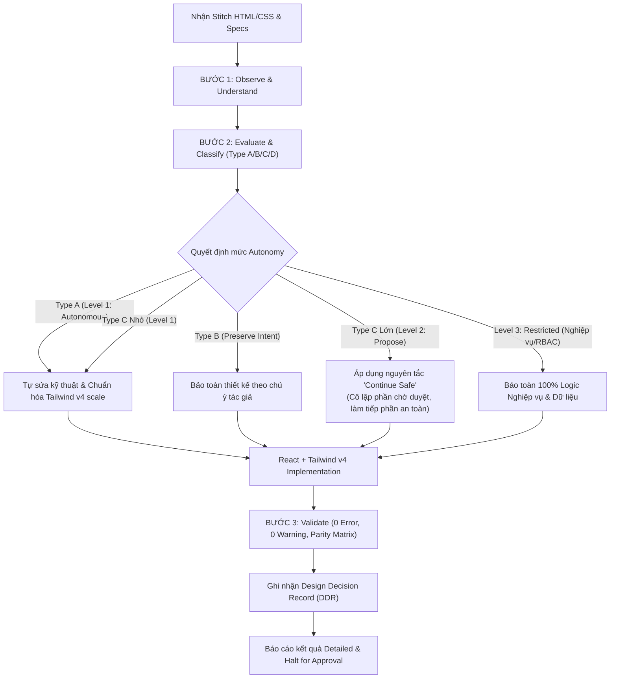

# Design Intelligence & Adaptive UI Engineering Skill

> **Version:** 1.0.0  
> **Status:** ACTIVE & MANDATORY  
> **Scope:** Entire SmartParkingHub Frontend (`smart-parking-app-v2`)  
> **Philosophy:** *Preserve Intent, Improve Execution*

---

## 1. Mục tiêu & Triết lý cốt lõi

### 1.1. Sứ mệnh
Chuyển hóa Agent từ một "công cụ sao chép HTML/CSS máy móc (*Pixel-pusher*)" thành một **Senior Frontend Engineer có tư duy thiết kế sâu sắc**.
Agent phải:
1. Hiểu và bảo toàn ý đồ thiết kế (**Design Intent**).
2. Phát hiện và xử lý lỗi triển khai (**Implementation Defects**) hoặc lỗi thiết kế (**Design Flaws**).
3. Thích nghi giao diện linh hoạt với môi trường thực tế (Responsive, Viewport, High-density displays).
4. Bảo toàn 100% tính toàn vẹn của nghiệp vụ, bảo mật, dữ liệu và phân quyền (**Business & RBAC Integrity**).
5. **Không bao giờ** tự ý biến đổi phong cách hoặc xóa chức năng theo sở thích cá nhân.

```
       ┌─────────────────────────────────────────────────────────┐
       │             Preserve Intent, Improve Execution          │
       ├────────────────────────────┬────────────────────────────┤
       │     NHỮNG GÌ BẢO TOÀN      │      NHỮNG GÌ CẢI THIỆN    │
       ├────────────────────────────┼────────────────────────────┤
       │ • Brand identity & Colors  │ • Lỗi flex/grid vỡ dòng    │
       │ • Typography scale         │ • Tràn container/viewport  │
       │ • Core Visual Hierarchy    │ • Spacing không đồng đều   │
       │ • Toàn bộ chức năng & RBAC │ • Thiếu Accessibility/A11y │
       │ • Navigation Structure     │ • Cú pháp Tailwind v4 scale│
       └────────────────────────────┴────────────────────────────┘
```

---

## 2. Bản đồ cấu trúc Skill (Skill Architecture)

Tài liệu được module hóa để Agent tra cứu tức thì khi thực thi từng bước:

- **Core Principles & Reasoning:**
  - [`core/design-intelligence-principles.md`](file:///d:/Documents/JAVA%20WEB%20SERVICE/SmartParkingHub/smart-parking-app-v2/.agents/skills/design-intelligence/core/design-intelligence-principles.md) — Triết lý nền tảng và 4 tầng trách nhiệm.
  - [`core/reasoning-pipeline.md`](file:///d:/Documents/JAVA%20WEB%20SERVICE/SmartParkingHub/smart-parking-app-v2/.agents/skills/design-intelligence/core/reasoning-pipeline.md) — Quy trình suy luận 7 bước (Observe $\rightarrow$ Validate).
  - [`core/design-classification.md`](file:///d:/Documents/JAVA%20WEB%20SERVICE/SmartParkingHub/smart-parking-app-v2/.agents/skills/design-intelligence/core/design-classification.md) — Ma trận phân loại 4 loại vấn đề: Type A, B, C, D.
  - [`core/autonomy-policy.md`](file:///d:/Documents/JAVA%20WEB%20SERVICE/SmartParkingHub/smart-parking-app-v2/.agents/skills/design-intelligence/core/autonomy-policy.md) — Giới hạn quyền tự chủ 3 cấp: Level 1 (Autonomous), Level 2 (Propose), Level 3 (Restricted).
  - [`core/decision-making.md`](file:///d:/Documents/JAVA%20WEB%20SERVICE/SmartParkingHub/smart-parking-app-v2/.agents/skills/design-intelligence/core/decision-making.md) — Cây ra quyết định và thứ tự ưu tiên khi có xung đột.

- **Design Quality Evaluation:**
  - [`evaluation/visual-quality.md`](file:///d:/Documents/JAVA%20WEB%20SERVICE/SmartParkingHub/smart-parking-app-v2/.agents/skills/design-intelligence/evaluation/visual-quality.md) — Tiêu chuẩn thị giác, màu sắc, bóng đổ và độ tương phản.
  - [`evaluation/layout-and-responsive.md`](file:///d:/Documents/JAVA%20WEB%20SERVICE/SmartParkingHub/smart-parking-app-v2/.agents/skills/design-intelligence/evaluation/layout-and-responsive.md) — Tiêu chuẩn bố cục, container, viewport breakpoints.
  - [`evaluation/usability-and-accessibility.md`](file:///d:/Documents/JAVA%20WEB%20SERVICE/SmartParkingHub/smart-parking-app-v2/.agents/skills/design-intelligence/evaluation/usability-and-accessibility.md) — Tiêu chuẩn A11y (ARIA, Keyboard, Focus, Touch target).
  - [`evaluation/information-hierarchy.md`](file:///d:/Documents/JAVA%20WEB%20SERVICE/SmartParkingHub/smart-parking-app-v2/.agents/skills/design-intelligence/evaluation/information-hierarchy.md) — Thứ bậc thị giác, mật độ thông tin, định vị CTA.
  - [`evaluation/consistency-audit.md`](file:///d:/Documents/JAVA%20WEB%20SERVICE/SmartParkingHub/smart-parking-app-v2/.agents/skills/design-intelligence/evaluation/consistency-audit.md) — Kiểm tra tính đồng bộ toàn hệ thống và shared components.

- **Component Patterns:**
  - [`patterns/header-and-navigation.md`](file:///d:/Documents/JAVA%20WEB%20SERVICE/SmartParkingHub/smart-parking-app-v2/.agents/skills/design-intelligence/patterns/header-and-navigation.md) — Xử lý menu nhiều mục, overflow, mobile drawer.
  - [`patterns/sidebar.md`](file:///d:/Documents/JAVA%20WEB%20SERVICE/SmartParkingHub/smart-parking-app-v2/.agents/skills/design-intelligence/patterns/sidebar.md) — Nhóm chức năng, accordion, collapsibility, internal scroll.
  - [`patterns/data-table.md`](file:///d:/Documents/JAVA%20WEB%20SERVICE/SmartParkingHub/smart-parking-app-v2/.agents/skills/design-intelligence/patterns/data-table.md) — Bảng nhiều cột, sticky columns, alignment, mobile view.
  - [`patterns/forms.md`](file:///d:/Documents/JAVA%20WEB%20SERVICE/SmartParkingHub/smart-parking-app-v2/.agents/skills/design-intelligence/patterns/forms.md) — Form nhiều trường, grouping, validation states, layout 1-col/2-col.
  - [`patterns/dashboard.md`](file:///d:/Documents/JAVA%20WEB%20SERVICE/SmartParkingHub/smart-parking-app-v2/.agents/skills/design-intelligence/patterns/dashboard.md) — Thẻ thống kê (KPIs), charts, visual hierarchy, bento grid.
  - [`patterns/modal-and-dialog.md`](file:///d:/Documents/JAVA%20WEB%20SERVICE/SmartParkingHub/smart-parking-app-v2/.agents/skills/design-intelligence/patterns/modal-and-dialog.md) — Dialog vượt chiều cao, scroll lock, a11y focus trap.
  - [`patterns/filters-and-search.md`](file:///d:/Documents/JAVA%20WEB%20SERVICE/SmartParkingHub/smart-parking-app-v2/.agents/skills/design-intelligence/patterns/filters-and-search.md) — Filter bar, chips, quick search, multi-select.

- **Execution Workflows:**
  - [`workflow/stitch-analysis.md`](file:///d:/Documents/JAVA%20WEB%20SERVICE/SmartParkingHub/smart-parking-app-v2/.agents/skills/design-intelligence/workflow/stitch-analysis.md) — Phân tích đầu vào Stitch trước khi viết code.
  - [`workflow/adaptive-implementation.md`](file:///d:/Documents/JAVA%20WEB%20SERVICE/SmartParkingHub/smart-parking-app-v2/.agents/skills/design-intelligence/workflow/adaptive-implementation.md) — Chuyển đổi mã có thích nghi và tuân thủ Tailwind v4 scale.
  - [`workflow/visual-validation.md`](file:///d:/Documents/JAVA%20WEB%20SERVICE/SmartParkingHub/smart-parking-app-v2/.agents/skills/design-intelligence/workflow/visual-validation.md) — Đối chiếu đa chiều và kiểm thử hiển thị.
  - [`workflow/design-review.md`](file:///d:/Documents/JAVA%20WEB%20SERVICE/SmartParkingHub/smart-parking-app-v2/.agents/skills/design-intelligence/workflow/design-review.md) — Báo cáo nghiệm thu theo format Detailed & Continue Safe.

- **Standard Templates:**
  - [`templates/design-analysis-template.md`](file:///d:/Documents/JAVA%20WEB%20SERVICE/SmartParkingHub/smart-parking-app-v2/.agents/skills/design-intelligence/templates/design-analysis-template.md)
  - [`templates/design-decision-record.md`](file:///d:/Documents/JAVA%20WEB%20SERVICE/SmartParkingHub/smart-parking-app-v2/.agents/skills/design-intelligence/templates/design-decision-record.md)
  - [`templates/design-issue-report.md`](file:///d:/Documents/JAVA%20WEB%20SERVICE/SmartParkingHub/smart-parking-app-v2/.agents/skills/design-intelligence/templates/design-issue-report.md)
  - [`templates/screen-quality-report.md`](file:///d:/Documents/JAVA%20WEB%20SERVICE/SmartParkingHub/smart-parking-app-v2/.agents/skills/design-intelligence/templates/screen-quality-report.md)

---

## 3. Quy trình thực thi cốt lõi (Core Execution Flow)

Khi nhận màn hình Stitch hoặc triển khai UI, Agent bắt buộc tuân theo luồng:



---

## 4. Bốn nguyên tắc bắt buộc khi kích hoạt Skill

1. **Detailed Reporting:** Mọi vấn đề phát hiện đều phải được báo cáo theo cấu trúc:  
   `[Issue ID] -> Quan sát -> Phân loại (Type A/B/C/D) -> Bằng chứng -> Đề xuất -> Trade-off -> Quyết định`.
2. **Continue Safe:** Nếu gặp lỗi thiết kế lớn cần người dùng phê duyệt, không dừng toàn bộ màn hình; hãy hoàn thiện toàn bộ khung trang và các thành phần an toàn, đặt thành phần nghi vấn vào cờ `[PENDING_APPROVAL]` và báo cáo rõ.
3. **Tailwind v4 Canonical Enforcement:** Tuyệt đối không dùng arbitrary `[...]` khi đã có utility scale tương đương (ví dụ: `max-w-310`, `w-145`, `bg-linear-to-*`, `bg-radial-*`).
4. **Git Branch Isolation:** Toàn bộ công việc tài liệu, skill và governance phải được thực hiện trên nhánh `docs/*`, không làm bẩn nhánh tính năng `feat/*`.
