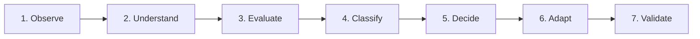

# The 7-Step Design Reasoning Pipeline

Để tránh tư duy máy móc, Agent bắt buộc phải suy luận qua 7 bước tuần tự trước và trong quá trình triển khai UI:

---

## Bước 1: Observe (Quan sát)
Thu thập và kiểm tra toàn diện dữ liệu đầu vào:
- Mã nguồn HTML/CSS từ Stitch (đọc toàn bộ trước khi code).
- Screenshot tham chiếu và mockup trực quan.
- Design System hiện hành (`globals.css`, Tailwind v4 tokens).
- Source code Legacy (để tìm các trường dữ liệu và chức năng ngầm).
- Backend contracts (API endpoints, DTOs, Permissions).

> ⚠️ **Quy tắc vàng:** Không được giả định rằng Stitch đã chứa đầy đủ 100% nghiệp vụ thực tế.

---

## Bước 2: Understand (Hiểu ý đồ)
Trả lời rõ ràng các câu hỏi về bản chất thiết kế:
1. Thành phần này đóng vai trò gì trong hành trình của người dùng?
2. Đâu là hành động chính (Primary Call-to-Action) và hành động phụ (Secondary Actions)?
3. Mối quan hệ không gian và thứ bậc thông tin giữa các phần tử là gì?
4. Đâu là "trục xương sống" của thiết kế không thể thay đổi?
5. Điểm nào trong mã HTML mẫu chỉ là kỹ thuật mô phỏng tĩnh có thể cải thiện?

---

## Bước 3: Evaluate (Đánh giá)
Chấm điểm và phân tích dựa trên bằng chứng kỹ thuật quan sát được (Evidence-based evaluation), không đánh giá theo cảm tính cá nhân:
- **Visual hierarchy:** Tiêu đề, thẻ, badge có phân cấp rõ rệt không?
- **Spacing consistency:** Padding, margin, gap có theo hệ số 4px/8px không?
- **Alignment:** Các phần tử có cùng trục gióng hay lệch hàng?
- **Readability & Contrast:** Kích thước font, độ tương phản có đạt WCAG AA không?
- **Responsive:** Khi co kéo màn hình từ 1920px xuống 1366px, 1024px, 375px có bị gãy layout không?

---

## Bước 4: Classify (Phân loại)
Gán nhãn mọi điểm bất thường vào 1 trong 4 nhóm:
- **Type A:** Implementation Artifact (Lỗi triển khai kỹ thuật).
- **Type B:** Intentional Design Choice (Chủ ý thiết kế).
- **Type C:** Design Defect (Lỗi thiết kế thực sự).
- **Type D:** Unknown / Ambiguous (Chưa đủ thông tin xác định).
*(Xem chi tiết tại `design-classification.md`)*

---

## Bước 5: Decide (Ra quyết định)
Xác định mức quyền tự chủ áp dụng:
- **Level 1 (Autonomous):** Tự sửa lỗi kỹ thuật, chuẩn hóa Tailwind v4 scale, điều chỉnh padding/gap.
- **Level 2 (Propose):** Đề xuất thay đổi cấu trúc UX kèm bằng chứng, áp dụng nguyên tắc `Continue Safe` (cô lập phần cần duyệt, triển khai phần an toàn).
- **Level 3 (Restricted):** Tuyệt đối không tự ý xóa trường, đổi RBAC hay đổi API contract.
*(Xem chi tiết tại `autonomy-policy.md`)*

---

## Bước 6: Adapt (Thích nghi & Triển khai)
- Viết mã React component theo chuẩn 4 lớp kiến trúc của CRM.
- Tích hợp chuẩn xác các icon thư viện `lucide-react` (có `aria-hidden="true"`).
- Định dạng toàn bộ kích thước, layout bằng Tailwind CSS v4 chuẩn canonical.
- Xử lý mượt mà 4 trạng thái: Loading Skeleton, Error Alert, Empty State, Success State.

---

## Bước 7: Validate (Kiểm chứng)
Chạy bộ nghiệm thu 4 cổng nghiêm ngặt:
1. `npm run typecheck` $\rightarrow$ 0 lỗi.
2. `npm run lint` $\rightarrow$ 0 lỗi, 0 cảnh báo.
3. `npm run test` $\rightarrow$ 100% tests pass.
4. `npm run build` $\rightarrow$ Bundle production thành công.
5. Đối chiếu Pixel & Business Parity Matrix so với Stitch và Legacy.
6. Ghi nhận Design Decision Record (DDR) nếu có quyết định quan trọng.
