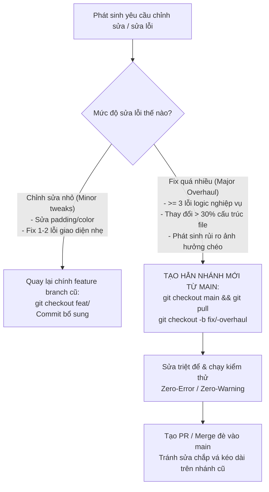

# Skill: Git Branching Strategy, Docs Isolation & Major Fix Threshold Protocol

## Purpose
Enforce a disciplined, clean, and maintainable Git branching workflow for the Smart Parking CRM Frontend. Ensure branch names are concise and meaningful, strictly isolate documentation/tooling from feature branches, and define clear thresholds for when to branch out for major bugfixes.

---

## 1. Naming Convention Standards

### Formula:
`<type>/<screen-or-module-slug>`

- **Format:** Lowercase `kebab-case`, maximum 30–40 characters.
- **Allowed Prefix Types:**
  | Prefix | Usage | Example |
  |---|---|---|
  | `feat/` | Triển khai màn hình hoặc tính năng mới | `feat/parking-lots-list`, `feat/booking-detail` |
  | `fix/` | Vá lỗi lớn hoặc overhaul tính năng | `fix/booking-timer-sync`, `fix/login-overhaul` |
  | `docs/` | Cập nhật tài liệu, README, hiến pháp, audit docs | `docs/governance-update`, `docs/api-guide` |
  | `chore/` | Cấu hình tooling, linter, dependencies, build | `chore/eslint-setup`, `chore/update-deps` |
  | `refactor/` | Tái cấu trúc code mà không đổi giao diện | `refactor/table-pagination`, `refactor/filter-bar` |

---

## 2. Rule: Isolate Docs & Tooling from Feature Branches (Tách Biệt Nhánh Docs & Tooling)

> [!CRITICAL]
> **Tuyệt đối KHÔNG push các thay đổi tài liệu (Docs) hoặc cấu hình không liên quan vào feature branch đang làm.**
> - Khi sửa tài liệu (`docs/`, `README.md`, `AGENTS.md`, rules, skills) hoặc cấu hình dự án (`eslint`, build tools): BẮT BUỘC tạo nhánh riêng (`docs/<topic>` hoặc `chore/<topic>`) hoặc push vào `main`.
> - Feature branch (`feat/*`) chỉ được chứa thuần túy mã nguồn (`src/features/...`, router, tests liên quan) của đúng tính năng đó.

---

## 3. Rule: Major Fix & Overhaul Threshold (Ngưỡng Tạo Nhánh Mới Khi Fix Quá Nhiều)

### Tại sao phải tạo nhánh mới khi fix quá nhiều?
1. **Tránh làm rác lịch sử commit:** Sửa đi sửa lại trên feature branch cũ tạo ra chuỗi commit chắp vá (patch-on-patch).
2. **Tránh nhảy qua nhảy lại nhiều nhánh:** Khi fix quá nhiều, tạo nhánh mới từ `main` giúp lập trình viên có một working tree sạch sẽ, tập trung giải quyết dứt điểm.
3. **An toàn khi rollback:** Nếu bản fix không đạt hoặc gây thêm lỗi, có thể hủy nhánh fix dễ dàng mà không ảnh hưởng đến bản code ban đầu đã merge.

---

## 4. Conventional Commits Standard

Mọi commit phải tuân thủ chuẩn:
`<type>(<scope>): <short imperative description>`

- `feat(parking-lots): implement slot grid and status badges`
- `fix(booking): resolve date picker timezone offset`
- `docs(readme): rewrite comprehensive project overview`
- `chore(linter): configure ESLint 9 flat config and react-hooks plugin`
- `refactor(shared-ui): extract data table pagination component`
