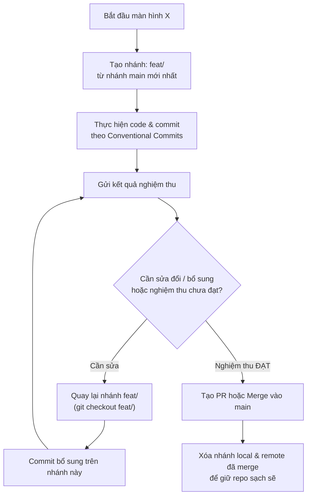

# Skill: Git Branching Strategy & Screen Branch Reuse Protocol

## Purpose
Enforce a disciplined, clean, and maintainable Git branching workflow for the Smart Parking CRM Frontend. Ensure branch names are concise and meaningful, and strictly enforce the reuse of feature branches when refining or fixing screens.

---

## 1. Naming Convention Standards

### Formula:
`<type>/<screen-or-module-slug>`

- **Format:** Lowercase `kebab-case`, maximum 30–40 characters.
- **Requirements:** Must clearly describe the specific screen or module being developed.

### Allowed Prefix Types:
| Prefix | Usage | Example |
|---|---|---|
| `feat/` | Triển khai màn hình hoặc tính năng mới | `feat/parking-lots-list`, `feat/booking-detail` |
| `fix/` | Vá lỗi trên màn hình hoặc tính năng đã có | `fix/booking-timer-sync`, `fix/login-token-refresh` |
| `refactor/` | Tái cấu trúc component, styles mà không đổi logic | `refactor/table-pagination`, `refactor/filter-bar` |
| `chore/` | Cấu hình tooling, CI/CD, dependencies, governance | `chore/setup-playwright`, `chore/update-deps` |

### ⛔ Strict Prohibitions:
- **NO vague or random names:** `test`, `dev`, `new`, `temp`, `my-branch`, `fix-1`.
- **NO excessively long names:** `feat/implement-screen-parking-lots-table-with-filter-and-pagination-v2`.
- **NO personal names or timestamps:** `john/screen1`, `feat/screen-2026-11-03`.

---

## 2. Inviolable Rule: Single Feature Branch Lifecycle (Quy Tắc Tái Sử Dụng Nhánh)

> [!CRITICAL]
> **Khi một màn hình cần chỉnh sửa, bổ sung form, vá lỗi hiển thị hoặc tinh chỉnh theo kết quả nghiệm thu:**
> Agent & Kỹ sư **BẮT BUỘC quay lại đúng nhánh của màn hình đó** (`git checkout <branch-name>`) để tiếp tục commit bổ sung.
> **TUYỆT ĐỐI KHÔNG TẠO THÊM NHÁNH MỚI** (như `<branch>-fix`, `<branch>-part2`, `<branch>-update`) gây rác kho lưu trữ và khó khăn khi triển khai.

### Quy Trình Thao Tác Chuẩn:


---

## 3. Đồng Bộ Tránh Xung Đột (Sync with Main Protocol)

1. **Trước khi tạo nhánh mới:** Luôn fetch và kéo code mới nhất từ `main`:
   ```bash
   git checkout main
   git pull origin main
   git checkout -b feat/<screen-slug>
   ```
2. **Trước khi push nhánh lên remote:** Rebase hoặc merge `main` để đảm bảo không bị conflict với các màn hình trước:
   ```bash
   git fetch origin
   git rebase origin/main
   git push -u origin feat/<screen-slug>
   ```

---

## 4. Conventional Commits Standard

Mọi commit phải tuân thủ chuẩn:
`<type>(<scope>): <short imperative description>`

- `feat(parking-lots): implement slot grid and status badges`
- `fix(booking): resolve date picker timezone offset`
- `refactor(shared-ui): extract data table pagination component`
- `test(auth): add unit test for login form validation`
- `docs(audit): update parity matrix for billing screen`
