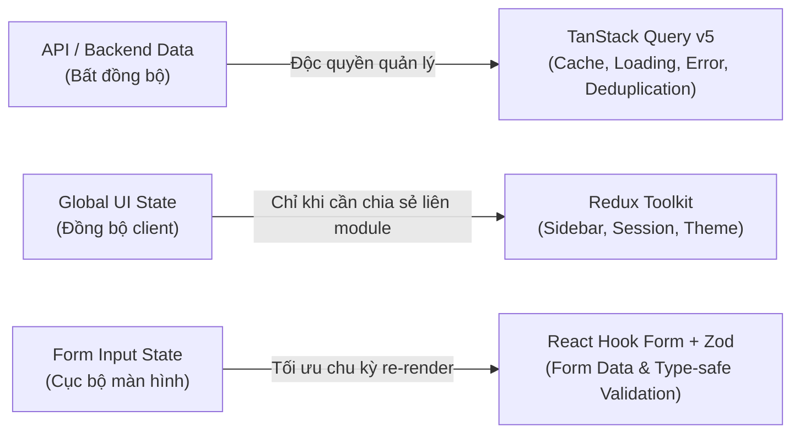

# Smart Parking Hub — Modern CRM Frontend v2

> **Phiên bản:** `v0.1.0`  
> **Tech Stack:** React 19 • TypeScript (Strict) • Vite • Tailwind CSS v4 • TanStack Query v5 • Redux Toolkit  
> **Trạng thái:** **Parallel Migration** (Phát triển song song & độc lập với `smart-parking-app` cho đến khi nghiệm thu từng phân hệ)  
> **Repository GitHub:** [smart-parking-hub/smart-parking-app-v2](https://github.com/smart-parking-hub/smart-parking-app-v2)

---

## 📖 1. Giới Thiệu Tổng Quan (Overview)

`smart-parking-app-v2` là dự án giao diện người dùng thế hệ mới dành cho nền tảng **Smart Parking Hub** (và hệ sinh thái bãi xe tải thông minh **SmartTruckHub**), phục vụ các đối tượng:
1. **Khách hàng / Tài xế xe tải:** Tra cứu bãi đỗ, đặt chỗ trước, check-in tự động qua mã QR / Camera ALPR, thanh toán không dùng tiền mặt.
2. **Chủ bãi xe (Merchants):** Giám sát sơ đồ slot thời gian thực, điều phối xe vào/ra, cấu hình bảng giá linh hoạt, đối soát tài chính tự động PayOS.
3. **Quản trị viên (Admin):** Quản lý đối tác bãi xe, duyệt hồ sơ, kiểm toán giao dịch, giám sát SLA và phân quyền hệ thống.

Dự án được xây dựng với hệ thống quản trị kỹ thuật nghiêm ngặt (**Agent Governance Foundation**), đảm bảo mỗi màn hình khi chuyển đổi từ mockup thiết kế (Stitch) đều bảo toàn 100% nghiệp vụ hiện hữu và đạt chuẩn kiểm thử trước khi bàn giao.

---

## ⚡ 2. Công Nghệ & Kiến Trúc Dữ Liệu (ADR-0001)

Dự án tuân thủ quyết định kiến trúc tại [`docs/01-architecture/adr/0001-technology-stack-and-state-management.md`](docs/01-architecture/adr/0001-technology-stack-and-state-management.md) và danh mục tại [`docs/01-architecture/technology-catalog.md`](docs/01-architecture/technology-catalog.md).

### 2.1. Core Application Stack
| Công nghệ | Phiên bản | Vai trò kiến trúc |
|---|---|---|
| **React** | `^19.0.0` | Thư viện UI cốt lõi, tối ưu hoá với React Server Components và Compiler |
| **TypeScript** | `^5.7.0` | Ngôn ngữ tĩnh kiểu nghiêm ngặt (Strict mode), 0% `any` |
| **Vite** | `^6.2.0` | Build tool và Dev server siêu tốc |
| **Tailwind CSS** | `^4.0.0` | Styling hiện đại với `@tailwindcss/vite`, khai báo biến qua `@theme` |
| **React Router** | `^7.3.0` | Điều hướng trang tập trung, layout lồng nhau và route guards |
| **TanStack Query** | `^5.67.0` | Quản lý độc quyền Server State, cache tự động, background refetch |
| **Redux Toolkit** | `^2.6.0` | Quản lý Global Client/UI State (chỉ cho trạng thái chia sẻ liên module) |
| **Axios** | `^1.8.0` | HTTP Client chuẩn hóa với Interceptors xử lý JWT token và error handling |
| **React Hook Form + Zod** | `^7.54.0` / `^3.24.0` | Quản lý form nghiệp vụ, tối ưu render và validation type-safe |
| **Lucide React** | `^1.16.0` | Hệ thống icon SVG nhẹ và đồng bộ |
| **Vitest + RTL** | `^3.0.0` / `^16.2.0` | Khung kiểm thử tự động (Unit & Component testing) |

### 2.2. Phân Định Ranh Giới 3 Loại Dữ Liệu (Inviolable Law)

> [!CAUTION]
> **Anti-Pattern cấm tiệt:** Tuyệt đối không sao chép dữ liệu từ API responses vào Redux Toolkit để tránh "Cache Invalidation Hell" và bất đồng bộ trạng thái.

### 2.3. Nguyên Tắc "Quality-First" Cho Dependency Mới
Không cài đặt sẵn hàng loạt thư viện (Chart, Virtual scroll, Calendar, Rich-text). Trước khi thêm bất kỳ package nào vào dự án, phải trả lời **5 Câu Hỏi Vàng** tại `docs/01-architecture/technology-catalog.md`. Nếu không chứng minh được tính tối ưu và cần thiết -> **TUYỆT ĐỐI KHÔNG THÊM**.

---

## 📂 3. Cấu Trúc Thư Mục (4-Layer Feature-Driven Architecture)

Dự án được tổ chức theo cấu trúc 4 phân tầng độc lập và hướng module (Feature-driven):

```text
smart-parking-app-v2/
├── .agents/                          # [TẦNG 1: GOVERNANCE LAYER]
│   ├── rules/                        # 15 bộ quy tắc kỹ thuật bất biến (Rule 13, Rule 15...)
│   ├── skills/                       # 11 kỹ năng chuyên môn của AI Agent (Stitch, Git, QA...)
│   ├── workflows/                    # 8 quy trình phát triển chuẩn (Stitch-to-React, Audit...)
│   └── templates/                    # Mẫu Task Brief, Task Report, ADR
│
├── docs/                             # [TẦNG 2: KNOWLEDGE LAYER]
│   ├── 00-governance/                # Định nghĩa Hoàn thành (DoD), Quy ước làm việc
│   ├── 01-architecture/              # Kiến trúc mục tiêu, ADR-0001, Technology Catalog
│   ├── 02-product-and-business/      # Khám phá nghiệp vụ CRM
│   ├── 03-design-system/             # Hiến chương Design System & Token
│   ├── 04-api-contracts/             # Quản trị API và DTOs
│   ├── 05-modules/                   # Tài liệu từng phân hệ nghiệp vụ
│   ├── 06-quality/                   # Chiến lược kiểm thử & Quality gates
│   ├── 07-migration/                 # Kế hoạch di trú song song
│   ├── 08-project-operations/        # Vận hành dự án & PR
│   ├── 09-audit/                     # Hồ sơ nghiệm thu: Screen Inventory, Parity Matrix
│   └── 10-traceability/              # Ma trận truy xuất nguồn gốc
│
├── src/                              # [TẦNG 3: APPLICATION LAYER]
│   ├── app/                          # Khởi tạo ứng dụng, Providers, Router, Global Store
│   │   ├── pages/                    # Các trang cấp hệ thống (Baseline overview...)
│   │   ├── providers/                # QueryProvider, AppProviders
│   │   ├── router/                   # React Router centralized configuration
│   │   └── store/                    # Redux Toolkit store & uiSlice
│   │
│   ├── layouts/                      # Vỏ layout cấu trúc (RootLayout, Sidebar CRM...)
│   │
│   ├── features/                     # Các module nghiệp vụ (Triển khai theo Rule 15)
│   │   └── landing/                  # [SCR-001] Public Landing Page SmartTruckHub
│   │       ├── components/           # 10 component giao diện độc lập
│   │       ├── pages/                # LandingPage.tsx
│   │       └── index.ts              # Public export boundary
│   │
│   ├── entities/                     # Các thực thể dữ liệu dùng chung (User, ParkingLot...)
│   │
│   ├── shared/                       # Thành phần dùng chung không phụ thuộc nghiệp vụ
│   │   ├── api/                      # Axios client tập trung (`client.ts`) + JWT Interceptors
│   │   ├── components/               # Headless primitives (shadcn/ui, Radix)
│   │   ├── hooks/                    # Custom hooks tiện ích
│   │   └── utils/                    # Tiện ích bổ trợ (`cn.ts` = clsx + tailwind-merge)
│   │
│   ├── styles/                       # Global CSS & Tailwind v4 `@theme` (`globals.css`)
│   ├── test/                         # Vitest setup & testing utilities
│   ├── vite-env.d.ts                 # Type definition cho environment variables
│   └── main.tsx                      # Bootstrap React DOM entry
│
├── index.html                        # HTML entry point, liên kết Google Fonts (Sora, Inter)
├── vite.config.ts                    # Cấu hình Vite & alias `@/*`
├── vitest.config.ts                  # Cấu hình Vitest & JSDOM
├── tsconfig.json                     # Cấu hình TypeScript solution
└── package.json                      # Quản lý dependencies & scripts
```

---

## 🚀 4. Hướng Dẫn Cài Đặt & Phát Triển (Getting Started)

### 4.1. Yêu cầu môi trường
* **Node.js:** `>= 20.x` (Đã kiểm thử tối ưu trên `v22.18.0`)
* **npm:** `>= 10.x`

### 4.2. Cài đặt mã nguồn
```bash
# Di chuyển vào thư mục dự án
cd smart-parking-app-v2

# Cài đặt toàn bộ dependencies
npm install

# Tạo file cấu hình môi trường từ mẫu
cp .env.example .env
```

### 4.3. Các lệnh thực thi chính (NPM Scripts)

| Lệnh | Mục đích |
|---|---|
| `npm run dev` | Khởi chạy máy chủ phát triển cục bộ tại `http://localhost:3000` |
| `npm run typecheck` | Kiểm tra toàn diện kiểu TypeScript (`tsc --noEmit`) |
| `npm run test` | Chạy bộ kiểm thử tự động với Vitest (`vitest run`) |
| `npm run test:watch` | Chạy kiểm thử chế độ tự động re-test khi sửa code |
| `npm run build` | Biên dịch mã nguồn sản xuất (`tsc -b && vite build`) vào thư mục `dist/` |
| `npm run preview` | Chạy máy chủ xem trước kết quả bản build `dist/` |

---

## 🎨 5. Quy Chuẩn Nhận & Triển Khai Giao Diện Stitch (Rule 15)

Mọi yêu cầu chuyển đổi giao diện từ Stitch sang React bắt buộc phải tuân theo quy chuẩn **`# TASK: IMPLEMENT ONE STITCH SCREEN INTO EXISTING CRM`** được quy định tại [`.agents/rules/15-stitch-screen-by-screen.md`](.agents/rules/15-stitch-screen-by-screen.md).

### 13 Quy Tắc Thực Thi Nghiêm Ngặt:
1. **Chỉ làm đúng 1 màn hình** trong mỗi task.
2. **Đọc toàn bộ HTML/CSS** trước khi viết code.
3. Stitch là **thẩm quyền trực quan cao nhất**.
4. **Không tự ý đổi** màu sắc, font chữ, khoảng cách, layout.
5. **Không tự ý thêm/xóa** logic nghiệp vụ so với hệ thống cũ.
6. **Khảo sát màn hình cũ** để đạt 100% tính năng kế thừa.
7. **Xác minh API, DTO, quyền hạn** với backend `smart-parking-microservice`.
8. Chuyển đổi thành **React 19 + TypeScript** sạch, chuẩn phân lớp.
9. **Không dùng HTML thô** hoặc `dangerouslySetInnerHTML`.
10. **Không gây ảnh hưởng (side-effect)** sang các màn hình khác.
11. **DỪNG LẠI (HALT)** và chờ nghiệm thu trước khi qua màn hình tiếp theo.
12. **Cổng kiểm tra Zero-Error & Zero-Warning:** Quét sạch toàn bộ lỗi đỏ (typecheck, build, test, runtime console) và cảnh báo vàng (linter, unused variables, hook warnings) đạt 0 Errors / 0 Warnings mới được tính là hoàn thành.
13. **Đánh giá tính tái sử dụng và vị trí lưu trữ:** Đánh giá từng component có dùng nhiều chỗ không, phân loại rõ ràng vị trí đặt (`shared/components/` vs `entities/` vs `features/<feature>/components/`).

### Thứ tự 8 giai đoạn:
* **Phase 1:** Analyze Stitch source.
* **Phase 2:** Inspect existing frontend & backend contracts.
* **Phase 3:** Create capability parity matrix.
* **Phase 4:** Report implementation plan.
* **Phase 5:** Implement the screen.
* **Phase 6:** Integrate API, permissions & all UI states (Loading, Empty, Error, Success).
* **Phase 7:** Run tests, typecheck, build and visual checks.
* **Phase 8:** Update documentation, report results, and **HALT**.

---

## 🌿 6. Chiến Lược Nhánh Git, Tách Nhánh Docs & Ngưỡng Fix Lớn (Rule 13)

Tuân thủ hướng dẫn tại [`.agents/skills/git-branch-workflow/SKILL.md`](.agents/skills/git-branch-workflow/SKILL.md) và [`.agents/rules/13-git-and-collaboration.md`](.agents/rules/13-git-and-collaboration.md).

### 6.1. Quy tắc đặt tên nhánh:
`<type>/<screen-or-module-slug>`
* Độ dài: Tối đa 30–40 ký tự, `kebab-case`.
* Hợp lệ: `feat/landing-page`, `feat/parking-lots-list`, `fix/booking-timer-sync`, `docs/governance-update`, `chore/eslint-setup`.
* Cấm: Các tên vô nghĩa (`test`, `new`, `dev`) hoặc quá dài dòng.

### 6.2. Tách biệt Docs & Tooling khỏi Feature Branch:
* **Tuyệt đối KHÔNG** push tài liệu (`docs/`, `README.md`, `AGENTS.md`) hoặc cấu hình dự án (`eslint`, tooling) vào feature branch đang làm code giao diện.
* Mọi cập nhật docs hoặc tooling phải tạo nhánh riêng (`docs/<topic>`, `chore/<topic>`) hoặc push vào `main`.

### 6.3. Quy tắc Vòng đời nhánh & Ngưỡng "Fix Quá Nhiều":
* **Chỉnh sửa nhỏ (Minor tweaks):** Tiếp tục checkout nhánh feature (`git checkout feat/<screen>`) để commit bổ sung theo feedback nghiệm thu.
* **Fix quá nhiều (Major Overhaul):** Khi phát sinh từ **3 lỗi logic trở lên** hoặc thay đổi **> 30% cấu trúc file**, **BẮT BUỘC TẠO HẲN NHÁNH MỚI TỪ MAIN** (ví dụ `fix/<screen>-overhaul`) để giải quyết dứt điểm, tránh sửa chắp vá kéo dài trên feature branch cũ.

### 6.4. Chuẩn commit: Conventional Commits
`<type>(<scope>): <mô tả ngắn bằng tiếng Anh hoặc tiếng Việt chuẩn mực>`

---

## 📊 7. Trạng Thái Triển Khai Màn Hình (Screen Inventory)

Chi tiết hồ sơ đối chiếu và tiến độ được lưu tại thư mục [`docs/09-audit/`](docs/09-audit/).

| Mã | Tên Màn Hình | Route | Module | Nhánh Git | Trạng Thái |
|:---:|---|---|---|---|:---:|
| **SCR-001** | Public Landing Page (SmartTruckHub) | `/` | `features/landing` | `feat/landing-page` | ✅ **Sẵn sàng nghiệm thu** |
| **SCR-002** | Baseline Architecture Overview | `/crm` | `app/pages` | `main` | ✅ **Đã hoàn thành** |

* Bảng ma trận đối chiếu 100% tính năng cũ: xem [`docs/09-audit/parity-matrix.md`](docs/09-audit/parity-matrix.md).
* Bảng danh mục màn hình hệ thống: xem [`docs/09-audit/screen-inventory.md`](docs/09-audit/screen-inventory.md).

---

## 🛡️ 8. Hệ Thống Hiến Pháp Điều Hành Agent (Agent Governance)

Mọi lập trình viên AI (Antigravity Agent) và kỹ sư làm việc trên repository này đều chịu sự ràng buộc tối cao của:
1. **Hiến pháp Master toàn workspace:** [`AGENTS.md`](../AGENTS.md)
2. **Hiến pháp Frontend CRM:** [`smart-parking-app-v2/AGENTS.md`](AGENTS.md)
3. **Quy định nhận màn hình Stitch:** [`Rule 15`](.agents/rules/15-stitch-screen-by-screen.md)
4. **Quy định quản lý nhánh Git:** [`Rule 13`](.agents/rules/13-git-and-collaboration.md)

*Bản quyền © 2026 Smart Parking Hub Team. Giữ toàn quyền phát triển.*
