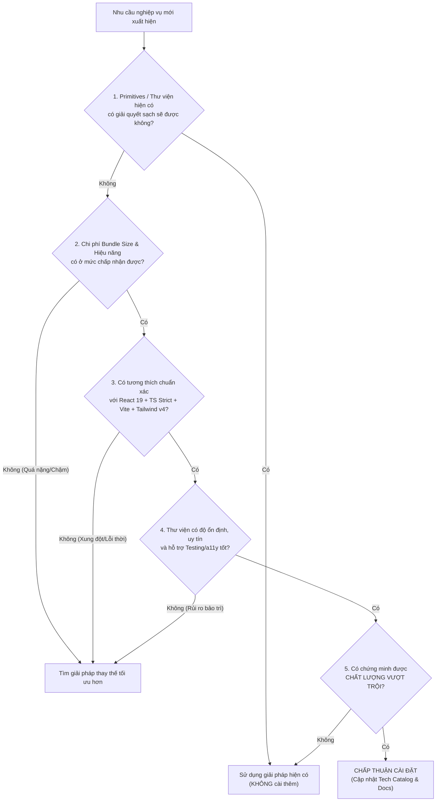

# Kho Lưu Trữ Công Nghệ & Tiêu Chuẩn Đánh Giá (Technology Catalog & Architecture Baseline)

> Status: APPROVED ARCHITECTURE BASELINE  
> Scope: `smart-parking-app-v2` (Modern CRM Frontend)  
> Nguyên tắc chỉ đạo: **Chất lượng là trên hết — Chỉ bổ sung khi nghiệp vụ thực sự cần — Đánh giá tính tối ưu trước khi cài đặt.**

---

## 1. Stack Khuyên Dùng Cho CRM Phân Hệ Lớn (Core Technology Baseline)

Dành cho hệ thống CRM có nhiều module, nhiều màn hình, bảng dữ liệu lớn, form nghiệp vụ phức tạp và phân quyền đa cấp độ.

### 1.1. Core Application Stack
| Công nghệ | Vai trò kiến trúc | Tiêu chí đánh giá & Áp dụng |
|---|---|---|
| **React Router** (v7/v6.x) | Routing, nested layouts, loader data | Quản lý định tuyến tập trung, layout lồng nhau cho CRM shell, phân quyền route guards |
| **TanStack Query** (v5) | API, server state, caching, deduplication | Quản lý 100% dữ liệu từ Backend, tự động cache, background refetch, đồng bộ loading/error state |
| **Redux Toolkit** | Global client / UI state | Chỉ quản lý trạng thái giao diện toàn cục cần chia sẻ liên module (sidebar collapsed, theme, active workspace) |
| **Axios** | Centralized HTTP client | HTTP client chuẩn hóa với Interceptors xử lý JWT token refresh, mã hóa header `X-Internal-Secret`, chuẩn hóa Error Response |
| **React Hook Form** | Form state management | Quản lý form hiệu năng cao, tối ưu render chu kỳ nhập liệu cho các biểu mẫu CRM phức tạp |
| **Zod** | Schema validation | Type-safe schema validation, chia sẻ kiểu TypeScript giữa form, DTO backend và filter parameters |
| **shadcn/ui + Radix UI** | Headless UI primitives | Bộ thành phần giao diện gốc (Dialog, Dropdown, Tooltip, Popover) chuẩn a11y, kiểm soát 100% mã nguồn và Tailwind styling |
| **Lucide React** | Icon system | Bộ icon SVG nhẹ, đồng nhất, chuẩn hóa kích thước và stroke width |
| **TanStack Table** (v8) | Headless data tables | Bảng dữ liệu nghiệp vụ: phân trang server-side, sắp xếp đa cột, lọc nâng cao, ghim cột, ẩn/hiện cột |
| **date-fns** | Date / Time manipulation | Xử lý ngày giờ, định dạng múi giờ Việt Nam (`Asia/Ho_Chi_Minh`), tính khoảng cách thời gian cho log/lịch sử đỗ xe |
| **i18next** (react-i18next) | Đa ngôn ngữ (i18n) | Chuẩn bị sẵn kiến trúc đa ngôn ngữ (Tiếng Việt mặc định, Tiếng Anh) khi mở rộng phân hệ |

---

### 1.2. Quality & Testing Stack
| Công nghệ | Vai trò đảm bảo chất lượng | Phạm vi áp dụng |
|---|---|---|
| **Vitest** | Unit test runner | Kiểm thử hàm tiện ích thuần (pure functions), formatters, tính toán tiền tệ, mappers, custom hooks |
| **React Testing Library** | Component integration test | Kiểm thử hành vi hiển thị của người dùng (User-centric testing), form submit, modal toggle, loading/error state |
| **Playwright** | E2E testing | Kiểm thử luồng nghiệp vụ đầu cuối quan trọng (Đăng nhập -> Xem danh sách -> Tạo bãi đỗ/đặt chỗ -> Thanh toán) |
| **MSW (Mock Service Worker)** | API network mocking | Chặn và giả lập request API ở tầng network service worker cho integration tests không phụ thuộc backend thật |
| **ESLint** | Static code analysis | Bắt lỗi cú pháp, thực thi quy chuẩn import 4 lớp, ngăn chặn memory leaks và anti-patterns |
| **Prettier** | Code formatting | Đồng nhất định dạng mã nguồn trong toàn bộ đội ngũ và Agent |
| **Storybook** | Component catalog / documentation | Lưu trữ và kiểm thử trực quan các thành phần Design System, cô lập UI components độc lập với backend |
| **Sentry** | Frontend error monitoring | Giám sát lỗi runtime của người dùng cuối trên môi trường production/staging (chỉ kích hoạt sau khi kiểm toán privacy) |

---

## 2. Kiến Trúc Phân Định 3 Loại Dữ Liệu (State Separation Architecture)

> [!CRITICAL]
> **Anti-Pattern cấm tiệt:** Tuyệt đối **KHÔNG** đưa toàn bộ API response vào Redux Toolkit.  
> Việc đưa API data vào Redux là sai lầm kinh điển dẫn đến "Cache Invalidation Hell", duplicate loading/error flags, mã nguồn boilerplate cồng kềnh và dữ liệu bị out-of-sync.

### 2.1. Ma trận phân định nguồn dữ liệu:
| Loại dữ liệu | Bản chất | Công nghệ đảm nhiệm | Ví dụ thực tế trong Smart Parking CRM |
|---|---|---|---|
| **Dữ liệu lấy từ Backend (Server State)** | Bất đồng bộ, thuộc quyền sở hữu của Server, có thể bị thay đổi bởi người khác, cần cache và revalidate | **TanStack Query** | - Danh sách bãi đỗ xe (`/api/v1/parking-lots`) - Lịch sử đặt chỗ (`/api/v1/bookings`) - Thông tin doanh thu từ payment-service - Chi tiết hồ sơ người dùng |
| **Trạng thái giao diện toàn cục (Global UI State)** | Đồng bộ, thuộc về trải nghiệm người dùng trên Client, cần chia sẻ xuyên suốt nhiều layout/module khác nhau | **Redux Toolkit** *(chỉ khi thực sự cần)* | - Trạng thái thu gọn/mở rộng Sidebar (`isSidebarCollapsed`) - Phiên làm việc (Current authenticated user session metadata) - Bảng điều khiển bộ lọc nâng cao ghim toàn màn hình |
| **Trạng thái riêng của Form (Local Form State)** | Tạm thời, cục bộ trong vòng đời nhập liệu của một form, cần validate tức thì trước khi submit | **React Hook Form + Zod** | - Form tạo mới / chỉnh sửa bãi đỗ xe - Form cấu hình bảng giá slot theo giờ/ngày - Form tìm kiếm / lọc theo khoảng ngày giờ |

---

## 3. Radar Công Nghệ Bổ Sung Đáng Cân Nhắc (On-Demand Evaluation Radar)

> [!NOTE]
> **Nguyên tắc "Just-in-Time":** Không cài đặt hàng loạt tất cả thư viện từ ngày đầu tiên. Chỉ bổ sung khi phân hệ nghiệp vụ cụ thể chứng minh sự cần thiết và vượt qua bài đánh giá tối ưu.

| Công nghệ | Đề xuất | Lý do & Điều kiện kích hoạt thực tế |
|---|---|---|
| **OpenAPI / Orval** | Khuyên dùng | Kích hoạt khi Backend Spring Boot cung cấp OpenAPI/Swagger specs ổn định (`v3/api-docs`). Tự động sinh TypeScript interfaces và TanStack Query hooks, loại bỏ sai lệch kiểu thủ công. |
| **TanStack Virtual** | Kích hoạt theo nhu cầu | Áp dụng khi bảng dữ liệu CRM vượt quá 100 dòng render đồng thời mà không dùng phân trang server-side, hoặc danh sách log sự kiện realtime cuộn vô tận. |
| **Recharts** | Kích hoạt theo nhu cầu | Áp dụng khi phát triển module Dashboard / Báo cáo tài chính, biểu đồ doanh thu theo ngày/tháng, tỷ lệ lấp đầy bãi xe. |
| **FullCalendar** | Kích hoạt theo nhu cầu | Áp dụng khi triển khai giao diện đặt lịch đỗ xe theo ca, phân bổ ca trực nhân viên bãi xe dạng Timeline / Calendar view. |
| **TipTap** | Kích hoạt theo nhu cầu | Áp dụng khi cần trình soạn thảo nội dung rich-text (ví dụ: soạn thảo thông báo gửi khách hàng, điều khoản hợp đồng bãi đỗ xe). |
| **Socket.IO Client / STOMP** | Kích hoạt theo nhu cầu | Kích hoạt khi Backend hỗ trợ WebSocket/Kafka bridge để nhận thông báo real-time xe ra/vào cổng bãi xe hoặc cảnh báo cháy/hết chỗ tức thì. |
| **Playwright** | Bắt buộc cho luồng lõi | Kích hoạt ngay khi hoàn thiện các luồng nghiệp vụ trọng điểm (Auth flow, Booking flow, Settlement flow). |

---

## 4. Khung Đánh Giá "Quality-First" Trước Khi Thêm Bất Kỳ Công Nghệ Nào

Mọi kỹ sư và Agent khi đề xuất cài đặt bất kỳ package `npm` nào mới vào dự án bắt buộc phải trả lời và ghi nhận vào Task Report hoặc ADR theo **5 Tiêu Chí Vàng**:

### 5 Câu Hỏi Thẩm Định:
1. **Tính cần thiết:** Chức năng này có thể tự xây dựng bằng React Hook Form / Radix / Tailwind có sẵn mà không tốn quá nhiều công sức bảo trì không?
2. **Chi phí hiệu năng (Bundle impact):** Package này có hỗ trợ Tree-shaking tốt không? Kích thước gzipped là bao nhiêu? Có gây giảm điểm Core Web Vitals không?
3. **Tính tương thích hệ sinh thái:** Thư viện có chạy mượt mà trên React 19, TypeScript strict mode, Vite build và Tailwind CSS v4 không? Có cần cờ `--legacy-peer-deps` không? (Nếu cần cờ này -> **Cấm cài đặt**).
4. **Hỗ trợ kiểm thử & trợ năng:** Thư viện có tương thích tốt với Vitest, React Testing Library và MSW không? Có hỗ trợ WAI-ARIA cho phím và screen-reader không?
5. **Chất lượng dài hạn:** Thư viện có cộng đồng lớn, cập nhật thường xuyên không? Có nguy cơ bị bỏ rơi (abandoned) trong 12 tháng tới không?

> **Tuyên ngôn chất lượng:** Nếu thêm một công nghệ mà không chứng minh được giúp code sạch hơn, nhanh hơn, an toàn hơn và dễ test hơn -> **TUYỆT ĐỐI KHÔNG THÊM**.
