# BÁO CÁO KIỂM THỬ VÀ ĐÁNH GIÁ TOÀN DIỆN GIAO DIỆN MOBILE (MOBILE UI/UX AUDIT)

> **Hệ thống đánh giá:** SmartParkingHub CRM v2  
> **Đường dẫn triển khai (Production URL):** [https://smart-parking-app-v2.vercel.app/](https://smart-parking-app-v2.vercel.app/)  
> **Thiết bị kiểm thử chuẩn:** Mobile Viewport 390 × 844 px (Tỉ lệ Apple iPhone 12 / 13 / 14 / 15 / 16)  
> **Thời điểm kiểm thử:** 21/11/2026 (Phiên bản Production mới nhất)  
> **Điểm đánh giá UX Mobile tổng thể:** **6.5 / 10**  
> *(Giao diện có tính thẩm mỹ hiện đại, logic nghiệp vụ tốt, nhưng mắc các lỗi hiển thị nền tảng trên màn hình nhỏ: tràn ngang viewport, bảng dữ liệu desktop chưa chuyển sang dạng thẻ, touch target vi mô).*

---

## I. TỔNG HỢP CÁC LỖI NỀN TẢNG TRÊN MOBILE (ROOT CAUSE ANALYSIS)

Qua đo đạc trực tiếp trên trình duyệt ở viewport 390×844px, hệ thống phát hiện **5 vấn đề cốt lõi** cản trở trải nghiệm người dùng di động:

```
+----+---------------------------------------------------+--------------------+-----------------+-----------------------+
| STT| Vấn đề kỹ thuật / UX                              | Tác động thực tế   | Mức độ nghiêm   | Hướng xử lý tối ưu    |
|    |                                                   | trên màn hình 390px| trọng           |                       |
+----+---------------------------------------------------+--------------------+-----------------+-----------------------+
| 01 | Tràn ngang toàn hệ thống (Global Horizontal Drift)| Body rộng 702-718px| 🔥 CRITICAL     | Chặn overflow-x root, |
|    | khiến Header, Menu, Avatar bị trôi ra x > 590px   | Mất 40% giao diện  | (P0)            | bỏ width cứng         |
+----+---------------------------------------------------+--------------------+-----------------+-----------------------+
| 02 | Bảng dữ liệu Desktop 6-7 cột (Unresponsive Table) | Bảng rộng 1248px   | 🔥 CRITICAL     | Chuyển sang Card List |
|    | tại /vehicles, /bookings, /merchant/withdrawals   | giấu nút QR/Tác vụ | (P0)            | trên màn hình < 768px |
+----+---------------------------------------------------+--------------------+-----------------+-----------------------+
| 03 | Touch Target vi mô (< 44×44px)                    | Radio 13px,        | ⚡ MAJOR        | Mở rộng diện tích     |
|    | tại Radio button, chip chọn nhanh số tiền rút     | chip cao 16px      | (P1)            | bấm tối thiểu 44×44px |
+----+---------------------------------------------------+--------------------+-----------------+-----------------------+
| 04 | Lịch đặt 30 phút chia 6 cột cố định               | Grid rộng 629px    | ⚡ MAJOR        | Chuyển sang 3 cột     |
|    | làm vỡ form đặt chỗ tại /parking/1                | gãy bố cục form    | (P1)            | hoặc slider timeline  |
+----+---------------------------------------------------+--------------------+-----------------+-----------------------+
| 05 | Lỗi 2 mũi tên tại ô Select Loại xe                | Mũi tên tam giác   | 🟡 MINOR        | Thêm class            |
|    | trong Modal thêm phương tiện                      | đè icon Chevron    | (P2)            | appearance-none       |
+----+---------------------------------------------------+--------------------+-----------------+-----------------------+
```

---

## II. ĐÁNH GIÁ CHI TIẾT TỪNG MÀN HÌNH & ẢNH CHỤP MINH CHỨNG

---

### 1. Màn hình 1: Trang Tìm Bãi Đỗ Xe & Bản Đồ (`/parking`)

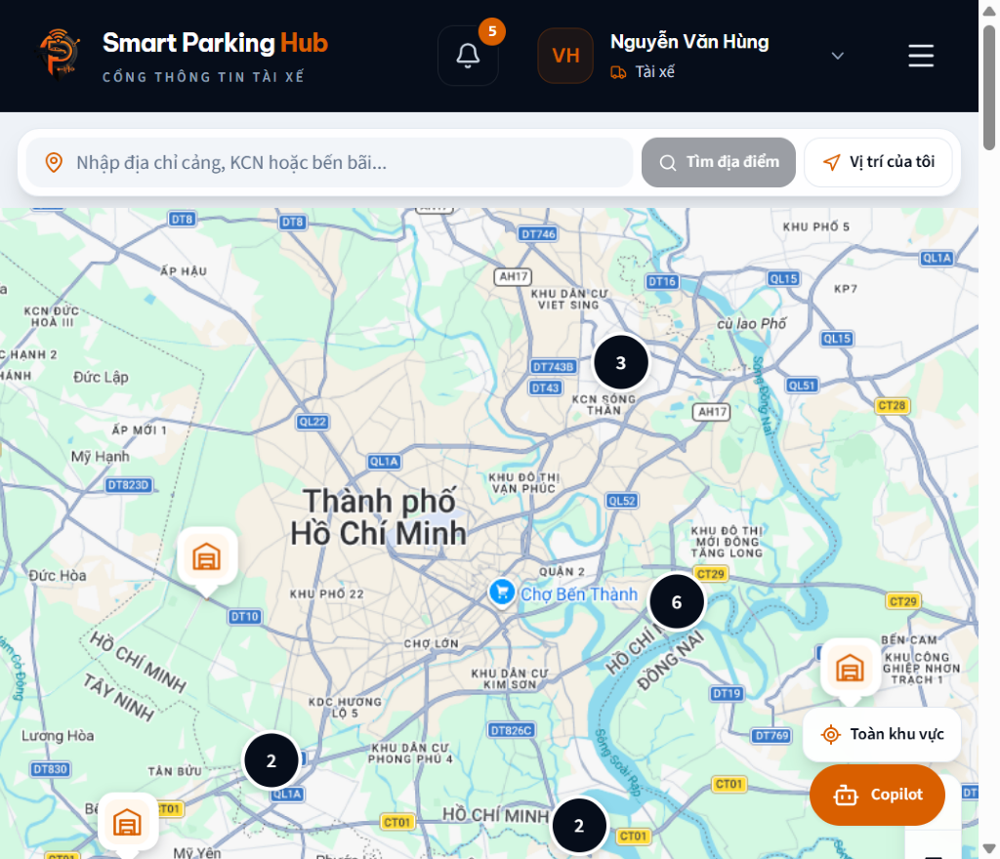

#### Đánh giá hiện trạng:
* **Ưu điểm:**
  * Bố cục 2 phần: Bản đồ MapLibre trực quan chiếm nửa trên (~380px), danh sách bãi xe cuộn dọc nửa dưới.
  * Mỗi thẻ bãi xe hiển thị rất rõ ràng: Tên bãi, Badge chỗ trống (`4/60 chỗ`), Phí cọc 20%, Rating (4.9★).
  * Nút "Đặt giữ chỗ" (cam) có chiều cao 42px, độ tương phản nổi bật.
* **Hạn chế & Điểm nghẽn:**
  * **Xung đột cảm ứng cuộn:** Khi người dùng vuốt dọc danh sách, nếu ngón tay chạm vào khu vực bản đồ sẽ vô tình kéo bản đồ (pan) thay vì cuộn trang.
  * **Mất nút chức năng:** Nút "Vị trí của tôi" và Menu góc phải bị đẩy ra khỏi màn hình (x > 390px) do tràn ngang.
* **Phương án tối ưu:**
  * Bổ sung nút chuyển đổi chế độ **"Xem Bản đồ" ⟷ "Xem Danh sách"** (Floating View Switcher) nằm ở đáy màn hình.
  * Khi ở chế độ Danh sách, ẩn bản đồ hoặc ghim ở chế độ thu nhỏ có nút phóng to.

---

### 2. Màn hình 2: Trang Chi Tiết Bãi Đỗ & Đặt Chỗ (`/parking/1`)

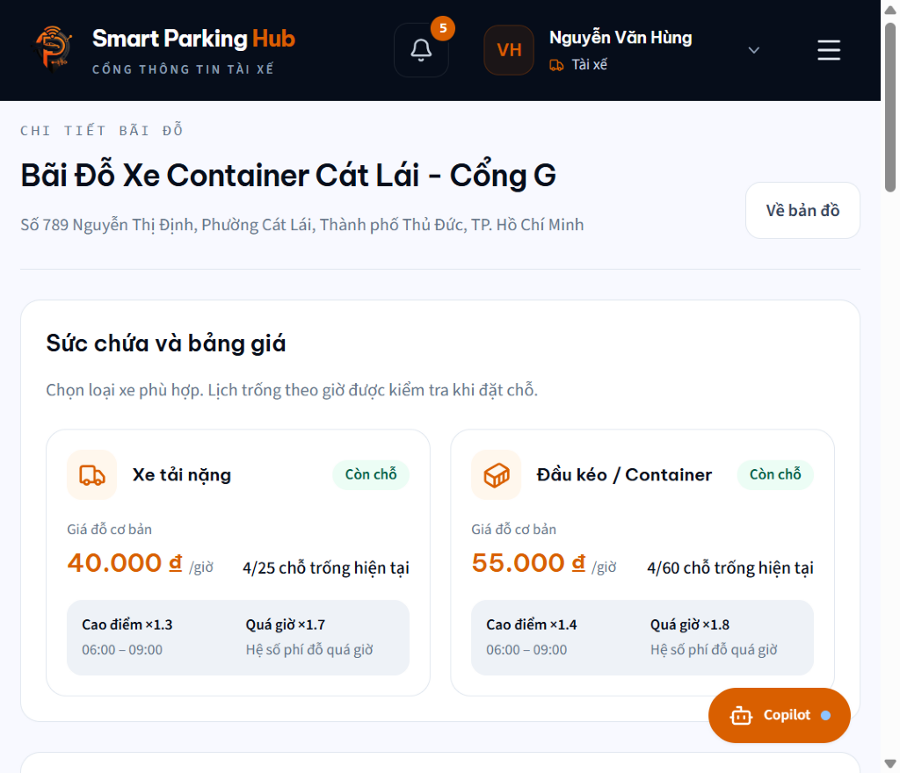
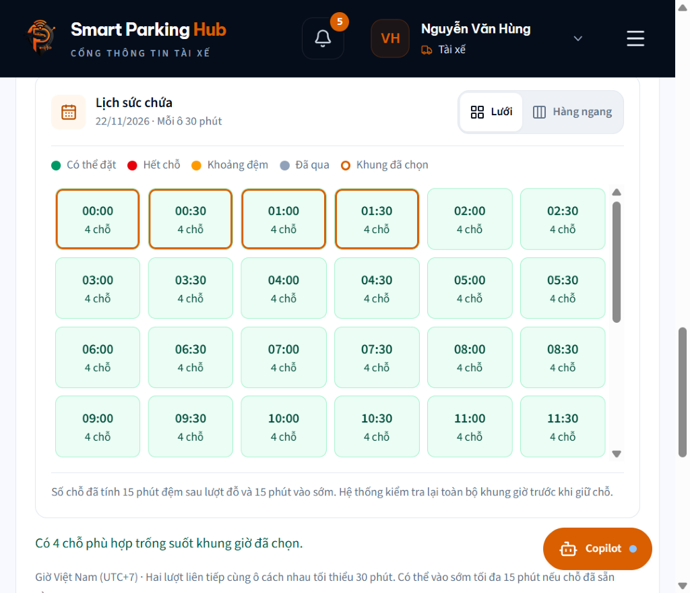
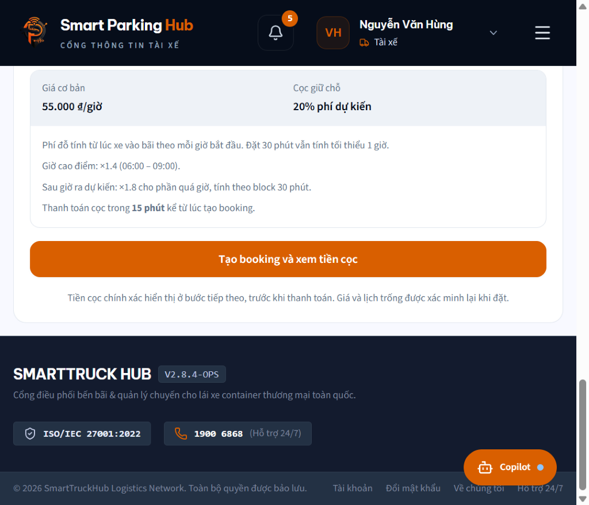

#### Đánh giá hiện trạng:
* **Ưu điểm:**
  * Thông tin vận hành cực kỳ minh bạch: Hệ số giờ cao điểm (x1.4), hệ số quá giờ (x1.8), tỷ lệ cọc (20%).
  * Lịch 30 phút có mã màu trạng thái trực quan: Xanh lá (Có thể đặt), Đỏ (Hết chỗ), Vàng (Khoảng đệm), Cam (Khung chọn).
* **Hạn chế & Điểm nghẽn:**
  * **Bảng giá bị dàn ngang 2 cột** thay vì xếp dọc, làm card phình rộng lên 702px.
  * **Nút "Về bản đồ"** nằm ở tọa độ x = 594px (người dùng hoàn toàn không nhìn thấy).
  * **Lịch 30 phút 6 cột cố định**: Bị tràn rộng 629px, các ô giờ bị thu nhỏ và ép sát mép.
  * **Nút CTA chìm sâu**: Nút cam "Tạo booking và xem tiền cọc" nằm ở cuối trang web dài, tài xế phải cuộn qua 4 màn hình mới thấy.
* **Phương án tối ưu:**
  * Bảng giá chuyển thành `grid-cols-1 sm:grid-cols-2`.
  * Lịch 30 phút trên mobile (< 640px) cấu hình thành 3 cột hoặc 4 cột (`grid-cols-3` hoặc `grid-cols-4`).
  * Bổ sung **Sticky Bottom Action Bar** (Thanh hành động bám đáy) chứa tóm tắt tiền cọc và nút "Tạo booking" nằm trọn trong vùng ngón tay cái (Thumb Zone).

---

### 3. Màn hình 3: Trang Đăng Nhập (`/login`)

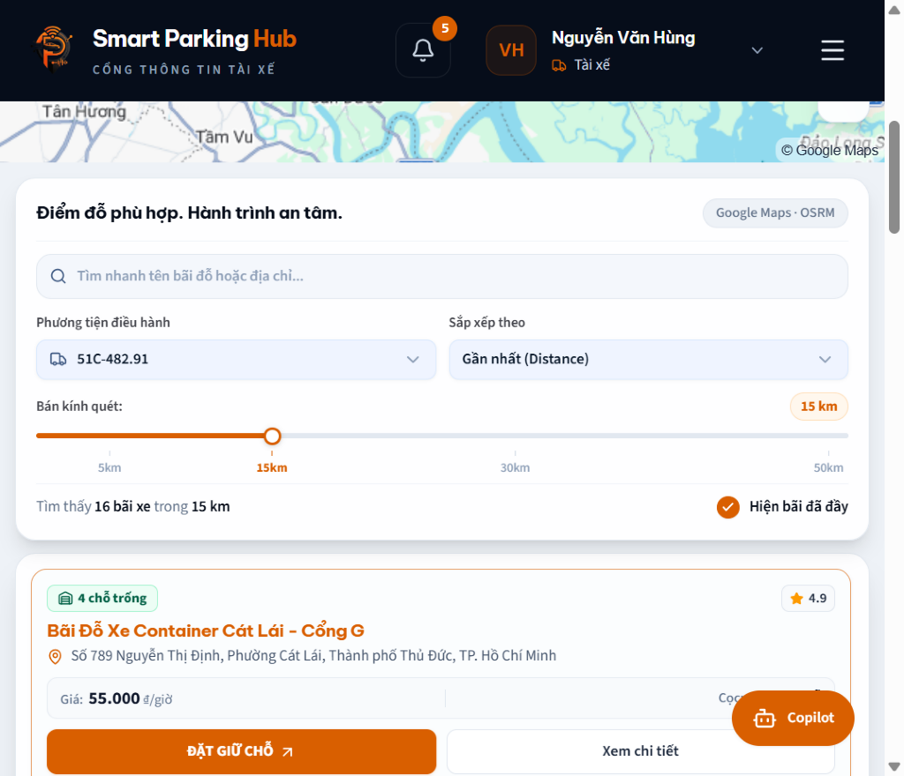

#### Đánh giá hiện trạng:
* **Ưu điểm:**
  * Thiết kế Glassmorphism trên nền bãi xe container đêm rất ấn tượng, mang tính thương hiệu mạnh.
  * Input số điện thoại & mật khẩu có chiều cao 45.3px, nút "Đăng nhập ↗" cao 48px, bấm rất vừa tay.
  * Có icon con mắt ẩn/hiện mật khẩu tiện lợi.
* **Hạn chế & Điểm nghẽn:**
  * Khung container nền có thuộc tính kéo rộng khiến `body.width = 718px`, làm xuất hiện thanh cuộn ngang dù nội dung nằm giữa.
  * Checkbox "Ghi nhớ đăng nhập" có diện tích cảm ứng thực tế chỉ 16×16px, tài xế tay to rất khó tick trúng.
* **Phương án tối ưu:**
  * Thêm `overflow-x: hidden; width: 100%;` cho container bao bọc.
  * Bọc thẻ `<label>` quanh checkbox với padding `py-2` để mở rộng vùng bấm thành tối thiểu 44×44px.

---

### 4. Màn hình 4: Quản Lý Xe Của Tôi & Modal Thêm Xe (`/vehicles`)

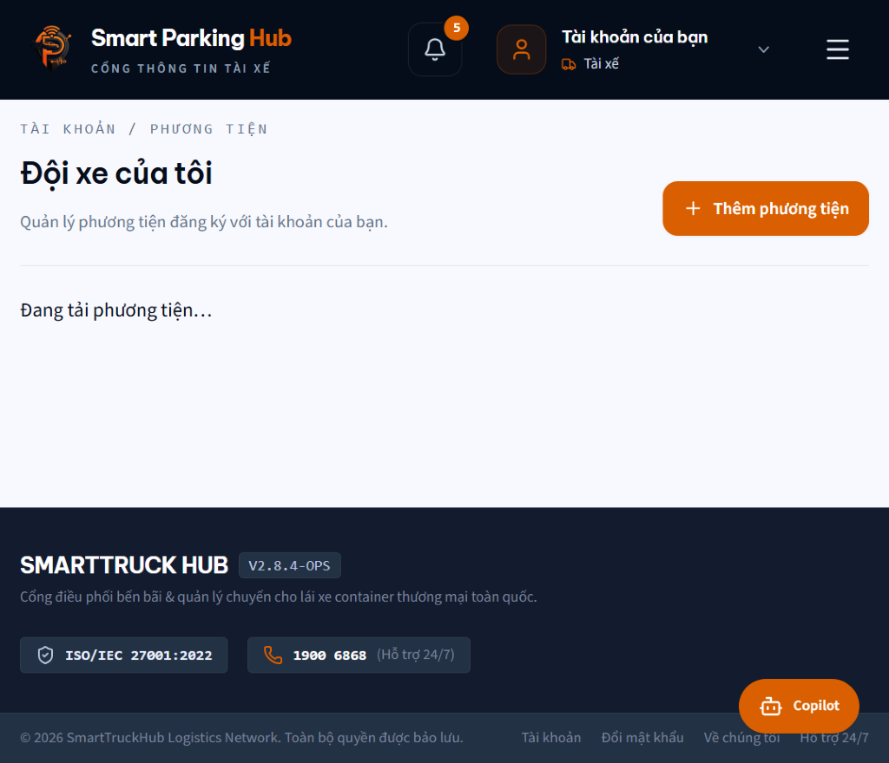
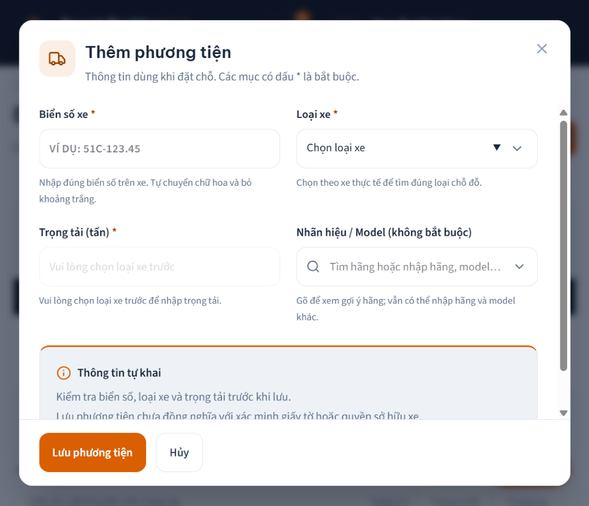

#### Đánh giá hiện trạng:
* **Ưu điểm:**
  * Nút "+ Thêm phương tiện" cao 44px, màu cam nổi bật.
  * Logic tự động khóa/mở trường trọng tải theo loại xe hoạt động chuẩn xác.
  * Nút "Lưu phương tiện" và "Hủy" trong modal có chiều cao 48px đạt chuẩn.
* **Hạn chế & Điểm nghẽn:**
  * **Bảng xe dạng `<table>` 7 cột:** Trên mobile 390px, bảng hiển thị bị cắt ngang, các cột quan trọng như "Trạng thái", "Thao tác sửa xe" bị giấu ngoài tầm mắt.
  * **Lỗi 2 mũi tên Select:** Ô select "Loại xe" bị hiển thị cả mũi tên tam giác đen native của browser lẫn icon Chevron SVG.
  * **Modal form chia 2 cột:** Form trong modal chia `grid-cols-2` đẩy chiều rộng lên 670px, làm modal bị tràn mép ngang.
* **Phương án tối ưu:**
  * Thay bảng bằng **Thẻ Xe Di Động (Mobile Vehicle Card)**: Hiển thị Biển số xe to đậm (16px), loại xe, tải trọng, badge "Chưa vào bãi", và 2 nút bấm "Sửa" / "Xóa" ngay dưới thẻ.
  * Modal chuyển thành 1 cột duy nhất (`grid-cols-1`) và bổ sung `appearance-none` cho thẻ `<select>`.

---

### 5. Màn hình 5: Trang Lịch Sử Đặt Chỗ (`/bookings`)

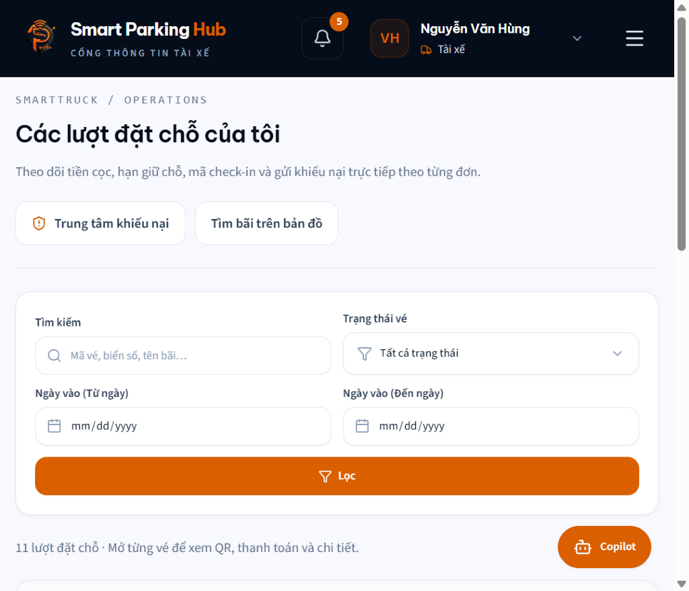
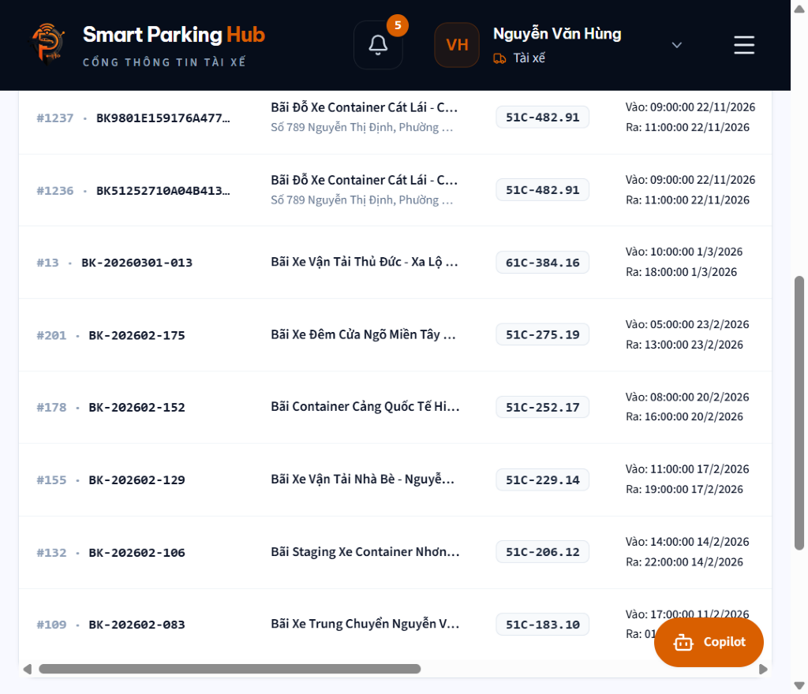

#### Đánh giá hiện trạng:
* **Ưu điểm:**
  * Bộ lọc trạng thái vé phong phú (Chờ cọc, Chờ check-in, Đang đỗ, Quá giờ, Đã hoàn tất...).
  * Nút "Lọc" full-width, cao 40px, dễ bấm.
* **Hạn chế & Điểm nghẽn (Cực kỳ nghiêm trọng):**
  * Bảng vé có chiều rộng đo được là **1248.65px** (gấp 3.2 lần chiều rộng màn hình điện thoại).
  * Nút "Chi tiết vé" và "Tác vụ QR" nằm ở tọa độ x = 1093px và 1157px. Tài xế khi đến cổng bãi xe cần mở mã QR check-in nhưng không thấy nút vì bị trôi cách mép màn hình 800px.
* **Phương án tối ưu:**
  * Chuyển đổi 100% sang danh sách **Booking Cards (Vé điện tử dạng thẻ)**: Mỗi vé là một card bo góc 16px, gồm:
    - Mã vé `#1237` kèm Badge trạng thái (Xanh lá / Vàng cam).
    - Tên bãi đỗ & Thời gian check-in dự kiến.
    - Tiền cọc đã thanh toán.
    - Hai nút bấm lớn nằm ở đáy thẻ: **"Mã QR Check-in"** (Nền cam) và **"Xem chi tiết"** (Viền xám).

---

### 6. Màn hình 6: Quản Lý Merchant: Ví & Rút Tiền (`/merchant/withdrawals`)

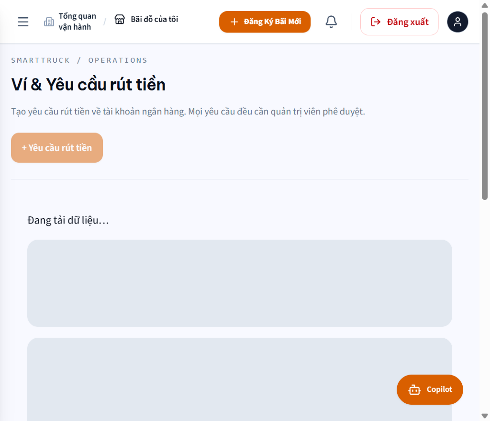
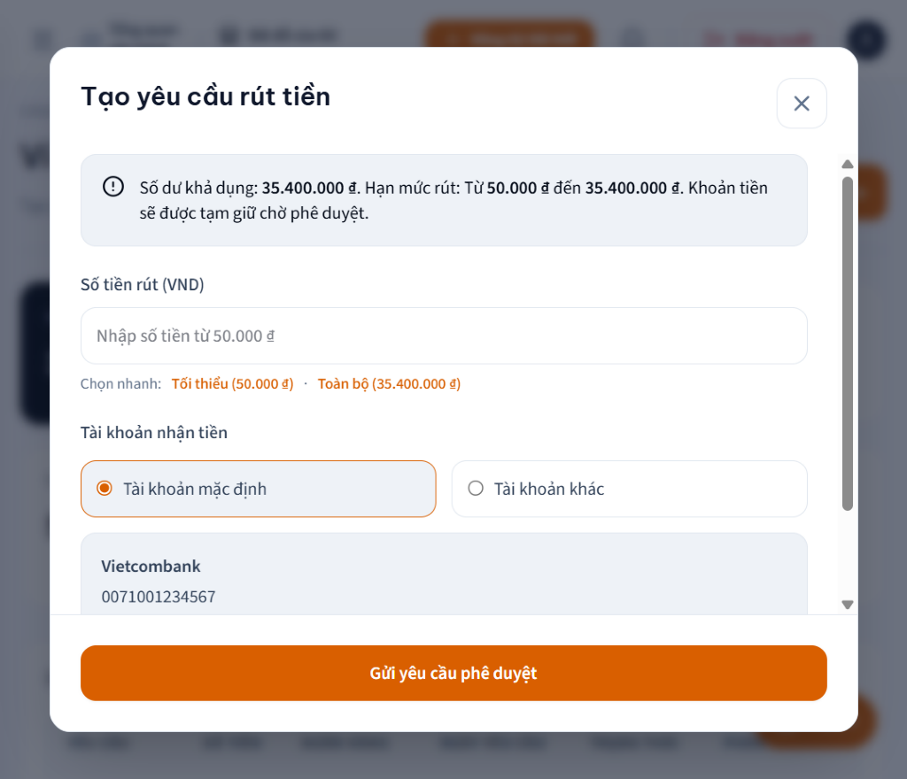

#### Đánh giá hiện trạng:
* **Ưu điểm:**
  * Thẻ "Số dư khả dụng" dùng nền tối Slate-900 làm bật lên con số `35.400.000 ₫` font 24px màu trắng rất uy tín và chuyên nghiệp.
  * Modal có tính năng bấm nhanh số tiền tối thiểu / toàn bộ.
  * Nút "Gửi yêu cầu phê duyệt" (cam, 44px) hiển thị trọn vẹn 100% trong khung nhìn.
* **Hạn chế & Điểm nghẽn:**
  * Bốn thẻ số dư ví chia lưới 2×2 khiến chiều rộng tràn lên 702px.
  * Hai nút chip chọn nhanh có chiều cao chỉ 16px và radio button chỉ 13×13px (vi phạm nghiêm trọng chuẩn ngón tay cái 44×44px).
  * Bảng lịch sử yêu cầu rút tiền bị tràn ngang.
* **Phương án tối ưu:**
  * Bốn thẻ số dư chuyển thành danh sách cuộn ngang (Swipeable Carousel) hoặc xếp chồng 1 cột.
  * Nâng chiều cao 2 chip chọn nhanh lên 36-40px và bọc radio button vào box thẻ chạm lớn (Selectable Card).

---

## III. QUY CHUẨN THIẾT KẾ MOBILE TỐI ƯU (MOBILE DESIGN SYSTEM SPECIFICATION)

Để đảm bảo người dùng di động (đặc biệt là tài xế container thao tác 1 tay ngoài trời) có trải nghiệm **dễ nhìn, thuận mắt, thao tác chính xác**, hệ thống cần áp dụng bảng quy chuẩn sau:

### 1. Bảng Quy Chuẩn Cỡ Chữ (Typography Scale)
| Cấp độ | Cỡ chữ (Font Size) | Chiều cao dòng (Line Height) | Độ đậm (Font Weight) | Ứng dụng cụ thể trên Mobile |
| :--- | :---: | :---: | :---: | :--- |
| **Display / Hero** | `24px` | `32px` | Bold (700) | Tiêu đề trang chính (Đăng nhập, Tổng quan) |
| **Heading 1 (H1)** | `20px` | `28px` | Bold (700) | Tên bãi đỗ xe, Tiêu đề modal |
| **Heading 2 (H2)** | `17px` | `24px` | Semi-bold (600) | Tên khối section (Biểu phí, Phương tiện) |
| **Heading 3 (H3)** | `15px` | `22px` | Semi-bold (600) | Biển số xe, Mã đơn đặt chỗ |
| **Body Regular** | `14px` | `20px` | Regular (400) | Nội dung mô tả, địa chỉ, hướng dẫn |
| **Input / Select** | **`16px`** | `24px` | Medium (500) | **Bắt buộc >= 16px để triệt tiêu iOS Auto-Zoom** |
| **Metadata / Badge**| `12px` | `16px` | Semi-bold (600) | Trạng thái vé, nhãn phụ (không dùng cỡ < 12px) |

### 2. Bảng Quy Chuẩn Màu Sắc & Độ Tương Phản (Color & Contrast)
* **Màu cam thương hiệu (Brand Accent):** `#d95f00` (Tương phản WCAG AA 4.6:1 với chữ trắng). Áp dụng cho nút CTA chính và icon nhấn.
* **Màu chữ chính (Primary Text):** `#0f172a` (Slate-900 / Brand Navy). Đảm bảo sắc nét, đọc rõ ngoài trời nắng gắt.
* **Màu chữ phụ (Secondary Text):** `#475569` (Slate-600). **Tuyệt đối không dùng Slate-400 (`#94a3b8`) cho chữ nội dung** vì ngoài trời nắng sẽ bị chói mờ.
* **Màu nền thẻ (Card Background):** `#ffffff` với viền mảnh `border border-slate-200/80` và đổ bóng nhẹ `shadow-xs`.
* **Màu nền ứng dụng (App Background):** `#f8fafc` (Slate-50) tạo độ tương phản nhẹ với nền card trắng.

### 3. Quy Chuẩn Vùng Cảm Ứng & Công Thái Học (Touch Targets & Ergonomics)
* **Quy tắc 44px:** Mọi thành phần tương tác (nút bấm, icon đóng, checkbox, chip lọc, tab) phải có diện tích chạm tối thiểu **44 × 44 px**.
* **Thumb Zone (Vùng ngón cái):**
  * Nút xác nhận chính ("Tạo booking", "Lưu xe", "Xác nhận rút tiền") phải nằm ở **1/3 phía dưới màn hình**, lý tưởng nhất là dùng **Bottom Sticky Bar** bám sát mép đáy màn hình kèm `padding-bottom: env(safe-area-inset-bottom)`.
* **Khoảng cách lề (Screen Margins):** Cố định lề trái/phải 16px (`px-4`) trên toàn bộ các trang mobile.

---

## IV. HƯỚNG DẪN KỸ THUẬT & CODE MẪU KHẮC PHỤC (CODE ACTION PLAN)

---

### Hạng mục 1: Khắc Phục Triệt Để Tràn Ngang Toàn Cục (P0)

* **Vị trí file:** [globals.css](../src/styles/globals.css#L191) & [DriverLayout.tsx](../src/layouts/DriverLayout.tsx)
* **Cách khắc phục:** Thêm thuộc tính chặn tràn ngang trên thẻ gốc `html, body` và layout bọc ngoài.

```css
/* Trong globals.css */
@layer base {
  html, body {
    margin: 0;
    padding: 0;
    overflow-x: hidden;
    max-width: 100vw;
    scroll-behavior: smooth;
    -webkit-tap-highlight-color: transparent;
  }
}
```

```tsx
/* Trong layouts/DriverLayout.tsx & layouts/MerchantLayout.tsx */
<div className="min-h-screen flex flex-col bg-[#f8f9ff] overflow-x-hidden w-full max-w-[100vw]">
```

---

### Hạng mục 2: Chuyển Đổi Bảng Xe Sang Dạng Thẻ Trên Mobile (P0)

* **Vị trí file:** [VehiclesTable.tsx](../src/features/vehicles/components/VehiclesTable.tsx)
* **Cách khắc phục:** Ẩn bảng `<table>` trên màn hình nhỏ (`hidden md:table`) và hiển thị `MobileVehicleCard` trên mobile (`block md:hidden`).

```tsx
{/* 1. Mobile Card List View (< 768px) */}
<div className="flex flex-col gap-3 md:hidden">
  {vehicles.map(vehicle => {
    const current = parking?.find(b => b.vehicleId === vehicle.id);
    return (
      <div key={vehicle.id} className="bg-white rounded-2xl p-4 border border-slate-200 shadow-xs flex flex-col gap-3">
        <div className="flex items-center justify-between">
          <div className="flex items-center gap-2.5">
            <span className="flex h-10 w-10 items-center justify-center rounded-xl bg-orange-50 border border-orange-200 text-[#d95f00]">
              <Truck size={20} />
            </span>
            <div>
              <p className="font-bold text-base text-slate-900 tracking-wide">{vehicle.licensePlate}</p>
              <p className="text-xs text-slate-600">{vehicleTypes[vehicle.vehicleType]}</p>
            </div>
          </div>
          <span className={`px-2.5 py-1 rounded-full text-xs font-semibold ${
            vehicle.status === 'ACTIVE' ? 'bg-emerald-50 text-emerald-700 border border-emerald-200' : 'bg-slate-100 text-slate-600'
          }`}>
            {vehicle.status === 'ACTIVE' ? 'Đang dùng' : 'Tạm khóa'}
          </span>
        </div>

        <div className="grid grid-cols-2 gap-2 text-xs py-2 border-y border-slate-100 text-slate-600">
          <div>Trọng tải: <strong className="text-slate-900 font-semibold">{vehicle.weightTon} tấn</strong></div>
          <div>Bãi hiện tại: <strong className="text-slate-900 font-semibold">{current ? current.parkingLotName : 'Chưa vào bãi'}</strong></div>
        </div>

        <div className="flex items-center gap-2 pt-1">
          <button
            type="button"
            onClick={(e) => onEdit(vehicle, e.currentTarget)}
            className="flex-1 min-h-[44px] flex items-center justify-center gap-1.5 rounded-xl border border-slate-200 bg-slate-50 text-slate-700 text-xs font-semibold hover:bg-slate-100"
          >
            <Pencil size={14} /> Chỉnh sửa
          </button>
          <button
            type="button"
            onClick={() => onDeactivate(vehicle)}
            className="flex-1 min-h-[44px] flex items-center justify-center gap-1.5 rounded-xl border border-red-200 bg-red-50 text-red-700 text-xs font-semibold hover:bg-red-100"
          >
            <Power size={14} /> Xóa xe
          </button>
        </div>
      </div>
    );
  })}
</div>

{/* 2. Desktop Table View (>= 768px) */}
<div className="hidden md:block overflow-x-auto">
  <table className="w-full text-left text-sm">...</table>
</div>
```

---

### Hạng mục 3: Xóa Mũi Tên Đôi Tại Ô Select Loại Xe (P2)

* **Vị trí file:** [RegisterVehicleModal.tsx](../src/features/vehicles/components/RegisterVehicleModal.tsx#L201)
* **Cách khắc phục:** Thêm class `appearance-none` và chuyển grid form trong modal thành 1 cột trên mobile.

```tsx
{/* Sửa grid-cols-2 thành grid-cols-1 sm:grid-cols-2 */}
<div className="grid grid-cols-1 sm:grid-cols-2 gap-4">
  ...
  <select
    id="modal-reg-class"
    name="vehicleClass"
    value={vehicleClass}
    onChange={(e) => setVehicleClass(e.target.value as VehicleClassType)}
    className="w-full px-4 py-3 bg-slate-50 border border-slate-300 rounded-xl text-base font-medium text-slate-900 focus:bg-white focus:outline-none focus:ring-2 focus:ring-orange-500/20 focus:border-orange-500 appearance-none -webkit-appearance-none cursor-pointer"
  >
    <option value="CONTAINER">Đầu kéo Container (Tractor)</option>
    <option value="TRAILER">Rơ-moóc / Sơ-mi rơ-moóc (Trailer)</option>
    <option value="HEAVY">Xe tải nặng &gt; 15 Tấn</option>
    <option value="MEDIUM">Xe tải trung 5 - 15 Tấn</option>
    <option value="LIGHT">Xe tải nhẹ &lt; 5 Tấn</option>
  </select>
</div>
```

---

### Hạng mục 4: Tối Ưu Lịch 30 Phút & Sticky Bottom Booking Bar (P1)

* **Vị trí file:** `smart-parking-app-v2/src/features/parking/pages/ParkingDetailPage.tsx`
* **Cách khắc phục:**
  1. Cấu hình grid slot 30 phút thành 3 cột trên mobile: `grid grid-cols-3 sm:grid-cols-4 md:grid-cols-6 gap-2`.
  2. Bổ sung Sticky Bottom Bar cố định ở chân màn hình cho nút đặt chỗ.

```tsx
{/* Sticky Bottom Bar trên Mobile (< 768px) */}
<div className="md:hidden fixed bottom-0 left-0 right-0 z-40 bg-white/95 backdrop-blur-md border-t border-slate-200 px-4 py-3 shadow-lg pb-[calc(12px+env(safe-area-inset-bottom))]">
  <div className="flex items-center justify-between gap-3 max-w-md mx-auto">
    <div>
      <p className="text-[11px] font-medium text-slate-600">Tiền cọc giữ chỗ (20%)</p>
      <p className="text-lg font-bold text-[#d95f00] tracking-tight">{formatCurrency(depositAmount)}</p>
    </div>
    <button
      type="button"
      onClick={handleCreateBooking}
      className="min-h-[48px] px-6 rounded-xl bg-[#d95f00] text-white font-semibold text-sm shadow-md active:scale-95 transition-all flex items-center justify-center gap-2"
    >
      Đặt Chỗ Ngay ↗
    </button>
  </div>
</div>
```

---

## V. KẾ HOẠCH TRIỂN KHAI THEO THỨ TỰ ƯU TIÊN

1. **Sprint 1 (Khẩn cấp - 0.5 ngày):**
   - Áp dụng class `overflow-x-hidden` cho toàn bộ layout và `globals.css` để dẹp bỏ ngay hiện tượng trôi header/menu sang x > 590px.
   - Thêm `appearance-none` cho select Loại xe.
2. **Sprint 2 (Trải nghiệm cốt lõi - 1 ngày):**
   - Chuyển đổi bảng danh sách xe (`/vehicles`) và lịch sử đặt chỗ (`/bookings`) sang Responsive Card List.
   - Bổ sung Sticky Bottom Bar cho nút "Tạo booking" tại trang chi tiết bãi đỗ.
3. **Sprint 3 (Hoàn thiện công thái học - 1 ngày):**
   - Tối ưu lưới lịch 30 phút thành 3 cột.
   - Tăng touch target cho radio button và chip chọn nhanh số tiền rút tại `/merchant/withdrawals`.
