# Sơ Đồ Định Tuyến Ứng Dụng (Route Map Evidence)

Dữ liệu định tuyến dưới đây được trích xuất trực tiếp từ file mã nguồn [`src/app/routes/AppRoutes.tsx`](file:///d:/Documents/JAVA%20WEB%20SERVICE/SmartParkingHub/smart-parking-app/src/app/routes/AppRoutes.tsx) và [`src/app/routes/ProtectedRoute.tsx`](file:///d:/Documents/JAVA%20WEB%20SERVICE/SmartParkingHub/smart-parking-app/src/app/routes/ProtectedRoute.tsx).

---

## 1. Cây Phân Cấp Định Tuyến (Nested Route Tree)

```mermaid
graph TD
    Root["<BrowserRouter>"] --> AppRoutes["<AppRoutes>"]
    
    AppRoutes --> LandingShell["<LandingLayout> (Navbar + Footer)"]
    AppRoutes --> AuthShell["<AuthLayout> (Hero Split Screen)"]
    AppRoutes --> DriverShell["<DashboardLayout> (Driver Shell)"]
    AppRoutes --> MerchantShell["<MerchantLayout> (Merchant Sidebar)"]
    AppRoutes --> AdminShell["<AdminLayout> (Admin Sidebar)"]
    AppRoutes --> Standalone["Standalone Routes"]

    LandingShell --> R_Root["/ (LandingPage)"]
    LandingShell --> R_SolDriver["/solutions/drivers"]
    LandingShell --> R_SolOwner["/solutions/owners"]
    LandingShell --> R_Pricing["/pricing"]
    LandingShell --> R_SolApi["/solutions/api"]
    LandingShell --> R_About["/company/about"]
    LandingShell --> R_Careers["/company/careers"]
    LandingShell --> R_Blog["/company/blog"]
    LandingShell --> R_Contact["/company/contact"]
    LandingShell --> R_DrNotif["/notifications [DRIVER]"]
    LandingShell --> R_DrPark["/parking [DRIVER]"]
    LandingShell --> R_DrBook["/bookings [DRIVER]"]
    LandingShell --> R_DrQueue["/queues [DRIVER]"]
    LandingShell --> R_DrPay["/payments [DRIVER]"]
    LandingShell --> R_DrVeh["/vehicles [DRIVER]"]
    LandingShell --> R_DrProf["/profile [DRIVER]"]
    LandingShell --> R_DrPwd["/change-password [DRIVER]"]

    AuthShell --> R_Login["/login"]
    AuthShell --> R_Reg["/register"]
    AuthShell --> R_Forgot["/forgot-password"]

    DriverShell --> R_Dash["/dashboard (Role Dispatcher)"]
    DriverShell --> R_DashVeh["/dashboard/vehicles [DRIVER]"]
    DriverShell --> R_DashSrch["/dashboard/search [DRIVER]"]
    DriverShell --> R_DashLot["/dashboard/parking/:id [DRIVER]"]

    MerchantShell --> R_M_Dash["/merchant/dashboard"]
    MerchantShell --> R_M_Prof["/merchant/profile"]
    MerchantShell --> R_M_Lots["/merchant/parking-lots"]
    MerchantShell --> R_M_NewLot["/merchant/parking-lots/new"]
    MerchantShell --> R_M_LotDet["/merchant/parking-lots/:id"]
    MerchantShell --> R_M_LotEdit["/merchant/parking-lots/:id/edit"]
    MerchantShell --> R_M_Slots["/merchant/parking-lots/:id/slots"]
    MerchantShell --> R_M_Price["/merchant/parking-lots/:id/pricing"]
    MerchantShell --> R_M_Books["/merchant/bookings"]
    MerchantShell --> R_M_BookDet["/merchant/bookings/:id"]
    MerchantShell --> R_M_Qr["/merchant/qr-scanner"]
    MerchantShell --> R_M_Rev["/merchant/revenue"]
    MerchantShell --> R_M_Wd["/merchant/withdrawals"]
    MerchantShell --> R_M_Disp["/merchant/disputes"]
    MerchantShell --> R_M_DispDet["/merchant/disputes/:ticketId"]
    MerchantShell --> R_M_Notif["/merchant/notifications"]

    AdminShell --> R_A_Dash["/admin/dashboard"]
    AdminShell --> R_A_Lots["/admin/parking-lots"]
    AdminShell --> R_A_LotDet["/admin/parking-lots/:id"]
    AdminShell --> R_A_Users["/admin/users"]
    AdminShell --> R_A_UserDet["/admin/users/:id"]
    AdminShell --> R_A_Txns["/admin/transactions"]
    AdminShell --> R_A_Wd["/admin/withdrawals"]
    AdminShell --> R_A_Disp["/admin/disputes"]
    AdminShell --> R_A_DispDet["/admin/disputes/:id"]
    AdminShell --> R_A_Audit["/admin/audit-logs"]
    AdminShell --> R_A_Notif["/admin/notifications"]
    AdminShell --> R_A_Prof["/admin/profile"]

    Standalone --> R_403["/403 (ForbiddenPage)"]
    Standalone --> R_PayOk["/payment/success (PaymentReturnPage)"]
    Standalone --> R_PayCancel["/payment/cancel (PaymentReturnPage)"]
    Standalone --> R_Wildcard["* (Redirect to /)"]
```

---

## 2. Bảng Tra Cứu Toàn Bộ 53 Tuyến Đường Định Tuyến (Route Directory)

| STT | URL Path | Component Render | Wrapper Layout | Allowed Roles | Chuyển Hướng Mặc Định (Redirect) |
|:---:|---|---|---|:---:|---|
| 1 | `/` | `LandingPage` | `LandingLayout` | `GUEST, ALL` | Không |
| 2 | `/solutions/drivers` | `DriverSolutionsPage` | `LandingLayout` | `GUEST, ALL` | Không |
| 3 | `/solutions/owners` | `OwnerSolutionsPage` | `LandingLayout` | `GUEST, ALL` | Không |
| 4 | `/pricing` | `PricingPage` | `LandingLayout` | `GUEST, ALL` | Không |
| 5 | `/solutions/api` | `ApiIntegrationPage` | `LandingLayout` | `GUEST, ALL` | Không |
| 6 | `/company/about` | `AboutUsPage` | `LandingLayout` | `GUEST, ALL` | Không |
| 7 | `/company/careers` | `CareersPage` | `LandingLayout` | `GUEST, ALL` | Không |
| 8 | `/company/blog` | `BlogPage` | `LandingLayout` | `GUEST, ALL` | Không |
| 9 | `/company/contact` | `ContactPage` | `LandingLayout` | `GUEST, ALL` | Không |
| 10 | `/notifications` | `NotificationsPage` | `LandingLayout` | `DRIVER` | Redirect `/login` nếu chưa login, `/403` nếu sai role |
| 11 | `/parking` | `SearchParkingPage` | `LandingLayout` | `DRIVER` | Redirect `/login` nếu chưa login, `/403` nếu sai role |
| 12 | `/bookings` | `MyBookingsPage` | `LandingLayout` | `DRIVER` | Redirect `/login` nếu chưa login, `/403` nếu sai role |
| 13 | `/queues` | `DriverQueuesPage` | `LandingLayout` | `DRIVER` | Redirect `/login` nếu chưa login, `/403` nếu sai role |
| 14 | `/payments` | `DriverPaymentsPage` | `LandingLayout` | `DRIVER` | Redirect `/login` nếu chưa login, `/403` nếu sai role |
| 15 | `/vehicles` | `VehiclesPage` | `LandingLayout` | `DRIVER` | Redirect `/login` nếu chưa login, `/403` nếu sai role |
| 16 | `/profile` | `ProfilePage` | `LandingLayout` | `DRIVER` | Redirect `/login` nếu chưa login, `/403` nếu sai role |
| 17 | `/change-password` | `ChangePasswordPage` | `LandingLayout` | `DRIVER` | Redirect `/login` nếu chưa login, `/403` nếu sai role |
| 18 | `/login` | `LoginPage` | `AuthLayout` | `GUEST` | Không |
| 19 | `/register` | `RegisterPage` | `AuthLayout` | `GUEST` | Không |
| 20 | `/forgot-password` | `ForgotPasswordPage` | `AuthLayout` | `GUEST` | Không |
| 21 | `/403` | `ForbiddenPage` | Không có | `ALL` | Không |
| 22 | `/payment/success` | `PaymentReturnPage` | Không có | `DRIVER` | Xử lý param PayOS |
| 23 | `/payment/cancel` | `PaymentReturnPage` | Không có | `DRIVER` | Xử lý param PayOS |
| 24 | `/dashboard` | `DashboardEntry` | `DashboardLayout` | `DRIVER` (MERCHANT/ADMIN redirect) | MERCHANT → `/merchant/dashboard`, ADMIN → `/admin/dashboard` |
| 25 | `/dashboard/vehicles` | `VehiclesPage` | `DashboardLayout` | `DRIVER` | Redirect `/403` nếu sai role |
| 26 | `/dashboard/search` | `SearchParkingPage` | `DashboardLayout` | `DRIVER` | Redirect `/403` nếu sai role |
| 27 | `/dashboard/parking/:id` | `ParkingDetailPage` | `DashboardLayout` | `DRIVER` | Redirect `/403` nếu sai role |
| 28 | `/merchant` | `Navigate to dashboard` | `MerchantLayout` | `MERCHANT` | Chuyển hướng sang `/merchant/dashboard` |
| 29 | `/merchant/dashboard` | `MerchantDashboardPage` | `MerchantLayout` | `MERCHANT` | Redirect `/403` nếu sai role |
| 30 | `/merchant/profile` | `MerchantProfilePage` | `MerchantLayout` | `MERCHANT` | Redirect `/403` nếu sai role |
| 31 | `/merchant/parking-lots` | `MerchantParkingLotsPage` | `MerchantLayout` | `MERCHANT` | Redirect `/403` nếu sai role |
| 32 | `/merchant/parking-lots/new` | `CreateMerchantParkingLotPage` | `MerchantLayout` | `MERCHANT` | Redirect `/403` nếu sai role |
| 33 | `/merchant/parking-lots/:parkingLotId` | `MerchantParkingLotDetailPage` | `MerchantLayout` | `MERCHANT` | Redirect `/403` nếu sai role |
| 34 | `/merchant/parking-lots/:parkingLotId/edit` | `EditMerchantParkingLotPage` | `MerchantLayout` | `MERCHANT` | Redirect `/403` nếu sai role |
| 35 | `/merchant/parking-lots/:parkingLotId/slots` | `MerchantSlotsPage` | `MerchantLayout` | `MERCHANT` | Redirect `/403` nếu sai role |
| 36 | `/merchant/parking-lots/:parkingLotId/pricing` | `MerchantPricingPage` | `MerchantLayout` | `MERCHANT` | Redirect `/403` nếu sai role |
| 37 | `/merchant/bookings` | `MerchantBookingsPage` | `MerchantLayout` | `MERCHANT` | Redirect `/403` nếu sai role |
| 38 | `/merchant/bookings/:bookingId` | `MerchantBookingDetailPage` | `MerchantLayout` | `MERCHANT` | Redirect `/403` nếu sai role |
| 39 | `/merchant/qr-scanner` | `MerchantQrScannerPage` | `MerchantLayout` | `MERCHANT` | Redirect `/403` nếu sai role |
| 40 | `/merchant/revenue` | `MerchantRevenuePage` | `MerchantLayout` | `MERCHANT` | Redirect `/403` nếu sai role |
| 41 | `/merchant/withdrawals` | `MerchantWithdrawalsPage` | `MerchantLayout` | `MERCHANT` | Redirect `/403` nếu sai role |
| 42 | `/merchant/disputes` | `MerchantDisputesPage` | `MerchantLayout` | `MERCHANT` | Redirect `/403` nếu sai role |
| 43 | `/merchant/disputes/:ticketId` | `MerchantDisputeDetailPage` | `MerchantLayout` | `MERCHANT` | Redirect `/403` nếu sai role |
| 44 | `/merchant/notifications` | `MerchantNotificationsPage` | `MerchantLayout` | `MERCHANT` | Redirect `/403` nếu sai role |
| 45 | `/admin` | `Navigate to dashboard` | `AdminLayout` | `ADMIN` | Chuyển hướng sang `/admin/dashboard` |
| 46 | `/admin/dashboard` | `AdminDashboardPage` | `AdminLayout` | `ADMIN` | Redirect `/403` nếu sai role |
| 47 | `/admin/parking-lots` | `AdminParkingLotsPage` | `AdminLayout` | `ADMIN` | Redirect `/403` nếu sai role |
| 48 | `/admin/parking-lots/:parkingLotId` | `AdminParkingLotDetailPage` | `AdminLayout` | `ADMIN` | Redirect `/403` nếu sai role |
| 49 | `/admin/users` | `AdminUsersPage` | `AdminLayout` | `ADMIN` | Redirect `/403` nếu sai role |
| 50 | `/admin/users/:userId` | `AdminUserDetailPage` | `AdminLayout` | `ADMIN` | Redirect `/403` nếu sai role |
| 51 | `/admin/transactions` | `AdminTransactionsPage` | `AdminLayout` | `ADMIN` | Redirect `/403` nếu sai role |
| 52 | `/admin/withdrawals` | `AdminWithdrawalsPage` | `AdminLayout` | `ADMIN` | Redirect `/403` nếu sai role |
| 53 | `/admin/disputes` | `AdminDisputesPage` | `AdminLayout` | `ADMIN` | Redirect `/403` nếu sai role |
| 54 | `/admin/disputes/:disputeId` | `AdminDisputeDetailPage` | `AdminLayout` | `ADMIN` | Redirect `/403` nếu sai role |
| 55 | `/admin/audit-logs` | `AdminAuditLogsPage` | `AdminLayout` | `ADMIN` | Redirect `/403` nếu sai role |
| 56 | `/admin/notifications` | `AdminNotificationsPage` | `AdminLayout` | `ADMIN` | Redirect `/403` nếu sai role |
| 57 | `/admin/profile` | `AdminProfilePage` | `AdminLayout` | `ADMIN` | Redirect `/403` nếu sai role |
| 58 | `*` | `Navigate to /` | Không có | `ALL` | Chuyển hướng về trang chủ `/` |
