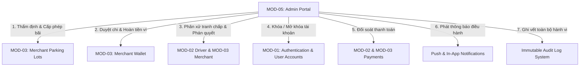
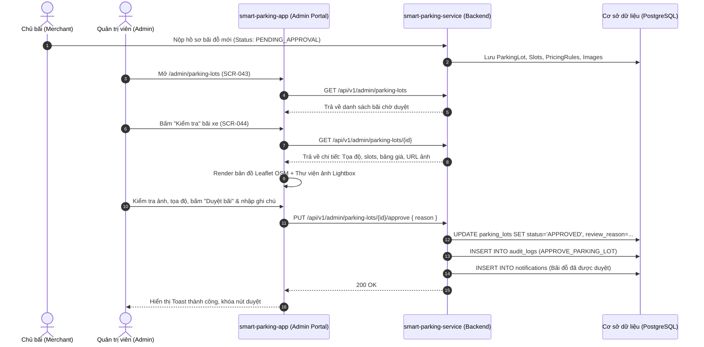
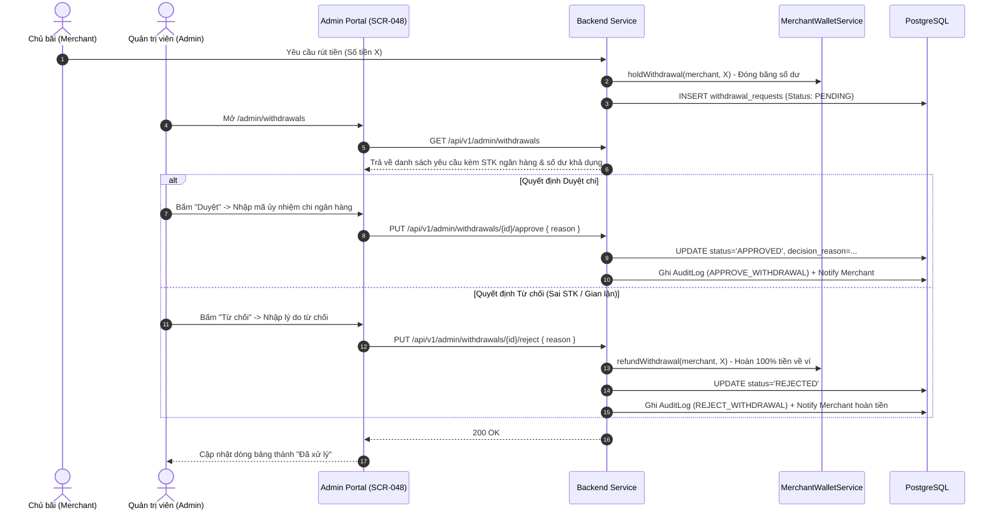
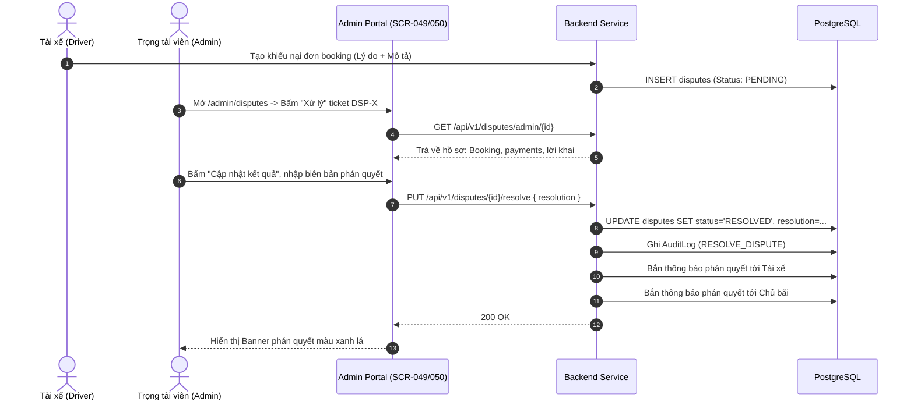

# Báo Cáo Phân Tích Chuyên Sâu: Cổng Quản Trị Hệ Thống (MOD-05: System Administration & Moderation)

---

## 1. Danh Mục Toàn Bộ Route Thuộc Module

Phân hệ Quản trị hệ thống (`Admin Portal`) được bảo vệ hoàn toàn bởi `<ProtectedRoute allowedRoles={['ADMIN']}>` bọc ngoài `AdminLayout` tại [`AppRoutes.tsx:95`](file:///d:/Documents/JAVA%20WEB%20SERVICE/SmartParkingHub/smart-parking-app/src/app/routes/AppRoutes.tsx#L95). Nếu phiên đăng nhập không phải Role `ADMIN`, hệ thống sẽ chặn và điều hướng về trang chủ hoặc `/login`. Nếu truy cập đường dẫn gốc `/admin`, hệ thống tự động redirect về `/admin/dashboard` ([`AppRoutes.tsx:177`](file:///d:/Documents/JAVA%20WEB%20SERVICE/SmartParkingHub/smart-parking-app/src/app/routes/AppRoutes.tsx#L177)).

| STT | Route URL | Tên Màn Hình / Page | Screen ID | Quyền Truy Cập | Mục Đích Nghiệp Vụ |
|---|---|---|---|---|---|
| 1 | `/admin` | *Redirect Route* | — | `ADMIN` | Tự động chuyển hướng về `/admin/dashboard` |
| 2 | `/admin/dashboard` | `AdminDashboardPage` | `SCR-042` | `ADMIN` | Tổng quan số liệu toàn sàn (users, lots, revenue, bookings) |
| 3 | `/admin/parking-lots` | `AdminParkingLotsPage` | `SCR-043` | `ADMIN` | Danh sách hàng đợi hồ sơ bãi đỗ xe cần kiểm duyệt |
| 4 | `/admin/parking-lots/:parkingLotId` | `AdminParkingLotDetailPage` | `SCR-044` | `ADMIN` | Bàn thẩm định chi tiết bãi đỗ (bản đồ, ảnh, phê duyệt/từ chối) |
| 5 | `/admin/users` | `AdminUsersPage` | `SCR-045` | `ADMIN` | Danh bạ tài khoản toàn hệ thống (Driver, Merchant, Admin) |
| 6 | `/admin/users/:userId` | `AdminUserDetailPage` | `SCR-046` | `ADMIN` | Hồ sơ người dùng chi tiết, chế tài Khóa (`Ban`) / Mở khóa (`Unban`) |
| 7 | `/admin/transactions` | `AdminTransactionsPage` | `SCR-047` | `ADMIN` | Nhật ký đối soát toàn bộ dòng tiền vào/ra trên hệ thống |
| 8 | `/admin/withdrawals` | `AdminWithdrawalsPage` | `SCR-048` | `ADMIN` | Hàng đợi phê duyệt lệnh rút tiền của Merchant về ngân hàng |
| 9 | `/admin/disputes` | `AdminDisputesPage` | `SCR-049` | `ADMIN` | Hàng đợi các vụ khiếu nại tranh chấp giữa Tài xế và Chủ bãi |
| 10 | `/admin/disputes/:disputeId` | `AdminDisputeDetailPage` | `SCR-050` | `ADMIN` | Bàn thụ lý tranh chấp, xem xét bằng chứng và ban hành phán quyết |
| 11 | `/admin/audit-logs` | `AdminAuditLogsPage` | `SCR-051` | `ADMIN` | Sổ cái kiểm toán bất biến (Audit Trail) ghi lại mọi can thiệp của Admin |
| 12 | `/admin/notifications` | `AdminNotificationsPage` | `SCR-052` | `ADMIN` | Trung tâm thông báo sự kiện khẩn cấp và cảnh báo hệ thống |
| 13 | `/admin/profile` | `AdminProfilePage` | `SCR-053` | `ADMIN` | Hồ sơ định danh phiên làm việc và xác thực bảo mật RBAC |

---

## 2. Toàn Bộ Page & Component Liên Quan

### 2.1. Layout & Shell Core
- **`AdminLayout.tsx`** ([`src/features/admin/layout/AdminLayout.tsx`](file:///d:/Documents/JAVA%20WEB%20SERVICE/SmartParkingHub/smart-parking-app/src/features/admin/layout/AdminLayout.tsx)): Khung sườn bao bọc toàn bộ giao diện quản trị, sử dụng Ant Design Layout gồm:
  - `Sider`: Thanh điều hướng bên trái (width 264px, collapsed 72px), logo thương hiệu `SmartTruck` (`BankOutlined`), menu 8 mục.
  - `Header`: Thanh tiêu đề trên cùng chứa nút thu/phóng menu (`MenuFoldOutlined`/`MenuUnfoldOutlined`), Breadcrumb tự động sinh theo URL ([`adminBreadcrumbLabels`](file:///d:/Documents/JAVA%20WEB%20SERVICE/SmartParkingHub/smart-parking-app/src/features/admin/navigation/adminNavigation.ts#L12)), và Dropdown menu tài khoản góc phải.
  - `Content`: Vùng chứa `Outlet` của React Router để render các page con.
  - `Footer`: Chân trang hiển thị thương hiệu `SmartTruck Admin`, trạng thái `Kết nối bảo mật` kèm icon `ShieldCheck` của Lucide.

### 2.2. Page Components
1. **`AdminDashboardPage.tsx`** ([`src/features/admin/dashboard/AdminDashboardPage.tsx`](file:///d:/Documents/JAVA%20WEB%20SERVICE/SmartParkingHub/smart-parking-app/src/features/admin/dashboard/AdminDashboardPage.tsx)): 6 thẻ KPI, panel liên kết nhanh và panel giám sát trạng thái 3 module lõi.
2. **`AdminParkingLotsPage.tsx`** ([`src/features/admin/parking-approvals/AdminParkingLotsPage.tsx`](file:///d:/Documents/JAVA%20WEB%20SERVICE/SmartParkingHub/smart-parking-app/src/features/admin/parking-approvals/AdminParkingLotsPage.tsx)): Thanh tìm kiếm, hộp chọn trạng thái, bảng hồ sơ bãi đỗ phân trang.
3. **`AdminParkingLotDetailPage.tsx`** ([`src/features/admin/parking-approvals/AdminParkingLotDetailPage.tsx`](file:///d:/Documents/JAVA%20WEB%20SERVICE/SmartParkingHub/smart-parking-app/src/features/admin/parking-approvals/AdminParkingLotDetailPage.tsx)): Bàn thẩm định 2 cột, thư viện ảnh lightbox, bản đồ Leaflet, hộp quyết định và Modal ghi chú.
4. **`AdminUsersPage.tsx`** ([`src/features/admin/users/AdminUsersPage.tsx`](file:///d:/Documents/JAVA%20WEB%20SERVICE/SmartParkingHub/smart-parking-app/src/features/admin/users/AdminUsersPage.tsx)): Bảng danh bạ tài khoản, bộ lọc kép theo vai trò và trạng thái.
5. **`AdminUserDetailPage.tsx`** ([`src/features/admin/users/AdminUserDetailPage.tsx`](file:///d:/Documents/JAVA%20WEB%20SERVICE/SmartParkingHub/smart-parking-app/src/features/admin/users/AdminUserDetailPage.tsx)): Thống kê vi phạm, nút Khóa/Mở khóa tài khoản kèm Modal lý do.
6. **`AdminTransactionsPage.tsx`** ([`src/features/admin/transactions/AdminTransactionsPage.tsx`](file:///d:/Documents/JAVA%20WEB%20SERVICE/SmartParkingHub/smart-parking-app/src/features/admin/transactions/AdminTransactionsPage.tsx)): Bảng đối soát dòng tiền và Modal xem chi tiết cổng thanh toán.
7. **`AdminWithdrawalsPage.tsx`** ([`src/features/admin/withdrawals/AdminWithdrawalsPage.tsx`](file:///d:/Documents/JAVA%20WEB%20SERVICE/SmartParkingHub/smart-parking-app/src/features/admin/withdrawals/AdminWithdrawalsPage.tsx)): Hàng đợi duyệt chi, nút Duyệt/Từ chối và Modal ghi chú giải ngân/từ chối hoàn ví.
8. **`AdminDisputesPage.tsx`** ([`src/features/admin/disputes/AdminDisputesPage.tsx`](file:///d:/Documents/JAVA%20WEB%20SERVICE/SmartParkingHub/smart-parking-app/src/features/admin/disputes/AdminDisputesPage.tsx)): Hàng đợi khiếu nại, bộ lọc trạng thái và nút chuyển sang bàn thụ lý.
9. **`AdminDisputeDetailPage.tsx`** ([`src/features/admin/disputes/AdminDisputeDetailPage.tsx`](file:///d:/Documents/JAVA%20WEB%20SERVICE/SmartParkingHub/smart-parking-app/src/features/admin/disputes/AdminDisputeDetailPage.tsx)): Xem hồ sơ tranh chấp, payment đính kèm và Modal cập nhật phán quyết giải quyết.
10. **`AdminAuditLogsPage.tsx`** ([`src/features/admin/audit-logs/AdminAuditLogsPage.tsx`](file:///d:/Documents/JAVA%20WEB%20SERVICE/SmartParkingHub/smart-parking-app/src/features/admin/audit-logs/AdminAuditLogsPage.tsx)): Bảng nhật ký kiểm toán bất biến, lọc theo loại đối tượng tác động.
11. **`AdminNotificationsPage.tsx`** ([`src/features/admin/notifications/AdminNotificationsPage.tsx`](file:///d:/Documents/JAVA%20WEB%20SERVICE/SmartParkingHub/smart-parking-app/src/features/admin/notifications/AdminNotificationsPage.tsx)): Danh sách thông báo dạng feed, nút đánh dấu đọc tất cả.
12. **`AdminProfilePage.tsx`** ([`src/features/admin/profile/AdminProfilePage.tsx`](file:///d:/Documents/JAVA%20WEB%20SERVICE/SmartParkingHub/smart-parking-app/src/features/admin/profile/AdminProfilePage.tsx)): Thẻ thông tin phiên đăng nhập và 2 thẻ cảnh báo bảo mật RBAC.

### 2.3. Shared Components & Helpers
- **`AdminPageHeader.tsx`** ([`src/features/admin/shared/AdminPageHeader.tsx`](file:///d:/Documents/JAVA%20WEB%20SERVICE/SmartParkingHub/smart-parking-app/src/features/admin/shared/AdminPageHeader.tsx)): Header chuẩn hóa gồm Eyebrow, H1 Title, Description và khu vực Action buttons.
- **`AdminStatusTag.tsx`** ([`src/features/admin/shared/AdminStatusTag.tsx`](file:///d:/Documents/JAVA%20WEB%20SERVICE/SmartParkingHub/smart-parking-app/src/features/admin/shared/AdminStatusTag.tsx)): Mapper chuyển đổi mã enum trạng thái thành Tag màu Ant Design kèm nhãn tiếng Việt chuẩn hóa (23 trạng thái).
- **`AdminParkingLotMap.tsx`** ([`src/features/admin/parking-approvals/AdminParkingLotMap.tsx`](file:///d:/Documents/JAVA%20WEB%20SERVICE/SmartParkingHub/smart-parking-app/src/features/admin/parking-approvals/AdminParkingLotMap.tsx)): Component bản đồ Leaflet.js tương tác, nhúng OpenStreetMap tile, custom marker, popup thông tin và liên kết ngoài sang Google Maps.
- **`adminFormat.ts`** ([`src/features/admin/shared/adminFormat.ts`](file:///d:/Documents/JAVA%20WEB%20SERVICE/SmartParkingHub/smart-parking-app/src/features/admin/shared/adminFormat.ts)): Hàm format ngày giờ (`Intl.DateTimeFormat`) và tiền tệ VNĐ (`Intl.NumberFormat`).
- **`adminRepository.ts`** ([`src/features/admin/api/adminRepository.ts`](file:///d:/Documents/JAVA%20WEB%20SERVICE/SmartParkingHub/smart-parking-app/src/features/admin/api/adminRepository.ts)): Tầng tích hợp API client cho toàn bộ phân hệ.
- **`adminNavigation.ts`** ([`src/features/admin/navigation/adminNavigation.ts`](file:///d:/Documents/JAVA%20WEB%20SERVICE/SmartParkingHub/smart-parking-app/src/features/admin/navigation/adminNavigation.ts)): Khai báo menu items và mapping nhãn breadcrumb.

---

## 3. Xác Định Các Layout, Tab, Dialog, Drawer, Dropdown & Menu Action

### 3.1. Layout Structure
- **Sidebar (`Sider`):** Cố định bên trái, responsive thu nhỏ thành 72px trên màn hình nhỏ hoặc khi bấm toggle.
- **Top Header:** Cố định bên trên, chứa Breadcrumb chỉ đường và cụm định danh Admin.
- **Main Content Area:** Vùng làm việc chính, áp dụng class `.admin-page` với background nền xám nhạt (`#f8fafc`).
- **Footer:** Chân trang cố định với biểu tượng khiên bảo mật (`ShieldCheck`).

### 3.2. Tabs & Navigation Menus
- **Sider Menu (8 items):**
  1. `Tổng quan` (`/admin/dashboard` - icon `AppstoreOutlined`)
  2. `Duyệt bãi đỗ` (`/admin/parking-lots` - icon `ShopOutlined`)
  3. `Người dùng` (`/admin/users` - icon `TeamOutlined`)
  4. `Giao dịch` (`/admin/transactions` - icon `TransactionOutlined`)
  5. `Rút tiền` (`/admin/withdrawals` - icon `WalletOutlined`)
  6. `Khiếu nại` (`/admin/disputes` - icon `AlertOutlined`)
  7. `Audit log` (`/admin/audit-logs` - icon `AuditOutlined`)
  8. `Thông báo` (`/admin/notifications` - icon `BellOutlined`)
- **Tabs:** Phân hệ Admin hiện tại không sử dụng `Tabs` lồng mà tổ chức mỗi phân hệ thành một Route riêng biệt, kết hợp Breadcrumb và bộ lọc Filter Select.

### 3.3. Dropdowns
- **Header User Dropdown Menu (`Dropdown`):** Mở khi click vào Avatar quản trị viên:
  - Mục 1: `Hồ sơ quản trị` (icon `UserOutlined`) → Điều hướng tới `/admin/profile`.
  - Divider phân cách.
  - Mục 2: `Đăng xuất` (icon `LogoutOutlined`, màu đỏ danger) → Gọi `clearAuthSession()` và chuyển hướng về `/login`.
- **Status Filter Dropdowns (`Select`):** Xuất hiện trên tất cả các trang danh sách (`AdminParkingLotsPage`, `AdminUsersPage`, `AdminTransactionsPage`, `AdminWithdrawalsPage`, `AdminDisputesPage`, `AdminAuditLogsPage`).

### 3.4. Dialogs / Modals (6 Hộp thoại nghiệp vụ)
1. **Modal Quyết định Thẩm định Bãi đỗ (`AdminParkingLotDetailPage.tsx:106-109`):**
   - Tiêu đề động: "Xác nhận duyệt bãi" / "Từ chối hồ sơ" / "Yêu cầu bổ sung hồ sơ".
   - Input: `TextArea` nhập lý do kiểm duyệt (tối đa 500 ký tự).
   - Nút: Xác nhận / Hủy.
2. **Modal Chế tài Tài khoản Người dùng (`AdminUserDetailPage.tsx:67-70`):**
   - Tiêu đề động: "Xác nhận khóa tài khoản" / "Xác nhận mở khóa tài khoản".
   - Input: `TextArea` nhập căn cứ kỷ luật (tối đa 500 ký tự).
   - Nút: Xác nhận / Hủy.
3. **Modal Xem Chi tiết Giao dịch (`AdminTransactionsPage.tsx:30`):**
   - Tiêu đề: "Chi tiết giao dịch".
   - Nội dung: Bảng `Descriptions` hiển thị Mã GD, Booking, Người thanh toán, Merchant, Cổng thanh toán, Số tiền, Trạng thái, Thời gian.
   - Nút: Đóng.
4. **Modal Phê duyệt / Từ chối Rút tiền (`AdminWithdrawalsPage.tsx:32`):**
   - Tiêu đề động: "Duyệt yêu cầu rút tiền" / "Từ chối yêu cầu rút tiền".
   - Nội dung đối soát: Tên Merchant kèm số tiền rút.
   - Input: `TextArea` ghi chú đối soát hoặc lý do từ chối (tối đa 500 ký tự).
   - Nút: Xác nhận / Hủy.
5. **Modal Phán quyết Tranh chấp Khiếu nại (`AdminDisputeDetailPage.tsx:23`):**
   - Tiêu đề: "Cập nhật kết quả tranh chấp".
   - Input: Dropdown chọn trạng thái vụ việc + `TextArea` nhập biên bản giải quyết (tối đa 1000 ký tự).
   - Nút: Lưu kết quả / Hủy.
6. **Modal Phóng to Xem Ảnh Bãi đỗ (`Image.PreviewGroup` - Lightbox Gallery tại `AdminParkingLotDetailPage.tsx:70-86`):**
   - Cho phép duyệt xem ảnh độ phân giải cao, phóng to, thu nhỏ, xoay ảnh và xem ảnh cover.

### 3.5. Drawers
- Hiện tại phân hệ Admin **không sử dụng Drawer**, tất cả các thao tác đi sâu vào dữ liệu đều dùng Modal hoặc chuyển hẳn sang trang Detail riêng biệt (`/parking-lots/:id`, `/users/:id`, `/disputes/:id`).

---

## 4. Toàn Bộ Chức Năng Người Dùng Có Thể Thực Hiện

1. **Giám sát vĩ mô:** Xem số lượng tài xế, chủ bãi, bãi đỗ xe, bãi chờ duyệt, tổng lượt booking và doanh thu nền tảng (`SCR-042`).
2. **Điều hướng nhanh backlog:** Bấm vào các liên kết số liệu trên Dashboard để nhảy thẳng đến hàng đợi cần xử lý (`SCR-042`).
3. **Tra cứu bãi đỗ:** Tìm kiếm bãi đỗ theo tên, địa chỉ hoặc tên Merchant (`SCR-043`).
4. **Lọc hồ sơ bãi đỗ:** Lọc theo trạng thái `PENDING_APPROVAL`, `CHANGES_REQUESTED`, `APPROVED`, `REJECTED` (`SCR-043`).
5. **Thẩm định hồ sơ bãi đỗ:** Xem sức chứa, danh sách loại xe hỗ trợ, kiểm tra vị trí GPS trên bản đồ OpenStreetMap và mở liên kết ngoài trên Google Maps (`SCR-044`).
6. **Soát xét hình ảnh bãi:** Duyệt album ảnh thực tế qua Lightbox, phân biệt ảnh đại diện (`SCR-044`).
7. **Phê duyệt bãi đỗ (`Approve`):** Kích hoạt bãi xe hiển thị trên bản đồ tài xế kèm lý do phê duyệt (`SCR-044`).
8. **Yêu cầu bổ sung hồ sơ bãi (`Request Changes`):** Trả hồ sơ kèm lý do yêu cầu Merchant cập nhật lại (`SCR-044`).
9. **Từ chối hồ sơ bãi (`Reject`):** Khóa hồ sơ vi phạm quy chuẩn an toàn/mặt bằng kèm lý do giải trình (`SCR-044`).
10. **Tra cứu người dùng:** Tìm kiếm theo tên hoặc số điện thoại (`SCR-045`).
11. **Lọc phân loại tài khoản:** Lọc theo vai trò (`DRIVER`, `MERCHANT`, `ADMIN`) và trạng thái (`ACTIVE`, `BANNED`, `LOCKED`) (`SCR-045`).
12. **Xem hồ sơ cá nhân của người dùng:** Xem số điện thoại, ngày tham gia, tổng lượt booking và số lượng tranh chấp liên quan (`SCR-046`).
13. **Khóa tài khoản (`Ban User`):** Áp dụng chế tài khóa tài khoản vi phạm kèm lý do giải trình bắt buộc (`SCR-046`).
14. **Mở khóa tài khoản (`Unban User`):** Khôi phục trạng thái hoạt động bình thường cho tài khoản (`SCR-046`).
15. **Tra cứu đối soát dòng tiền:** Tìm kiếm giao dịch theo mã GD, mã booking, số điện thoại tài xế hoặc tên Merchant (`SCR-047`).
16. **Lọc trạng thái giao dịch:** Lọc theo `SUCCESS`, `PENDING`, `FAILED`, `REFUNDED` (`SCR-047`).
17. **Xem chi tiết đối soát thanh toán:** Mở modal xem cổng thanh toán, mã đơn và thời gian giao dịch (`SCR-047`).
18. **Tra cứu lệnh rút tiền:** Tìm kiếm yêu cầu rút theo mã `WD-XXX`, tên Merchant hoặc SĐT (`SCR-048`).
19. **Lọc trạng thái lệnh rút:** Lọc theo `PENDING`, `APPROVED`, `REJECTED` (`SCR-048`).
20. **Phê duyệt chi tiền (`Approve Withdrawal`):** Xác nhận đã chuyển khoản ngân hàng thành công, đổi trạng thái lệnh rút sang `APPROVED` (`SCR-048`).
21. **Từ chối chi tiền (`Reject Withdrawal`):** Từ chối lệnh rút tiền kèm lý do; kích hoạt cơ chế hoàn tiền tự động 100% về ví Merchant (`SCR-048`).
22. **Tra cứu khiếu nại tranh chấp:** Tìm ticket khiếu nại theo mã `DSP-XXX`, tên tài xế, mã booking hoặc tiêu đề (`SCR-049`).
23. **Lọc trạng thái tranh chấp:** Lọc theo `OPEN`, `IN_REVIEW`, `WAITING_EVIDENCE`, `RESOLVED`, `CLOSED` (`SCR-049`).
24. **Thụ lý hồ sơ tranh chấp:** Xem nội dung mâu thuẫn, số tiền liên quan, các khoản thanh toán đính kèm (`SCR-050`).
25. **Ban hành phán quyết tranh chấp:** Nhập nội dung phán quyết giải quyết tranh chấp (`resolution`) và cập nhật trạng thái vụ việc thành `RESOLVED` (`SCR-050`).
26. **Tra cứu sổ cái kiểm toán (Audit Trail):** Tìm kiếm theo tên quản trị viên, hành động hoặc nội dung giải trình (`SCR-051`).
27. **Lọc nhật ký theo thực thể:** Lọc log can thiệp theo `PARKING_LOT`, `USER`, `WITHDRAWAL`, `DISPUTE` (`SCR-051`).
28. **Xem luồng thông báo quản trị:** Xem danh sách thông báo sự kiện khẩn cấp hệ thống dạng feed thời gian thực (`SCR-052`).
29. **Đánh dấu đã đọc thông báo:** Đánh dấu đọc từng thông báo hoặc bấm nút "Đánh dấu tất cả đã đọc" (`SCR-052`).
30. **Xem thông tin phiên bảo mật:** Xem số điện thoại Admin và trạng thái xác thực RBAC (`SCR-053`).
31. **Đăng xuất an toàn:** Hủy phiên làm việc, xóa token lưu trữ và đăng xuất khỏi cổng Admin (`SCR-053`, `AdminLayout`).

---

## 5. Đặc Tả Từng Chức Năng: Điều Kiện, Dữ Liệu Đầu Vào, Kết Quả & API

### 5.1. Phê Duyệt Bãi Đỗ Xe (`Approve Parking Lot`)
- **Điều kiện thực hiện:** Bãi đỗ xe phải đang ở trạng thái `PENDING_APPROVAL` hoặc `CHANGES_REQUESTED` ([`AdminServiceImpl.java:231-235`](file:///d:/Documents/JAVA%20WEB%20SERVICE/SmartParkingHub/smart-parking-service/src/main/java/com/backend/service/impl/AdminServiceImpl.java#L231-L235)).
- **Dữ liệu đầu vào:**
  - `id` (Path variable: ID bãi đỗ)
  - `reason` (JSON Body: Chuỗi text ghi chú phê duyệt, max 1000 ký tự)
- **Kết quả xử lý:**
  - Bãi xe đổi trạng thái thành `APPROVED` trong DB.
  - Lưu `reviewedAt`, `reviewedBy` (User ID của Admin) và `reviewReason`.
  - Tự động ghi nhật ký vào `AuditLog`: Action `APPROVE_PARKING_LOT`, Target `ParkingLot`, TargetId `id`.
  - Bắn thông báo hệ thống (`NotificationTypeEnum.SYSTEM`) tới tài khoản Merchant sở hữu bãi.
  - Bãi xe lập tức xuất hiện trong kết quả tìm kiếm bản đồ của tài xế.
- **API liên quan:** `PUT /api/v1/admin/parking-lots/{id}/approve` ([`AdminController.java:74-80`](file:///d:/Documents/JAVA%20WEB%20SERVICE/SmartParkingHub/smart-parking-service/src/main/java/com/backend/controller/AdminController.java#L74-L80)).

### 5.2. Yêu Cầu Bổ Sung Hồ Sơ Bãi Đỗ (`Request Parking Lot Changes`)
- **Điều kiện thực hiện:** Bãi đỗ đang ở trạng thái `PENDING_APPROVAL` hoặc `CHANGES_REQUESTED`.
- **Dữ liệu đầu vào:** `id` (ID bãi), `reason` (Nội dung Merchant cần bổ sung/chỉnh sửa).
- **Kết quả xử lý:**
  - Bãi xe đổi trạng thái thành `CHANGES_REQUESTED`.
  - Ghi nhận `reviewReason` để Merchant xem và chỉnh sửa trên cổng Merchant Portal.
  - Ghi nhật ký vào `AuditLog`: Action `REQUEST_PARKING_LOT_CHANGES`.
  - Bắn thông báo hệ thống tới Merchant: *"Yêu cầu bổ sung hồ sơ bãi đỗ"*.
- **API liên quan:** `PUT /api/v1/admin/parking-lots/{id}/request-changes` ([`AdminController.java:90-96`](file:///d:/Documents/JAVA%20WEB%20SERVICE/SmartParkingHub/smart-parking-service/src/main/java/com/backend/controller/AdminController.java#L90-L96)).

### 5.3. Từ Chối Hồ Sơ Bãi Đỗ Xe (`Reject Parking Lot`)
- **Điều kiện thực hiện:** Bãi đỗ đang ở trạng thái `PENDING_APPROVAL` hoặc `CHANGES_REQUESTED`.
- **Dữ liệu đầu vào:** `id` (ID bãi), `reason` (Lý do từ chối, ví dụ: không đủ điều kiện PCCC, đường cấm tải).
- **Kết quả xử lý:**
  - Bãi xe đổi trạng thái thành `REJECTED`.
  - Ghi nhận `reviewReason`.
  - Ghi nhật ký vào `AuditLog`: Action `REJECT_PARKING_LOT`.
  - Bắn thông báo hệ thống tới Merchant: *"Hồ sơ bãi đỗ bị từ chối"*.
- **API liên quan:** `PUT /api/v1/admin/parking-lots/{id}/reject` ([`AdminController.java:82-88`](file:///d:/Documents/JAVA%20WEB%20SERVICE/SmartParkingHub/smart-parking-service/src/main/java/com/backend/controller/AdminController.java#L82-L88)).

### 5.4. Khóa Tài Khoản Người Dùng (`Ban User`)
- **Điều kiện thực hiện:**
  - Quản trị viên không thể tự khóa tài khoản của chính mình (`adminUserId.equals(targetUserId)` ném lỗi `BadRequestException`).
  - Không thể khóa tài khoản có vai trò Quản trị viên khác (`user.getRole() == RoleEnum.ADMIN` ném lỗi).
  - Tài khoản mục tiêu chưa bị khóa (`user.getStatus() != UserStatusEnum.BANNED`).
- **Dữ liệu đầu vào:** `id` (User ID), `reason` (Lý do khóa, ví dụ: gian lận thanh toán, cố tình hủy cọc nhiều lần).
- **Kết quả xử lý:**
  - Cập nhật `user.status = BANNED` và `user.statusReason = reason`.
  - Ghi nhật ký vào `AuditLog`: Action `BAN_USER`, Target `User`.
  - Khi bị khóa, tài khoản không thể tạo token mới hoặc bị Security Filter chặn truy cập.
- **API liên quan:** `PUT /api/v1/admin/users/{id}/ban` ([`AdminController.java:133-139`](file:///d:/Documents/JAVA%20WEB%20SERVICE/SmartParkingHub/smart-parking-service/src/main/java/com/backend/controller/AdminController.java#L133-L139)).

### 5.5. Mở Khóa Tài Khoản Người Dùng (`Unban User`)
- **Điều kiện thực hiện:** Tài khoản mục tiêu đang không ở trạng thái `ACTIVE`.
- **Dữ liệu đầu vào:** `id` (User ID), `reason` (Căn cứ khôi phục tài khoản).
- **Kết quả xử lý:**
  - Cập nhật `user.status = ACTIVE` và `user.statusReason = reason`.
  - Ghi nhật ký vào `AuditLog`: Action `UNBAN_USER`, Target `User`.
- **API liên quan:** `PUT /api/v1/admin/users/{id}/unban` ([`AdminController.java:141-147`](file:///d:/Documents/JAVA%20WEB%20SERVICE/SmartParkingHub/smart-parking-service/src/main/java/com/backend/controller/AdminController.java#L141-L147)).

### 5.6. Gửi Cảnh Báo Cho Người Dùng (`Warn User`)
- **Điều kiện thực hiện:** Người dùng tồn tại trong hệ thống.
- **Dữ liệu đầu vào:** `id` (User ID), `reason` (Nội dung nhắc nhở cảnh báo).
- **Kết quả xử lý:**
  - Gửi thông báo hệ thống (`NotificationTypeEnum.SYSTEM`) tới tài khoản mục tiêu với tiêu đề *"Cảnh báo từ quản trị viên"*.
  - Ghi nhật ký vào `AuditLog`: Action `WARN_USER`, Target `User`.
- **API liên quan:** `POST /api/v1/admin/users/{id}/warnings` ([`AdminController.java:149-155`](file:///d:/Documents/JAVA%20WEB%20SERVICE/SmartParkingHub/smart-parking-service/src/main/java/com/backend/controller/AdminController.java#L149-L155)). *(Hiện chưa có UI button trên Frontend)*.

### 5.7. Phê Duyệt Lệnh Rút Tiền (`Approve Withdrawal`)
- **Điều kiện thực hiện:** Lệnh rút tiền phải đang ở trạng thái `PENDING` ([`WithdrawalServiceImpl.java:58-60`](file:///d:/Documents/JAVA%20WEB%20SERVICE/SmartParkingHub/smart-parking-service/src/main/java/com/backend/service/impl/WithdrawalServiceImpl.java#L58-L60)).
- **Dữ liệu đầu vào:** `id` (Withdrawal ID), `reason` (Mã giao dịch ngân hàng hoặc ghi chú đối soát).
- **Kết quả xử lý:**
  - Lệnh rút đổi trạng thái thành `APPROVED`.
  - Ghi nhận `processedBy` (Admin ID), `processedAt` (thời điểm duyệt) và `decisionReason`.
  - Ghi nhật ký vào `AuditLog`: Action `APPROVE_WITHDRAWAL`, Target `WithdrawalRequest`.
  - Bắn thông báo loại `PAYMENT` tới Merchant: *"Yêu cầu rút tiền đã được duyệt"*.
- **API liên quan:** `PUT /api/v1/admin/withdrawals/{id}/approve` ([`AdminController.java:58-64`](file:///d:/Documents/JAVA%20WEB%20SERVICE/SmartParkingHub/smart-parking-service/src/main/java/com/backend/controller/AdminController.java#L58-L64)).

### 5.8. Từ Chối Lệnh Rút Tiền & Hoàn Ví (`Reject Withdrawal`)
- **Điều kiện thực hiện:** Lệnh rút tiền phải đang ở trạng thái `PENDING`.
- **Dữ liệu đầu vào:** `id` (Withdrawal ID), `reason` (Lý do từ chối: sai số tài khoản, nghi vấn gian lận,...).
- **Kết quả xử lý:**
  - Lệnh rút đổi trạng thái thành `REJECTED`.
  - Ghi nhận `processedBy`, `processedAt` và `decisionReason`.
  - **Tự động hoàn tiền:** Gọi `merchantWalletService.refundWithdrawal(merchant, amount, "Hoàn ví do từ chối rút #" + id)` giải phóng số tiền đang bị đóng băng (`hold`) và cộng ngược lại vào số dư khả dụng của ví Merchant.
  - Ghi nhật ký vào `AuditLog`: Action `REJECT_WITHDRAWAL`, Target `WithdrawalRequest`.
  - Bắn thông báo loại `PAYMENT` tới Merchant: *"Yêu cầu rút tiền bị từ chối. Số tiền đã được hoàn lại ví."*
- **API liên quan:** `PUT /api/v1/admin/withdrawals/{id}/reject` ([`AdminController.java:66-72`](file:///d:/Documents/JAVA%20WEB%20SERVICE/SmartParkingHub/smart-parking-service/src/main/java/com/backend/controller/AdminController.java#L66-L72)).

### 5.9. Giải Quyết Tranh Chấp Khiếu Nại (`Resolve Dispute`)
- **Điều kiện thực hiện:** Vụ tranh chấp chưa ở trạng thái `RESOLVED` hoặc `REJECTED` ([`DisputeServiceImpl.java:98`](file:///d:/Documents/JAVA%20WEB%20SERVICE/SmartParkingHub/smart-parking-service/src/main/java/com/backend/service/impl/DisputeServiceImpl.java#L98)).
- **Dữ liệu đầu vào:**
  - `id` (Dispute ID)
  - `resolution` (Nội dung phán quyết giải quyết, bắt buộc không rỗng, tối đa 3000 ký tự)
- **Kết quả xử lý:**
  - Cập nhật `dispute.resolution = resolution` và `dispute.status = DisputeStatusEnum.RESOLVED`.
  - Ghi nhật ký vào `AuditLog`: Action `RESOLVE_DISPUTE`, Target `Dispute`.
  - Bắn 2 thông báo hệ thống song song:
    1. Gửi cho Tài xế: *"Tranh chấp đã được xử lý: [Nội dung phán quyết]"*.
    2. Gửi cho Chủ bãi: *"Tranh chấp liên quan bãi đỗ đã được xử lý: [Nội dung phán quyết]"*.
- **API liên quan:** `PUT /api/v1/admin/disputes/{id}/resolve` ([`AdminController.java:167-173`](file:///d:/Documents/JAVA%20WEB%20SERVICE/SmartParkingHub/smart-parking-service/src/main/java/com/backend/controller/AdminController.java#L167-L173)) hoặc alias `PUT /api/v1/disputes/{id}/resolve` ([`DisputeController.java:61-68`](file:///d:/Documents/JAVA%20WEB%20SERVICE/SmartParkingHub/smart-parking-service/src/main/java/com/backend/controller/DisputeController.java#L61-L68)).

---

## 6. Đối Chiếu API Với Controller, Service, DTO, Entity & Validation Phía Backend

| Phương Thức & Endpoint | Controller | Service Xử Lý | Request DTO / Validation | Response DTO | Entities Tác Động |
|---|---|---|---|---|---|
| `GET /api/v1/admin/dashboard` | `AdminController:43` | `AdminServiceImpl:68` | Không | `AdminDashboardResponse` | `User`, `ParkingLot`, `Booking`, `WithdrawalRequest`, `Dispute`, `PlatformWallet` |
| `GET /api/v1/admin/parking-lots` | `AdminController:106` | `AdminServiceImpl:101` | `Pageable` | `PageResponse<AdminParkingLotResponse>` | `ParkingLot`, `Merchant` |
| `GET /api/v1/admin/parking-lots/pending` | `AdminController:98` | `AdminServiceImpl:93` | `Pageable` | `PageResponse<AdminParkingLotResponse>` | `ParkingLot` (`status=PENDING_APPROVAL`) |
| `GET /api/v1/admin/parking-lots/{id}` | `AdminController:113` | `AdminServiceImpl:108` | `Long id` | `AdminParkingLotDetailResponse` | `ParkingLot`, `Slot`, `PricingRule`, `ParkingLotImage`, `Merchant`, `User` |
| `PUT /api/v1/admin/parking-lots/{id}/approve` | `AdminController:74` | `AdminServiceImpl:118` | `@Valid AdminDecisionRequest` (`@NotBlank`, `@Size(max=1000)`) | `ApiResponse<Void>` | `ParkingLot`, `AuditLog`, `Notification` |
| `PUT /api/v1/admin/parking-lots/{id}/reject` | `AdminController:82` | `AdminServiceImpl:130` | `@Valid AdminDecisionRequest` | `ApiResponse<Void>` | `ParkingLot`, `AuditLog`, `Notification` |
| `PUT /api/v1/admin/parking-lots/{id}/request-changes` | `AdminController:90` | `AdminServiceImpl:142` | `@Valid AdminDecisionRequest` | `ApiResponse<Void>` | `ParkingLot`, `AuditLog`, `Notification` |
| `GET /api/v1/admin/users` | `AdminController:117` | `AdminServiceImpl:154` | `Pageable` | `PageResponse<AdminUserResponse>` | `User` |
| `GET /api/v1/admin/users/{id}` | `AdminController:124` | `AdminServiceImpl:161` | `Long id` | `AdminUserDetailResponse` | `User`, `Booking`, `Dispute` |
| `PUT /api/v1/admin/users/{id}/ban` | `AdminController:133` | `AdminServiceImpl:173` | `@Valid AdminDecisionRequest` | `ApiResponse<Void>` | `User`, `AuditLog` |
| `PUT /api/v1/admin/users/{id}/unban` | `AdminController:141` | `AdminServiceImpl:192` | `@Valid AdminDecisionRequest` | `ApiResponse<Void>` | `User`, `AuditLog` |
| `POST /api/v1/admin/users/{id}/warnings` | `AdminController:149` | `AdminServiceImpl:246` | `@Valid AdminDecisionRequest` | `ApiResponse<Void>` | `User`, `Notification`, `AuditLog` |
| `GET /api/v1/admin/transactions` | `AdminController:128` | `AdminServiceImpl:167` | `Pageable` | `PageResponse<AdminTransactionResponse>` | `Payment`, `Booking`, `Driver`, `Merchant`, `User` |
| `GET /api/v1/admin/transactions/{id}` | `AdminController:130` | `AdminServiceImpl:169` | `Long id` | `AdminTransactionResponse` | `Payment`, `Booking`, `Driver`, `Merchant`, `User` |
| `GET /api/v1/admin/withdrawals` | `AdminController:48` | `WithdrawalServiceImpl:114` | `Pageable` | `PageResponse<WithdrawalResponse>` | `WithdrawalRequest`, `Merchant`, `User` |
| `GET /api/v1/admin/withdrawals/{id}` | `AdminController:53` | `WithdrawalServiceImpl:132` | `Long id` | `WithdrawalResponse` | `WithdrawalRequest`, `Merchant`, `User` |
| `PUT /api/v1/admin/withdrawals/{id}/approve` | `AdminController:58` | `WithdrawalServiceImpl:55` | `@Valid AdminDecisionRequest` | `ApiResponse<Void>` | `WithdrawalRequest`, `AuditLog`, `Notification` |
| `PUT /api/v1/admin/withdrawals/{id}/reject` | `AdminController:66` | `WithdrawalServiceImpl:82` | `@Valid AdminDecisionRequest` | `ApiResponse<Void>` | `WithdrawalRequest`, `Merchant` (Wallet refund), `AuditLog`, `Notification` |
| `GET /api/v1/admin/disputes` hoặc `/api/v1/disputes/admin` | `AdminController:157` / `DisputeController:70` | `DisputeServiceImpl:90` | `Pageable` | `PageResponse<AdminDisputeResponse>` | `Dispute`, `Booking`, `Payment`, `Driver`, `Merchant`, `User` |
| `GET /api/v1/admin/disputes/{id}` hoặc `/api/v1/disputes/admin/{id}` | `AdminController:162` / `DisputeController:76` | `DisputeServiceImpl:92` | `Long id` | `AdminDisputeResponse` | `Dispute`, `Booking`, `Payment`, `Driver`, `Merchant`, `User` |
| `PUT /api/v1/admin/disputes/{id}/resolve` hoặc `/api/v1/disputes/{id}/resolve` | `AdminController:167` / `DisputeController:61` | `DisputeServiceImpl:95` | `@Valid ResolveDisputeRequest` (`@NotBlank`, `@Size(max=3000)`) | `ApiResponse<AdminDisputeResponse>` | `Dispute`, `Notification`, `AuditLog` |
| `GET /api/v1/admin/audit-logs` | `AdminController:175` | `AdminServiceImpl:207` | `Pageable` | `PageResponse<AuditLogResponse>` | `AuditLog`, `User` |
| `GET /api/v1/notifications` | `NotificationController` | `NotificationService` | `Pageable` | `PageResponse<NotificationResponse>` | `Notification` |
| `POST /api/v1/notifications/{id}/read` | `NotificationController` | `NotificationService` | `Long id` | `ApiResponse<Void>` | `Notification` |
| `POST /api/v1/notifications/read-all` | `NotificationController` | `NotificationService` | Không | `ApiResponse<Void>` | `Notification` |

---

## 7. Role & Phân Quyền (RBAC)

- **Role Yêu Cầu:** Bắt buộc duy nhất `RoleEnum.ADMIN`.
- **Cơ Chế Bảo Vệ:**
  - **Frontend:** `<ProtectedRoute allowedRoles={['ADMIN']}>` bao bọc lấy `/admin` tại [`AppRoutes.tsx:95`](file:///d:/Documents/JAVA%20WEB%20SERVICE/SmartParkingHub/smart-parking-app/src/app/routes/AppRoutes.tsx#L95). Nếu user chưa đăng nhập, chuyển về `/login`. Nếu user có role khác (`DRIVER`, `MERCHANT`), component `ProtectedRoute` sẽ chặn và chuyển về trang cổng tương ứng.
  - **Backend Controller:** `@PreAuthorize("hasRole('ADMIN')")` được khai báo ở cấp độ class trên `AdminController.java:35` và trên từng phương thức admin của `DisputeController.java:62, 71, 77`. Mọi request không có JWT chứa Authority `ROLE_ADMIN` đều bị Spring Security ném lỗi `403 Forbidden`.
  - **Quy Tắc Bảo Vệ Nội Bộ Quản Trị Viên:**
    - Admin không thể tự khóa tài khoản của chính mình ([`AdminServiceImpl.java:174`](file:///d:/Documents/JAVA%20WEB%20SERVICE/SmartParkingHub/smart-parking-service/src/main/java/com/backend/service/impl/AdminServiceImpl.java#L174)).
    - Admin không thể khóa tài khoản của Quản trị viên khác ([`AdminServiceImpl.java:176-178`](file:///d:/Documents/JAVA%20WEB%20SERVICE/SmartParkingHub/smart-parking-service/src/main/java/com/backend/service/impl/AdminServiceImpl.java#L176-L178)).
    - Tất cả các hành động can thiệp dữ liệu (`Approve`, `Reject`, `Ban`, `Unban`, `Resolve`, `Warn`) đều bắt buộc ghi vết vào thực thể `AuditLog` với `actorUserId = currentAdminId`.

---

## 8. Mối Quan Hệ Giữa Module Admin Với Các Module Khác

Phân hệ Admin đóng vai trò là "Tổng trọng tài & Giám sát trưởng" điều phối và tác động trực tiếp tới tất cả các phân hệ khác:



1. **Với Module Merchant Portal (`MOD-03`):**
   - **Đăng ký bãi xe:** Bãi xe mới do Merchant tạo luôn ở trạng thái `PENDING_APPROVAL`. Chỉ khi Admin thẩm định và bấm `Approve` (`SCR-044`), bãi mới được kích hoạt sang `APPROVED` để hiển thị trên bản đồ.
   - **Rút tiền:** Khi Merchant lập lệnh rút tiền, tiền bị trừ khỏi khả dụng và rơi vào trạng thái `HOLD`. Admin tại `SCR-048` là chốt chặn cuối cùng: nếu duyệt thì tiền ra khỏi hệ thống, nếu từ chối thì tiền được hoàn tự động về ví Merchant.
2. **Với Module Driver Portal (`MOD-02`):**
   - **Bản đồ tìm bãi:** Tài xế chỉ có thể thấy các bãi đã được Admin phê duyệt.
   - **Khiếu nại:** Khi tài xế phát sinh mâu thuẫn (bị thu thừa tiền, tính sai giờ đỗ), đơn khiếu nại sẽ gửi đến Admin Portal (`SCR-049`, `SCR-050`) để Admin đứng ra làm trọng tài phân xử.
3. **Với Module Authentication & RBAC (`MOD-01`):**
   - Admin có quyền thay đổi trạng thái người dùng từ `ACTIVE` sang `BANNED` (`SCR-046`). Khi bị `BANNED`, user bị tước quyền đăng nhập và các API của Driver/Merchant sẽ từ chối xử lý.
4. **Với Module Audit Logging & An Ninh:**
   - Mọi hành vi mang tính quyết định của Admin đều được ghi tự động vào bảng `audit_logs` để thanh tra an ninh, chống lạm quyền.

---

## 9. Mô Tả Các Luồng Nghiệp Vụ End-to-End

### 9.1. Luồng 1: Thẩm Định & Kích Hoạt Bãi Đỗ Xe Mới (End-to-End Lot Approval)



### 9.2. Luồng 2: Duyệt Chi Rút Tiền & Cơ Chế Hoàn Ví Khi Từ Chối (End-to-End Withdrawal)



### 9.3. Luồng 3: Trọng Tài Giải Quyết Khiếu Nại Tranh Chấp (End-to-End Dispute Settlement)



---

## 10. Liệt Kê Các Trạng Thái UI & Các Trường Hợp Lỗi

### 10.1. Trạng Thái UI Tổng Thể
1. **Loading State:**
   - Trang Dashboard: `Skeleton active paragraph={{ rows: 10 }}` ([`AdminDashboardPage.tsx:27`](file:///d:/Documents/JAVA%20WEB%20SERVICE/SmartParkingHub/smart-parking-app/src/features/admin/dashboard/AdminDashboardPage.tsx#L27)).
   - Các trang danh sách (ParkingLots, Users, Transactions, Withdrawals, Disputes, AuditLogs): `Skeleton active` bên trong container `.admin-empty`.
   - Các trang chi tiết: `Skeleton active paragraph={{ rows: 10-12 }}`.
2. **Empty State:**
   - Khi bộ lọc hoặc tìm kiếm không khớp kết quả: Hiển thị component Ant Design `Empty` với thông báo tiếng Việt tương ứng: *"Không có hồ sơ phù hợp"*, *"Không tìm thấy tài khoản phù hợp"*, *"Không có giao dịch phù hợp"*, *"Bạn chưa có thông báo"*.
3. **Submitting / Button Loading State:**
   - Các modal phê duyệt (Bãi đỗ, Người dùng, Rút tiền, Tranh chấp): Khi bấm Xác nhận, nút chuyển sang icon quay loading (`confirmLoading={submitting}`), đồng thời khóa đóng modal (`maskClosable={false}`, `closable={false}`).
4. **Action Locked State (Đã xử lý):**
   - Trang chi tiết bãi đỗ: Nếu `status !== 'PENDING_APPROVAL'`, ẩn cả 3 nút duyệt và hiện Alert màu xanh/xám: *"Hồ sơ đã được xử lý. Quyết định đã được lưu và không thể xử lý lại trên hồ sơ này."*
   - Trang rút tiền: Nếu `status !== 'PENDING'`, cột thao tác hiển thị lý do xử lý hoặc chữ *"Đã xử lý"*.

### 10.2. Các Trường Hợp Lỗi & Xử Lý Ngoại Lệ
1. **Lỗi 403 Forbidden (Không đủ quyền):** Nếu token JWT hết hạn hoặc tài khoản không có role `ADMIN`, Backend trả về 403. Frontend axios interceptor bắt lỗi và đẩy về trang đăng nhập hoặc hiển thị thông báo lỗi quyền hạn.
2. **Lỗi 400 Bad Request khi tự khóa Admin:** Nếu Quản trị viên cố gắng khóa chính mình hoặc khóa tài khoản Admin khác, Backend ném `BadRequestException("Admin không thể tự khóa tài khoản")` hoặc `("Không thể khóa tài khoản quản trị viên khác")`. Frontend hiển thị toast thông báo lỗi qua `message.error()`.
3. **Lỗi 400 khi duyệt bãi đã xử lý:** Nếu 2 admin cùng mở một hồ sơ bãi đỗ và một người đã duyệt trước, người thứ hai bấm duyệt sẽ bị Backend chặn bởi `BadRequestException("Chỉ có thể xử lý bãi đang chờ duyệt hoặc cần bổ sung hồ sơ!")` ([`AdminServiceImpl.java:234`](file:///d:/Documents/JAVA%20WEB%20SERVICE/SmartParkingHub/smart-parking-service/src/main/java/com/backend/service/impl/AdminServiceImpl.java#L234)).
4. **Lỗi 400 khi duyệt lệnh rút tiền đã xử lý:** Backend kiểm tra `request.getStatus() != WithdrawalStatusEnum.PENDING` và ném `BadRequestException("Chỉ có thể duyệt yêu cầu đang chờ!")` ([`WithdrawalServiceImpl.java:59`](file:///d:/Documents/JAVA%20WEB%20SERVICE/SmartParkingHub/smart-parking-service/src/main/java/com/backend/service/impl/WithdrawalServiceImpl.java#L59)).
5. **Lỗi Validation form (Rỗng lý do):** Khi bấm xác nhận trong các Modal mà trường ghi chú/lý do rỗng, Frontend chặn ngay tại client với cảnh báo `message.warning('Vui lòng nhập lý do...')` trước khi gửi request.
6. **Lỗi N+1 Timeout / Mất kết nối:** Tại `adminRepository.ts:206-208`, nếu request lấy chi tiết của 1 bãi đỗ xe bị lỗi mạng, khối `catch` tự động fallback sang `parkingFromList(item)` để giữ bảng hoạt động mà không bị crash trắng màn hình.

---

## 11. Chức Năng Có Trong Backend Nhưng Chưa Thấy Sử Dụng Ở Frontend

1. **`POST /api/v1/admin/users/{id}/warnings` (Gửi cảnh báo vi phạm):**
   - **Bằng chứng Backend:** Được định nghĩa tại [`AdminController.java:149-155`](file:///d:/Documents/JAVA%20WEB%20SERVICE/SmartParkingHub/smart-parking-service/src/main/java/com/backend/controller/AdminController.java#L149-L155) và thực thi tại [`AdminServiceImpl.java:246-251`](file:///d:/Documents/JAVA%20WEB%20SERVICE/SmartParkingHub/smart-parking-service/src/main/java/com/backend/service/impl/AdminServiceImpl.java#L246-L251). Chức năng này nhận `AdminDecisionRequest`, gửi thông báo hệ thống trực tiếp tới điện thoại người dùng và ghi nhật ký kiểm toán `WARN_USER`.
   - **Tình trạng Frontend:** Trang `AdminUserDetailPage.tsx` chỉ có 2 nút: `Khóa tài khoản` và `Mở khóa tài khoản`. Hoàn toàn không có nút bấm, modal hay form nào để gửi cảnh báo tới người dùng!
2. **`GET /api/v1/admin/parking-lots/pending` (Lọc danh sách bãi chờ duyệt từ server):**
   - **Bằng chứng Backend:** Endpoint chuyên biệt tại [`AdminController.java:98-104`](file:///d:/Documents/JAVA%20WEB%20SERVICE/SmartParkingHub/smart-parking-service/src/main/java/com/backend/controller/AdminController.java#L98-L104) dùng SQL `findByStatus(PENDING_APPROVAL)`.
   - **Tình trạng Frontend:** `adminRepository.ts:198` gọi `GET /api/v1/admin/parking-lots` lấy toàn bộ 100 bãi, sau đó lọc `PENDING_APPROVAL` thủ công bằng JavaScript trên Client.
3. **Chỉ số `pendingWithdrawals` & `openDisputes` trên Dashboard API:**
   - **Bằng chứng Backend:** [`AdminDashboardResponse.java:19-20`](file:///d:/Documents/JAVA%20WEB%20SERVICE/SmartParkingHub/smart-parking-service/src/main/java/com/backend/dto/AdminDashboardResponse.java#L19-L20) trả về chính xác số lệnh rút tiền đang chờ duyệt và số vụ khiếu nại đang mở.
   - **Tình trạng Frontend:** Type `BackendDashboard` tại [`adminRepository.ts:26-34`](file:///d:/Documents/JAVA%20WEB%20SERVICE/SmartParkingHub/smart-parking-app/src/features/admin/api/adminRepository.ts#L26-L34) và `AdminDashboardPage.tsx` bỏ qua hoàn toàn 2 trường này, không hiển thị trên các thẻ metric.
4. **Thuộc tính pháp lý `businessLicense` & `merchantEmail` của Bãi đỗ xe:**
   - **Bằng chứng Backend:** [`AdminParkingLotDetailResponse.java:11-12`](file:///d:/Documents/JAVA%20WEB%20SERVICE/SmartParkingHub/smart-parking-service/src/main/java/com/backend/dto/AdminParkingLotDetailResponse.java#L11-L12) trả về mã số Giấy phép kinh doanh và Email của Merchant.
   - **Tình trạng Frontend:** Bảng mô tả chi tiết tại [`AdminParkingLotDetailPage.tsx:48-57`](file:///d:/Documents/JAVA%20WEB%20SERVICE/SmartParkingHub/smart-parking-app/src/features/admin/parking-approvals/AdminParkingLotDetailPage.tsx#L48-L57) không hiển thị trường Giấy phép kinh doanh, làm giảm hiệu quả đối soát pháp lý.

---

## 12. Chức Năng Frontend Đang Hiển Thị Nhưng Chưa Tìm Được Bằng Chứng Backend Hỗ Trợ

1. **Dropdown chọn trạng thái trong Modal Phán quyết Tranh chấp (`AdminDisputeDetailPage.tsx:23`):**
   - **Thực tế Frontend:** Modal cho phép Quản trị viên chọn 4 trạng thái: `IN_REVIEW`, `WAITING_EVIDENCE`, `RESOLVED`, `CLOSED`.
   - **Thực tế Backend:** Request DTO [`ResolveDisputeRequest.java:3`](file:///d:/Documents/JAVA%20WEB%20SERVICE/SmartParkingHub/smart-parking-service/src/main/java/com/backend/dto/ResolveDisputeRequest.java#L3) chỉ có duy nhất trường `@NotBlank String resolution`. Code tại [`adminRepository.ts:275-278`](file:///d:/Documents/JAVA%20WEB%20SERVICE/SmartParkingHub/smart-parking-app/src/features/admin/api/adminRepository.ts#L275-L278) đặt tên tham số là `_status` và bỏ qua không gửi lên server. Phía Backend [`DisputeServiceImpl.java:100`](file:///d:/Documents/JAVA%20WEB%20SERVICE/SmartParkingHub/smart-parking-service/src/main/java/com/backend/service/impl/DisputeServiceImpl.java#L100) luôn ép cứng `dispute.setStatus(DisputeStatusEnum.RESOLVED)`. Do đó, nếu Admin chọn `IN_REVIEW` hoặc `WAITING_EVIDENCE`, giá trị này hoàn toàn bị phớt lờ!
2. **Trường "Hồ sơ pháp lý: Đầy đủ / Chưa đầy đủ" (`AdminParkingLotDetailPage.tsx:55`):**
   - **Thực tế Frontend:** Hiển thị dòng mô tả *"Hồ sơ pháp lý: Chưa đầy đủ"*.
   - **Thực tế Backend:** Thực thể `ParkingLot` không có trường boolean `documentsComplete`. Trong `adminRepository.ts:125, 152`, trường này bị gán cứng `documentsComplete: false`.
3. **Các loại giao dịch `OVERTIME_FEE` và `WITHDRAWAL` trong bảng Giao dịch:**
   - **Thực tế Frontend:** `typeLabels` tại [`AdminTransactionsPage.tsx:11`](file:///d:/Documents/JAVA%20WEB%20SERVICE/SmartParkingHub/smart-parking-app/src/features/admin/transactions/AdminTransactionsPage.tsx#L11) định nghĩa nhãn cho `OVERTIME_FEE` (Phí quá giờ) và `WITHDRAWAL` (Rút tiền).
   - **Thực tế Backend:** Enum `PaymentTypeEnum` chỉ có `DEPOSIT`, `FINAL_PAYMENT`, `PENALTY`, `REFUND`. Lệnh rút tiền được lưu trữ ở bảng riêng biệt `withdrawal_requests` chứ không nằm trong bảng `payments`.
4. **Trường "Đăng nhập gần nhất" (`AdminUserDetailPage.tsx:50`):**
   - **Thực tế Frontend:** Hiển thị thuộc tính kèm fallback chữ: *"Backend chưa cung cấp"*.
   - **Thực tế Backend:** Bảng `users` không có cột `last_login_at` và `AdminUserDetailResponse` cũng không trả về trường này.

---

## 13. Phân Loại Trạng Thái Hoàn Thiện Nghiệp Vụ (Maturity Classification)

| Mã | Chức Năng | Phân Loại | Bằng Chứng Kỹ Thuật |
|---|---|---|---|
| `F-01` | Dashboard thống kê vĩ mô | `VERIFIED` | Khớp nối hoàn hảo giữa `AdminDashboardPage` và `AdminController:43` |
| `F-02` | Danh sách bãi đỗ xe | `VERIFIED` (Cần tối ưu) | Hoạt động qua `GET /api/v1/admin/parking-lots` nhưng dính lỗi N+1 API |
| `F-03` | Thẩm định chi tiết bãi đỗ | `VERIFIED` | Đầy đủ bản đồ Leaflet, thư viện ảnh Lightbox, API chi tiết |
| `F-04` | Phê duyệt bãi đỗ (`Approve`) | `VERIFIED` | Cập nhật status `APPROVED`, ghi AuditLog, bắn Notification |
| `F-05` | Từ chối bãi đỗ (`Reject`) | `VERIFIED` | Cập nhật status `REJECTED`, ghi AuditLog, bắn Notification |
| `F-06` | Yêu cầu sửa hồ sơ bãi (`Request Changes`) | `VERIFIED` | Cập nhật status `CHANGES_REQUESTED`, ghi AuditLog, bắn Notification |
| `F-07` | Khóa tài khoản người dùng (`Ban`) | `VERIFIED` | Có chặn Admin tự khóa, lưu statusReason, ghi AuditLog |
| `F-08` | Mở khóa tài khoản (`Unban`) | `VERIFIED` | Khôi phục `ACTIVE`, ghi AuditLog |
| `F-09` | Cảnh báo người dùng (`Warn`) | `CODE_ONLY` | Backend có API `POST /warnings` nhưng Frontend chưa có nút bấm |
| `F-10` | Duyệt chi rút tiền (`Approve Withdrawal`) | `VERIFIED` | Cập nhật `APPROVED`, ghi AuditLog, notify Merchant |
| `F-11` | Từ chối rút tiền & hoàn ví (`Reject Withdrawal`)| `VERIFIED` | Cập nhật `REJECTED`, tự động gọi `refundWithdrawal` hoàn 100% ví |
| `F-12` | Phán quyết tranh chấp khiếu nại | `INCOMPLETE` | Frontend cho chọn status đa dạng nhưng Backend luôn ép về `RESOLVED` |
| `F-13` | Sổ cái kiểm toán bất biến (Audit Trail) | `VERIFIED` | Read-only, ghi nhận mọi hành vi can thiệp của Admin |
| `F-14` | Đối soát cổng thanh toán | `VERIFIED` | Hiển thị mã đơn, cổng thanh toán, người trả |
| `F-15` | Đọc thông báo quản trị | `VERIFIED` | Đọc từng tin hoặc đọc tất cả qua `/notifications` |

---

## 14. Phát Hiện Những Điểm Bất Hợp Lý Có Thể Ảnh Hưởng Đến Thiết Kế Mới

### 14.1. Lỗi Hiệu Năng Nghiêm Trọng (N+1 Query Explosion Phía Client)
- **Vấn đề:** Trong [`adminRepository.ts:198-209`](file:///d:/Documents/JAVA%20WEB%20SERVICE/SmartParkingHub/smart-parking-app/src/features/admin/api/adminRepository.ts#L198-L209), hàm `parkingLots()` tải danh sách 100 bãi, sau đó chạy vòng lặp `Promise.all` gọi `GET /api/v1/admin/parking-lots/${item.id}` cho **từng bãi đỗ xe** chỉ để lấy tổng số chỗ đỗ (`totalCapacity`) và số lượng ảnh (`imageCount`).
- **Hệ quả:** Mỗi lần Quản trị viên mở trang `/admin/parking-lots`, trình duyệt lập tức bắn **101 HTTP requests đồng thời** về server! Điều này gây nghẽn mạng, tăng tải đột biến cho cơ sở dữ liệu và làm chậm thời gian hiển thị bảng.
- **Giải pháp thiết kế mới:** Yêu cầu Backend bổ sung trực tiếp 2 trường `totalCapacity` và `imageCount` vào `AdminParkingLotResponse` để Frontend chỉ cần gọi 1 request duy nhất.

### 14.2. Khóa Cứng Luồng Thẩm Định Bãi Đỗ Phía Frontend (Workflow Lockout Bug)
- **Vấn đề:** Trong [`AdminServiceImpl.java:231-235`](file:///d:/Documents/JAVA%20WEB%20SERVICE/SmartParkingHub/smart-parking-service/src/main/java/com/backend/service/impl/AdminServiceImpl.java#L231-L235), Backend cho phép Quản trị viên xử lý bãi đỗ khi bãi ở trạng thái `PENDING_APPROVAL` **HOẶC** `CHANGES_REQUESTED`. Tuy nhiên, tại [`AdminParkingLotDetailPage.tsx:95`](file:///d:/Documents/JAVA%20WEB%20SERVICE/SmartParkingHub/smart-parking-app/src/features/admin/parking-approvals/AdminParkingLotDetailPage.tsx#L95), Frontend chỉ kiểm tra duy nhất:
  ```tsx
  {item.status === 'PENDING_APPROVAL' ? ( cụm 3 nút Duyệt/Sửa/Từ chối ) : ( Alert "Hồ sơ đã được xử lý" )}
  ```
- **Hệ quả:** Khi Admin đã bấm "Yêu cầu bổ sung" (`CHANGES_REQUESTED`), hồ sơ bị khóa hoàn toàn trên giao diện của Admin. Admin không thể bấm Duyệt hoặc Từ chối tiếp được nữa ngay cả khi Merchant đã cập nhật lại thông tin!
- **Giải pháp thiết kế mới:** Cho phép hiển thị nút thao tác khi `item.status === 'PENDING_APPROVAL' || item.status === 'CHANGES_REQUESTED'`.

### 14.3. Phân Trang Giả Lập & Lọc Dữ Liệu Tại Trình Duyệt (Client-Side Filtering)
- **Vấn đề:** Tất cả các trang danh sách của Admin (`UsersPage`, `TransactionsPage`, `WithdrawalsPage`, `DisputesPage`) đều gọi API với tham số `size: 200` và thực hiện tìm kiếm, lọc status trên bộ nhớ Client bằng hàm `array.filter()`.
- **Hệ quả:** Khi hệ thống vận hành thực tế vượt quá 200 người dùng hoặc 200 giao dịch, Quản trị viên sẽ **không thể tìm thấy** các bản ghi thứ 201 trở đi!
- **Giải pháp thiết kế mới:** Chuyển đổi toàn bộ sang phân trang và lọc dữ liệu phía Server (`Server-Side Pagination & Filtering`) sử dụng Spring Data Pageable với query params: `?page=0&size=10&status=...&query=...`.

### 14.4. Xung Đột Mô Hình Trạng Thái Tranh Chấp (Dispute State Mismatch)
- **Vấn đề:** Backend chỉ có 4 trạng thái tranh chấp (`PENDING`, `REVIEWING`, `RESOLVED`, `REJECTED`), trong khi Frontend khai báo 5 trạng thái (`OPEN`, `IN_REVIEW`, `WAITING_EVIDENCE`, `RESOLVED`, `CLOSED`). Đồng thời API giải quyết tranh chấp không nhận status từ client mà luôn gán cứng thành `RESOLVED`.
- **Giải pháp thiết kế mới:** Đồng bộ hóa enum trạng thái giữa FE và BE. Cập nhật DTO `ResolveDisputeRequest` cho phép Admin lựa chọn ban hành phán quyết hoàn tất (`RESOLVED`) hay bác đơn khiếu nại (`REJECTED`) hay chuyển sang bước chờ bổ sung bằng chứng (`WAITING_EVIDENCE`).

---

## 15. Báo Cáo Tổng Hợp & Yếu Tố Bắt Buộc Không Được Làm Mất Khi Thiết Kế Lại

### 15.1. Danh Sách Màn Hình
Gồm 12 màn hình nghiệp vụ chuẩn hóa:
- `SCR-042`: `AdminDashboardPage` (`/admin/dashboard`)
- `SCR-043`: `AdminParkingLotsPage` (`/admin/parking-lots`)
- `SCR-044`: `AdminParkingLotDetailPage` (`/admin/parking-lots/:parkingLotId`)
- `SCR-045`: `AdminUsersPage` (`/admin/users`)
- `SCR-046`: `AdminUserDetailPage` (`/admin/users/:userId`)
- `SCR-047`: `AdminTransactionsPage` (`/admin/transactions`)
- `SCR-048`: `AdminWithdrawalsPage` (`/admin/withdrawals`)
- `SCR-049`: `AdminDisputesPage` (`/admin/disputes`)
- `SCR-050`: `AdminDisputeDetailPage` (`/admin/disputes/:disputeId`)
- `SCR-051`: `AdminAuditLogsPage` (`/admin/audit-logs`)
- `SCR-052`: `AdminNotificationsPage` (`/admin/notifications`)
- `SCR-053`: `AdminProfilePage` (`/admin/profile`)

### 15.2. Các Yếu Tố "Bất Di Bất Dịch" Tuyệt Đối Phải Giữ Khi Thiết Kế Lại
1. **Bảo Mật Kỷ Luật Sàn & Tự Động Hoàn Ví:** Cơ chế khi từ chối lệnh rút tiền (`Reject Withdrawal`) phải **bắt buộc kích hoạt hoàn tiền tự động 100% về ví cho Merchant** ngay trong transaction. Không được tách rời bước này.
2. **Sổ Cái Kiểm Toán Bất Biến (Audit Trail):** Toàn bộ thao tác nhạy cảm (Duyệt/Từ chối bãi, Khóa/Mở khóa tài khoản, Duyệt chi rút tiền, Giải quyết khiếu nại) phải bắt buộc ghi nhận vào bảng `audit_logs` kèm lý do giải trình. Giao diện trang `SCR-051` phải giữ nguyên tính chất **READ-ONLY**, tuyệt đối không cung cấp bất kỳ chức năng sửa hay xóa log.
3. **Quy Tắc Bảo Vệ Quản Trị Viên (Self/Peer Admin Protection):** Quản trị viên không thể tự khóa tài khoản của mình và không thể khóa các tài khoản Admin khác. Giao diện phải disable nút Khóa đối với tài khoản Role `ADMIN`.
4. **Bản Đồ GPS & Thư Viện Ảnh Thẩm Định Bãi:** Bàn thẩm định bãi đỗ `SCR-044` bắt buộc phải có bản đồ tương tác hiển thị tọa độ GPS thực địa kèm nút mở Google Maps, và thư viện ảnh có khả năng phóng to toàn màn hình (Lightbox) để kiểm tra mặt bằng thực tế trước khi cấp phép.
5. **Thông Báo Hai Chiều Khi Phán Quyết Tranh Chấp:** Khi Admin ban hành phán quyết giải quyết tranh chấp `SCR-050`, hệ thống phải đồng thời gửi thông báo kết quả tới cả 2 phía: Tài xế (người khiếu nại) và Chủ bãi xe (người bị khiếu nại).
