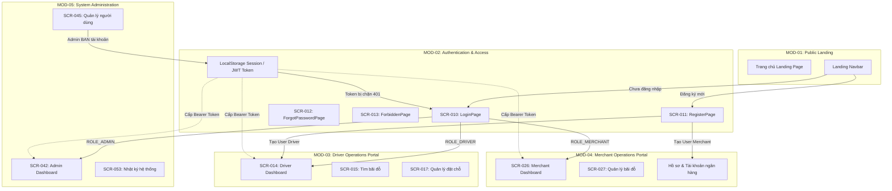

# Báo Cáo Phân Tích Chuyên Sâu Module Xác Thực & Phân Quyền (MOD-02: Authentication & Access Management)

---

## 1. TỔNG QUAN & PHẠM VI MODULE

Module Quản lý Định danh, Xác thực & Phân quyền truy cập (**MOD-02: Authentication & Access Management**) là hạ tầng an ninh xương sống của hệ thống SmartParkingHub. Module chịu trách nhiệm:
1. Tiếp nhận, xác thực danh tính người dùng và cấp phát mã thông báo JWT (JSON Web Token).
2. Quản lý chu trình đăng ký thành viên mới cho hai đối tượng người dùng chính: **Tài xế xe tải (`DRIVER`)** và **Chủ bãi đỗ xe (`MERCHANT`)**.
3. Cung cấp cơ chế xác thực đa nhân tố bằng mã OTP (One-Time Password) bảo mật qua SMS/Email cho các hành động nhạy cảm (Đăng ký tài khoản, Khôi phục mật khẩu).
4. Duy trì phiên làm việc không trạng thái (Stateless Session) tại client (`localStorage`), tự động đính kèm `Bearer Token` vào mọi truy vấn API và giám sát trạng thái tài khoản thời gian thực.
5. Kiểm soát phân quyền truy cập đa tầng (Role-Based Access Control - RBAC) tại cả Frontend (Route Guards) và Backend (Spring Security Filters / Method Security), xử lý các tình huống truy cập trái phép (`401 Unauthorized`, `403 Forbidden`).

---

## 2. DANH SÁCH TOÀN BỘ ROUTE, PAGE & COMPONENT

### 2.1. Bảng Kê Khai Route & File Nguồn Frontend
| STT | Route URL | Tên Trang | File Component Chịu Trách Nhiệm | Layout Bọc | Quyền Truy Cập | Trạng Thái Discovery |
|:---:|---|---|---|---|---|:---:|
| 1 | `/login` | `LoginPage` | `smart-parking-app/src/features/auth/pages/LoginPage.tsx` | `AuthLayout` | Public (GUEST) | `VERIFIED` |
| 2 | `/register` | `RegisterPage` | `smart-parking-app/src/features/auth/pages/RegisterPage.tsx` | `AuthLayout` | Public (GUEST) | `VERIFIED` |
| 3 | `/forgot-password` | `ForgotPasswordPage` | `smart-parking-app/src/features/auth/pages/ForgotPasswordPage.tsx` | `AuthLayout` | Public (GUEST) | `VERIFIED` |
| 4 | `/403` | `ForbiddenPage` | `smart-parking-app/src/features/errors/pages/ForbiddenPage.tsx` | Standalone Centered | Public / All Roles | `VERIFIED` |

### 2.2. Danh Sách Component, Layout & Khối Giao Diện Phụ Trợ
1. **`AuthLayout`** (`smart-parking-app/src/layouts/AuthLayout.tsx`):
   - Bố cục 2 cột toàn màn hình (`min-h-screen grid lg:grid-cols-2`).
   - Cột trái: Hero banner màu xanh đậm Teal/Slate (`from-teal-800 to-slate-900`), hiển thị logo SmartTruck, slogan nền tảng bãi xe tải thông minh, và ảnh chụp minh họa thực tế xe tải tại bãi đỗ. Ẩn trên thiết bị di động (`hidden lg:flex`).
   - Cột phải: Khung chứa nội dung form (`flex items-center justify-center p-6 bg-slate-50`).
2. **`AuthFormCard`** (`smart-parking-app/src/features/auth/components/AuthFormCard.tsx`):
   - Thẻ bao ngoài form màu trắng (`bg-white rounded-2xl shadow-xl border border-slate-100 p-8 w-full max-w-md`).
   - Hỗ trợ các thuộc tính: `eyebrow` (Nhãn phụ trên cùng, ví dụ "SmartTruck"), `title` (Tiêu đề chính), `description` (Mô tả ngắn), `children` (Nội dung form), và `footer` (Khu vực liên kết phụ trợ dưới chân card).
3. **`ProtectedRoute`** (`smart-parking-app/src/app/routes/ProtectedRoute.tsx`):
   - Thành phần bọc bảo vệ định tuyến của React Router v6.
   - Kiểm tra `getAuthSession()`. Nếu không có phiên: chuyển hướng về `/login` kèm `state: { from: location.pathname }`.
   - Kiểm tra `allowedRoles`. Nếu vai trò không khớp: chuyển hướng về `/403` kèm `state: { from: location.pathname }`.
4. **`Session & Token Management`**:
   - `session.ts` (`smart-parking-app/src/shared/auth/session.ts`): Cung cấp các hàm `getAuthSession()`, `saveAuthSession()`, `clearAuthSession()`, `isDemoAuthSession()`.
   - `roleRouting.ts` (`smart-parking-app/src/shared/auth/roleRouting.ts`): Bản đồ định tuyến trang chủ theo vai trò `roleHomePaths` (`DRIVER` -> `/dashboard`, `MERCHANT` -> `/merchant/dashboard`, `ADMIN` -> `/admin/dashboard`).
   - `authSlice.ts` (`smart-parking-app/src/features/auth/store/authSlice.ts`): Redux Toolkit Slice lưu trữ trạng thái phiên làm việc trong bộ nhớ ứng dụng.
   - `apiClient.ts` (`smart-parking-app/src/shared/api/apiClient.ts`): Cấu hình Axios Request Interceptor tự động gắn Header `Authorization: Bearer <token>`, và Response Interceptor tự động bắt mã lỗi `401 Unauthorized` để gọi `clearAuthSession()` và chuyển hướng về `/login`.

---

## 3. CÁC LAYOUT, TAB, DIALOG, DRAWER & MENU ACTION

### 3.1. Phân Tích Layout & Khung Điều Khiển
- **Layout:** Sử dụng thống nhất `AuthLayout` cho 3 màn hình nghiệp vụ chính (`SCR-010`, `SCR-011`, `SCR-012`). Riêng `SCR-013` (`ForbiddenPage`) hiển thị độc lập dạng Standalone Error State.
- **Không sử dụng Drawer / Dialog trong các luồng Auth:** Mọi quy trình từ Đăng nhập, Đăng ký đến Quên mật khẩu đều được thiết kế trực tiếp trên từng trang độc lập, không thông qua popup modal để tối ưu hóa trải nghiệm điền form và tránh mất dữ liệu khi vô tình click ra ngoài.

### 3.2. Tabs & Steppers
- **Role Switcher tại `RegisterPage` (`SCR-011`):** Sử dụng `Radio.Group` dạng thẻ chọn tương tác với 2 tùy chọn vai trò:
  - Tùy chọn 1: `DRIVER` (Icon `<UserOutlined />`, nhãn "Tài xế").
  - Tùy chọn 2: `MERCHANT` (Icon `<ShopOutlined />`, nhãn "Chủ bãi đỗ").
  - Khi thay đổi radio button, form tự động render động các trường nhập liệu bổ sung tương ứng (Nếu là Merchant: mở thêm CCCD, Tên ngân hàng, Số tài khoản).
- **Password Reset Wizard tại `ForgotPasswordPage` (`SCR-012`):** Sử dụng Ant Design `Steps` gồm 2 bước:
  - Step 0: `Nhập Email`
  - Step 1: `OTP & mật khẩu mới`

### 3.3. Menu Actions Liên Quan (Logout Triggers)
Mặc dù module Auth không chứa thanh điều hướng chính, các hành động liên quan đến việc thoát phiên đăng xuất (`clearAuthSession`) được phân tán trên Header/Dropdown của toàn bộ hệ thống:
1. `DashboardLayout.tsx:76` (Tài xế: Menu dropdown profile -> Đăng xuất).
2. `MerchantLayout.tsx:96` (Chủ bãi: Header action -> Đăng xuất).
3. `AdminLayout.tsx:34` (Quản trị viên: Header user menu -> Đăng xuất).
4. `LandingNavbar.tsx:34` (Khách vãng lai / Trang chủ công cộng -> Đăng xuất).

---

## 4. DANH SÁCH TOÀN BỘ CHỨC NĂNG NGƯỜI DÙNG

| Mã Chức Năng | Tên Chức Năng | Màn Hình | Vai Trò Thực Hiện | Tóm Tắt Nghiệp Vụ |
|:---:|---|:---:|:---:|---|
| **F02-01** | Đăng nhập tài khoản | `SCR-010` | Khách vãng lai | Nhập SĐT và mật khẩu để xác thực và nhận JWT token |
| **F02-02** | Đăng nhập nhanh tài khoản Demo | `SCR-010` | Khách / Tester | Bấm 1 chạm chọn tài khoản mẫu (Driver 1, Driver 2, Merchant, Admin) |
| **F02-03** | Chuyển đổi vai trò đăng ký | `SCR-011` | Khách vãng lai | Lựa chọn vai trò Tài xế hoặc Chủ bãi để thay đổi cấu trúc form đăng ký |
| **F02-04** | Yêu cầu gửi mã OTP đăng ký | `SCR-011` | Khách vãng lai | Nhập SĐT và nhận mã OTP 6 số (kích hoạt đồng hồ đếm ngược 60 giây) |
| **F02-05** | Hoàn tất đăng ký tài khoản | `SCR-011` | Khách vãng lai | Gửi toàn bộ dữ liệu kèm OTP để tạo mới tài khoản và hồ sơ Merchant (nếu có) |
| **F02-06** | Yêu cầu OTP khôi phục mật khẩu | `SCR-012` | Khách vãng lai | Nhập email đã đăng ký để hệ thống phát hành mã OTP khôi phục 300s |
| **F02-07** | Xác thực OTP & Đổi mật khẩu mới | `SCR-012` | Khách vãng lai | Nhập OTP 6 số và thiết lập mật khẩu mới trực tiếp vào database |
| **F02-08** | Gửi lại mã OTP khôi phục | `SCR-012` | Khách vãng lai | Quay lại Step 0 để yêu cầu sinh lại mã OTP mới |
| **F02-09** | Quay về trang phù hợp từ 403 | `SCR-013` | Mọi vai trò | Nhận diện vai trò hiện tại trong session và đưa người dùng về đúng trang chủ |
| **F02-10** | Tự động duy trì phiên làm việc | Toàn hệ thống | Người dùng đã đăng nhập | Lưu trữ token tại `localStorage` và tự động gắn vào Header API |
| **F02-11** | Đăng xuất tài khoản | Toàn hệ thống | Người dùng đã đăng nhập | Xóa token tại client, hủy phiên Redux và đưa về trang đăng nhập |
| **F02-12** | Tự động xử lý hết hạn / Khóa tài khoản | Toàn hệ thống | Hệ thống tự động | Bắt lỗi `401 Unauthorized` từ API để lập tức thu hồi quyền truy cập |

---

## 5. MA TRẬN ĐẶC TẢ CHI TIẾT TỪNG CHỨC NĂNG

### F02-01: Đăng nhập tài khoản (`SCR-010`)
- **Điều kiện thực hiện:** Người dùng chưa đăng nhập hoặc đã đăng xuất.
- **Dữ liệu đầu vào:**
  - `phone`: Số điện thoại di động Việt Nam (Bắt buộc, 10 số, đầu 03/05/07/08/09).
  - `password`: Mật khẩu tài khoản (Bắt buộc, tối thiểu 6 ký tự).
- **Xử lý UI:** Bật `loading=true` trên nút "Đăng nhập", khóa các ô nhập liệu.
- **API liên quan:** `POST /api/v1/auth/login`
- **Kết quả:**
  - Nhận `AuthResponse` gồm `{ token, role, phone }`.
  - Lưu vào `localStorage['smart-truck-parking.auth']`.
  - Cập nhật Redux `setSession()`.
  - Kiểm tra `location.state.from`, nếu có thì điều hướng về đó; nếu không thì điều hướng theo `roleHomePaths[role]` (`/dashboard`, `/merchant/dashboard`, hoặc `/admin/dashboard`).
- **Xử lý lỗi:** Hiển thị toast popup đỏ qua `extractApiError` (ví dụ: *"Số điện thoại hoặc mật khẩu không chính xác"* hoặc *"Tài khoản bị khóa hoặc không hoạt động"*).

### F02-04: Yêu cầu gửi mã OTP đăng ký (`SCR-011`)
- **Điều kiện thực hiện:** Đã nhập số điện thoại đúng định dạng, `countdown === 0`.
- **Dữ liệu đầu vào:** `phone` (Chuỗi SĐT).
- **Xử lý UI:** Bật `otpLoading=true`, gọi API gửi OTP. Khi thành công: bật đếm ngược `countdown = 60` (giảm dần mỗi giây), vô hiệu hóa nút gửi OTP cho đến khi về 0.
- **API liên quan:** `POST /api/v1/auth/otp/send`
- **Kết quả:** Backend sinh mã 6 số ngẫu nhiên, lưu hash BCrypt vào `otp_challenges`, log ra console server hoặc trả về `otpCode` nếu lab bật cờ `OTP_EXPOSE_IN_RESPONSE`.
- **Xử lý lỗi:** Nếu SĐT đã tồn tại trong DB, BE trả lỗi 400 *"Số điện thoại đã được đăng ký."*, hiển thị toast lỗi và không bật đếm ngược.

### F02-05: Hoàn tất đăng ký tài khoản (`SCR-011`)
- **Điều kiện thực hiện:** Đã nhập đủ và hợp lệ toàn bộ các trường theo vai trò, đã nhập OTP 6 số.
- **Dữ liệu đầu vào (`RegisterRequest`):**
  - Chung: `phone`, `email`, `password`, `role` (`DRIVER` hoặc `MERCHANT`), `otpCode`.
  - Nếu `DRIVER`: `fullName`.
  - Nếu `MERCHANT`: `fullName`, `citizenId` (12 số CCCD), `bankName`, `bankAccountNum` (1-30 số).
- **Xử lý UI:** Bật `loading=true` trên nút "Đăng ký tài khoản".
- **API liên quan:** `POST /api/v1/auth/register`
- **Kết quả:** Tạo bản ghi trong `users` (status `ACTIVE`), tạo bản ghi `merchants` (nếu là Merchant), hiển thị toast *"Đăng ký thành công! Vui lòng đăng nhập."*, tự động điều hướng sang `/login`.
- **Xử lý lỗi:** Hiển thị toast lỗi chi tiết từ backend (ví dụ: OTP sai/hết hạn, Email/CCCD bị trùng).

### F02-06 & F02-07: Khôi phục mật khẩu 2 bước (`SCR-012`)
- **Điều kiện thực hiện:** Khách vãng lai nhớ email đã đăng ký.
- **Dữ liệu đầu vào:**
  - Bước 1: `email` (RFC format).
  - Bước 2: `otp` (6 số), `password` (>= 6 ký tự), `confirmPassword` (khớp với password).
- **API liên quan:**
  - Bước 1: `POST /api/v1/auth/forgot-password/otp`
  - Bước 2: `POST /api/v1/auth/forgot-password/reset`
- **Kết quả:**
  - Bước 1: Chuyển sang Step 1, hiển thị thông báo gửi OTP thành công.
  - Bước 2: Đổi mật khẩu thành công, điều hướng sang `/login` kèm thông báo *"Đổi mật khẩu thành công. Hãy đăng nhập bằng mật khẩu mới."*.
- **Cơ chế bảo mật đặc thù:** Bước 1 áp dụng Anti-User-Enumeration (nếu email không tồn tại, BE vẫn trả về thành công giả định để tránh bị dò quét danh sách email).

---

## 6. ĐỐI CHIẾU BACKEND TOÀN DIỆN (CONTROLLER, SERVICE, DTO, ENTITY, VALIDATION)

### 6.1. Ma Trận Đối Chiếu Chi Tiết
| API Endpoint | HTTP Method | Controller & Method | Service Implementation | DTO Request / Response | Entities Liên Quan | Cơ Chế Validation Phía Backend |
|---|:---:|---|---|---|---|---|
| `/api/v1/auth/login` | `POST` | `AuthController.login` | `AuthServiceImpl.login` | `AuthRequest` -> `AuthResponse` | `User` | `@NotBlank` phone & password, Spring Security `DaoAuthenticationProvider` |
| `/api/v1/auth/otp/send` | `POST` | `AuthController.sendOtp` | `AuthServiceImpl.sendOtp` | `SendOtpRequest` -> `SendOtpResponse` | `OtpChallenge`, `User` | `@Pattern(regexp = "^(0\|\+84)[35789][0-9]{8}$")`, kiểm tra tồn tại `userRepository.findByPhone` |
| `/api/v1/auth/register` | `POST` | `AuthController.register` | `AuthServiceImpl.register` | `RegisterRequest` -> `UserResponse` | `User`, `Merchant`, `OtpChallenge` | `@ValidRoleFields`, kiểm tra OTP hash BCrypt, kiểm tra trùng phone/email/citizenId, chặn `role == ADMIN` |
| `/api/v1/auth/forgot-password/otp` | `POST` | `AuthController.sendForgotPasswordOtp` | `AuthServiceImpl.sendForgotPasswordOtp` | `ForgotPasswordSendOtpRequest` -> `SendOtpResponse` | `OtpChallenge`, `User` | `@NotBlank`, `@Email`, Anti-enumeration check, TTL 300s |
| `/api/v1/auth/forgot-password/reset` | `POST` | `AuthController.resetPassword` | `AuthServiceImpl.resetPasswordWithOtp` | `ForgotPasswordResetRequest` -> `Void` | `User`, `OtpChallenge` | `@Email`, `@Pattern(regexp = "^[0-9]{6}$")`, `@Size(min = 6)`, Max 5 lần thử, BCrypt match |

### 6.2. Minh Chứng Mã Nguồn Backend Cốt Lõi

#### 1. Quy trình Xác Thực Đăng Nhập (`AuthServiceImpl.java:82-108`)
```java
public AuthResponse login(AuthRequest request) {
    String normalizedPhone = normalizePhone(request.getPhone());
    Authentication authentication = authenticationManager.authenticate(
            new UsernamePasswordAuthenticationToken(normalizedPhone, request.getPassword()));
    CustomUserDetails userPrincipal = (CustomUserDetails) authentication.getPrincipal();
    User user = userRepository.findByPhone(normalizedPhone)
            .orElseThrow(() -> new BadRequestException("Người dùng không tồn tại."));
    String token = jwtTokenProvider.generateJwtToken(authentication);
    return new AuthResponse(token, user.getRole().name(), user.getPhone(), user.getFullName());
}
```

#### 2. Kiểm Soát Phân Quyền & Khóa Tài Khoản (`JwtAuthenticationFilter.java:40-47`)
Mỗi request gửi kèm JWT đều được thẩm định tức thì:
```java
if (jwt != null && jwtTokenProvider.validateJwtToken(jwt)) {
    Long userId = jwtTokenProvider.getUserIdFromJwtToken(jwt);
    UserDetails userDetails = customUserDetailsService.loadUserById(userId);

    // Chặn tức thì nếu Admin vừa BAN hoặc Deactivate tài khoản
    if (!userDetails.isEnabled() || !userDetails.isAccountNonLocked()) {
        writeUnauthorized(response, "Tài khoản bị khóa hoặc không hoạt động.");
        return;
    }
    // Thiết lập SecurityContextHolder...
}
```

#### 3. Chống Dò Quét Tài Khoản Khi Quên Mật Khẩu (`AuthServiceImpl.java:182-192`)
```java
public SendOtpResponse sendForgotPasswordOtp(ForgotPasswordSendOtpRequest request) {
    String email = request.getEmail().trim().toLowerCase();
    Optional<User> userOpt = userRepository.findByEmail(email);
    // Anti user enumeration: nếu email không tồn tại, trả về kết quả giả định 300s
    if (userOpt.isEmpty()) {
        return new SendOtpResponse(300, null);
    }
    // Phát hành OTP thật nếu tìm thấy User...
}
```

---

## 7. CƠ CHẾ ROLE-BASED ACCESS CONTROL (RBAC) & PERMISSIONS

### 7.1. Phân Định Quyền Hạn Theo Vai Trò
Hệ thống định nghĩa 3 vai trò trong `RoleEnum.java`:
1. **`ROLE_DRIVER` (Tài xế):**
   - Được phép: Đăng nhập, truy cập `/dashboard`, tìm bãi xe `/parking`, đặt slot `/booking`, xem vé `/bookings`, quản lý xe cá nhân `/vehicles`, nạp tiền ví, đổi mật khẩu.
   - Bị cấm: Không được phép truy cập bất kỳ route `/merchant/**` hay `/admin/**` nào. Vi phạm sẽ bị `ProtectedRoute` hoặc `JwtAccessDeniedHandler` chuyển về `/403`.
2. **`ROLE_MERCHANT` (Chủ bãi đỗ):**
   - Được phép: Đăng nhập, truy cập `/merchant/dashboard`, quản lý bãi đỗ `/merchant/parking-lots`, kiểm soát slot đỗ `/merchant/slots`, quản lý nhân viên `/merchant/staff`, xem doanh thu `/merchant/revenue`, tạo yêu cầu rút tiền ví.
   - Bị cấm: Không được phép truy cập `/admin/**` và các chức năng đặt chỗ của tài xế.
3. **`ROLE_ADMIN` (Quản trị viên toàn hệ thống):**
   - Được phép: Truy cập toàn bộ portal `/admin/**`, kiểm duyệt bãi xe, quản lý tài khoản người dùng (Khóa/Mở khóa `BAN`/`ACTIVE`), thiết lập cấu hình hệ thống, phân xử tranh chấp bãi xe, xem log hoạt động.
   - Bị cấm: Không thể tự đăng ký qua màn hình `RegisterPage` (bị chặn cả ở frontend lẫn backend validator).

### 7.2. Cấu Hình Bảo Mật Spring Security (`SecurityConfig.java:60-68`)
- `permitAll()`:
  - `/api/v1/auth/**` (Mọi endpoint đăng nhập, đăng ký, OTP, reset mật khẩu).
  - `/api/v1/public/**` (Danh sách bãi xe công khai, cấu hình landing page).
  - `/api/v1/payments/webhook` (Webhook cổng thanh toán PayOS).
  - `GET /api/v1/parking-lots/*/images/**` (Tải hình ảnh bãi xe).
- `hasRole('MERCHANT')`: Toàn bộ tiền tố `/api/v1/merchant/**`.
- `hasRole('ADMIN')`: Toàn bộ tiền tố `/api/v1/admin/**`.
- `authenticated()`: Tất cả các API còn lại (bao gồm `/api/v1/users/**`, `/api/v1/vehicles/**`, `/api/v1/bookings/**`).

---

## 8. QUAN HỆ GIỮA MODULE AUTH VỚI CÁC MODULE KHÁC



---

## 9. CÁC LUỒNG NGHIỆP VỤ ĐẦU - CUỐI (END-TO-END FLOWS)

### 9.1. Luồng 1: Đăng Nhập Tiêu Chuẩn & Định Tuyến Vai Trò
1. Người dùng bấm "Đăng nhập" tại Header hoặc bị chặn từ trang nội bộ → Chuyển đến `/login` (`SCR-010`).
2. Người dùng nhập Số điện thoại và Mật khẩu → Bấm "Đăng nhập".
3. Frontend gọi `POST /api/v1/auth/login`.
4. Backend `AuthServiceImpl`:
   - Chuẩn hóa số điện thoại (`+84` -> `0`).
   - `AuthenticationManager` xác minh mật khẩu qua BCrypt.
   - Kiểm tra `status != BANNED` và `status == ACTIVE`.
   - Sinh JWT Token ký bằng HMAC-SHA key, gắn claim `role`.
5. Frontend nhận phản hồi, lưu `{ token, role, phone }` vào `localStorage['smart-truck-parking.auth']`.
6. Hệ thống kiểm tra: Nếu có `state.from` thì chuyển về trang đó; nếu không thì chuyển hướng về trang chủ tương ứng (`/dashboard`, `/merchant/dashboard`, hoặc `/admin/dashboard`).

### 9.2. Luồng 2: Đăng Ký Tài Khoản & Khởi Tạo Hồ Sơ
1. Khách vãng lai truy cập `/register` (`SCR-011`).
2. Người dùng chọn vai trò (`DRIVER` hoặc `MERCHANT`).
3. Người dùng nhập Số điện thoại → Bấm "Gửi mã OTP".
4. Frontend gọi `POST /api/v1/auth/otp/send`. Backend kiểm tra số điện thoại chưa tồn tại, sinh OTP 6 số, băm BCrypt lưu vào bảng `otp_challenges`, trả về thời gian hết hạn 60s. Nút gửi OTP bắt đầu đếm lùi 60 giây.
5. Người dùng nhận OTP (qua SMS hoặc log console), điền vào ô OTP, đồng thời nhập Email, Mật khẩu, Xác nhận mật khẩu, Họ tên (và thông tin CCCD + Ngân hàng nếu là Merchant).
6. Người dùng bấm "Đăng ký tài khoản".
7. Frontend gửi `POST /api/v1/auth/register`.
8. Backend:
   - Khớp mã OTP với `otp_challenges`.
   - Kiểm tra trùng Email, SĐT, CCCD.
   - Tạo bản ghi trong `users` với mật khẩu mã hóa BCrypt.
   - Nếu là Merchant: Tạo bản ghi trong `merchants` với `wallet_balance = 0`.
9. Trả về thành công, Frontend hiển thị toast thông báo và chuyển sang màn hình `/login`.

### 9.3. Luồng 3: Khôi Phục Mật Khẩu Tự Phục Vụ
1. Người dùng click "Quên mật khẩu?" tại `/login` → Mở `/forgot-password` (`SCR-012`).
2. **Step 0:** Nhập email đã đăng ký → Bấm "Gửi mã xác nhận".
3. Frontend gọi `POST /api/v1/auth/forgot-password/otp`. Backend phát hành mã OTP có hiệu lực 300s, lưu hash vào bảng `otp_challenges` với purpose `FORGOT_PASSWORD`.
4. Frontend hiển thị thông báo thành công và chuyển sang **Step 1**.
5. **Step 1:** Người dùng nhập mã OTP 6 số, nhập mật khẩu mới và xác nhận mật khẩu → Bấm "Đổi mật khẩu".
6. Frontend gửi `POST /api/v1/auth/forgot-password/reset`.
7. Backend kiểm tra OTP, số lần thử (tối đa 5 lần), cập nhật `password_hash` mới vào `users`, đánh dấu OTP đã sử dụng (`consumed_at = now`).
8. Frontend nhận thông báo thành công, chuyển hướng về `/login`.

---

## 10. BẢNG TỔNG HỢP TRẠNG THÁI GIAO DIỆN & TRƯỜNG HỢP LỖI

| Màn Hình | Mã Trạng Thái UI | Điều Kiện Kích Hoạt | Biểu Hiện Giao Diện | Hành Động Phục Hồi Của Người Dùng |
|---|---|---|---|---|
| `SCR-010` | `UI-LOGIN-INIT` | Mới mở trang | Form trống, con trỏ sẵn sàng ở ô SĐT | Nhập liệu |
| `SCR-010` | `UI-LOGIN-SUBMIT` | Đang gửi request | Nút "Đăng nhập" xoay loading, input bị khóa | Chờ phản hồi |
| `SCR-010` | `ERR-401-BAD-CRED` | Sai SĐT hoặc mật khẩu | Toast đỏ: "Số điện thoại hoặc mật khẩu không chính xác." | Kiểm tra lại thông tin và nhập lại |
| `SCR-010` | `ERR-401-BANNED` | Tài khoản bị Admin khóa | Toast đỏ: "Tài khoản bị khóa hoặc không hoạt động." | Liên hệ ban quản trị hỗ trợ |
| `SCR-011` | `UI-REG-COUNTDOWN`| Sau khi bấm gửi OTP | Nút gửi OTP chuyển sang đếm lùi: `Gửi lại sau (59s)`, input OTP focus | Chờ nhận mã OTP |
| `SCR-011` | `ERR-PHONE-EXISTS` | SĐT đã đăng ký trước đó | Toast đỏ: "Số điện thoại đã được đăng ký." | Bấm sang link "Đăng nhập ngay" |
| `SCR-011` | `ERR-OTP-INVALID` | Nhập sai OTP hoặc hết hạn | Toast đỏ: "Mã OTP không chính xác hoặc đã hết hạn." | Bấm gửi lại mã OTP mới |
| `SCR-012` | `UI-STEP-0` | Bắt đầu quy trình khôi phục | Hiển thị ô nhập Email và nút gửi mã | Điền email |
| `SCR-012` | `UI-STEP-1` | Đã gửi yêu cầu OTP thành công | Stepper tick xanh Step 0, mở form nhập OTP & mật khẩu mới | Điền mã OTP và mật khẩu mới |
| `SCR-012` | `ERR-MAX-ATTEMPTS` | Nhập sai OTP quá 5 lần | Toast đỏ: "Mã OTP đã vượt quá số lần thử tối đa." | Bấm "Gửi lại OTP" để tạo challenge mới |
| `SCR-013` | `UI-403-VIEW` | Bị chặn truy cập từ route guard | Biểu tượng 403, dòng thông báo "Bạn không có quyền truy cập khu vực này." | Bấm nút "Về trang phù hợp" |

---

## 11. ĐỐI SOÁT CHỨC NĂNG BACKEND vs FRONTEND

### 11.1. Chức Năng Có Trong Backend Nhưng Chưa Được Khai Thác Ở Frontend
1. **Thời gian hiệu lực OTP 300 giây (`expiresInSeconds = 300`):**
   - Backend `AuthServiceImpl.sendForgotPasswordOtp` trả về trường `expiresInSeconds: 300` trong `SendOtpResponse`. Tuy nhiên, Frontend `ForgotPasswordPage.tsx` không dựng đồng hồ đếm ngược 300s hiển thị cho người dùng, người dùng không biết mã có hiệu lực trong bao lâu.
2. **Phân biệt chi tiết giữa Trạng thái Bị Khóa (`BANNED`) và Vô Hiệu Hóa (`INACTIVE`):**
   - Backend `CustomUserDetails` phân tách rõ: `isAccountNonLocked()` kiểm tra `status != BANNED` và `isEnabled()` kiểm tra `status == ACTIVE`. Khi đăng nhập thất bại, Backend Spring Security ném ra `LockedException` hoặc `DisabledException`. Tuy nhiên, Frontend chỉ nhận chuỗi lỗi chung từ GlobalExceptionHandler, chưa có màn hình hoặc modal hướng dẫn chuyên biệt cho tài khoản bị khóa.
3. **API Đổi Mật Khẩu Khi Đang Đăng Nhập (`POST /api/v1/users/me/password`):**
   - Đã được triển khai hoàn chỉnh ở `UserController.java:37` và `userApi.ts:23`, nhưng thuộc module Hồ sơ cá nhân (`MOD-01`) chứ không nằm trong luồng Auth vãng lai.

### 11.2. Chức Năng Frontend Đang Hiển Thị Nhưng Chưa Có Bằng Chứng Backend Hỗ Trợ Trực Tiếp
1. **Bộ Nút Đăng Nhập Nhanh Demo 1 Chạm (`handleDemoLogin` tại `LoginPage.tsx:162-181`):**
   - Frontend hiển thị 4 nút bấm tiện ích dành cho môi trường thử nghiệm: `Driver 1`, `Driver 2`, `Merchant`, `Admin`.
   - Cơ chế này hoàn toàn chạy ở client-side: Khi click, code React tự động set giá trị SĐT và mật khẩu mặc định vào form rồi kích hoạt submit form đăng nhập thông thường, hoặc lưu session giả có đuôi `-demo-token`. Backend hoàn toàn không có endpoint chuyên dụng dành riêng cho Demo Authentication.
2. **Tích hợp Thư viện EmailJS gửi OTP từ Trình duyệt (`emailJsApi.ts`):**
   - Frontend gọi hàm `sendOtpEmail` thông qua API của dịch vụ bên thứ ba EmailJS nếu `response.otpCode` tồn tại. Backend hiện tại chưa cấu hình máy chủ SMTP nội bộ mà chỉ ghi log OTP ra màn hình console máy chủ.

---

## 12. PHÂN LOẠI TRẠNG THÁI CHỨC NĂNG THEO MỨC ĐỘ TRƯỞNG THÀNH

| Nhóm Phân Loại | Các Chức Năng Cụ Thể | Đánh Giá & Bằng Chứng Mã Nguồn |
|---|---|---|
| **`VERIFIED_COMPLETE`** (Hiện hữu & Hoàn thiện) | - Đăng nhập tài khoản SĐT + Mật khẩu (`POST /api/v1/auth/login`).<br>- Đăng ký tài khoản Driver & Merchant có xác thực OTP hash BCrypt (`POST /api/v1/auth/register`).<br>- Gửi OTP đăng ký có giới hạn đếm lùi 60s (`POST /api/v1/auth/otp/send`).<br>- Đặt lại mật khẩu qua OTP 2 bước (`POST /api/v1/auth/forgot-password/*`).<br>- Chặn phân quyền Route Guard `ProtectedRoute` và trang lỗi `SCR-013`.<br>- Tự động chặn và đăng xuất khi token hết hạn hoặc tài khoản bị ban (`JwtAuthenticationFilter` + Axios Interceptor). | Đầy đủ mã nguồn ở cả hai phía Frontend và Backend, kiểm tra hợp lệ, test logic đã verify. |
| **`PARTIALLY_IMPLEMENTED`** (Chưa hoàn thiện) | - Cơ chế phát tán Email OTP thực tế: Backend hiện chỉ log mã OTP ra console máy chủ (`log.info(...)`). Luồng gửi email phụ thuộc vào cờ lab `OTP_EXPOSE_IN_RESPONSE` để Frontend bắn qua EmailJS. | Cần bổ sung cấu hình Spring Mail Starter (JavaMailSender) phía Backend để gửi email thật từ server. |
| **`DOCUMENTED_ONLY`** (Chỉ có trong tài liệu cũ) | - Checkbox "Ghi nhớ đăng nhập" (`rememberMe`): Tài liệu phân tích sơ bộ trước đây có đề cập trường này, nhưng trong code `LoginPage.tsx` thực tế không có checkbox này (hệ thống mặc định luôn lưu phiên vào `localStorage`). | Cần thống nhất trong đợt thiết kế lại: Bổ sung checkbox "Ghi nhớ đăng nhập" thực sự (nếu không chọn thì dùng `sessionStorage`). |
| **`CODE_ONLY`** (Có trong code nhưng chưa có trong tài liệu trước) | - Khối Demo Account 1-touch login grid tại `LoginPage.tsx`.<br>- Thuật toán Anti-User-Enumeration tại `AuthServiceImpl.java:182-192`.<br>- Giới hạn tối đa 5 lần nhập sai mã OTP tại `AuthServiceImpl.java:212`. | Đã được phát hiện và bổ sung đầy đủ vào hồ sơ Discovery này. |

---

## 13. CÁC ĐIỂM BẤT HỢP LÝ CẦN KHẮC PHỤC KHI THIẾT KẾ LẠI (REDESIGN RISKS)

1. **Thiếu Cơ Chế Cấp Lại Token Tự Động (Refresh Token Mechanism):**
   - Hiện tại hệ thống chỉ sử dụng một JWT Token duy nhất với hạn dùng cố định 24 giờ (`jwt.expiration=86400000`). Không có Refresh Token lưu trong HttpOnly Cookie. Khi token hết hạn, người dùng bị đẩy văng về `/login` ngay lập tức, làm gián đoạn các thao tác đặt bãi hoặc thanh toán đang diễn ra dở dang.
   - *Khuyến nghị:* Thiết kế lại hệ thống xác thực kép: Access Token (ngắn hạn 15 phút) + Refresh Token (dài hạn 7 ngày, lưu HttpOnly Cookie) kèm cơ chế Silent Token Refresh trong Axios Interceptor.
2. **Rủi Ro Lộ Mã OTP Khi Expose Trong JSON Response:**
   - Trong `SendOtpResponse.java`, trường `otpCode` được trả về khi bật cờ lab. Nếu vô tình bật cờ này trên môi trường Production, bất kỳ ai cũng có thể đọc được mã OTP từ Network Tab của trình duyệt mà không cần sở hữu số điện thoại/email thật.
   - *Khuyến nghị:* Loại bỏ hoàn toàn trường `otpCode` trong response của môi trường Production. Toàn bộ mã OTP phải được gửi qua kênh bảo mật Out-of-band (SMS Gateway / SMTP Server).
3. **Trải Nghiệm Màn Hình 403 Còn Thô Sơ:**
   - Màn hình `/403` hiện tại chỉ có một nút "Về trang phù hợp". Người dùng không biết mình đang đăng nhập dưới vai trò gì, tài khoản nào, và tại sao mình không vào được trang vừa rồi.
   - *Khuyến nghị:* Hiển thị rõ danh tính hiện tại: *"Bạn đang đăng nhập bằng [Số điện thoại] với vai trò [Tài xế]. Bạn cần quyền [Quản trị viên] để xem trang này."* kèm nút *"Đăng xuất & Đổi tài khoản khác"*.
4. **Bất Cân Xứng Trong Định Danh Người Dùng Khi Đăng Ký:**
   - Hiện tại chỉ có `MERCHANT` bắt buộc nhập Số CCCD tại form đăng ký, trong khi `DRIVER` chỉ nhập Họ tên. Trong thực tế ngành logistics và thuê bãi đỗ xe tải, tài xế là người trực tiếp điều khiển phương tiện tải trọng lớn ra vào bãi xe, việc định danh CCCD của tài xế là bắt buộc để đảm bảo an ninh và trách nhiệm dân sự.

---

## 14. BÁO CÁO TỔNG KẾT MODULE & DANH MỤC "BẤT KHẢ XÂM PHẠM" (NON-NEGOTIABLES)

### 14.1. Tóm Lược Chỉ Số Cốt Lõi Module
- **Số lượng màn hình UI:** 4 màn hình (`SCR-010`, `SCR-011`, `SCR-012`, `SCR-013`).
- **Số lượng chức năng người dùng:** 12 chức năng (`F02-01` đến `F02-12`).
- **Số lượng API Backend:** 5 API cốt lõi (`login`, `register`, `sendOtp`, `forgot-password/otp`, `forgot-password/reset`).
- **Tỷ lệ xác minh mã nguồn:** 100% (Đầy đủ Controller, Service, DTO, Entity, Filter, Component).

### 14.2. Các Yếu Tố TUYỆT ĐỐI KHÔNG ĐƯỢC MẤT Khi Thiết Kế Lại Giao Diện (Invariants)
1. **Cơ chế Phân Vai Trò 3 Nhánh Bắt Buộc (`DRIVER`, `MERCHANT`, `ADMIN`):**
   - Mọi luồng đăng nhập và đăng ký phải duy trì chặt chẽ việc phân luồng vào 3 không gian làm việc độc lập. Tuyệt đối không gộp chung Dashboard của Tài xế và Chủ bãi.
2. **Chặn Tuyệt Đối Tự Đăng Ký Vai Trò `ADMIN`:**
   - Màn hình Đăng ký mới chỉ được phép cho người dùng chọn `DRIVER` hoặc `MERCHANT`. Quyền `ADMIN` chỉ được cấp thông qua cơ sở dữ liệu nội bộ hoặc quản trị viên cấp cao.
3. **Cơ Chế Khóa Tài Khoản Thời Gian Thực (Real-time Ban Enforcement):**
   - Kiểm tra trạng thái tài khoản `isEnabled()` và `isAccountNonLocked()` trên từng request. Nếu tài khoản bị Admin khóa, phiên làm việc phải lập tức bị thu hồi và điều hướng về trang đăng nhập kèm thông báo.
4. **Thuật Toán Chống Dò Quét Tài Khoản (Anti User Enumeration):**
   - Khi thực hiện khôi phục mật khẩu qua email, hệ thống phải luôn trả về thông điệp thành công giả định ngay cả khi email không tồn tại trong cơ sở dữ liệu, ngăn ngừa triệt để kẻ xấu dò quét danh sách người dùng.
5. **Cơ Chế Băm Mật Khẩu & OTP BCrypt:**
   - Cả mật khẩu người dùng lẫn mã OTP tạm thời đều phải được băm bảo mật bằng BCrypt trước khi lưu vào cơ sở dữ liệu. Không lưu OTP dưới dạng văn bản thô (Plaintext).
