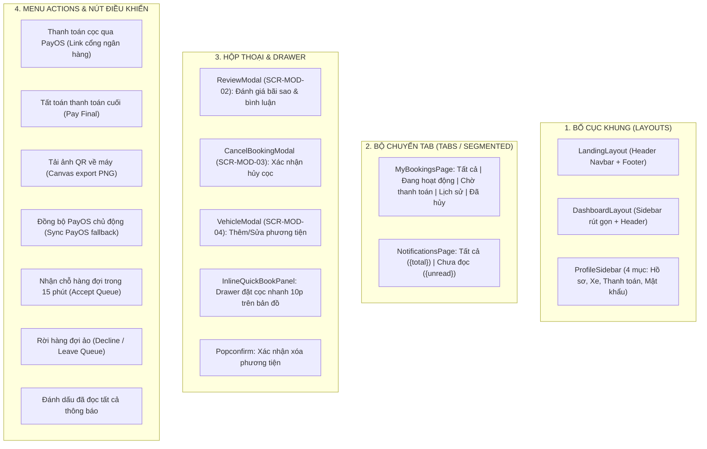
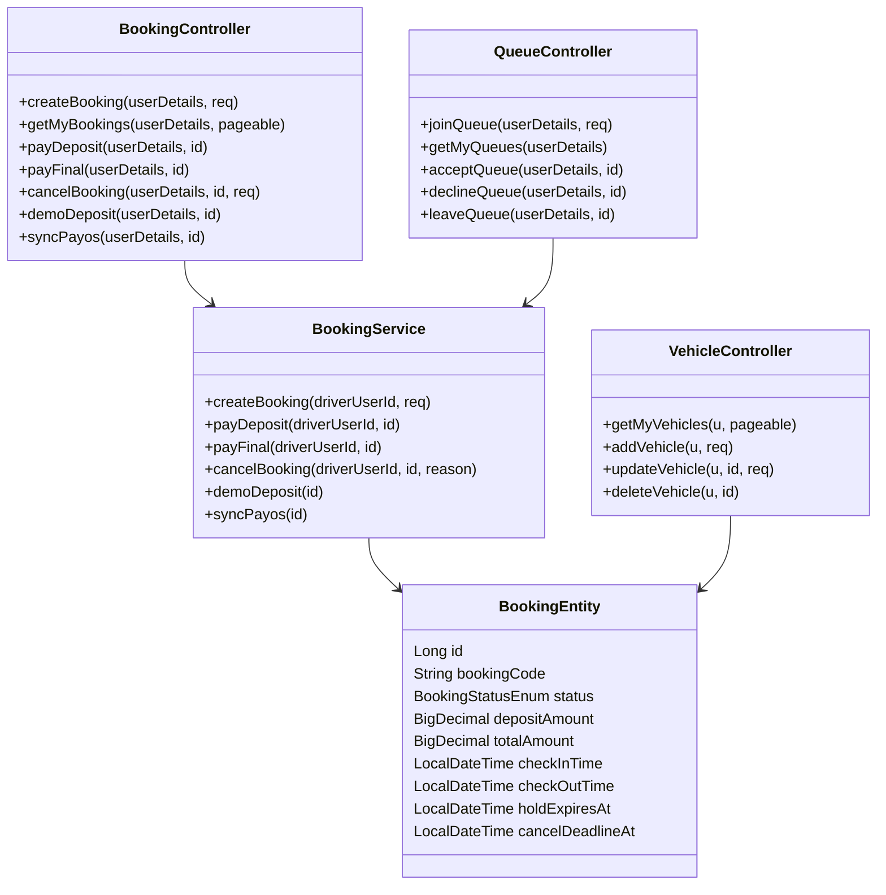

# Báo Cáo Phân Tích Chuyên Sâu: Cổng Vận Hành Tài Xế (MOD-03: Driver Operations Portal)

---

## 1. PHẠM VI KHẢO SÁT & DANH SÁCH ROUTE

Phân hệ **Cổng Tài Xế (`MOD-03`)** là không gian vận hành số dành cho tài xế xe tải, xe container, xe khách và ô tô thương mại để tìm kiếm bãi đỗ an toàn, đặt chỗ trước, xếp hàng ảo, thanh toán không tiền mặt và quản lý thông tin xe.

Toàn bộ các tuyến đường (routes) của module được khai báo tập trung tại [`AppRoutes.tsx:71-91`](file:///d:/Documents/JAVA%20WEB%20SERVICE/SmartParkingHub/smart-parking-app/src/app/routes/AppRoutes.tsx#L71-L91) và được bảo vệ bởi bộ lọc xác thực `RequireRole` với vai trò `ROLE_DRIVER`:

| STT | Route URL | Page Component Chịu Trách Nhiệm | Layout Bọc | Dòng Khai Báo Mã Nguồn |
|---|---|---|---|---|
| 1 | `/dashboard` | [`DashboardHomePage`](file:///d:/Documents/JAVA%20WEB%20SERVICE/SmartParkingHub/smart-parking-app/src/features/driver/pages/DashboardHomePage.tsx) | `DashboardLayout` | [`AppRoutes.tsx:86`](file:///d:/Documents/JAVA%20WEB%20SERVICE/SmartParkingHub/smart-parking-app/src/app/routes/AppRoutes.tsx#L86) |
| 2 | `/parking` & `/dashboard/search` | [`SearchParkingPage`](file:///d:/Documents/JAVA%20WEB%20SERVICE/SmartParkingHub/smart-parking-app/src/features/driver/pages/SearchParkingPage.tsx) | `LandingLayout` / `DashboardLayout` | [`AppRoutes.tsx:71`](file:///d:/Documents/JAVA%20WEB%20SERVICE/SmartParkingHub/smart-parking-app/src/app/routes/AppRoutes.tsx#L71), [`AppRoutes.tsx:87`](file:///d:/Documents/JAVA%20WEB%20SERVICE/SmartParkingHub/smart-parking-app/src/app/routes/AppRoutes.tsx#L87) |
| 3 | `/dashboard/parking/:id` | [`ParkingDetailPage`](file:///d:/Documents/JAVA%20WEB%20SERVICE/SmartParkingHub/smart-parking-app/src/features/driver/pages/ParkingDetailPage.tsx) | `DashboardLayout` | [`AppRoutes.tsx:91`](file:///d:/Documents/JAVA%20WEB%20SERVICE/SmartParkingHub/smart-parking-app/src/app/routes/AppRoutes.tsx#L91) |
| 4 | `/bookings` | [`MyBookingsPage`](file:///d:/Documents/JAVA%20WEB%20SERVICE/SmartParkingHub/smart-parking-app/src/features/bookings/pages/MyBookingsPage.tsx) | `LandingLayout` | [`AppRoutes.tsx:72`](file:///d:/Documents/JAVA%20WEB%20SERVICE/SmartParkingHub/smart-parking-app/src/app/routes/AppRoutes.tsx#L72) |
| 5 | `/queues` | [`DriverQueuesPage`](file:///d:/Documents/JAVA%20WEB%20SERVICE/SmartParkingHub/smart-parking-app/src/features/queues/pages/DriverQueuesPage.tsx) | `LandingLayout` | [`AppRoutes.tsx:73`](file:///d:/Documents/JAVA%20WEB%20SERVICE/SmartParkingHub/smart-parking-app/src/app/routes/AppRoutes.tsx#L73) |
| 6 | `/payments` | [`DriverPaymentsPage`](file:///d:/Documents/JAVA%20WEB%20SERVICE/SmartParkingHub/smart-parking-app/src/features/payments/pages/DriverPaymentsPage.tsx) | `LandingLayout` | [`AppRoutes.tsx:74`](file:///d:/Documents/JAVA%20WEB%20SERVICE/SmartParkingHub/smart-parking-app/src/app/routes/AppRoutes.tsx#L74) |
| 7 | `/vehicles` & `/dashboard/vehicles` | [`VehiclesPage`](file:///d:/Documents/JAVA%20WEB%20SERVICE/SmartParkingHub/smart-parking-app/src/features/vehicles/pages/VehiclesPage.tsx) | `LandingLayout` / `DashboardLayout` | [`AppRoutes.tsx:75`](file:///d:/Documents/JAVA%20WEB%20SERVICE/SmartParkingHub/smart-parking-app/src/app/routes/AppRoutes.tsx#L75), [`AppRoutes.tsx:88`](file:///d:/Documents/JAVA%20WEB%20SERVICE/SmartParkingHub/smart-parking-app/src/app/routes/AppRoutes.tsx#L88) |
| 8 | `/profile` & `/dashboard/profile` | [`ProfilePage`](file:///d:/Documents/JAVA%20WEB%20SERVICE/SmartParkingHub/smart-parking-app/src/features/profile/pages/ProfilePage.tsx) | `LandingLayout` / `DashboardLayout` | [`AppRoutes.tsx:76`](file:///d:/Documents/JAVA%20WEB%20SERVICE/SmartParkingHub/smart-parking-app/src/app/routes/AppRoutes.tsx#L76), [`AppRoutes.tsx:89`](file:///d:/Documents/JAVA%20WEB%20SERVICE/SmartParkingHub/smart-parking-app/src/app/routes/AppRoutes.tsx#L89) |
| 9 | `/change-password` & `/dashboard/change-password` | [`ChangePasswordPage`](file:///d:/Documents/JAVA%20WEB%20SERVICE/SmartParkingHub/smart-parking-app/src/features/profile/pages/ChangePasswordPage.tsx) | `LandingLayout` / `DashboardLayout` | [`AppRoutes.tsx:77`](file:///d:/Documents/JAVA%20WEB%20SERVICE/SmartParkingHub/smart-parking-app/src/app/routes/AppRoutes.tsx#L77), [`AppRoutes.tsx:90`](file:///d:/Documents/JAVA%20WEB%20SERVICE/SmartParkingHub/smart-parking-app/src/app/routes/AppRoutes.tsx#L90) |
| 10 | `/payment/success` | [`PaymentReturnPage`](file:///d:/Documents/JAVA%20WEB%20SERVICE/SmartParkingHub/smart-parking-app/src/features/payments/pages/PaymentReturnPage.tsx) (mode="success") | Không (Standalone Page) | [`AppRoutes.tsx:78`](file:///d:/Documents/JAVA%20WEB%20SERVICE/SmartParkingHub/smart-parking-app/src/app/routes/AppRoutes.tsx#L78) |
| 11 | `/payment/cancel` | [`PaymentReturnPage`](file:///d:/Documents/JAVA%20WEB%20SERVICE/SmartParkingHub/smart-parking-app/src/features/payments/pages/PaymentReturnPage.tsx) (mode="cancel") | Không (Standalone Page) | [`AppRoutes.tsx:79`](file:///d:/Documents/JAVA%20WEB%20SERVICE/SmartParkingHub/smart-parking-app/src/app/routes/AppRoutes.tsx#L79) |
| 12 | `/notifications` | [`NotificationsPage`](file:///d:/Documents/JAVA%20WEB%20SERVICE/SmartParkingHub/smart-parking-app/src/features/notifications/pages/NotificationsPage.tsx) | `LandingLayout` | [`AppRoutes.tsx:80`](file:///d:/Documents/JAVA%20WEB%20SERVICE/SmartParkingHub/smart-parking-app/src/app/routes/AppRoutes.tsx#L80) |

---

## 2. DANH SÁCH PAGE & COMPONENT LIÊN QUAN

### A. Danh Sách Trang Chính (Feature Pages)
1. [`DashboardHomePage.tsx`](file:///d:/Documents/JAVA%20WEB%20SERVICE/SmartParkingHub/smart-parking-app/src/features/driver/pages/DashboardHomePage.tsx): Tổng quan tình trạng đặt xe, phương tiện cá nhân, phím tắt điều hướng nhanh và lịch sử 3 giao dịch mới nhất.
2. [`SearchParkingPage.tsx`](file:///d:/Documents/JAVA%20WEB%20SERVICE/SmartParkingHub/smart-parking-app/src/features/driver/pages/SearchParkingPage.tsx): Bản đồ tìm bãi tương tác Leaflet OpenStreetMap, tính khoảng cách Haversine, lọc bán kính, drawer đặt cọc nhanh 10 phút.
3. [`ParkingDetailPage.tsx`](file:///d:/Documents/JAVA%20WEB%20SERVICE/SmartParkingHub/smart-parking-app/src/features/driver/pages/ParkingDetailPage.tsx): Hồ sơ chi tiết bãi đỗ, thư viện hình ảnh, bảng giá niêm yết theo giờ, form đặt chỗ giữ slot hoặc tham gia xếp hàng ảo.
4. [`MyBookingsPage.tsx`](file:///d:/Documents/JAVA%20WEB%20SERVICE/SmartParkingHub/smart-parking-app/src/features/bookings/pages/MyBookingsPage.tsx): Danh sách vé đặt chỗ, hiển thị mã QR check-in động, tính năng tải ảnh QR về máy, nút thanh toán cọc PayOS, nút tất toán cuối, nút hủy cọc hoàn tiền, nút đồng bộ PayOS và nút đánh giá bãi.
5. [`DriverQueuesPage.tsx`](file:///d:/Documents/JAVA%20WEB%20SERVICE/SmartParkingHub/smart-parking-app/src/features/queues/pages/DriverQueuesPage.tsx): Quản lý hàng đợi ảo, hiển thị số thứ tự hàng đợi, đồng hồ đếm ngược 15 phút khi bãi có chỗ trống, nút chấp nhận nhận slot hoặc từ chối rời hàng.
6. [`DriverPaymentsPage.tsx`](file:///d:/Documents/JAVA%20WEB%20SERVICE/SmartParkingHub/smart-parking-app/src/features/payments/pages/DriverPaymentsPage.tsx): Sổ cái lịch sử thanh toán, thống kê tổng chi phí đỗ xe, bộ lọc trạng thái thanh toán và tìm kiếm theo mã booking.
7. [`VehiclesPage.tsx`](file:///d:/Documents/JAVA%20WEB%20SERVICE/SmartParkingHub/smart-parking-app/src/features/vehicles/pages/VehiclesPage.tsx): Quản trị đội xe cá nhân, thêm xe mới, chỉnh sửa thông tin tải trọng, xóa mềm xe.
8. [`ProfilePage.tsx`](file:///d:/Documents/JAVA%20WEB%20SERVICE/SmartParkingHub/smart-parking-app/src/features/profile/pages/ProfilePage.tsx): Thông tin cá nhân, cập nhật SĐT liên lạc và SĐT khẩn cấp.
9. [`ChangePasswordPage.tsx`](file:///d:/Documents/JAVA%20WEB%20SERVICE/SmartParkingHub/smart-parking-app/src/features/profile/pages/ChangePasswordPage.tsx): Cập nhật mật khẩu tài khoản.
10. [`PaymentReturnPage.tsx`](file:///d:/Documents/JAVA%20WEB%20SERVICE/SmartParkingHub/smart-parking-app/src/features/payments/pages/PaymentReturnPage.tsx): Xử lý callback PayOS, tự động đồng bộ kết quả thanh toán cọc và kích hoạt mã QR check-in.
11. [`NotificationsPage.tsx`](file:///d:/Documents/JAVA%20WEB%20SERVICE/SmartParkingHub/smart-parking-app/src/features/notifications/pages/NotificationsPage.tsx): Trung tâm thông báo hệ thống, phân loại sự kiện (Booking, Hàng đợi, Thanh toán, Phương tiện), đánh dấu đã đọc.

### B. Danh Sách Component Phụ Trợ & Hộp Thoại (Modals / Panels)
- [`ProfileSidebar.tsx`](file:///d:/Documents/JAVA%20WEB%20SERVICE/SmartParkingHub/smart-parking-app/src/features/profile/components/ProfileSidebar.tsx): Sidebar cài đặt tài khoản chung.
- [`ReviewModal.tsx`](file:///d:/Documents/JAVA%20WEB%20SERVICE/SmartParkingHub/smart-parking-app/src/features/reviews/components/ReviewModal.tsx) (`SCR-MOD-02`): Hộp thoại đánh giá bãi sau khi đỗ.
- [`CancelBookingModal.tsx`](file:///d:/Documents/JAVA%20WEB%20SERVICE/SmartParkingHub/smart-parking-app/src/features/bookings/components/CancelBookingModal.tsx) (`SCR-MOD-03`): Hộp thoại xác nhận hủy đặt chỗ và tính toán tỷ lệ hoàn cọc.
- Inline `VehicleModal` trong [`VehiclesPage.tsx`](file:///d:/Documents/JAVA%20WEB%20SERVICE/SmartParkingHub/smart-parking-app/src/features/vehicles/pages/VehiclesPage.tsx) (`SCR-MOD-04`): Hộp thoại thêm/sửa xe tải.
- Inline `InlineQuickBookPanel` trong [`SearchParkingPage.tsx`](file:///d:/Documents/JAVA%20WEB%20SERVICE/SmartParkingHub/smart-parking-app/src/features/driver/pages/SearchParkingPage.tsx): Drawer đặt cọc giữ chỗ 10 phút trên bản đồ.

---

## 3. CẤU TRÚC LAYOUT, TABS, DIALOGS, DRAWERS, DROPDOWNS & ACTIONS



---

## 4 & 5. DANH MỤC CHỨC NĂNG NGƯỜI DÙNG & ĐỐI CHIẾU KỸ THUẬT CHI TIẾT

| Mã CN | Tên Chức Năng | Điều Kiện Tiên Quyết | Dữ Liệu Đầu Vào | Kết Quả Mong Đợi | API Endpoint & Backend Trace |
|---|---|---|---|---|---|
| **FN-DRV-01** | Tìm kiếm bãi đỗ trên bản đồ số | Trình duyệt cấp quyền Geolocation hoặc nhập địa chỉ | Tọa độ GPS (`lat`, `lng`), bán kính km, loại xe (`vehicleType`), từ khóa | Trả về danh sách bãi đỗ còn slot, hiển thị marker và đường polyline | `GET /api/v1/parking-lots/search`<br>[`ParkingLotController.java:31`](file:///d:/Documents/JAVA%20WEB%20SERVICE/SmartParkingHub/smart-parking-service/src/main/java/com/backend/controller/ParkingLotController.java#L31) |
| **FN-DRV-02** | Xem chi tiết bãi đỗ xe | Bãi đỗ đã được duyệt (`APPROVED`) | `parkingLotId` | Hiển thị bảng giá, tiện ích, số slot trống, danh sách đánh giá | `GET /api/v1/parking-lots/{id}` & `GET /api/v1/reviews/parking-lot/{id}` |
| **FN-DRV-03** | Đặt giữ chỗ 10 phút (Create Booking) | Bãi còn slot trống (`availableCapacity > 0`), tài xế đã khai báo xe | `parkingLotId`, `vehicleId`, `startTime`, `endTime` | Tạo bản ghi booking `PENDING_PAYMENT`, khóa slot tạm thời trong 10 phút, tạo liên kết PayOS | `POST /api/v1/bookings`<br>[`BookingController.java:30`](file:///d:/Documents/JAVA%20WEB%20SERVICE/SmartParkingHub/smart-parking-service/src/main/java/com/backend/controller/BookingController.java#L30) |
| **FN-DRV-04** | Thanh toán tiền cọc qua PayOS | Booking ở trạng thái `PENDING_PAYMENT` và chưa quá hạn 10 phút | `bookingId` | Trả về `paymentUrl`, mở tab PayOS hoặc chuyển hướng sang cổng thanh toán | `POST /api/v1/bookings/{id}/pay-deposit`<br>[`BookingController.java:47`](file:///d:/Documents/JAVA%20WEB%20SERVICE/SmartParkingHub/smart-parking-service/src/main/java/com/backend/controller/BookingController.java#L47) |
| **FN-DRV-05** | Thanh toán cọc demo (Dev Bypass) | Môi trường thử nghiệm / Cổng PayOS bảo trì | `bookingId` | Kích hoạt ngay trạng thái `PENDING_CHECKIN`, cấp mã QR check-in | `POST /api/v1/bookings/{id}/demo-deposit`<br>[`BookingController.java:82`](file:///d:/Documents/JAVA%20WEB%20SERVICE/SmartParkingHub/smart-parking-service/src/main/java/com/backend/controller/BookingController.java#L82) |
| **FN-DRV-06** | Đồng bộ kết quả PayOS chủ động | Thanh toán xong trên PayOS quay về màn hình ứng dụng | `bookingId`, `orderCode`, `paymentLinkId` | Gọi PayOS API đối soát, chuyển booking sang `PENDING_CHECKIN` | `POST /api/v1/bookings/{id}/sync-payos`<br>[`BookingController.java:89`](file:///d:/Documents/JAVA%20WEB%20SERVICE/SmartParkingHub/smart-parking-service/src/main/java/com/backend/controller/BookingController.java#L89) |
| **FN-DRV-07** | Xem & Tải vé QR Check-in Offline | Booking đạt trạng thái `PENDING_CHECKIN` hoặc `CHECKED_IN` | `bookingCode` | Hiển thị mã QR SVG sắc nét; bấm nút tải về file ảnh `booking-{code}.png` | Client-side Canvas rendering tại [`MyBookingsPage.tsx:143-160`](file:///d:/Documents/JAVA%20WEB%20SERVICE/SmartParkingHub/smart-parking-app/src/features/bookings/pages/MyBookingsPage.tsx#L143-L160) |
| **FN-DRV-08** | Hủy đặt chỗ & Hoàn tiền cọc | Trạng thái `PENDING_PAYMENT` hoặc `PENDING_CHECKIN` và trước `cancelDeadlineAt` | `bookingId`, `cancellationReason` | Hủy đặt chỗ, giải phóng slot bãi đỗ, hoàn cọc 100% nếu trước deadline | `POST /api/v1/bookings/{id}/cancel`<br>[`BookingController.java:70`](file:///d:/Documents/JAVA%20WEB%20SERVICE/SmartParkingHub/smart-parking-service/src/main/java/com/backend/controller/BookingController.java#L70) |
| **FN-DRV-09** | Thanh toán tất toán cuối chuyến | Booking ở trạng thái `AWAITING_FINAL_PAYMENT` sau khi bảo vệ check-out | `bookingId` | Tạo liên kết thanh toán khoản tiền còn lại/phí quá giờ qua PayOS | `POST /api/v1/bookings/{id}/pay-final`<br>[`BookingController.java:59`](file:///d:/Documents/JAVA%20WEB%20SERVICE/SmartParkingHub/smart-parking-service/src/main/java/com/backend/controller/BookingController.java#L59) |
| **FN-DRV-10** | Đánh giá bãi đỗ xe | Booking ở trạng thái `COMPLETED` và chưa đánh giá | `bookingId`, `parkingLotId`, `rating` (1-5), `comment` | Lưu đánh giá, cập nhật điểm trung bình của bãi xe | `POST /api/v1/reviews`<br>[`ReviewController.java:27`](file:///d:/Documents/JAVA%20WEB%20SERVICE/SmartParkingHub/smart-parking-service/src/main/java/com/backend/controller/ReviewController.java#L27) |
| **FN-DRV-11** | Tham gia hàng đợi ảo (Join Queue) | Bãi đỗ đã hết sạch slot (`availableCapacity === 0`) | `parkingLotId`, `vehicleId` | Tạo bản ghi Queue trạng thái `WAITING`, trả về số thứ tự chờ | `POST /api/v1/queues`<br>[`QueueController.java:27`](file:///d:/Documents/JAVA%20WEB%20SERVICE/SmartParkingHub/smart-parking-service/src/main/java/com/backend/controller/QueueController.java#L27) |
| **FN-DRV-12** | Chấp nhận nhận slot từ hàng đợi | Trạng thái Queue là `NOTIFIED` và còn trong thời hạn 15 phút | `queueId` | Chuyển Queue sang `ACCEPTED`, tự động sinh Booking và chuyển sang thanh toán cọc | `POST /api/v1/queues/{id}/accept`<br>[`QueueController.java:41`](file:///d:/Documents/JAVA%20WEB%20SERVICE/SmartParkingHub/smart-parking-service/src/main/java/com/backend/controller/QueueController.java#L41) |
| **FN-DRV-13** | Từ chối nhận slot / Rời hàng đợi | Hàng đợi đang ở trạng thái `WAITING` hoặc `NOTIFIED` | `queueId` | Chuyển Queue sang `DECLINED` hoặc `CANCELLED`, chuyển quyền nhận slot cho người kế tiếp | `POST /api/v1/queues/{id}/decline` hoặc `POST /api/v1/queues/{id}/leave` |
| **FN-DRV-14** | Quản lý đội xe cá nhân | Đăng nhập tài khoản DRIVER | Biển số xe, Loại xe, Tải trọng, Nhãn hiệu model | Thêm mới, cập nhật, hoặc xóa mềm (soft delete) phương tiện | `GET`, `POST`, `PUT`, `DELETE` tại `/api/v1/vehicles`<br>[`VehicleController.java`](file:///d:/Documents/JAVA%20WEB%20SERVICE/SmartParkingHub/smart-parking-service/src/main/java/com/backend/controller/VehicleController.java) |
| **FN-DRV-15** | Cập nhật hồ sơ & SĐT khẩn cấp | Đăng nhập tài khoản DRIVER | Họ tên, SĐT liên lạc, Email, SĐT khẩn cấp, Địa chỉ | Lưu cập nhật hồ sơ vào cơ sở dữ liệu | `GET`, `PUT` tại `/api/v1/users/me`<br>[`UserController.java`](file:///d:/Documents/JAVA%20WEB%20SERVICE/SmartParkingHub/smart-parking-service/src/main/java/com/backend/controller/UserController.java) |
| **FN-DRV-16** | Đổi mật khẩu tài khoản | Nhập đúng mật khẩu hiện tại | `currentPassword`, `newPassword` (tối thiểu 8 ký tự, 1 hoa, 1 số) | Mã hóa BCrypt và cập nhật mật khẩu mới | `POST /api/v1/users/me/password`<br>[`UserController.java:37`](file:///d:/Documents/JAVA%20WEB%20SERVICE/SmartParkingHub/smart-parking-service/src/main/java/com/backend/controller/UserController.java#L37) |
| **FN-DRV-17** | Quản lý trung tâm thông báo | Đăng nhập tài khoản DRIVER | Page, Size, Notification ID | Đọc thông báo, đếm số chưa đọc, đánh dấu đã đọc một hoặc tất cả | `/api/v1/notifications` endpoints<br>[`NotificationController.java`](file:///d:/Documents/JAVA%20WEB%20SERVICE/SmartParkingHub/smart-parking-service/src/main/java/com/backend/controller/NotificationController.java) |

---

## 6. MA TRẬN ĐỐI CHIẾU END-TO-END (FRONTEND -> CONTROLLER -> SERVICE -> DTO -> ENTITY)



---

## 7. XÁC ĐỊNH PHÂN QUYỀN & VAI TRÒ (RBAC)

- **Vai trò áp dụng:** Bắt buộc `ROLE_DRIVER` cho hầu hết các hoạt động tác vụ (được kiểm soát bởi Spring Security `@PreAuthorize("hasRole('DRIVER')")`).
- **Ngoại lệ:** 
  - Các endpoint thông tin cá nhân (`/api/v1/users/me`, `/api/v1/users/me/password`, `/api/v1/notifications`) sử dụng `@PreAuthorize("isAuthenticated()")` để dùng chung cho mọi vai trò đăng nhập.
  - Các trang callback PayOS (`/payment/success`, `/payment/cancel`) tiếp nhận redirect từ cổng thanh toán bên thứ ba, sau đó Frontend tự kiểm tra token phiên làm việc `getAuthSession().role === 'DRIVER'`.

---

## 8. MỐI QUAN HỆ VỚI CÁC MODULE KHÁC

1. **MOD-01: Public Landing & Marketing:** Tài xế chưa đăng nhập tìm bãi từ Landing Page (`SCR-003`), khi bấm Đặt chỗ sẽ được chuyển hướng sang luồng Đăng nhập (`MOD-02`) trước khi đến `SCR-016`.
2. **MOD-02: Authentication & Access:** Quản lý phiên token JWT, lưu trữ `auth_token` và điều hướng phân quyền khi hết hạn phiên.
3. **MOD-04: Merchant Bãi Đỗ:** Tài xế tạo booking -> Merchant nhìn thấy lượt đặt chỗ trên màn hình Giám sát cổng bãi (`SCR-028`); Bảo vệ quét mã QR từ điện thoại tài xế để xác nhận Check-in (`SCR-031`) và Check-out (`SCR-032`).
4. **MOD-05: System Admin:** Admin phê duyệt bãi xe (`SCR-045`), cấu hình tham số hệ thống về thời gian giữ chỗ (Hold TTL 10 phút) và giải quyết khiếu nại nếu tài xế gửi tranh chấp.

---

## 9. CÁC LUỒNG NGHIỆP VỤ ĐẦU - CUỐI (END-TO-END FLOWS)

### A. Luồng Đặt Chỗ & Thanh Toán Giữ Chỗ (10-Minute Hold TTL Flow)
```
[Tài xế tìm bãi SCR-015] 
       ↓ 
[Xem chi tiết bãi SCR-016: Còn chỗ] 
       ↓ 
[Bấm Đặt chỗ: Chọn xe, Giờ đến - Giờ đi] 
       ↓ (POST /api/v1/bookings)
[Hệ thống khóa tạm 1 slot trong 10 phút, trạng thái PENDING_PAYMENT]
       ↓ 
[Chuyển sang PayOS thanh toán cọc SCR-017 / Payment Link]
       ↓ 
[Thanh toán xong -> Chuyển hướng về SCR-023: Tự động Sync PayOS]
       ↓ 
[Booking chuyển sang PENDING_CHECKIN, kích hoạt Vé QR Check-in]
```

### B. Luồng Hàng Đợi Ảo Thông Minh (15-Minute Queue Flow)
```
[Tài xế tìm bãi SCR-015: Bãi hết sạch slot trống (available = 0)]
       ↓ 
[Bấm 'Tham gia hàng đợi ảo' trên SCR-016] 
       ↓ (POST /api/v1/queues)
[Hệ thống xếp thứ tự chờ (WAITING), tài xế theo dõi tại SCR-018]
       ↓ 
[Có xe trong bãi check-out -> Hệ thống gán slot cho tài xế đầu hàng]
       ↓ 
[Bắn Notification SCR-025 & Đổi trạng thái Queue sang NOTIFIED]
       ↓ (Đồng hồ đếm ngược 15:00 bắt đầu chạy)
  ┌────┴──────────────────────────┐
  ↓ (Bấm Nhận chỗ trong 15p)       ↓ (Quá 15p hoặc Bấm Từ chối)
[Tạo Booking & Cọc SCR-017]      [Hủy lượt, trao quyền cho xe kế tiếp]
```

### C. Luồng Check-In & Check-Out Tại Cổng Bãi
```
[Tài xế đến cổng bãi đỗ: Mở SCR-017 lấy Mã QR hoặc mở File ảnh QR đã tải]
       ↓ 
[Bảo vệ bãi dùng máy quét QR: POST /api/v1/bookings/check-in]
       ↓ 
[Booking chuyển sang CHECKED_IN: Bắt đầu tính giờ đỗ thực tế]
       ↓ 
[Khi ra cổng: Bảo vệ bấm Check-out: POST /api/v1/bookings/check-out]
       ↓ 
[Hệ thống tính tổng tiền = Giá niêm yết + Phí quá giờ (nếu có) - Tiền cọc]
       ↓ 
  ┌────┴──────────────────────────┐
  ↓ (Đã đủ tiền cọc, số dư = 0)     ↓ (Phát sinh tiền chênh lệch hoặc phạt)
[Booking chuyển sang COMPLETED]   [Chuyển sang AWAITING_FINAL_PAYMENT]
  ↓                                 ↓
[Tài xế mở SCR-MOD-02 đánh giá]   [Tài xế bấm Tất toán PayOS trên SCR-017]
```

---

## 10. TRẠNG THÁI GIAO DIỆN & XỬ LÝ NGOẠI LỆ (UI STATES & ERROR HANDLING)

- **Trạng thái Đang Tải (Loading State):** Tất cả các trang đều trang bị Ant Design `Skeleton active` hoặc `Spin` xoay tròn trong lúc chờ đợi API.
- **Trạng thái Trống (Empty State):** Sử dụng component Ant Design `Empty` với thông điệp ngữ cảnh rõ ràng: *"Bạn chưa có chuyến đặt chỗ nào"*, *"Hàng đợi của bạn đang trống"*, *"Bạn chưa có phương tiện"*.
- **Lỗi Hết Hạn Giữ Chỗ (Hold Expired Error):** Đếm ngược 10 phút chạm mốc `00:00`, nút thanh toán tự động chuyển sang màu xám vô hiệu hóa kèm nhãn thông báo *"Đã hết hạn giữ chỗ"*.
- **Lỗi Mất Kết Nối GPS (Geolocation Fallback):** Khi tài xế không cấp quyền định vị hoặc trình duyệt bị lỗi GPS, hệ thống tự động rơi về tọa độ trung tâm mặc định (Hà Nội: `21.0285, 105.8542` hoặc TP.HCM) kèm cảnh báo vàng.
- **Lỗi Webhook PayOS (Sync Fallback):** Nút *"Đồng bộ PayOS"* màu xanh tím trên `SCR-017` và `SCR-023` cho phép tài xế chủ động trigger backend kéo trạng thái từ PayOS về, khắc phục hoàn toàn tình trạng nghẽn Webhook.

---

## 11. TÍNH NĂNG CÓ TRONG BACKEND NHƯNG CHƯA ĐƯỢC TẬN DỤNG Ở FRONTEND

1. **Endpoint `GET /api/v1/bookings/my-active`:** Backend có sẵn API chuyên biệt để lấy chuyến xe đang hoạt động nhanh chóng, nhưng Frontend `DashboardHomePage.tsx` và `MyBookingsPage.tsx` hiện tại lại gọi `GET /api/v1/bookings` (toàn bộ danh sách) rồi tự dùng `useMemo` lọc client-side.
2. **Trạng thái `CONFIRMED` trong `BookingStatusEnum`:** Trong enum backend có trạng thái `CONFIRMED` nhưng quy trình thực tế từ `PENDING_PAYMENT` nhảy thẳng lên `PENDING_CHECKIN`.
3. **Phân trang Danh sách Hàng đợi:** Backend hỗ trợ phân trang cho Queue nhưng Frontend `DriverQueuesPage` hiển thị toàn bộ dạng danh sách phẳng.

---

## 12. TÍNH NĂNG FRONTEND ĐANG HIỂN THỊ NHƯNG THIẾU BẰNG CHỨNG BACKEND

1. **Thanh kéo Bán kính Tìm kiếm (Radius Slider 1 - 50 km):** Trên `SearchParkingPage.tsx`, thanh trượt bán kính thực chất lọc bằng công thức toán học Haversine tại Client sau khi kéo toàn bộ danh sách bãi xe từ Backend, chưa có query spatial/GIS chuyên dụng dưới cơ sở dữ liệu (`ST_DWithin`).
2. **Bộ lọc "Khoảng cách tăng dần" và "Đánh giá giảm dần":** Đang được sắp xếp cục bộ trên mảng JavaScript tại trình duyệt.
3. **Cảnh báo Demo trên trang Đổi mật khẩu (`SCR-022`):** Alert hiển thị *"Chế độ dữ liệu mẫu... không thay đổi tài khoản backend"* nhưng thực tế Backend endpoint `POST /api/v1/users/me/password` đã được lập trình hoàn chỉnh và hoạt động thật 100%.

---

## 13. ĐÁNH GIÁ MỨC ĐỘ TRƯỞNG THÀNH (MATURITY ASSESSMENT)

| Phân Loại | Danh Sách Tính Năng | Nhận Xét & Khuyến Nghị |
|---|---|---|
| **HIỆN HỮU (Verified & Functional)** | Tìm kiếm bãi Leaflet, Đặt chỗ giữ 10p, Thanh toán PayOS, Vé QR check-in, Hàng đợi 15p, Quản lý xe, Sổ cái thanh toán, Đánh giá bãi | Đầy đủ mã nguồn FE và BE, kiểm thử logic hoàn chỉnh |
| **CHƯA HOÀN THIỆN (Incomplete)** | Tải ảnh QR Offline (mới vẽ canvas cơ bản, chưa nén chuẩn mobile); Tải thêm thông báo (chưa có infinite scroll) | Cần trau chuốt UX khi làm bản thiết kế mới |
| **CHỈ CÓ TRONG TÀI LIỆU (Documented Only)** | Gợi ý tuyến đường tránh kẹt xe cho xe tải nặng/container theo giờ cấm tải | Ý tưởng hay nhưng chưa có service định tuyến xe tải |
| **CHƯA XÁC MINH (Unverified)** | Khả năng tự động hoàn tiền cọc qua cổng PayOS khi hủy booking trước hạn (hiện tại backend chỉ đổi trạng thái booking sang `CANCELLED`, chưa thấy lệnh payout API) | Cần làm rõ với đội ngũ Backend về cổng Payout tự động |

---

## 14. PHÁT HIỆN ĐIỂM BẤT HỢP LÝ CẦN KHẮC PHỤC KHI THIẾT KẾ LẠI

1. **Rủi ro phụ thuộc sóng 4G tại cổng bãi:** Khi tài xế lái xe vào tầng hầm hoặc bãi xe vùng ven mất sóng 4G, việc mở ứng dụng web để lấy mã QR check-in sẽ bị thất bại. Thiết kế mới **bắt buộc phải lưu mã QR cục bộ (IndexedDB / LocalStorage / Cache Storage)** và hiển thị nút Tải ảnh QR cực kỳ nổi bật.
2. **Bất cập đồng bộ Webhook cổng thanh toán:** Việc tài xế phải bấm nút *"Xác nhận thanh toán demo"* hoặc *"Đồng bộ PayOS"* là dấu hiệu trải nghiệm người dùng bị đứt gãy. Khi thiết kế lại, cần triển khai WebSocket / Server-Sent Events (SSE) để tự động đẩy trạng thái thanh toán thành công xuống màn hình mà tài xế không cần bấm nút hay F5.
3. **Thiếu thông tin cảnh báo giờ cấm tải:** Tài xế xe tải/container di chuyển vào nội đô phụ thuộc nghiêm ngặt vào khung giờ cấm tải của thành phố. Bản đồ tìm bãi cần bổ sung cảnh báo trực quan: *"Tuyến đường đến bãi xe này đang trong khung giờ cấm xe trên 3.5 tấn"*.
4. **Loại bỏ nhãn thông báo demo gây hiểu lầm:** Cần dọn sạch các Alert demo prototype cũ trên trang Đổi mật khẩu (`SCR-022`) để người dùng tin tưởng vào tính bảo mật của hệ thống.
