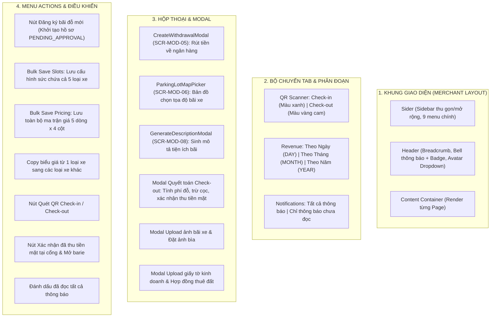
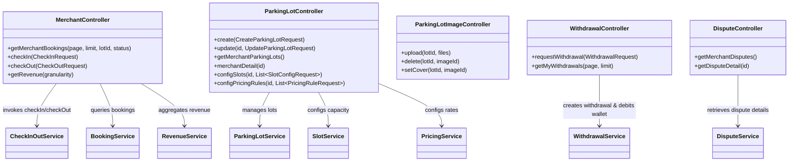
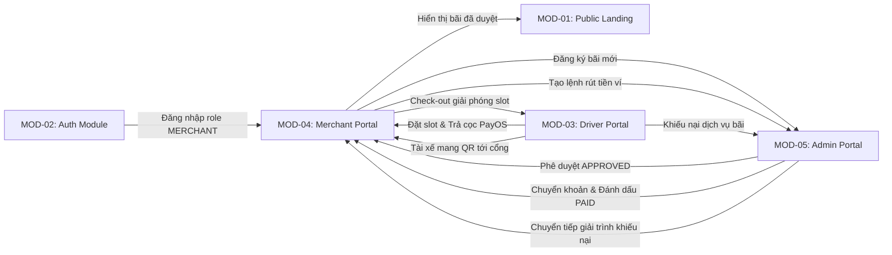
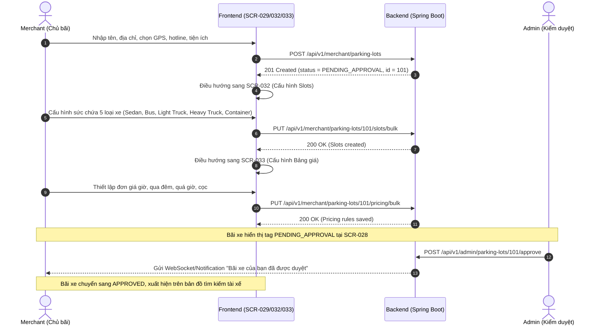
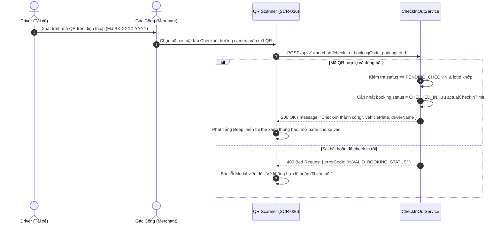
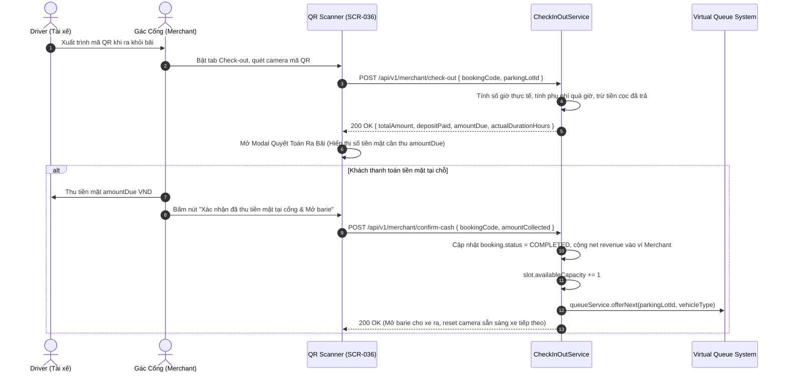
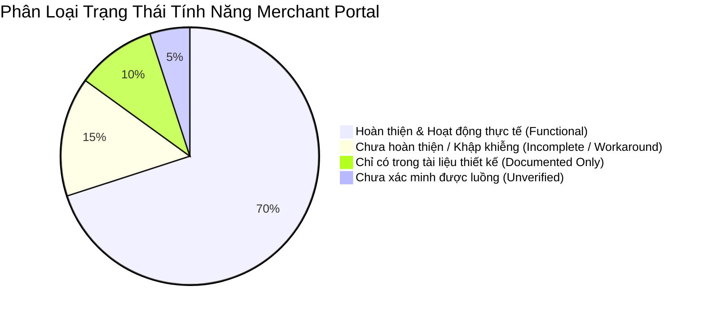

# Báo Cáo Phân Tích Chuyên Sâu: Cổng Vận Hành Chủ Bãi (MOD-04: Merchant Operations Portal)

---

## 1. PHẠM VI KHẢO SÁT & DANH SÁCH ROUTE

Phân hệ **Cổng Chủ Bãi (`MOD-04: Merchant Operations Portal`)** là phân hệ vận hành nghiệp vụ cốt lõi dành cho các đối tác chủ bãi đỗ xe thương mại và nhân viên trực trạm barie. Hệ thống cung cấp công cụ số hóa toàn diện từ đăng ký bãi đỗ, thẩm định hồ sơ kỹ thuật, cấu hình sức chứa chỗ đỗ cho 5 loại phương tiện, thiết lập biểu phí lũy tiến đa chiều, quét camera mã QR kiểm soát xe ra vào thời gian thực, đối soát dòng tiền và tạo lệnh rút tiền về ngân hàng.

Toàn bộ các tuyến đường (routes) của module được khai báo tập trung tại [`AppRoutes.tsx:94-111`](file:///d:/Documents/JAVA%20WEB%20SERVICE/SmartParkingHub/smart-parking-app/src/app/routes/AppRoutes.tsx#L94-L111), được bảo vệ bởi bọc kiểm tra vai trò `RequireRole` với quyền `ROLE_MERCHANT` và được chứa trong khung bố cục `MerchantLayout`:

| STT | Tuyến Đường (URL Route) | Page Component Đảm Trách | Khung Bố Cục (Layout) | Vị Trí Khai Báo Mã Nguồn |
|---|---|---|---|---|
| 1 | `/merchant/dashboard` | [`MerchantDashboardPage`](file:///d:/Documents/JAVA%20WEB%20SERVICE/SmartParkingHub/smart-parking-app/src/features/merchant/dashboard/pages/MerchantDashboardPage.tsx) | `MerchantLayout` | [`AppRoutes.tsx:95`](file:///d:/Documents/JAVA%20WEB%20SERVICE/SmartParkingHub/smart-parking-app/src/app/routes/AppRoutes.tsx#L95) |
| 2 | `/merchant/profile` | [`MerchantProfilePage`](file:///d:/Documents/JAVA%20WEB%20SERVICE/SmartParkingHub/smart-parking-app/src/features/merchant/profile/pages/MerchantProfilePage.tsx) | `MerchantLayout` | [`AppRoutes.tsx:96`](file:///d:/Documents/JAVA%20WEB%20SERVICE/SmartParkingHub/smart-parking-app/src/app/routes/AppRoutes.tsx#L96) |
| 3 | `/merchant/parking-lots` | [`MerchantParkingLotsPage`](file:///d:/Documents/JAVA%20WEB%20SERVICE/SmartParkingHub/smart-parking-app/src/features/merchant/parking-lots/pages/MerchantParkingLotsPage.tsx) | `MerchantLayout` | [`AppRoutes.tsx:97`](file:///d:/Documents/JAVA%20WEB%20SERVICE/SmartParkingHub/smart-parking-app/src/app/routes/AppRoutes.tsx#L97) |
| 4 | `/merchant/parking-lots/new` | [`CreateMerchantParkingLotPage`](file:///d:/Documents/JAVA%20WEB%20SERVICE/SmartParkingHub/smart-parking-app/src/features/merchant/parking-lots/pages/CreateMerchantParkingLotPage.tsx) | `MerchantLayout` | [`AppRoutes.tsx:98`](file:///d:/Documents/JAVA%20WEB%20SERVICE/SmartParkingHub/smart-parking-app/src/app/routes/AppRoutes.tsx#L98) |
| 5 | `/merchant/parking-lots/:parkingLotId` | [`MerchantParkingLotDetailPage`](file:///d:/Documents/JAVA%20WEB%20SERVICE/SmartParkingHub/smart-parking-app/src/features/merchant/parking-lots/pages/MerchantParkingLotDetailPage.tsx) | `MerchantLayout` | [`AppRoutes.tsx:99`](file:///d:/Documents/JAVA%20WEB%20SERVICE/SmartParkingHub/smart-parking-app/src/app/routes/AppRoutes.tsx#L99) |
| 6 | `/merchant/parking-lots/:parkingLotId/edit` | [`EditMerchantParkingLotPage`](file:///d:/Documents/JAVA%20WEB%20SERVICE/SmartParkingHub/smart-parking-app/src/features/merchant/parking-lots/pages/EditMerchantParkingLotPage.tsx) | `MerchantLayout` | [`AppRoutes.tsx:100`](file:///d:/Documents/JAVA%20WEB%20SERVICE/SmartParkingHub/smart-parking-app/src/app/routes/AppRoutes.tsx#L100) |
| 7 | `/merchant/parking-lots/:parkingLotId/slots` | [`MerchantSlotsPage`](file:///d:/Documents/JAVA%20WEB%20SERVICE/SmartParkingHub/smart-parking-app/src/features/merchant/parking-lots/pages/MerchantSlotsPage.tsx) | `MerchantLayout` | [`AppRoutes.tsx:101`](file:///d:/Documents/JAVA%20WEB%20SERVICE/SmartParkingHub/smart-parking-app/src/app/routes/AppRoutes.tsx#L101) |
| 8 | `/merchant/parking-lots/:parkingLotId/pricing` | [`MerchantPricingPage`](file:///d:/Documents/JAVA%20WEB%20SERVICE/SmartParkingHub/smart-parking-app/src/features/merchant/parking-lots/pages/MerchantPricingPage.tsx) | `MerchantLayout` | [`AppRoutes.tsx:102`](file:///d:/Documents/JAVA%20WEB%20SERVICE/SmartParkingHub/smart-parking-app/src/app/routes/AppRoutes.tsx#L102) |
| 9 | `/merchant/bookings` | [`MerchantBookingsPage`](file:///d:/Documents/JAVA%20WEB%20SERVICE/SmartParkingHub/smart-parking-app/src/features/merchant/bookings/pages/MerchantBookingsPage.tsx) | `MerchantLayout` | [`AppRoutes.tsx:103`](file:///d:/Documents/JAVA%20WEB%20SERVICE/SmartParkingHub/smart-parking-app/src/app/routes/AppRoutes.tsx#L103) |
| 10 | `/merchant/bookings/:bookingId` | [`MerchantBookingDetailPage`](file:///d:/Documents/JAVA%20WEB%20SERVICE/SmartParkingHub/smart-parking-app/src/features/merchant/bookings/pages/MerchantBookingDetailPage.tsx) | `MerchantLayout` | [`AppRoutes.tsx:104`](file:///d:/Documents/JAVA%20WEB%20SERVICE/SmartParkingHub/smart-parking-app/src/app/routes/AppRoutes.tsx#L104) |
| 11 | `/merchant/qr-scanner` | [`MerchantQrScannerPage`](file:///d:/Documents/JAVA%20WEB%20SERVICE/SmartParkingHub/smart-parking-app/src/features/merchant/qr/pages/MerchantQrScannerPage.tsx) | `MerchantLayout` | [`AppRoutes.tsx:105`](file:///d:/Documents/JAVA%20WEB%20SERVICE/SmartParkingHub/smart-parking-app/src/app/routes/AppRoutes.tsx#L105) |
| 12 | `/merchant/revenue` | [`MerchantRevenuePage`](file:///d:/Documents/JAVA%20WEB%20SERVICE/SmartParkingHub/smart-parking-app/src/features/merchant/revenue/pages/MerchantRevenuePage.tsx) | `MerchantLayout` | [`AppRoutes.tsx:106`](file:///d:/Documents/JAVA%20WEB%20SERVICE/SmartParkingHub/smart-parking-app/src/app/routes/AppRoutes.tsx#L106) |
| 13 | `/merchant/withdrawals` | [`MerchantWithdrawalsPage`](file:///d:/Documents/JAVA%20WEB%20SERVICE/SmartParkingHub/smart-parking-app/src/features/merchant/withdrawals/pages/MerchantWithdrawalsPage.tsx) | `MerchantLayout` | [`AppRoutes.tsx:107`](file:///d:/Documents/JAVA%20WEB%20SERVICE/SmartParkingHub/smart-parking-app/src/app/routes/AppRoutes.tsx#L107) |
| 14 | `/merchant/disputes` | [`MerchantDisputesPage`](file:///d:/Documents/JAVA%20WEB%20SERVICE/SmartParkingHub/smart-parking-app/src/features/merchant/disputes/pages/MerchantDisputesPage.tsx) | `MerchantLayout` | [`AppRoutes.tsx:108`](file:///d:/Documents/JAVA%20WEB%20SERVICE/SmartParkingHub/smart-parking-app/src/app/routes/AppRoutes.tsx#L108) |
| 15 | `/merchant/disputes/:ticketId` | [`MerchantDisputeDetailPage`](file:///d:/Documents/JAVA%20WEB%20SERVICE/SmartParkingHub/smart-parking-app/src/features/merchant/disputes/pages/MerchantDisputeDetailPage.tsx) | `MerchantLayout` | [`AppRoutes.tsx:109`](file:///d:/Documents/JAVA%20WEB%20SERVICE/SmartParkingHub/smart-parking-app/src/app/routes/AppRoutes.tsx#L109) |
| 16 | `/merchant/notifications` | [`MerchantNotificationsPage`](file:///d:/Documents/JAVA%20WEB%20SERVICE/SmartParkingHub/smart-parking-app/src/features/merchant/notifications/pages/MerchantNotificationsPage.tsx) | `MerchantLayout` | [`AppRoutes.tsx:110`](file:///d:/Documents/JAVA%20WEB%20SERVICE/SmartParkingHub/smart-parking-app/src/app/routes/AppRoutes.tsx#L110) |

---

## 2. DANH SÁCH PAGE & COMPONENT LIÊN QUAN

### A. Danh Sách Trang Chính (Feature Pages)
1. [`MerchantDashboardPage.tsx`](file:///d:/Documents/JAVA%20WEB%20SERVICE/SmartParkingHub/smart-parking-app/src/features/merchant/dashboard/pages/MerchantDashboardPage.tsx): Tổng quan KPI vận hành bãi đỗ xe trong ngày, số bãi đỗ, số xe thực tế đang đỗ (`PARKING`), doanh thu ngày, bảng hoạt động check-in/out gần nhất và các lối tắt nhanh.
2. [`MerchantProfilePage.tsx`](file:///d:/Documents/JAVA%20WEB%20SERVICE/SmartParkingHub/smart-parking-app/src/features/merchant/profile/pages/MerchantProfilePage.tsx): Thông tin thương nhân, số điện thoại, thông tin định danh doanh nghiệp, tài khoản ngân hàng thụ hưởng nhận tiền rút và upload hồ sơ pháp lý.
3. [`MerchantParkingLotsPage.tsx`](file:///d:/Documents/JAVA%20WEB%20SERVICE/SmartParkingHub/smart-parking-app/src/features/merchant/parking-lots/pages/MerchantParkingLotsPage.tsx): Danh mục bãi đỗ xe sở hữu, tag trạng thái kiểm duyệt (`APPROVED`, `PENDING_APPROVAL`, `REJECTED`, `SUSPENDED`), tìm kiếm và các menu điều khiển từng bãi.
4. [`CreateMerchantParkingLotPage.tsx`](file:///d:/Documents/JAVA%20WEB%20SERVICE/SmartParkingHub/smart-parking-app/src/features/merchant/parking-lots/pages/CreateMerchantParkingLotPage.tsx): Form đăng ký bãi đỗ mới, chọn GPS qua bản đồ, chọn tiện ích dịch vụ, tích hợp trợ lý sinh mô tả tự động và chuyển hướng cấu hình slots sau khi tạo.
5. [`MerchantParkingLotDetailPage.tsx`](file:///d:/Documents/JAVA%20WEB%20SERVICE/SmartParkingHub/smart-parking-app/src/features/merchant/parking-lots/pages/MerchantParkingLotDetailPage.tsx): Hồ sơ kỹ thuật bãi, thư viện ảnh mặt bằng (upload, set ảnh bìa, xóa ảnh), thống kê doanh thu riêng của bãi và các nút điều hướng cấu hình.
6. [`EditMerchantParkingLotPage.tsx`](file:///d:/Documents/JAVA%20WEB%20SERVICE/SmartParkingHub/smart-parking-app/src/features/merchant/parking-lots/pages/EditMerchantParkingLotPage.tsx): Màn hình sửa thông tin bãi bị Admin từ chối hoặc yêu cầu sửa (`REJECTED` / `CHANGES_REQUESTED`), hiển thị lý do phản hồi từ kiểm duyệt viên.
7. [`MerchantSlotsPage.tsx`](file:///d:/Documents/JAVA%20WEB%20SERVICE/SmartParkingHub/smart-parking-app/src/features/merchant/parking-lots/pages/MerchantSlotsPage.tsx): Bảng cấu hình sức chứa (`totalCapacity`) cho 5 loại phương tiện chuẩn hóa (`SEDAN_SUV`, `BUS_COACH`, `LIGHT_TRUCK`, `HEAVY_TRUCK`, `CONTAINER`), thanh đo tỷ lệ lấp đầy và tính năng bulk update.
8. [`MerchantPricingPage.tsx`](file:///d:/Documents/JAVA%20WEB%20SERVICE/SmartParkingHub/smart-parking-app/src/features/merchant/parking-lots/pages/MerchantPricingPage.tsx): Ma trận biểu phí lũy tiến cho 5 loại xe gồm: đơn giá giờ (`hourlyRate`), đơn giá qua đêm (`overnightRate`), phụ phí quá giờ (`overtimeHourlyRate`), và tiền đặt cọc quy định (`depositAmount`).
9. [`MerchantBookingsPage.tsx`](file:///d:/Documents/JAVA%20WEB%20SERVICE/SmartParkingHub/smart-parking-app/src/features/merchant/bookings/pages/MerchantBookingsPage.tsx): Giám sát toàn bộ lượt đặt chỗ của khách tại bãi, lọc theo bãi xe, lọc theo trạng thái (`PENDING_CHECKIN`, `PARKING`, `COMPLETED`, `CANCELLED`, `OVERTIME`), tìm kiếm theo biển số hoặc mã đơn.
10. [`MerchantBookingDetailPage.tsx`](file:///d:/Documents/JAVA%20WEB%20SERVICE/SmartParkingHub/smart-parking-app/src/features/merchant/bookings/pages/MerchantBookingDetailPage.tsx): Chi tiết thời gian xe vào/ra, chi tiết tiền cọc và thanh toán cuối cùng, thông tin tài xế và phương tiện.
11. [`MerchantQrScannerPage.tsx`](file:///d:/Documents/JAVA%20WEB%20SERVICE/SmartParkingHub/smart-parking-app/src/features/merchant/qr/pages/MerchantQrScannerPage.tsx): Trạm quét mã QR Barie: Chuyển đổi linh hoạt giữa chế độ Check-in (Xe vào) và Check-out (Xe ra), laser quét camera, nhập mã tay dự phòng, tính toán số giờ đỗ và tiền chênh lệch cần thu tại chỗ.
12. [`MerchantRevenuePage.tsx`](file:///d:/Documents/JAVA%20WEB%20SERVICE/SmartParkingHub/smart-parking-app/src/features/merchant/revenue/pages/MerchantRevenuePage.tsx): Phân tích doanh thu tổng hợp bằng biểu đồ Recharts Composed (Cột doanh thu + Đường số lượt đỗ), lọc thời gian theo Ngày, Tháng, Năm và thống kê số dư ví khả dụng.
13. [`MerchantWithdrawalsPage.tsx`](file:///d:/Documents/JAVA%20WEB%20SERVICE/SmartParkingHub/smart-parking-app/src/features/merchant/withdrawals/pages/MerchantWithdrawalsPage.tsx): Quản trị ví doanh thu, tạo lệnh rút tiền về ngân hàng và bảng theo dõi trạng thái phê duyệt chuyển khoản (`PENDING`, `APPROVED`, `REJECTED`).
14. [`MerchantDisputesPage.tsx`](file:///d:/Documents/JAVA%20WEB%20SERVICE/SmartParkingHub/smart-parking-app/src/features/merchant/disputes/pages/MerchantDisputesPage.tsx): Tiếp nhận các khiếu nại phát sinh từ tài xế gửi về bãi xe, lọc trạng thái (`OPEN`, `RESOLVED`, `CLOSED`), xem mức độ nghiêm trọng và mã đơn liên quan.
15. [`MerchantDisputeDetailPage.tsx`](file:///d:/Documents/JAVA%20WEB%20SERVICE/SmartParkingHub/smart-parking-app/src/features/merchant/disputes/pages/MerchantDisputeDetailPage.tsx): Xem tường thuật khiếu nại từ tài xế, hình ảnh bằng chứng hiện trường, quyết định hòa giải và phương án giải quyết từ Admin.
16. [`MerchantNotificationsPage.tsx`](file:///d:/Documents/JAVA%20WEB%20SERVICE/SmartParkingHub/smart-parking-app/src/features/merchant/notifications/pages/MerchantNotificationsPage.tsx): Trung tâm nhận tin tức: Thông báo kết quả phê duyệt bãi xe, thông báo có tài xế đặt chỗ mới, thông báo tiền rút đã chuyển khoản.

### B. Danh Sách Component Phụ Trợ & Hộp Thoại (Modals / Drawers / Pickers)
- [`MerchantLayout.tsx`](file:///d:/Documents/JAVA%20WEB%20SERVICE/SmartParkingHub/smart-parking-app/src/features/merchant/layout/MerchantLayout.tsx): Khung sườn quản trị với Sider điều hướng 9 chức năng, hiển thị badge số lượng thông báo chưa đọc, Header chứa Breadcrumbs và User Profile Dropdown.
- [`CreateWithdrawalModal.tsx`](file:///d:/Documents/JAVA%20WEB%20SERVICE/SmartParkingHub/smart-parking-app/src/features/merchant/withdrawals/components/CreateWithdrawalModal.tsx) (`SCR-MOD-05`): Hộp thoại tạo lệnh rút tiền ví, kiểm tra số dư và tự động điền tài khoản ngân hàng thụ hưởng.
- [`ParkingLotMapPicker.tsx`](file:///d:/Documents/JAVA%20WEB%20SERVICE/SmartParkingHub/smart-parking-app/src/features/merchant/parking-lots/components/ParkingLotMapPicker.tsx) (`SCR-MOD-06`): Hộp thoại bản đồ OpenStreetMap/Leaflet cho phép chủ bãi click chọn tọa độ Latitude/Longitude chuẩn xác cho bãi đỗ.
- [`QrCameraScanner.tsx`](file:///d:/Documents/JAVA%20WEB%20SERVICE/SmartParkingHub/smart-parking-app/src/features/merchant/qr/components/QrCameraScanner.tsx) (`SCR-MOD-07`): Công cụ quét QR video stream từ camera sau bằng thư viện `html5-qrcode`.
- [`GenerateDescriptionModal.tsx`](file:///d:/Documents/JAVA%20WEB%20SERVICE/SmartParkingHub/smart-parking-app/src/features/merchant/parking-lots/components/GenerateDescriptionModal.tsx) (`SCR-MOD-08`): Hộp thoại gợi ý viết mô tả giới thiệu bãi đỗ xe hấp dẫn.

---

## 3. CẤU TRÚC LAYOUT, TABS, DIALOGS, DRAWERS, DROPDOWNS & ACTIONS

---

## 4 & 5. DANH MỤC CHỨC NĂNG NGƯỜI DÙNG & ĐỐI CHIẾU KỸ THUẬT CHI TIẾT

Bảng dưới đây ánh xạ đầy đủ 22 chức năng nghiệp vụ của Merchant Portal sang tầng kỹ thuật Backend:

| Mã CN | Tên Chức Năng | Điều Kiện Tiên Quyết | Dữ Liệu Đầu Vào | Kết Quả Mong Đợi | API Endpoint & Backend Implementation Trace |
|---|---|---|---|---|---|
| **FN-MCH-01** | Xem KPI tổng quan vận hành | Role `MERCHANT` đã đăng nhập | Không | Trả về tổng số bãi xe, số booking hôm nay, số xe đang đỗ (`PARKING`), doanh thu ngày | `GET /api/v1/merchant/parking-lots` `GET /api/v1/merchant/bookings` `GET /api/v1/merchant/revenue` [`MerchantController.java`](file:///d:/Documents/JAVA%20WEB%20SERVICE/SmartParkingHub/smart-parking-service/src/main/java/com/backend/controller/MerchantController.java) |
| **FN-MCH-02** | Xem danh mục bãi đỗ xe sở hữu | Role `MERCHANT` | Không | Danh sách bãi xe của tài khoản kèm trạng thái duyệt, địa chỉ, hotline | `GET /api/v1/merchant/parking-lots` [`ParkingLotController.java:55`](file:///d:/Documents/JAVA%20WEB%20SERVICE/SmartParkingHub/smart-parking-service/src/main/java/com/backend/controller/ParkingLotController.java#L55) |
| **FN-MCH-03** | Đăng ký khởi tạo bãi đỗ mới | Tài khoản thương nhân hợp lệ | `name`, `address`, `latitude`, `longitude`, `phone`, `description`, `facilities` | Tạo bãi mới trạng thái `PENDING_APPROVAL`, trả về `parkingLotId` để chuyển cấu hình slots | `POST /api/v1/merchant/parking-lots` [`ParkingLotController.java:43`](file:///d:/Documents/JAVA%20WEB%20SERVICE/SmartParkingHub/smart-parking-service/src/main/java/com/backend/controller/ParkingLotController.java#L43) |
| **FN-MCH-04** | Xem chi tiết hồ sơ kỹ thuật bãi | Là chủ sở hữu bãi đỗ xe | `parkingLotId` | Trả về đầy đủ thông tin bãi, bộ ảnh, danh sách slot, bảng giá và doanh thu riêng | `GET /api/v1/merchant/parking-lots/{id}` [`ParkingLotController.java:60`](file:///d:/Documents/JAVA%20WEB%20SERVICE/SmartParkingHub/smart-parking-service/src/main/java/com/backend/controller/ParkingLotController.java#L60) |
| **FN-MCH-05** | Chỉnh sửa bãi bị từ chối duyệt | Bãi ở trạng thái `REJECTED` hoặc `CHANGES_REQUESTED` | `name`, `address`, `latitude`, `longitude`, `phone`, `description` | Cập nhật hồ sơ bãi và chuyển lại trạng thái chờ Admin duyệt lại | `PUT /api/v1/merchant/parking-lots/{id}` [`ParkingLotController.java:49`](file:///d:/Documents/JAVA%20WEB%20SERVICE/SmartParkingHub/smart-parking-service/src/main/java/com/backend/controller/ParkingLotController.java#L49) |
| **FN-MCH-06** | Tải lên thư viện ảnh bãi xe | Bãi đỗ thuộc quyền sở hữu | `parkingLotId`, `MultipartFile[] files` | Lưu file ảnh vào thư mục server, trả về danh sách URL ảnh và `imageId` | `POST /api/v1/merchant/parking-lots/{parkingLotId}/images` [`ParkingLotImageController.java:32`](file:///d:/Documents/JAVA%20WEB%20SERVICE/SmartParkingHub/smart-parking-service/src/main/java/com/backend/controller/ParkingLotImageController.java#L32) |
| **FN-MCH-07** | Đặt ảnh đại diện (Cover Photo) | Ảnh thuộc bãi xe của Merchant | `parkingLotId`, `imageId` | Đánh dấu `isCover = true`, các ảnh khác thành `false` | `PATCH /api/v1/merchant/parking-lots/{parkingLotId}/images/{imageId}/cover` [`ParkingLotImageController.java:46`](file:///d:/Documents/JAVA%20WEB%20SERVICE/SmartParkingHub/smart-parking-service/src/main/java/com/backend/controller/ParkingLotImageController.java#L46) |
| **FN-MCH-08** | Xóa ảnh mặt bằng bãi xe | Ảnh thuộc bãi xe của Merchant | `parkingLotId`, `imageId` | Xóa bản ghi trong DB và xóa file vật lý trên server | `DELETE /api/v1/merchant/parking-lots/{parkingLotId}/images/{imageId}` [`ParkingLotImageController.java:39`](file:///d:/Documents/JAVA%20WEB%20SERVICE/SmartParkingHub/smart-parking-service/src/main/java/com/backend/controller/ParkingLotImageController.java#L39) |
| **FN-MCH-09** | Cấu hình sức chứa slot xe | `totalCapacity >= occupiedCount` (không nhỏ hơn xe đang đỗ) | Mảng 5 items `{ vehicleType, totalCapacity }` | Cập nhật `totalCapacity` và tự động tính `availableCapacity = total - occupied` | `PUT /api/v1/merchant/parking-lots/{id}/slots/bulk` [`ParkingLotController.java:66`](file:///d:/Documents/JAVA%20WEB%20SERVICE/SmartParkingHub/smart-parking-service/src/main/java/com/backend/controller/ParkingLotController.java#L66) |
| **FN-MCH-10** | Cấu hình biểu phí 5 loại xe | Các đơn giá không âm | Mảng 5 items `{ vehicleType, hourlyRate, overnightRate, overtimeHourlyRate, depositAmount }` | Lưu bảng giá 5 loại xe vào DB trong 1 transaction | `PUT /api/v1/merchant/parking-lots/{id}/pricing/bulk` [`ParkingLotController.java:78`](file:///d:/Documents/JAVA%20WEB%20SERVICE/SmartParkingHub/smart-parking-service/src/main/java/com/backend/controller/ParkingLotController.java#L78) |
| **FN-MCH-11** | Giám sát danh sách đặt chỗ bãi | Bãi thuộc quyền sở hữu | `parkingLotId`, `status`, `page`, `limit` | Trả về danh sách đơn đặt chỗ phân trang, thông tin xe và giờ vào/ra | `GET /api/v1/merchant/bookings` [`MerchantController.java:27`](file:///d:/Documents/JAVA%20WEB%20SERVICE/SmartParkingHub/smart-parking-service/src/main/java/com/backend/controller/MerchantController.java#L27) |
| **FN-MCH-12** | Xem chi tiết 1 đơn đặt chỗ | Thuộc bãi xe của Merchant | `bookingId` | Trả về chi tiết check-in/out log, tiền cọc, tiền tất toán, SĐT tài xế | Duyệt mảng `getMerchantBookings(page, 50)` (Client workaround) |
| **FN-MCH-13** | Quét QR Barie cho xe vào (Check-in) | Booking ở trạng thái `PENDING_CHECKIN`, đúng bãi xe | `bookingCode`, `parkingLotId` | Chuyển booking sang `CHECKED_IN`, ghi nhận `actualCheckInTime`, mở barie vào | `POST /api/v1/merchant/check-in` [`MerchantController.java:34`](file:///d:/Documents/JAVA%20WEB%20SERVICE/SmartParkingHub/smart-parking-service/src/main/java/com/backend/controller/MerchantController.java#L34) |
| **FN-MCH-14** | Quét QR Barie cho xe ra (Check-out) | Booking ở trạng thái `CHECKED_IN` | `bookingCode`, `parkingLotId` | Tính toán số giờ thực tế, tính phụ phí/quá giờ, trừ cọc, mở modal quyết toán | `POST /api/v1/merchant/check-out` [`MerchantController.java:40`](file:///d:/Documents/JAVA%20WEB%20SERVICE/SmartParkingHub/smart-parking-service/src/main/java/com/backend/controller/MerchantController.java#L40) |
| **FN-MCH-15** | Xác nhận thu tiền mặt tại cổng | Check-out xong và còn khoản tiền mặt cần thu | `bookingCode`, `amountCollected` | Backend hoàn tất booking, cộng tiền ví, giải phóng slot, gọi `queue.offerNext()` | `POST /api/v1/merchant/confirm-cash` *(FE đã gọi nhưng BE chưa có endpoint)* |
| **FN-MCH-16** | Xem biểu đồ phân tích doanh thu | Role `MERCHANT` | `granularity=DAY\|MONTH\|YEAR` | Trả về mảng dữ liệu doanh thu VND và số lượt đỗ vẽ biểu đồ Recharts | `GET /api/v1/merchant/revenue` [`MerchantController.java:46`](file:///d:/Documents/JAVA%20WEB%20SERVICE/SmartParkingHub/smart-parking-service/src/main/java/com/backend/controller/MerchantController.java#L46) |
| **FN-MCH-17** | Xem lịch sử yêu cầu rút tiền | Role `MERCHANT` | `page`, `limit` | Bảng danh sách các yêu cầu rút tiền kèm trạng thái `PENDING`, `APPROVED`, `REJECTED` | `GET /api/v1/withdrawals` [`WithdrawalController.java:35`](file:///d:/Documents/JAVA%20WEB%20SERVICE/SmartParkingHub/smart-parking-service/src/main/java/com/backend/controller/WithdrawalController.java#L35) |
| **FN-MCH-18** | Tạo lệnh rút tiền từ số dư ví | `amount >= 50,000` và `<= walletBalance` | `amount`, `bankName`, `accountNumber`, `accountHolderName`, `note` | Trừ số dư ví ngay lập tức, tạo bản ghi `PENDING`, gửi thông báo tới Admin | `POST /api/v1/withdrawals` [`WithdrawalController.java:29`](file:///d:/Documents/JAVA%20WEB%20SERVICE/SmartParkingHub/smart-parking-service/src/main/java/com/backend/controller/WithdrawalController.java#L29) |
| **FN-MCH-19** | Xem danh sách khiếu nại tài xế | Role `MERCHANT` | Không | Trả về các vé khiếu nại phát sinh từ các bãi xe thuộc Merchant | `GET /api/v1/disputes/merchant` [`DisputeController.java:36`](file:///d:/Documents/JAVA%20WEB%20SERVICE/SmartParkingHub/smart-parking-service/src/main/java/com/backend/controller/DisputeController.java#L36) |
| **FN-MCH-20** | Xem chi tiết khiếu nại bãi xe | Thuộc bãi xe của Merchant | `ticketId` | Hiển thị nội dung phản ánh, bằng chứng ảnh, phán quyết Admin | `GET /api/v1/disputes/{id}` [`DisputeController.java:42`](file:///d:/Documents/JAVA%20WEB%20SERVICE/SmartParkingHub/smart-parking-service/src/main/java/com/backend/controller/DisputeController.java#L42) |
| **FN-MCH-21** | Cập nhật hồ sơ & Ngân hàng | Role `MERCHANT` | `businessName`, `bankName`, `accountNumber`, `accountHolderName`, `phone` | Cập nhật thông tin chủ bãi và tài khoản mặc định khi rút tiền | `PUT /api/v1/merchant/profile` [`MerchantProfileController.java:32`](file:///d:/Documents/JAVA%20WEB%20SERVICE/SmartParkingHub/smart-parking-service/src/main/java/com/backend/controller/MerchantProfileController.java#L32) |
| **FN-MCH-22** | Xem & Đánh dấu đã đọc thông báo | Role `MERCHANT` | `notificationId` / hoặc all | Cập nhật trạng thái `isRead = true`, giảm badge đếm chưa đọc trên header | `GET /api/v1/notifications` `POST /api/v1/notifications/{id}/read` `POST /api/v1/notifications/read-all` |

---

## 6. ĐỐI CHIẾU KIẾN TRÚC BACKEND (CONTROLLER, SERVICE, DTO, ENTITY & VALIDATION)

### Chi Tiết Từng Thành Phần Backend:
1. **Controllers & Endpoints:**
   - [`MerchantController.java`](file:///d:/Documents/JAVA%20WEB%20SERVICE/SmartParkingHub/smart-parking-service/src/main/java/com/backend/controller/MerchantController.java): Xử lý các thao tác barie cổng (`checkIn`, `checkOut`), danh sách đặt chỗ của merchant, và doanh thu tổng.
   - [`ParkingLotController.java`](file:///d:/Documents/JAVA%20WEB%20SERVICE/SmartParkingHub/smart-parking-service/src/main/java/com/backend/controller/ParkingLotController.java): Xử lý toàn bộ vòng đời bãi đỗ xe thương mại, từ đăng ký mới, cập nhật, lấy chi tiết, bulk config slot và bulk config pricing.
   - [`ParkingLotImageController.java`](file:///d:/Documents/JAVA%20WEB%20SERVICE/SmartParkingHub/smart-parking-service/src/main/java/com/backend/controller/ParkingLotImageController.java): Quản lý file ảnh mặt bằng bãi xe (lưu file vật lý và metadata).
   - [`WithdrawalController.java`](file:///d:/Documents/JAVA%20WEB%20SERVICE/SmartParkingHub/smart-parking-service/src/main/java/com/backend/controller/WithdrawalController.java): Tạo lệnh rút tiền và truy vấn lịch sử rút tiền của tài khoản.
   - [`DisputeController.java`](file:///d:/Documents/JAVA%20WEB%20SERVICE/SmartParkingHub/smart-parking-service/src/main/java/com/backend/controller/DisputeController.java): Tra cứu danh sách khiếu nại liên quan đến các bãi của Merchant.
   - [`MerchantProfileController.java`](file:///d:/Documents/JAVA%20WEB%20SERVICE/SmartParkingHub/smart-parking-service/src/main/java/com/backend/controller/MerchantProfileController.java): Quản lý thông tin doanh nghiệp, tài khoản ngân hàng thụ hưởng và giấy tờ kinh doanh.
2. **Services & Business Logic:**
   - `CheckInOutServiceImpl.java`: Kiểm tra trạng thái booking (`PENDING_CHECKIN` để vào, `CHECKED_IN` để ra), tính toán thời gian đỗ thực tế, áp dụng đơn giá theo giờ và phạt quá giờ, trừ tiền cọc đã thanh toán trước, cộng doanh thu vào ví chủ bãi, giải phóng slot và kích hoạt `queueService.offerNext()`.
   - `SlotServiceImpl.java`: Ràng buộc bất biến `totalCapacity >= occupiedCount`. Không cho phép merchant giảm sức chứa thấp hơn số xe đang đỗ thực tế.
   - `ParkingLotServiceImpl.java`: Ràng buộc chỉnh sửa bãi: chỉ cho phép bãi ở trạng thái `REJECTED` hoặc `CHANGES_REQUESTED` được sửa đổi thông tin cơ bản. Bãi `APPROVED` bị khóa sửa đổi để bảo vệ tính toàn vẹn của kết quả thẩm định.
   - `WithdrawalServiceImpl.java`: Ràng buộc `amount >= 50,000` và `amount <= wallet.balance`. Trừ ngay số dư ví khi tạo lệnh rút trạng thái `PENDING` nhằm triệt tiêu rủi ro Double Spending.
3. **DTOs & Validations:**
   - `CreateParkingLotRequest`: `@NotBlank name`, `@NotBlank address`, `@NotNull latitude`, `@NotNull longitude`, `@NotBlank phone`.
   - `SlotConfigRequest`: `@NotNull vehicleType`, `@NotNull @Min(0) totalCapacity`.
   - `PricingRuleRequest`: `@NotNull vehicleType`, `@DecimalMin("0.0") hourlyRate`, `@DecimalMin("0.0") depositAmount`.
   - `WithdrawalRequest`: `@NotNull @Min(50000) amount`, `@NotBlank bankName`, `@NotBlank accountNumber`, `@NotBlank accountHolderName`.
4. **Entities & Database Schema:**
   - `ParkingLot`: `id`, `name`, `address`, `latitude`, `longitude`, `phone`, `status` (`PENDING_APPROVAL`, `APPROVED`, `REJECTED`, `SUSPENDED`), `merchant_id`.
   - `Slot`: `id`, `parking_lot_id`, `vehicle_type` (`SEDAN_SUV`, `BUS_COACH`, `LIGHT_TRUCK`, `HEAVY_TRUCK`, `CONTAINER`), `total_capacity`, `available_capacity`.
   - `PricingRule`: `id`, `parking_lot_id`, `vehicle_type`, `hourly_rate`, `overnight_rate`, `overtime_hourly_rate`, `deposit_amount`.
   - `Withdrawal`: `id`, `user_id`, `amount`, `bank_name`, `account_number`, `account_holder_name`, `status` (`PENDING`, `APPROVED`, `REJECTED`), `rejection_reason`.
   - `Wallet`: `id`, `user_id`, `balance`, `updated_at`.

---

## 7. MA TRẬN VAI TRÒ & PHÂN QUYỀN (ROLES & PERMISSIONS)

| Quyền Hạn / Nghiệp Vụ | `ROLE_MERCHANT` (Chủ Bãi) | `ROLE_ADMIN` (Quản Trị) | `ROLE_DRIVER` (Tài Xế) |
|---|:---:|:---:|:---:|
| Truy cập URL Route `/merchant/*` | **Cho phép** | Bị chuyển hướng | Bị chuyển hướng (403) |
| Đăng ký bãi đỗ mới | **Cho phép** | Không | Không |
| Sửa thông tin bãi đỗ sở hữu | Chỉ khi `REJECTED`/`CHANGES_REQ` | Toàn quyền kiểm duyệt | Không |
| Cấu hình Slot & Bảng giá bãi mình | **Toàn quyền** | Xem | Xem (Bảng giá niêm yết) |
| Quét camera QR Check-in / Check-out | **Cho phép** | Không | Chỉ xuất trình mã QR |
| Xem danh sách đơn đặt chỗ tại bãi | **Cho phép** (Bãi sở hữu) | Xem toàn hệ thống | Chỉ xem đơn cá nhân |
| Rút tiền từ ví doanh thu | **Cho phép** (`amount >= 50k`) | Duyệt chi / Từ chối | Không có ví merchant |
| Phản hồi / Xem khiếu nại bãi xe | Xem chi tiết khiếu nại | Phân xử hòa giải | Khởi tạo khiếu nại |

---

## 8. MỐI QUAN HỆ GIỮA MODULE MERCHANT VỚI CÁC MODULE KHÁC

1. **Quan hệ với `MOD-02` (Authentication & Profile):**
   - Xác thực danh tính qua JWT Token, giải mã vai trò `ROLE_MERCHANT`. Nếu chưa đăng nhập chuyển hướng về `/login`, nếu sai vai trò chuyển hướng về `/forbidden`.
2. **Quan hệ với `MOD-05` (Admin Portal):**
   - Vòng đời bãi xe phụ thuộc trực tiếp vào Admin: Admin thẩm định hồ sơ kỹ thuật bãi tại `SCR-044` trước khi bãi được phép bán chỗ.
   - Vòng đời rút tiền: Lệnh rút tiền do Merchant tạo tại `SCR-038` chuyển thành bản ghi `PENDING` chờ Admin duyệt chi và chuyển khoản tại `SCR-048`.
   - Phân xử khiếu nại: Khiếu nại từ tài xế được Admin phân xử tại `SCR-050` và phản ánh kết quả về cho Merchant tại `SCR-040`.
3. **Quan hệ với `MOD-03` (Driver Portal):**
   - Driver tạo booking, cọc tiền PayOS, nhận mã QR check-in và xuất trình tại trạm quét `SCR-036` của Merchant.
   - Khi Merchant bấm Check-out tại `SCR-036`, slot trống được hoàn trả và hệ thống tự động gọi sang module Driver Queue (`queueService.offerNext()`) để phân bổ chỗ cho tài xế kế tiếp.

---

## 9. CÁC LUỒNG NGHIỆP VỤ ĐẦU CUỐI (END-TO-END BUSINESS FLOWS)

### Luồng 1: Vòng Đời Đăng Ký & Kích Hoạt Bãi Đỗ Xe Mới

### Luồng 2: Quy Trình Trạm Barie: Quét QR Check-in Xe Vào

### Luồng 3: Quy Trình Trạm Barie: Quét QR Check-out, Quyết Toán & Mở Chỗ Hàng Đợi

---

## 10. TRẠNG THÁI GIAO DIỆN & CÁC KỊCH BẢN LỖI (UI STATES & ERROR HANDLING)

| Kịch Bản Nghiệp Vụ / Kỹ Thuật | Trạng Thái Giao Diện (UI State) | Phản Hồi Hệ Thống & Hướng Xử Lý Người Dùng |
|---|---|---|
| **Đang tải dữ liệu ban đầu** | Hiển thị AntD `Spin` toàn màn hình hoặc Skeleton placeholder | Khóa các nút bấm thao tác để chống click trùng lặp |
| **Merchant chưa có bãi xe nào** | Hiển thị AntD `Empty` mô tả "Bạn chưa đăng ký bãi đỗ xe nào" | Hiển thị nút CTA lớn màu xanh: **"Đăng ký bãi đỗ xe đầu tiên"** dẫn tới `/merchant/parking-lots/new` |
| **Bãi xe bị từ chối duyệt (`REJECTED`)** | Thẻ bãi xe đổi tag màu đỏ, hiển thị Alert thông báo lý do Admin từ chối | Hiển thị nút màu cam: **"Chỉnh sửa và nộp lại hồ sơ"** dẫn tới `SCR-031` |
| **Giảm slot nhỏ hơn số xe đang đỗ** | Bấm Bulk Save Slot báo lỗi 400 Bad Request từ Backend | Form highlight viền đỏ ô nhập liệu: *"Sức chứa mới (X) không thể nhỏ hơn số xe đang đỗ thực tế (Y)"* |
| **Quét QR sai bãi đỗ** | Camera dừng quét, rung haptic và phát âm thanh cảnh báo | Pop-up viền đỏ: *"Vé đặt chỗ này thuộc bãi [Tên bãi khác], không hợp lệ tại bãi hiện tại!"* |
| **Rút tiền vượt quá số dư ví** | Ô nhập số tiền hiển thị lỗi validation client ngay khi gõ | Nút "Gửi yêu cầu" bị disable; thông báo *"Số tiền rút vượt quá số dư khả dụng hiện có"* |
| **Rút tiền nhỏ hơn hạn mức tối thiểu** | Nhập số tiền < 50.000 VNĐ | Báo lỗi validation: *"Số tiền rút tối thiểu là 50.000 VNĐ"* |
| **Mất quyền truy cập camera quét QR** | Khung camera hiển thị nền đen kèm icon camera gạch chéo | Hiển thị hộp thoại hướng dẫn cấp quyền trình duyệt, đồng thời trỏ tiêu điểm sang **Ô nhập mã thủ công bằng bàn phím** |

---

## 11. CÁC TÍNH NĂNG CÓ TRONG BACKEND NHƯNG CHƯA ĐƯỢC DÙNG Ở FRONTEND

1. **Lọc doanh thu bãi theo khoảng ngày tùy ý (`startDate`, `endDate`):**
   - Backend endpoint `GET /api/v1/merchant/parking-lots/{id}/revenue` hỗ trợ nhận `@RequestParam LocalDate startDate, LocalDate endDate` để thống kê chính xác theo khoảng ngày.
   - Frontend hiện chỉ truyền tham số độ mịn `granularity=DAY|MONTH|YEAR` mà chưa cung cấp thanh chọn khoảng ngày `RangePicker` cho người dùng.
2. **API chuyển đổi trạng thái hoạt động đóng/mở cửa bãi (`Active/Inactive`):**
   - Backend hỗ trợ endpoint cập nhật trạng thái hoạt động của bãi đỗ xe để chủ bãi có thể tạm ngưng nhận khách khi bãi bảo trì hoặc ngập nước.
   - Frontend hiện chưa có nút gạt bật/tắt (Toggle Switch On/Off) trạng thái nhận khách nhanh trên thẻ bãi đỗ xe.
3. **API cập nhật tài liệu hồ sơ pháp lý theo từng loại tài liệu:**
   - Backend `MerchantProfileController` có cơ chế nhận diện từng phân loại giấy phép (Giấy ĐKKD, Giấy chứng nhận PCCC, Hợp đồng thuê mặt bằng), nhưng Frontend đang gộp chung vào một nút upload tập tin đơn giản.

---

## 12. CÁC TÍNH NĂNG FRONTEND HIỂN THỊ NHƯNG CHƯA TÌM THẤY BẰNG CHỨNG BACKEND (`FE_AHEAD_OF_BE`)

1. **API Xác nhận thu tiền mặt tại cổng (`confirm-cash`):**
   - **Bằng chứng mã nguồn:** Frontend tại [`merchantQrApi.ts:14-17`](file:///d:/Documents/JAVA%20WEB%20SERVICE/SmartParkingHub/smart-parking-app/src/features/merchant/qr/api/merchantQrApi.ts#L14-L17) khai báo gọi `POST /api/v1/merchant/confirm-cash` khi gác cổng bấm nút *"Xác nhận đã thu tiền mặt tại cổng & Mở barie"* trong modal quyết toán.
   - **Đối soát Backend:** Truy vết toàn bộ mã nguồn Backend trong `MerchantController` và các controller khác **KHÔNG TỒN TẠI endpoint `/api/v1/merchant/confirm-cash`**. Đây là lỗ hổng bất đồng bộ giữa FE và BE khiến quy trình thu tiền mặt tại cổng bị lỗi 404 khi vận hành thực tế.
2. **Endpoint lấy chi tiết 1 đơn đặt chỗ theo ID cho Merchant (`GET /merchant/bookings/{id}`):**
   - **Bằng chứng mã nguồn:** Tại [`MerchantBookingDetailPage.tsx:40-46`](file:///d:/Documents/JAVA%20WEB%20SERVICE/SmartParkingHub/smart-parking-app/src/features/merchant/bookings/pages/MerchantBookingDetailPage.tsx#L40-L46), lập trình viên Frontend đã ghi chú rõ: `// BE chưa có GET /merchant/bookings/{id} — lấy trang và tìm theo id`. Frontend buộc phải chạy vòng lặp tải 5 trang đầu tiên (mỗi trang 50 đơn) của API `getMerchantBookings` để tìm bản ghi có `id` trùng khớp.
   - **Hậu quả:** Gây lãng phí băng thông mạng, thời gian tải trang chậm và sẽ bị lỗi không tìm thấy đơn nếu booking nằm ngoài trang thứ 5 (đơn cũ).
3. **Chỉ số KPI "Tỷ lệ lấp đầy bãi xe" trên Merchant Dashboard:**
   - Thẻ thống kê tỷ lệ lấp đầy trên `MerchantDashboardPage` hiện chỉ hiển thị dấu gạch ngang `—` vì Backend không cung cấp API tính toán tỷ lệ lấp đầy tổng hợp theo thời gian thực cho tất cả bãi của Merchant.

---

## 13. PHÂN LOẠI MỨC ĐỘ TRƯỞNG THÀNH TÍNH NĂNG (FEATURE MATURITY CLASSIFICATION)

1. **Hiện hữu & Hoạt động hoàn chỉnh (Existing & Functional):**
   - Khởi tạo bãi đỗ mới gửi Admin duyệt (`SCR-029`).
   - Cấu hình sức chứa slot cho 5 loại xe có ràng buộc kiểm tra xe đang đỗ (`SCR-032`).
   - Cấu hình ma trận giá 5 loại xe x 4 đơn giá (`SCR-033`).
   - Thư viện ảnh bãi xe: Upload nhiều ảnh, đặt ảnh bìa, xóa ảnh (`SCR-030`).
   - Camera quét mã QR Check-in xe vào bãi (`SCR-036`).
   - Biểu đồ phân tích doanh thu đa tầng theo Ngày/Tháng/Năm (`SCR-037`).
   - Tạo lệnh rút tiền ví có trừ tiền tức thời (`SCR-038` & `SCR-MOD-05`).
   - Tiếp nhận danh sách và chi tiết khiếu nại (`SCR-039`, `SCR-040`).
   - Nhận thông báo và đánh dấu đã đọc (`SCR-041`).
2. **Chưa hoàn thiện / Dùng giải pháp tạm (Incomplete / Workaround):**
   - Xem chi tiết booking `SCR-035` (chạy vòng lặp quét client 50 items/trang).
   - Xác nhận thu tiền mặt tại chỗ khi Check-out (FE gọi endpoint `confirm-cash` chưa triển khai ở BE).
   - Tỷ lệ lấp đầy bãi xe trên Dashboard `SCR-026` hiển thị `—`.
3. **Chỉ có trong tài liệu thiết kế (Documented Only):**
   - Cơ chế phân quyền tài khoản gác cổng phụ (Staff Sub-accounts): Mỗi bãi xe cho phép tạo tài khoản nhân viên bảo vệ chỉ có quyền quét QR, không được xem doanh thu hay rút tiền. Hệ thống hiện tại 1 tài khoản Merchant dùng chung toàn bộ chức năng.
4. **Chưa xác minh (Unverified):**
   - Luồng tự động hoàn tiền từ ví Merchant về tài khoản Driver khi Admin xử phạt khiếu nại (Dispute Auto-Debit).

---

## 14. ĐIỂM BẤT HỢP LÝ CẦN THAY ĐỔI & RỦI RO KHI THIẾT KẾ LẠI

1. **Quy tắc khóa chỉnh sửa bãi đỗ quá cứng nhắc (`Gatekeeper Lock`):**
   - **Vấn đề:** Màn hình `SCR-031` chặn chỉnh sửa toàn bộ nếu bãi ở trạng thái `APPROVED` hoặc `PENDING_APPROVAL`. Trong thực tế, chủ bãi thường xuyên có nhu cầu cập nhật số điện thoại hotline trực bãi, bổ sung tiện ích (camera, phòng nghỉ) hoặc chỉnh sửa giờ mở cửa.
   - **Giải pháp thiết kế lại:** Tách thông tin bãi thành 2 nhóm:
     - *Nhóm thông tin vận hành thông thường (SĐT, tiện ích, mô tả, giờ mở cửa):* Cho phép sửa đổi trực tiếp.
     - *Nhóm thông tin pháp lý trọng yếu (Tọa độ GPS, địa chỉ, giấy phép):* Khi sửa đổi sẽ tạo một yêu cầu cập nhật (`Pending Update Request`) chờ Admin duyệt, trong lúc chờ bãi vẫn hoạt động bình thường theo thông tin cũ.
2. **Phụ thuộc quá lớn vào Camera Web trên thiết bị di động tại Barie:**
   - **Vấn đề:** Trạm barie ngoài trời có độ chói sáng cao, camera điện thoại dễ bị lóa hoặc tài xế đưa màn hình bị vỡ nứt khiến thư viện `html5-qrcode` quét chậm hoặc không nhận diện được mã.
   - **Giải pháp thiết kế lại:** Thiết kế giao diện Barie ưu tiên ô nhập mã nhanh cỡ lớn (Full-width Fast Input) hỗ trợ máy quét mã vạch cầm tay chuyên dụng (USB/Bluetooth Barcode Scanner) cắm vào máy tính gác cổng, tự động nhận chuỗi ký tự và tự động kích hoạt Check-in/Check-out mà không cần chạm chuột.
3. **Thiếu cơ chế đối soát tiền mặt chống thất thoát tại trạm Barie:**
   - **Vấn đề:** Khi khách trả tiền mặt, bảo vệ bấm "Đã thu tiền mặt", nhưng nếu không có biên lai hoặc camera giám sát thì chủ bãi không thể kiểm tra nhân viên gác cổng có thực sự nộp lại tiền mặt hay không.
   - **Giải pháp thiết kế lại:** Tích hợp tính năng in phiếu thu tiền mặt mini (POS Receipt Printer 80mm) có mã xác thực để đưa cho tài xế làm bằng chứng xuất bãi.
4. **Thiếu API chi tiết Booking gây ảnh hưởng nghiêm trọng đến hiệu năng:**
   - Bắt buộc Backend phải bổ sung `GET /api/v1/merchant/bookings/{id}` trước khi triển khai thiết kế mới để loại bỏ hoàn toàn đoạn mã lặp phân trang 50 đơn tại `SCR-035`.
