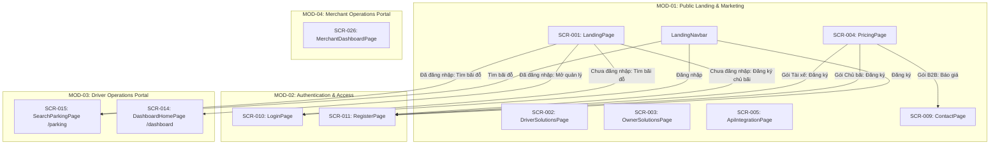

# Báo Cáo Phân Tích Chuyên Sâu Module Cổng Thông Tin Công Cộng & Marketing (MOD-01: Public Landing & Marketing Website)

---

## 1. TỔNG QUAN & PHẠM VI MODULE

Module Cổng Thông Tin Công Cộng & Marketing (**MOD-01: Public Landing & Marketing Website**) là phân hệ tiếp thị số và giao diện người dùng công khai (Public-facing Interface) của hệ thống SmartParkingHub. Phân hệ này chịu trách nhiệm:
1. Giới thiệu tổng thể giá trị sản phẩm, định vị thương hiệu SmartTruck đối với ngành vận tải logistics và bãi đỗ xe tải tại Việt Nam.
2. Đóng vai trò là phễu chuyển đổi (Conversion Funnel) chính, phân luồng khách vãng lai thành 2 tệp người dùng cốt lõi: **Tài xế/Chủ xe cơ giới** và **Chủ bãi đỗ xe (Merchant)**.
3. Cung cấp bản đồ trực quan hóa dữ liệu bãi xe mẫu (`LandingHeroMap`) kích thích nhu cầu tìm kiếm bãi xe của tài xế trước khi đăng nhập.
4. Công bố biểu phí minh bạch (`PricingPage`), giới thiệu năng lực kết nối kỹ thuật cho doanh nghiệp logistics 3PL (`ApiIntegrationPage`), tuyển dụng nhân sự (`CareersPage`), chia sẻ kiến thức chuyên môn (`BlogPage`) và tiếp nhận thông tin đối tác (`ContactPage`).
5. Đóng vai trò là khung bao bọc điều hướng chung ([`LandingLayout`](file:///d:/Documents/JAVA%20WEB%20SERVICE/SmartParkingHub/smart-parking-app/src/features/landing/components/LandingLayout.tsx)), tích hợp thanh điều hướng thông minh [`LandingNavbar`](file:///d:/Documents/JAVA%20WEB%20SERVICE/SmartParkingHub/smart-parking-app/src/features/landing/components/LandingNavbar.tsx) tự động biến đổi giao diện theo trạng thái đăng nhập của người dùng.

---

## 2. DANH SÁCH TOÀN BỘ ROUTE, PAGE & COMPONENT

### 2.1. Bảng Kê Khai Route & File Nguồn Frontend
| STT | Route URL | Tên Trang | File Component Chịu Trách Nhiệm | Layout Bọc | Quyền Truy Cập | Trạng Thái Discovery |
|:---:|---|---|---|---|---|:---:|
| 1 | `/` | `LandingPage` | [LandingPage.tsx](file:///d:/Documents/JAVA%20WEB%20SERVICE/SmartParkingHub/smart-parking-app/src/features/landing/pages/LandingPage.tsx) | `LandingLayout` | Public / Mọi vai trò | `VERIFIED` |
| 2 | `/solutions/drivers` | `DriverSolutionsPage` | [DriverSolutionsPage.tsx](file:///d:/Documents/JAVA%20WEB%20SERVICE/SmartParkingHub/smart-parking-app/src/features/landing/pages/DriverSolutionsPage.tsx) | `LandingLayout` | Public / Tài xế | `VERIFIED` |
| 3 | `/solutions/owners` | `OwnerSolutionsPage` | [OwnerSolutionsPage.tsx](file:///d:/Documents/JAVA%20WEB%20SERVICE/SmartParkingHub/smart-parking-app/src/features/landing/pages/OwnerSolutionsPage.tsx) | `LandingLayout` | Public / Chủ bãi | `VERIFIED` |
| 4 | `/pricing` | `PricingPage` | [PricingPage.tsx](file:///d:/Documents/JAVA%20WEB%20SERVICE/SmartParkingHub/smart-parking-app/src/features/landing/pages/PricingPage.tsx) | `LandingLayout` | Public / Khách vãng lai | `VERIFIED` |
| 5 | `/solutions/api` | `ApiIntegrationPage` | [ApiIntegrationPage.tsx](file:///d:/Documents/JAVA%20WEB%20SERVICE/SmartParkingHub/smart-parking-app/src/features/landing/pages/ApiIntegrationPage.tsx) | `LandingLayout` | Public / Lập trình viên | `VERIFIED` |
| 6 | `/company/about` | `AboutUsPage` | [AboutUsPage.tsx](file:///d:/Documents/JAVA%20WEB%20SERVICE/SmartParkingHub/smart-parking-app/src/features/landing/pages/AboutUsPage.tsx) | `LandingLayout` | Public / Mọi vai trò | `VERIFIED` |
| 7 | `/company/careers` | `CareersPage` | [CareersPage.tsx](file:///d:/Documents/JAVA%20WEB%20SERVICE/SmartParkingHub/smart-parking-app/src/features/landing/pages/CareersPage.tsx) | `LandingLayout` | Public / Ứng viên | `VERIFIED` |
| 8 | `/company/blog` | `BlogPage` | [BlogPage.tsx](file:///d:/Documents/JAVA%20WEB%20SERVICE/SmartParkingHub/smart-parking-app/src/features/landing/pages/BlogPage.tsx) | `LandingLayout` | Public / Bạn đọc | `VERIFIED` |
| 9 | `/company/contact` | `ContactPage` | [ContactPage.tsx](file:///d:/Documents/JAVA%20WEB%20SERVICE/SmartParkingHub/smart-parking-app/src/features/landing/pages/ContactPage.tsx) | `LandingLayout` | Public / Khách cần hỗ trợ | `VERIFIED` |

### 2.2. Danh Sách Component Phụ Trợ & Layout
1. **`LandingLayout`** (`smart-parking-app/src/features/landing/components/LandingLayout.tsx`):
   - Cấu trúc flexbox dọc chiếm trọn chiều cao màn hình (`min-h-screen flex flex-col`).
   - Bao bọc `LandingNavbar` ở đầu trang, `Outlet` ở giữa (`flex-1`), và `LandingFooter` ở chân trang.
2. **`LandingNavbar`** (`smart-parking-app/src/features/landing/components/LandingNavbar.tsx`):
   - Thanh điều hướng chuẩn gồm logo SmartTruck, 6 liên kết nghiệp vụ (`Trang chủ`, `Tìm bãi đỗ`, `Đặt chỗ của tôi`, `Hàng đợi`, `Thanh toán`, `Thông báo`).
   - Đọc phiên từ `getAuthSession()`: Nếu chưa đăng nhập thì hiện nút "Đăng nhập" (`/login`) & "Đăng ký" (`/register`); nếu đã đăng nhập thì hiện Icon chuông thông báo và Dropdown menu tài khoản (SĐT, Role, Hồ sơ cá nhân, Đăng xuất).
   - Nút Hamburger đóng/mở menu trên thiết bị di động.
3. **`LandingFooter`** (`smart-parking-app/src/features/landing/components/LandingFooter.tsx`):
   - Lưới thông tin chân trang chia 4 cột: Giới thiệu SmartTruck, Nhóm liên kết Tài xế, Nhóm liên kết Pháp lý, Nhóm liên kết Hỗ trợ, và dòng bản quyền năm 2026.
4. **`LandingHeroMap`** (`smart-parking-app/src/features/landing/components/LandingHeroMap.tsx`):
   - Bản đồ mini tích hợp thư viện Leaflet (`react-leaflet` / `leaflet`), định vị tại trung tâm cụm logistics TP.HCM (lat: 10.79, lng: 106.785, zoom: 12).
   - Hiển thị 3 marker bãi xe (`An Phát – Cát Lái`, `Tân Cảng`, `Miền Đông mới`) kèm số chỗ trống, mức giá (32K - 35K), marker vị trí tài xế và đường dẫn đứt đoạn màu vàng cam nối tới bãi gần nhất.

---

## 3. CÁC LAYOUT, TAB, DIALOG, DRAWER & MENU ACTION

### 3.1. Phân Tích Bố Cục & Thanh Điều Hướng
- **Toàn bộ 9 màn hình sử dụng thống nhất một Layout duy nhất:** [`LandingLayout`](file:///d:/Documents/JAVA%20WEB%20SERVICE/SmartParkingHub/smart-parking-app/src/features/landing/components/LandingLayout.tsx).
- **Không sử dụng Drawer / Dialog trong các trang marketing:** Mọi nội dung từ bảng giá, bài viết blog, tuyển dụng đến form liên hệ đều được trình bày trực tiếp trên trang cuộn (Page View), không qua cửa sổ popup để tối ưu hóa SEO và tốc độ tải trang.

### 3.2. Menu Actions & Dropdowns
- **Dropdown Menu Tài Khoản (`LandingNavbar.tsx:24-39`):**
  - Component Ant Design `Dropdown` kết hợp `MenuProps`.
  - Item 1 (Disabled): Tóm tắt tài khoản gồm vai trò (`Tài xế`, `Chủ bãi` hoặc `Quản trị viên`) và Số điện thoại đăng nhập.
  - Item 2: Đường phân cách (`divider`).
  - Item 3: "Hồ sơ cá nhân" (Icon `<UserRound />`) -> Điều hướng tới `/profile` (Driver), `/merchant/profile` (Merchant), hoặc `/admin/profile` (Admin).
  - Item 4 (Danger): "Đăng xuất" (Icon `<LogOut />`) -> Gọi `clearAuthSession()`, đóng menu và chuyển hướng về `/login`.
- **Menu Hamburger Trên Mobile (`LandingNavbar.tsx:48`):**
  - Toggle trạng thái `open` qua nút bấm `<Menu />` / `<X />`, mở rộng danh sách liên kết phủ trọn thanh điều hướng mobile.

---

## 4. DANH SÁCH TOÀN BỘ CHỨC NĂNG NGƯỜI DÙNG

| Mã Chức Năng | Tên Chức Năng | Màn Hình | Vai Trò Thực Hiện | Tóm Tắt Nghiệp Vụ |
|:---:|---|:---:|:---:|---|
| **F01-01** | Xem trang chủ & Giá trị cốt lõi | `SCR-001` | Khách vãng lai / Mọi vai trò | Tiếp cận thông điệp sản phẩm, số liệu mạng lưới và các phân đoạn khách hàng |
| **F01-02** | Xem bản đồ mini Hero Map | `SCR-001` | Khách vãng lai | Quan sát vị trí 3 bãi đỗ xe mẫu, số chỗ trống và giá giờ tại khu vực Cát Lái |
| **F01-03** | Điều hướng tìm bãi đỗ xe nhanh | `SCR-001` | Khách vãng lai / Tài xế | Bấm "Tìm bãi đỗ", hệ thống tự động kiểm tra đăng nhập để đưa vào `/parking` hoặc `/login` |
| **F01-04** | Điều hướng đăng ký chủ bãi | `SCR-001` | Khách vãng lai / Chủ bãi | Bấm "Đăng ký chủ bãi", chuyển hướng tới `/register` hoặc `/dashboard` |
| **F01-05** | Xem giải pháp dành cho Tài xế | `SCR-002` | Khách vãng lai / Tài xế | Tìm hiểu giải pháp an tâm dừng đỗ, thanh toán số và tra cứu tiện ích xe tải |
| **F01-06** | Xem giải pháp dành cho Chủ bãi | `SCR-003` | Khách vãng lai / Chủ bãi | Tìm hiểu giải pháp số hóa bãi xe, quét QR chống thất thoát và định giá động |
| **F01-07** | Xem bảng so sánh các gói giá | `SCR-004` | Khách vãng lai / Doanh nghiệp | So sánh 3 gói dịch vụ: Tài xế cá nhân, Đội xe doanh nghiệp, Chủ bãi đỗ |
| **F01-08** | Xem tài liệu tích hợp API & Webhooks | `SCR-005` | Khách vãng lai / Developer | Xem cấu trúc RESTful API mẫu, JSON response và hướng dẫn Bearer Token |
| **F01-09** | Xem câu chuyện sứ mệnh công ty | `SCR-006` | Khách vãng lai / Đối tác | Tìm hiểu lý do ra đời và sứ mệnh số hóa bãi đỗ xe tải của SmartTruck |
| **F01-10** | Xem danh sách vị trí tuyển dụng | `SCR-007` | Khách vãng lai / Ứng viên | Xem các cơ hội nghề nghiệp kỹ thuật và kinh doanh tại Hà Nội, TP.HCM |
| **F01-11** | Xem tin tức & cẩm nang blog | `SCR-008` | Khách vãng lai / Bạn đọc | Đọc các bài viết chia sẻ kinh nghiệm vận hành bãi xe và tối ưu nhiên liệu |
| **F01-12** | Điền biểu mẫu gửi liên hệ | `SCR-009` | Khách vãng lai / Khách hàng | Điền Họ tên, Email, Nội dung gửi yêu cầu tư vấn hoặc báo giá |
| **F01-13** | Điều hướng phân hệ qua Navbar | Toàn module | Mọi người dùng | Nhấp vào các liên kết Trang chủ, Tìm bãi đỗ, Đặt chỗ, Hàng đợi, Thanh toán, Thông báo |
| **F01-14** | Thao tác tài khoản & Đăng xuất | Toàn module | Người dùng đã đăng nhập | Xem tóm tắt vai trò/SĐT, truy cập trang hồ sơ cá nhân và thực hiện đăng xuất |

---

## 5. MA TRẬN ĐẶC TẢ CHI TIẾT TỪNG CHỨC NĂNG

### F01-02 & F01-03: Tương Tác Bản Đồ Mini & Chuyển Hướng Tìm Bãi (`SCR-001`)
- **Điều kiện thực hiện:** Người dùng đang ở màn hình trang chủ `/`.
- **Dữ liệu đầu vào:** Click vào Marker bãi xe trên bản đồ Leaflet hoặc bấm nút "Tìm bãi đỗ" / "Tìm bãi ngay".
- **Xử lý UI (`LandingPage.tsx:11`):**
  ```typescript
  const openDriver = () => navigate(getAuthSession() ? '/parking' : '/login', { state: { from: '/parking' } })
  ```
- **Kết quả:**
  - Nếu đã có phiên đăng nhập: Điều hướng thẳng vào phân hệ tìm kiếm bãi xe `/parking` (`SCR-015`).
  - Nếu chưa đăng nhập: Điều hướng sang màn hình Đăng nhập `/login` (`SCR-010`) kèm router state `{ state: { from: '/parking' } }` để sau khi đăng nhập xong sẽ tự động quay lại bản đồ.

### F01-04: Chuyển Hướng Đăng Ký Đối Tác Chủ Bãi (`SCR-001`)
- **Điều kiện thực hiện:** Người dùng bấm nút "Đăng ký chủ bãi" hoặc "Mở cổng quản lý".
- **Xử lý UI (`LandingPage.tsx:12`):**
  ```typescript
  const openOwner = () => navigate(getAuthSession() ? '/dashboard' : '/register')
  ```
- **Kết quả:** Nếu chưa đăng nhập, mở màn hình Đăng ký `/register` (`SCR-011`).

### F01-07: Lựa Chọn Gói Dịch Vụ Tại Bảng Giá (`SCR-004`)
- **Gói 1 (Tài Xế Cá Nhân):** Nút "Đăng ký ngay" -> Chuyển hướng sang `/register`.
- **Gói 2 (Đội Xe / Doanh Nghiệp):** Nút "Nhận báo giá" -> Chuyển hướng sang `/company/contact` (`SCR-009`).
- **Gói 3 (Chủ Bãi Đỗ):** Nút "Đăng ký bãi đỗ" -> Chuyển hướng sang `/register`.

### F01-12: Gửi Tin Nhắn Liên Hệ Hợp Tác (`SCR-009`)
- **Dữ liệu đầu vào:** `fullName` (text), `email` (email), `message` (textarea).
- **Trạng thái kỹ thuật hiện tại:** Biểu mẫu `<form>` không có thuộc tính `onSubmit`. Khi click nút "Gửi yêu cầu", form chỉ kích hoạt hành vi tải lại trang mặc định của HTML. Chưa có mã nguồn gọi API Backend hoặc EmailJS.

---

## 6. ĐỐI CHIẾU BACKEND TOÀN DIỆN (CONTROLLER, SERVICE, DTO, ENTITY, VALIDATION)

### 6.1. Ma Trận Đối Chiếu API Phục Vụ Module
| Màn Hình | Hành Động Trên UI | Endpoint Phỏng Đoán | Endpoint Thực Tế Backend | Controller & Method | Trạng Thái Đối Chiếu |
|---|---|---|---|---|:---:|
| `SCR-001` | Lấy danh sách 3 bãi đỗ trên Hero Map | `GET /api/v1/public/parking-lots/featured` | **Không tồn tại** | Không có Controller map | `CODE_ONLY_MOCK` (Hardcoded data tại `LandingHeroMap.tsx:5-9`) |
| `SCR-001` | Lấy số liệu thống kê (chỗ trống, checkin) | `GET /api/v1/public/stats` | **Không tồn tại** | Không có Controller map | `CODE_ONLY_MOCK` (Hardcoded data tại `LandingPage.tsx:22-27`) |
| `SCR-005` | Xem code mẫu API tìm bãi | Mẫu ghi: `GET /api/v1/parks/search` | Thực tế là: `GET /api/v1/parking-lots/search` | [ParkingLotController.java:57](file:///d:/Documents/JAVA%20WEB%20SERVICE/SmartParkingHub/smart-parking-service/src/main/java/com/backend/controller/ParkingLotController.java#L57) | `CONFLICT` (Sai lệch giữa mẫu UI và API thật) |
| `SCR-005` | Nút "Xem Tài Liệu API" | Mở Swagger UI | URL: `/swagger-ui/index.html` hoặc `/api/public/openapi` | [MayhemOpenApiSecurityConfig.java:19](file:///d:/Documents/JAVA%20WEB%20SERVICE/SmartParkingHub/smart-parking-service/src/main/java/com/backend/security/MayhemOpenApiSecurityConfig.java#L19) | `PARTIALLY_IMPLEMENTED` (Backend có hỗ trợ nhưng nút chưa gắn link) |
| `SCR-007` | Xem danh sách việc làm | `GET /api/v1/public/careers` | **Không tồn tại** | Không có Controller | `CODE_ONLY_MOCK` (Hardcoded array tại `CareersPage.tsx:12-16`) |
| `SCR-008` | Xem danh sách bài viết Blog | `GET /api/v1/public/posts` | **Không tồn tại** | Không có Controller | `CODE_ONLY_MOCK` (Hardcoded array tại `BlogPage.tsx:5-9`) |
| `SCR-009` | Nút "Gửi yêu cầu" liên hệ | `POST /api/v1/public/contact` | **Không tồn tại** | Không có Controller | `FE_AHEAD_OF_BE` / Form tĩnh chưa có logic xử lý |

### 6.2. Minh Chứng Về Cấu Hình Bảo Mật Backend Phục Vụ Module
Trong cấu hình an ninh Spring Security [`SecurityConfig.java:61`](file:///d:/Documents/JAVA%20WEB%20SERVICE/SmartParkingHub/smart-parking-service/src/main/java/com/backend/security/SecurityConfig.java#L61) và [`JwtAuthenticationFilter.java:31`](file:///d:/Documents/JAVA%20WEB%20SERVICE/SmartParkingHub/smart-parking-service/src/main/java/com/backend/security/JwtAuthenticationFilter.java#L31):
```java
// SecurityConfig.java
.requestMatchers("/api/v1/public/**").permitAll()

// JwtAuthenticationFilter.java
protected boolean shouldNotFilter(HttpServletRequest request) throws ServletException {
    String path = request.getServletPath();
    return path.startsWith("/api/v1/auth/")
            || path.startsWith("/api/v1/public/")
            || path.equals("/api/v1/payments/webhook");
}
```
**Kết luận đối soát:** Backend đã mở sẵn hành lang bảo mật `permitAll()` cho toàn bộ tiền tố `/api/v1/public/**`, nhưng đội ngũ phát triển backend **chưa xây dựng Controller nào để hiện thực hóa các endpoint này**. Frontend hiện đang hoàn toàn tự xử lý hiển thị bằng dữ liệu tĩnh.

---

## 7. CƠ CHẾ ROLE-BASED ACCESS CONTROL (RBAC) & PERMISSIONS

### 7.1. Phân Quyền Tiếp Cận Các Màn Hình
- Tất cả 9 màn hình thuộc Module 01 (`SCR-001` đến `SCR-009`) đều được cấu hình trong `AppRoutes.tsx:68-86` nằm ngoài bộ lọc bảo vệ `ProtectedRoute`.
- Mọi người dùng (`GUEST`, `DRIVER`, `MERCHANT`, `ADMIN`) đều có quyền truy cập trực tiếp công khai mà không bị chặn phân quyền.

### 7.2. Cơ Chế Thích Ứng Giao Diện Động Theo Role Trên `LandingNavbar`
Mặc dù là trang công cộng, thanh điều hướng [`LandingNavbar.tsx:16-52`](file:///d:/Documents/JAVA%20WEB%20SERVICE/SmartParkingHub/smart-parking-app/src/features/landing/components/LandingNavbar.tsx#L16-L52) sở hữu logic thích ứng theo vai trò rất chặt chẽ:
1. **Khách vãng lai (`session === null`):**
   - Hiển thị liên kết "Đăng nhập" dẫn tới `/login` và "Đăng ký" dẫn tới `/register`.
2. **Tài xế (`session.role === 'DRIVER'`):**
   - Ẩn cụm nút đăng nhập/đăng ký.
   - Hiển thị Icon chuông thông báo (link `/notifications`).
   - Avatar hiển thị dropdown: Thẻ tóm tắt nhãn `"Tài xế"` + SĐT, mục `"Hồ sơ cá nhân"` trỏ về `/profile`, và nút `"Đăng xuất"`.
3. **Chủ bãi đỗ (`session.role === 'MERCHANT'`):**
   - Avatar hiển thị dropdown: Thẻ tóm tắt nhãn `"Chủ bãi"` + SĐT, mục `"Hồ sơ cá nhân"` trỏ về `/merchant/profile`, và nút `"Đăng xuất"`.
4. **Quản trị viên (`session.role === 'ADMIN'`):**
   - Avatar hiển thị dropdown: Thẻ tóm tắt nhãn `"Quản trị viên"` + SĐT, mục `"Hồ sơ cá nhân"` trỏ về `/admin/profile`, và nút `"Đăng xuất"`.

---

## 8. QUAN HỆ GIỮA MODULE PUBLIC LANDING VỚI CÁC MODULE KHÁC



---

## 9. CÁC LUỒNG NGHIỆP VỤ ĐẦU - CUỐI (BUSINESS FLOWS)

### 9.1. Luồng 1: Khách Vãng Lai Tiếp Cận & Khám Phá Bãi Đỗ Xe (Landing to Discovery Flow)
1. Người dùng truy cập trang chủ `/` (`SCR-001`).
2. Quan sát bản đồ mini `LandingHeroMap`, thấy các bãi xe xung quanh khu vực cảng Cát Lái và trạm dừng nghỉ.
3. Nhấp vào marker bãi xe hoặc nút "Tìm bãi đỗ".
4. Hệ thống kiểm tra phiên:
   - Nếu chưa đăng nhập: Chuyển hướng sang `/login` kèm `state: { from: '/parking' }`.
   - Người dùng tiến hành đăng nhập thành công.
   - Hệ thống tự động đọc lại `state.from` và đưa thẳng người dùng đến bản đồ tìm kiếm toàn diện `/parking` (`SCR-015`).

### 9.2. Luồng 2: Chủ Bãi Tiếp Cận & Đăng Ký Trở Thành Đối Tác (Owner Onboarding Flow)
1. Khách truy cập vào trang chủ hoặc click liên kết footer "Giải pháp dành cho Chủ bãi" (`SCR-003`).
2. Xem bảng phân tích lợi nhuận, chống thất thoát doanh thu và quét mã QR kiểm soát xe ra vào.
3. Bấm nút "Mở cổng quản lý" hoặc "Đăng ký chủ bãi".
4. Hệ thống điều hướng sang `/register` (`SCR-011`).
5. Người dùng chọn vai trò `MERCHANT`, điền thông tin CCCD, tài khoản ngân hàng và hoàn tất đăng ký để trở thành Chủ bãi.

### 9.3. Luồng 3: Doanh Nghiệp Vận Tải Xem Bảng Giá & Yêu Cầu Báo Giá B2B (Enterprise Pricing Flow)
1. Doanh nghiệp vận tải truy cập `/pricing` (`SCR-004`).
2. Xem gói dịch vụ "Đội Xe / Doanh Nghiệp" (gói nổi bật trung tâm).
3. Bấm nút "Nhận báo giá".
4. Hệ thống chuyển hướng sang trang Liên hệ `/company/contact` (`SCR-009`).
5. Doanh nghiệp điền thông tin liên hệ và gửi yêu cầu tư vấn gói doanh nghiệp.

---

## 10. BẢNG TỔNG HỢP TRẠNG THÁI GIAO DIỆN & TRƯỜNG HỢP LỖI

| Màn Hình | Tên Trạng Thái UI | Điều Kiện Xuất Hiện | Biểu Hiện Trên Màn Hình | Hành Động Khắc Phục |
|---|---|---|---|---|
| `SCR-001` | `UI-MAP-LOADING` | Mới mở trang, Leaflet đang tải tile map | Khung bản đồ hiển thị xám nhẹ, sau đó render tile OpenStreetMap | Chờ tải bản đồ |
| `SCR-001` | `UI-NAV-GUEST` | Người dùng chưa đăng nhập | Navbar hiển thị nút "Đăng nhập" và "Đăng ký" | Nhấp đăng nhập hoặc tiếp tục xem |
| `SCR-001` | `UI-NAV-AUTH` | Người dùng đã đăng nhập | Navbar ẩn nút đăng nhập, hiển thị chuông và Avatar dropdown | Bấm avatar để xem hồ sơ / đăng xuất |
| `SCR-001` | `UI-NAV-MOBILE` | Thu nhỏ màn hình `< md` | Các link bị ẩn, hiển thị icon nút Hamburger (Menu/X) | Bấm nút Hamburger để mở menu trượt |
| `SCR-005` | `ERR-DEAD-CLICK-DOCS`| Click nút "Xem Tài Liệu API" | Nút bấm không có phản hồi do chưa gắn handler | Cần gắn link tới Swagger UI |
| `SCR-007` | `ERR-DEAD-CLICK-APPLY`| Click nút "Ứng tuyển" tại vị trí công việc | Nút bấm không có phản hồi do chưa gắn handler | Cần gắn `mailto:` hoặc mở modal nộp CV |
| `SCR-008` | `ERR-DEAD-CLICK-POST`| Click vào thẻ bài viết Blog | Thẻ có hiệu ứng hover nhưng click không mở ra trang đọc chi tiết | Cần tạo route `/company/blog/:id` |
| `SCR-009` | `ERR-FORM-RELOAD` | Click nút "Gửi yêu cầu" tại form liên hệ | Form kích hoạt reload lại trang do thiếu `e.preventDefault()` | Cần gắn hàm `onSubmit` kết nối API |

---

## 11. ĐỐI SOÁT CHỨC NĂNG BACKEND vs FRONTEND

### 11.1. Chức Năng Có Trong Backend Nhưng Chưa Khai Thác Trên Frontend
1. **Tài Liệu Swagger / OpenAPI UI Phía Backend:**
   - Backend cấu hình cổng Swagger tại `/swagger-ui/index.html` và `/api/public/openapi` ([`MayhemOpenApiSecurityConfig.java:19`](file:///d:/Documents/JAVA%20WEB%20SERVICE/SmartParkingHub/smart-parking-service/src/main/java/com/backend/security/MayhemOpenApiSecurityConfig.java#L19)). Tuy nhiên nút "Xem Tài Liệu API" trên trang `ApiIntegrationPage.tsx:28` là nút chết, chưa được gắn đường dẫn mở trực tiếp Swagger UI này.
2. **Dữ Liệu Bãi Xe Thực Tế Trong Database:**
   - Backend sở hữu dữ liệu các bãi xe thật trong bảng `parking_lots`, nhưng trang chủ `LandingPage` và `LandingHeroMap` không gọi API để lấy bãi xe thực tế mà chỉ hiển thị 3 bãi xe giả lập ở khu vực Cát Lái/Tân Cảng.

### 11.2. Chức Năng Frontend Đang Hiển Thị Nhưng Chưa Có Bằng Chứng Backend Hỗ Trợ
1. **Biểu Mẫu Tiếp Nhận Liên Hệ (`ContactPage.tsx`):**
   - Frontend có form nhập Họ tên, Email, Nội dung tin nhắn nhưng Backend hoàn toàn không có Controller hay Service nào lưu trữ thông tin liên hệ của khách hàng.
2. **Dữ Liệu Thống Kê Quảng Bá Mạng Lưới:**
   - Các con số "500+ tài xế", "120+ bãi đỗ toàn quốc", "128 chỗ trống", "42 check-in hôm nay", "Doanh thu +14%" hoàn toàn là số liệu tĩnh viết trực tiếp trong code JSX.
3. **Bài Viết Blog & Tin Tuyển Dụng:**
   - Được khai báo dưới dạng mảng JavaScript cục bộ trên Frontend, Backend không có bảng cơ sở dữ liệu `posts` hay `jobs`.

---

## 12. PHÂN LOẠI TRẠNG THÁI CHỨC NĂNG THEO MỨC ĐỘ TRƯỞNG THÀNH

| Nhóm Phân Loại | Các Chức Năng Cụ Thể | Đánh Giá & Bằng Chứng Mã Nguồn |
|---|---|---|
| **`VERIFIED_COMPLETE`** (Hiện hữu & Hoàn thiện) | - Giao diện Trang chủ Marketing (`SCR-001`).<br>- Trang giới thiệu giải pháp Tài xế (`SCR-002`) & Chủ bãi (`SCR-003`).<br>- Bảng giá 3 gói giải pháp (`SCR-004`).<br>- Trang giới thiệu công ty (`SCR-006`).<br>- Thanh điều hướng `LandingNavbar` biến đổi linh hoạt theo vai trò và hỗ trợ đăng xuất. | Hoàn thiện về mặt giao diện, trải nghiệm mượt mà, định tuyến chính xác. |
| **`PARTIALLY_IMPLEMENTED`** (Chưa hoàn thiện / Nút chết) | - Trang tích hợp API (`SCR-005`): Nút "Xem Tài Liệu API" chưa gắn hành động.<br>- Trang tuyển dụng (`SCR-007`): Nút "Ứng tuyển" chưa mở form nộp hồ sơ.<br>- Trang blog (`SCR-008`): Chưa có trang đọc bài viết chi tiết.<br>- Trang liên hệ (`SCR-009`): Biểu mẫu chưa có logic gửi dữ liệu. | Giao diện đã dựng đẹp nhưng thiếu logic xử lý sự kiện tương tác. |
| **`DOCUMENTED_ONLY`** (Chỉ có trong tài liệu cũ) | - Tích hợp dịch vụ EmailJS (`emailJsApi.ts`) tại `ContactPage`: Tài liệu cũ ghi nhận có kết nối, nhưng mã nguồn thực tế file `ContactPage.tsx` không hề import hoặc gọi `emailJsApi.ts`. | Đã được hiệu chỉnh chính xác trong báo cáo này. |
| **`CODE_ONLY`** (Có trong code nhưng chưa có trong tài liệu trước) | - Bản đồ tương tác mini Leaflet `LandingHeroMap` hiển thị 3 bãi mẫu tại Cát Lái/Tân Cảng kèm route polyline.<br>- Widget biểu đồ cột doanh thu CSS `+14%` tại trang chủ. | Đã được ghi nhận đầy đủ vào hệ thống tài liệu Screen Spec. |

---

## 13. CÁC ĐIỂM BẤT HỢP LÝ CẦN KHẮC PHỤC KHI THIẾT KẾ LẠI (REDESIGN RISKS)

1. **Khắc Phục Toàn Diện Các Nút Bấm Chết (Dead Click Elimination):**
   - Nút "Xem Tài Liệu API" trên `SCR-005` cần được gắn link trực tiếp mở `/swagger-ui/index.html`.
   - Nút "Ứng tuyển" trên `SCR-007` cần mở Modal nộp CV hoặc kích hoạt `mailto:tuyendung@smarttruck.vn`.
   - Các thẻ bài viết Blog trên `SCR-008` cần được bao bọc bằng thẻ `<Link to={`/company/blog/${post.slug}`}>` dẫn tới trang đọc bài viết hoàn chỉnh.
2. **Kích Hoạt Biểu Mẫu Liên Hệ (`SCR-009`):**
   - Biểu mẫu liên hệ cần được gắn `onSubmit` handler, kiểm tra tính hợp lệ dữ liệu (Validate Họ tên, Email, SĐT), gọi API lưu vào hệ thống hoặc gửi thông báo qua EmailJS/SendGrid, và hiển thị thông báo thành công cho khách hàng.
3. **Mâu Thuẫn Công Nghệ Tuyển Dụng (Tech Stack Mismatch):**
   - Tại `CareersPage.tsx:14`, thông tin tuyển dụng ghi tuyển `Backend Node.js Developer`, trong khi mã nguồn Backend thực tế của dự án là **Java Spring Boot 3.x / JPA / MySQL**. Cần hiệu chỉnh lại thành `Backend Java Developer`.
4. **Tách Bạch Các Liên Kết Pháp Lý Tại Chân Trang:**
   - Hiện tại cả hai liên kết "Chính sách bảo mật" và "Điều khoản dịch vụ" tại Footer đều trỏ về `/company/about`. Cần xây dựng riêng 2 trang nội dung văn bản pháp lý độc lập: `/terms` và `/privacy`.
5. **Động Hóa Dữ Liệu Trang Chủ Qua API Công Khai:**
   - Xây dựng endpoint công khai `GET /api/v1/public/featured-parking-lots` để bản đồ mini trên trang chủ tự động tải bãi xe thật theo vị trí GPS của người dùng thay vì ghim cứng 3 bãi xe tại TP.HCM.

---

## 14. BÁO CÁO TỔNG KẾT MODULE & DANH MỤC "BẤT KHẢ XÂM PHẠM" (NON-NEGOTIABLES)

### 14.1. Tóm Lược Chỉ Số Cốt Lõi Module
- **Số lượng màn hình UI:** 9 màn hình (`SCR-001` đến `SCR-009`).
- **Số lượng chức năng người dùng:** 14 chức năng (`F01-01` đến `F01-14`).
- **Số lượng API Backend:** Hiện tại là 0 (Đang chuẩn bị sẵn cấu hình `permitAll("/api/v1/public/**")` phía Spring Security).
- **Tỷ lệ hoàn thiện UI:** 100% giao diện đã hoàn thiện, cần hoàn thiện logic sự kiện cho các nút hành động phụ.

### 14.2. Các Yếu Tố TUYỆT ĐỐI KHÔNG ĐƯỢC MẤT Khi Thiết Kế Lại Giao Diện (Invariants)
1. **Cơ Chế Điều Hướng Thông Minh Kèm `state.from`:**
   - Khi khách vãng lai bấm "Tìm bãi đỗ" trên trang chủ, hệ thống phải luôn ghi nhớ trang đích thông qua `{ state: { from: '/parking' } }` để sau khi đăng nhập thành công, người dùng được đưa thẳng tới bản đồ tìm bãi mà không phải bấm lại từ đầu.
2. **Thanh Điều Hướng Thích Ứng Vai Trò (Smart Role-Adaptive Navbar):**
   - Thanh điều hướng trên cùng `LandingNavbar` phải luôn kiểm tra trạng thái phiên làm việc trong `localStorage` để tự động chuyển đổi giữa 2 chế độ: Nút bấm Đăng nhập/Đăng ký (cho khách vãng lai) và Menu Avatar tài khoản kèm định danh vai trò (cho người dùng đã đăng nhập).
3. **Bản Đồ Trực Quan Hóa Bãi Xe Ngay Tại Hero Section:**
   - Thành phần bản đồ số `LandingHeroMap` hiển thị trực tiếp các bãi xe, số chỗ trống và giá giờ ngay cạnh tiêu đề Hero là điểm nhấn chuyển đổi quan trọng nhất của trang chủ, tuyệt đối không được lược bỏ thay bằng hình ảnh tĩnh.
4. **Phân Luồng Rõ Ràng Hai Nhóm Khách Hàng (Tài Xế vs Chủ Bãi):**
   - Thiết kế mới phải luôn duy trì hai phân vùng nội dung và hai nút kêu gọi hành động độc lập dành riêng cho Tài xế xe tải và Chủ bãi đỗ xe trên toàn bộ các trang Marketing.
