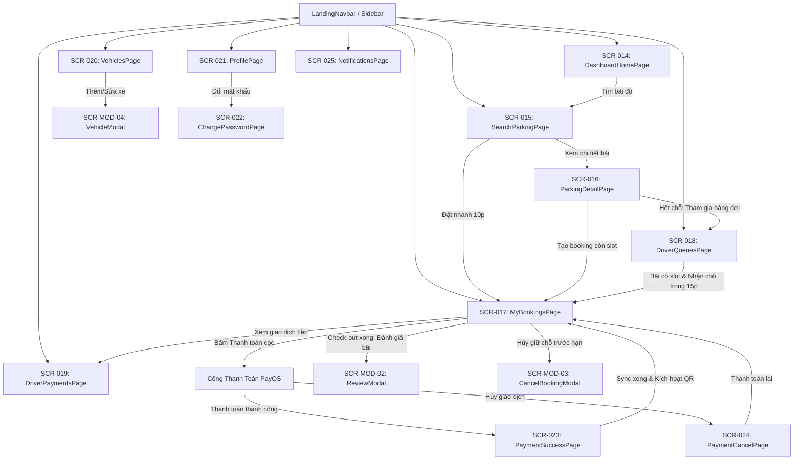

# Danh Mục Đặc Tả Chi Tiết Màn Hình Cổng Tài Xế (SCR-014 đến SCR-025)

---

## 1. TỔNG QUAN PHÂN HỆ CỔNG TÀI XẾ (DRIVER OPERATIONS PORTAL)

Phân hệ **Cổng Tài Xế (`MOD-03`)** là không gian vận hành số dành cho tài xế xe tải, xe container, xe khách và ô tô thương mại. Phân hệ bao gồm 12 màn hình chính (`SCR-014` đến `SCR-025`) cùng 3 thành phần hộp thoại phụ trợ (`SCR-MOD-02`, `SCR-MOD-03`, `SCR-MOD-04`).

Tất cả các màn hình trong phân hệ này đã được khảo sát kỹ lưỡng từ tầng Giao diện (React/Vite/AntD/Leaflet) đến tầng Dịch vụ (Spring Boot/JPA/PayOS), và được chuẩn hóa thành 12 hồ sơ đặc tả chi tiết (Screen Specification) lưu trữ tại thư mục [`docs/ui-redesign-discovery/detail-screens/`](file:///d:/Documents/JAVA%20WEB%20SERVICE/SmartParkingHub/docs/ui-redesign-discovery/detail-screens).

---

## 2. DANH MỤC SCREEN SPECIFICATION ĐỘC LẬP

Dưới đây là liên kết truy cập trực tiếp vào hồ sơ đặc tả kỹ thuật chi tiết của từng màn hình:

| Mã MH | Tên Màn Hình & Thành Phần | URL Route | Layout / Container | Hồ Sơ Đặc Tả Chi Tiết |
|---|---|---|---|---|
| **SCR-014** | Bảng điều khiển tổng quan tài xế (`DashboardHomePage`) | `/dashboard` | `DashboardLayout` | [`SCR-014-driver-dashboard.md`](file:///d:/Documents/JAVA%20WEB%20SERVICE/SmartParkingHub/docs/ui-redesign-discovery/detail-screens/SCR-014-driver-dashboard.md) |
| **SCR-015** | Bản đồ số & Tìm kiếm bãi đỗ (`SearchParkingPage`) | `/parking`, `/dashboard/search` | `LandingLayout` / `DashboardLayout` | [`SCR-015-driver-search-parking.md`](file:///d:/Documents/JAVA%20WEB%20SERVICE/SmartParkingHub/docs/ui-redesign-discovery/detail-screens/SCR-015-driver-search-parking.md) |
| **SCR-016** | Chi tiết bãi đỗ & Tạo lệnh đặt chỗ (`ParkingDetailPage`) | `/dashboard/parking/:id` | `DashboardLayout` | [`SCR-016-driver-parking-detail.md`](file:///d:/Documents/JAVA%20WEB%20SERVICE/SmartParkingHub/docs/ui-redesign-discovery/detail-screens/SCR-016-driver-parking-detail.md) |
| **SCR-017** | Quản lý đặt chỗ & Vé QR check-in (`MyBookingsPage`) | `/bookings` | `LandingLayout` | [`SCR-017-driver-bookings.md`](file:///d:/Documents/JAVA%20WEB%20SERVICE/SmartParkingHub/docs/ui-redesign-discovery/detail-screens/SCR-017-driver-bookings.md) |
| **SCR-018** | Theo dõi hàng đợi ảo thông minh (`DriverQueuesPage`) | `/queues` | `LandingLayout` | [`SCR-018-driver-queues.md`](file:///d:/Documents/JAVA%20WEB%20SERVICE/SmartParkingHub/docs/ui-redesign-discovery/detail-screens/SCR-018-driver-queues.md) |
| **SCR-019** | Sổ cái thanh toán & Hóa đơn điện tử (`DriverPaymentsPage`) | `/payments` | `LandingLayout` | [`SCR-019-driver-payments.md`](file:///d:/Documents/JAVA%20WEB%20SERVICE/SmartParkingHub/docs/ui-redesign-discovery/detail-screens/SCR-019-driver-payments.md) |
| **SCR-020** | Quản lý phương tiện vận tải (`VehiclesPage`) | `/vehicles`, `/dashboard/vehicles` | `LandingLayout` / `DashboardLayout` + `ProfileSidebar` | [`SCR-020-driver-vehicles.md`](file:///d:/Documents/JAVA%20WEB%20SERVICE/SmartParkingHub/docs/ui-redesign-discovery/detail-screens/SCR-020-driver-vehicles.md) |
| **SCR-021** | Hồ sơ cá nhân tài xế (`ProfilePage`) | `/profile`, `/dashboard/profile` | `LandingLayout` / `DashboardLayout` + `ProfileSidebar` | [`SCR-021-driver-profile.md`](file:///d:/Documents/JAVA%20WEB%20SERVICE/SmartParkingHub/docs/ui-redesign-discovery/detail-screens/SCR-021-driver-profile.md) |
| **SCR-022** | Đổi mật khẩu tài khoản (`ChangePasswordPage`) | `/change-password`, `/dashboard/change-password` | `LandingLayout` / `DashboardLayout` + `ProfileSidebar` | [`SCR-022-driver-change-password.md`](file:///d:/Documents/JAVA%20WEB%20SERVICE/SmartParkingHub/docs/ui-redesign-discovery/detail-screens/SCR-022-driver-change-password.md) |
| **SCR-023** | Callback kết quả thanh toán PayOS thành công (`PaymentReturnPage`) | `/payment/success` | Standalone Page | [`SCR-023-driver-payment-success.md`](file:///d:/Documents/JAVA%20WEB%20SERVICE/SmartParkingHub/docs/ui-redesign-discovery/detail-screens/SCR-023-driver-payment-success.md) |
| **SCR-024** | Callback kết quả hủy thanh toán PayOS (`PaymentReturnPage`) | `/payment/cancel` | Standalone Page | [`SCR-024-driver-payment-cancel.md`](file:///d:/Documents/JAVA%20WEB%20SERVICE/SmartParkingHub/docs/ui-redesign-discovery/detail-screens/SCR-024-driver-payment-cancel.md) |
| **SCR-025** | Trung tâm thông báo hệ thống (`NotificationsPage`) | `/notifications` | `LandingLayout` | [`SCR-025-driver-notifications.md`](file:///d:/Documents/JAVA%20WEB%20SERVICE/SmartParkingHub/docs/ui-redesign-discovery/detail-screens/SCR-025-driver-notifications.md) |

---

## 3. CÁC DIALOG, DRAWER & MODAL PHỤ TRỢ (MODAL INVENTORY)

| Mã Modal | Tên Modal | Component Mã Nguồn | Màn Hình Kích Hoạt | Mục Đích Nghiệp Vụ |
|---|---|---|---|---|
| **SCR-MOD-02** | `ReviewModal` | [`ReviewModal.tsx`](file:///d:/Documents/JAVA%20WEB%20SERVICE/SmartParkingHub/smart-parking-app/src/features/reviews/components/ReviewModal.tsx) | `SCR-017` (`MyBookingsPage`) | Đánh giá bãi đỗ sau chuyến đi (Số sao 1-5, bình luận văn bản) |
| **SCR-MOD-03** | `CancelBookingModal` | [`CancelBookingModal.tsx`](file:///d:/Documents/JAVA%20WEB%20SERVICE/SmartParkingHub/smart-parking-app/src/features/bookings/components/CancelBookingModal.tsx) | `SCR-017` (`MyBookingsPage`) | Xác nhận hủy đặt cọc giữ chỗ (Cảnh báo chính sách hoàn cọc 100% nếu trước deadline) |
| **SCR-MOD-04** | `VehicleModal` | Inline Modal trong [`VehiclesPage.tsx:145-203`](file:///d:/Documents/JAVA%20WEB%20SERVICE/SmartParkingHub/smart-parking-app/src/features/vehicles/pages/VehiclesPage.tsx#L145-L203) | `SCR-020` (`VehiclesPage`) | Form popup thêm mới hoặc chỉnh sửa phương tiện vận tải (Biển số, loại xe, tải trọng) |
| **SCR-DRW-01** | `InlineQuickBookPanel` | Inline Panel trong [`SearchParkingPage.tsx`](file:///d:/Documents/JAVA%20WEB%20SERVICE/SmartParkingHub/smart-parking-app/src/features/driver/pages/SearchParkingPage.tsx) | `SCR-015` (`SearchParkingPage`) | Panel đặt cọc giữ chỗ siêu tốc 10 phút ngay trên giao diện bản đồ |

---

## 4. MA TRẬN LUỒNG NGHIỆP VỤ LIÊN MÀN HÌNH (SCREEN FLOW MAP)

---

## 5. CÁC QUY TẮC BẤT BIẾN NGHIỆP VỤ BẮT BUỘC BẢO TOÀN

1. **Bộ đếm thời gian giữ chỗ 10 phút (Hold TTL):** Khi tạo booking, slot bãi đỗ bị khóa tạm thời trong đúng 10 phút. Nếu tài xế không thanh toán tiền cọc trong thời gian này, hệ thống tự động hoàn trả slot cho thị trường.
2. **Quy tắc thời hạn hàng đợi ảo 15 phút (Queue Deadline):** Khi bãi đỗ có chỗ trống, tài xế đứng đầu hàng đợi được cấp thông báo ưu tiên với thời hạn đúng 15 phút để chấp nhận hoặc từ chối.
3. **Vé Check-in QR Động & Tải ảnh Offline:** Mã QR chỉ được kích hoạt khi booking đạt trạng thái `PENDING_CHECKIN`. Cho phép tải file ảnh PNG chất lượng cao để tài xế xuất trình khi mất sóng di động.
4. **Đồng bộ chủ động kết quả thanh toán (PayOS Active Sync):** Tại màn hình callback `SCR-023` và danh sách `SCR-017`, bắt buộc phải có cơ chế chủ động gọi API `POST /api/v1/bookings/{id}/sync-payos` để khắc phục tình trạng Webhook PayOS bị nghẽn mạng hoặc môi trường mạng nội bộ.
