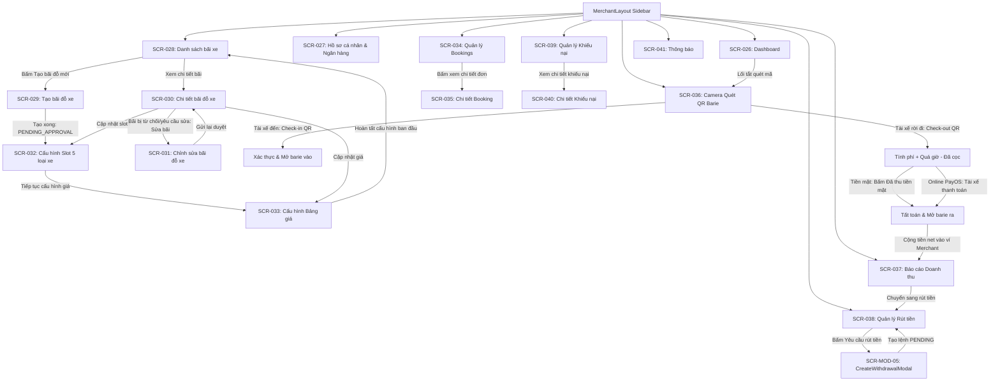

# Danh Mục Đặc Tả Chi Tiết Màn Hình Cổng Chủ Bãi (SCR-026 đến SCR-041)

---

## 1. TỔNG QUAN PHÂN HỆ CỔNG CHỦ BÃI (MERCHANT OPERATIONS PORTAL)

Phân hệ **Cổng Chủ Bãi (`MOD-04`)** là không gian vận hành số dành cho các chủ bãi đỗ xe và nhân viên gác cổng, phục vụ đăng ký bãi đỗ, cấu hình số lượng chỗ đỗ (slots), thiết lập ma trận biểu phí, kiểm soát xe ra vào bằng camera quét mã QR, quản lý đơn đặt chỗ, tra cứu doanh thu và tạo lệnh rút tiền về ngân hàng.

Phân hệ bao gồm 16 màn hình chính (`SCR-026` đến `SCR-041`) cùng 4 thành phần hộp thoại/công cụ phụ trợ chuyên dụng (`SCR-MOD-05`, `ParkingLotMapPicker`, `QrCameraScanner`, `GenerateDescriptionModal`).

Toàn bộ 16 màn hình đã được khảo sát kỹ lưỡng từ tầng Giao diện (React/AntD/Leaflet/html5-qrcode/Recharts) đến tầng Dịch vụ Backend (Spring Boot/JPA/MySQL), và được chuẩn hóa thành 16 hồ sơ đặc tả chi tiết (Screen Specification) lưu trữ tại thư mục [`docs/ui-redesign-discovery/detail-screens/`](file:///d:/Documents/JAVA%20WEB%20SERVICE/SmartParkingHub/docs/ui-redesign-discovery/detail-screens).

---

## 2. DANH MỤC SCREEN SPECIFICATION ĐỘC LẬP

Dưới đây là bảng liên kết truy cập trực tiếp vào hồ sơ đặc tả kỹ thuật chi tiết của từng màn hình:

| Mã MH | Tên Màn Hình & Thành Phần | URL Route | Layout / Container | Hồ Sơ Đặc Tả Chi Tiết |
|---|---|---|---|---|
| **SCR-026** | Bảng điều khiển tổng quan chủ bãi (`MerchantDashboardPage`) | `/merchant/dashboard` | `MerchantLayout` | [`SCR-026-merchant-dashboard.md`](file:///d:/Documents/JAVA%20WEB%20SERVICE/SmartParkingHub/docs/ui-redesign-discovery/detail-screens/SCR-026-merchant-dashboard.md) |
| **SCR-027** | Hồ sơ doanh nghiệp & Tài khoản rút tiền (`MerchantProfilePage`) | `/merchant/profile` | `MerchantLayout` | [`SCR-027-merchant-profile.md`](file:///d:/Documents/JAVA%20WEB%20SERVICE/SmartParkingHub/docs/ui-redesign-discovery/detail-screens/SCR-027-merchant-profile.md) |
| **SCR-028** | Danh sách bãi đỗ xe sở hữu (`MerchantParkingLotsPage`) | `/merchant/parking-lots` | `MerchantLayout` | [`SCR-028-merchant-parking-lots.md`](file:///d:/Documents/JAVA%20WEB%20SERVICE/SmartParkingHub/docs/ui-redesign-discovery/detail-screens/SCR-028-merchant-parking-lots.md) |
| **SCR-029** | Đăng ký khởi tạo bãi đỗ mới (`CreateMerchantParkingLotPage`) | `/merchant/parking-lots/new` | `MerchantLayout` | [`SCR-029-merchant-create-parking-lot.md`](file:///d:/Documents/JAVA%20WEB%20SERVICE/SmartParkingHub/docs/ui-redesign-discovery/detail-screens/SCR-029-merchant-create-parking-lot.md) |
| **SCR-030** | Hồ sơ chi tiết & Doanh thu bãi đỗ (`MerchantParkingLotDetailPage`) | `/merchant/parking-lots/:parkingLotId` | `MerchantLayout` | [`SCR-030-merchant-parking-lot-detail.md`](file:///d:/Documents/JAVA%20WEB%20SERVICE/SmartParkingHub/docs/ui-redesign-discovery/detail-screens/SCR-030-merchant-parking-lot-detail.md) |
| **SCR-031** | Chỉnh sửa bãi bị từ chối/yêu cầu sửa (`EditMerchantParkingLotPage`) | `/merchant/parking-lots/:parkingLotId/edit` | `MerchantLayout` | [`SCR-031-merchant-edit-parking-lot.md`](file:///d:/Documents/JAVA%20WEB%20SERVICE/SmartParkingHub/docs/ui-redesign-discovery/detail-screens/SCR-031-merchant-edit-parking-lot.md) |
| **SCR-032** | Cấu hình sức chứa chỗ đỗ xe (`MerchantSlotsPage`) | `/merchant/parking-lots/:parkingLotId/slots` | `MerchantLayout` | [`SCR-032-merchant-slots.md`](file:///d:/Documents/JAVA%20WEB%20SERVICE/SmartParkingHub/docs/ui-redesign-discovery/detail-screens/SCR-032-merchant-slots.md) |
| **SCR-033** | Cấu hình bảng giá 5 loại phương tiện (`MerchantPricingPage`) | `/merchant/parking-lots/:parkingLotId/pricing` | `MerchantLayout` | [`SCR-033-merchant-pricing.md`](file:///d:/Documents/JAVA%20WEB%20SERVICE/SmartParkingHub/docs/ui-redesign-discovery/detail-screens/SCR-033-merchant-pricing.md) |
| **SCR-034** | Quản lý danh sách đặt chỗ khách hàng (`MerchantBookingsPage`) | `/merchant/bookings` | `MerchantLayout` | [`SCR-034-merchant-bookings.md`](file:///d:/Documents/JAVA%20WEB%20SERVICE/SmartParkingHub/docs/ui-redesign-discovery/detail-screens/SCR-034-merchant-bookings.md) |
| **SCR-035** | Chi tiết booking & Lịch sử ra vào (`MerchantBookingDetailPage`) | `/merchant/bookings/:bookingId` | `MerchantLayout` | [`SCR-035-merchant-booking-detail.md`](file:///d:/Documents/JAVA%20WEB%20SERVICE/SmartParkingHub/docs/ui-redesign-discovery/detail-screens/SCR-035-merchant-booking-detail.md) |
| **SCR-036** | Quét camera QR Barie Check-in / Check-out (`MerchantQrScannerPage`) | `/merchant/qr-scanner` | `MerchantLayout` | [`SCR-036-merchant-qr-scanner.md`](file:///d:/Documents/JAVA%20WEB%20SERVICE/SmartParkingHub/docs/ui-redesign-discovery/detail-screens/SCR-036-merchant-qr-scanner.md) |
| **SCR-037** | Báo cáo doanh thu & Dòng tiền ví (`MerchantRevenuePage`) | `/merchant/revenue` | `MerchantLayout` | [`SCR-037-merchant-revenue.md`](file:///d:/Documents/JAVA%20WEB%20SERVICE/SmartParkingHub/docs/ui-redesign-discovery/detail-screens/SCR-037-merchant-revenue.md) |
| **SCR-038** | Quản lý ví & Lịch sử rút tiền (`MerchantWithdrawalsPage`) | `/merchant/withdrawals` | `MerchantLayout` | [`SCR-038-merchant-withdrawals.md`](file:///d:/Documents/JAVA%20WEB%20SERVICE/SmartParkingHub/docs/ui-redesign-discovery/detail-screens/SCR-038-merchant-withdrawals.md) |
| **SCR-039** | Danh sách khiếu nại tài xế gửi bãi (`MerchantDisputesPage`) | `/merchant/disputes` | `MerchantLayout` | [`SCR-039-merchant-disputes.md`](file:///d:/Documents/JAVA%20WEB%20SERVICE/SmartParkingHub/docs/ui-redesign-discovery/detail-screens/SCR-039-merchant-disputes.md) |
| **SCR-040** | Chi tiết khiếu nại & Tiến trình xử lý (`MerchantDisputeDetailPage`) | `/merchant/disputes/:ticketId` | `MerchantLayout` | [`SCR-040-merchant-dispute-detail.md`](file:///d:/Documents/JAVA%20WEB%20SERVICE/SmartParkingHub/docs/ui-redesign-discovery/detail-screens/SCR-040-merchant-dispute-detail.md) |
| **SCR-041** | Trung tâm thông báo chủ bãi (`MerchantNotificationsPage`) | `/merchant/notifications` | `MerchantLayout` | [`SCR-041-merchant-notifications.md`](file:///d:/Documents/JAVA%20WEB%20SERVICE/SmartParkingHub/docs/ui-redesign-discovery/detail-screens/SCR-041-merchant-notifications.md) |

---

## 3. CÁC DIALOG, DRAWER & MODAL PHỤ TRỢ (MODAL INVENTORY)

| Mã Modal | Tên Modal | Component Mã Nguồn | Màn Hình Kích Hoạt | Mục Đích Nghiệp Vụ |
|---|---|---|---|---|
| **SCR-MOD-05** | `CreateWithdrawalModal` | [`CreateWithdrawalModal.tsx`](file:///d:/Documents/JAVA%20WEB%20SERVICE/SmartParkingHub/smart-parking-app/src/features/merchant/withdrawals/components/CreateWithdrawalModal.tsx) | `SCR-038` (`MerchantWithdrawalsPage`) | Hộp thoại tạo yêu cầu rút tiền: nhập số tiền (>= 50.000 đ), hiển thị thông tin ngân hàng thụ hưởng, trừ tiền ví |
| **SCR-MOD-06** | `ParkingLotMapPicker` | [`ParkingLotMapPicker.tsx`](file:///d:/Documents/JAVA%20WEB%20SERVICE/SmartParkingHub/smart-parking-app/src/features/merchant/parking-lots/components/ParkingLotMapPicker.tsx) | `SCR-029` (`CreateParkingLot`), `SCR-031` (`EditParkingLot`) | Hộp thoại bản đồ tương tác OpenStreetMap/Leaflet: click chọn ghim tọa độ Latitude/Longitude chính xác |
| **SCR-MOD-07** | `QrCameraScanner` | [`QrCameraScanner.tsx`](file:///d:/Documents/JAVA%20WEB%20SERVICE/SmartParkingHub/smart-parking-app/src/features/merchant/qr/components/QrCameraScanner.tsx) | `SCR-036` (`MerchantQrScannerPage`) | Thành phần camera quét mã vạch/QR thời gian thực bằng `html5-qrcode` có laser quét và chuyển đổi camera |
| **SCR-MOD-08** | `GenerateDescriptionModal` | [`GenerateDescriptionModal.tsx`](file:///d:/Documents/JAVA%20WEB%20SERVICE/SmartParkingHub/smart-parking-app/src/features/merchant/parking-lots/components/GenerateDescriptionModal.tsx) | `SCR-029` (`CreateParkingLot`) | Trợ lý gợi ý tự động tạo đoạn văn miêu tả tiện ích bãi đỗ xe hấp dẫn thu hút tài xế |

---

## 4. MA TRẬN LUỒNG NGHIỆP VỤ LIÊN MÀN HÌNH (SCREEN FLOW MAP)

---

## 5. CÁC QUY TẮC BẤT BIẾN NGHIỆP VỤ BẮT BUỘC BẢO TOÀN (INVARIANTS)

1. **Ràng buộc kiểm duyệt bãi đỗ (Approval Gatekeeper):**
   - Bãi đỗ xe sau khi tạo mới có trạng thái `PENDING_APPROVAL` và chưa thể nhận khách đặt chỗ.
   - Chỉ khi Admin phê duyệt (`APPROVED`) thì bãi mới xuất hiện trên bản đồ tìm kiếm tài xế.
   - Màn hình chỉnh sửa thông tin chung `SCR-031` chỉ cho phép truy cập khi bãi ở trạng thái `REJECTED` hoặc `CHANGES_REQUESTED` (khóa chỉnh sửa đối với bãi `APPROVED` hoặc `PENDING_APPROVAL` để tránh gian lận sau khi đã thẩm định).
2. **Quy tắc bảo toàn sức chứa slot không nhỏ hơn số xe thực tế đang đỗ:**
   - Trong `SCR-032`, Merchant không được phép giảm `totalCapacity` xuống nhỏ hơn số lượng xe đang thực tế đỗ tại bãi (`occupied = totalCapacity - availableCapacity`). Vi phạm sẽ bị Backend từ chối với lỗi `VALIDATION_ERROR`.
3. **Quy tắc 5 loại phương tiện chuẩn hóa toàn hệ thống:**
   - Cả Slot (`SCR-032`) và Pricing (`SCR-033`) đều phải ánh xạ chính xác 5 loại xe: `SEDAN_SUV`, `BUS_COACH`, `LIGHT_TRUCK`, `HEAVY_TRUCK`, `CONTAINER`. Không được tự ý thêm hoặc bớt enum.
4. **Quy trình đóng booking và giải phóng slot / Queue:**
   - Khi thực hiện Check-out tại `SCR-036`, hệ thống giải phóng 1 slot trống cho bãi (`availableCapacity += 1`), tính tổng phí dựa trên đơn giá giờ + phụ phí quá giờ - tiền cọc đã trả, ghi nhận doanh thu vào ví chủ bãi, và tự động gọi `queueService.offerNext()` để phân bổ chỗ cho tài xế kế tiếp trong hàng đợi ảo.
5. **Quy tắc rút tiền ví không âm và hạn mức tối thiểu:**
   - Số tiền rút trong `SCR-MOD-05` tối thiểu là 50.000 VNĐ và không vượt quá số dư ví khả dụng (`walletBalance`). Số dư bị trừ ngay khi tạo lệnh rút trạng thái `PENDING` để tránh Double Spending.
