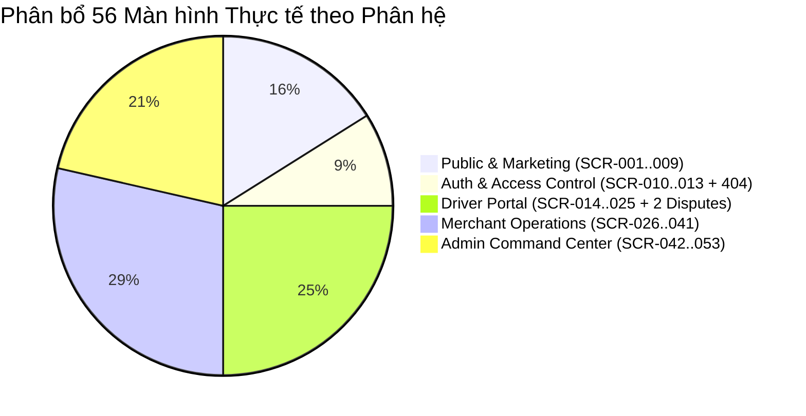

# 01. ROUTE MATRIX & SCREEN INVENTORY — SMART PARKING HUB CRM V2

> **Giai đoạn:** DISCOVERY & INVENTORY AUDIT  
> **Thời gian thẩm định:** 06/11/2026 · **Trạng thái:** HOÀN THÀNH ĐỐI SOÁT 100% ROUTE THỰC TẾ  
> **Nguồn bằng chứng:** `src/app/router/index.tsx` (659 dòng), các file Page và Component thực tế trong `src/features/`.

---

## 1. BẢNG TỔNG HỢP VÀ ĐỐI CHIẾU SỐ LƯỢNG (RECONCILIATION)

### 1.1. Giải thích con số 53 trang và thực tế triển khai
- **Số lượng màn hình được thông báo ban đầu:** **53 màn hình** (Mã hiệu chuẩn hóa từ `SCR-001` đến `SCR-053`).
- **Số lượng màn hình độc lập thực tế:** **56 màn hình**
  - Gồm 53 màn hình `SCR-001` -> `SCR-053`.
  - Bổ sung 02 màn hình giải quyết khiếu nại phía Tài xế: `DRV-DISP-01` (`/disputes`) và `DRV-DISP-02` (`/disputes/:id`).
  - Bổ sung 01 màn hình lỗi điều hướng: `404 Not Found` (`/*`).
- **Tổng số Route Path được cấu hình trong Router:** **73 URL patterns**.
  - Sự chênh lệch giữa 56 màn hình và 73 URL là do hệ thống cấu hình các **Route Aliases** (Đường dẫn phụ) thân thiện:
    1. Hỗ trợ đa ngôn ngữ/SEO: ví dụ `/pricing` song song với `/bang-gia`; `/about` song song với `/ve-chung-toi`.
    2. Cấu trúc URL tiền tố: Phân hệ Driver hỗ trợ cả URL ngắn (như `/parking`, `/bookings`) và URL có tiền tố (như `/dashboard/parking`, `/driver/parking`) để bảo toàn liên kết từ các phiên bản trước.
    3. 02 route kỹ thuật nội bộ: `/crm` (Scaffold ban đầu) và `/design-preview/*` (Công cụ xem trước DEV-only).

---

## 2. MA TRẬN CHI TIẾT TOÀN BỘ 56 MÀN HÌNH HỆ THỐNG

### PHÂN HỆ 1: PUBLIC & MARKETING (9 MÀN HÌNH)

| Page ID | Route Path & Aliases | Tên Màn Hình & Phân Loại | Layout | Module Nghiệp Vụ | Mục Đích Chính & Hành Động Người Dùng | Component Chính | Tích Hợp API | Trạng Thái & Responsive |
| :--- | :--- | :--- | :--- | :--- | :--- | :--- | :--- | :--- |
| **SCR-001** | `/` | **Public Landing Page** *(Standalone)* | `LandingNavbar` + `LandingFooter` | `features/landing` | Giới thiệu nền tảng SmartTruck Hub, kết nối mạng lưới bến bãi logistics. Hành động: Khám phá dịch vụ, xem bảng giá, nhấn CTA đăng ký/đặt chỗ. | `HomeHeroSection`, `LandingMetricsBanner`, `LandingServicesGrid`, `LandingWhyUsBento`, `LandingHowItWorks`, `LandingPricingMatrix`, `HomeTestimonials`, `HomeConversionCta` | Client-side static content | IMPLEMENTED Responsive tốt, scroll dài |
| **SCR-002** | `/solutions/drivers` *(Alias: `/driver-solutions`, `/giai-phap-tai-xe`)* | **Driver Solutions** *(Standalone)* | `LandingNavbar` + `LandingFooter` | `features/landing` | Trình bày giải pháp số hóa hành trình và tiện ích cho tài xế container/xe tải. Hành động: Xem tính năng tìm bãi, giữ chỗ, bấm CTA đăng ký làm tài xế. | `DriverSolutionsHero`, `DriverFeatureMatrix`, `DriverTestimonialStrip`, `DriverCtaSection` | Static content | IMPLEMENTED Responsive tốt |
| **SCR-003** | `/solutions/owners` *(Alias: `/owner-solutions`, `/giai-phap-chu-bai`)* | **Owner Solutions** *(Standalone)* | `LandingNavbar` + `LandingFooter` | `features/landing` | Giới thiệu giải pháp tối ưu công suất bến bãi, camera ALPR cho chủ bãi. Hành động: Xem mô hình doanh thu, bấm CTA đăng ký bãi đỗ mới. | `OwnerSolutionsHero`, `OwnerFeatureShowcase`, `OwnerRevenueCalculator`, `OwnerCtaSection` | Static content | IMPLEMENTED Responsive tốt |
| **SCR-004** | `/pricing` *(Alias: `/bang-gia`)* | **Pricing Page** *(Standalone)* | `LandingNavbar` + `LandingFooter` | `features/landing` | Niêm yết bảng giá dịch vụ nền tảng, phí kết nối bến bãi và camera ALPR. Hành động: Chọn chu kỳ cước, chọn gói dịch vụ, liên hệ tư vấn. | `PricingHeader`, `PricingTiersGrid`, `PricingComparisonTable`, `PricingFaqSection` | Static content | IMPLEMENTED Responsive tốt |
| **SCR-005** | `/api-docs` *(Alias: `/ket-noi-api`, `/solutions/api`)* | **API & Developer Docs** *(Standalone)* | `LandingNavbar` + `LandingFooter` | `features/landing` | Tài liệu tích hợp Open API, Webhook vào/ra bãi cho đối tác công nghệ. Hành động: Sao chép JSON payload, xem terminal demo, tra cứu endpoint. | `ApiDocsHero`, `ApiTerminalSection`, `ApiEndpointsList`, `WebhookGuide` | Client copy handler | IMPLEMENTED Terminal có cuộn ngang |
| **SCR-006** | `/about` *(Alias: `/ve-chung-toi`, `/company/about`)* | **About Us** *(Standalone)* | `LandingNavbar` + `LandingFooter` | `features/landing` | Giới thiệu sứ mệnh, tầm nhìn và đội ngũ giải quyết bài toán vận tải cảng biển. Hành động: Đọc thông tin doanh nghiệp, xem các mốc lịch sử. | `AboutHeroSection`, `MissionVisionSection`, `LeadershipGrid`, `MilestonesTimeline` | Static content | IMPLEMENTED Responsive tốt |
| **SCR-007** | `/careers` *(Alias: `/tuyen-dung`, `/company/careers`)* | **Careers & Recruitment** *(Standalone)* | `LandingNavbar` + `LandingFooter` | `features/landing` | Trang tuyển dụng nhân sự logistics và công nghệ. Hành động: Lọc vị trí tuyển dụng theo phòng ban, nhấn nộp hồ sơ qua email. | `CareersHero`, `CultureBento`, `JobListings`, `ApplicationModal` | Static content | IMPLEMENTED Responsive tốt |
| **SCR-008** | `/insights` *(Alias: `/tin-tuc`, `/company/blog`)* | **Logistics Insights** *(Standalone)* | `LandingNavbar` + `LandingFooter` | `features/landing` | Tin tức ngành, cẩm nang logistics và phân tích xu hướng công nghệ vận tải. Hành động: Xem bài viết, lọc theo chủ đề, đăng ký bản tin email. | `InsightsHero`, `FeaturedArticleCard`, `ArticlesGrid`, `NewsletterForm` | Client newsletter validation | IMPLEMENTED Responsive tốt |
| **SCR-009** | `/contact` *(Alias: `/lien-he`, `/ho-tro`, `/company/contact`)* | **Contact & Support 24/7** *(Standalone)* | `LandingNavbar` + `LandingFooter` | `features/landing` | Kênh liên hệ điều phối và hỗ trợ khẩn cấp 24/7. Hành động: Nhập nội dung, mở mailto client để gửi email an toàn cho ban quản trị. | `ContactHeader`, `ContactForm`, `OfficeLocationsList`, `EmergencyHotlineStrip` | Mailto client trigger | IMPLEMENTED Responsive tốt |

---

### PHÂN HỆ 2: AUTHENTICATION & ACCESS CONTROL (5 MÀN HÌNH)

| Page ID | Route Path | Tên Màn Hình & Phân Loại | Layout | User Role | Mục Đích Chính & Hành Động | Component Chính | Tích Hợp API | Trạng Thái & Ghi Chú |
| :--- | :--- | :--- | :--- | :--- | :--- | :--- | :--- | :--- |
| **SCR-010** | `/login` | **Authentication / Login** *(Standalone)* | `AuthLayout` *(Split-screen)* | Guest *(Redirect nếu đã login)* | Đăng nhập hệ thống qua SĐT và mật khẩu, hỗ trợ tài khoản demo ở DEV mode. Hành động: Điền thông tin, chọn tài khoản mẫu, Đăng nhập. | `LoginPage`, `LoginForm`, Demo Account Picker | `POST /api/v1/auth/login` | IMPLEMENTED Đã wired Redux & JWT sync |
| **SCR-011** | `/register` | **User Registration** *(Standalone)* | `AuthLayout` | Guest | Đăng ký tài khoản mới cho Tài xế hoặc Chủ bãi kèm xác thực OTP. Hành động: Chọn vai trò, điền SĐT, Email, CCCD, nhập OTP 6 số. | `AuthPage mode="register"`, `AuthSuccess` | `POST /api/v1/auth/otp/send` `POST /api/v1/auth/register` | IMPLEMENTED Đầy đủ validation |
| **SCR-012** | `/forgot-password` | **Password Recovery** *(Standalone)* | `AuthLayout` | Guest | Khôi phục quyền truy cập tài khoản khi quên mật khẩu qua OTP email. Hành động: Nhập email, nhận OTP, nhập mật khẩu mới và xác nhận. | `AuthPage mode="forgot"`, `AuthSuccess` | `POST /api/v1/auth/forgot-password/otp` `POST /api/v1/auth/forgot-password/reset` | IMPLEMENTED Đầy đủ countdown |
| **SCR-013** | `/403` | **Access Denied / Forbidden** *(Status)* | Standalone Center | Any | Thông báo tài khoản không đủ quyền hạn để truy cập tài nguyên (Role Guard). Hành động: Quay về trang chủ hoặc đăng nhập lại tài khoản khác. | `AccessPage` | None | IMPLEMENTED Responsive tốt |
| **404** | `*` | **Page Not Found** *(Catch-all)* | Standalone Center | Any | Xử lý các đường dẫn URL không hợp lệ hoặc không tồn tại trong ứng dụng. Hành động: Nhấn nút quay về trang tổng quan. | `AccessPage notFound` | None | IMPLEMENTED Responsive tốt |

---

### PHÂN HỆ 3: DRIVER PORTAL — CỔNG TÀI XẾ (14 MÀN HÌNH)

*Tất cả các trang dưới đây được bảo vệ bởi `<RequireRole role="DRIVER">` bên trong `DriverLayout`.*

| Page ID | Route Path & Aliases | Tên Màn Hình & Phân Loại | Mục Đích Chính & Hành Động Người Dùng | Component Chính | Tích Hợp API | Ghi Chú & Tồn Tại |
| :--- | :--- | :--- | :--- | :--- | :--- | :--- |
| **SCR-014** | `/dashboard` *(Alias: `/driver`, `/driver/dashboard`)* | **Driver Dashboard Home** *(Dashboard)* | Tổng quan vận hành cá nhân hóa: chuyến xe đang chạy, 4 KPI, phím tắt nhanh, bảng đặt chỗ gần đây. Hành động: Mở mã QR checkout nhanh, tra cứu mã vé. | `DriverWelcomeBanner`, `DriverStatGrid`, `ActiveTripCard`, `DriverShortcuts`, `RecentBookingsTable`, `QrCheckoutModal` | `GET /api/v1/driver/dashboard-summary` | Bento card dùng màu hex `#d95f00` |
| **SCR-015** | `/parking` *(Alias: `/dashboard/search`, `/dashboard/parking`, `/driver/search`)* | **Interactive Parking Search & Map** *(Workbench)* | Tìm kiếm bãi đỗ xe theo thời gian thực trên bản đồ OpenStreetMap/Leaflet. Hành động: Lọc 5 loại xe, kéo bán kính 5-50km, chọn bãi xem slot trống, mở Drawer giữ chỗ nhanh. | `TopFilterBar`, `SmartLocationBar`, `YardCardList`, `InteractiveMapCanvas`, `InlineQuickBookPanel` | `GET /api/v1/parking-lots/search` OSM Nominatim Geocode | Cần tối ưu chiều cao trên tablet |
| **SCR-016** | `/parking/:id` *(Alias: `/dashboard/parking/:id`, `/driver/parking/:id`)* | **Parking Details & Reservation** *(Detail & Form)* | Chi tiết kỹ thuật bãi đỗ, sức chứa từng loại xe, biểu phí giờ cao điểm và form đặt chỗ chính thức. Hành động: Chọn xe, chọn thời gian vào/ra, nhấn đặt chỗ & đặt cọc. | `ParkingDetailHero`, `PricingRulesCard`, `CapacityBreakdownCard`, `ReservationFormCard`, `FacilityAmenitiesGrid` | `GET /api/v1/parking-lots/{id}` `POST /api/v1/bookings` | Tích hợp giữ chỗ 10 phút |
| **SCR-017** | `/bookings` *(Alias: `/dashboard/bookings`, `/driver/bookings`)* | **Driver Bookings & QR Ticket** *(Master-Detail)* | Quản lý danh sách đặt chỗ, xuất vé điện tử QR, thanh toán cước còn thiếu, hủy vé. Hành động: Lọc theo 5 tab trạng thái, chọn vé xem chi tiết, tải vé QR (PNG), hủy vé, đánh giá sao. | `BookingsCommandToolbar`, `BookingMasterList`, `BookingDetailView`, `CancelBookingModal`, `ReviewBookingModal`, `PayOsCheckoutModal` | `GET /api/v1/bookings/my` `POST /api/v1/bookings/{id}/cancel` `POST /api/v1/bookings/{id}/review` | Master-Detail 2 cột trên desktop |
| **SCR-018** | `/queues` *(Alias: `/dashboard/queues`, `/driver/queues`)* | **Virtual Queues** *(Operational)* | Hàng đợi ảo thông minh khi bãi đỗ hết chỗ; xếp nốt tự động. Hành động: Theo dõi số thứ tự và thời gian chờ ước tính, xác nhận nhận slot được cấp, rời hàng đợi. | `QueueCommandToolbar`, `ActiveQueueCard`, `QueueHistoryTable`, `QueueRegulationsSection`, `LeaveQueueConfirmModal` | `GET /api/v1/queues/my` `POST /api/v1/queues/{id}/leave` `POST /api/v1/queues/{id}/accept` | Đầy đủ empty & active states |
| **SCR-019** | `/payments` *(Alias: `/dashboard/payments`, `/driver/payments`)* | **Driver Payments & VAT Invoices** *(Master-Detail)* | Lịch sử thanh toán cước đỗ xe và quản lý hóa đơn VAT điện tử (TT78). Hành động: Lọc giao dịch, xem biên lai bóc tách phí, tải biên lai PDF, cấu hình xuất HĐ VAT công ty. | `PaymentCommandHeader`, `PaymentBentoKpi`, `PaymentFilterToolbar`, `PaymentMasterTable`, `PaymentReceiptInspector`, `CompanyInvoiceModal` | `GET /api/v1/payments/my` `GET /api/v1/payments/{id}/invoice` | Master-Detail 2 cột |
| **SCR-020** | `/vehicles` *(Alias: `/dashboard/vehicles`, `/driver/vehicles`)* | **Driver Fleet Management & ALPR** *(Master Table)* | Quản lý phương tiện và đồng bộ biển số xe nhận diện tự động qua camera cổng ALPR. Hành động: Thêm xe mới, sửa thông tin, xem hồ sơ kiểm định, xóa xe, xuất danh sách. | `VehiclesCommandHeader`, `VehiclesKpiBento`, `VehicleFilterToolbar`, `VehicleMasterTable`, `RegisterVehicleModal`, `EditVehicleModal` | `GET /api/v1/vehicles` `POST /api/v1/vehicles` `PUT /api/v1/vehicles/{id}` `DELETE /api/v1/vehicles/{id}` | Vẫn dùng `useEffect` thay vì TanStack Query |
| **SCR-021** | `/profile` *(Alias: `/dashboard/profile`, `/driver/profile`)* | **Driver Profile & Emergency** *(Settings)* | Quản lý thông tin cá nhân bác tài và người liên hệ khẩn cấp. Hành động: Cập nhật họ tên, địa chỉ, số điện thoại khẩn cấp. *(Đặc biệt: Ẩn Footer và Copilot)* | `ProfileSidebarNav`, `DriverContactForm`, `DriverPasswordForm` | `GET /api/v1/users/me` `PUT /api/v1/users/me` | Thiết kế tinh gọn API-only |
| **SCR-022** | `/change-password` *(Alias: `/dashboard/change-password`, `/driver/change-password`)* | **Driver Security & Password** *(Security)* | Đổi mật khẩu tài khoản và kiểm tra độ mạnh theo tiêu chuẩn an ninh Fretrix. Hành động: Nhập mật khẩu cũ, mật khẩu mới, kiểm tra 4 tiêu chí an toàn, khôi phục qua SMS OTP. | `ChangePasswordCommandHeader`, `SecurityPolicySidebar`, `ChangePasswordForm`, `TerminalQrSyncBanner`, `SmsRecoveryModal` | `PUT /api/v1/users/me/password` | Form kiểm tra độ mạnh realtime |
| **SCR-023** | `/payment/success` *(Alias: `/payment/return`, `/dashboard/payment/success`)* | **PayOS Success Callback Hub** *(Callback)* | Tiếp nhận kết quả thanh toán thành công từ cổng PayOS, xác nhận giữ slot và cấp vé QR. Hành động: Xem mã giao dịch, tải vé QR, chuyển hướng sang danh sách đặt chỗ. | `PaymentReturnPage mode="success"` | `GET /api/v1/payments/verify-payos` | Kiểm tra token hợp lệ |
| **SCR-024** | `/payment/cancel` *(Alias: `/dashboard/payment/cancel`, `/driver/payment/cancel`)* | **PayOS Cancel Callback Hub** *(Callback)* | Tiếp nhận trường hợp hủy thanh toán PayOS; thông báo bảo lưu slot trong 10 phút. Hành động: Chọn thanh toán lại hoặc quay về tìm kiếm bãi khác. | `PaymentCancelPage` | None | Giữ nguyên trạng thái đơn |
| **SCR-025** | `/notifications` *(Alias: `/dashboard/notifications`, `/driver/notifications`)* | **Driver Notifications Center** *(Notification)* | Trung tâm thông báo nhật ký tác vụ điều phối, nhắc giờ check-in/out, phân bổ slot hàng đợi. Hành động: Lọc thông báo, đánh dấu đã đọc, kích hoạt Web Push 24/7. | `NotificationsCommandHeader`, `NotificationFilterTabs`, `NotificationList`, `WebPushActivationCard` | `GET /api/v1/notifications` `PUT /api/v1/notifications/{id}/read` `PUT /api/v1/notifications/read-all` | Tích hợp đẩy thông báo trình duyệt |
| **DRV-DISP-01** | `/disputes` | **Driver Disputes List** *(Operations List)* | Danh sách khiếu nại cước hoặc phản ánh sự cố dịch vụ bến bãi của tài xế. Hành động: Xem trạng thái hồ sơ, bấm nút gửi khiếu nại mới, mở chi tiết hồ sơ. | `DisputesPage role="driver"`, `DataTable`, `CreateDisputeModal` | `GET /api/v1/disputes/me` `POST /api/v1/disputes` | Sử dụng primitive Workspace |
| **DRV-DISP-02** | `/disputes/:id` | **Driver Dispute Detail** *(Operations Detail)* | Chi tiết hồ sơ khiếu nại, phản hồi của chủ bãi và kết luận phán quyết của Admin. Hành động: Xem tiến trình xử lý, đọc lý do phân xử, quay lại danh sách. | `DisputesPage role="driver" detail`, `DisputeDetail` | `GET /api/v1/disputes/{id}` | Sử dụng primitive Workspace |

---

### PHÂN HỆ 4: MERCHANT PORTAL — CỔNG CHỦ BÃI (16 MÀN HÌNH)

*Tất cả các trang dưới đây được bảo vệ bởi `<RequireRole role="MERCHANT">` bên trong `MerchantLayout`.*

| Page ID | Route Path | Tên Màn Hình & Phân Loại | Mục Đích Chính & Hành Động Người Dùng | Component Chính | Tích Hợp API | Ghi Chú & Tồn Tại |
| :--- | :--- | :--- | :--- | :--- | :--- | :--- |
| **SCR-026** | `/merchant` *(Alias: `/merchant/dashboard`)* | **Merchant Executive Dashboard** *(Dashboard)* | Bảng điều khiển tổng quan vận hành và doanh thu theo thời gian thực. Hành động: Xem 4 Bento KPI, biểu đồ doanh thu & lưu lượng, bảng manifest xe vào gần nhất, ALPR camera. | `MerchantCommandSurface`, `MerchantBentoMetrics`, `RevenueVolumeComboChart`, `RecentCheckinManifestTable`, `LiveYardsCapacityList`, `AlprGateControllerCard` | `GET /api/v1/merchant/dashboard-summary` | Dùng màu sidebar tối `#131b2e` |
| **SCR-027** | `/merchant/profile` | **Merchant Legal & Banking Profile** *(Settings)* | Quản lý hồ sơ pháp lý doanh nghiệp bến bãi và thông tin tài khoản ngân hàng thụ hưởng tiền rút. Hành động: Cập nhật thông tin công ty, số tài khoản ngân hàng, tên chủ tài khoản. | `MerchantProfilePage` | `GET /api/v1/merchant/profile` `PUT /api/v1/merchant/profile` | Dùng form validation chuẩn |
| **SCR-028** | `/merchant/parking-lots` | **Merchant Parking Lots Directory** *(Directory)* | Danh mục các bãi đỗ xe thuộc quyền sở hữu của chủ bãi. Hành động: Lọc bãi theo trạng thái kiểm duyệt (Chờ duyệt, Đã duyệt, Từ chối), chuyển hướng tạo bãi mới, cấu hình bãi. | `MerchantParkingLotsPage` | `GET /api/v1/merchant/parking-lots` | Danh sách bãi dạng thẻ/bảng |
| **SCR-029** | `/merchant/parking-lots/new` | **Create Merchant Parking Lot Wizard** *(Wizard)* | Đăng ký bãi đỗ xe hoặc kho depot mới lên hệ thống chờ Admin thẩm định. Hành động: Nhập tên bãi, địa chỉ, chọn tọa độ GPS trên bản đồ, tải ảnh chụp mặt bằng, nhập số slot ban đầu. | `CreateMerchantParkingLotPage` | `POST /api/v1/merchant/parking-lots` | Tích hợp tải ảnh lên server |
| **SCR-030** | `/merchant/parking-lots/:parkingLotId` | **Parking Lot Details & Telemetry** *(Detail)* | Hồ sơ kỹ thuật bãi đỗ: sức chứa từng loại xe, hình ảnh thực tế, trạng thái duyệt. Hành động: Mở lightbox xem ảnh lớn, xem lý do nếu bị từ chối, chuyển sang chỉnh sửa/biểu phí. | `MerchantParkingLotDetailPage` | `GET /api/v1/merchant/parking-lots/{id}` | Có tính năng xem ảnh lightbox |
| **SCR-031** | `/merchant/parking-lots/:parkingLotId/edit` | **Edit Merchant Parking Lot** *(Edit Form)* | Cập nhật hồ sơ bãi đỗ. Khóa sửa đổi (Lockout mode) khi bãi đã được duyệt (`APPROVED`). Hành động: Hiệu chỉnh tọa độ, xem lịch sử sửa đổi, lưu cập nhật thông tin. | `EditMerchantParkingLotPage` | `PUT /api/v1/merchant/parking-lots/{id}` | Khóa trường khi đã duyệt |
| **SCR-032** | `/merchant/parking-lots/:parkingLotId/slots` | **Vehicle Slots Capacity Configuration** *(Workbench)* | Thiết lập sức chứa tối đa cho đủ 5 nhóm xe tiêu chuẩn. Hành động: Dùng stepper tăng/giảm slot, kiểm tra ràng buộc không được giảm nhỏ hơn số xe đang đỗ, lưu hàng loạt. | `MerchantSlotsPage` | `GET /api/v1/merchant/parking-lots/{id}/slots` `PUT /api/v1/merchant/parking-lots/{id}/slots` | Kiểm tra Occupied Invariant |
| **SCR-033** | `/merchant/parking-lots/:id/pricing` | **Pricing Rules Configuration** *(Pricing Matrix)* | Cấu hình biểu phí giờ thường, hệ số giờ cao điểm và phạt quá giờ cho 5 loại xe. Hành động: Nhập giá cơ bản VND/giờ, giờ cao điểm, lưu ma trận cước. | `MerchantLotPage mode="pricing"` | `GET /api/v1/merchant/parking-lots/{id}` `PUT /api/v1/merchant/parking-lots/{id}/pricing` | Dùng component Workspace |
| **SCR-034** | `/merchant/bookings` | **Merchant Bookings Management** *(Operations List)* | Danh sách điều phối toàn bộ các lượt đặt chỗ đến các bãi của chủ bãi. Hành động: Xem biển số xe, giờ đến dự kiến, tiền cọc, lọc nhanh, mở chi tiết từng lượt. | `MerchantBookingsPage`, `DataTable`, `Metrics` | `GET /api/v1/merchant/bookings` | Phân trang 20 records |
| **SCR-035** | `/merchant/bookings/:id` | **Merchant Booking Detail** *(Operations Detail)* | Chi tiết hợp đồng đặt chỗ, mốc check-in/out thực tế, tiền cọc và bảng kê chi phí. Hành động: Xem thông tin xe, liên hệ tài xế, kiểm tra trạng thái quyết toán. | `MerchantBookingDetailPage` | `GET /api/v1/merchant/bookings/{id}` | Xác minh quyền sở hữu booking |
| **SCR-036** | `/merchant/qr-scanner` | **Gate Barie Terminal & QR Scanner** *(Operator Desk)* | Trạm điều hành cổng tự động: quét mã QR của tài xế bằng camera hoặc nhập mã tay, xử lý check-in/out và thu tiền mặt. Hành động: Bật camera quét, nhập mã tay, bấm Check-in/Check-out, xác nhận thu tiền mặt. | `MerchantScannerPage` | `POST /api/v1/merchant/check-in` `POST /api/v1/merchant/check-out` `POST /api/v1/merchant/confirm-cash` | Khung tối màu, nút xác nhận thu tiền mặt có chủ đích |
| **SCR-037** | `/merchant/revenue` | **Merchant Revenue & Reports** *(Financial)* | Báo cáo doanh thu bến bãi, doanh thu gộp, phí sàn và doanh thu thực nhận. Hành động: Chọn khoảng thời gian thống kê, xem chuỗi biểu đồ doanh thu theo ngày/tháng. | `MerchantRevenuePage`, `Metrics` | `GET /api/v1/merchant/revenue` | Backend cần hoàn thiện filter |
| **SCR-038** | `/merchant/withdrawals` | **Merchant Wallet & Withdrawals** *(Financial)* | Quản lý ví doanh thu khả dụng và tạo lệnh rút tiền về tài khoản ngân hàng. Hành động: Xem số dư, nhập số tiền rút (tối thiểu 50.000 VND), chọn tài khoản, gửi lệnh rút tiền. | `MerchantWithdrawalsPage`, `DataTable`, `Dialog` | `GET /api/v1/merchant/wallet` `GET /api/v1/merchant/withdrawals` `POST /api/v1/merchant/withdrawals` | Kiểm tra số dư trước khi submit |
| **SCR-039** | `/merchant/disputes` | **Merchant Disputes Workbench** *(Operations List)* | Danh mục các khiếu nại từ phía tài xế gửi đến các bãi của Merchant. Hành động: Lọc hồ sơ khiếu nại, mở xem chi tiết điều tra. | `DisputesPage role="merchant"`, `DataTable` | `GET /api/v1/disputes/merchant` | Dùng component Workspace |
| **SCR-040** | `/merchant/disputes/:id` | **Merchant Dispute Detail** *(Operations Detail)* | Chi tiết vụ việc khiếu nại của tài xế, xem nội dung giải trình và phán quyết từ Admin. Hành động: Xem diễn biến giải quyết, đối chiếu biên bản. | `DisputesPage role="merchant" detail`, `DisputeDetail` | `GET /api/v1/disputes/{id}` | Dùng component Workspace |
| **SCR-041** | `/merchant/notifications` | **Merchant Notifications Center** *(Notification)* | Thông báo biến động số dư ví, lệnh rút tiền được duyệt, booking mới phát sinh hoặc bãi đỗ được Admin duyệt. Hành động: Đánh dấu đã đọc từng mục hoặc toàn bộ. | `PortalNotificationsPage`, `DataTable` | `GET /api/v1/notifications` `PUT /api/v1/notifications/{id}/read` | Dùng chung với Admin |

---

### PHÂN HỆ 5: ADMIN COMMAND CENTER — QUẢN TRỊ VIÊN (12 MÀN HÌNH)

*Tất cả các trang dưới đây được bảo vệ bởi `<RequireRole role="ADMIN">` bên trong `AdminLayout`.*

| Page ID | Route Path | Tên Màn Hình & Phân Loại | Mục Đích Chính & Hành Động Người Dùng | Component Chính | Tích Hợp API | Ghi Chú & Tồn Tại |
| :--- | :--- | :--- | :--- | :--- | :--- | :--- |
| **SCR-042** | `/admin` *(Alias: `/admin/dashboard`)* | **Admin Executive Command Center** *(Dashboard)* | Bảng chỉ huy toàn hệ thống: tổng người dùng, tài xế, chủ bãi, bãi chờ duyệt, lệnh rút tiền chờ duyệt, tổng doanh thu sàn. Hành động: Xem Metrics cảnh báo, điều hướng nhanh xử lý hồ sơ gấp. | `AdminDashboardPage`, `Workspace`, `Metrics` | `GET /api/v1/admin/dashboard` | Dùng primitive Workspace |
| **SCR-043** | `/admin/parking-lots` | **Parking Lots Moderation Queue** *(Moderation)* | Hàng đợi kiểm duyệt và thẩm định danh mục bãi đỗ xe do chủ bãi đăng ký toàn quốc. Hành động: Lọc bãi chờ duyệt, xem tọa độ, mở hồ sơ thẩm định chi tiết. | `AdminParkingLotsPage`, `DataTable`, `Badge` | `GET /api/v1/admin/parking-lots` | Phân trang 20 records |
| **SCR-044** | `/admin/parking-lots/:id` | **Parking Lot Appraisal Dossier** *(Appraisal)* | Hồ sơ thẩm định chi tiết bãi đỗ: mặt bằng, giấy phép, sức chứa, tọa độ. Hành động: Bấm Phê Duyệt (`APPROVED`), Từ Chối (`REJECTED` + lý do) hoặc Yêu cầu bổ sung. | `AdminLotDetailPage`, `Dialog` | `GET /api/v1/admin/parking-lots/{id}` `PUT /api/v1/admin/parking-lots/{id}/status` | Modal nhập lý do từ chối |
| **SCR-045** | `/admin/users` | **User Directory & Governance** *(Directory)* | Quản lý danh mục toàn bộ tài khoản người dùng trong hệ thống (Tài xế, Chủ bãi, Admin). Hành động: Tìm kiếm SĐT/Email, xem trạng thái, mở hồ sơ người dùng. | `AdminUsersPage`, `DataTable`, `Badge` | `GET /api/v1/admin/users` | Phân trang 20 records |
| **SCR-046** | `/admin/users/:id` | **User Account Enforcement Dossier** *(Enforcement)* | Chi tiết hoạt động người dùng, số lần bị khiếu nại, số lượt đặt chỗ. Hành động: Gửi cảnh báo vi phạm, khóa tài khoản (`BANNED`), mở khóa tài khoản (`ACTIVE`). | `AdminUserDetailPage`, `Dialog` | `GET /api/v1/admin/users/{id}` `PUT /api/v1/admin/users/{id}/status` `POST /api/v1/admin/users/{id}/warnings` | Nút hành động khóa/mở khóa |
| **SCR-047** | `/admin/transactions` | **Financial Reconciliation Ledger** *(Ledger)* | Sổ cái theo dõi và đối soát toàn bộ các giao dịch dòng tiền (Nạp cọc PayOS, hoàn tiền, quyết toán). Hành động: Tra cứu mã `TX-...`, xem trạng thái cổng PayOS, mở modal đối soát. | `AdminTransactionsPage`, `DataTable`, `Badge` | `GET /api/v1/admin/transactions` | Phân trang 20 records |
| **SCR-048** | `/admin/withdrawals` | **Merchant Withdrawal Settlement Desk** *(Settlement)* | Bàn phê duyệt yêu cầu rút tiền doanh thu từ ví chủ bãi về tài khoản ngân hàng. Hành động: Đối chiếu tài khoản ngân hàng, bấm Xác nhận đã chuyển khoản (`PAID`) hoặc Từ chối lệnh rút. | `AdminWithdrawalsPage`, `DataTable`, `Dialog` | `GET /api/v1/admin/withdrawals` `PUT /api/v1/admin/withdrawals/{id}/approve` `PUT /api/v1/admin/withdrawals/{id}/reject` | Modal nhập lý do từ chối |
| **SCR-049** | `/admin/disputes` | **Disputes & Arbitration Docket** *(Arbitration)* | Danh sách toàn bộ các vụ việc tranh chấp giữa Tài xế và Chủ bãi cần Admin làm trọng tài. Hành động: Lọc các vụ đang mở (`OPEN`), chọn vụ việc để mở phòng điều tra. | `DisputesPage role="admin"`, `DataTable` | `GET /api/v1/disputes/admin` | Dùng primitive Workspace |
| **SCR-050** | `/admin/disputes/:id` | **Dispute Investigation & Final Verdict** *(Verdict)* | Chi tiết vụ việc tranh chấp: mốc check-in/out, phản ánh tài xế, dữ liệu đối soát. Hành động: Nhập nội dung phán quyết giải quyết (`resolution`), ban hành quyết định đóng hồ sơ. | `DisputesPage role="admin" detail`, `DisputeDetail` | `GET /api/v1/disputes/{id}` `PUT /api/v1/disputes/{id}/resolve` | Ghi nhận phán quyết cuối cùng |
| **SCR-051** | `/admin/audit-logs` | **Security & Operational Audit Trail** *(Audit Trail)* | Nhật ký kiểm toán an ninh ghi nhận mọi thao tác nhạy cảm (duyệt bãi, khóa user, duyệt tiền, phán quyết). Hành động: Xem actor ID, hành động, kết quả (`SUCCESS`/`FAIL`), phân trang nhật ký. | `AdminAuditLogsPage`, `DataTable` | `GET /api/v1/admin/audit-logs` | Nhật ký bất biến |
| **SCR-052** | `/admin/notifications` | **Admin Operations Notifications** *(Notification)* | Nhận thông báo thời gian thực về sự kiện cần xử lý: bãi đỗ mới nộp hồ sơ, có lệnh rút tiền, có tranh chấp mới. Hành động: Đánh dấu đã đọc từng mục hoặc toàn bộ. | `PortalNotificationsPage`, `DataTable` | `GET /api/v1/notifications` `PUT /api/v1/notifications/{id}/read` | Dùng chung với Merchant |
| **SCR-053** | `/admin/profile` | **Admin Account & Security Profile** *(Security)* | Quản lý thông tin tài khoản quản trị viên và đổi mật khẩu an ninh cấp cao. Hành động: Cập nhật họ tên, số điện thoại, đổi mật khẩu quản trị. | `AdminProfilePage` | `GET /api/v1/admin/profile` `PUT /api/v1/admin/profile` `PUT /api/v1/admin/change-password` | Form validation nghiêm ngặt |

---

### PHÂN HỆ 6: CÁC ROUTE ĐẶC BIỆT & PHÁT TRIỂN NỘI BỘ (2 ROUTES)

| Route Path | Tên Màn Hình & Phân Loại | Layout | Mục Đích & Phạm Vi Sử Dụng | Component | Ghi Chú Kỹ Thuật |
| :--- | :--- | :--- | :--- | :--- | :--- |
| `/design-preview/*` | **Design Preview Catalog** *(Dev-only)* | Tự nhúng đa layout | Công cụ xem trước trực quan 31 màn hình với cache dữ liệu mẫu, nằm trong cây `inert`, không gọi API thật. Chỉ hoạt động trong chế độ phát triển (`import.meta.env.DEV`). | `DesignPreviewPage` | Bị loại bỏ hoàn toàn khi chạy `vite build` |
| `/crm` | **Baseline Overview** *(Scaffold)* | `RootLayout` | Màn hình scaffold kỹ thuật ban đầu, hiển thị tài liệu và trạng thái kiểm định 4 lớp kiến trúc. | `BaselineOverviewPage` | Không dùng cho người dùng cuối |
