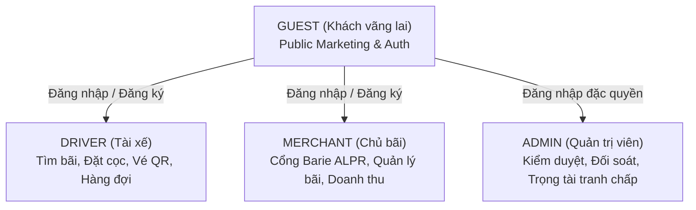
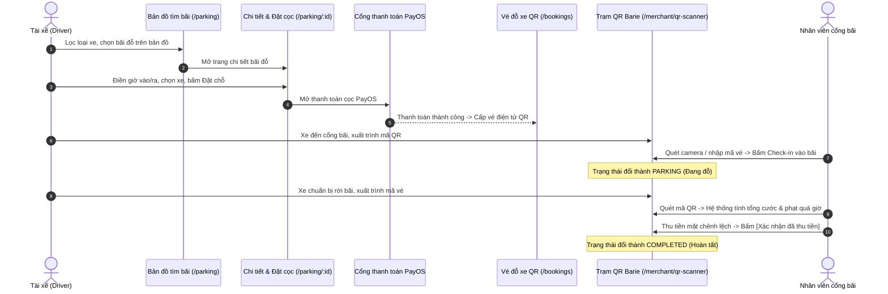
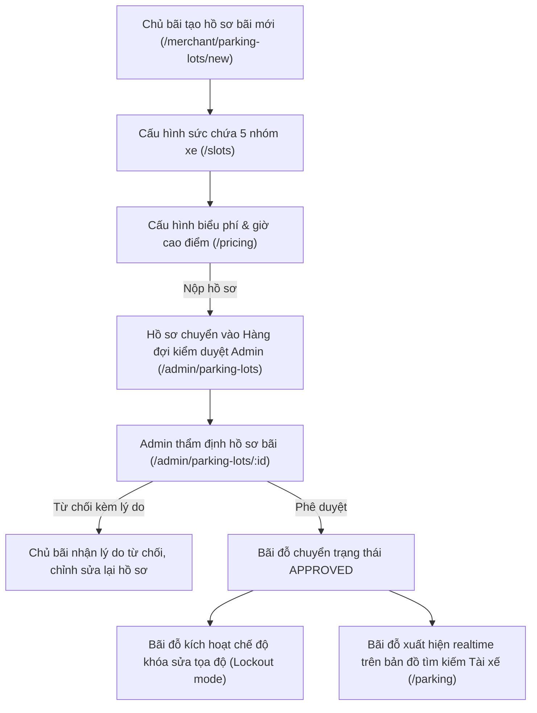
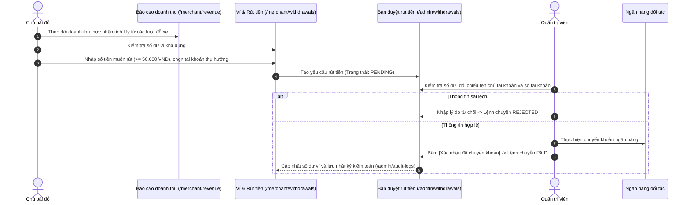
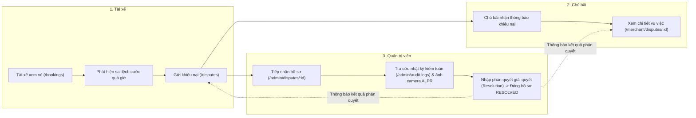

# 03. ROLE & WORKFLOW MAPPING — SMART PARKING HUB CRM V2

> **Giai đoạn:** DISCOVERY & INVENTORY AUDIT  
> **Thời gian khảo sát:** 06/11/2026 · **Trạng thái:** HOÀN THÀNH XÁC LẬP MA TRẬN PHÂN QUYỀN VÀ LUỒNG NGHIỆP VỤ  
> **Căn cứ xác thực:** `src/features/auth/model/session.ts`, `src/features/auth/components/RequireRole.tsx`, các API controller và DTOs thực tế trong repository.

---

## 1. MA TRẬN VAI TRÒ & PHÂN QUYỀN TRUY CẬP (ROLE-BASED ACCESS CONTROL)

Hệ thống ghi nhận chính thức **4 vai trò (Roles)** với phạm vi truy cập phân định rõ ràng:



### 1.1. Bảng quyền hạn truy cập theo màn hình

| Nhóm Màn Hình / Nghiệp Vụ | Đường Dẫn (Route) | GUEST | DRIVER | MERCHANT | ADMIN | Căn Cứ Mã Nguồn Xác Thực |
| :--- | :--- | :---: | :---: | :---: | :---: | :--- |
| **Public Landing & Marketing** | `/`, `/solutions/*`, `/pricing`, `/about`, `/careers`, `/insights`, `/contact` | ✅ | ✅ | ✅ | ✅ | Không có route guard, public cho mọi người dùng |
| **Xác thực tài khoản (Auth)** | `/login`, `/register`, `/forgot-password` | ✅ | 🔄* | 🔄* | 🔄* | `*` Nếu đã đăng nhập, tự động redirect về trang chủ của vai trò (`roleHome`) |
| **Thông báo lỗi quyền (403)** | `/403` | ✅ | ✅ | ✅ | ✅ | Hiển thị khi bị từ chối quyền truy cập |
| **Driver Dashboard & Bản đồ tìm bãi** | `/dashboard`, `/parking`, `/parking/:id` | ❌ | ✅ | ❌ | ❌ | `<RequireRole role="DRIVER">` trong `DriverLayout` |
| **Vé đỗ QR & Hàng đợi ảo** | `/bookings`, `/queues`, `/payments` | ❌ | ✅ | ❌ | ❌ | `<RequireRole role="DRIVER">` |
| **Phương tiện & Hồ sơ cá nhân** | `/vehicles`, `/profile`, `/change-password`, `/notifications` | ❌ | ✅ | ❌ | ❌ | `<RequireRole role="DRIVER">` |
| **Merchant Dashboard & Quản lý bãi** | `/merchant`, `/merchant/dashboard`, `/merchant/parking-lots/*` | ❌ | ❌ | ✅ | ❌ | `<RequireRole role="MERCHANT">` trong `MerchantLayout` |
| **Trạm Barie Cổng & Quét QR** | `/merchant/qr-scanner`, `/merchant/bookings/*` | ❌ | ❌ | ✅ | ❌ | `<RequireRole role="MERCHANT">` |
| **Báo cáo doanh thu & Rút tiền ví** | `/merchant/revenue`, `/merchant/withdrawals`, `/merchant/profile` | ❌ | ❌ | ✅ | ❌ | `<RequireRole role="MERCHANT">` |
| **Admin Command Center** | `/admin`, `/admin/dashboard` | ❌ | ❌ | ❌ | ✅ | `<RequireRole role="ADMIN">` trong `AdminLayout` |
| **Kiểm duyệt bãi & Quản lý người dùng** | `/admin/parking-lots/*`, `/admin/users/*` | ❌ | ❌ | ❌ | ✅ | `<RequireRole role="ADMIN">` |
| **Đối soát sổ cái & Duyệt rút tiền** | `/admin/transactions`, `/admin/withdrawals`, `/admin/audit-logs` | ❌ | ❌ | ❌ | ✅ | `<RequireRole role="ADMIN">` |
| **Giải quyết tranh chấp khiếu nại** | `/disputes/*` (Driver), `/merchant/disputes/*`, `/admin/disputes/*` | ❌ | ✅ | ✅ | ✅ | Dùng chung component `DisputesPage`, phân quyền theo prop `role` |

---

## 2. BẢN ĐỒ CÁC LUỒNG NGHIỆP VỤ LIÊN TRANG (CROSS-PAGE WORKFLOWS)

### 2.1. Luồng 1: Đặt chỗ, Giữ slot & Check-in/out Cổng tự động



- **Màn hình tham gia:** `SCR-015` -> `SCR-016` -> `SCR-023` -> `SCR-017` -> `SCR-036` -> `SCR-019`.
- **Ràng buộc an toàn:** Nhân viên cổng bắt buộc phải bấm nút xác nhận riêng khi thu tiền mặt; không bao giờ tự động chuyển trạng thái hoàn tất nếu chưa xác nhận tiền mặt.

---

### 2.2. Luồng 2: Hàng đợi ảo thông minh (Virtual Queue Dispatch)

```mermaid
flowchart TD
    A["Tài xế tìm bãi trên Bản đồ (/parking)"] -->|Bãi đỗ đã hết chỗ| B["Bấm tham gia Hàng đợi ảo"]
    B --> C["Vào trang Hàng đợi ảo (/queues)<br/>Nhận số thứ tự & thời gian chờ ước tính"]
    C -->|Xe khác rời bãi qua QR Scanner| D["Hệ thống phát hiện slot trống"]
    D --> E["Cấp quyền giữ slot trong 10 phút"]
    E -->|Tài xế bấm [Chấp nhận]| F["Chuyển thành Booking chính thức -> Nhận Vé QR (/bookings)"]
    E -->|Hết 10 phút không xác nhận| G["Hủy lượt, chuyển slot cho xe tiếp theo trong hàng đợi"]
```

- **Màn hình tham gia:** `SCR-015` -> `SCR-018` -> `SCR-036` (kích hoạt giải phóng slot) -> `SCR-017`.

---

### 2.3. Luồng 3: Đăng ký, Cấu hình & Thẩm định Bãi đỗ xe



- **Màn hình tham gia:** `SCR-029` -> `SCR-032` -> `SCR-033` -> `SCR-043` -> `SCR-044` -> `SCR-030` -> `SCR-015`.

---

### 2.4. Luồng 4: Quyết toán doanh thu & Rút tiền ngân hàng



- **Màn hình tham gia:** `SCR-037` -> `SCR-038` -> `SCR-048` -> `SCR-051` -> `SCR-041`.

---

### 2.5. Luồng 5: Phân xử khiếu nại & Tranh chấp 3 bên



- **Màn hình tham gia:** `SCR-017` -> `DRV-DISP-01` -> `SCR-039` -> `SCR-049` -> `SCR-050` -> `SCR-051` -> `DRV-DISP-02` -> `SCR-040`.
