# Báo Cáo Kiểm Tra Hành Vi Giao Diện & Tương Tác (Interaction & Behavioral Audit)

> **Dự án**: Smart Parking Hub — `smart-parking-app-v2`  
> **Giai đoạn**: UX/UI AUDIT (DISCOVERY & AUDIT PHASE ONLY — NO CODE MODIFICATION)  
> **Ngày thực hiện**: 06/11/2026  
> **Tiêu chuẩn kiểm thử**: WCAG 2.1 AA, React 19 State Consistency, REST API Contract Alignment

---

## MỤC LỤC
1. [Phương Pháp & Phạm Vi Kiểm Tra](#1-phương-pháp--phạm-vi-kiểm-tra)
2. [Phần 1: Kiểm Tra Button & Actions (Nút Bấm & Tác Vụ)](#phần-1-kiểm-tra-button--actions)
3. [Phần 2: Form Audit & Dữ Liệu Nhập Liệu](#phần-2-form-audit--dữ-liệu-nhập-liệu)
4. [Phần 3: Data Display & Data Binding (Hiển Thị & Ràng Buộc Dữ Liệu)](#phần-3-data-display--data-binding)
5. [Phần 4: Navigation & Layout Audit (Điều Hướng & Bố Cục)](#phần-4-navigation--layout-audit)
6. [Phần 5: Modal & Overlay Audit (Hộp Thoại & Lớp Phủ)](#phần-5-modal--overlay-audit)
7. [Phần 6: Workflow Continuity Audit (Tính Liên Tục Của Luồng Nghiệp Vụ)](#phần-6-workflow-continuity-audit)
8. [Phần 7: Bảng Tổng Hợp Đăng Ký Vấn Đề (Prioritized Issue Registry)](#phần-7-bảng-tổng-hợp-đăng-ký-vấn-đề)
9. [Kết Luận & Khuyến Nghị Giai Đoạn Kế Tiếp](#kết-luận--khuyến-nghị-giai-đoạn-kế-tiếp)

---

## 1. Phương Pháp & Phạm Vi Kiểm Tra

Quá trình kiểm tra hành vi tương tác được thực hiện trực tiếp trên toàn bộ mã nguồn của [`smart-parking-app-v2`](file:///d:/Documents/JAVA%20WEB%20SERVICE/SmartParkingHub/smart-parking-app-v2) kết hợp đối chiếu hợp đồng Backend tại [`smart-parking-microservice`](file:///d:/Documents/JAVA%20WEB%20SERVICE/SmartParkingHub/smart-parking-microservice).

### 6 Phân loại vấn đề chuẩn hóa:
1. **Bug thực sự**: Lỗi logic, crash, xử lý catch nuốt lỗi, tải file hỏng, hoặc dữ liệu bị sai lệch nghiêm trọng.
2. **Thiếu feedback**: Hệ thống thực hiện thao tác ngầm hoặc thao tác hoàn tất nhưng người dùng không nhận được thông báo trạng thái.
3. **Thiếu trạng thái tương tác**: Thiếu loading indicator, spinner, disabled khi đang gửi, focus-visible, hoặc keyboard accessibility.
4. **Vấn đề UX**: Bố cục nhảy giật (layout shift), nhầm lẫn điều hướng, validation bẫy người dùng không thể submit, liên kết ra trang rỗng/thiếu tham số.
5. **Nghiệp vụ chưa được triển khai**: Nút bấm hoặc form chỉ giả lập bằng `setTimeout` và mock code phía client, chưa kết nối API thực tế của Backend.
6. **Không đủ dữ liệu để kiểm tra**: Các màn hình chưa có mock data hoàn chỉnh hoặc phụ thuộc vào thiết bị phần cứng thực tế (barie tự động, camera ALPR).

---

## Phần 1: Kiểm Tra Button & Actions

Kiểm tra toàn bộ hệ thống nút bấm hành động (CTA, button tương tác, link action) trên các màn hình chính:

| Màn hình / Component | Hành động | Trạng thái kỹ thuật | Hành vi thực tế | Đánh giá & Rủi ro |
| :--- | :--- | :--- | :--- | :--- |
| [`DriverDashboardPage.tsx`](file:///d:/Documents/JAVA%20WEB%20SERVICE/SmartParkingHub/smart-parking-app-v2/src/features/driver/pages/DriverDashboardPage.tsx#L130-L136) | Nút "Tra Cứu Nhanh" | `type="submit"` | Kích hoạt toast `setSuccessToast` và `reset()` form; **không** lọc dữ liệu, **không** chuyển hướng | **Nghiệp vụ chưa triển khai / Thiếu feedback thực tế**: Người dùng tưởng đã tìm kiếm nhưng bảng dữ liệu không đổi. |
| [`ActiveTripCard.tsx`](file:///d:/Documents/JAVA%20WEB%20SERVICE/SmartParkingHub/smart-parking-app-v2/src/features/driver/components/ActiveTripCard.tsx#L211-L219) | Nút "Chỉ đường" | `<a href="https://maps.google.com" target="_blank">` | Mở trang chủ Google Maps trống trơn, không có tọa độ lat/lng hay địa chỉ của bãi đỗ | **Vấn đề UX**: Tài xế xe tải đang di chuyển bấm vào chỉ đường không nhận được lộ trình tới bãi. |
| [`ActiveTripCard.tsx`](file:///d:/Documents/JAVA%20WEB%20SERVICE/SmartParkingHub/smart-parking-app-v2/src/features/driver/components/ActiveTripCard.tsx#L220-L226) | Nút "Trực ban bến" | `<a href="tel:19006868">` | Gọi số hotline tĩnh giả lập `19006868`, không lấy số điện thoại quản lý thực tế của bãi từ API | **Vấn đề UX**: Không liên hệ được với người điều phối thực tế tại trạm bãi. |
| [`CareersApplyModal.tsx`](file:///d:/Documents/JAVA%20WEB%20SERVICE/SmartParkingHub/smart-parking-app-v2/src/features/landing/components/careers/CareersApplyModal.tsx#L20-L32) | Nút "Gửi hồ sơ ứng tuyển" | Form submit | Chạy `setTimeout(2000)`, hiển thị trạng thái thành công và đóng form; không gửi request HTTP | **Nghiệp vụ chưa triển khai**: Ứng viên gửi CV nhưng thông tin bị hủy trong RAM client. |
| [`ExportReportModal.tsx`](file:///d:/Documents/JAVA%20WEB%20SERVICE/SmartParkingHub/smart-parking-app-v2/src/features/payments/components/ExportReportModal.tsx#L21-L38) | Nút "Tải Báo Cáo" (Payments) | `onClick={handleExport}` | Chạy `setTimeout(800)` quay spinner, `setTimeout(1000)` đóng modal; **không tải bất kỳ tệp nào** | **Bug thực sự / Giả lập**: Nút xuất báo cáo nhưng không có tệp nào được tạo ra hoặc tải về trình duyệt. |
| [`ExportReportModal.tsx`](file:///d:/Documents/JAVA%20WEB%20SERVICE/SmartParkingHub/smart-parking-app-v2/src/features/merchant/parking-lots/components/ExportReportModal.tsx#L17-L26) | Nút "Tải Báo Cáo" (Merchant) | `onClick={handleExport}` | Chạy `setTimeout(1000)` quay spinner rồi đóng; **không tải tệp** | **Bug thực sự / Giả lập**: Tương tự như trên, giả lập hành vi xuất file. |
| [`SendReceiptEmailModal.tsx`](file:///d:/Documents/JAVA%20WEB%20SERVICE/SmartParkingHub/smart-parking-app-v2/src/features/payments/components/SendReceiptEmailModal.tsx#L23-L38) | Nút "Gửi Biên Lai / HĐĐT" | `sendReceiptEmailApi()` | Gọi hàm tại [`paymentApi.ts`](file:///d:/Documents/JAVA%20WEB%20SERVICE/SmartParkingHub/smart-parking-app-v2/src/features/payments/api/paymentApi.ts#L309-L315) chứa `setTimeout(600)` trả về `true` | **Nghiệp vụ chưa triển khai**: Hệ thống không gửi email thực tế đến người dùng. |

---

## Phần 2: Form Audit & Dữ Liệu Nhập Liệu

Kiểm tra tính nhất quán giữa frontend validation (Zod, React Hook Form) và Backend DTO validation:

### 2.1. Lỗi nuốt lỗi mạng và tạo đơn ảo tại [`BookingPaymentModal.tsx`](file:///d:/Documents/JAVA%20WEB%20SERVICE/SmartParkingHub/smart-parking-app-v2/src/features/parking-detail/components/BookingPaymentModal.tsx#L110-L135)
* **Vị trí**: `src/features/parking-detail/components/BookingPaymentModal.tsx` dòng 110-135.
* **Hành vi thực tế**:
  ```typescript
  } catch (error) {
    // Fallback result on network error
    const fallbackResult: BookingCreationResult = {
      bookingId: 'BK-2025-CLG2-014',
      facilityId,
      facilityName,
      status: 'HOLD_CONFIRMED',
      ...
    }
    setBookingResult(fallbackResult)
    setStep('SUCCESS')
    if (onPaymentSuccess) {
      onPaymentSuccess(fallbackResult.bookingId)
    }
  }
  ```
* **Hậu quả nghiêm trọng**: Khi Backend sập hoặc mất kết nối mạng, thay vì báo lỗi cho tài xế để thử lại, khối `catch` tự tạo một mã đặt chỗ giả `BK-2025-CLG2-014`, chuyển sang màn hình thành công và báo tài xế "Đã giữ slot thành công". Tài xế sẽ lái xe đến bãi mà không hề có đơn đặt chỗ nào trong cơ sở dữ liệu!

### 2.2. Validation bẫy người dùng tại [`FinancePages.tsx`](file:///d:/Documents/JAVA%20WEB%20SERVICE/SmartParkingHub/smart-parking-app-v2/src/features/merchant/operations/FinancePages.tsx#L280-L290)
* **Vị trí**: `src/features/merchant/operations/FinancePages.tsx` dòng 168 & dòng 287-288.
* **Hành vi thực tế**:
  Nút "+ Yêu cầu rút tiền" chỉ kiểm tra `disabled={!revenue.data}`. Khi số dư khả dụng (`balance`) nhỏ hơn mức rút tối thiểu (`minimum = 50,000 VND`), nút bấm vẫn cho phép click mở hộp thoại.
  Bên trong dialog, input số tiền có ràng buộc:
  ```typescript
  min: minimum, // 50,000 VND
  max: balance, // ví dụ: 20,000 VND
  ```
* **Hậu quả**: Khi `balance < 50,000 VND`, người dùng mở được dialog nhưng không có bất kỳ con số nào thỏa mãn đồng thời `>= 50,000` và `<= 20,000`. Form bị kẹt, nút submit không thể vượt qua validation, gây ức chế cho Merchant.

### 2.3. Bắt buộc nhập lý do duyệt không cần thiết tại [`features/admin/index.tsx`](file:///d:/Documents/JAVA%20WEB%20SERVICE/SmartParkingHub/smart-parking-app-v2/src/features/admin/index.tsx#L307-L310)
* **Vị trí**: `DecisionDialog` trong `features/admin/index.tsx` dòng 307-310.
* **Hành vi thực tế**:
  Trường `reason` được cài đặt:
  ```typescript
  {...form.register('reason', {
    required: true,
    validate: (value) => !!value.trim(),
  })}
  ```
  Trong khi đó, Backend [`AdminParkingLotController.java`](file:///d:/Documents/JAVA%20WEB%20SERVICE/SmartParkingHub/smart-parking-microservice/parking-lot-service/src/main/java/com/smartparking/parkinglot/api/controller/AdminParkingLotController.java) quy định `@RequestBody(required = false) AdminDecisionRequest` đối với hành động phê duyệt (`/approve`).
* **Hậu quả**: Quản trị viên duyệt một bãi xe hoặc lệnh rút tiền hoàn toàn hợp lệ nhưng vẫn bị ép buộc phải gõ văn bản vào ô "Lý do quyết định", làm chậm trễ thao tác vận hành hàng ngày.

---

## Phần 3: Data Display & Data Binding

Kiểm tra khả năng hiển thị dữ liệu thực từ API so với dữ liệu mẫu (mock/fallback):

### 3.1. Dữ liệu tĩnh đè dữ liệu động tại [`ParkingDetailPage.tsx`](file:///d:/Documents/JAVA%20WEB%20SERVICE/SmartParkingHub/smart-parking-app-v2/src/features/parking-detail/pages/ParkingDetailPage.tsx#L112-L138)
* **Vị trí**: `src/features/parking-detail/pages/ParkingDetailPage.tsx` (`SCR-016`).
* **Hành vi thực tế**:
  Mặc dù trang có gọi `fetchFacilityDetail(facilityId)` qua `useQuery`, các component con lại nhận dữ liệu từ các biến tĩnh hardcode:
  - `<SlotCapacityMatrixSection categories={fallbackCapacityCategories} ... />`
  - `<PricingRulesTableSection pricingRules={fallbackPricingRules} />`
  - `<AmenitiesChecklistSection amenities={fallbackAmenities} />`
  - `<StickyReservationDesk reservationState={fallbackReservationState} ... />`
* **Hậu quả**: Cho dù người dùng truy cập bãi xe ID 1, 2, hay 99, bảng giá, tiện ích và ma trận slot hiển thị luôn là của "Tân Cảng Cát Lái - Gate 2".

### 3.2. Giữ slot khẩn cấp không gọi API tại [`InlineQuickBookPanel.tsx`](file:///d:/Documents/JAVA%20WEB%20SERVICE/SmartParkingHub/smart-parking-app-v2/src/features/parking-search/components/InlineQuickBookPanel.tsx#L99-L103)
* **Vị trí**: `src/features/parking-search/components/InlineQuickBookPanel.tsx`.
* **Hành vi thực tế**:
  Khi người dùng click "Xác nhận giữ slot 10 phút":
  ```typescript
  const code = `BK-HOLD-2026-${Math.floor(1000 + Math.random() * 9000)}`
  setReservationCode(code)
  setConfirmed(true)
  onConfirmSuccess?.(code)
  ```
* **Hậu quả**: Hệ thống thông báo slot đã được khóa vật lý, nhưng không hề gửi request đặt chỗ tới Backend. Slot trên bãi thực tế vẫn trống và tài xế khác có thể đặt mất.

### 3.3. Lưu cấu hình hóa đơn doanh nghiệp vào LocalStorage tại [`paymentApi.ts`](file:///d:/Documents/JAVA%20WEB%20SERVICE/SmartParkingHub/smart-parking-app-v2/src/features/payments/api/paymentApi.ts#L303-L307)
* **Vị trí**: `saveCompanyInvoiceConfig` và `fetchCompanyInvoiceConfig`.
* **Hành vi thực tế**: Chỉ lưu trữ thông tin MST, tên công ty, địa chỉ vào `localStorage.setItem('sth.driver.company_invoice_config', ...)`.
* **Hậu quả**: Không có cơ chế đồng bộ lên Backend. Khi tài xế đổi thiết bị hoặc chuyển từ điện thoại sang máy tính, toàn bộ thông tin xuất hóa đơn công ty biến mất.

---

## Phần 4: Navigation & Layout Audit

### 4.1. Lệch chiều cao Header gây giật giao diện (Layout Shift)
* **Vị trí**: [`globals.css`](file:///d:/Documents/JAVA%20WEB%20SERVICE/SmartParkingHub/smart-parking-app-v2/src/styles/globals.css#L35-L47) và [`DriverDashboardPage.tsx`](file:///d:/Documents/JAVA%20WEB%20SERVICE/SmartParkingHub/smart-parking-app-v2/src/features/driver/pages/DriverDashboardPage.tsx#L54).
* **Bằng chứng**:
  - `globals.css`:
    ```css
    :root { --driver-header-height: 80px; }
    @media (min-width: 1024px) and (max-width: 1535px) { :root { --driver-header-height: 140px; } }
    @media (min-width: 1536px) { :root { --driver-header-height: 92px; } }
    ```
  - Trong khi đó, `DriverDashboardPage.tsx` lại hardcode:
    ```html
    <div className="w-full min-h-[calc(100vh-140px)] bg-[#f8f9ff]">
    ```
  - `DriverLayout.tsx` sử dụng:
    ```html
    <main className="flex-1 w-full pt-[var(--driver-header-height)]">
    ```
* **Hậu quả**: Trên màn hình di động (< 1024px) và màn hình lớn (≥ 1536px), trang Dashboard bị khoảng trống thừa bên dưới hoặc tràn màn hình không đồng đều so với các trang khác do tính toán chiều cao không đồng bộ.

### 4.2. Breadcrumb & Active Navigation States
* **Vị trí**: [`DriverHeader.tsx`](file:///d:/Documents/JAVA%20WEB%20SERVICE/SmartParkingHub/smart-parking-app-v2/src/layouts/driver/DriverHeader.tsx#L45-L55).
* **Đánh giá**: Logic `active()` xử lý đường dẫn tương đối tốt (`/dashboard`, `/parking`, `/bookings`, `/queues`), có hỗ trợ `aria-current="page"`. Tuy nhiên, khi người dùng ở màn hình chi tiết như `/parking/:id` hoặc `/bookings/:id`, thanh điều hướng chính vẫn highlight mục cha nhưng không có thanh Breadcrumb phụ để người dùng nhận biết vị trí phân cấp và quay lại danh sách một cách tự nhiên.

---

## Phần 5: Modal & Overlay Audit

Bảng kiểm tra tính tương tác và khả năng tiếp cận (Accessibility - A11y) của tất cả modal trong hệ thống:

| Tên Modal | File Component | Escape Key | Click Backdrop | Scroll Lock | Xuất File Hợp Lệ |
| :--- | :--- | :---: | :---: | :---: | :---: |
| **CancelBookingModal** | [`CancelBookingModal.tsx`](file:///d:/Documents/JAVA%20WEB%20SERVICE/SmartParkingHub/smart-parking-app-v2/src/features/bookings/components/CancelBookingModal.tsx) | ❌ Không | ✅ Có | ❌ Không | N/A |
| **ReviewBookingModal** | [`ReviewBookingModal.tsx`](file:///d:/Documents/JAVA%20WEB%20SERVICE/SmartParkingHub/smart-parking-app-v2/src/features/bookings/components/ReviewBookingModal.tsx) | ❌ Không | ✅ Có | ❌ Không | N/A |
| **LeaveQueueConfirmModal** | [`LeaveQueueConfirmModal.tsx`](file:///d:/Documents/JAVA%20WEB%20SERVICE/SmartParkingHub/smart-parking-app-v2/src/features/queues/components/LeaveQueueConfirmModal.tsx) | ❌ Không | ❌ Không | ❌ Không | N/A |
| **AcceptQueueSuccessModal** | [`AcceptQueueSuccessModal.tsx`](file:///d:/Documents/JAVA%20WEB%20SERVICE/SmartParkingHub/smart-parking-app-v2/src/features/queues/components/AcceptQueueSuccessModal.tsx) | ❌ Không | ❌ Không | ❌ Không | N/A |
| **DeleteVehicleConfirmModal** | [`DeleteVehicleConfirmModal.tsx`](file:///d:/Documents/JAVA%20WEB%20SERVICE/SmartParkingHub/smart-parking-app-v2/src/features/vehicles/components/DeleteVehicleConfirmModal.tsx) | ❌ Không | ❌ Không | ❌ Không | N/A |
| **ExportFleetModal** | [`ExportFleetModal.tsx`](file:///d:/Documents/JAVA%20WEB%20SERVICE/SmartParkingHub/smart-parking-app-v2/src/features/vehicles/components/ExportFleetModal.tsx) | ❌ Không | ❌ Không | ❌ Không | ❌ **Hỏng tệp** (Tải chuỗi JSON đổi đuôi `.xlsx` / `.pdf`) |
| **ExportReportModal (Pay)** | [`ExportReportModal.tsx`](file:///d:/Documents/JAVA%20WEB%20SERVICE/SmartParkingHub/smart-parking-app-v2/src/features/payments/components/ExportReportModal.tsx) | ❌ Không | ❌ Không | ❌ Không | ❌ **Không tải tệp** (Chỉ chạy timer) |
| **ExportReportModal (Mer)** | [`ExportReportModal.tsx`](file:///d:/Documents/JAVA%20WEB%20SERVICE/SmartParkingHub/smart-parking-app-v2/src/features/merchant/parking-lots/components/ExportReportModal.tsx) | ❌ Không | ❌ Không | ❌ Không | ❌ **Không tải tệp** (Chỉ chạy timer) |
| **SendReceiptEmailModal** | [`SendReceiptEmailModal.tsx`](file:///d:/Documents/JAVA%20WEB%20SERVICE/SmartParkingHub/smart-parking-app-v2/src/features/payments/components/SendReceiptEmailModal.tsx) | ❌ Không | ❌ Không | ❌ Không | N/A |
| **InlineQuickBookPanel** | [`InlineQuickBookPanel.tsx`](file:///d:/Documents/JAVA%20WEB%20SERVICE/SmartParkingHub/smart-parking-app-v2/src/features/parking-search/components/InlineQuickBookPanel.tsx) | ✅ Có | ✅ Có | ✅ Có | N/A |
| **BookingPaymentModal** | [`BookingPaymentModal.tsx`](file:///d:/Documents/JAVA%20WEB%20SERVICE/SmartParkingHub/smart-parking-app-v2/src/features/parking-detail/components/BookingPaymentModal.tsx) | ❌ Không | ✅ Có | ❌ Không | N/A |

> **Ghi chú A11y**: Đa số các modal hiện tại được viết thủ công mà không có hook quản lý tập trung (`useModal` hoặc component thư viện Radix UI/Headless UI), dẫn đến việc quên xử lý phím `Escape`, không khóa thanh cuộn của trang nền (`overflow: hidden`), và không bẫy tiêu điểm (`focus trap`).

---

## Phần 6: Workflow Continuity Audit

Kiểm tra tính liền mạch xuyên suốt các luồng người dùng chính:

```mermaid
flowchart TD
    subgraph WF_Driver["Luồng Đặt Chỗ Tài Xế (Driver Booking Workflow)"]
        D1["Tìm bãi đỗ (/parking)"] --> D2["Xem chi tiết bãi (/parking/:id)"]
        D2 --> D3["Đặt chỗ cọc 20% (BookingPaymentModal)"]
        D3 -- Lỗi mạng/API sập --> D3_Bug["Tự tạo mã BK giả & báo Thành Công (ISS-01)"]
        D3 -- Thành công --> D4["Xem vé & mã QR (/bookings)"]
        D4 --> D5["Check-in qua cổng ALPR"]
    end

    subgraph WF_Queue["Luồng Hàng Đợi Ảo (Virtual Queue Workflow)"]
        Q1["Hết chỗ -> Vào hàng đợi (/queues)"] --> Q2["Nhận thông báo có slot"]
        Q2 --> Q3["Xác nhận nhận chỗ (AcceptQueueSuccessModal)"]
        Q3 --> Q4["Chuyển đổi thành Vé (/bookings)"]
    end

    subgraph WF_Merchant["Luồng Quản Lý Bãi & Rút Tiền (Merchant Workflow)"]
        M1["Xem doanh thu (/merchant/operations/finance)"] --> M2["Bấm '+ Yêu cầu rút tiền'"]
        M2 -- Số dư < 50k --> M2_Trap["Bẫy validation min/max không thể submit (ISS-03)"]
        M2 -- Hợp lệ --> M3["Tạo yêu cầu rút thành công"]
    end

    subgraph WF_Admin["Luồng Phê Duyệt Quản Trị (Admin Moderation)"]
        A1["Danh sách bãi chờ duyệt (/admin/parking-lots)"] --> A2["Xem hồ sơ bãi"]
        A2 --> A3["Bấm 'Duyệt bãi'"]
        A3 --> A4_Friction["Bị ép buộc gõ lý do dù Backend không yêu cầu (ISS-04)"]
    end
```



### Đánh giá các điểm đứt gãy luồng:
1. **Đứt gãy luồng đặt chỗ**: Khi Backend trả về mã lỗi 400/500, luồng không hiển thị thông báo lỗi mà tự nhảy sang bước hoàn tất, khiến tài xế ngộ nhận đã có chỗ.
2. **Đứt gãy luồng giữ slot nhanh**: Nút "Xác nhận giữ slot 10 phút" tại panel tìm kiếm bãi chỉ sinh mã ngẫu nhiên ở client mà không đồng bộ về hệ thống đặt chỗ, tạo ra "vé ma" không có giá trị đối soát.
3. **Đứt gãy luồng rút tiền**: Người dùng có số dư dưới 50.000đ bị mắc kẹt trong form rút tiền mà không có thông báo hướng dẫn trước khi bấm.

---

## Phần 7: Bảng Tổng Hợp Đăng Ký Vấn Đề

Dưới đây là 18 vấn đề hành vi và tương tác được phát hiện, phân loại chi tiết:

### [ISS-01] False Success Fallback khi đặt chỗ gặp lỗi mạng
* **Mã vấn đề**: `ISS-01`
* **Màn hình**: `SCR-016` (Parking Facility Detail Page)
* **Đường dẫn**: `/parking/:id`
* **Component**: [`BookingPaymentModal.tsx`](file:///d:/Documents/JAVA%20WEB%20SERVICE/SmartParkingHub/smart-parking-app-v2/src/features/parking-detail/components/BookingPaymentModal.tsx#L110-L135)
* **Hành động kiểm tra**: Bấm nút "Xác nhận thanh toán cọc" khi mạng ngắt hoặc Backend trả về lỗi 500.
* **Hành vi mong đợi**: Hiển thị thông báo lỗi rõ ràng (toast hoặc alert đỏ) và giữ nguyên ở bước thanh toán để người dùng thử lại hoặc đổi phương thức.
* **Hành vi thực tế**: Khối `catch` tạo đối tượng `fallbackResult` với mã `BK-2025-CLG2-014`, chuyển bước sang `SUCCESS` và kích hoạt callback `onPaymentSuccess`.
* **Mức độ nghiêm trọng**: **CRITICAL**
* **Phân loại**: **Bug thực sự**
* **Bằng chứng**: Dòng 110-135 file `BookingPaymentModal.tsx`.
* **Nguyên nhân dự kiến**: Lập trình viên để lại đoạn code mock phục vụ quay demo/design preview mà không bỏ khi tích hợp API.
* **Đề xuất sửa**: Xóa bỏ hoàn toàn việc gán `fallbackResult` trong khối `catch`. Gọi `setValidationError(err.message || 'Thanh toán thất bại, vui lòng thử lại')` và giữ nguyên ở bước `CONFIGURATION`.

---

### [ISS-02] Tải file hỏng khi xuất báo cáo đội xe (Export Fleet)
* **Mã vấn đề**: `ISS-02`
* **Màn hình**: `SCR-013` (Vehicle Management Page)
* **Đường dẫn**: `/vehicles`
* **Component**: [`ExportFleetModal.tsx`](file:///d:/Documents/JAVA%20WEB%20SERVICE/SmartParkingHub/smart-parking-app-v2/src/features/vehicles/components/ExportFleetModal.tsx#L30-L37)
* **Hành động kiểm tra**: Chọn định dạng `Excel (.xlsx)` hoặc `PDF (.pdf)` và bấm "Tải xuống".
* **Hành vi mong đợi**: Trình duyệt tải về tệp Excel nhị phân hoặc tệp PDF chuẩn có thể mở được bằng phần mềm chuyên dụng.
* **Hành vi thực tế**: Code tạo một `Blob` kiểu `text/plain` chứa chuỗi `JSON.stringify(vehicles)` rồi lưu với đuôi file `.xlsx` hoặc `.pdf`.
* **Mức độ nghiêm trọng**: **HIGH**
* **Phân loại**: **Bug thực sự**
* **Bằng chứng**: Dòng 30-37 file `ExportFleetModal.tsx`.
* **Nguyên nhân dự kiến**: Chưa tích hợp thư viện xuất bảng tính (như `xlsx` / `exceljs`) hoặc chưa gọi endpoint xuất file từ Backend.
* **Đề xuất sửa**: Chuyển đổi dữ liệu sang định dạng CSV thực sự (dùng dấu phẩy và mã hóa UTF-8 BOM) đối với xuất nhanh ở client, hoặc kết nối tới API xuất báo cáo phía Backend.

---

### [ISS-03] Bẫy validation không thể submit khi số dư nhỏ hơn mức tối thiểu
* **Mã vấn đề**: `ISS-03`
* **Màn hình**: `SCR-031` (Merchant Finance Page)
* **Đường dẫn**: `/merchant/operations/finance`
* **Component**: [`FinancePages.tsx`](file:///d:/Documents/JAVA%20WEB%20SERVICE/SmartParkingHub/smart-parking-app-v2/src/features/merchant/operations/FinancePages.tsx#L168-L289)
* **Hành động kiểm tra**: Khi số dư ví khả dụng < 50.000 VND, bấm nút "+ Yêu cầu rút tiền" và nhập số tiền muốn rút.
* **Hành vi mong đợi**: Nút "+ Yêu cầu rút tiền" bị vô hiệu hóa kèm tooltip giải thích "Số dư chưa đạt hạn mức tối thiểu", hoặc trong dialog hiển thị thông báo chặn submit rõ ràng.
* **Hành vi thực tế**: Nút vẫn click được; trong dialog, input validation đặt `min: 50000, max: balance`. Khi `balance < 50000`, không giá trị nào hợp lệ, form bị kẹt không có giải thích.
* **Mức độ nghiêm trọng**: **HIGH**
* **Phân loại**: **Vấn đề UX**
* **Bằng chứng**: Dòng 168 và dòng 287-288 file `FinancePages.tsx`.
* **Nguyên nhân dự kiến**: Thiếu điều kiện kiểm tra `revenue.data.currentWalletBalance >= minAmount` trên nút mở dialog và thiếu helper text trong dialog.
* **Đề xuất sửa**: Thêm điều kiện `disabled={!revenue.data || revenue.data.currentWalletBalance < 50000}` trên nút bấm.

---

### [ISS-04] Bắt buộc nhập lý do khi Admin duyệt hồ sơ bãi hợp lệ
* **Mã vấn đề**: `ISS-04`
* **Màn hình**: `SCR-043` (Admin Parking Lots List) & `SCR-044` (Admin Lot Detail)
* **Đường dẫn**: `/admin/parking-lots/:id`
* **Component**: [`features/admin/index.tsx`](file:///d:/Documents/JAVA%20WEB SERVICE/SmartParkingHub/smart-parking-app-v2/src/features/admin/index.tsx#L307-L315)
* **Hành động kiểm tra**: Admin bấm nút "Duyệt bãi" (`/approve`).
* **Hành vi mong đợi**: Mở dialog xác nhận nhanh, trường lý do là tùy chọn (optional) và có thể bấm xác nhận ngay.
* **Hành vi thực tế**: Form bắt buộc nhập `reason` (`required: true, validate: (value) => !!value.trim()`), nếu bỏ trống sẽ báo lỗi "Nhập lý do quyết định".
* **Mức độ nghiêm trọng**: **MEDIUM**
* **Phân loại**: **Vấn đề UX**
* **Bằng chứng**: Dòng 307-310 file `features/admin/index.tsx`, đối chiếu [`AdminParkingLotController.java`](file:///d:/Documents/JAVA%20WEB%20SERVICE/SmartParkingHub/smart-parking-microservice/parking-lot-service/src/main/java/com/smartparking/parkinglot/api/controller/AdminParkingLotController.java).
* **Nguyên nhân dự kiến**: Dùng chung một form `DecisionDialog` cho cả hành động duyệt, từ chối và yêu cầu sửa đổi mà không tách điều kiện validation theo loại hành động.
* **Đề xuất sửa**: Chỉ bắt buộc nhập lý do khi `decision.action !== 'approve'`.

---

### [ISS-05] Nút "Tra Cứu Nhanh" tại Driver Dashboard chỉ xóa form và hiện toast ảo
* **Mã vấn đề**: `ISS-05`
* **Màn hình**: `SCR-011` (Driver Dashboard Overview)
* **Đường dẫn**: `/dashboard`
* **Component**: [`DriverDashboardPage.tsx`](file:///d:/Documents/JAVA%20WEB%20SERVICE/SmartParkingHub/smart-parking-app-v2/src/features/driver/pages/DriverDashboardPage.tsx#L48-L51)
* **Hành động kiểm tra**: Nhập biển số xe hoặc mã vé vào thanh tra cứu nhanh và bấm "Tra Cứu Nhanh".
* **Hành vi mong đợi**: Điều hướng sang trang `/bookings?search=...` hoặc lọc trực tiếp danh sách chuyến đi gần đây.
* **Hành vi thực tế**: Chỉ gọi `setSuccessToast` với nội dung thông báo chung chung, xóa trắng ô nhập liệu và không thực hiện tra cứu.
* **Mức độ nghiêm trọng**: **MEDIUM**
* **Phân loại**: **Nghiệp vụ chưa được triển khai**
* **Bằng chứng**: Dòng 48-51 file `DriverDashboardPage.tsx`.
* **Nguyên nhân dự kiến**: Mock UI chưa kết nối với React Router navigation.
* **Đề xuất sửa**: Sử dụng `useNavigate` để chuyển hướng sang `/bookings?keyword=${encodeURIComponent(formData.query)}`.

---

### [ISS-06] Nút "Chỉ đường" và "Trực ban bến" liên kết rỗng / tĩnh
* **Mã vấn đề**: `ISS-06`
* **Màn hình**: `SCR-011` (Driver Dashboard Overview)
* **Đường dẫn**: `/dashboard`
* **Component**: [`ActiveTripCard.tsx`](file:///d:/Documents/JAVA%20WEB%20SERVICE/SmartParkingHub/smart-parking-app-v2/src/features/driver/components/ActiveTripCard.tsx#L211-L226)
* **Hành động kiểm tra**: Bấm vào nút "Chỉ đường" hoặc "Trực ban bến" trên thẻ chuyến đi đang hoạt động.
* **Hành vi mong đợi**: "Chỉ đường" mở Google Maps với tọa độ/địa chỉ bãi đỗ thực tế (`https://www.google.com/maps/dir/?api=1&destination=...`). "Trực ban bến" mở cuộc gọi tới hotline của bãi.
* **Hành vi thực tế**: "Chỉ đường" mở `https://maps.google.com` trống trơn; "Trực ban bến" gọi số tĩnh `19006868`.
* **Mức độ nghiêm trọng**: **MEDIUM**
* **Phân loại**: **Vấn đề UX**
* **Bằng chứng**: Dòng 212 & 221 file `ActiveTripCard.tsx`.
* **Nguyên nhân dự kiến**: Chưa truyền props tọa độ và số điện thoại từ `activeBooking` vào thẻ.
* **Đề xuất sửa**: Truyền `activeBooking.latitude`, `activeBooking.longitude`, `activeBooking.contactPhone` vào các thẻ liên kết.

---

### [ISS-07] Màn hình chi tiết bãi đỗ đè dữ liệu tĩnh lên dữ liệu API
* **Mã vấn đề**: `ISS-07`
* **Màn hình**: `SCR-016` (Parking Facility Detail Page)
* **Đường dẫn**: `/parking/:id`
* **Component**: [`ParkingDetailPage.tsx`](file:///d:/Documents/JAVA%20WEB%20SERVICE/SmartParkingHub/smart-parking-app-v2/src/features/parking-detail/pages/ParkingDetailPage.tsx#L112-L138)
* **Hành động kiểm tra**: Truy cập vào chi tiết bãi đỗ có ID khác 1.
* **Hành vi mong đợi**: Toàn bộ ma trận slot, bảng giá và tiện ích hiển thị theo dữ liệu của bãi đỗ được chọn.
* **Hành vi thực tế**: Header hiển thị tên bãi từ API, nhưng các mục con bên dưới sử dụng `fallbackCapacityCategories`, `fallbackPricingRules`, `fallbackAmenities`.
* **Mức độ nghiêm trọng**: **HIGH**
* **Phân loại**: **Bug thực sự**
* **Bằng chứng**: Dòng 114, 122, 125, 136 file `ParkingDetailPage.tsx`.
* **Nguyên nhân dự kiến**: Dữ liệu trả về từ API backend chưa có trường chi tiết pricingRules/slots hoặc mapper DTO chưa hoàn thiện nên tác giả dùng tạm biến fallback.
* **Đề xuất sửa**: Xây dựng mapper chuyển đổi từ `facility.pricingRules` và `facility.slots` sang props của component con, chỉ dùng fallback khi mảng rỗng.

---

### [ISS-08] Giữ slot khẩn cấp (10 phút) hoàn toàn giả lập
* **Mã vấn đề**: `ISS-08`
* **Màn hình**: `SCR-015` (Parking Search Map & List)
* **Đường dẫn**: `/parking` hoặc `/search`
* **Component**: [`InlineQuickBookPanel.tsx`](file:///d:/Documents/JAVA%20WEB%20SERVICE/SmartParkingHub/smart-parking-app-v2/src/features/parking-search/components/InlineQuickBookPanel.tsx#L99-L103)
* **Hành động kiểm tra**: Bấm nút "Xác nhận giữ slot 10 phút".
* **Hành vi mong đợi**: Gửi request `POST /api/v1/bookings/hold` tới Backend để khóa slot trong 10 phút.
* **Hành vi thực tế**: Client tự sinh mã ngẫu nhiên `BK-HOLD-2026-xxxx`, hiển thị thành công nhưng Backend không hề ghi nhận.
* **Mức độ nghiêm trọng**: **HIGH**
* **Phân loại**: **Nghiệp vụ chưa được triển khai**
* **Bằng chứng**: Dòng 99-103 file `InlineQuickBookPanel.tsx`.
* **Nguyên nhân dự kiến**: Thiếu API endpoint giữ chỗ tạm thời (hold slot) phía backend hoặc chưa được kết nối.
* **Đề xuất sửa**: Tích hợp gọi mutation API đặt giữ chỗ, hiển thị spinner khi đang gửi, và xử lý thông báo nếu hết chỗ.

---

### [ISS-09] Hộp thoại xuất báo cáo chi phí chỉ chạy hẹn giờ giả lập
* **Mã vấn đề**: `ISS-09`
* **Màn hình**: `SCR-014` (Driver Payments Ledger)
* **Đường dẫn**: `/payments`
* **Component**: [`ExportReportModal.tsx`](file:///d:/Documents/JAVA%20WEB%20SERVICE/SmartParkingHub/smart-parking-app-v2/src/features/payments/components/ExportReportModal.tsx#L21-L38)
* **Hành động kiểm tra**: Chọn định dạng và bấm nút "Tải Báo Cáo".
* **Hành vi mong đợi**: Tải về tệp sao kê chi phí tương ứng.
* **Hành vi thực tế**: `setTimeout` 800ms hiện spinner, 1000ms hiện thành công rồi tự đóng; không tải file.
* **Mức độ nghiêm trọng**: **HIGH**
* **Phân loại**: **Nghiệp vụ chưa được triển khai**
* **Bằng chứng**: Dòng 21-38 file `ExportReportModal.tsx` (`features/payments`).
* **Nguyên nhân dự kiến**: Chưa kết nối API xuất dữ liệu sao kê tài chính.
* **Đề xuất sửa**: Tạo logic xuất file CSV trực tiếp từ danh sách `transactions` đã có trong store hoặc gọi API xuất báo cáo.

---

### [ISS-10] Hộp thoại xuất báo cáo mặt bằng Merchant chỉ chạy hẹn giờ giả lập
* **Mã vấn đề**: `ISS-10`
* **Màn hình**: `SCR-032` (Merchant Parking Lots Workbench)
* **Đường dẫn**: `/merchant/parking-lots`
* **Component**: [`ExportReportModal.tsx`](file:///d:/Documents/JAVA%20WEB%20SERVICE/SmartParkingHub/smart-parking-app-v2/src/features/merchant/parking-lots/components/ExportReportModal.tsx#L17-L26)
* **Hành động kiểm tra**: Bấm nút xuất báo cáo danh sách bãi.
* **Hành vi mong đợi**: Tải về tệp danh sách bãi đỗ xe của Merchant.
* **Hành vi thực tế**: `setTimeout` 1000ms giả vờ tải rồi đóng modal, không tạo file.
* **Mức độ nghiêm trọng**: **HIGH**
* **Phân loại**: **Nghiệp vụ chưa được triển khai**
* **Bằng chứng**: Dòng 17-26 file `ExportReportModal.tsx` (`features/merchant`).
* **Nguyên nhân dự kiến**: Mock hành vi cho đủ giao diện.
* **Đề xuất sửa**: Tạo tệp CSV xuất dữ liệu danh sách bãi thực tế từ `data.content`.

---

### [ISS-11] Gửi biên lai email và lưu thông tin xuất hóa đơn không đồng bộ máy chủ
* **Mã vấn đề**: `ISS-11`
* **Màn hình**: `SCR-014` (Driver Payments Ledger)
* **Đường dẫn**: `/payments`
* **Component**: [`SendReceiptEmailModal.tsx`](file:///d:/Documents/JAVA%20WEB%20SERVICE/SmartParkingHub/smart-parking-app-v2/src/features/payments/components/SendReceiptEmailModal.tsx) & [`paymentApi.ts`](file:///d:/Documents/JAVA%20WEB%20SERVICE/SmartParkingHub/smart-parking-app-v2/src/features/payments/api/paymentApi.ts#L291-L315)
* **Hành động kiểm tra**: Bấm gửi email biên lai hoặc lưu thông tin MST công ty.
* **Hành vi mong đợi**: Gửi request lên Backend để lưu cấu hình tài khoản và kích hoạt service gửi email.
* **Hành vi thực tế**: `sendReceiptEmailApi` chạy `setTimeout(600)` trả về `true`; `saveCompanyInvoiceConfig` lưu vào `localStorage`.
* **Mức độ nghiêm trọng**: **MEDIUM**
* **Phân loại**: **Nghiệp vụ chưa được triển khai**
* **Bằng chứng**: Dòng 291-315 file `paymentApi.ts`.
* **Nguyên nhân dự kiến**: Chưa có microservice gửi email / notification riêng biệt.
* **Đề xuất sửa**: Đồng bộ trường thông tin hóa đơn vào API User Profile (`/api/v1/users/me`).

---

### [ISS-12] Thiếu lắng nghe phím Escape và khóa cuộn trên hầu hết các Modal
* **Mã vấn đề**: `ISS-12`
* **Màn hình**: Toàn bộ hệ thống modal (Driver, Merchant, Admin)
* **Đường dẫn**: Đa màn hình
* **Component**: `CancelBookingModal`, `ReviewBookingModal`, `LeaveQueueConfirmModal`, `AcceptQueueSuccessModal`, `DeleteVehicleConfirmModal`, `ExportReportModal`
* **Hành động kiểm tra**: Mở modal và bấm phím `Escape` trên bàn phím, hoặc cuộn chuột trên trang.
* **Hành vi mong đợi**: Modal đóng khi nhấn phím `Escape`, trang nền phía sau bị khóa cuộn (`document.body.style.overflow = 'hidden'`).
* **Hành vi thực tế**: Phím `Escape` không có tác dụng; người dùng vẫn cuộn được nội dung trang nền phía sau lớp phủ mờ.
* **Mức độ nghiêm trọng**: **MEDIUM**
* **Phân loại**: **Thiếu trạng thái tương tác / A11y**
* **Bằng chứng**: Kiểm tra source code các file modal đều không có `useEffect` gắn sự kiện `keydown`.
* **Nguyên nhân dự kiến**: Thiếu một component Modal khung dùng chung chuẩn A11y.
* **Đề xuất sửa**: Tạo hook `useModalA11y` hoặc chuẩn hóa component `AppModal` kế thừa từ `@radix-ui/react-dialog` hoặc Headless UI.

---

### [ISS-13] AcceptQueueSuccessModal không có nút đóng (X) và không đóng khi click nền
* **Mã vấn đề**: `ISS-13`
* **Màn hình**: `SCR-012` (Driver Virtual Queue Dashboard)
* **Đường dẫn**: `/queues`
* **Component**: [`AcceptQueueSuccessModal.tsx`](file:///d:/Documents/JAVA%20WEB%20SERVICE/SmartParkingHub/smart-parking-app-v2/src/features/queues/components/AcceptQueueSuccessModal.tsx#L22-L28)
* **Hành động kiểm tra**: Nhận được thông báo có slot và hiển thị modal thành công. Người dùng muốn đóng modal bằng cách click ra ngoài hoặc bấm icon X.
* **Hành vi mong đợi**: Có icon nút [X] ở góc phải trên và cho phép click vào backdrop tối để đóng.
* **Hành vi thực tế**: Không có nút [X], backdrop không có sự kiện `onClick`. Người dùng chỉ có thể bấm nút "Đóng" ở chân modal hoặc bấm link chuyển trang.
* **Mức độ nghiêm trọng**: **LOW**
* **Phân loại**: **Vấn đề UX**
* **Bằng chứng**: Dòng 22-28 file `AcceptQueueSuccessModal.tsx`.
* **Nguyên nhân dự kiến**: Thiếu thuộc tính tương tác cơ bản của modal.
* **Đề xuất sửa**: Bổ sung nút [X] góc phải và sự kiện đóng khi click backdrop.

---

### [ISS-14] Lệch chiều cao Driver Header gây biến dạng khung nhìn (Layout Shift)
* **Mã vấn đề**: `ISS-14`
* **Màn hình**: `SCR-011` (Driver Dashboard Overview)
* **Đường dẫn**: `/dashboard`
* **Component**: [`DriverDashboardPage.tsx`](file:///d:/Documents/JAVA%20WEB%20SERVICE/SmartParkingHub/smart-parking-app-v2/src/features/driver/pages/DriverDashboardPage.tsx#L54) & [`globals.css`](file:///d:/Documents/JAVA%20WEB%20SERVICE/SmartParkingHub/smart-parking-app-v2/src/styles/globals.css#L35-L47)
* **Hành động kiểm tra**: Thay đổi kích thước trình duyệt qua các mốc breakpoint (1024px, 1280px, 1536px).
* **Hành vi mong đợi**: Khung nội dung trang tự co giãn mượt mà theo biến `--driver-header-height`.
* **Hành vi thực tế**: Trang Dashboard hardcode `min-h-[calc(100vh-140px)]`, trong khi trên màn hình lớn header chỉ cao 92px và màn hình nhỏ cao 80px, làm xuất hiện thanh cuộn giả hoặc khoảng trống bất thường.
* **Mức độ nghiêm trọng**: **MEDIUM**
* **Phân loại**: **Vấn đề UX**
* **Bằng chứng**: `globals.css` dòng 35-47 và `DriverDashboardPage.tsx` dòng 54.
* **Nguyên nhân dự kiến**: Hardcode giá trị kích thước thay vì sử dụng CSS variable dùng chung.
* **Đề xuất sửa**: Đổi thành `min-h-[calc(100vh-var(--driver-header-height))]`.

---

### [ISS-15] Form ứng tuyển nghề nghiệp bỏ rơi dữ liệu ứng viên
* **Mã vấn đề**: `ISS-15`
* **Màn hình**: `SCR-005` (Careers Landing Page)
* **Đường dẫn**: `/careers`
* **Component**: [`CareersApplyModal.tsx`](file:///d:/Documents/JAVA%20WEB%20SERVICE/SmartParkingHub/smart-parking-app-v2/src/features/landing/components/careers/CareersApplyModal.tsx#L20-L32)
* **Hành động kiểm tra**: Nhập thông tin họ tên, email, link CV và bấm "Gửi hồ sơ".
* **Hành vi mong đợi**: Dữ liệu được gửi về API tuyển dụng hoặc tạo liên kết `mailto:` tới phòng nhân sự.
* **Hành vi thực tế**: Sau 2 giây xoay spinner, form báo thành công và xóa sạch dữ liệu khỏi state mà không gửi đi đâu.
* **Mức độ nghiêm trọng**: **MEDIUM**
* **Phân loại**: **Nghiệp vụ chưa được triển khai**
* **Bằng chứng**: Dòng 20-32 file `CareersApplyModal.tsx`.
* **Nguyên nhân dự kiến**: Trang Landing page tĩnh chưa có backend tiếp nhận đơn ứng tuyển.
* **Đề xuất sửa**: Tích hợp gửi email qua webhook hoặc mở trình gửi email mặc định của ứng viên kèm thông tin đã điền.

---

### [ISS-16] Thiếu Breadcrumb điều hướng phân cấp trên các trang chi tiết
* **Mã vấn đề**: `ISS-16`
* **Màn hình**: Các trang chi tiết: `/parking/:id`, `/bookings/:id`, `/merchant/parking-lots/:id`, `/admin/parking-lots/:id`
* **Đường dẫn**: Đa màn hình chi tiết
* **Component**: Global Layouts & Detail Pages
* **Hành động kiểm tra**: Người dùng truy cập trực tiếp bằng deep link vào trang chi tiết một bãi đỗ hoặc một đơn đặt chỗ.
* **Hành vi mong đợi**: Có thanh Breadcrumb (ví dụ: `Trang chủ > Bản đồ tìm bãi > Chi tiết bãi đỗ`) để người dùng nhận thức vị trí và bấm quay lại cấp cha.
* **Hành vi thực tế**: Chỉ có thanh điều hướng cấp cao nhất; người dùng buộc phải bấm nút Back của trình duyệt hoặc bấm lại menu cha làm mất ngữ cảnh lọc trước đó.
* **Mức độ nghiêm trọng**: **LOW**
* **Phân loại**: **Vấn đề UX**
* **Bằng chứng**: Khảo sát mã nguồn trang `ParkingDetailPage.tsx` và `MerchantParkingLotDetailPage.tsx`.
* **Nguyên nhân dự kiến**: Chưa chuẩn hóa component `Breadcrumb` vào hệ thống shared UI.
* **Đề xuất sửa**: Tạo component `Breadcrumbs` dùng chung và nhúng vào phần đầu của các trang chi tiết.

---

### [ISS-17] Double Click trên nút Submit khi mạng phản hồi chậm
* **Mã vấn đề**: `ISS-17`
* **Màn hình**: `SCR-013` (Vehicle Management - Thêm xe mới), `SCR-033` (Merchant - Tạo bãi mới)
* **Đường dẫn**: `/vehicles`, `/merchant/parking-lots/new`
* **Component**: Form submit buttons
* **Hành động kiểm tra**: Bấm nút Submit liên tiếp 2 lần thật nhanh khi đường truyền mạng có độ trễ cao.
* **Hành vi mong đợi**: Ngay lần click đầu tiên, nút chuyển sang trạng thái disabled và hiển thị icon loading để ngăn chặn gửi nhiều bản ghi trùng lặp.
* **Hành vi thực tế**: Một số form chỉ kiểm tra cờ sau khi Promise bắt đầu khởi tạo hoặc không vô hiệu hóa nút submit triệt để qua `disabled={isSubmitting}`.
* **Mức độ nghiêm trọng**: **MEDIUM**
* **Phân loại**: **Thiếu trạng thái tương tác**
* **Bằng chứng**: Rải rác trong một số form xử lý mutation không sử dụng `disabled={mutation.isPending}` trực tiếp trên nút bấm.
* **Nguyên nhân dự kiến**: Quên gán thuộc tính `disabled` hoặc thiếu debounce.
* **Đề xuất sửa**: Chuẩn hóa toàn bộ nút submit form theo quy tắc `disabled={isSubmitting || !isValid}`.

---

### [ISS-18] Thiếu trạng thái Empty State có hành động điều hướng (Actionable Empty State)
* **Mã vấn đề**: `ISS-18`
* **Màn hình**: `SCR-012` (Driver Queues), `SCR-014` (Driver Payments)
* **Đường dẫn**: `/queues`, `/payments`
* **Component**: Data listing components
* **Hành động kiểm tra**: Tài xế mới tạo tài khoản, chưa có lịch sử xếp hàng và chưa có giao dịch nào.
* **Hành vi mong đợi**: Hiển thị hình minh họa thân thiện, văn bản giải thích rõ ràng và có nút CTA dẫn tới hành động tiếp theo (ví dụ: "Tìm bãi đỗ ngay" hoặc "Bắt đầu đặt chỗ").
* **Hành vi thực tế**: Hiển thị bảng trống trơn hoặc chỉ có một dòng chữ xám "Không tìm thấy dữ liệu", không có hướng dẫn hành động tiếp theo cho người dùng mới.
* **Mức độ nghiêm trọng**: **LOW**
* **Phân loại**: **Thiếu feedback / Vấn đề UX**
* **Bằng chứng**: Các component hiển thị danh sách khi mảng rỗng chỉ render `null` hoặc text đơn giản.
* **Nguyên nhân dự kiến**: Chưa áp dụng đồng bộ component `EmptyState` chuẩn.
* **Đề xuất sửa**: Tái sử dụng component `EmptyState` với icon, mô tả và nút CTA điều hướng phù hợp với từng ngữ cảnh.

---

## 8. Kết Luận & Khuyến Nghị Giai Đoạn Kế Tiếp

### 8.1. Tổng kết định lượng
* **Tổng số vấn đề phát hiện**: **18 vấn đề**.
* **Phân bổ theo mức độ nghiêm trọng**:
  - **CRITICAL**: **1 vấn đề** (`ISS-01` — Nuốt lỗi mạng tạo đơn ảo trong đặt chỗ).
  - **HIGH**: **6 vấn đề** (`ISS-02`, `ISS-03`, `ISS-07`, `ISS-08`, `ISS-09`, `ISS-10` — Xuất file hỏng, bẫy form rút tiền, dữ liệu tĩnh đè dữ liệu động, giả lập tác vụ).
  - **MEDIUM**: **7 vấn đề** (`ISS-04`, `ISS-05`, `ISS-06`, `ISS-11`, `ISS-12`, `ISS-14`, `ISS-17` — Ép buộc lý do duyệt, liên kết tĩnh, modal thiếu A11y, layout shift).
  - **LOW**: **4 vấn đề** (`ISS-13`, `ISS-15`, `ISS-16`, `ISS-18` — Thiếu nút đóng, thiếu breadcrumb, empty state nghèo nàn).

### 8.2. Rủi ro lớn nhất cần xử lý trước tiên
1. **Rủi ro vận hành bến bãi**: `ISS-01` (False Success Fallback) là lỗ hổng nghiêm trọng nhất. Cần loại bỏ ngay việc tạo booking giả khi mạng lỗi để tránh việc tài xế lái xe đến bãi mà không có chỗ.
2. **Rủi ro uy tín người dùng**: `ISS-02` (Tải file JSON đổi đuôi `.xlsx`), `ISS-09`, `ISS-10` (Nút bấm xuất file giả vờ tải) tạo cảm giác sản phẩm chưa hoàn thiện và đánh lừa người dùng.
3. **Rủi ro khả năng tiếp cận (A11y)**: `ISS-12` (Toàn bộ modal không bấm được Escape, không khóa cuộn) vi phạm tiêu chuẩn thiết kế web hiện đại.

---

> **Báo cáo hoàn tất và tuân thủ tuyệt đối quy định AUDIT ONLY: Không có bất kỳ dòng code nguồn nào bị thay đổi trong quá trình khảo sát.**  
> Hồ sơ được lưu trữ tại: `docs/ux-ui-audit/04-interaction-audit.md`.
