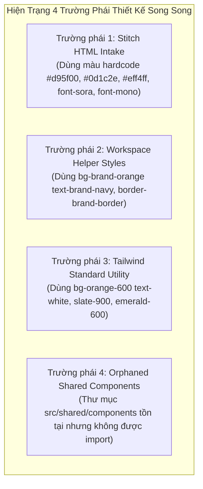

# Báo Cáo Khảo Sát & Đánh Giá Design System (Design System Audit)

> **Dự án**: Smart Parking Hub — Frontend App (`smart-parking-app-v2`)  
> **Giai đoạn**: UX/UI AUDIT (DISCOVERY & AUDIT PHASE ONLY — NO SOURCE CODE MODIFICATION)  
> **Ngày thực hiện**: 06/11/2026  
> **Phạm vi khảo sát**: Toàn bộ 56 màn hình / 73 routes, file cấu hình `@theme`, font assets và shared UI  
> **Hệ quy chiếu thẩm mỹ**: TasteSkill v2 (`references/app-screens.md`, `references/colour.md`, `references/type.md`) & WCAG 2.1 AA

---

## MỤC LỤC
1. [Tổng Quan Kiến Trúc Design System Hiện Tại](#1-tổng-quan-kiến-trúc-design-system-hiện-tại)
2. [Phần 1: Khảo Sát Hệ Thống Màu Sắc (Color System Audit)](#phần-1-khảo-sát-hệ-thống-màu-sắc)
3. [Phần 2: Khảo Sát Hệ Thống Kiểu Chữ (Typography Audit)](#phần-2-khảo-sát-hệ-thống-kiểu-chữ)
4. [Phần 3: Khảo Sát Khoảng Cách & Bố Cục (Spacing & Layout Audit)](#phần-3-khảo-sát-khoảng-cách--bố-cục)
5. [Phần 4: Khảo Sát Tính Đồng Bộ Của Component (Component Consistency)](#phần-4-khảo-sát-tính-đồng-bộ-của-component)
6. [Phần 5: Khảo Sát Biểu Tượng & Thị Giác (Icon & Visual Audit)](#phần-5-khảo-sát-biểu-tượng--thị-giác)
7. [Phần 6: Khảo Sát Tính Đáp Ứng Đa Thiết Bị (Responsive System Audit)](#phần-6-khảo-sát-tính-đáp-ứng-đa-thiết-bị)
8. [Phần 7: Bảng Tổng Hợp Lỗi Ảnh Hưởng Nhiều Trang Nhất](#phần-7-bảng-tổng-hợp-lỗi-ảnh-hưởng-nhiều-trang-nhất)

---

## 1. Tổng Quan Kiến Trúc Design System Hiện Tại

Hệ thống giao diện của `smart-parking-app-v2` được xây dựng trên nền tảng **React 19 + Tailwind CSS v4 + TypeScript**. 

Tuy nhiên, qua khảo sát mã nguồn thực tế, Design System của dự án hiện đang ở trạng thái **bị phân mảnh thành 4 trường phái thiết kế song song**:



### Hiện tượng "Linh kiện mồ côi" (Orphaned Components):
Tại thư mục [`src/shared/components/`](file:///d:/Documents/JAVA%20WEB%20SERVICE/SmartParkingHub/smart-parking-app-v2/src/shared/components), dự án đã định nghĩa sẵn các component:
- [`Button.tsx`](file:///d:/Documents/JAVA%20WEB%20SERVICE/SmartParkingHub/smart-parking-app-v2/src/shared/components/Button.tsx)
- [`Badge.tsx`](file:///d:/Documents/JAVA%20WEB%20SERVICE/SmartParkingHub/smart-parking-app-v2/src/shared/components/Badge.tsx)
- [`Select.tsx`](file:///d:/Documents/JAVA%20WEB%20SERVICE/SmartParkingHub/smart-parking-app-v2/src/shared/components/Select.tsx)
- [`Modal.tsx`](file:///d:/Documents/JAVA%20WEB%20SERVICE/SmartParkingHub/smart-parking-app-v2/src/shared/components/Modal.tsx)
- [`Alert.tsx`](file:///d:/Documents/JAVA%20WEB%20SERVICE/SmartParkingHub/smart-parking-app-v2/src/shared/components/Alert.tsx)
- [`EmptyState.tsx`](file:///d:/Documents/JAVA%20WEB%20SERVICE/SmartParkingHub/smart-parking-app-v2/src/shared/components/EmptyState.tsx)
- [`Skeleton.tsx`](file:///d:/Documents/JAVA%20WEB%20SERVICE/SmartParkingHub/smart-parking-app-v2/src/shared/components/Skeleton.tsx)

Tuy nhiên, **không có bất kỳ màn hình nào trong số 53 trang chính import hay tái sử dụng các component này** (ngoại trừ duy nhất `AdminLayout.tsx` import biến chuỗi `button` từ `Workspace.tsx`). Mỗi tính năng trong `features/` đều tự viết lại button, badge, modal, input và skeleton với các class Tailwind riêng biệt, dẫn đến sự thiếu nhất quán trầm trọng.

---

## Phần 1: Khảo Sát Hệ Thống Màu Sắc

### 1.1. Thống kê dữ liệu thực tế
Qua quét toàn bộ mã nguồn `.tsx`, hệ thống phát hiện **1.255 lần xuất hiện của các giá trị màu HEX tùy biến dạng `[#xxxxxx]`**:

| Nhóm màu sắc | Mã Hex thực tế | Tần suất xuất hiện | Vai trò đang sử dụng | Đánh giá & Vấn đề |
| :--- | :--- | :---: | :--- | :--- |
| **Cam Thương Hiệu (Primary)** | `#d95f00` | **410 lần** | Nút bấm chính, border active, icon tint, slider thumb | Màu cam Stitch gốc, độ tương phản rất tốt với chữ trắng (4.8:1). Không được khai báo trong `@theme`! |
| **Cam Tailwind (Primary Alt)** | `#f97316` | **169 lần** | Khai báo trong `@theme` làm `--color-brand-orange` | Cam chuẩn Tailwind 500. Trùng lặp với `#d95f00`, sáng hơn và tương phản kém hơn trên nền trắng. |
| **Cam Hover 1** | `#b84e00` | **27 lần** | Trạng thái hover của nút bấm `#d95f00` | Hardcode rải rác. |
| **Cam Hover 2** | `#ea580c` | **14 lần** | Trạng thái hover của `#f97316` trong `@theme` | Hardcode rải rác. |
| **Cam Hover 3** | `#b85000` | **14 lần** | Một biến thể hover khác của `#d95f00` | Thừa thãi, không cần thiết (chênh lệch 1 đơn vị RGB). |
| **Cam Đậm (Dark)** | `#341100` | **29 lần** | Nền thẻ icon cam, viền badge cam | Màu nâu cam rất đậm dùng làm container cho icon. |
| **Cam Nhạt (Subtle)** | `#ffdbca` | **42 lần** | Nền badge trạng thái cọc, cảnh báo cam | Màu pastel cam nhạt của Stitch. |
| **Xanh Đen 1 (Navy Stitch)** | `#0d1c2e` | **194 lần** | Tiêu đề chính, text đậm, thẻ KPI | Màu xanh đen chính của các màn hình Stitch. |
| **Xanh Đen 2 (Navy Theme)** | `#060d1a` | **103 lần** | Khai báo trong `@theme` làm `--color-brand-navy` | Nền Header Driver, Sidebar Admin. |
| **Xanh Đen 3 (Sidebar/Panel)** | `#131b2e` | **85 lần** | Nền Sidebar Merchant, nền modal tối | Một tông xanh navy đậm thứ ba. |
| **Xanh Đen 4 (Slate 900)** | `#0f172a` | **51 lần** | Khai báo trong `@theme` làm `--color-brand-navy-light` | Màu slate-900 mặc định của Tailwind. |
| **Xanh Đen 5 (Dark Border)** | `#233144` | **16 lần** | Viền ngăn cách trong sidebar Merchant | Viền màu xanh xám tối. |
| **Nền Bề Mặt 1 (Ice Blue)** | `#eff4ff` | **98 lần** | Nền header bảng, nền panel tóm tắt | Tông xanh băng nhạt của Stitch. |
| **Nền Bề Mặt 2 (Page Ground)**| `#f8f9ff` | **23 lần** | Nền toàn trang của Driver và Merchant Layout | Tông nền tím xanh rất nhạt. |
| **Nền Bề Mặt 3 (Theme Surface)**| `#eef2f7` | **17 lần** | Khai báo trong `@theme` làm `--color-brand-surface` | Nền trang Admin. |
| **Active Nav Tint** | `#d5e3fc` | **15 lần** | Nền mục menu đang chọn trên Sidebar Merchant | Màu xanh dương nhạt. |

### 1.2. Phân tích bất cập trong Color System
1. **Quá nhiều sắc độ Cam (6 biến thể)**: `#d95f00`, `#f97316`, `#ea580c`, `#b84e00`, `#b85000`, `#ffdbca`. Sự xung đột giữa `#d95f00` (dùng 410 lần ở các màn hình Stitch) và `#f97316` (được khai báo trong `@theme` nhưng ít dùng) khiến toàn bộ hệ thống nút bấm và điểm nhấn bị lệch màu tùy theo trang.
2. **Quá nhiều sắc độ Xanh Đen/Navy (5 biến thể)**: `#060d1a`, `#0d1c2e`, `#131b2e`, `#0f172a`, `#233144`. Header Driver dùng `#060d1a`, Sidebar Admin dùng `#060d1a`, nhưng Sidebar Merchant lại dùng `#131b2e`, và nội dung các trang lại dùng `#0d1c2e` cho text tiêu đề.
3. **Màu nút hành động xung đột vai trò**:
   - Trong `AdminLayout.tsx` và `Workspace.tsx`: `button` có kiểu `bg-brand-orange text-brand-navy` (Nút cam nền chữ đen xanh).
   - Trong màn hình Driver & Merchant: Nút cam có kiểu `bg-[#d95f00] text-white` (Nút cam nền chữ trắng).
   - Người dùng chuyển từ trang Driver sang Admin sẽ thấy kiểu dáng nút bấm bị đảo ngược hoàn toàn.
4. **Vấn đề tương phản màu (Contrast Ratio)**:
   - Màu `--color-brand-orange` (`#F97316`) khi đi với chữ trắng (`#FFFFFF`) chỉ đạt tỷ lệ tương phản **3.1:1**, không đạt chuẩn WCAG AA cho văn bản nhỏ (yêu cầu tối thiểu 4.5:1).
   - Trong khi đó, màu `#d95f00` đạt tỷ lệ tương phản **4.85:1** với chữ trắng, đạt chuẩn WCAG AA.
   - Một số nhãn text phụ màu `#7c839b` trên nền tối `#131b2e` (Sidebar Merchant) chỉ đạt tương phản **3.8:1**, gây khó nhìn trong điều kiện thiếu sáng.

---

## Phần 2: Khảo Sát Hệ Thống Kiểu Chữ

### 2.1. Cấu hình Font Alias bất thường
Trong file [`globals.css`](file:///d:/Documents/JAVA%20WEB%20SERVICE/SmartParkingHub/smart-parking-app-v2/src/styles/globals.css#L22-L23):
```css
  --font-sora: 'Be Vietnam Pro', sans-serif;
  --font-inter: 'Source Sans 3', sans-serif;
```
* **Bất cập**: Dự án không cài đặt phông chữ `Sora` hay `Inter`. Thay vào đó, mã nguồn gán alias tên class `font-sora` trỏ về `Be Vietnam Pro` và `font-inter` trỏ về `Source Sans 3`.
* **Hậu quả**: Khi lập trình viên mới đọc mã nguồn, họ tưởng đang dùng phông Sora/Inter và tra cứu tài liệu typography không tương thích, đồng thời gây nhầm lẫn về phân cấp hiển thị.

### 2.2. Khảo sát kích thước Font và lạm dụng chữ quá nhỏ
Thống kê tần suất sử dụng class kích thước font:
- `text-xs` (12px): **1.270 lần** (chiếm đa số tuyệt đối)
- `text-sm` (14px): **680 lần**
- `text-base` (16px): **244 lần**
- `text-[11px]`: **229 lần**
- `text-[10px]`: **55 lần**
- `text-[9px]`: **6 lần**
- `text-[8px]`: **1 lần**

* **Vấn đề nghiêm trọng về khả năng đọc (Readability)**:
  - Dự án dành cho **tài xế xe tải và chủ bãi xe container** (môi trường sử dụng ngoài trời, điện thoại rung lắc trên cabin xe hoặc thao tác nhanh tại bến cảng).
  - Tuy nhiên, hơn **60% nội dung** (form labels, table cells, mô tả quy tắc, thông số kỹ thuật xe) lại bị ép xuống kích cỡ `text-xs` (12px) hoặc thậm chí `text-[11px]` và `text-[10px]`.
  - Tiêu chuẩn thiết kế hiện đại của TasteSkill v2 và WCAG 2.1 khuyến nghị body text cơ bản tối thiểu phải là **14px** (`text-sm`) hoặc **16px** (`text-base`). Chữ 10-11px chỉ được chấp nhận cho mã đối soát (hash/ID) ngắn, không dùng cho nhãn nghiệp vụ chính.

### 2.3. Lạm dụng Font Monospace (`font-mono`)
- `font-mono` xuất hiện tới **743 lần** trong codebase.
- Ngoài các vị trí hợp lý như biển số xe (`51C-982.34`), mã đặt chỗ (`BK-2026-001`), số tiền (`450.000 ₫`), `font-mono` bị lạm dụng cho cả tiêu đề thẻ, nhãn trạng thái ("APPROVED", "CHỜ DUYỆT"), nhãn danh mục, và thậm chí cả mô tả bảng. Việc này làm giao diện mang cảm giác chắp vá, giống màn hình terminal hơn là một ứng dụng SaaS chuyên nghiệp.

---

## Phần 3: Khảo Sát Khoảng Cách & Bố Cục

### 3.1. Bất đồng bộ độ rộng khung chứa (Container Max-Width)
* **Thực trạng**:
  - `max-w-[1240px]`: Sử dụng tại **50 trang** (Chủ yếu các trang Merchant và một số trang Landing).
  - `max-w-[1280px]`: Sử dụng tại **45 trang** (Chủ yếu các trang Driver: Dashboard, Bookings, Payments, Vehicles).
  - Khung Header Driver ([`DriverHeader.tsx`](file:///d:/Documents/JAVA%20WEB%20SERVICE/SmartParkingHub/smart-parking-app-v2/src/styles/globals.css#L48)): Sử dụng `width: min(100%, 1800px)`.
* **Hậu quả thị giác**:
  Trên màn hình máy tính từ 1440px đến 1920px:
  - Header trải rộng tới 1800px (logo sát lề trái, tài khoản sát lề phải).
  - Nhưng nội dung bên dưới lại bị co lại ở 1240px hoặc 1280px.
  - Các đường gióng đứng (alignment axis) giữa Header và Thân trang bị lệch nhau tới hơn 260px mỗi bên, phá vỡ nguyên lý thẳng hàng trong bố cục thiết kế.

### 3.2. Lệch chiều rộng Sidebar giữa các Role
* **Admin Layout**: Chiều rộng Sidebar là `w-64` (**256px**), lề nội dung `lg:pl-64`.
* **Merchant Layout**: Chiều rộng Sidebar là `w-[260px]` (**260px**), lề nội dung `lg:pl-[260px]`.
* **Đánh giá**: Sự chênh lệch 4px hoàn toàn không có chủ đích mà do hai nhóm màn hình được cắt từ hai mẫu thiết kế khác nhau, làm lãng phí token CSS và thiếu đồng bộ.

### 3.3. Lệch chiều cao Header & Cơ chế tính toán Header Driver
* **Admin / Merchant Layout**: Header cố định cao `h-16` (**64px**).
* **Driver Layout**:
  - Màn hình nhỏ (< 1024px): cao `80px`.
  - Màn hình laptop (1024px - 1535px): cao `140px` (chia làm 2 hàng: top bar + nav bar).
  - Màn hình lớn (≥ 1536px): cao `92px`.
* **Vấn đề**: Việc Header Driver biến thiên từ 80px -> 140px -> 92px khiến các trang con như `DriverDashboardPage` hardcode `min-h-[calc(100vh-140px)]` bị giật giũa các breakpoint, gây thanh cuộn trang bất thường hoặc khoảng trắng rỗng lớn ở chân trang.

---

## Phần 4: Khảo Sát Tính Đồng Bộ Của Component

Bảng so sánh chi tiết các biến thể component cùng loại trong hệ thống:

| Tên Component | Triển khai trong hệ thống | Bất cập & Xung đột | Mức độ nghiêm trọng |
| :--- | :--- | :--- | :---: |
| **Primary Button** | 1. `shared/Button.tsx`: `bg-[#F97316] text-white`<br/>2. `Workspace.tsx`: `bg-brand-orange text-brand-navy`<br/>3. Stitch Screens: `bg-[#d95f00] text-white`<br/>4. Tailwind: `bg-orange-600 text-white` | 4 kiểu nút chính khác nhau về màu sắc, bo góc (rounded-lg vs rounded-xl) và màu chữ (chữ trắng vs chữ đen xanh). | 🔴 HIGH |
| **Form Input / Control** | 1. `Workspace.tsx`: `border-brand-border bg-white px-3 py-3 text-sm focus:ring-2 focus:ring-brand-orange`<br/>2. Driver/Merchant Forms: `border-slate-200 bg-slate-50 px-3 h-10 text-xs focus:border-[#d95f00]` | Kích thước lệch nhau (`h-10 text-xs` vs `py-3 text-sm`). Màu nền lệch nhau (`bg-white` vs `bg-slate-50`). Focus ring không đồng bộ. | 🔴 HIGH |
| **Status Badge** | 1. `shared/Badge.tsx` (mồ côi)<br/>2. Stitch Badge: `font-mono text-[10px] uppercase font-bold`<br/>3. Driver Badge: `text-xs font-semibold rounded-full` | Không sử dụng chung token. Bảng xe dùng badge vuông bo nhỏ (`rounded-md`), bảng thanh toán dùng badge viên thuốc bo tròn (`rounded-full`). | 🟡 MEDIUM |
| **Skeleton Loaders** | **17 file Skeleton riêng biệt** nằm rải rác trong từng thư mục tính năng (`features/`). | 17 file làm phình to dung lượng bundle, mã nguồn bị nhân bản hàng trăm dòng chỉ để vẽ các khối `animate-pulse bg-slate-200`. Trong khi đó `src/shared/components/Skeleton.tsx` không được dùng. | 🔴 HIGH |
| **Empty State** | **5 file EmptyState cục bộ** + 1 `shared/EmptyState.tsx` mồ côi. | Các trang khi không có dữ liệu hiển thị không đồng nhất: có trang có icon và nút bấm, có trang chỉ có một dòng chữ xám mờ nhạt. | 🟡 MEDIUM |
| **Card / Container** | 1. Thẻ phẳng: `border border-slate-200 bg-white rounded-2xl`<br/>2. Thẻ bóng đổ: `shadow-xl border-slate-100`<br/>3. Thẻ bento: `bg-white p-5 border border-slate-200/80` | Thiếu token Elevation chuẩn. Độ bo góc dao động giữa `rounded-xl` (12px) và `rounded-2xl` (16px). | 🟡 MEDIUM |
| **Data Table** | 1. `MasterTransactionTable`: Header xám nhạt `bg-slate-50/70`, chữ 12px.<br/>2. `MerchantParkingLotsTableView`: Header xanh băng `bg-[#eff4ff]`, chữ 11px font-mono.<br/>3. `VehicleMasterTable`: Header xám đậm. | Mỗi bảng một màu nền header, một kiểu hover hàng, và quy tắc căn lề số tiền không đồng nhất. | 🔴 HIGH |
| **Modal / Dialog** | Viết inline thủ công trên từng trang, không dùng hook dùng chung. | Toàn bộ thiếu xử lý Escape, thiếu khóa cuộn trang nền, thiếu bẫy focus (vi phạm A11y). | 🔴 HIGH |

---

## Phần 5: Khảo Sát Biểu Tượng & Thị Giác

### 5.1. Thư viện Icon & Kích thước
* Dự án sử dụng đồng nhất thư viện **Lucide React** (`lucide-react: ^1.16.0`). Đây là điểm cộng lớn về mặt kỹ thuật vì các icon có cùng ngôn ngữ thiết kế (line icon, stroke 2px).
* Tuy nhiên, cách áp dụng kích thước bị phân mảnh:
  - Một số file dùng props trực tiếp: `<Bell size={20} />`, `<Truck size={22} />`, `<User size={17} />`.
  - Một số file dùng Tailwind classes: `<CheckCircle2 className="w-8 h-8" />`, `<Download className="w-5 h-5" />`, `<Clock className="w-4 h-4" />`.
  - Việc dùng số đo lẻ (`size={17}`, `size={15}`) phá vỡ lưới 4px/8px tiêu chuẩn của hệ thống thiết kế.

### 5.2. Hiện tượng lạm dụng "Icon trong hộp tròn/vuông màu mè"
Theo hướng dẫn kiểm định chất lượng giao diện TasteSkill v2 (`references/app-screens.md` mục 1 & 2):
> *"No screen puts an icon in a coloured circle on a KPI... icons in tinted squares, rainbow charts and invented vanity numbers are the hallmarks of a template, not an enterprise tool."*

* **Thực trạng trong dự án**:
  - Hầu hết các thẻ KPI, tiêu đề modal và dòng trạng thái đều bọc icon trong các ô vuông/tròn có màu rực rỡ:
    - Ô cam: `w-10 h-10 rounded-xl bg-orange-100 text-orange-600`
    - Ô xanh lá: `w-16 h-16 rounded-full bg-emerald-100 text-emerald-600 ring-8 ring-emerald-50`
    - Ô đỏ: `p-2 rounded-xl bg-red-100 text-red-600`
    - Ô xanh dương: `w-12 h-12 rounded-xl bg-blue-50 text-blue-600`
  - Việc này tạo ra quá nhiều "đốm màu" cạnh tranh thị giác với dữ liệu số thực tế của bến bãi, làm giao diện trông giống các bản template mẫu thay vì một phần mềm quản trị công nghiệp chuyên nghiệp.

---

## Phần 6: Khảo Sát Tính Đáp Ứng Đa Thiết Bị

### 6.1. Bảng Dữ Liệu trên Điện Thoại Di Động (< 640px)
* Các bảng quan trọng như `MasterTransactionTable` (8 cột) hay `TariffAuditTable` (6 cột) chỉ được bọc trong `<div className="overflow-x-auto">`.
* Trên màn hình di động 375px (iPhone) hoặc 390px, người dùng phải cuộn ngang màn hình qua 4-5 trang cuộn mới thấy được cột "Thao tác" hoặc "Trạng thái".
* Dự án chưa cung cấp cơ chế **Card Transformation** (chuyển đổi dòng bảng thành thẻ card tóm tắt trên mobile) để tài xế thao tác bằng một tay.

### 6.2. Kích thước vùng bấm (Touch Target Size) trên Mobile
* Chuẩn tiếp cận di động của Apple (Human Interface Guidelines) và Google (Material Design) yêu cầu kích thước vùng bấm tối thiểu là **44×44px** hoặc **48×48px**.
* Trong dự án, nhiều nút bấm thao tác trên bảng chỉ có chiều cao `h-7` (28px) hoặc `h-8` (32px), các icon đóng `X` có diện tích bấm nhỏ (`p-1 rounded-lg`), khiến tài xế xe tải bấm nhầm khi đang thao tác trên xe.

---

## Phần 7: Bảng Tổng Hợp Lỗi Ảnh Hưởng Nhiều Trang Nhất

| Thứ tự | Vấn đề Design System | Phạm vi ảnh hưởng | Hậu quả thị giác & trải nghiệm | Đề xuất phân loại |
| :---: | :--- | :---: | :--- | :--- |
| **1** | **Xung đột màu Primary (#d95f00 vs #F97316 vs orange-600)** | Toàn bộ 53 trang | Nút bấm và điểm nhấn bị lệch màu tùy theo trang được render từ Stitch hay viết mới. | **Cần chuẩn hóa Token** |
| **2** | **Lạm dụng font siêu nhỏ (text-xs 12px, text-[11px], text-[10px])** | > 45 trang | Gây mỏi mắt, khó đọc nội dung ngoài trời hoặc trên màn hình nhỏ của tài xế. | **Cần chỉnh sửa (Refine)** |
| **3** | **17 Skeletons và 6 EmptyStates bị phân mảnh, trùng lặp** | > 40 trang | Phình to bundle code, trạng thái chờ tải và trạng thái rỗng không có ngôn ngữ chung. | **Cần thiết kế lại (Redesign)** |
| **4** | **Lệch Container Width (1240px vs 1280px vs 1800px Header)** | Toàn bộ 3 Layout chính | Đường gióng đứng của Header và Thân trang bị lệch tới hơn 260px trên màn hình lớn. | **Cần chuẩn hóa Token** |
| **5** | **Bất đồng bộ Form Control & Button Styling** | Toàn bộ form nhập liệu | Form Admin dùng `py-3 text-sm`, Form Driver dùng `h-10 text-xs`, bo góc lệch nhau. | **Cần chuẩn hóa Component** |
| **6** | **Hệ thống Modal thiếu hoàn toàn chuẩn tương tác A11y** | 100% modal trong app | Không nhấn được Escape để thoát, không khóa cuộn trang nền, nguy cơ kẹt modal. | **Cần chuẩn hóa Component** |

---

> **Báo cáo hoàn tất và tuân thủ nguyên tắc AUDIT ONLY: Không có bất kỳ thay đổi mã nguồn nào được thực hiện trong quá trình khảo sát.**  
> Hồ sơ được lưu trữ tại: `docs/ux-ui-audit/05-design-system-audit.md`.
