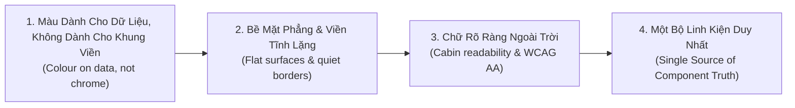
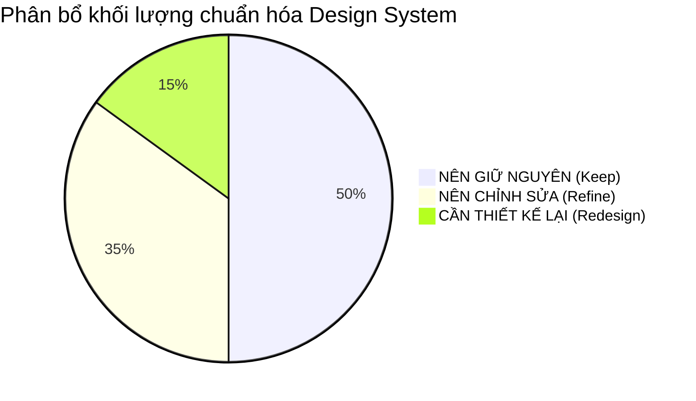
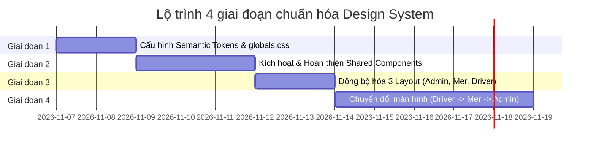

# Đề Xuất Chuẩn Hóa & Nâng Cấp Design System (Design System Recommendations)

> **Dự án**: Smart Parking Hub — Frontend App (`smart-parking-app-v2`)  
> **Giai đoạn**: UX/UI AUDIT & DESIGN SYSTEM SPECIFICATION (NO SOURCE CODE MODIFICATION)  
> **Ngày lập báo cáo**: 06/11/2026  
> **Tài liệu tham chiếu**: [`docs/ux-ui-audit/05-design-system-audit.md`](file:///d:/Documents/JAVA%20WEB%20SERVICE/SmartParkingHub/smart-parking-app-v2/docs/ux-ui-audit/05-design-system-audit.md)  
> **Tiêu chuẩn thiết kế**: TasteSkill v2 (Enterprise Anti-Slop Guidelines) & WCAG 2.1 AA

---

## MỤC LỤC
1. [Triết Lý & Nguyên Tắc Chuẩn Hóa](#1-triết-lý--nguyên-tắc-chuẩn-hóa)
2. [Hệ Thống Semantic Tokens Mục Tiêu (Tailwind CSS v4 @theme)](#2-hệ-thống-semantic-tokens-mục-tiêu)
3. [Danh Mục: Giữ Nguyên - Chỉnh Sửa - Thiết Kế Lại](#3-danh-mục-giữ-nguyên--chỉnh-sửa--thiết-kế-lại)
4. [Quy Chuẩn Component Dùng Chung Thống Nhất](#4-quy-chuẩn-component-dùng-chung-thống-nhất)
5. [Quy Chuẩn Typography & Khả Năng Đọc (Readability)](#5-quy-chuẩn-typography--khả-năng-đọc)
6. [Quy Chuẩn Bố Cục & Gióng Hàng (Layout & Grid Arithmetic)](#6-quy-chuẩn-bố-cục--gióng-hàng)
7. [Lộ Trình Triển Khai Chuẩn Hóa Theo Pha (Phased Roadmap)](#7-lộ-trình-triển-khai-chuẩn-hóa-theo-pha)

---

## 1. Triết Lý & Nguyên Tắc Chuẩn Hóa

Hệ thống giao diện `smart-parking-app-v2` phục vụ một hệ sinh thái logistics vận tải thực thụ (Tài xế xe container, Chủ bến bãi đỗ xe cảng, Quản trị viên đối soát tài chính). 

Dựa trên kết quả khảo sát từ [Báo cáo Audit 05](file:///d:/Documents/JAVA%20WEB%20SERVICE/SmartParkingHub/smart-parking-app-v2/docs/ux-ui-audit/05-design-system-audit.md) và các nguyên lý của **TasteSkill v2**, định hướng chuẩn hóa Design System tuân thủ 4 nguyên tắc cốt lõi:



1. **Màu dành cho dữ liệu, không dành cho khung viền**: Giảm thiểu các ô vuông/tròn màu mè bao bọc icon trang trí. Màu cam thương hiệu chỉ tập trung vào hành động cốt lõi (Primary CTA) và trạng thái khẩn cấp (giữ slot, cảnh báo hết hạn).
2. **Bề mặt phẳng & viền tĩnh lặng**: Loại bỏ các lớp bóng đổ giả lập (`shadow-2xl`) trên các panel vận hành; thay thế bằng đường viền mỏng 1px tinh tế (`border-slate-200`) và chuyển cấp màu nền nhẹ (`slate-50`).
3. **Chữ rõ ràng ngoài trời**: Kiên quyết xóa bỏ việc lạm dụng chữ 10px-11px và body text 12px. Nâng kích thước nhãn và thông tin lên tối thiểu **14px (`text-sm`)**, đảm bảo độ tương phản từ 4.5:1 trở lên để tài xế có thể đọc tốt trong cabin xe chói nắng.
4. **Một bộ linh kiện duy nhất (Single Source of Truth)**: Hợp nhất toàn bộ các biến thể nút bấm, bảng biểu, modal, badge, và loại bỏ 17 skeleton phân mảnh để đưa về thư mục [`src/shared/components/`](file:///d:/Documents/JAVA%20WEB%20SERVICE/SmartParkingHub/smart-parking-app-v2/src/shared/components).

---

## 2. Hệ Thống Semantic Tokens Mục Tiêu

Thay vì để 1.255 mã HEX tùy biến rải rác khắp mã nguồn, toàn bộ hệ màu và quy chuẩn đo lường sẽ được cấu hình tập trung trong khối `@theme` của Tailwind CSS v4 tại [`globals.css`](file:///d:/Documents/JAVA%20WEB%20SERVICE/SmartParkingHub/smart-parking-app-v2/src/styles/globals.css).

### 2.1. Đề xuất khối `@theme` chuẩn hóa cho `globals.css`

```css
@theme {
  /* ── 1. Brand & Accent Tokens ── */
  /* Chọn #d95f00 làm Primary vì đã xuất hiện 410 lần và đạt tương phản 4.85:1 với chữ trắng */
  --color-brand-primary: #d95f00;
  --color-brand-primary-hover: #b84e00;
  --color-brand-primary-active: #9e4300;
  --color-brand-primary-subtle: #fff7ed;
  --color-brand-primary-border: #fed7aa;

  /* ── 2. Chrome, Header & Sidebar Tokens (Navy) ── */
  /* Hợp nhất các tông xanh đen về 3 bậc nhất quán */
  --color-navy-darkest: #060d1a;    /* Header Driver, Sidebar Admin */
  --color-navy-surface: #0d1c2e;    /* Sidebar Merchant, Text tiêu đề chính */
  --color-navy-panel: #131b2e;      /* Bảng điều khiển tối, modal backdrop */
  --color-navy-border: #1e293b;     /* Viền ngăn cách trong môi trường tối */
  --color-navy-muted: #64748b;      /* Chữ phụ trên nền tối */

  /* ── 3. Page Ground & Surface Tokens (Neutrals) ── */
  --color-surface-page: #f8f9ff;     /* Nền toàn trang Driver & Merchant */
  --color-surface-card: #ffffff;     /* Nền thẻ nội dung, form, bảng */
  --color-surface-subtle: #f1f5f9;   /* Nền phụ, ô input, header bảng (slate-100) */
  --color-surface-hover: #f8fafc;    /* Trạng thái hover dòng bảng (slate-50) */

  /* ── 4. Text Hierarchy Tokens ── */
  --color-text-primary: #0f172a;    /* Chữ chính, tiêu đề (slate-900) */
  --color-text-secondary: #334155;  /* Chữ nội dung thường, nhãn (slate-700) */
  --color-text-muted: #64748b;      /* Chữ phụ, thời gian, chú thích (slate-500) */
  --color-text-disabled: #94a3b8;   /* Chữ khi bị vô hiệu hóa (slate-400) */

  /* ── 5. Semantic Status Tokens (Chỉ định rõ vai trò) ── */
  /* Thành công / Đã khóa slot / Thanh toán xong: Chuẩn hóa Emerald */
  --color-status-success: #059669;
  --color-status-success-bg: #ecfdf5;
  --color-status-success-border: #a7f3d0;

  /* Chờ xử lý / Đang đỗ / Cảnh báo cọc: Chuẩn hóa Amber */
  --color-status-warning: #d97706;
  --color-status-warning-bg: #fffbeb;
  --color-status-warning-border: #fde68a;

  /* Lỗi / Hủy vé / Vi phạm: Chuẩn hóa Rose */
  --color-status-danger: #e11d48;
  --color-status-danger-bg: #fff1f2;
  --color-status-danger-border: #fecdd3;

  /* Thông tin / Đang xếp hàng / Hướng dẫn: Chuẩn hóa Sky */
  --color-status-info: #0284c7;
  --color-status-info-bg: #f0f9ff;
  --color-status-info-border: #bae6fd;

  /* ── 6. Typography Tokens ── */
  --font-heading: 'Be Vietnam Pro', -apple-system, BlinkMacSystemFont, sans-serif;
  --font-body: 'Source Sans 3', -apple-system, BlinkMacSystemFont, sans-serif;
  --font-data: ui-monospace, SFMono-Regular, Menlo, Monaco, Consolas, monospace;

  /* ── 7. Layout Arithmetic Tokens ── */
  --size-header-height: 64px;       /* Cố định 64px (h-16) cho cả 3 Layout */
  --size-sidebar-width: 256px;      /* Cố định 256px (w-64) cho Admin & Merchant */
  --size-container-max: 1280px;     /* Khung nội dung tối đa chuẩn hóa */
}
```

---

## 3. Danh Mục: Giữ Nguyên - Chỉnh Sửa - Thiết Kế Lại

Dựa trên nguyên tắc bảo toàn hệ thống và không tự ý sáng tạo thừa thãi:



### 3.1. Những thứ NÊN GIỮ NGUYÊN (Keep)
1. **Bộ phông chữ địa phương hóa**: Giữ nguyên `Be Vietnam Pro` (tiêu đề) và `Source Sans 3` (nội dung). Hai phông chữ này hiển thị tiếng Việt có dấu cực kỳ hoàn hảo, không bị lỗi dính dấu hay vỡ glyph trên mọi hệ điều hành.
2. **Màu sắc nhận diện cốt lõi**:
   - Giữ màu Cam `#d95f00` làm màu nhận diện chính của SmartTruckHub (đã chứng minh được độ tương phản và được sử dụng rộng rãi nhất).
   - Giữ màu Xanh Đen `#060d1a` / `#0d1c2e` làm màu đại diện cho ngành logistics, bến bãi, container.
3. **Thư viện Lucide Icons**: Tiếp tục sử dụng toàn bộ icon từ `lucide-react`, không thay thế bằng thư viện khác để đảm bảo đồng nhất về nét vẽ (stroke 2px).
4. **Kiến trúc Layout phân hệ (3 cổng thông tin riêng biệt)**:
   - Cổng Tài xế (Driver Layout) dùng Top Header Navigation.
   - Cổng Chủ bãi (Merchant Layout) dùng Left Sidebar Operations.
   - Cổng Quản trị (Admin Layout) dùng Left Sidebar Command Center.
5. **Cấu trúc Route & Phân quyền nghiệp vụ**: Bảo toàn 100% cấu trúc 56 màn hình và các endpoint API tương ứng.

### 3.2. Những thứ NÊN CHỈNH SỬA (Refine)
1. **Quy chuẩn Font Alias**:
   - Chuyển đổi cách gọi class từ giả danh `font-sora` và `font-inter` sang tên ngữ nghĩa thực chất `font-heading` và `font-body`.
2. **Kích thước Font tối thiểu (Font Sizing Floor)**:
   - Nâng toàn bộ nhãn form, văn bản bảng dữ liệu, và đoạn văn mô tả từ `text-xs` (12px) lên `text-sm` (14px).
   - Chỉ giữ `text-xs` (12px) cho thời gian (timestamp) hoặc nhãn phụ.
   - Tuyệt đối loại bỏ `text-[9px]`, `text-[10px]`, `text-[11px]` trên các thành phần tương tác chính.
3. **Hợp nhất độ rộng Container**:
   - Đưa toàn bộ các trang đang dùng `max-w-[1240px]` về chuẩn thống nhất `max-w-[1280px]` (`max-w-7xl`).
   - Căn chỉnh Header Driver từ `min(100%, 1800px)` về cùng trục gióng đứng của khung nội dung chính để tránh lệch lề.
4. **Đồng bộ hóa Sidebar Width**:
   - Thống nhất Sidebar của cả Admin và Merchant về kích thước chuẩn `w-64` (256px), loại bỏ độ rộng lệch `w-[260px]`.
5. **Hợp nhất màu sắc trạng thái (Status Colors)**:
   - Đồng bộ toàn bộ trạng thái thành công về `emerald` (loại bỏ việc dùng lẫn lộn `green` và `emerald`).
   - Đồng bộ trạng thái lỗi/hủy về `rose` (loại bỏ việc dùng lẫn lộn `red` và `rose`).
   - Đồng bộ cảnh báo về `amber`.

### 3.3. Những thứ CẦN THIẾT KẾ LẠI (Redesign)
1. **Xóa bỏ 17 Skeleton phân mảnh & Thay thế bằng 1 Dynamic Skeleton Component**:
   - Hiện tại có tới 17 file Skeleton riêng biệt.
   - Cần thiết kế lại thành 1 component [`src/shared/components/Skeleton.tsx`](file:///d:/Documents/JAVA%20WEB%20SERVICE/SmartParkingHub/smart-parking-app-v2/src/shared/components/Skeleton.tsx) có các preset: `variant="table"`, `variant="card-grid"`, `variant="form"`, `variant="kpi-bento"`.
2. **Chuẩn hóa Modal/Dialog theo chuẩn WCAG 2.1 AA**:
   - Thiết kế lại component [`src/shared/components/Modal.tsx`](file:///d:/Documents/JAVA%20WEB%20SERVICE/SmartParkingHub/smart-parking-app-v2/src/shared/components/Modal.tsx) có sẵn:
     - Tự động bắt phím `Escape` để đóng.
     - Tự động khóa cuộn trang nền (`document.body.style.overflow = 'hidden'`).
     - Tự động đóng khi bấm backdrop (có thể bật/tắt qua prop `closeOnBackdrop`).
     - Có sẵn nút đóng `[X]` với vùng bấm tối thiểu 44×44px.
     - Bẫy tiêu điểm bàn phím (`focus trap`).
3. **Thiết kế lại Bảng Dữ Liệu trên Mobile (Mobile Table Transformation)**:
   - Các bảng dữ liệu nhiều cột (như bảng đối soát giao dịch, bảng đội xe) khi hiển thị trên màn hình < 640px phải tự động chuyển thành danh sách thẻ tóm tắt (Card List), không ép người dùng cuộn ngang 8 cột.
4. **Loại bỏ kiểu dáng nút bấm đảo ngược ở Admin**:
   - Chuyển nút trong `Workspace.tsx` từ `bg-brand-orange text-brand-navy` sang chuẩn thống nhất toàn hệ thống: `bg-[#d95f00] text-white hover:bg-[#b84e00]`.

---

## 4. Quy Chuẩn Component Dùng Chung Thống Nhất

### 4.1. Quy chuẩn Button (`@/shared/components/Button`)
* **Chiều cao chuẩn**:
  - `sm`: `h-8 px-3 text-xs` (Dành cho tác vụ phụ trong bảng dữ liệu).
  - `md`: `h-10 px-4 text-sm font-semibold` (Kích thước mặc định cho toàn bộ form và thanh công cụ).
  - `lg`: `h-12 px-6 text-base font-bold` (Dành cho Primary CTA trang chi tiết hoặc thanh toán).
* **Các biến thể**:
  - `primary`: `bg-[#d95f00] hover:bg-[#b84e00] text-white rounded-xl shadow-xs transition-colors`.
  - `secondary`: `bg-slate-100 hover:bg-slate-200 text-slate-700 rounded-xl transition-colors`.
  - `outline`: `bg-transparent border border-slate-300 hover:bg-slate-50 text-slate-800 rounded-xl`.
  - `danger`: `bg-rose-600 hover:bg-rose-700 text-white rounded-xl`.
  - `ghost`: `hover:bg-slate-100 text-slate-600 rounded-lg`.
* **Trạng thái bắt buộc**: Luôn có spinner loading và `disabled:opacity-50 disabled:cursor-not-allowed` khi `isLoading={true}` hoặc form chưa hợp lệ.

### 4.2. Quy chuẩn Form Input / Select (`@/shared/components/Input`)
* **Cấu trúc 4 phần**:
  1. `Label`: `text-sm font-semibold text-slate-700 mb-1.5 block` kèm dấu sao đỏ nếu bắt buộc.
  2. `Control`: `w-full h-10 px-3.5 bg-white border border-slate-200 rounded-xl text-sm text-slate-900 placeholder:text-slate-400 focus:outline-none focus:ring-2 focus:ring-[#d95f00]/20 focus:border-[#d95f00] transition-all`.
  3. `Helper Text`: `text-xs text-slate-500 mt-1`.
  4. `Error Message`: `text-xs text-rose-600 font-medium mt-1 flex items-center gap-1`.

### 4.3. Quy chuẩn Status Badge (`@/shared/components/Badge`)
* **Kiểu dáng**: Viên thuốc nhẹ nhàng (`rounded-full px-2.5 py-0.5 text-xs font-semibold border`), không dùng màu đặc chói gắt:
  - `SUCCESS` (Đã duyệt / Đã thanh toán / Đang hoạt động): `bg-emerald-50 text-emerald-700 border-emerald-200`.
  - `PENDING` (Chờ duyệt / Đang giữ slot / Chờ vào bến): `bg-amber-50 text-amber-700 border-amber-200`.
  - `DANGER` (Từ chối / Hủy vé / Vi phạm cước): `bg-rose-50 text-rose-700 border-rose-200`.
  - `INFO` (Đang xếp hàng ảo / Hướng dẫn): `bg-sky-50 text-sky-700 border-sky-200`.
  - `NEUTRAL` (Hết hạn / Lưu kho / Đã đóng): `bg-slate-100 text-slate-600 border-slate-200`.

### 4.4. Quy chuẩn Bảng Dữ Liệu (Data Table Standards)
* **Header Bảng**: Nền `bg-slate-50/80`, viền dưới `border-b border-slate-200`, văn bản `text-xs font-semibold text-slate-500 uppercase tracking-wider py-3 px-4`.
* **Dòng Dữ Liệu**: `py-3.5 px-4 text-sm text-slate-800 border-b border-slate-100 hover:bg-slate-50/60 transition-colors`.
* **Quy tắc căn lề cột**:
  - Dữ liệu chữ (Tên bãi, biển số, ghi chú): Căn trái (`text-left`).
  - Dữ liệu số (Số tiền, số chỗ, tải trọng): Căn phải (`text-right`) và định dạng tiền tệ VNĐ chuẩn hóa.
  - Mã đối soát / Mã booking: Dùng `font-data` (`font-mono text-xs font-bold text-slate-900`).
  - Trạng thái / Thao tác: Căn giữa (`text-center`).

---

## 5. Quy Chuẩn Typography & Khả Năng Đọc

| Vai trò văn bản | Phông chữ | Kích thước đề xuất | Độ đậm (Weight) | Màu sắc Token | Ghi chú & Ngữ cảnh |
| :--- | :--- | :---: | :---: | :--- | :--- |
| **Page Title** | `Be Vietnam Pro` | `text-2xl` (24px) | Bold (700) | `text-slate-900` | Tiêu đề chính đầu trang |
| **Section Title** | `Be Vietnam Pro` | `text-lg` (18px) | Bold (700) | `text-slate-900` | Tiêu đề khối / Panel |
| **Card / Modal Title** | `Be Vietnam Pro` | `text-base` (16px) | SemiBold (600) | `text-slate-900` | Tiêu đề thẻ hoặc hộp thoại |
| **Body Primary** | `Source Sans 3` | `text-sm` (14px) | Regular (400) | `text-slate-700` | Văn bản nội dung, mô tả, bảng |
| **Form Label** | `Source Sans 3` | `text-sm` (14px) | SemiBold (600) | `text-slate-800` | Nhãn ô nhập liệu |
| **Button Text** | `Source Sans 3` | `text-sm` (14px) | SemiBold (600) | White / Slate-700 | Chữ trên nút bấm |
| **Caption / Meta** | `Source Sans 3` | `text-xs` (12px) | Regular (400) | `text-slate-500` | Thời gian, ghi chú dưới nhãn |
| **Technical Code** | `ui-monospace` | `text-xs` (12px) | Bold (700) | `text-slate-900` | Biển số xe, mã vé, mã đơn hàng |

---

## 6. Quy Chuẩn Bố Cục & Gióng Hàng

```
┌──────────────────────────────────────────────────────────────────────────┐
│ Global Header (h-16 = 64px) — Logo & Profile                             │
├──────────────────────────────────────────────────────────────────────────┤
│ Container: max-w-[1280px] mx-auto px-4 sm:px-6 lg:px-8                   │
│                                                                          │
│ ┌──────────────────────────────────────────────────────────────────────┐ │
│ │ Page Header (Title + Breadcrumbs + Action Buttons)                   │ │
│ └──────────────────────────────────────────────────────────────────────┘ │
│                                                                          │
│ ┌─────────────────────────────┐ ┌──────────────────────────────────────┐ │
│ │ Left Filter / Workbench     │ │ Main Data Panel / Content Area       │ │
│ │ (w-80 hoặc 25%)             │ │ (flex-1 hoặc 75%)                    │ │
│ └─────────────────────────────┘ └──────────────────────────────────────┘ │
└──────────────────────────────────────────────────────────────────────────┘
```

* **Lề hai bên (Page Padding)**: `px-4 sm:px-6 lg:px-8` (16px trên mobile, 24px trên tablet, 32px trên desktop).
* **Khoảng cách dọc giữa các khối (Section Spacing)**: `space-y-6` hoặc `gap-6` (24px).
* **Độ bo góc chuẩn hóa**:
  - Khối thẻ / Bảng / Modal: `rounded-2xl` (16px).
  - Nút bấm / Ô nhập liệu / Dropdown: `rounded-xl` (12px).
  - Badge / Tag nhỏ: `rounded-full` hoặc `rounded-md` (6px).

---

## 7. Lộ Trình Triển Khai Chuẩn Hóa Theo Pha

Để đảm bảo an toàn tuyệt đối cho hệ thống và không làm gián đoạn các luồng nghiệp vụ hiện có, quá trình chuẩn hóa cần thực hiện theo 4 giai đoạn độc lập:



### Pha 1: Chuẩn hóa Tokens trong `globals.css` (Không rủi ro)
* Cập nhật khối `@theme` với đầy đủ các token semantic như đã đề xuất ở Mục 2.
* Khai báo chính thức `--color-brand-primary: #d95f00` để các màn hình Stitch và màn hình viết mới có thể dùng chung token `bg-brand-primary` thay vì viết `[#d95f00]`.

### Pha 2: Kích hoạt & Hoàn thiện `@/shared/components`
* Hoàn thiện 7 component cốt lõi trong `src/shared/components/`:
  - `Button`: Hỗ trợ variants, sizes, loading spinner.
  - `Modal`: Tích hợp tự động Escape key, khóa cuộn, backdrop click.
  - `Input` & `Select`: Có sẵn label, helper, error message, focus ring.
  - `Badge`: Chuẩn hóa 5 biến thể trạng thái ngữ nghĩa.
  - `Skeleton`: Hợp nhất 17 skeleton thành 1 component đa năng.
  - `EmptyState`: Tích hợp hình ảnh và nút CTA điều hướng.
* Viết unit tests kiểm thử 100% các component shared này trước khi áp dụng.

### Pha 3: Đồng bộ hóa 3 Layout Khung (Admin, Merchant, Driver)
* Chuẩn hóa chiều rộng Sidebar Merchant về `w-64` (256px) giống Admin.
* Thống nhất chiều cao Header về `h-16` (64px) cố định, loại bỏ việc biến thiên chiều cao gây layout shift trên Driver Layout.
* Đưa nút đăng xuất trong Admin về cùng kiểu dáng nút bấm dùng chung.

### Pha 4: Chuyển đổi màn hình cuốn chiếu theo phân hệ
* **Bước 4.1**: Cổng Tài xế (Driver Screens) — Nâng kích thước font, chuẩn hóa modal đặt chỗ và hủy chỗ.
* **Bước 4.2**: Cổng Chủ bãi (Merchant Screens) — Thay thế bảng dữ liệu, chuẩn hóa form tạo bãi và rút tiền.
* **Bước 4.3**: Cổng Quản trị (Admin Screens) — Chuẩn hóa bảng kiểm duyệt và modal phê duyệt.

---

> **Báo cáo đề xuất chuẩn hóa Design System đã hoàn tất.**  
> Hồ sơ được lưu trữ tại: `docs/ux-ui-audit/06-design-system-recommendations.md`.
