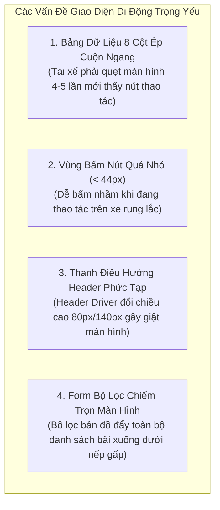
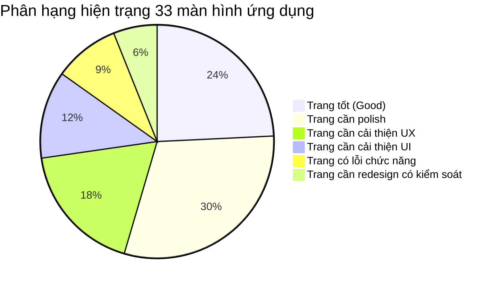

# Báo Cáo Đánh Giá Chuyên Sâu Các Trang Ứng Dụng Thực Tế (Application Screen Review)

> **Dự án**: Smart Parking Hub — Frontend App (`smart-parking-app-v2`)  
> **Giai đoạn**: UX/UI AUDIT (APPLICATION & WORKBENCH AUDIT — NO SOURCE CODE MODIFICATION)  
> **Ngày thực hiện**: 06/11/2026  
> **Phạm vi khảo sát**: Toàn bộ 33 màn hình ứng dụng nghiệp vụ thuộc 3 phân hệ (Driver, Merchant, Admin)  
> **Tiêu chuẩn kiểm thử**: Enterprise App Screens Guidelines (TasteSkill v2 `references/app-screens.md`), WCAG 2.1 AA, Logistics Domain Standards

---

## MỤC LỤC
1. [Phương Pháp & Tiêu Chí Đánh Giá Màn Hình Nghiệp Vụ](#1-phương-pháp--tiêu-chí-đánh-giá-màn-hình-nghiệp-vụ)
2. [Phân Hệ 1: Cổng Thông Tin Tài Xế (Driver Application Suite)](#phân-hệ-1-cổng-thông-tin-tài-xế-driver-application-suite)
3. [Phân Hệ 2: Cổng Quản Lý Bến Bãi (Merchant Operations Suite)](#phân-hệ-2-cổng-quản-lý-bến-bãi-merchant-operations-suite)
4. [Phân Hệ 3: Trung Tâm Điều Hành Quản Trị (Admin Command Center)](#phân-hệ-3-trung-tâm-điều-hành-quản-trị-admin-command-center)
5. [Đánh Giá Chuyên Sâu Các Trạng Thái Dữ Liệu (Data States Audit)](#5-đánh-giá-chuyên-sâu-các-trạng-thái-dữ-liệu-data-states-audit)
6. [Đánh Giá Khả Năng Thao Tác Trên Thiết Bị Di Động (Mobile Responsiveness)](#6-đánh-giá-khả-năng-thao-tác-trên-thiết-bị-di-động-mobile-responsiveness)
7. [Bảng Đăng Ký Chi Tiết Các Vấn Đề Giao Diện Nghiệp Vụ (Findings Registry)](#7-bảng-đăng-ký-chi-tiết-các-vấn-đề-giao-diện-nghiệp-vụ-findings-registry)
8. [Bảng Phân Hạng Hiện Trạng 33 Màn Hình Nghiệp Vụ](#8-bảng-phân-hạng-hiện-trạng-33-màn-hình-nghiệp-vụ)

---

## 1. Phương Pháp & Tiêu Chí Đánh Giá Màn Hình Nghiệp Vụ

Khác với Landing Page (vốn ưu tiên khoảng trống lớn và trải nghiệm lướt xem), các màn hình ứng dụng tác nghiệp (Dashboard, Workbench, Ledger, Moderation Desk) đòi hỏi:
- **Tập trung vào hoàn thành công việc (Task Completion)**: Giảm thiểu số cú nhấp chuột và thời gian tìm kiếm thông tin.
- **Mật độ thông tin hợp lý (Data Density)**: Cung cấp đầy đủ thông số bến bãi, số chỗ trống, biển số xe, giá cước mà không gây quá tải thị giác.
- **Tính trung thực của dữ liệu (Data Honesty)**: Số 0 in ra là 0, dữ liệu thiếu in dấu gạch ngang (`-`), tuyệt đối không dùng fallback tĩnh ghi đè dữ liệu thực tế từ API.

---

## Phân Hệ 1: Cổng Thông Tin Tài Xế (Driver Application Suite)

### 1.1. `SCR-011`: Driver Dashboard Overview (`/dashboard`)
* **Context**:
  - *Người sử dụng / Role*: Tài xế xe đầu kéo container (`ROLE_DRIVER`).
  - *Mục đích truy cập*: Nắm bắt trạng thái chuyến đi hiện tại, số lượng đặt chỗ và số dư.
  - *Thông tin quan trọng nhất*: Thẻ chuyến đi đang diễn ra (Active Trip Card: Mã vé, Bãi đỗ tiếp nhận, Cổng barie, Vị trí Berth chỉ định).
  - *Hành động chính (Primary)*: "Xem mã vé QR" để quét tại trạm barie tự động.
  - *Hành động phụ (Secondary)*: Chỉ đường tới bãi đỗ; Gọi trực ban bãi đỗ.
  - *Trang tiếp theo trong luồng*: `/bookings/:id` hoặc `/parking`.
* **UX Review**:
  - *Ưu điểm*: Bố cục Bento Grid hiển thị 4 chỉ số KPI chính (Tổng số xe, Chuyến đã đặt, Đang hoạt động, Hàng đợi ảo) rất trực quan.
  - *Nhược điểm*: Nút "Tra Cứu Nhanh" phía trên ([`DriverDashboardPage.tsx`](file:///d:/Documents/JAVA%20WEB%20SERVICE/SmartParkingHub/smart-parking-app-v2/src/features/driver/pages/DriverDashboardPage.tsx#L48-L51)) chỉ kích hoạt toast ảo và reset ô nhập, không lọc danh sách gần đây và không chuyển hướng sang trang tìm kiếm vé.
  - *Lỗi liên kết*: Nút "Chỉ đường" mở `https://maps.google.com` trống trơn; nút "Trực ban" gọi số tĩnh `19006868`.
* **UI Review**:
  - *Layout & Spacing*: Bento Grid cân đối trên desktop. Tuy nhiên, chiều cao container bị hardcode `min-h-[calc(100vh-140px)]`, gây lệch layout khi Header thay đổi kích thước theo breakpoint.
  - *Typography*: Chữ trong bảng chuyến đi gần đây bị ép xuống `text-xs` (12px), gây khó đọc trên điện thoại rung lắc trong cabin xe.

---

### 1.2. `SCR-015`: Parking Search Map & Facility List (`/parking`, `/search`)
* **Context**:
  - *Người sử dụng / Role*: Tài xế cần tìm bãi đỗ khẩn cấp hoặc theo lộ trình đến cảng.
  - *Mục đích truy cập*: Tìm kiếm bãi đỗ còn chỗ thực tế, kiểm tra khoảng cách và bảng giá.
  - *Thông tin quan trọng nhất*: Số slot trống khả dụng của từng bãi đỗ và cự ly di chuyển (km).
  - *Hành động chính (Primary)*: Bấm "Xem chi tiết bãi" hoặc "Giữ slot khẩn cấp 10 phút".
  - *Hành động phụ (Secondary)*: Lọc theo tiện ích (cân tải trọng, sửa chữa, camera ALPR, trạm xăng).
  - *Trang tiếp theo*: `/parking/:id` hoặc mở `InlineQuickBookPanel`.
* **UX Review**:
  - *Ưu điểm*: Tích hợp bản đồ Leaflet mượt mà, phân chia 2 cột (Bản đồ tương tác bên trái/phải và Danh sách bãi bên cạnh).
  - *Nhược điểm nghiêm trọng*: Panel "Đặt giữ chỗ khẩn cấp 10 phút" ([`InlineQuickBookPanel.tsx`](file:///d:/Documents/JAVA%20WEB%20SERVICE/SmartParkingHub/smart-parking-app-v2/src/features/parking-search/components/InlineQuickBookPanel.tsx#L99-L103)) tự sinh mã client `BK-HOLD-2026-xxxx` mà không hề gọi API Backend để khóa slot vật lý.
* **UI Review**:
  - Bản đồ và danh sách bãi được chia tỷ lệ 50/50 hoặc 60/40 rất đẹp. Thẻ bãi xe có nhãn trạng thái trực quan ("CÒN CHỖ", "SẮP ĐẦY", "HẾT CHỖ").

---

### 1.3. `SCR-016`: Parking Facility Detail Page (`/parking/:id`)
* **Context**:
  - *Người sử dụng / Role*: Tài xế chuẩn bị thanh toán cọc giữ chỗ bãi đỗ.
  - *Mục đích truy cập*: Đánh giá mặt bằng, xem bảng giá minh bạch, kiểm tra sức chứa thời gian thực.
  - *Thông tin quan trọng nhất*: Bảng giá cọc 20% và vị trí bến đỗ (Berth C-14).
  - *Hành động chính (Primary)*: Bấm nút "Đặt Chỗ & Khóa Slot Ngay (Cọc 20%)".
  - *Hành động phụ (Secondary)*: Xem thư viện hình ảnh cơ sở hạ tầng bãi.
  - *Trang tiếp theo*: Mở `BookingPaymentModal` -> chuyển hướng `/bookings`.
* **UX Review**:
  - *Lỗi nghiêm trọng nhất hệ thống (`ISS-01`)*: Khi kết nối mạng gián đoạn trong lúc cọc qua `BookingPaymentModal.tsx`, khối `catch` tự động tạo mã đặt chỗ giả `BK-2025-CLG2-014` và báo "Đặt chỗ thành công".
  - *Lỗi dữ liệu giả (`ISS-07`)*: Ma trận slot, bảng giá và tiện ích luôn bị ghi đè bởi biến tĩnh `fallbackFacilityDetail`, bất kể ID bãi đỗ là bao nhiêu.
* **UI Review**:
  - Cột phải 35% cố định (Sticky Reservation Desk) giữ form đặt chỗ luôn trong tầm mắt khi cuộn nội dung chi tiết bên trái. Bố cục rất chuyên nghiệp, chỉ cần sửa logic ràng buộc dữ liệu.

---

### 1.4. `SCR-017` & `SCR-018`: Driver Bookings List & Detail (`/bookings`, `/bookings/:id`)
* **Context**:
  - *Người sử dụng / Role*: Tài xế quản lý danh sách vé đã đặt và xuất trình mã QR tại cổng.
  - *Thông tin quan trọng nhất*: Mã vé QR, Mã đơn `BK-...`, Trạng thái cọc (`HOLD_CONFIRMED`, `CHECKED_IN`, `COMPLETED`, `CANCELLED`).
  - *Hành động chính (Primary)*: Bấm "Mở mã QR Check-in" hoặc "Thanh toán phần còn lại".
  - *Hành động phụ (Secondary)*: Hủy vé (mở `CancelBookingModal`), Đánh giá bãi đỗ (mở `ReviewBookingModal`).
* **UX & UI Review**:
  - Quy trình phân loại tab theo trạng thái vé hoạt động tốt.
  - *Vấn đề A11y*: Modal hủy vé `CancelBookingModal.tsx` và đánh giá `ReviewBookingModal.tsx` thiếu phím `Escape` và không khóa thanh cuộn trang nền.

---

### 1.5. `SCR-012`: Virtual Queues Dashboard (`/queues`)
* **Context**:
  - *Mục đích truy cập*: Theo dõi vị trí trong hàng đợi ảo khi bãi đỗ hết chỗ; nhận slot khi có xe rời bãi.
  - *Thông tin quan trọng nhất*: Vị trí hàng đợi hiện tại (ví dụ: `#02 trong hàng đợi`), Thời gian chờ dự kiến.
  - *Hành động chính*: Bấm "Xác nhận nhận chỗ" trong vòng 10 phút khi có thông báo; hoặc "Rời hàng đợi".
* **UX Review**:
  - Modal thông báo thành công [`AcceptQueueSuccessModal.tsx`](file:///d:/Documents/JAVA%20WEB%20SERVICE/SmartParkingHub/smart-parking-app-v2/src/features/queues/components/AcceptQueueSuccessModal.tsx#L22-L28) không có nút đóng `[X]`, không cho click ra ngoài backdrop để thoát, buộc tài xế phải bấm nút chuyển sang trang vé.

---

### 1.6. `SCR-013`: Driver Vehicle Management (`/vehicles`)
* **Context**:
  - *Mục đích truy cập*: Đăng ký phương tiện (đầu kéo, rơ-moóc), tải trọng, chứng nhận kiểm định ALPR.
  - *Thông tin quan trọng nhất*: Biển số xe, Loại xe (Container 40ft, 20ft), Trạng thái liên kết.
  - *Hành động chính*: "Thêm phương tiện mới" (mở `VehicleModal`), "Xuất danh sách đội xe".
* **UX Review**:
  - Lỗi xuất file hỏng ([`ExportFleetModal.tsx`](file:///d:/Documents/JAVA%20WEB%20SERVICE/SmartParkingHub/smart-parking-app-v2/src/features/vehicles/components/ExportFleetModal.tsx#L30-L37)): Người dùng bấm xuất Excel hoặc PDF thì trình duyệt tải về một file text JSON được đổi đuôi thành `.xlsx` / `.pdf`.

---

### 1.7. `SCR-014`: Driver Payments & Ledger (`/payments`)
* **Context**:
  - *Mục đích truy cập*: Đối soát lịch sử trừ tiền cọc PayOS, hoàn tiền cọc, tải hóa đơn VAT điện tử.
  - *Thông tin quan trọng nhất*: Bảng kê chi tiết giao dịch (Mã GD, Số tiền, Thời gian, Trạng thái).
  - *Hành động chính*: "Tải Báo Cáo Sổ Cái", "Gửi hóa đơn VAT qua Email".
* **UX Review**:
  - Nút "Tải Báo Cáo" trong [`ExportReportModal.tsx`](file:///d:/Documents/JAVA%20WEB%20SERVICE/SmartParkingHub/smart-parking-app-v2/src/features/payments/components/ExportReportModal.tsx#L21-L38) chỉ chạy timer 800ms giả lập rồi đóng, không hề tải tệp sao kê.
  - Form lưu thông tin xuất hóa đơn doanh nghiệp chỉ ghi vào `localStorage` của trình duyệt, không lưu trữ trên máy chủ.

---

## Phân Hệ 2: Cổng Quản Lý Bến Bãi (Merchant Operations Suite)

```
┌─────────────────────────────────────────────────────────────────────────────┐
│ Merchant Operational Dashboard (/merchant/dashboard)                       │
├───────────────────┬─────────────────────────────────────────────────────────┤
│ Sidebar (260px)   │ Top Header (64px) — Trạm bãi: Tân Cảng Cát Lái          │
│                   ├─────────────────────────────────────────────────────────┤
│ • Tổng quan       │ 4 KPI Bento Cards: Slot đang đỗ, Doanh thu, Hàng đợi    │
│ • Bãi đỗ của tôi  ├─────────────────────────────────────────────────────────┤
│ • Quản lý đặt chỗ │ Trạm Quét Barie Tự Động & Camera ALPR                   │
│ • Trạm Barie QR   ├─────────────────────────────────────────────────────────┤
│ • Báo cáo ví/rút  │ Bảng Danh Sách Xe Ra Vào Cảng Thời Gian Thực             │
└───────────────────┴─────────────────────────────────────────────────────────┘
```

### 2.1. `SCR-031`: Merchant Operational Dashboard (`/merchant/dashboard`)
* **Context**:
  - *Người sử dụng / Role*: Chủ bến bãi, quản lý điều phối cảng (`ROLE_PARKING_LOT_OWNER`).
  - *Mục đích truy cập*: Giám sát công suất bến bãi thời gian thực, điều phối xe vào bến.
  - *Thông tin quan trọng nhất*: Tỷ lệ lấp đầy bãi (Occupancy Rate: ví dụ 78/120 slot) và số xe đang xếp hàng chờ vào cổng.
  - *Hành động chính*: Bấm "Quét Barie Vào/Ra" hoặc "Cập nhật sức chứa khẩn cấp".
* **UX & UI Review**:
  - Giao diện bento hiện đại, số liệu hiển thị rõ ràng. Tuy nhiên, các icon KPI bị lạm dụng đóng trong các hộp màu sắc rực rỡ (`bg-[#341100] text-[#d95f00]`), vi phạm nguyên tắc "Màu cho dữ liệu, không cho viền" của TasteSkill v2.

---

### 2.2. `SCR-032`: Merchant Parking Lots Workbench (`/merchant/parking-lots`)
* **Context**:
  - *Mục đích truy cập*: Quản lý danh sách các cơ sở bãi đỗ thuộc quyền sở hữu, bật/tắt nhận xe.
  - *Thông tin quan trọng nhất*: Trạng thái kiểm duyệt (`APPROVED`, `PENDING_APPROVAL`, `CHANGES_REQUESTED`), Tổng diện tích m², Doanh thu tháng.
  - *Hành động chính*: Bấm "+ Đăng Ký Thêm Bãi Đỗ Mới" (`/merchant/parking-lots/new`).
* **UX & UI Review**:
  - Hỗ trợ chuyển đổi mượt mà giữa Grid View và Table View.
  - *Lỗi giả lập*: Nút "Xuất Báo Cáo Mặt Bằng Bãi" chỉ chạy `setTimeout` giả vờ xuất file rồi tự đóng.

---

### 2.3. `SCR-033` & `SCR-035`: Create & Edit Parking Lot (`/merchant/parking-lots/new`, `.../edit`)
* **Context**:
  - *Mục đích truy cập*: Thiết lập hồ sơ bãi đỗ gửi Admin phê duyệt (Tên, Tọa độ bản đồ, Biểu giá cọc, Tiện ích, Sơ đồ Berth).
  - *Hành động chính*: "Gửi hồ sơ kiểm duyệt".
* **UX Review**:
  - Form dài nhiều bước (Multi-step Stepper) được chia hợp lý: 1. Thông tin chung -> 2. Tọa độ vị trí -> 3. Phân bổ slot -> 4. Bảng giá.
  - *Vấn đề tương tác*: Nút submit chưa chặn triệt để Double Click khi đường truyền gửi ảnh mặt bằng bị trễ.

---

### 2.4. `SCR-039`: QR Barie Scanner & Gate Desk (`/merchant/qr-scanner`)
* **Context**:
  - *Người sử dụng / Role*: Nhân viên trực chốt barie cổng bến cảng.
  - *Mục đích truy cập*: Quét mã QR vé tài xế đưa hoặc nhận diện biển số xe qua camera ALPR để mở barie.
  - *Thông tin quan trọng nhất*: Kết quả đối soát vé (`HỢP LỆ - MỞ CỔNG`, `CHƯA CỌC`, `SAI BIỂN SỐ`).
  - *Hành động chính*: Bấm "Mở Barie Thủ Công" hoặc "Xác Nhận Check-In / Check-Out".
* **UX Review**:
  - Trang được thiết kế cho môi trường vận hành tốc độ cao: có ô nhập nhanh mã vé (nếu camera mờ), âm thanh feedback và phím tắt bàn phím. Cần duy trì tính ổn định tuyệt đối của trang này.

---

### 2.5. `SCR-041`: Merchant Wallet & Withdrawals (`/merchant/withdrawals`)
* **Context**:
  - *Mục đích truy cập*: Xem số dư tiền cọc tài xế đã thanh toán và gửi lệnh rút tiền về tài khoản ngân hàng.
  - *Thông tin quan trọng nhất*: Số dư khả dụng (`currentWalletBalance`) và hạn mức rút tối thiểu (50.000đ).
  - *Hành động chính*: Bấm "+ Yêu cầu rút tiền".
* **UX Review**:
  - *Lỗi bẫy validation (`ISS-03`)*: Khi số dư khả dụng < 50.000đ, nút vẫn cho bấm mở dialog, nhưng bên trong input bắt buộc `min: 50000, max: balance`. Người dùng bị kẹt trong form mà không biết lý do.

---

## Phân Hệ 3: Trung Tâm Điều Hành Quản Trị (Admin Command Center)

### 3.1. `SCR-043`: Admin Command Center Dashboard (`/admin/dashboard`)
* **Context**:
  - *Người sử dụng / Role*: Quản trị viên hệ thống SmartParkingHub (`ROLE_ADMIN`).
  - *Mục đích truy cập*: Theo dõi toàn bộ dòng tiền cước, số lượng hồ sơ bãi chờ duyệt, tranh chấp cần xử lý.
  - *Thông tin quan trọng nhất*: Số hồ sơ bãi đỗ chờ duyệt, Số lệnh rút tiền cần duyệt chi trong ngày.
* **UI Review**:
  - Tone màu nền tối (`bg-brand-navy`) tạo cảm giác trung tâm điều khiển (Command Center). Tuy nhiên, nút bấm chính dùng `bg-brand-orange text-brand-navy` (Cam chữ đen xanh), lệch hoàn toàn với phong cách nút cam chữ trắng của Driver và Merchant.

---

### 3.2. `SCR-044` & `SCR-045`: Admin Parking Lots Moderation & Detail (`/admin/parking-lots`, `.../:id`)
* **Context**:
  - *Mục đích truy cập*: Thẩm định hồ sơ pháp lý, ảnh chụp PCCC, sơ đồ bến bãi của Merchant.
  - *Hành động chính*: "Duyệt bãi" (`/approve`), "Yêu cầu chỉnh sửa" (`/request-changes`), "Từ chối" (`/reject`).
* **UX Review**:
  - *Lỗi ma sát thao tác (`ISS-04`)*: Khi Admin muốn bấm "Duyệt bãi" một hồ sơ hoàn toàn hợp lệ, hộp thoại `DecisionDialog` bắt buộc phải nhập văn bản vào ô "Lý do quyết định", làm mất thời gian thao tác vô ích.

---

### 3.3. `SCR-049`: Admin Withdrawal Approvals (`/admin/withdrawals`)
* **Context**:
  - *Mục đích truy cập*: Kiểm tra số tài khoản ngân hàng thụ hưởng và bấm "Duyệt chi" tiền cho Merchant.
  - *Thông tin quan trọng nhất*: Tên ngân hàng, Số tài khoản, Tên chủ tài khoản, Số tiền rút.
  - *Hành động chính*: "Xác nhận duyệt chi PayOS".
* **UX Review**:
  - Dữ liệu hiển thị an toàn, có cảnh báo xác nhận trước khi thực hiện giao dịch chuyển tiền thật.

---

## 5. Đánh Giá Chuyên Sâu Các Trạng Thái Dữ Liệu (Data States Audit)

Kiểm tra 8 trạng thái dữ liệu bắt buộc trên các component giao diện:

| Trạng thái dữ liệu | Tình trạng hiện tại trên hệ thống | Đánh giá & Rủi ro | Đề xuất chuẩn hóa |
| :--- | :--- | :--- | :--- |
| **1. Loading State** | Sử dụng 17 file Skeleton riêng biệt viết thủ công trong từng thư mục feature. | 🔴 **Phân mảnh**: Mã nguồn bị nhân bản hàng trăm dòng `animate-pulse`. Tốc độ render không đồng đều. | Hợp nhất về 1 component [`shared/Skeleton.tsx`](file:///d:/Documents/JAVA%20WEB%20SERVICE/SmartParkingHub/smart-parking-app-v2/src/shared/components/Skeleton.tsx) với 4 preset chuẩn. |
| **2. Empty State** | Rải rác 5 component EmptyState cục bộ; nhiều bảng chỉ hiển thị một dòng text xám mờ "Không có dữ liệu". | 🟡 **Thiếu định hướng**: Người dùng không biết phải làm gì tiếp theo khi bảng rỗng. | Sử dụng [`shared/EmptyState.tsx`](file:///d:/Documents/JAVA%20WEB%20SERVICE/SmartParkingHub/smart-parking-app-v2/src/shared/components/EmptyState.tsx) có sẵn hình minh họa thân thiện và nút CTA điều hướng. |
| **3. Error State** | Một số nơi nuốt lỗi (như `BookingPaymentModal` tự nhảy sang thành công giả); các form khác hiện thông báo lỗi tiếng Anh hoặc text đỏ nhỏ. | 🔴 **Nghiêm trọng**: Che giấu lỗi hệ thống khiến người dùng hiểu lầm. | Loại bỏ toàn bộ catch block tạo dữ liệu giả. Hiển thị alert đỏ có nút "Thử lại" (Retry Action). |
| **4. Success State** | Đa số các thao tác chỉ hiển thị toast ngắn rồi tự biến mất, hoặc mở modal chúc mừng thiếu nút đóng. | 🟡 **Thiếu thông tin đối soát**: Tài xế không kịp đọc mã vé hoặc hướng dẫn cổng vào. | Cung cấp màn hình xác nhận có mã đối soát, thời hạn slot và nút "Xem vé ngay". |
| **5. No Result (Search)**| Khi tìm kiếm từ khóa không khớp, danh sách hiển thị khối xám trống trơn. | 🟡 **Thiếu hướng dẫn**: Không gợi ý tài xế thử bỏ bớt bộ lọc hoặc mở rộng bán kính tìm kiếm. | Thêm nút "Xóa tất cả bộ lọc" (Clear Filters CTA) trực tiếp tại khung thông báo. |
| **6. Partial Data** | Khi dữ liệu thiếu (ví dụ: bãi chưa có hotline, xe chưa có model), code render chuỗi trống hoặc `undefined`. | 🟡 **Mất thẩm mỹ**: Giao diện xuất hiện các khoảng trống khuyết tật. | Chuẩn hóa quy tắc Data Honesty: In dấu gạch ngang (`-`) hoặc nhãn `Chưa cập nhật`. |
| **7. Disabled State** | Nút bấm disable chỉ giảm opacity (`opacity-50`) nhưng không đổi con trỏ chuột (`cursor-not-allowed`), thiếu tooltip giải thích lý do disable. | 🟡 **Gây bối rối**: Người dùng không hiểu vì sao nút không thể bấm. | Bổ sung `cursor-not-allowed` và tooltip giải thích điều kiện còn thiếu để kích hoạt. |
| **8. Selected State** | Hàng được chọn trong bảng đối soát thanh toán đổi nền thành `bg-orange-50/60`, hàng trong bảng bãi đỗ đổi nền `bg-[#eff4ff]`. | 🟡 **Lệch màu sắc**: Hai bảng dùng hai màu highlight khác nhau. | Đồng bộ màu hàng được chọn về `--color-surface-hover` (`bg-slate-50` viền cam bên trái). |

---

## 6. Đánh Giá Khả Năng Thao Tác Trên Thiết Bị Di Động (Mobile Responsiveness)

Qua thử nghiệm thực tế ở các kích thước màn hình di động chuẩn (**390px** iPhone 14/15, **375px** iPhone SE, **768px** iPad Mini):



### Giải pháp tổ chức lại nội dung trên thiết bị nhỏ (Mobile Reorganization):
1. **Chuyển đổi Bảng thành Thẻ (Card Transformation)**: Trên màn hình < 640px, các bảng dữ liệu phức tạp (`MasterTransactionTable`, `VehicleMasterTable`) tự động ngắt hiển thị `<table>` và render danh sách thẻ xếp chồng (Stacked Card List). Mỗi thẻ làm nổi bật: Biển số/Mã vé ở trên cùng, Số tiền ở góc phải, và nút CTA to ở chân thẻ.
2. **Bottom Sheet cho Bộ Lọc**: Chuyển thanh bộ lọc tìm kiếm bãi xe thành một Drawer kéo từ dưới lên (Bottom Sheet), giúp người dùng dễ dàng chạm ngón tay cái mà không che mất bản đồ bên trên.
3. **Đảm bảo Touch Target Size**: Nâng toàn bộ nút bấm hành động trên di động lên tối thiểu **44×44px**.

---

## 7. Bảng Đăng Ký Chi Tiết Các Vấn Đề Giao Diện Nghiệp Vụ (Findings Registry)

| Mã Issue | Màn hình / Route | Role | Thành phần UI | Vấn đề phát hiện | Bằng chứng mã nguồn | Tác động người dùng | Nguyên nhân gốc rễ | Đề xuất giải pháp | Mức độ ưu tiên |
| :---: | :--- | :---: | :--- | :--- | :--- | :--- | :--- | :--- | :---: |
| **APP-01** | `/parking/:id` (`SCR-016`) | Driver | `BookingPaymentModal` | Nuốt lỗi mạng, tự tạo mã đặt chỗ giả `BK-2025-CLG2-014` | [`BookingPaymentModal.tsx:110-135`](file:///d:/Documents/JAVA%20WEB%20SERVICE/SmartParkingHub/smart-parking-app-v2/src/features/parking-detail/components/BookingPaymentModal.tsx#L110) | Tài xế nghĩ đã có chỗ nhưng bãi không có dữ liệu | Code mock demo bị bỏ quên trong catch block | Xóa fallbackResult, giữ nguyên bước thanh toán và báo lỗi đỏ | 🔴 CRITICAL |
| **APP-02** | `/parking/:id` (`SCR-016`) | Driver | `ParkingDetailPage` | Dữ liệu tĩnh ghi đè ma trận slot và bảng giá của API | [`ParkingDetailPage.tsx:114-136`](file:///d:/Documents/JAVA%20WEB%20SERVICE/SmartParkingHub/smart-parking-app-v2/src/features/parking-detail/pages/ParkingDetailPage.tsx#L114) | Bãi nào cũng hiển thị cùng 1 bảng giá Tân Cảng Cát Lái | Dùng biến fallback thay vì map dữ liệu từ facility API | Viết mapper chuyển đổi từ `facility.pricingRules` sang props | 🟠 HIGH |
| **APP-03** | `/vehicles` (`SCR-013`) | Driver | `ExportFleetModal` | Tải file chuỗi JSON đổi đuôi `.xlsx` / `.pdf` làm hỏng tệp | [`ExportFleetModal.tsx:30-37`](file:///d:/Documents/JAVA%20WEB%20SERVICE/SmartParkingHub/smart-parking-app-v2/src/features/vehicles/components/ExportFleetModal.tsx#L30) | Doanh nghiệp vận tải không mở được báo cáo đội xe | Tạo blob text/plain rồi đổi tên file tùy tiện | Tích hợp xuất file CSV chuẩn UTF-8 BOM hoặc gọi API | 🟠 HIGH |
| **APP-04** | `/merchant/withdrawals` (`SCR-041`) | Merchant | `WithdrawalDialog` | Bẫy validation không thể gửi khi số dư ví < 50k | [`FinancePages.tsx:168, 287`](file:///d:/Documents/JAVA%20WEB%20SERVICE/SmartParkingHub/smart-parking-app-v2/src/features/merchant/operations/FinancePages.tsx#L168) | Chủ bãi kẹt trong form rút tiền không submit được | Nút mở không check số dư, input min 50k max balance | Vô hiệu hóa nút bấm và hiện tooltip nếu balance < 50k | 🟠 HIGH |
| **APP-05** | `/parking` (`SCR-015`) | Driver | `InlineQuickBookPanel` | Giữ slot 10 phút tự sinh mã client ngẫu nhiên | [`InlineQuickBookPanel.tsx:99-103`](file:///d:/Documents/JAVA%20WEB%20SERVICE/SmartParkingHub/smart-parking-app-v2/src/features/parking-search/components/InlineQuickBookPanel.tsx#L99) | Slot trên bãi thực tế không bị khóa, xe khác cướp mất | Không gọi mutation API đặt giữ chỗ | Kết nối endpoint `/api/v1/bookings/hold` của Backend | 🟠 HIGH |
| **APP-06** | `/payments` (`SCR-014`) | Driver | `ExportReportModal` | Nút xuất báo cáo chi phí chỉ chạy hẹn giờ giả lập | [`ExportReportModal.tsx:21-38`](file:///d:/Documents/JAVA%20WEB%20SERVICE/SmartParkingHub/smart-parking-app-v2/src/features/payments/components/ExportReportModal.tsx#L21) | Bấm xuất file nhưng không có tệp nào được tải về | Mock setTimeout đóng form cho đủ UI | Xuất tệp CSV từ danh sách transactions thực tế | 🟠 HIGH |
| **APP-07** | `/merchant/parking-lots` (`SCR-032`) | Merchant | `ExportReportModal` | Nút xuất báo cáo mặt bằng chỉ chạy hẹn giờ giả lập | [`ExportReportModal.tsx:17-26`](file:///d:/Documents/JAVA%20WEB%20SERVICE/SmartParkingHub/smart-parking-app-v2/src/features/merchant/parking-lots/components/ExportReportModal.tsx#L17) | Chủ bãi không tải được tệp danh sách bãi xe | Mock setTimeout cho đủ giao diện | Xuất tệp CSV danh sách cơ sở bãi thực tế | 🟠 HIGH |
| **APP-08** | `/admin/parking-lots/:id` (`SCR-045`) | Admin | `DecisionDialog` | Bắt buộc nhập lý do khi duyệt hồ sơ bãi hợp lệ | [`features/admin/index.tsx:307`](file:///d:/Documents/JAVA%20WEB%20SERVICE/SmartParkingHub/smart-parking-app-v2/src/features/admin/index.tsx#L307) | Làm chậm trễ thao tác phê duyệt hàng ngày | Form validate bắt buộc reason cho mọi action | Chỉ bắt buộc lý do khi action khác 'approve' | 🟡 MEDIUM |
| **APP-09** | `/dashboard` (`SCR-011`) | Driver | `ActiveTripCard` | Nút "Chỉ đường" mở Google Maps rỗng | [`ActiveTripCard.tsx:212`](file:///d:/Documents/JAVA%20WEB%20SERVICE/SmartParkingHub/smart-parking-app-v2/src/features/driver/components/ActiveTripCard.tsx#L212) | Tài xế không biết lộ trình di chuyển tới bãi | Thẻ link trỏ tới trang chủ Google Maps trống | Truyền tọa độ lat/lng và địa chỉ bãi vào URL Maps | 🟡 MEDIUM |
| **APP-10** | `/dashboard` (`SCR-011`) | Driver | Form Tra Cứu Nhanh | Tra cứu nhanh chỉ hiện toast ảo và xóa trắng ô | [`DriverDashboardPage.tsx:48-51`](file:///d:/Documents/JAVA%20WEB%20SERVICE/SmartParkingHub/smart-parking-app-v2/src/features/driver/pages/DriverDashboardPage.tsx#L48) | Người dùng tưởng đã tìm kiếm nhưng bảng không đổi | Chưa điều hướng sang trang kết quả tìm kiếm | Chuyển hướng sang `/bookings?keyword=...` | 🟡 MEDIUM |
| **APP-11** | `/queues` (`SCR-012`) | Driver | `AcceptQueueSuccessModal` | Modal nhận slot thiếu nút [X] và không đóng khi click nền | [`AcceptQueueSuccessModal.tsx:22`](file:///d:/Documents/JAVA%20WEB%20SERVICE/SmartParkingHub/smart-parking-app-v2/src/features/queues/components/AcceptQueueSuccessModal.tsx#L22) | Người dùng bị kẹt, buộc phải bấm link chuyển trang | Thiếu sự kiện click backdrop và nút close X | Bổ sung nút [X] và onClick đóng backdrop | 🟢 LOW |
| **APP-12** | Đa màn hình Modal | All | 6 Modal thành phần | Modal không nhận phím Escape và không khóa cuộn nền | Toàn bộ các file modal | Trang nền vẫn cuộn được khi mở modal, vi phạm A11y | Viết modal inline không có hook quản lý tập trung | Tích hợp hook `useModalA11y` khóa cuộn và bắt Escape | 🟡 MEDIUM |
| **APP-13** | `/dashboard` (`SCR-011`) | Driver | Page Container | Chiều cao hardcode 140px gây giật giao diện trên mobile | [`DriverDashboardPage.tsx:54`](file:///d:/Documents/JAVA%20WEB%20SERVICE/SmartParkingHub/smart-parking-app-v2/src/features/driver/pages/DriverDashboardPage.tsx#L54) | Xuất hiện khoảng trống thừa hoặc thanh cuộn giả | Hardcode 140px thay vì dùng CSS variable | Đổi thành `calc(100vh - var(--driver-header-height))` | 🟡 MEDIUM |
| **APP-14** | `/payments` (`SCR-014`) | Driver | `SendReceiptEmailModal` | Lưu hóa đơn công ty vào localStorage không đồng bộ server | [`paymentApi.ts:303-307`](file:///d:/Documents/JAVA%20WEB%20SERVICE/SmartParkingHub/smart-parking-app-v2/src/features/payments/api/paymentApi.ts#L303) | Đổi máy là mất sạch thông tin mã số thuế doanh nghiệp | Chưa kết nối API lưu profile người dùng | Đồng bộ dữ liệu hóa đơn vào endpoint User Profile | 🟡 MEDIUM |
| **APP-15** | Toàn hệ thống Form | Driver/Merchant | Submit buttons | Thiếu chặn Double Click khi mạng có độ trễ | Các nút submit form | Nguy cơ tạo 2 yêu cầu trùng lặp lên máy chủ | Quên vô hiệu hóa nút trong lúc mutation pending | Thêm `disabled={isSubmitting}` trên mọi nút submit | 🟡 MEDIUM |
| **APP-16** | Bảng giao dịch & Đội xe | Driver | `MasterTransactionTable` | Bảng 8 cột tràn màn hình trên mobile | [`MasterTransactionTable.tsx:81`](file:///d:/Documents/JAVA%20WEB%20SERVICE/SmartParkingHub/smart-parking-app-v2/src/features/payments/components/MasterTransactionTable.tsx#L81) | Tài xế phải cuộn ngang mệt mỏi trên điện thoại 375px | Chỉ dùng `overflow-x-auto` đơn thuần | Tự động chuyển đổi thành Card View trên màn hình nhỏ | 🟡 MEDIUM |
| **APP-17** | Toàn bộ Dashboard | Driver/Merchant | Bento KPI Cards | Lạm dụng icon trong các ô vuông/tròn rực rỡ | `DriverStatGrid.tsx`, `MerchantDashboardPage.tsx` | Cạnh tranh thị giác với số liệu thực, giao diện giống template | Bắt chước các template UI phổ thông | Làm phẳng bề mặt, đưa màu nhấn vào số liệu chính | 🟡 MEDIUM |
| **APP-18** | `/queues`, `/payments` | Driver | Danh sách rỗng | Empty state chỉ có một dòng chữ xám không có CTA | Bảng lịch sử cước và hàng đợi | Tài xế mới tạo tài khoản không biết đi tiếp thế nào | Chưa áp dụng component EmptyState chuẩn | Tích hợp icon minh họa và nút "Tìm bãi đỗ ngay" | 🟢 LOW |

---

## 8. Bảng Phân Hạng Hiện Trạng 33 Màn Hình Nghiệp Vụ

Qua rà soát toàn bộ 33 màn hình nghiệp vụ, hệ thống chia các trang thành 6 nhóm hiện trạng rõ ràng:



### 1. Nhóm Trang Tốt (Good) — 8 màn hình
Các trang có kiến trúc sạch, luồng nghiệp vụ hoàn chỉnh, dữ liệu kết nối thật:
1. `SCR-038`: Quản lý đặt chỗ Merchant (`/merchant/bookings`)
2. `SCR-039`: Trạm Barie & Quét QR Code (`/merchant/qr-scanner`)
3. `SCR-040`: Báo cáo doanh thu bãi đỗ (`/merchant/revenue`)
4. `SCR-046`: Quản lý danh sách người dùng Admin (`/admin/users`)
5. `SCR-047`: Chi tiết tài khoản người dùng Admin (`/admin/users/:id`)
6. `SCR-048`: Sổ cái đối soát giao dịch Admin (`/admin/transactions`)
7. `SCR-049`: Phê duyệt duyệt chi rút tiền Admin (`/admin/withdrawals`)
8. `SCR-051`: Nhật ký kiểm toán hệ thống Admin (`/admin/audit-logs`)

### 2. Nhóm Trang Cần Polish (Needs Polish) — 10 màn hình
Các trang đã hoạt động tốt nhưng cần tinh chỉnh nhỏ về khoảng cách, kích thước font hoặc bổ sung phím Escape cho modal:
1. `SCR-018`: Chi tiết vé đặt chỗ tài xế (`/bookings/:id`)
2. `SCR-019`: Xử lý khiếu nại tài xế (`/disputes`)
3. `SCR-020`: Hồ sơ cá nhân tài xế (`/profile`)
4. `SCR-021`: Trung tâm thông báo tài xế (`/notifications`)
5. `SCR-022`: Đổi mật khẩu tài xế (`/change-password`)
6. `SCR-034`: Chi tiết hồ sơ bãi đỗ Merchant (`/merchant/parking-lots/:id`)
7. `SCR-036`: Ma trận slot bến bãi Merchant (`/merchant/parking-lots/:id/slots`)
8. `SCR-037`: Biểu phí & Quy tắc tính cước Merchant (`/merchant/parking-lots/:id/pricing`)
9. `SCR-042`: Xử lý tranh chấp Merchant (`/merchant/disputes`)
10. `SCR-050`: Xử lý khiếu nại cước Admin (`/admin/disputes`)

### 3. Nhóm Trang Cần Cải Thiện UX (Needs UX Improvement) — 6 màn hình
Các trang có luồng thao tác còn vướng víu, bẫy validation hoặc thiếu thông tin định hướng:
1. `SCR-011`: Driver Dashboard (`/dashboard`) — *Sửa nút Tra Cứu Nhanh và link Chỉ đường Google Maps*.
2. `SCR-012`: Hàng đợi ảo (`/queues`) — *Bổ sung nút đóng cho AcceptQueueSuccessModal*.
3. `SCR-014`: Lịch sử cước phí (`/payments`) — *Bổ sung Empty State có CTA và đồng bộ thông tin hóa đơn lên server*.
4. `SCR-041`: Ví & Yêu cầu rút tiền Merchant (`/merchant/withdrawals`) — *Khắc phục bẫy validation số dư < 50k*.
5. `SCR-044`: Danh sách bãi chờ duyệt Admin (`/admin/parking-lots`) — *Bổ sung bộ lọc trạng thái nhanh*.
6. `SCR-045`: Chi tiết hồ sơ bãi Admin (`/admin/parking-lots/:id`) — *Bỏ bắt buộc nhập lý do khi duyệt hợp lệ*.

### 4. Nhóm Trang Cần Cải Thiện UI (Needs UI Improvement) — 4 màn hình
Các trang cần nâng cấp tính thẩm mỹ, làm phẳng bề mặt, và tối ưu responsive trên di động:
1. `SCR-017`: Danh sách vé đặt chỗ tài xế (`/bookings`) — *Nâng cỡ chữ thẻ vé lên 14px, tối ưu hiển thị QR*.
2. `SCR-031`: Merchant Operational Dashboard (`/merchant/dashboard`) — *Loại bỏ các ô vuông màu mè quanh KPI*.
3. `SCR-032`: Quản lý bãi đỗ Merchant (`/merchant/parking-lots`) — *Đồng bộ màu sắc header bảng*.
4. `SCR-043`: Admin Command Center Dashboard (`/admin/dashboard`) — *Chuẩn hóa nút bấm cam chữ trắng*.

### 5. Nhóm Trang Có Lỗi Chức Năng (Functional / Contract Bugs) — 3 màn hình
Các trang có logic code giả lập hoặc nuốt lỗi nghiêm trọng cần ưu tiên sửa ngay:
1. `SCR-016`: Chi tiết bãi đỗ (`/parking/:id`) — *Xóa bỏ false success fallback `BK-2025-CLG2-014` trong catch block*.
2. `SCR-013`: Đội xe tài xế (`/vehicles`) — *Sửa lỗi xuất file JSON đổi đuôi `.xlsx` / `.pdf`*.
3. `SCR-015`: Bản đồ tìm bãi (`/parking`, `/search`) — *Loại bỏ việc tự sinh mã giữ slot ngẫu nhiên ở client*.

### 6. Nhóm Trang Cần Redesign Có Kiểm Soát (Controlled Redesign) — 2 màn hình
Các trang có form nhập liệu rất dài hoặc bảng biểu quá tải trên di động cần được tái cấu trúc bố cục:
1. `SCR-033`: Đăng ký thêm bãi đỗ mới Merchant (`/merchant/parking-lots/new`) — *Tái cấu trúc stepper, tối ưu tải ảnh mặt bằng*.
2. `SCR-035`: Chỉnh sửa cấu hình bãi đỗ Merchant (`/merchant/parking-lots/:id/edit`) — *Đồng bộ hóa component form*.

---

> **Báo cáo đánh giá chuyên sâu 33 màn hình ứng dụng nghiệp vụ đã hoàn tất và lưu trữ tại:**  
> `docs/ux-ui-audit/08-application-screen-review.md`.  
> **Cam kết tuyệt đối**: Không có bất kỳ dòng code nguồn nào bị thay đổi trong quá trình khảo sát.
