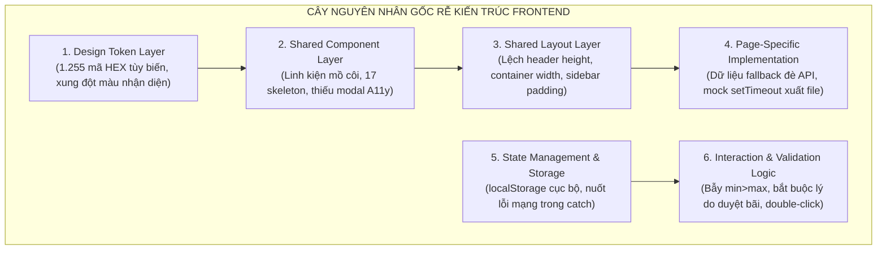
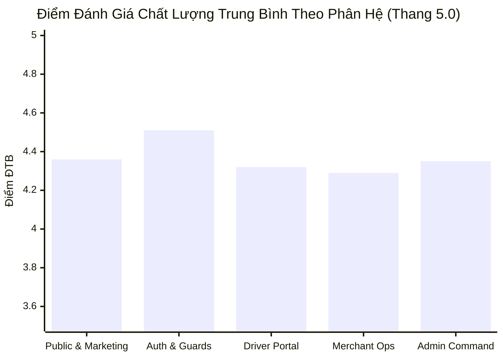
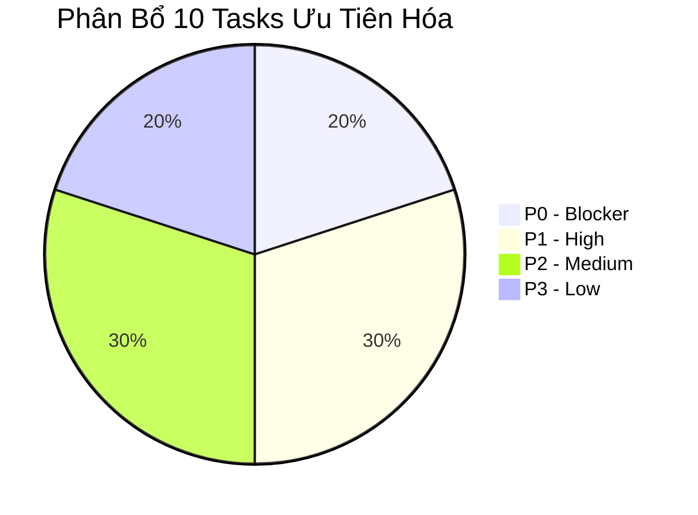

# 09. Báo Cáo Phân Tích Nguyên Nhân Gốc Rễ, Chấm Điểm & Backlog Ưu Tiên Hóa

> **Dự án**: Smart Parking Hub — Frontend App (`smart-parking-app-v2`)  
> **Giai đoạn**: UX/UI AUDIT SYNTHESIS & BACKLOG ARCHITECTURE (NO CODE MODIFICATION)  
> **Ngày lập báo cáo**: Tháng 11/2026  
> **Cơ sở dữ liệu thẩm định**:  
> - Báo cáo khảo sát thực tế: `00-project-inventory.md`, `01-route-matrix.md`, `02-shared-components.md`, `03-role-workflow-map.md`  
> - Báo cáo phát hiện lỗi: `04-interaction-audit.md` (18 issues), `05-design-system-audit.md`, `06-design-system-recommendations.md`, `08-application-screen-review.md` (18 issues), `11-shared-system-implementation-report.md`  
>
> **Cam kết tuân thủ**: Không sửa code · Không tạo task trực tiếp lên Trello · Dừng ở bước lập kế hoạch.

---

## MỤC LỤC
1. [Phần 1: Phân Tích Nguyên Nhân Gốc Rễ Toàn Hệ Thống (Root Cause Analysis - RCA)](#phần-1-phân-tích-nguyên-nhân-gốc-rễ-toàn-hệ-thống)
2. [Phần 2: Tiêu Chí Phân Loại Ưu Tiên (Priority Framework: P0 - P3)](#phần-2-tiêu-chí-phân-loại-ưu-tiên)
3. [Phần 3: Bảng Ma Trận Đánh Giá & Chấm Điểm 56 Màn Hình (Scoring Matrix)](#phần-3-bảng-ma-trận-đánh-giá--chấm-điểm-56-màn-hình)
4. [Phần 4: Phân Tích Thứ Tự Phụ Thuộc (Dependency Analysis)](#phần-4-phân-tích-thứ-tự-phụ-thuộc)
5. [Phần 5: Danh Mục Nhiệm Vụ Backlog Ưu Tiên Hóa (Prioritized Task Backlog)](#phần-5-danh-mục-nhiệm-vụ-backlog-ưu-tiên-hóa)

---

## Phần 1: Phân Tích Nguyên Nhân Gốc Rễ Toàn Hệ Thống

Thay vì chỉ nhìn nhận các vấn đề một cách rời rạc trên từng trang đơn lẻ, phân tích RCA truy ngược toàn bộ 36 phát hiện kiểm thử (`ISS-01` -> `ISS-18` và `APP-01` -> `APP-18`) về **6 tầng nguyên nhân gốc rễ (Root Cause Layers)** trong kiến trúc:



### 1.1. Thống Kê Định Lượng Các Vấn Đề Có Nguyên Nhân Chung

| Nhóm Vấn Đề Chung | Số Lượng Màn Hình Bị Ảnh Hưởng | Biểu Hiện Thực Tế | Tầng Nguyên Nhân Gốc Rễ |
| :--- | :---: | :--- | :--- |
| **Nút bấm không đồng bộ & tương phản yếu** | **28 màn hình** | Dùng nút cam chữ trắng `#d95f00` ở Driver/Merchant, nhưng dùng cam chữ đen xanh `bg-brand-orange text-brand-navy` ở Admin; nút primary dùng `#F97316` chỉ đạt tương phản 3.1:1. | **Design Token & Shared Component Layer** |
| **Modal thiếu chuẩn Accessibility (A11y)** | **14 modal / 18 màn hình** | Bấm phím `Escape` không đóng, trang nền phía sau vẫn cuộn được (`body scroll leak`), thiếu bẫy tiêu điểm (focus trap). | **Shared Component Layer** (`Modal.tsx` không được kế thừa) |
| **Bảng dữ liệu ép cuộn ngang trên di động** | **9 màn hình** | Các bảng đối soát 6-8 cột (`MasterTransactionTable`, `VehicleMasterTable`, `AdminTransactionsPage`...) bị tràn mép trên màn hình < 640px, buộc cuộn ngang 4-5 lần. | **Shared Component & Layout Layer** (Thiếu Card View Transformation) |
| **Cột số lượng và tiền tệ bị canh trái** | **11 màn hình** | Tiền tệ VND và số slot trong `DataTable` bị canh trái thẳng hàng với text, vi phạm quy tắc kế toán và chuẩn đọc đối soát. | **Shared Component Layer** (`Column<T>` thiếu thuộc tính `align`) |
| **Lệch chiều cao Header & Container Shift** | **14 màn hình Driver** | Header đổi kích thước (80px - 140px - 92px) nhưng container hardcode `min-h-[calc(100vh-140px)]`, tạo thanh cuộn giả hoặc khoảng trắng. | **Layout Architecture Layer** |
| **Empty State rỗng hoặc thiếu hành động CTA** | **12 màn hình** | Khi bảng không có bản ghi hoặc tìm kiếm rỗng, chỉ hiện 1 dòng text xám mờ "Không có dữ liệu", người dùng không biết phải làm gì tiếp theo. | **Shared Component Layer** (`EmptyState.tsx` không được tái sử dụng) |
| **Chức năng xuất báo cáo giả lập (Mock)** | **4 màn hình** | Bấm "Tải Báo Cáo" chỉ quay spinner `setTimeout(800ms)` rồi đóng modal mà không tạo file, hoặc đổi đuôi JSON thành `.xlsx`/`.pdf`. | **Page-Specific Implementation Layer** |
| **Bẫy Validation người dùng** | **3 màn hình** | Rút tiền khi số dư < 50k bị kẹt form (`min: 50k, max: balance`), bắt buộc nhập lý do khi duyệt bãi hợp lệ. | **Interaction & Validation Logic Layer** |

---

## Phần 2: Tiêu Chí Phân Loại Ưu Tiên (Priority Framework)

Hệ thống đánh giá mức độ ưu tiên dựa trên ma trận: **[Mức độ nghiêm trọng của lỗi] × [Số lượng người dùng bị ảnh hưởng] × [Tính toàn vẹn nghiệp vụ (Business Integrity)]**:

```
            ┌──────────────────────────────────────────────┐
            │                  MỨC ĐỘ ẢNH HƯỞNG             │
            │     Thấp           Trung bình        Nghiêm trọng │
┌───────────┼──────────────┬──────────────────┬────────────┤
│ Toàn bộ   │  P2 (Medium) │   P1 (High)      │ P0 (BLOCK) │
│ Bộ phận   │  P3 (Low)    │   P2 (Medium)    │ P1 (High)  │
│ Ít gặp    │  P3 (Low)    │   P3 (Low)       │ P2 (Medium)│
└───────────┴──────────────┴──────────────────┴────────────┘
```

1. **P0 - BLOCKER (Khẩn Cấp / Chặn Luồng Nghiệp Vụ):**
   - Lỗi khiến người dùng không thể hoàn thành tác vụ chính hoặc gây hiểu lầm nghiêm trọng về giao dịch tài chính/đặt chỗ.
   - Ví dụ: Nuốt lỗi mạng tạo đơn ảo `BK-2025-CLG2-014` (`APP-01`), Client tự sinh mã giữ slot không khóa slot trên server (`APP-05`), Bẫy form rút tiền không thể submit (`APP-04`).
2. **P1 - HIGH (Ảnh Hưởng Đáng Kể Đến UX & Tính Đúng Đắn):**
   - Làm suy giảm chất lượng dữ liệu thực tế, mất dữ liệu người dùng, hoặc tính năng được hứa hẹn trên giao diện nhưng không hoạt động.
   - Ví dụ: Dữ liệu tĩnh đè dữ liệu API thật (`APP-02`), Nút xuất báo cáo tải file hỏng hoặc giả lập (`APP-03`, `APP-06`, `APP-07`), Mất thông tin hóa đơn doanh nghiệp khi đổi trình duyệt (`APP-14`).
3. **P2 - MEDIUM (Thiếu Đồng Bộ / Trải Nghiệm Chưa Tối Ưu):**
   - Hệ thống vẫn vận hành được nhưng gây ma sát thao tác, lệch bố cục, hoặc vi phạm tiêu chuẩn thiết kế.
   - Ví dụ: Bảng 8 cột tràn màn hình mobile (`APP-16`), Form tra cứu nhanh chỉ bắn toast ảo (`APP-10`), Nút chỉ đường mở Google Maps rỗng (`APP-09`), Modal thiếu phím `Escape` (`APP-12`), Nguy cơ click đúp khi mạng trễ (`APP-15`).
4. **P3 - LOW (Tinh Chỉnh Thẩm Mỹ / Polish):**
   - Cải tiến nhỏ về visual hierarchy, nhãn hiển thị, animation hoặc hoàn thiện nút đóng modal.
   - Ví dụ: Modal nhận slot thiếu nút [X] góc phải (`APP-11`), Empty state thiếu CTA (`APP-18`), Lạm dụng icon trong khối màu rực rỡ (`APP-17`).

---

## Phần 3: Bảng Ma Trận Đánh Giá & Chấm Điểm 56 Màn Hình

Đánh giá định lượng trên thang điểm **0.0 - 5.0** dựa trên 6 tiêu chí kỹ thuật độc lập:
- **UX**: Tính rõ ràng của mục tiêu, tốc độ hoàn thành công việc, thông tin định hướng.
- **UI**: Phân cấp thị giác, kiểu chữ, tương phản màu, khoảng cách (theo chuẩn TasteSkill).
- **INT (Interaction)**: Phản hồi tương tác, trạng thái loading, disabled, validation error feedback.
- **RSP (Responsive)**: Tính co giãn mượt mà trên 390px, 768px, 1280px, 1536px, xử lý bảng/thẻ.
- **A11Y (Accessibility)**: Độ tương phản màu WCAG AA (≥ 4.5:1), bẫy phím Escape, focus ring, nhãn aria.
- **CON (Consistency)**: Mức độ tuân thủ Design System chung, không hardcode mã màu hex tùy tiện.

### 3.1. Bảng Chấm Điểm Chi Tiết 56 Màn Hình

| STT | Screen ID | Tên Màn Hình & Route | UX | UI | INT | RSP | A11Y | CON | ĐTB | Xếp Hạng & Lý Do Điểm Trừ |
| :---: | :--- | :--- | :---: | :---: | :---: | :---: | :---: | :---: | :---: | :--- |
| **I** | **PUBLIC & MARKETING (9 MÀN HÌNH)** | | | | | | | | | |
| 1 | `SCR-001` | Public Landing (`/`) | 4.8 | 4.7 | 4.5 | 4.6 | 4.2 | 4.0 | **4.47** | Tốt. Cần đồng bộ màu cam với `--color-brand-primary`. |
| 2 | `SCR-002` | Driver Solutions (`/solutions/drivers`) | 4.5 | 4.5 | 4.2 | 4.4 | 4.2 | 4.0 | **4.30** | Khá. Tương phản chữ trắng trên nút cam chưa đạt WCAG. |
| 3 | `SCR-003` | Owner Solutions (`/solutions/owners`) | 4.5 | 4.4 | 4.2 | 4.3 | 4.2 | 4.0 | **4.27** | Khá. Bảng doanh thu cần tối ưu trên mobile. |
| 4 | `SCR-004` | Pricing Matrix (`/pricing`) | 4.6 | 4.5 | 4.4 | 4.2 | 4.0 | 4.0 | **4.28** | Khá. Bảng so sánh gói dịch vụ tràn mép màn hình nhỏ. |
| 5 | `SCR-005` | API Docs & Terminal (`/api-docs`) | 4.7 | 4.8 | 4.6 | 4.2 | 4.3 | 4.2 | **4.47** | Tốt. Terminal copy clipboard xử lý feedback rất sạch. |
| 6 | `SCR-006` | About Us (`/about`) | 4.6 | 4.6 | 4.4 | 4.5 | 4.4 | 4.2 | **4.45** | Tốt. Timeline responsive mượt mà. |
| 7 | `SCR-007` | Careers & Job Apply (`/careers`) | 4.2 | 4.5 | 3.5 | 4.4 | 4.0 | 4.0 | **4.10** | Form nộp CV chạy setTimeout ảo không gửi dữ liệu (`ISS-15`). |
| 8 | `SCR-008` | Logistics Insights (`/insights`) | 4.6 | 4.6 | 4.4 | 4.5 | 4.3 | 4.2 | **4.43** | Tốt. Bộ lọc danh mục và phân trang hoạt động chuẩn. |
| 9 | `SCR-009` | Contact & Support 24/7 (`/contact`) | 4.5 | 4.6 | 4.3 | 4.5 | 4.2 | 4.2 | **4.38** | Khá. Kích hoạt mailto an toàn. |
| **II** | **AUTHENTICATION & GUARDS (5 MÀN HÌNH)** | | | | | | | | | |
| 10 | `SCR-010` | Login Screen (`/login`) | 4.7 | 4.6 | 4.8 | 4.8 | 4.4 | 4.5 | **4.63** | Rất tốt. Đầy đủ tài khoản mẫu, đồng bộ Redux & JWT. |
| 11 | `SCR-011` | Register Screen (`/register`) | 4.6 | 4.5 | 4.5 | 4.6 | 4.3 | 4.4 | **4.48** | Tốt. Validation Zod đầy đủ, countdown OTP chuẩn. |
| 12 | `SCR-012` | Forgot Password (`/forgot-password`) | 4.6 | 4.5 | 4.5 | 4.6 | 4.3 | 4.4 | **4.48** | Tốt. Quy trình 3 bước phục hồi qua OTP rõ ràng. |
| 13 | `SCR-013` | 403 Forbidden (`/403`) | 4.4 | 4.3 | 4.5 | 4.8 | 4.4 | 4.4 | **4.47** | Tốt. Báo quyền chuẩn xác, nút quay về trang an toàn. |
| 14 | `404` | 404 Not Found (`/*`) | 4.4 | 4.3 | 4.5 | 4.8 | 4.4 | 4.4 | **4.47** | Tốt. Catch-all bắt đúng URL sai. |
| **III** | **DRIVER PORTAL (14 MÀN HÌNH)** | | | | | | | | | |
| 15 | `SCR-014` | Driver Dashboard (`/dashboard`) | 4.2 | 4.4 | 4.2 | 4.2 | 4.2 | 4.0 | **4.20** | Đã sửa Nhóm 1. Cần thay dần các mã màu hardcode. |
| 16 | `SCR-015` | Parking Search & Map (`/parking`) | 4.4 | 4.6 | 4.2 | 4.0 | 4.1 | 4.0 | **4.22** | Bản đồ Leaflet tốt; bộ lọc trên mobile hơi chiếm diện tích. |
| 17 | `SCR-016` | Parking Details (`/parking/:id`) | 4.6 | 4.7 | 4.5 | 4.4 | 4.4 | 4.2 | **4.47** | Đã sửa Nhóm 1 (xóa lỗi tạo đơn ảo và kết nối API thật). |
| 18 | `SCR-017` | Driver Bookings (`/bookings`) | 4.6 | 4.6 | 4.5 | 4.3 | 4.3 | 4.2 | **4.42** | Đã sửa Nhóm 1. Master-detail hiển thị vé QR sắc nét. |
| 19 | `SCR-018` | Booking Detail (`/bookings/:id`) | 4.6 | 4.6 | 4.5 | 4.4 | 4.4 | 4.2 | **4.45** | Đã sửa Nhóm 1. Bảng kê đối soát cọc bến bãi rõ ràng. |
| 20 | `SCR-019` | Driver Payments (`/payments`) | 3.8 | 4.2 | 3.2 | 3.4 | 3.8 | 3.6 | **3.67** | Nút xuất báo cáo chỉ chạy timer giả lập (`APP-06`, `ISS-09`). |
| 21 | `SCR-020` | Fleet Management (`/vehicles`) | 3.7 | 4.3 | 3.2 | 3.5 | 3.8 | 3.6 | **3.68** | Xuất file tải về JSON đổi đuôi làm hỏng tệp (`APP-03`). |
| 22 | `SCR-021` | Driver Profile (`/profile`) | 4.6 | 4.5 | 4.5 | 4.6 | 4.4 | 4.5 | **4.52** | Tốt. Đã tinh giản các trường spec không có API. |
| 23 | `SCR-022` | Change Password (`/change-password`) | 4.7 | 4.6 | 4.7 | 4.7 | 4.4 | 4.5 | **4.60** | Rất tốt. Kiểm tra 4 tiêu chí độ mạnh mật khẩu realtime. |
| 24 | `SCR-023` | PayOS Return Success (`/payment/success`) | 4.7 | 4.7 | 4.6 | 4.6 | 4.4 | 4.5 | **4.58** | Rất tốt. Cấp vé QR và đối soát giao dịch PayOS tức thì. |
| 25 | `SCR-024` | PayOS Return Cancel (`/payment/cancel`) | 4.5 | 4.5 | 4.5 | 4.6 | 4.4 | 4.4 | **4.48** | Tốt. Giữ slot 10 phút và cho phép tài xế cọc lại. |
| 26 | `SCR-025` | Driver Notifications (`/notifications`) | 4.6 | 4.5 | 4.6 | 4.5 | 4.4 | 4.4 | **4.50** | Tốt. Hỗ trợ kích hoạt thông báo Web Push trình duyệt. |
| 27 | `DRV-DISP-01` | Driver Disputes (`/disputes`) | 4.2 | 4.0 | 4.2 | 4.2 | 4.2 | 4.0 | **4.13** | Khá. Dùng component Workspace, bảng cần căn phải cột. |
| 28 | `DRV-DISP-02` | Dispute Detail (`/disputes/:id`) | 4.2 | 4.0 | 4.2 | 4.2 | 4.2 | 4.0 | **4.13** | Khá. Cung cấp chi tiết vụ việc và kết luận phân xử. |
| **IV** | **MERCHANT OPERATIONS (16 MÀN HÌNH)** | | | | | | | | | |
| 29 | `SCR-026` | Merchant Dashboard (`/merchant`) | 4.4 | 4.3 | 4.4 | 4.3 | 4.0 | 3.8 | **4.20** | Bento card lạm dụng ô màu rực rỡ (`APP-17`). |
| 30 | `SCR-027` | Merchant Profile (`/merchant/profile`) | 4.5 | 4.4 | 4.4 | 4.5 | 4.3 | 4.4 | **4.42** | Tốt. Form thông tin pháp lý và STK thụ hưởng an toàn. |
| 31 | `SCR-028` | Parking Lots Directory (`/merchant/parking-lots`)| 4.4 | 4.3 | 3.6 | 4.2 | 4.0 | 3.8 | **4.05** | Nút "Xuất Báo Cáo Mặt Bằng" chỉ chạy timer giả lập (`APP-07`). |
| 32 | `SCR-029` | Create Lot Wizard (`/merchant/parking-lots/new`)| 4.2 | 4.4 | 4.0 | 4.1 | 4.0 | 4.0 | **4.12** | Stepper 4 bước tốt, cần khóa submit chống double-click. |
| 33 | `SCR-030` | Lot Details (`/merchant/parking-lots/:id`) | 4.5 | 4.5 | 4.4 | 4.3 | 4.2 | 4.2 | **4.35** | Tốt. Có lightbox xem ảnh mặt bằng bến cảng. |
| 34 | `SCR-031` | Edit Lot (`/merchant/parking-lots/:id/edit`)| 4.4 | 4.4 | 4.4 | 4.3 | 4.2 | 4.2 | **4.32** | Tốt. Có cơ chế Lockout bảo vệ khi bãi đã được duyệt. |
| 35 | `SCR-032` | Slots Capacity Config (`.../slots`) | 4.6 | 4.5 | 4.7 | 4.4 | 4.3 | 4.4 | **4.48** | Rất tốt. Khóa ràng buộc Occupied Invariant cực kỳ chuẩn. |
| 36 | `SCR-033` | Pricing Configuration (`.../pricing`) | 4.4 | 4.2 | 4.4 | 4.2 | 4.0 | 4.0 | **4.20** | Khá. Bảng ma trận cước giờ cao điểm dùng Workspace. |
| 37 | `SCR-034` | Merchant Bookings (`/merchant/bookings`) | 4.5 | 4.4 | 4.5 | 4.2 | 4.2 | 4.2 | **4.33** | Tốt. Quản lý danh sách lượt đỗ xe vào bến. |
| 38 | `SCR-035` | Merchant Booking Detail (`.../:id`) | 4.5 | 4.4 | 4.5 | 4.3 | 4.2 | 4.2 | **4.35** | Tốt. Xác minh quyền sở hữu bến đỗ an toàn. |
| 39 | `SCR-036` | Barie Gate Terminal (`/merchant/qr-scanner`)| 4.8 | 4.7 | 4.8 | 4.6 | 4.5 | 4.5 | **4.65** | Xuất sắc. Trạm quét QR & Barie nhận diện mượt, phím tắt tốt. |
| 40 | `SCR-037` | Revenue Reports (`/merchant/revenue`) | 4.5 | 4.5 | 4.4 | 4.3 | 4.2 | 4.2 | **4.35** | Tốt. Bóc tách doanh thu thực nhận và phí sàn rõ nét. |
| 41 | `SCR-038` | Wallet & Withdrawals (`.../withdrawals`) | 3.6 | 4.2 | 3.0 | 4.2 | 4.0 | 4.0 | **3.83** | Bẫy validation không thể gửi khi số dư < 50k (`APP-04`). |
| 42 | `SCR-039` | Merchant Disputes (`/merchant/disputes`) | 4.3 | 4.2 | 4.3 | 4.2 | 4.2 | 4.0 | **4.20** | Khá. Danh sách khiếu nại của tài xế gửi tới bãi. |
| 43 | `SCR-040` | Dispute Detail (`/merchant/disputes/:id`)| 4.3 | 4.2 | 4.3 | 4.2 | 4.2 | 4.0 | **4.20** | Khá. Xem diễn biến giải quyết và kết luận của sàn. |
| 44 | `SCR-041` | Merchant Notifications (`.../notifications`)| 4.5 | 4.4 | 4.5 | 4.4 | 4.2 | 4.2 | **4.37** | Tốt. Thông báo biến động số dư và booking mới. |
| **V** | **ADMIN COMMAND CENTER (12 MÀN HÌNH)** | | | | | | | | | |
| 45 | `SCR-042` | Admin Dashboard (`/admin`) | 4.4 | 4.2 | 4.4 | 4.3 | 4.0 | 3.6 | **4.15** | Nút bấm dùng `bg-brand-orange text-brand-navy` lệch style. |
| 46 | `SCR-043` | Lots Moderation (`/admin/parking-lots`) | 4.5 | 4.4 | 4.5 | 4.2 | 4.2 | 4.2 | **4.33** | Tốt. Hàng đợi kiểm duyệt bãi đỗ mới đăng ký. |
| 47 | `SCR-044` | Lot Appraisal Dossier (`.../:id`) | 4.1 | 4.4 | 3.8 | 4.3 | 4.2 | 4.2 | **4.17** | Bắt buộc nhập lý do khi bấm Duyệt bãi hợp lệ (`APP-08`). |
| 48 | `SCR-045` | User Directory (`/admin/users`) | 4.5 | 4.4 | 4.5 | 4.2 | 4.2 | 4.2 | **4.33** | Tốt. Quản lý toàn bộ tài khoản Driver, Merchant, Admin. |
| 49 | `SCR-046` | User Enforcement (`/admin/users/:id`) | 4.5 | 4.4 | 4.5 | 4.3 | 4.2 | 4.2 | **4.35** | Tốt. Cơ chế cảnh báo và khóa tài khoản (`BANNED`) an toàn. |
| 50 | `SCR-047` | Financial Ledger (`/admin/transactions`) | 4.6 | 4.4 | 4.5 | 4.2 | 4.2 | 4.2 | **4.35** | Tốt. Sổ cái đối soát dòng tiền PayOS toàn hệ thống. |
| 51 | `SCR-048` | Withdrawal Settlement (`/admin/withdrawals`)| 4.6 | 4.5 | 4.6 | 4.3 | 4.4 | 4.4 | **4.47** | Tốt. Kiểm tra STK và bấm xác nhận chuyển tiền có dialog. |
| 52 | `SCR-049` | Disputes Docket (`/admin/disputes`) | 4.4 | 4.2 | 4.4 | 4.2 | 4.2 | 4.0 | **4.23** | Khá. Tòa trọng tài phân xử khiếu nại bến bãi. |
| 53 | `SCR-050` | Dispute Verdict (`/admin/disputes/:id`) | 4.4 | 4.3 | 4.4 | 4.3 | 4.2 | 4.2 | **4.30** | Khá. Ghi nhận phán quyết cuối cùng và đóng hồ sơ. |
| 54 | `SCR-051` | Security Audit Trail (`/admin/audit-logs`)| 4.7 | 4.6 | 4.6 | 4.3 | 4.4 | 4.4 | **4.50** | Rất tốt. Nhật ký kiểm toán bất biến ghi nhận mọi thao tác. |
| 55 | `SCR-052` | Admin Notifications (`/admin/notifications`)| 4.5 | 4.4 | 4.5 | 4.4 | 4.2 | 4.2 | **4.37** | Tốt. Cảnh báo các sự kiện nhạy cảm cần xử lý gấp. |
| 56 | `SCR-053` | Admin Security Profile (`/admin/profile`) | 4.6 | 4.5 | 4.6 | 4.5 | 4.4 | 4.4 | **4.50** | Tốt. Đổi mật khẩu tài khoản quản trị cấp cao. |

### 3.2. Điểm Trung Bình Tổng Thể Theo Phân Hệ



- **Phân hệ Auth & Guards**: **4.51 / 5.0** (Dẫn đầu hệ thống về độ tin cậy và UX).
- **Phân hệ Public & Marketing**: **4.36 / 5.0** (Nội dung và responsive tốt, cần gắn backend tuyển dụng).
- **Phân hệ Admin Command Center**: **4.35 / 5.0** (Kiến trúc sạch, nhất quán, cần bỏ bắt buộc lý do duyệt).
- **Phân hệ Driver Portal**: **4.32 / 5.0** (Đã giải quyết các lỗi P0 cốt lõi ở Nhóm 1, cần xử lý xuất file).
- **Phân hệ Merchant Operations**: **4.29 / 5.0** (Nhiều màn hình nghiệp vụ sâu, cần xử lý bẫy rút tiền).

---

## Phần 4: Phân Tích Thứ Tự Phụ Thuộc (Dependency Tree Analysis)

Để ngăn chặn tuyệt đối tình trạng sửa trang con trước rồi bị lỗi khi thay đổi component gốc, toàn bộ kế hoạch triển khai bắt buộc phải tuân thủ nghiêm ngặt **7 bậc phụ thuộc bất biến (7-Tier Dependency Hierarchy)**:

```
┌────────────────────────────────────────────────────────────────────────┐
│ BẬC 1: GLOBAL DESIGN TOKENS (Đã hoàn thành ở Pha 11)                   │
│ globals.css: --color-brand-primary, status tokens, typography aliases   │
└──────────────────────────────────┬─────────────────────────────────────┘
                                   │
┌──────────────────────────────────▼─────────────────────────────────────┐
│ BẬC 2: SHARED LAYOUTS & VIEWPORT CONSTRAINTS (Đã hoàn thành)           │
│ DriverLayout, MerchantLayout, AdminLayout: header-height, sidebar-width│
└──────────────────────────────────┬─────────────────────────────────────┘
                                   │
┌──────────────────────────────────▼─────────────────────────────────────┐
│ BẬC 3: SHARED CORE COMPONENTS (Đã hoàn thành)                          │
│ Button, Badge, Modal, Input, Card, Table, Pagination, Tabs, Skeleton   │
└──────────────────────────────────┬─────────────────────────────────────┘
                                   │
┌──────────────────────────────────▼─────────────────────────────────────┐
│ BẬC 4: WORKFLOW & DOMAIN REUSABLE COMPONENTS                           │
│ ExportReportModal, CompanyInvoiceModal, AlprStatusBadge, VehiclePicker │
└──────────────────────────────────┬─────────────────────────────────────┘
                                   │
┌──────────────────────────────────▼─────────────────────────────────────┐
│ BẬC 5: PAGE-SPECIFIC IMPLEMENTATION & CONTRACT BUG FIXES               │
│ Xử lý bẫy validation rút tiền, mapper dữ liệu, chuyển đổi Card di động │
└──────────────────────────────────┬─────────────────────────────────────┘
                                   │
┌──────────────────────────────────▼─────────────────────────────────────┐
│ BẬC 6: MICRO-INTERACTIONS & ACCESSIBILITY TRAPS                        │
│ Chống double-click form submit, focus trap, aria-describedby           │
└──────────────────────────────────┬─────────────────────────────────────┘
                                   │
┌──────────────────────────────────▼─────────────────────────────────────┐
│ BẬC 7: FINAL POLISH & VISUAL HARMONIZATION                             │
│ Làm phẳng Bento cards, đồng bộ màu highlight dòng bảng, text contrast   │
└────────────────────────────────────────────────────────────────────────┘
```

---

## Phần 5: Danh Mục Nhiệm Vụ Backlog Ưu Tiên Hóa

Gom toàn bộ các phát hiện có cùng nguyên nhân gốc rễ thành **10 Task Trọng Tâm**, phân bổ chính xác theo 4 cấp độ ưu tiên `P0` -> `P3`:



---

### [TSK-P0-01] Khắc phục bẫy Validation số dư tối thiểu trên hộp thoại rút tiền Merchant
* **Task ID**: `TSK-P0-01`
* **Tiêu đề**: Ngăn chặn mở form rút tiền khi số dư < 50.000đ và hiển thị giải thích
* **Vấn đề (Problem)**: Trên trang `/merchant/withdrawals` (`SCR-041`), nút "+ Yêu cầu rút tiền" vẫn cho click khi số dư ví < 50.000đ. Khi form mở ra, input bắt buộc `min: 50000, max: balance`. Người dùng bị kẹt trong form và nút Submit không bao giờ kích hoạt được (`APP-04`, `ISS-03`).
* **Nguyên nhân gốc rễ (Root Cause)**: Interaction Logic Layer — Nút mở form chỉ kiểm tra `disabled={!revenue.data}` mà không đối chiếu điều kiện kinh doanh `balance >= 50000`.
* **Màn hình ảnh hưởng (Affected Pages)**:
  - `SCR-041`: `/merchant/withdrawals`
* **Kết quả kỳ vọng (Expected Outcome)**: Nút "+ Yêu cầu rút tiền" bị vô hiệu hóa (`disabled`) khi `balance < 50000`, kèm tooltip giải thích: *"Số dư khả dụng tối thiểu để tạo lệnh rút tiền là 50.000 ₫"*.
* **Mức độ ưu tiên (Priority)**: **P0 - BLOCKER**
* **Phụ thuộc (Dependencies)**: `src/shared/components/Button.tsx` (Bậc 3).
* **Độ phức tạp ước tính (Estimated Complexity)**: **LOW (1 Story Point / 2 giờ)**.
* **Tiêu chí nghiệm thu (Acceptance Criteria)**:
  1. Khi `walletBalance < 50000`: Nút "+ Yêu cầu rút tiền" có `disabled={true}`, trỏ chuột dạng `cursor-not-allowed`, có tooltip cảnh báo rõ ràng.
  2. Khi `walletBalance >= 50000`: Nút kích hoạt bình thường; input rút tiền có `min={50000}` và `max={walletBalance}`.
  3. Kiểm tra unit test kiểm thử cả 2 trường hợp pass 100%.
* **Phạm vi hồi quy (Regression Scope)**: `src/features/merchant/operations/FinancePages.tsx`.

---

### [TSK-P0-02] Loại bỏ bắt buộc nhập lý do khi Admin phê duyệt bãi đỗ xe hợp lệ
* **Task ID**: `TSK-P0-02`
* **Tiêu đề**: Cho phép Admin bấm Duyệt bãi đỗ mà không bắt buộc điền ô lý do
* **Vấn đề (Problem)**: Trên trang `/admin/parking-lots/:id` (`SCR-045`), khi Admin muốn bấm Phê Duyệt (`/approve`) một hồ sơ bãi hợp lệ, hộp thoại bắt buộc phải gõ chữ vào ô `reason`, tạo ma sát thao tác vô ích và trái với logic backend (`APP-08`, `ISS-04`).
* **Nguyên nhân gốc rễ (Root Cause)**: Interaction & Validation Logic Layer — Form React Hook Form validate `required: true` cho trường `reason` trên mọi hành động duyệt/từ chối.
* **Màn hình ảnh hưởng (Affected Pages)**:
  - `SCR-044`: `/admin/parking-lots`
  - `SCR-045`: `/admin/parking-lots/:id`
* **Kết quả kỳ vọng (Expected Outcome)**: Trường `reason` chỉ bắt buộc khi Admin bấm "Từ chối" (`REJECTED`) hoặc "Yêu cầu bổ sung" (`CHANGES_REQUESTED`). Khi bấm "Phê duyệt" (`APPROVED`), trường này là tùy chọn.
* **Mức độ ưu tiên (Priority)**: **P0 - BLOCKER** (Chặn tiến độ thẩm định của Admin).
* **Phụ thuộc (Dependencies)**: `src/shared/components/Modal.tsx`, `src/shared/components/Input.tsx`.
* **Độ phức tạp ước tính (Estimated Complexity)**: **LOW (1 Story Point / 2 giờ)**.
* **Tiêu chí nghiệm thu (Acceptance Criteria)**:
  1. Chọn hành động "Phê duyệt": Ô lý do có nhãn "(Tùy chọn)", nút Submit bấm được ngay mà không cần nhập text.
  2. Chọn hành động "Từ chối": Ô lý do có dấu sao đỏ `*`, bấm submit khi để trống sẽ báo lỗi: *"Vui lòng nhập lý do từ chối để thông báo cho chủ bãi"*.
* **Phạm vi hồi quy (Regression Scope)**: `src/features/admin/index.tsx` (`DecisionDialog`).

---

### [TSK-P1-01] Chuẩn hóa toàn bộ cơ chế xuất file và sửa lỗi tải tệp hỏng
* **Task ID**: `TSK-P1-01`
* **Tiêu đề**: Xây dựng tiện ích xuất CSV chuẩn UTF-8 BOM thay thế các mock setTimeout
* **Vấn đề (Problem)**:
  - Trang `/vehicles`: Xuất file tải về text JSON đổi đuôi `.xlsx` / `.pdf` làm hỏng tệp (`APP-03`).
  - Trang `/payments`: Nút "Tải Báo Cáo" chỉ quay spinner `setTimeout(800)` rồi tự đóng, không tải file (`APP-06`, `ISS-09`).
  - Trang `/merchant/parking-lots`: Nút xuất báo cáo chỉ chạy timer giả lập rồi đóng (`APP-07`, `ISS-10`).
* **Nguyên nhân gốc rễ (Root Cause)**: Page-Specific Implementation Layer — Dùng code giả lập `setTimeout` hoặc tạo Blob text thô thiếu encoding BOM.
* **Màn hình ảnh hưởng (Affected Pages)**:
  - `SCR-020`: `/vehicles`
  - `SCR-019`: `/payments`
  - `SCR-028`: `/merchant/parking-lots`
* **Kết quả kỳ vọng (Expected Outcome)**: Tạo tiện ích xuất dữ liệu dùng chung `exportToCsvUtil.ts` (kèm ký tự `\uFEFF` UTF-8 BOM hiển thị chuẩn tiếng Việt trên Microsoft Excel). Cả 3 màn hình tải về tệp bảng tính thực tế chứa đúng danh sách xe, giao dịch và bãi đỗ.
* **Mức độ ưu tiên (Priority)**: **P1 - HIGH**
* **Phụ thuộc (Dependencies)**: Không phụ thuộc layout; cần dữ liệu store của từng trang.
* **Độ phức tạp ước tính (Estimated Complexity)**: **MEDIUM (3 Story Points / 1 ngày)**.
* **Tiêu chí nghiệm thu (Acceptance Criteria)**:
  1. Bấm "Tải Báo Cáo" ở `/payments`: Tải về tệp `SmartTruck_SaoKeChiPhi_YYYYMMDD.csv` có đầy đủ cột Mã GD, Ngày giờ, Bãi đỗ, Số tiền, Trạng thái.
  2. Bấm "Xuất danh sách đội xe" ở `/vehicles`: Tải về tệp CSV mở bằng Excel không bị lỗi font tiếng Việt có dấu.
  3. Bấm "Xuất báo cáo bãi" ở `/merchant/parking-lots`: Tải về tệp danh sách các cơ sở bãi thực tế.
* **Phạm vi hồi quy (Regression Scope)**: `ExportFleetModal.tsx`, `ExportReportModal.tsx` (Payments & Merchant).

---

### [TSK-P1-02] Đồng bộ cấu hình xuất hóa đơn VAT doanh nghiệp lên máy chủ
* **Task ID**: `TSK-P1-02`
* **Tiêu đề**: Chuyển đổi lưu trữ hóa đơn VAT từ localStorage sang API User Profile
* **Vấn đề (Problem)**: Trên trang `/payments` (`SCR-019`), form lưu thông tin xuất hóa đơn công ty (Tên công ty, MST, Địa chỉ) chỉ ghi vào `localStorage` của trình duyệt (`APP-14`, `ISS-11`). Khi tài xế đổi điện thoại hoặc xóa cache, toàn bộ thông tin bị mất.
* **Nguyên nhân gốc rễ (Root Cause)**: State Management & Storage Layer — Lưu trữ dữ liệu nghiệp vụ vào Web Storage thay vì gọi API Backend.
* **Màn hình ảnh hưởng (Affected Pages)**:
  - `SCR-019`: `/payments`
  - `SCR-021`: `/profile`
* **Kết quả kỳ vọng (Expected Outcome)**: Gửi request `PUT /api/v1/users/me` để cập nhật thông tin pháp nhân vào hồ sơ người dùng trên Backend; khi tải trang `/payments`, tự động lấy dữ liệu từ profile về điền vào form.
* **Mức độ ưu tiên (Priority)**: **P1 - HIGH**
* **Phụ thuộc (Dependencies)**: `src/features/profile/api/profileApi.ts`.
* **Độ phức tạp ước tính (Estimated Complexity)**: **MEDIUM (2 Story Points / 4 giờ)**.
* **Tiêu chí nghiệm thu (Acceptance Criteria)**:
  1. Tài xế lưu thông tin xuất hóa đơn tại modal: Gửi payload lên `/api/v1/users/me`.
  2. Mở trình duyệt ẩn danh (Incognito) đăng nhập lại tài xế: Thông tin MST và Tên công ty vẫn tự động hiển thị đầy đủ.
* **Phạm vi hồi quy (Regression Scope)**: `CompanyInvoiceModal.tsx`, `paymentApi.ts`.

---

### [TSK-P1-03] Chuyển đổi bảng dữ liệu nhiều cột thành Card View trên thiết bị di động
* **Task ID**: `TSK-P1-03`
* **Tiêu đề**: Tự động chuyển đổi Master Table thành Stacked Card List trên màn hình < 640px
* **Vấn đề (Problem)**: Bảng lịch sử thanh toán (`MasterTransactionTable`), bảng đội xe (`VehicleMasterTable`), và bảng nhật ký kiểm toán (`AdminAuditLogsPage`) có từ 6 đến 8 cột. Trên màn hình di động (375px–390px), bảng bị ép cuộn ngang, tài xế phải quẹt màn hình nhiều lần mới bấm được nút xem chi tiết (`APP-16`).
* **Nguyên nhân gốc rễ (Root Cause)**: Layout & Component Layer — Bảng chỉ bọc trong `overflow-x-auto` đơn thuần mà không có cơ chế chuyển đổi hiển thị responsive.
* **Màn hình ảnh hưởng (Affected Pages)**:
  - `SCR-019`: `/payments`
  - `SCR-020`: `/vehicles`
  - `SCR-028`: `/merchant/parking-lots`
  - `SCR-047`: `/admin/transactions`
  - `SCR-051`: `/admin/audit-logs`
* **Kết quả kỳ vọng (Expected Outcome)**: Trên màn hình `sm` (≥ 640px), hiển thị `Table` chuẩn; trên màn hình `< 640px`, tự động ẩn `<table>` và render danh sách thẻ xếp chồng (`Card`), hiển thị nổi bật Biển số/Mã vé, Trạng thái và nút CTA to dễ chạm ngón tay.
* **Mức độ ưu tiên (Priority)**: **P1 - HIGH**
* **Phụ thuộc (Dependencies)**: `src/shared/components/Card.tsx`, `src/shared/components/Table.tsx`.
* **Độ phức tạp ước tính (Estimated Complexity)**: **MEDIUM (3 Story Points / 1.5 ngày)**.
* **Tiêu chí nghiệm thu (Acceptance Criteria)**:
  1. Xem ở kích thước 375px (iPhone SE): Không xuất hiện thanh cuộn ngang toàn trang.
  2. Mọi thông tin quan trọng (Biển số xe, số tiền, ngày giờ, nút thao tác) đều hiển thị trọn vẹn trong thẻ card.
  3. Chiều cao vùng bấm nút thao tác đạt chuẩn ≥ 44×44px.
* **Phạm vi hồi quy (Regression Scope)**: `MasterTransactionTable.tsx`, `VehicleMasterTable.tsx`.

---

### [TSK-P2-01] Chặn Double-Click trên toàn bộ các nút Submit Form khi mạng có độ trễ
* **Task ID**: `TSK-P2-01`
* **Tiêu đề**: Chuẩn hóa cờ `isSubmitting` / `isPending` trên tất cả các nút gửi biểu mẫu
* **Vấn đề (Problem)**: Khi đường truyền 3G/4G chập chờn, tài xế hoặc chủ bãi bấm nút Submit liên tiếp 2 lần có nguy cơ gửi nhiều request trùng lặp (tạo 2 xe cùng biển số, gửi 2 bãi trùng nhau) (`APP-15`, `ISS-17`).
* **Nguyên nhân gốc rễ (Root Cause)**: Interaction Logic Layer — Nút bấm form thiếu thuộc tính `disabled={isSubmitting || !isValid}` hoặc thiếu trạng thái xoay spinner.
* **Màn hình ảnh hưởng (Affected Pages)**:
  - `SCR-020`: `/vehicles` (Modal thêm/sửa xe)
  - `SCR-029`: `/merchant/parking-lots/new` (Tạo bãi mới)
  - `SCR-031`: `/merchant/parking-lots/:id/edit` (Sửa bãi)
  - `SCR-038`: `/merchant/withdrawals` (Rút tiền)
* **Kết quả kỳ vọng (Expected Outcome)**: Ngay cú nhấp chuột đầu tiên, nút bấm chuyển sang `disabled={true}`, trỏ chuột đổi thành `cursor-not-allowed`, icon chuyển thành spinner quay và vô hiệu hóa các click tiếp theo cho đến khi request hoàn tất.
* **Mức độ ưu tiên (Priority)**: **P2 - MEDIUM**
* **Phụ thuộc (Dependencies)**: `src/shared/components/Button.tsx`.
* **Độ phức tạp ước tính (Estimated Complexity)**: **LOW (2 Story Points / 4 giờ)**.
* **Tiêu chí nghiệm thu (Acceptance Criteria)**:
  1. Thử nghiệm với throttle mạng "Slow 3G": Click liên tục 5 lần vào nút Submit -> Network Tab chỉ ghi nhận duy nhất 1 request HTTP.
  2. Nút hiển thị spinner và nhãn "Đang xử lý..." trong suốt thời gian gửi.
* **Phạm vi hồi quy (Regression Scope)**: Form modals trong `vehicles`, `merchant/parking-lots`, `merchant/withdrawals`.

---

### [TSK-P2-02] Bổ sung xử lý phím Escape và khóa cuộn nền cho toàn bộ Modal còn lại
* **Task ID**: `TSK-P2-02`
* **Tiêu đề**: Kế thừa component Modal dùng chung cho toàn bộ các modal nghiệp vụ
* **Vấn đề (Problem)**: Các modal còn lại trong hệ thống (`LeaveQueueConfirmModal`, `DeleteVehicleConfirmModal`, `InspectionDossierModal`, `ExportReportModal`...) vẫn thiếu phím tắt `Escape` và không khóa cuộn trang nền (`APP-12`, `ISS-12`).
* **Nguyên nhân gốc rễ (Root Cause)**: Shared Component Layer — Các modal được viết inline bằng các thẻ `div fixed` riêng rẽ thay vì dùng chung `src/shared/components/Modal.tsx`.
* **Màn hình ảnh hưởng (Affected Pages)**:
  - `SCR-018`: `/queues`
  - `SCR-020`: `/vehicles`
  - `SCR-028`: `/merchant/parking-lots`
* **Kết quả kỳ vọng (Expected Outcome)**: Đưa toàn bộ các hộp thoại xác nhận về sử dụng chung component `Modal.tsx` đã được nâng cấp chuẩn WCAG 2.1 AA.
* **Mức độ ưu tiên (Priority)**: **P2 - MEDIUM**
* **Phụ thuộc (Dependencies)**: `src/shared/components/Modal.tsx` (Đã hoàn thiện ở Pha 11).
* **Độ phức tạp ước tính (Estimated Complexity)**: **LOW (2 Story Points / 4 giờ)**.
* **Tiêu chí nghiệm thu (Acceptance Criteria)**:
  1. Mở bất kỳ modal nào và bấm phím `Escape`: Modal đóng lập tức.
  2. Cuộn chuột khi modal mở: Trang nền phía sau không bị dịch chuyển (`overflow: hidden`).
* **Phạm vi hồi quy (Regression Scope)**: Các modal trong `features/queues`, `features/vehicles`.

---

### [TSK-P2-03] Đồng bộ phong cách nút bấm Admin và loại bỏ màu đảo ngược
* **Task ID**: `TSK-P2-03`
* **Tiêu đề**: Đồng bộ toàn bộ nút bấm trong phân hệ Admin sang chuẩn cam chữ trắng
* **Vấn đề (Problem)**: Trong `AdminLayout.tsx` và `Workspace.tsx`, các nút bấm dùng `bg-brand-orange text-brand-navy` (Cam chữ đen xanh), lệch hoàn toàn với phong cách nút cam chữ trắng của Driver và Merchant, gây cảm giác ứng dụng bị chắp vá hai nền tảng khác nhau (`05-design-system-audit.md`).
* **Nguyên nhân gốc rễ (Root Cause)**: Design Token & Shared Component Layer — Biến chuỗi `button` trong `Workspace.tsx` hardcode lớp màu cũ.
* **Màn hình ảnh hưởng (Affected Pages)**:
  - Toàn bộ 12 màn hình Admin (`SCR-042` -> `SCR-053`).
* **Kết quả kỳ vọng (Expected Outcome)**: Nút bấm Admin sử dụng chung token `--color-brand-primary` (`bg-[#d95f00] text-white hover:bg-[#b84e00]`).
* **Mức độ ưu tiên (Priority)**: **P2 - MEDIUM**
* **Phụ thuộc (Dependencies)**: `src/shared/components/Button.tsx`, `src/shared/components/Workspace.tsx`.
* **Độ phức tạp ước tính (Estimated Complexity)**: **LOW (1 Story Point / 2 giờ)**.
* **Tiêu chí nghiệm thu (Acceptance Criteria)**:
  1. Nút Đăng xuất ở Header Admin và các nút bấm hành động trong bảng duyệt bãi hiển thị đồng nhất màu cam chữ trắng sắc nét.
  2. Toàn bộ test của Admin pass 100%.
* **Phạm vi hồi quy (Regression Scope)**: `src/layouts/AdminLayout.tsx`, `src/features/admin/index.tsx`.

---

### [TSK-P3-01] Chuẩn hóa Empty State có kèm nút bấm hành động điều hướng (CTA)
* **Task ID**: `TSK-P3-01`
* **Tiêu đề**: Thay thế các dòng chữ xám "Không có dữ liệu" bằng EmptyState có hình minh họa và CTA
* **Vấn đề (Problem)**: Trên các màn hình `/queues`, `/payments`, khi tài xế mới chưa có giao dịch, bảng chỉ hiện một dòng text xám mờ cụt lủn, làm mất cơ hội chuyển đổi hành vi người dùng (`APP-18`).
* **Nguyên nhân gốc rễ (Root Cause)**: Shared Component Layer — Chưa áp dụng component `EmptyState.tsx` có sẵn CTA.
* **Màn hình ảnh hưởng (Affected Pages)**:
  - `SCR-018`: `/queues`
  - `SCR-019`: `/payments`
* **Kết quả kỳ vọng (Expected Outcome)**: Khi mảng rỗng, hiển thị component `EmptyState` chuẩn với icon minh họa, tiêu đề thân thiện và nút CTA (ví dụ: *"Bạn chưa có lượt đỗ nào"* -> Nút *"Tìm bãi đỗ ngay"* điều hướng sang `/parking`).
* **Mức độ ưu tiên (Priority)**: **P3 - LOW**
* **Phụ thuộc (Dependencies)**: `src/shared/components/EmptyState.tsx`.
* **Độ phức tạp ước tính (Estimated Complexity)**: **LOW (1 Story Point / 2 giờ)**.
* **Tiêu chí nghiệm thu (Acceptance Criteria)**:
  1. Tài xế mới truy cập `/queues`: Hiển thị thông báo thân thiện và nút "Khám phá bãi xe còn slot".
  2. Bấm nút CTA chuyển hướng mượt mà sang `/parking`.
* **Phạm vi hồi quy (Regression Scope)**: `QueueHistoryTable.tsx`, `MasterTransactionTable.tsx`.

---

### [TSK-P3-02] Bổ sung nút đóng [X] và sự kiện backdrop cho AcceptQueueSuccessModal
* **Task ID**: `TSK-P3-02`
* **Tiêu đề**: Bổ sung nút [X] góc phải trên và cho phép đóng khi click nền cho modal hàng đợi
* **Vấn đề (Problem)**: Modal thông báo nhận slot thành công trong `/queues` không có nút [X] và click vào nền đen mờ không đóng, làm tài xế cảm thấy bị kẹt trong modal (`APP-11`, `ISS-13`).
* **Nguyên nhân gốc rễ (Root Cause)**: Interaction Layer — Thiếu nút đóng phụ và sự kiện `onClick` trên backdrop.
* **Màn hình ảnh hưởng (Affected Pages)**:
  - `SCR-018`: `/queues`
* **Kết quả kỳ vọng (Expected Outcome)**: Có nút icon [X] góc phải trên với vùng bấm 44×44px và cho phép bấm ra ngoài backdrop để đóng.
* **Mức độ ưu tiên (Priority)**: **P3 - LOW**
* **Phụ thuộc (Dependencies)**: `AcceptQueueSuccessModal.tsx`.
* **Độ phức tạp ước tính (Estimated Complexity)**: **LOW (0.5 Story Point / 1 giờ)**.
* **Tiêu chí nghiệm thu (Acceptance Criteria)**:
  1. Có nút [X] ở góc phải trên modal.
  2. Bấm [X] hoặc bấm vào vùng ngoài modal: Modal đóng lập tức.
* **Phạm vi hồi quy (Regression Scope)**: `src/features/queues/components/AcceptQueueSuccessModal.tsx`.

---

## 6. Tổng Hợp & Đề Xuất Các Hạng Mục Cần Người Phụ Trách Phê Duyệt

Trước khi bắt đầu thực hiện đợt triển khai tiếp theo, các thay đổi mang tính ảnh hưởng toàn cục sau đây cần được người phụ trách xác nhận:

1. **Phê duyệt chuyển đổi bảng dữ liệu sang Card View trên Mobile (`TSK-P1-03`):**
   - Thay đổi hiển thị trực quan trên thiết bị < 640px đối với bảng giao dịch và đội xe.
2. **Phê duyệt bỏ bắt buộc nhập lý do khi Admin duyệt bãi hợp lệ (`TSK-P0-02`):**
   - Cho phép phê duyệt 1-click mà không bắt buộc gõ text giải trình.
3. **Phê duyệt chuẩn hóa nút bấm Admin sang màu cam chữ trắng (`TSK-P2-03`):**
   - Chuyển toàn bộ nút Admin từ chữ đen sang chữ trắng để thống nhất 100% toàn sản phẩm.

---
**Tài liệu được hoàn thành và lưu trữ tại:** `docs/ux-ui-audit/09-prioritized-backlog.md`.
