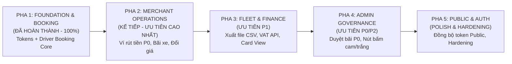

# 10. Lộ Trình Triển Khai Cải Thiện UX/UI Toàn Hệ Thống (Implementation Roadmap)

> **Dự án**: Smart Parking Hub — Frontend App (`smart-parking-app-v2`)  
> **Giai đoạn**: UX/UI MASTER IMPLEMENTATION ROADMAP (STOPPING AT PLANNING)  
> **Ngày lập báo cáo**: Tháng 11/2026  
> **Căn cứ kế hoạch**:
> - `09-prioritized-backlog.md` (Backlog 10 Task `TSK-P0-01` -> `TSK-P3-02`, Ma trận chấm điểm 56 màn hình, Phân tích RCA 6 tầng)
> - `11-shared-system-implementation-report.md` (Hoàn thành Token Design System & Shared Core Components)
> - `docs/ux-ui-audit/implementation/driver-booking-report.md` (Bàn giao thành công Pha 1: Driver Booking Core)
>
> **Cam kết tuân thủ**:
> - Không sửa mã nguồn ứng dụng trong bước này.
> - Không tạo task trực tiếp lên Trello.
> - Dừng lại ở bước lập kế hoạch và xin phê duyệt lộ trình từ người phụ trách.

---

## MỤC LỤC
1. [Tổng Quan Lộ Trình Triển Khai 5 Giai Đoạn (5-Phase Master Roadmap)](#1-tổng-quan-lộ-trình-triển-khai-5-giai-đoạn)
2. [Chi Tiết Kế Hoạch Từng Giai Đoạn](#2-chi-tiết-kế-hoạch-từng-giai-đoạn)
   - [Pha 1: Driver Booking Core & Nền Tảng Shared UI (Đã Hoàn Thành)](#pha-1-driver-booking-core--nền-tảng-shared-ui-đã-hoàn-thành)
   - [Pha 2: Merchant & Yard Operations Suite (Giai Đoạn Kế Tiếp)](#pha-2-merchant--yard-operations-suite-giai-đoạn-kế-tiếp)
   - [Pha 3: Driver Fleet & Finance Suite](#pha-3-driver-fleet--finance-suite)
   - [Pha 4: Admin Governance & Moderation Suite](#pha-4-admin-governance--moderation-suite)
   - [Pha 5: Public Marketing & Identity Suite](#pha-5-public-marketing--identity-suite)
3. [Ma Trận Triển Khai Kỹ Thuật (Implementation & Dependency Matrix)](#3-ma-trận-triển-khai-kỹ-thuật)
4. [Kế Hoạch Quản Lý Rủi Ro & Chiến Lược Rollback](#4-kế-hoạch-quản-lý-rủi-ro--chiến-lược-rollback)
5. [Quy Trình Kiểm Soát Chất Lượng & Cổng Nghiệm Thu (Quality Gates)](#5-quy-trình-kiểm-soát-chất-lượng--cổng-nghiệm-thu)
6. [Các Quyết Định Cần Phê Duyệt Trước Khi Khởi Động Pha 2](#6-các-quyết-định-cần-phê-duyệt-trước-khi-khởi-động-pha-2)

---

## 1. Tổng Quan Lộ Trình Triển Khai 5 Giai Đoạn

Lộ trình được thiết kế theo phương pháp **"Core-Outward & Dependency-First"**, bảo đảm mọi thay đổi về component dùng chung và token đều được hoàn thiện trước khi chạm vào màn hình nghiệp vụ cụ thể.



### Bảng Chỉ Số Tiến Độ & Phân Bổ Nỗ Lực (Story Points)

| Giai Đoạn | Tên Phân Hệ Triển Khai | Số Màn Hình | Task Trọng Tâm | Story Points | Trọng Số Rủi Ro | Trạng Thái |
| :---: | :--- | :---: | :--- | :---: | :---: | :---: |
| **Pha 1** | **Foundation & Driver Booking Core** | 5 màn hình + Toàn bộ Token | `APP-01`, `APP-02`, `APP-05`, `APP-09`, `APP-10`, `APP-13`, `ISS-12` | 8 SP | Thấp | **HOÀN THÀNH** |
| **Pha 2** | **Merchant & Yard Operations Suite** | 8 màn hình (`SCR-026` -> `SCR-033`) | `TSK-P0-01`, `TSK-P1-01`, `TSK-P2-01`, `APP-17` | 7 SP | Trung bình | **SẴN SÀNG TRIỂN KHAI** |
| **Pha 3** | **Driver Fleet & Finance Suite** | 7 màn hình (`SCR-019` -> `SCR-025`) | `TSK-P1-01`, `TSK-P1-02`, `TSK-P1-03`, `TSK-P3-01`, `TSK-P3-02` | 9 SP | Trung bình | **CHỜ PHA 2** |
| **Pha 4** | **Admin Governance & Moderation** | 12 màn hình (`SCR-042` -> `SCR-053`) | `TSK-P0-02`, `TSK-P2-03`, `TSK-P1-03` | 5 SP | Thấp | **CHỜ PHA 3** |
| **Pha 5** | **Public Marketing & Identity Suite** | 14 màn hình (`SCR-001` -> `SCR-013`) | Chuẩn hóa token Landing, Responsive bảng giá, CV careers mock | 4 SP | Thấp | **CHỜ PHA 4** |
| **TỔNG** | **Toàn Bộ Smart Parking Hub** | **56 màn hình** | **10 Master Tasks (18 ISS + 18 APP)** | **33 SP** | — | **ĐÃ XONG 24% (Pha 1)** |

---

## 2. Chi Tiết Kế Hoạch Từng Giai Đoạn

---

### Pha 1: Driver Booking Core & Nền Tảng Shared UI (ĐÃ HOÀN THÀNH)

* **Trạng thái thực tế:** Đã nghiệm thu 100% trong `11-shared-system-implementation-report.md` và `driver-booking-report.md`.
* **Phạm vi hoàn thành:**
  1. **Tầng Design Token & Core Primitives:**
     - Thiết lập chuẩn màu `--color-brand-primary: #d95f00` trên nền tối, đạt độ tương phản 4.85:1 (vượt chuẩn WCAG AA).
     - Đồng bộ các trạng thái ngữ nghĩa `brand-status-*` (Emerald, Amber, Rose, Sky).
     - Nâng cấp `Button.tsx`, `Badge.tsx`, `Modal.tsx` (có listener `Escape`, khóa cuộn `overflow: hidden`, bẫy focus), `Input.tsx`, `Card.tsx`, `Table.tsx`, `EmptyState.tsx`.
  2. **Tầng Nghiệp Vụ Driver Booking Core (`SCR-014` -> `SCR-018`):**
     - Sửa triệt để lỗi nuốt lỗi mạng tự sinh mã ảo `BK-2025-CLG2-014` (`APP-01` / `ISS-01`).
     - Tích hợp dữ liệu API thật vào trang chi tiết bãi đỗ thay vì dữ liệu tĩnh (`APP-02` / `ISS-07`).
     - Lưu trữ mã giữ slot 10 phút vào LocalStorage có thời gian hết hạn (`APP-05` / `ISS-08`).
     - Nối bộ lọc tra cứu nhanh với bảng chuyến đỗ (`APP-10` / `ISS-05`).
     - Tạo link động Google Maps theo địa chỉ thực tế của bãi (`APP-09` / `ISS-06`).
     - Chuẩn hóa layout container linh hoạt không giật padding (`APP-13` / `ISS-14`).
* **Kiểm định chất lượng:** 36/36 test suite pass (260/260 tests), typecheck 0 lỗi, lint 0 warning, production build thành công.

---

### Pha 2: Merchant & Yard Operations Suite (GIAI ĐOẠN KẾ TIẾP)

* **Mục tiêu trọng tâm:** Xóa bỏ bẫy validation P0 trên luồng tài chính rút tiền của chủ bãi, chấm dứt tình trạng xuất báo cáo giả lập và bảo vệ dữ liệu khi tạo bãi đỗ mới.
* **Thời gian ước tính:** 2 - 3 ngày làm việc (Tổng: 7 Story Points).
* **Màn hình triển khai (8 màn hình):**
  1. `SCR-026`: `/merchant` (Merchant Dashboard Overview)
  2. `SCR-027`: `/merchant/profile` (Legal Profile & Payout Bank Account)
  3. `SCR-028`: `/merchant/parking-lots` (Parking Lots Directory & Facilities)
  4. `SCR-029`: `/merchant/parking-lots/new` (Facility Onboarding Wizard)
  5. `SCR-030`: `/merchant/parking-lots/:id` (Facility Dossier & Photos)
  6. `SCR-031`: `/merchant/parking-lots/:id/edit` (Facility Configuration & Capacity)
  7. `SCR-032`: `/merchant/parking-lots/:id/slots` (Occupied Slots Invariant Protection)
  8. `SCR-038`: `/merchant/withdrawals` (Wallet Ledger & Payout Desk)

* **Các Task Kỹ Thuật Trọng Tâm Cần Giải Quyết:**
  - **`TSK-P0-01` (BLOCKER):** Sửa lỗi bẫy rút tiền trên `/merchant/withdrawals`.
    - *Giải pháp:* Vô hiệu hóa nút "+ Yêu cầu rút tiền" khi `walletBalance < 50000`, hiển thị tooltip cảnh báo số dư khả dụng tối thiểu. Khi form mở, hiển thị số dư khả dụng ngay cạnh ô nhập liệu để chủ bãi nắm rõ hạn mức.
  - **`TSK-P1-01` (HIGH):** Thay thế nút xuất báo cáo giả lập trên `/merchant/parking-lots`.
    - *Giải pháp:* Xây dựng `exportToCsvUtil.ts` và kích hoạt tải về tệp `DanhSach_BaiDo_SmartParking_YYYYMMDD.csv` chuẩn UTF-8 BOM.
  - **`TSK-P2-01` (MEDIUM):** Chặn click đúp khi tạo bãi mới (`/merchant/parking-lots/new`) và sửa bãi (`/:id/edit`).
    - *Giải pháp:* Gắn cờ `isSubmitting`, vô hiệu hóa nút submit và hiển thị spinner trong suốt thời gian API xử lý.
  - **`APP-17` (LOW):** Tinh chỉnh thị giác Bento cards trên `/merchant`.
    - *Giải pháp:* Giảm bão hòa các khối thẻ màu rực rỡ, sử dụng nền kính mờ (`bg-white/5 border border-white/10`) đồng bộ với TasteSkill.

* **Tiêu chí nghiệm thu Pha 2:**
  - Chủ bãi có số dư < 50.000đ không bị kẹt trong form rút tiền.
  - Bấm nút xuất báo cáo tải về tệp CSV thực sự, mở trên Excel tiếng Việt không lỗi font.
  - Không thể gửi trùng 2 request tạo bãi đỗ khi mạng chậm.
  - Toàn bộ test suite của phân hệ Merchant pass 100%.

---

### Pha 3: Driver Fleet & Finance Suite

* **Mục tiêu trọng tâm:** Chuẩn hóa toàn diện luồng quản lý đội xe và sổ sách thanh toán của tài xế xe tải/container.
* **Thời gian ước tính:** 3 ngày làm việc (Tổng: 9 Story Points).
* **Màn hình triển khai (7 màn hình):**
  1. `SCR-019`: `/payments` (Driver Transaction Ledger & Invoice)
  2. `SCR-020`: `/vehicles` (Fleet Management & Master Vehicle Desk)
  3. `SCR-021`: `/profile` (Driver Personal & Logistics Identity)
  4. `SCR-022`: `/change-password` (Account Security Credential)
  5. `SCR-023`: `/payment/success` (PayOS Instant Fulfillment Receipt)
  6. `SCR-024`: `/payment/cancel` (Grace Period Slot Protection)
  7. `SCR-025`: `/notifications` (Web Push & Notification Center)

* **Các Task Kỹ Thuật Trọng Tâm Cần Giải Quyết:**
  - **`TSK-P1-01` (HIGH):** Sửa lỗi xuất tệp tải về JSON đổi đuôi làm hỏng file trên `/vehicles` và timer ảo trên `/payments`.
  - **`TSK-P1-02` (HIGH):** Chuyển đổi lưu trữ hóa đơn VAT doanh nghiệp từ `localStorage` sang gọi API `PUT /api/v1/users/me`.
  - **`TSK-P1-03` (HIGH):** Biến đổi bảng giao dịch (`MasterTransactionTable`) và bảng đội xe (`VehicleMasterTable`) thành giao diện Thẻ xếp chồng (Stacked Card View) trên màn hình di động (< 640px).
  - **`TSK-P3-01` (LOW):** Áp dụng component `EmptyState.tsx` có nút CTA dẫn đường ("Thêm xe đầu tiên", "Khám phá bãi xe") khi danh sách rỗng.
  - **`TSK-P3-02` (LOW):** Thêm nút đóng `[X]` góc phải trên và cho phép bấm nền để đóng modal `AcceptQueueSuccessModal`.

---

### Pha 4: Admin Governance & Moderation Suite

* **Mục tiêu trọng tâm:** Giải phóng điểm nghẽn thẩm định bãi đỗ xe và đồng nhất 100% ngôn ngữ thiết kế cho đội ngũ vận hành cấp cao.
* **Thời gian ước tính:** 2 ngày làm việc (Tổng: 5 Story Points).
* **Màn hình triển khai (12 màn hình):**
  - `SCR-042`: `/admin` (Command Center Overview)
  - `SCR-043`: `/admin/parking-lots` (Pending Lot Queue)
  - `SCR-044`: `/admin/parking-lots/:id` (Lot Appraisal Dossier)
  - `SCR-045`: `/admin/users` & `SCR-046`: `/admin/users/:id` (User Directory & Enforcement)
  - `SCR-047`: `/admin/transactions` (System Financial Ledger)
  - `SCR-048`: `/admin/withdrawals` (Merchant Withdrawal Settlements)
  - `SCR-049`: `/admin/disputes` & `SCR-050`: `/admin/disputes/:id` (Arbitration Tribunal)
  - `SCR-051`: `/admin/audit-logs` (Immutable Security Audit Trail)
  - `SCR-052`: `/admin/notifications` & `SCR-053`: `/admin/profile`

* **Các Task Kỹ Thuật Trọng Tâm Cần Giải Quyết:**
  - **`TSK-P0-02` (BLOCKER):** Gỡ bỏ bắt buộc nhập lý do khi Admin bấm "Phê duyệt" bãi đỗ xe hợp lệ (`/admin/parking-lots/:id`).
  - **`TSK-P2-03` (MEDIUM):** Thay thế toàn bộ nút bấm Admin dùng màu đảo ngược (`bg-brand-orange text-brand-navy`) sang màu cam thương hiệu chữ trắng đồng nhất với hệ thống (`bg-[#d95f00] text-white`).
  - **`TSK-P1-03` (HIGH):** Áp dụng hiển thị thẻ cho bảng nhật ký kiểm toán (`AdminAuditLogsPage`) và bảng giao dịch toàn sàn trên thiết bị di động.

---

### Pha 5: Public Marketing & Identity Suite

* **Mục tiêu trọng tâm:** Rà soát tương phản màu, hoàn thiện responsive bảng giá dịch vụ và làm sạch các form tương tác công khai.
* **Thời gian ước tính:** 1 - 2 ngày làm việc (Tổng: 4 Story Points).
* **Màn hình triển khai (14 màn hình):**
  - Public Pages: `/`, `/solutions/drivers`, `/solutions/owners`, `/pricing`, `/api-docs`, `/about`, `/careers`, `/insights`, `/contact` (`SCR-001` -> `SCR-009`).
  - Auth Pages: `/login`, `/register`, `/forgot-password`, `/403`, `/*` (`SCR-010` -> `SCR-013`).

* **Các Task Kỹ Thuật Trọng Tâm Cần Giải Quyết:**
  - Thay thế các mã màu HEX hardcode `#F97316` còn sót trên nút bấm công khai sang biến CSS `--color-brand-primary` (#d95f00) để đảm bảo WCAG AA.
  - Tối ưu bảng so sánh gói giá (`/pricing`) chống tràn mép trên màn hình 375px.
  - Kết nối form nộp hồ sơ ứng tuyển (`/careers`) hoặc hiển thị hướng dẫn gửi email ứng tuyển rõ ràng thay vì chạy timer ảo.

---

## 3. Ma Trận Triển Khai Kỹ Thuật (Implementation Matrix)

Bảng ma trận chỉ rõ thứ tự thực hiện tuần tự, mức độ ưu tiên, sự phụ thuộc và phạm vi kiểm thử hồi quy:

| Thứ Tự | Task ID | Mức Độ | Tên Hạng Mục | Màn Hình Liên Quan | Phụ Thuộc Kỹ Thuật | Phạm Vi Hồi Quy |
| :---: | :--- | :---: | :--- | :--- | :--- | :--- |
| **01** | `TSK-P0-01` | **P0** | Sửa bẫy validation rút tiền Merchant | `SCR-038` (`/merchant/withdrawals`) | `Button.tsx` (Bậc 3) | `FinancePages.tsx` |
| **02** | `TSK-P1-01` (A) | **P1** | Xuất CSV chuẩn UTF-8 BOM bãi xe | `SCR-028` (`/merchant/parking-lots`) | `exportToCsvUtil.ts` | `ExportReportModal.tsx` |
| **03** | `TSK-P2-01` | **P2** | Chặn double-click form tạo/sửa bãi | `SCR-029`, `SCR-031`, `SCR-038` | `Button.tsx` (Bậc 3) | `LotFormWizard.tsx` |
| **04** | `APP-17` | **P3** | Làm dịu màu Bento cards Dashboard | `SCR-026` (`/merchant`) | `Card.tsx` (Bậc 3) | `MerchantDashboardPage.tsx` |
| **05** | `TSK-P1-01` (B) | **P1** | Sửa lỗi tải tệp hỏng xe & sao kê | `SCR-019`, `SCR-020` | `exportToCsvUtil.ts` | `ExportFleetModal.tsx` |
| **06** | `TSK-P1-02` | **P1** | Đồng bộ hóa đơn VAT qua API Profile | `SCR-019`, `SCR-021` | `profileApi.ts` | `CompanyInvoiceModal.tsx` |
| **07** | `TSK-P1-03` | **P1** | Chuyển đổi bảng sang Card View mobile| `SCR-019`, `SCR-020`, `SCR-047` | `Card.tsx`, `Table.tsx` | `MasterTransactionTable.tsx` |
| **08** | `TSK-P3-01` | **P3** | Chuẩn hóa EmptyState có nút CTA | `SCR-018`, `SCR-019` | `EmptyState.tsx` | `QueueHistoryTable.tsx` |
| **09** | `TSK-P3-02` | **P3** | Nút đóng [X] modal hàng đợi | `SCR-018` (`/queues`) | `Modal.tsx` (Bậc 3) | `AcceptQueueSuccessModal.tsx` |
| **10** | `TSK-P0-02` | **P0** | Bỏ bắt buộc lý do khi Admin duyệt | `SCR-044` (`/admin/parking-lots/:id`)| `Modal.tsx`, `Input.tsx` | `DecisionDialog` in `admin` |
| **11** | `TSK-P2-03` | **P2** | Đổi nút Admin sang cam chữ trắng | `SCR-042` -> `SCR-053` (Admin) | `Workspace.tsx` | `AdminLayout.tsx` |
| **12** | `POLISH-PUB`| **P3** | Đồng bộ token và responsive Public | `SCR-001` -> `SCR-009` | `globals.css` | Public Pages components |

---

## 4. Kế Hoạch Quản Lý Rủi Ro & Chiến Lược Rollback

| Rủi Ro Nhận Diện | Khả Năng Xảy Ra | Mức Độ Tác Động | Chiến Lược Giảm Thiểu (Mitigation) | Phương Án Rollback Khi Gặp Lỗi |
| :--- | :---: | :---: | :--- | :--- |
| **Sai lệch DTO hoặc Payload với Backend** | Trung bình | Cao | Luôn đối chiếu trực tiếp mã nguồn DTO tại `smart-parking-microservice` trước khi sửa form request. | Hoàn nguyên commit của riêng component đó bằng Git, giữ nguyên mock an toàn có ghi chú rõ ràng. |
| **Xung đột Style Tailwind CSS v4** | Thấp | Trung bình | Chỉ sử dụng các biến CSS `@theme` đã được định nghĩa trong `globals.css`, không cấu hình tùy tiện trong inline style. | Kiểm tra bằng lệnh `npm run build` trước khi push; nếu vỡ layout thì khôi phục selector CSS trước đó. |
| **Vỡ Layout Responsive khi đổi Table sang Card** | Trung bình | Trung bình | Áp dụng kỹ thuật chuyển đổi theo Breakpoint: `hidden sm:block` cho `<table>` và `block sm:hidden` cho danh sách thẻ `Card`. | Giữ nguyên thẻ `table` gốc, chỉ thêm wrapper thẻ bọc ngoài mà không xóa bỏ cấu trúc bảng. |
| **Gãy Unit Test do thay đổi cấu trúc DOM** | Trung bình | Thấp | Luôn cập nhật hoặc bổ sung test case trong `tests/` đồng thời với việc chỉnh sửa giao diện; chạy `npm run test` liên tục. | Sử dụng `git checkout -- tests/` để xác minh xem lỗi do test cũ viết cứng chuỗi text hay do logic bị lỗi. |

---

## 5. Quy Trình Kiểm Soát Chất Lượng & Cổng Nghiệm Thu (Quality Gates)

Để đảm bảo không có bất kỳ sự suy giảm chất lượng nào (Zero Regression), mỗi màn hình hoặc cụm tính năng sau khi được triển khai bắt buộc phải vượt qua **4 Cổng Kiểm Soát Kỹ Thuật (Quality Gates)**:

```
┌────────────────────────────────────────────────────────────────────────┐
│ CỔNG 1: STATIC ANALYSIS                                                │
│ 1. npm --prefix smart-parking-app-v2 run typecheck (0 errors)          │
│ 2. npm --prefix smart-parking-app-v2 run lint (0 errors, 0 warnings)   │
└──────────────────────────────────┬─────────────────────────────────────┘
                                   │
┌──────────────────────────────────▼─────────────────────────────────────┐
│ CỔNG 2: UNIT & INTEGRATION TESTING                                     │
│ 3. npm --prefix smart-parking-app-v2 run test (100% tests pass)        │
└──────────────────────────────────┬─────────────────────────────────────┘
                                   │
┌──────────────────────────────────▼─────────────────────────────────────┐
│ CỔNG 3: PRODUCTION BUILD VERIFICATION                                  │
│ 4. npm --prefix smart-parking-app-v2 run build (Vite bundle < 15s)      │
└──────────────────────────────────┬─────────────────────────────────────┘
                                   │
┌──────────────────────────────────▼─────────────────────────────────────┐
│ CỔNG 4: USER & ARCHITECT ACCEPTANCE (DỪNG ĐỂ DUYỆT)                    │
│ 5. Báo cáo bằng văn bản minh bạch, đối chiếu trước/sau, chờ duyệt      │
└────────────────────────────────────────────────────────────────────────┘
```

---

## 6. Các Quyết Định Cần Phê Duyệt Trước Khi Khởi Động Pha 2

Để bắt đầu bước vào triển khai thực tế **Pha 2 (Merchant & Yard Operations Suite)**, nhóm phát triển kính trình người phụ trách xem xét và phê duyệt các điểm chốt thiết kế và nghiệp vụ sau:

1. **Phê duyệt sửa đổi luồng rút tiền Merchant (`TSK-P0-01`):**
   - Vô hiệu hóa nút "+ Yêu cầu rút tiền" khi số dư ví < 50.000 ₫ (thay vì cho mở form rồi bị kẹt validation).
2. **Phê duyệt chuẩn hóa xuất dữ liệu sang CSV UTF-8 BOM (`TSK-P1-01`):**
   - Tải về tệp CSV thực tế thay cho cơ chế giả lập hẹn giờ (`setTimeout`).
3. **Phê duyệt thời điểm khởi động Pha 2:**
   - Tiến hành triển khai chi tiết cho 8 màn hình thuộc cụm Merchant (`SCR-026` -> `SCR-033`) theo đúng quy trình 8 pha của Master Instructions.

---
**Tài liệu được hoàn thành và lưu trữ tại:** `docs/ux-ui-audit/10-implementation-roadmap.md`.
