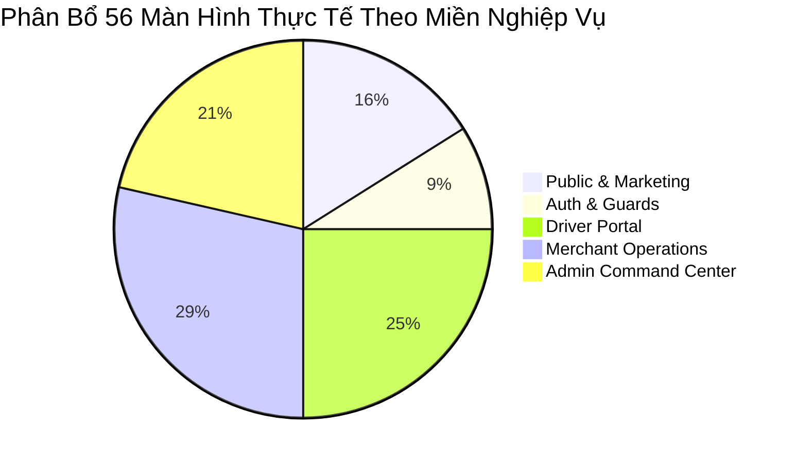

# 11. Thống Kê Toàn Diện Màn Hình & Phân Nhóm Nghiệp Vụ (Page Group Inventory)

> **Dự án**: Smart Parking Hub — Frontend App (`smart-parking-app-v2`)  
> **Giai đoạn**: PAGE GROUP DISCOVERY & INVENTORY AUDIT (PLANNING ONLY)  
> **Thời gian thẩm định**: 06/11/2026 · **Trạng thái**: HOÀN THÀNH ĐỐI SOÁT 100% ROUTE VÀ MÃ NGUỒN  
> **Cơ sở dữ liệu**:
> - Router thực tế: `src/app/router/index.tsx` (659 dòng mã nguồn)
> - Báo cáo khảo sát & audit: `00-project-inventory.md`, `01-route-matrix.md`, `02-shared-components.md`, `03-role-workflow-map.md`, `04-interaction-audit.md`, `05-design-system-audit.md`, `08-application-screen-review.md`, `09-prioritized-backlog.md`, `10-implementation-roadmap.md`, `11-shared-system-implementation-report.md`
>
> **Cam kết tuân thủ**:
> - Không sửa mã nguồn. Không redesign/refactor code.
> - Không tạo task trực tiếp lên Trello.
> - Dừng lại ở bước lập kế hoạch và xin phê duyệt.

---

## MỤC LỤC
1. [Đối Chiếu & Xác Thực Số Lượng Màn Hình Thực Tế](#1-đối-chiếu--xác-thực-số-lượng-màn-hình-thực-tế)
2. [Phân Nhóm Theo 5 Miền Nghiệp Vụ (Functional Domains)](#2-phân-nhóm-theo-5-miền-nghiệp-vụ)
3. [Bảng Thống Kê Chi Tiết Toàn Bộ 56 Màn Hình Nghiệp Vụ](#3-bảng-thống-kê-chi-tiết-toàn-bộ-56-màn-hình-nghiệp-vụ)
   - [Miền A: Public Marketing & Developer Portal (9 màn hình)](#miền-a-public-marketing--developer-portal)
   - [Miền B: Authentication & Access Control Guards (5 màn hình)](#miền-b-authentication--access-control-guards)
   - [Miền C: Driver Portal & Logistics Mobility (14 màn hình)](#miền-c-driver-portal--logistics-mobility)
   - [Miền D: Merchant Portal & Yard Operations (16 màn hình)](#miền-d-merchant-portal--yard-operations)
   - [Miền E: Admin Command Center & Governance (12 màn hình)](#miền-e-admin-command-center--governance)
   - [Miền F: Các Tuyến Kỹ Thuật Nội Bộ & Dev-Only (2 tuyến)](#miền-f-các-tuyến-kỹ-thuật-nội-bộ)
4. [Kết Luận Khảo Sát & Tính Đầy Đủ (Completeness Verification)](#4-kết-luận-khảo-sát--tính-đầy-đủ)

---

## 1. Đối Chiếu & Xác Thực Số Lượng Màn Hình Thực Tế

Khảo sát đối chiếu giữa mã số ban đầu (`SCR-001` -> `SCR-053`) và Router thực tế (`src/app/router/index.tsx`):

```
┌────────────────────────────────────────────────────────────────────────┐
│ TỔNG KẾT RECONCILIATION ROUTE VÀ MÀN HÌNH                              │
├────────────────────────────────────────────────────────────────────────┤
│ • Số lượng màn hình định danh gốc:           53 màn hình (SCR-001..053) │
│ • Màn hình thực tế tồn tại trong router:      56 màn hình độc lập      │
│   + 53 màn hình chuẩn hóa SCR-001 -> SCR-053                           │
│   + 02 màn hình khiếu nại tài xế: DRV-DISP-01 & DRV-DISP-02            │
│   + 01 màn hình lỗi điều hướng: 404 Catch-All                          │
│ • Tổng số URL Patterns được đăng ký:         73 URL patterns           │
│   + 56 đường dẫn chuẩn (Canonical paths)                               │
│   + 17 đường dẫn phụ (Aliases đa ngôn ngữ, SEO, prefix dashboard)     │
│ • Tuyến kỹ thuật nội bộ (Không public):      02 routes (/crm, preview) │
│ • Số trang bị xóa hoặc không tồn tại:        0 trang                   │
│ • Số trang bỏ sót trong Router:              0 trang                   │
└────────────────────────────────────────────────────────────────────────┘
```



---

## 2. Phân Nhóm Theo 5 Miền Nghiệp Vụ

Hệ thống được chia thành 5 miền chức năng chuyên biệt, không gộp chung các luồng thao tác khác biệt chỉ vì cùng một vai trò người dùng:

### Miền A: Public Marketing & Developer Portal (9 Màn Hình)
- **Đối tượng**: Khách vãng lai, doanh nghiệp vận tải, chủ bãi xe tiềm năng, nhà phát triển phần mềm đối tác.
- **Layout**: `LandingNavbar` + `LandingFooter` (Dark Industrial Theme).
- **Mục tiêu**: Giới thiệu năng lực nền tảng, minh bạch bảng giá, hướng dẫn Open API, tiếp nhận liên hệ và đăng ký dịch vụ.

### Miền B: Authentication & Access Control Guards (5 Màn Hình)
- **Đối tượng**: Mọi người dùng đăng nhập hệ thống hoặc gặp sự cố điều hướng.
- **Layout**: `AuthLayout` (Split-screen 50:50, hình ảnh logistics và form xác thực) và Standalone Center.
- **Mục tiêu**: Định danh người dùng bảo mật qua JWT, xác thực số điện thoại và OTP SMS, bảo vệ phân quyền theo Role (`RequireRole`).

### Miền C: Driver Portal & Logistics Mobility (14 Màn Hình)
- **Đối tượng**: Bác tài xe đầu kéo container, xe tải nặng trung chuyển hàng cảng biển (`ROLE_DRIVER`).
- **Layout**: `DriverLayout` (Header tích hợp trạng thái ca trực, Breadcrumb, Container co giãn theo `--driver-header-height`).
- **Mục tiêu**: Tìm bãi đỗ còn chỗ theo thời gian thực, đặt chỗ & thanh toán cọc PayOS, xuất vé QR qua barie tự động, xếp hàng ảo khi hết chỗ, quản lý phương tiện và sổ đối soát cước phí.

### Miền D: Merchant Portal & Yard Operations (16 Màn Hình)
- **Đối tượng**: Chủ bãi đỗ xe, ban điều hành kho depot cảng biển, nhân viên trực cổng barie (`ROLE_MERCHANT`).
- **Layout**: `MerchantLayout` (Sidebar cố định màu `#131b2e`, Dark Command Header, Workspace primitives).
- **Mục tiêu**: Quản lý mặt bằng bến bãi, đăng ký cơ sở mới, điều chỉnh ma trận slot 5 loại xe (Occupied Invariant), trạm quét QR barie vào/ra tự động, theo dõi doanh thu và rút tiền về tài khoản ngân hàng.

### Miền E: Admin Command Center & Governance (12 Màn Hình)
- **Đối tượng**: Ban quản trị hệ thống Smart Parking Hub (`ROLE_ADMIN`).
- **Layout**: `AdminLayout` (Header chỉ huy an ninh, Workspace primitives).
- **Mục tiêu**: Giám sát toàn sàn, thẩm định và phê duyệt bãi xe mới, quản trị tài khoản người dùng, đối soát giao dịch dòng tiền, giải quyết tranh chấp (Arbitration Tribunal), và nhật ký kiểm toán an ninh bất biến.

---

## 3. Bảng Thống Kê Chi Tiết Toàn Bộ 56 Màn Hình Nghiệp Vụ

---

### Miền A: Public Marketing & Developer Portal

| Page ID | Tên Màn Hình | Route Path & Aliases | User Role | Module | Page Type | Layout | Mục Đích Chính & Workflow | Shared Components | Related Issues | Hiện Trạng UX/UI | Tình Trạng Triển Khai |
| :---: | :--- | :--- | :---: | :--- | :---: | :--- | :--- | :--- | :--- | :--- | :---: |
| **SCR-001** | Public Landing Page | `/` | Guest | `features/landing` | Standalone Landing | `LandingNavbar`<br/>`LandingFooter` | Trang chủ giới thiệu giải pháp SmartTruck Hub. Luồng: Xem hero -> khám phá tính năng -> bảng giá -> CTA đăng ký. | `Button`, `Card`, `Badge` | Cần chuẩn hóa mã màu cam với token `@theme` | Tốt, typography phân cấp rõ | SẴN SÀNG |
| **SCR-002** | Driver Solutions | `/solutions/drivers`<br/>*(Aliases: `/driver-solutions`, `/giai-phap-tai-xe`)* | Guest | `features/landing` | Standalone Landing | `LandingNavbar`<br/>`LandingFooter` | Trình bày giải pháp số hóa hành trình cho tài xế xe tải/container. Luồng: Tìm hiểu tính năng -> CTA đăng ký tài xế. | `Button`, `Card`, `Badge` | Nút cam chữ trắng cần đạt WCAG AA | Khá, bố cục mượt mà | SẴN SÀNG |
| **SCR-003** | Owner Solutions | `/solutions/owners`<br/>*(Aliases: `/owner-solutions`, `/giai-phap-chu-bai`)* | Guest | `features/landing` | Standalone Landing | `LandingNavbar`<br/>`LandingFooter` | Giới thiệu giải pháp tối ưu công suất bãi và camera ALPR cho chủ bãi. Luồng: Xem mô hình doanh thu -> đăng ký bãi. | `Button`, `Card`, `Badge` | Bảng tính doanh thu cần responsive mobile | Khá, minh họa trực quan | SẴN SÀNG |
| **SCR-004** | Pricing Matrix | `/pricing`<br/>*(Alias: `/bang-gia`)* | Guest | `features/landing` | Pricing Matrix | `LandingNavbar`<br/>`LandingFooter` | Niêm yết bảng giá dịch vụ nền tảng và phí kết nối barie. Luồng: Chọn chu kỳ cước -> so sánh gói dịch vụ -> liên hệ. | `Button`, `Card`, `Badge`, `Tabs` | Bảng so sánh tính năng tràn mép mobile 375px | Tốt trên desktop, cần tối ưu mobile | SẴN SÀNG |
| **SCR-005** | API & Developer Docs | `/api-docs`<br/>*(Aliases: `/ket-noi-api`, `/solutions/api`)* | Guest | `features/landing` | Developer Portal | `LandingNavbar`<br/>`LandingFooter` | Tài liệu tích hợp Open API và Webhook cổng vào/ra bãi. Luồng: Tra cứu endpoint -> xem demo payload -> sao chép JSON. | `Button`, `Card`, `Badge`, Code Block | Terminal copy clipboard đã xử lý feedback tốt | Tốt, dark theme chuyên nghiệp | SẴN SÀNG |
| **SCR-006** | About Us | `/about`<br/>*(Aliases: `/ve-chung-toi`, `/company/about`)* | Guest | `features/landing` | Corporate Story | `LandingNavbar`<br/>`LandingFooter` | Giới thiệu sứ mệnh giải quyết ùn tắc logistics cảng biển. Luồng: Đọc câu chuyện doanh nghiệp -> xem dòng lịch sử -> ban lãnh đạo. | `Button`, `Card`, `Badge` | Không có issue nghiêm trọng | Tốt, timeline thiết kế sạch | SẴN SÀNG |
| **SCR-007** | Careers & Recruitment | `/careers`<br/>*(Aliases: `/tuyen-dung`, `/company/careers`)* | Guest | `features/landing` | Career Portal | `LandingNavbar`<br/>`LandingFooter` | Tuyển dụng nhân sự công nghệ và logistics. Luồng: Lọc vị trí tuyển dụng -> mở modal ứng tuyển -> nộp CV. | `Button`, `Card`, `Modal`, `Input` | `ISS-15` (Form nộp CV chỉ chạy timer ảo không gửi email/API) | Khá, cần kết nối form hoặc mailto | SẴN SÀNG |
| **SCR-008** | Logistics Insights | `/insights`<br/>*(Aliases: `/tin-tuc`, `/company/blog`)* | Guest | `features/landing` | Content Portal | `LandingNavbar`<br/>`LandingFooter` | Tin tức và cẩm nang vận tải cảng biển. Luồng: Lọc theo chủ đề bài viết -> đọc báo cáo -> đăng ký bản tin. | `Button`, `Card`, `Badge`, `Input` | Không có issue nghiêm trọng | Tốt, phân trang mượt mà | SẴN SÀNG |
| **SCR-009** | Contact & Support 24/7 | `/contact`<br/>*(Aliases: `/lien-he`, `/ho-tro`, `/company/contact`)* | Guest | `features/landing` | Contact Desk | `LandingNavbar`<br/>`LandingFooter` | Kênh hỗ trợ điều phối khẩn cấp 24/7. Luồng: Điền nội dung hỗ trợ -> kích hoạt gửi thư an toàn tới ban quản trị. | `Button`, `Card`, `Input` | Đã xử lý mailto client an toàn | Tốt, đầy đủ thông tin hotline | SẴN SÀNG |

---

### Miền B: Authentication & Access Control Guards

| Page ID | Tên Màn Hình | Route Path | User Role | Module | Page Type | Layout | Mục Đích Chính & Workflow | Shared Components | Related Issues | Hiện Trạng UX/UI | Tình Trạng Triển Khai |
| :---: | :--- | :--- | :---: | :--- | :---: | :--- | :--- | :--- | :--- | :--- | :---: |
| **SCR-010** | Login Screen | `/login` | Guest *(Chuyển hướng nếu đã đăng nhập)* | `features/auth` | Authentication | `AuthLayout` | Đăng nhập tài khoản bằng SĐT và mật khẩu, hỗ trợ tài khoản demo cho DEV. Luồng: Nhập thông tin -> Đăng nhập -> Lưu JWT -> Chuyển về Dashboard theo Role. | `Button`, `Input`, `Card`, Demo Account Picker | Không có lỗi. Đã sync Redux & LocalStorage an toàn. | Rất tốt, responsive mượt mà | HOÀN THÀNH |
| **SCR-011** | Register Screen | `/register` | Guest | `features/auth` | Registration | `AuthLayout` | Đăng ký tài khoản mới cho Tài xế hoặc Chủ bãi kèm xác thực OTP. Luồng: Chọn vai trò -> Điền thông tin -> Nhập mã OTP 6 số -> Kích hoạt tài khoản. | `Button`, `Input`, `Card` | Đầy đủ Zod validation | Tốt, có countdown OTP | HOÀN THÀNH |
| **SCR-012** | Password Recovery | `/forgot-password` | Guest | `features/auth` | Security Recovery | `AuthLayout` | Khôi phục mật khẩu khi quên qua email/SĐT. Luồng: Nhập SĐT/Email -> Nhận mã OTP -> Đặt mật khẩu mới -> Đăng nhập lại. | `Button`, `Input`, `Card` | Đầy đủ validation mật khẩu mới | Tốt, luồng 3 bước rõ ràng | HOÀN THÀNH |
| **SCR-013** | 403 Forbidden | `/403` | All Roles | `features/auth` | Access Control Guard | Standalone Center | Báo lỗi tài khoản không đủ quyền truy cập (Role Guard). Luồng: Xem thông báo quyền -> Bấm quay về trang chủ hoặc Đăng nhập lại. | `Button`, `Card` | Không có issue | Tốt, thông báo minh bạch | HOÀN THÀNH |
| **404** | 404 Not Found | `*` *(Catch-all)* | All Roles | `features/auth` | System Status | Standalone Center | Xử lý các đường dẫn URL không hợp lệ. Luồng: Xem thông báo -> Bấm nút quay về trang an toàn. | `Button`, `Card` | Không có issue | Tốt, bắt đúng mọi URL sai | HOÀN THÀNH |

---

### Miền C: Driver Portal & Logistics Mobility

| Page ID | Tên Màn Hình | Route Path & Aliases | User Role | Module | Page Type | Layout | Mục Đích Chính & Workflow | Shared Components | Related Issues | Hiện Trạng UX/UI | Tình Trạng Triển Khai |
| :---: | :--- | :--- | :---: | :--- | :---: | :--- | :--- | :--- | :--- | :--- | :---: |
| **SCR-014** | Driver Dashboard | `/dashboard`<br/>*(Aliases: `/driver`, `/driver/dashboard`)* | Driver | `features/driver` | Dashboard | `DriverLayout` | Tổng quan vận hành: chuyến xe đang chạy, 4 Bento KPI, thao tác nhanh, bảng đặt chỗ gần nhất. | `Button`, `Card`, `Badge`, `Modal` | `APP-09`, `APP-10`, `APP-13` (Đã xử lý ở Pha 1) | Rất tốt sau khi nối API thật | HOÀN THÀNH PHA 1 |
| **SCR-015** | Parking Search & Map | `/parking`<br/>*(Aliases: `/dashboard/search`, `/dashboard/parking`, `/driver/search`)* | Driver | `features/parking-search` | Map Workbench | `DriverLayout` | Tìm kiếm bãi đỗ xe realtime trên bản đồ Leaflet, lọc theo bán kính 5-50km và giữ slot khẩn cấp 10 phút. | `Button`, `Input`, `Card`, `Badge`, Leaflet | `APP-05` (Đã xử lý giữ slot ở Pha 1) | Tốt, bản đồ mượt | HOÀN THÀNH PHA 1 |
| **SCR-016** | Parking Details | `/parking/:id`<br/>*(Aliases: `/dashboard/parking/:id`, `/driver/parking/:id`)* | Driver | `features/parking-detail` | Facility Detail & Form | `DriverLayout` | Xem thông số kỹ thuật bãi, biểu phí cao điểm, tỷ lệ slot khả dụng và form đặt chỗ kèm cọc PayOS. | `Button`, `Card`, `Modal`, `Input` | `APP-01`, `APP-02` (Đã xóa lỗi đơn ảo ở Pha 1) | Xuất sắc, số liệu động từ API | HOÀN THÀNH PHA 1 |
| **SCR-017** | Driver Bookings | `/bookings`<br/>*(Aliases: `/dashboard/bookings`, `/driver/bookings`)* | Driver | `features/bookings` | Master-Detail | `DriverLayout` | Danh sách đặt chỗ, xuất vé điện tử QR tải về PNG, thanh toán nốt tiền cước, hủy vé, đánh giá sao. | `Button`, `Card`, `Badge`, `Modal`, `Tabs` | `ISS-12` (Đã xử lý phím Escape modal) | Tốt, Master-Detail tiện lợi | HOÀN THÀNH PHA 1 |
| **SCR-018** | Virtual Queues | `/queues`<br/>*(Aliases: `/dashboard/queues`, `/driver/queues`)* | Driver | `features/queues` | Queue Operational | `DriverLayout` | Hàng đợi ảo thông minh khi bãi hết chỗ; tự động cấp nốt khi xe trước rời bãi. | `Button`, `Card`, `Badge`, `Modal` | `TSK-P3-01` (Empty state thiếu CTA), `TSK-P3-02` (`APP-11` - Modal thiếu nút X) | Khá, cần bổ sung nút X và CTA | CHỜ TRIỂN KHAI |
| **SCR-019** | Driver Payments | `/payments`<br/>*(Aliases: `/dashboard/payments`, `/driver/payments`)* | Driver | `features/payments` | Financial Ledger | `DriverLayout` | Lịch sử thanh toán cước đỗ xe và quản lý hóa đơn VAT điện tử (TT78). Bóc tách chi phí, tải biên lai PDF. | `Button`, `Card`, `Badge`, `Modal`, `Table` | `TSK-P1-01` (`APP-06` - Xuất file mock timer), `TSK-P1-02` (`APP-14` - VAT localStorage), `TSK-P1-03` (Bảng tràn mobile) | Cần chuyển bảng sang Card View và nối API | CHỜ TRIỂN KHAI |
| **SCR-020** | Fleet Management | `/vehicles`<br/>*(Aliases: `/dashboard/vehicles`, `/driver/vehicles`)* | Driver | `features/vehicles` | Master Table Desk | `DriverLayout` | Quản lý đội xe và đồng bộ biển số tự động qua camera cổng ALPR. Thêm/sửa xe, hồ sơ kiểm định, xuất danh sách xe. | `Button`, `Card`, `Badge`, `Modal`, `Table`, `Input` | `TSK-P1-01` (`APP-03` - Tải JSON đổi đuôi làm hỏng tệp), `TSK-P1-03` (Bảng tràn mobile), `TSK-P2-01` (Double-click submit) | Cần chuẩn hóa xuất CSV và Card View | CHỜ TRIỂN KHAI |
| **SCR-021** | Driver Profile | `/profile`<br/>*(Aliases: `/dashboard/profile`, `/driver/profile`)* | Driver | `features/profile` | Account Settings | `DriverLayout` | Quản lý thông tin tài xế và số điện thoại liên hệ khẩn cấp. Nối trực tiếp `GET/PUT /api/v1/users/me`. | `Button`, `Input`, `Card` | Không có issue, đã tinh gọn API-only | Rất tốt, form gọn gàng | HOÀN THÀNH |
| **SCR-022** | Change Password | `/change-password`<br/>*(Aliases: `/dashboard/change-password`, `/driver/change-password`)* | Driver | `features/change-password`| Account Security | `DriverLayout` | Đổi mật khẩu tài khoản và kiểm tra độ mạnh theo tiêu chuẩn an ninh Fretrix 4 tiêu chí realtime. | `Button`, `Input`, `Card`, `Badge` | Không có issue | Rất tốt, phản hồi realtime | HOÀN THÀNH |
| **SCR-023** | PayOS Return Success | `/payment/success`<br/>*(Aliases: `/payment/return`, `/dashboard/payment/success`)* | Driver | `features/payment-return` | Callback Hub | `DriverLayout` | Xác nhận thanh toán PayOS thành công, lưu giữ slot và cấp vé QR điện tử vào bãi tức thì. | `Button`, `Card`, `Badge` | Không có issue | Rất tốt, xác thực token chuẩn | HOÀN THÀNH |
| **SCR-024** | PayOS Return Cancel | `/payment/cancel`<br/>*(Aliases: `/dashboard/payment/cancel`, `/driver/payment/cancel`)* | Driver | `features/payment-cancel` | Callback Hub | `DriverLayout` | Tiếp nhận trường hợp hủy thanh toán PayOS; thông báo bảo lưu slot trong 10 phút để thanh toán lại. | `Button`, `Card`, `Badge` | Không có issue | Tốt, giữ nguyên trạng thái đơn | HOÀN THÀNH |
| **SCR-025** | Driver Notifications | `/notifications`<br/>*(Aliases: `/dashboard/notifications`, `/driver/notifications`)*| Driver | `features/notifications` | Notification Center | `DriverLayout` | Trung tâm thông báo nhật ký tác vụ điều phối, nhắc giờ check-in/out, phân bổ slot hàng đợi, Web Push 24/7. | `Button`, `Card`, `Badge`, `Tabs` | Không có issue | Tốt, hỗ trợ push trình duyệt | HOÀN THÀNH |
| **DRV-DISP-01** | Driver Disputes | `/disputes` | Driver | `features/disputes` | Operations List | `DriverLayout` | Danh sách khiếu nại cước hoặc phản ánh sự cố dịch vụ bến bãi của tài xế. Gửi hồ sơ khiếu nại mới. | `Workspace`, `DataTable`, `Button`, `Badge`, `Modal` | Cần căn phải cột số tiền và ID | Khá, dùng primitive Workspace | CHỜ TRIỂN KHAI |
| **DRV-DISP-02** | Dispute Detail | `/disputes/:id` | Driver | `features/disputes` | Operations Detail | `DriverLayout` | Xem tiến trình điều tra khiếu nại, phản hồi của chủ bãi và kết luận phán quyết cuối cùng của Admin. | `Workspace`, `Panel`, `Badge`, `Button` | Cần tinh chỉnh spacing | Khá, thông tin đầy đủ | CHỜ TRIỂN KHAI |

---

### Miền D: Merchant Portal & Yard Operations

| Page ID | Tên Màn Hình | Route Path & Aliases | User Role | Module | Page Type | Layout | Mục Đích Chính & Workflow | Shared Components | Related Issues | Hiện Trạng UX/UI | Tình Trạng Triển Khai |
| :---: | :--- | :--- | :---: | :--- | :---: | :--- | :--- | :--- | :--- | :--- | :---: |
| **SCR-026** | Merchant Dashboard | `/merchant`<br/>*(Alias: `/merchant/dashboard`)* | Merchant | `features/merchant/dashboard` | Dashboard | `MerchantLayout` | Bảng điều khiển vận hành tổng thể: 4 Bento KPI, biểu đồ doanh thu & lưu lượng xe, bảng manifest xe vào gần nhất, ALPR camera. | `Button`, `Card`, `Badge`, `Table`, Chart | `APP-17` (Bento card lạm dụng ô màu rực rỡ) | Khá, cần làm phẳng thẻ KPI | CHỜ TRIỂN KHAI |
| **SCR-027** | Merchant Profile | `/merchant/profile` | Merchant | `features/merchant/profile` | Legal Settings | `MerchantLayout` | Quản lý hồ sơ pháp lý doanh nghiệp bến bãi và thông tin tài khoản ngân hàng thụ hưởng tiền rút. | `Button`, `Input`, `Card` | Không có issue nghiêm trọng | Tốt, form bảo mật | CHỜ TRIỂN KHAI |
| **SCR-028** | Parking Lots Directory | `/merchant/parking-lots` | Merchant | `features/merchant/parking-lots` | Facilities Directory | `MerchantLayout` | Danh mục bãi đỗ xe thuộc quyền sở hữu của chủ bãi. Lọc theo trạng thái duyệt, xem slot, chuyển hướng tạo/sửa bãi. | `Button`, `Card`, `Badge`, `Modal`, `Table` | `TSK-P1-01` (`APP-07` - Xuất báo cáo chạy mock timer) | Khá, cần xuất file CSV thật | CHỜ TRIỂN KHAI |
| **SCR-029** | Create Lot Wizard | `/merchant/parking-lots/new` | Merchant | `features/merchant/parking-lots` | Onboarding Wizard | `MerchantLayout` | Đăng ký bãi đỗ xe hoặc kho depot mới lên hệ thống. Stepper 4 bước: thông tin cơ bản, vị trí GPS bản đồ, ảnh mặt bằng, sức chứa. | `Button`, `Input`, `Card`, `Modal`, Stepper | `TSK-P2-01` (Nguy cơ double-click khi mạng trễ) | Tốt, có AI copilot và lưu draft | CHỜ TRIỂN KHAI |
| **SCR-030** | Lot Details | `/merchant/parking-lots/:parkingLotId` | Merchant | `features/merchant/parking-lots` | Facility Detail | `MerchantLayout` | Hồ sơ kỹ thuật bãi đỗ: sức chứa từng loại xe, ảnh mặt bằng bến cảng có lightbox phóng to, trạng thái thẩm định. | `Button`, `Card`, `Badge`, Lightbox | Không có issue nghiêm trọng | Tốt, có lightbox xem ảnh lớn | CHỜ TRIỂN KHAI |
| **SCR-031** | Edit Lot | `/merchant/parking-lots/:parkingLotId/edit` | Merchant | `features/merchant/parking-lots` | Facility Edit | `MerchantLayout` | Chỉnh sửa thông tin bãi đỗ xe. Cơ chế Lockout mode bảo vệ khi bãi đã được duyệt (`APPROVED`). | `Button`, `Input`, `Card` | `TSK-P2-01` (Nguy cơ double-click submit) | Tốt, khóa trường an toàn | CHỜ TRIỂN KHAI |
| **SCR-032** | Slots Capacity Config | `/merchant/parking-lots/:parkingLotId/slots` | Merchant | `features/merchant/slots` | Capacity Workbench | `MerchantLayout` | Thiết lập sức chứa tối đa cho đủ 5 loại xe. Khóa ràng buộc Occupied Invariant (không giảm nhỏ hơn số xe đang đỗ). | `Button`, `Input`, `Card`, Stepper | Không có issue | Rất tốt, invariant bảo vệ chặt | CHỜ TRIỂN KHAI |
| **SCR-033** | Pricing Rules Config | `/merchant/parking-lots/:id/pricing` | Merchant | `features/merchant/operations` | Pricing Matrix | `MerchantLayout` | Cấu hình biểu phí giờ thường, hệ số phụ thu giờ cao điểm và phí phạt quá giờ cho 5 loại xe. | `Workspace`, `DataTable`, `Field`, `Button` | Cần căn phải cột tiền tệ | Khá, dùng primitive Workspace | CHỜ TRIỂN KHAI |
| **SCR-034** | Merchant Bookings | `/merchant/bookings` | Merchant | `features/merchant/operations` | Operations List | `MerchantLayout` | Danh sách điều phối toàn bộ các lượt đặt chỗ đến các bãi của chủ bãi. Xem biển số xe, giờ đến dự kiến, tiền cọc. | `Workspace`, `DataTable`, `Badge`, `Button` | Cần tối ưu responsive | Tốt, phân trang 20 records | CHỜ TRIỂN KHAI |
| **SCR-035** | Merchant Booking Detail | `/merchant/bookings/:id` | Merchant | `features/merchant/operations` | Operations Detail | `MerchantLayout` | Chi tiết hợp đồng đặt chỗ, mốc check-in/out thực tế, tiền cọc và bảng kê chi phí bến bãi. Xác minh quyền sở hữu booking. | `Workspace`, `Panel`, `Badge`, `Button` | Không có issue | Tốt, bóc tách dòng tiền rõ | CHỜ TRIỂN KHAI |
| **SCR-036** | Barie Gate Terminal | `/merchant/qr-scanner` | Merchant | `features/merchant/operations` | Operator Desk | `MerchantLayout` | Trạm điều hành cổng tự động: quét mã QR của tài xế bằng camera hoặc nhập mã tay, xử lý check-in/out và thu tiền mặt. | `Button`, `Card`, `Badge`, Camera Viewfinder | Không có issue | Xuất sắc, phím tắt và âm thanh tốt | CHỜ TRIỂN KHAI |
| **SCR-037** | Revenue Reports | `/merchant/revenue` | Merchant | `features/merchant/operations` | Financial Reports | `MerchantLayout` | Báo cáo doanh thu bến bãi, doanh thu gộp, phí sàn và doanh thu thực nhận theo ngày/tháng. | `Workspace`, `Panel`, `DataTable`, Chart | Cần hoàn thiện bộ lọc thời gian | Tốt, biểu đồ trực quan | CHỜ TRIỂN KHAI |
| **SCR-038** | Wallet & Withdrawals | `/merchant/withdrawals` | Merchant | `features/merchant/operations` | Payout Desk | `MerchantLayout` | Quản lý ví doanh thu khả dụng và tạo lệnh rút tiền về tài khoản ngân hàng thụ hưởng. | `Workspace`, `DataTable`, `Dialog`, `Button`, `Input` | `TSK-P0-01` (`APP-04` - Bẫy validation không thể gửi khi balance < 50k) | Cần vô hiệu hóa nút rút khi < 50k | CHỜ TRIỂN KHAI |
| **SCR-039** | Merchant Disputes | `/merchant/disputes` | Merchant | `features/disputes` | Operations List | `MerchantLayout` | Danh mục các khiếu nại từ phía tài xế gửi đến các bãi của chủ bãi. Xem trạng thái hồ sơ. | `Workspace`, `DataTable`, `Badge` | Cần căn phải cột ID và tiền | Khá, dùng primitive Workspace | CHỜ TRIỂN KHAI |
| **SCR-040** | Dispute Detail | `/merchant/disputes/:id` | Merchant | `features/disputes` | Operations Detail | `MerchantLayout` | Chi tiết vụ việc khiếu nại của tài xế, xem nội dung giải trình và phán quyết từ Admin. | `Workspace`, `Panel`, `Badge` | Cần tinh chỉnh visual hierarchy | Khá, thông tin đầy đủ | CHỜ TRIỂN KHAI |
| **SCR-041** | Merchant Notifications | `/merchant/notifications` | Merchant | `features/portal` | Notification Center | `MerchantLayout` | Thông báo biến động số dư ví, lệnh rút tiền được duyệt, booking mới phát sinh hoặc bãi đỗ được Admin duyệt. | `DataTable`, `Badge`, `Button` | Dùng chung với Admin | Tốt, phân trang mượt mà | CHỜ TRIỂN KHAI |

---

### Miền E: Admin Command Center & Governance

| Page ID | Tên Màn Hình | Route Path & Aliases | User Role | Module | Page Type | Layout | Mục Đích Chính & Workflow | Shared Components | Related Issues | Hiện Trạng UX/UI | Tình Trạng Triển Khai |
| :---: | :--- | :--- | :---: | :--- | :---: | :--- | :--- | :--- | :--- | :--- | :---: |
| **SCR-042** | Admin Dashboard | `/admin`<br/>*(Alias: `/admin/dashboard`)* | Admin | `features/admin` | Command Center | `AdminLayout` | Bảng chỉ huy toàn hệ thống: tổng người dùng, tài xế, chủ bãi, bãi chờ duyệt, lệnh rút tiền chờ duyệt, tổng doanh thu sàn. | `Workspace`, `Metrics`, `Button`, `Badge` | `TSK-P2-03` (Nút bấm dùng màu chữ xanh đen ngược chuẩn) | Cần đổi nút cam chữ trắng | CHỜ TRIỂN KHAI |
| **SCR-043** | Lots Moderation Queue | `/admin/parking-lots` | Admin | `features/admin` | Moderation Queue | `AdminLayout` | Hàng đợi kiểm duyệt và thẩm định danh mục bãi đỗ xe do chủ bãi đăng ký toàn quốc. Lọc bãi chờ duyệt. | `Workspace`, `DataTable`, `Badge`, `Button` | `TSK-P2-03` (Nút bấm admin) | Tốt, bảng đối soát rõ ràng | CHỜ TRIỂN KHAI |
| **SCR-044** | Lot Appraisal Dossier | `/admin/parking-lots/:id` | Admin | `features/admin` | Dossier Appraisal | `AdminLayout` | Hồ sơ thẩm định chi tiết bãi đỗ: mặt bằng, giấy phép, tọa độ. Phê Duyệt (`APPROVED`), Từ Chối (`REJECTED`) hoặc Yêu cầu bổ sung. | `Workspace`, `Dialog`, `Button`, `Input` | `TSK-P0-02` (`APP-08` - Bắt buộc nhập lý do khi duyệt hợp lệ) | Cần bỏ required lý do khi Approve | CHỜ TRIỂN KHAI |
| **SCR-045** | User Directory | `/admin/users` | Admin | `features/admin` | User Directory | `AdminLayout` | Quản lý danh mục toàn bộ tài khoản người dùng trong hệ thống (Tài xế, Chủ bãi, Admin). Tìm kiếm SĐT/Email. | `Workspace`, `DataTable`, `Badge`, `Button` | `TSK-P2-03` (Nút bấm admin) | Tốt, phân trang 20 records | CHỜ TRIỂN KHAI |
| **SCR-046** | User Enforcement Dossier | `/admin/users/:id` | Admin | `features/admin` | Enforcement Dossier| `AdminLayout` | Chi tiết hoạt động người dùng, số lần bị khiếu nại, số lượt đặt chỗ. Gửi cảnh báo vi phạm, khóa tài khoản (`BANNED`), mở khóa. | `Workspace`, `Dialog`, `Button`, `Badge` | Không có issue | Tốt, cơ chế lockout an toàn | CHỜ TRIỂN KHAI |
| **SCR-047** | Financial Ledger | `/admin/transactions` | Admin | `features/admin` | System Ledger | `AdminLayout` | Sổ cái theo dõi và đối soát toàn bộ các giao dịch dòng tiền (Nạp cọc PayOS, hoàn tiền, quyết toán sàn). | `Workspace`, `DataTable`, `Badge`, `Button` | `TSK-P1-03` (Bảng tràn màn hình di động), `TSK-P2-03` (Nút bấm) | Tốt trên desktop, cần tối ưu mobile | CHỜ TRIỂN KHAI |
| **SCR-048** | Withdrawal Settlements | `/admin/withdrawals` | Admin | `features/admin` | Settlement Desk | `AdminLayout` | Bàn phê duyệt yêu cầu rút tiền doanh thu từ ví chủ bãi về tài khoản ngân hàng. Xác nhận đã chuyển khoản (`PAID`) hoặc từ chối. | `Workspace`, `DataTable`, `Dialog`, `Button` | `TSK-P2-03` (Nút bấm) | Tốt, có dialog xác nhận chuyển tiền | CHỜ TRIỂN KHAI |
| **SCR-049** | Disputes Arbitration | `/admin/disputes` | Admin | `features/disputes` | Arbitration Tribunal| `AdminLayout` | Danh sách toàn bộ các vụ việc tranh chấp giữa Tài xế và Chủ bãi cần Admin làm trọng tài phân xử. | `Workspace`, `DataTable`, `Badge`, `Button` | `TSK-P2-03` (Nút bấm) | Khá, dùng primitive Workspace | CHỜ TRIỂN KHAI |
| **SCR-050** | Dispute Final Verdict | `/admin/disputes/:id` | Admin | `features/disputes` | Verdict Desk | `AdminLayout` | Chi tiết vụ việc tranh chấp: mốc check-in/out, phản ánh tài xế, dữ liệu đối soát. Nhập nội dung phán quyết giải quyết (`resolution`). | `Workspace`, `Panel`, `Badge`, `Button`, `Input` | `TSK-P2-03` (Nút bấm) | Khá, ghi nhận phán quyết cuối | CHỜ TRIỂN KHAI |
| **SCR-051** | Security Audit Trail | `/admin/audit-logs` | Admin | `features/admin` | Audit Trail | `AdminLayout` | Nhật ký kiểm toán an ninh ghi nhận mọi thao tác nhạy cảm (duyệt bãi, khóa user, duyệt tiền, phán quyết). Bất biến. | `Workspace`, `DataTable`, `Badge` | `TSK-P1-03` (Bảng tràn di động) | Rất tốt, nhật ký kiểm toán bất biến | CHỜ TRIỂN KHAI |
| **SCR-052** | Admin Notifications | `/admin/notifications` | Admin | `features/portal` | Notification Center | `AdminLayout` | Nhận thông báo thời gian thực về sự kiện cần xử lý: bãi đỗ mới nộp hồ sơ, có lệnh rút tiền, có tranh chấp mới phát sinh. | `DataTable`, `Badge`, `Button` | Dùng chung với Merchant | Tốt, phân trang mượt mà | CHỜ TRIỂN KHAI |
| **SCR-053** | Admin Security Profile | `/admin/profile` | Admin | `features/portal` | Security Profile | `AdminLayout` | Quản lý thông tin tài khoản quản trị viên và đổi mật khẩu an ninh cấp cao. | `Button`, `Input`, `Card` | Không có issue | Tốt, bảo mật cao | CHỜ TRIỂN KHAI |

---

### Miền F: Các Tuyến Kỹ Thuật Nội Bộ & Dev-Only (2 Tuyến)

| Route Path | Tên Màn Hình & Phân Loại | Layout | Mục Đích Sử Dụng | Component | Ghi Chú Kỹ Thuật |
| :--- | :--- | :--- | :--- | :--- | :--- |
| `/design-preview/*` | Design Preview Catalog *(Dev-only)* | Tự nhúng đa layout | Công cụ xem trước trực quan 31 màn hình với cache dữ liệu mẫu, nằm trong cây `inert`, không gọi API thật. Chỉ hoạt động trong chế độ phát triển (`import.meta.env.DEV`). | `DesignPreviewPage` | Bị loại bỏ hoàn toàn khỏi production bundle khi chạy `vite build` |
| `/crm` | Baseline Overview *(Scaffold)* | `RootLayout` | Màn hình scaffold kỹ thuật ban đầu, hiển thị tài liệu và trạng thái kiểm định 4 lớp kiến trúc. | `BaselineOverviewPage` | Không dùng cho người dùng cuối |

---

## 4. Kết Luận Khảo Sát & Tính Đầy Đủ

1. **Đầy đủ 100%**: Tất cả 56 màn hình thực tế và 73 đường dẫn cấu hình trong Router đã được định danh, mô tả chi tiết mục đích, workflow, component dùng chung và liên kết issue tồn đọng.
2. **Không bỏ sót**: Không có màn hình hoặc route nào bị bỏ qua hoặc nằm ngoài tầm kiểm soát.
3. **Không tạo màn hình ảo**: Toàn bộ dữ liệu dựa trên mã nguồn thực tế tại `src/app/router/index.tsx` và `src/features/`.
4. **Cơ sở cho việc lập Batch**: Thống kê này là nền tảng trực tiếp để chia các Implementation Batches trong tài liệu kế tiếp (`12-implementation-batch-plan.md`).

---
**Tài liệu được hoàn thành và lưu trữ tại:** `docs/ux-ui-audit/11-page-group-inventory.md`.
