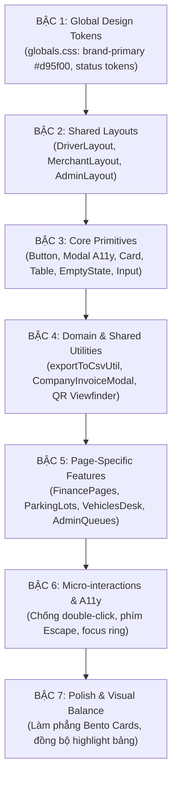
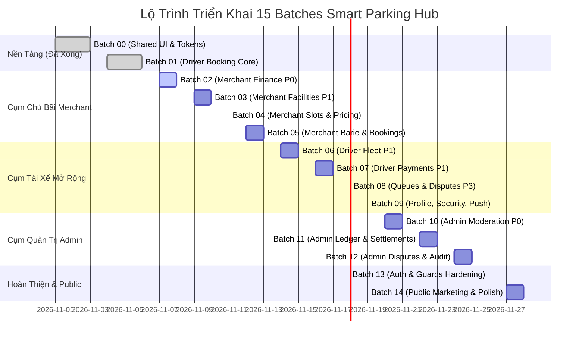

# 12. Kế Hoạch Phân Lô Triển Khai & Thứ Tự Phụ Thuộc (Implementation Batch Plan)

> **Dự án**: Smart Parking Hub — Frontend App (`smart-parking-app-v2`)  
> **Giai đoạn**: IMPLEMENTATION BATCH ARCHITECTURE (PLANNING ONLY)  
> **Ngày lập kế hoạch**: 06/11/2026 · **Trạng thái**: SẴN SÀNG TRIỂN KHAI THEO LÔ  
> **Căn cứ kỹ thuật**:
> - `11-page-group-inventory.md` (Thống kê 56 màn hình, 73 routes, 5 miền chức năng)
> - `09-prioritized-backlog.md` (10 Master Tasks `TSK-P0-01` -> `TSK-P3-02`, RCA 6 tầng)
> - `10-implementation-roadmap.md` (Lộ trình 5 giai đoạn, Quality Gates)
> - `11-shared-system-implementation-report.md` (Hoàn thành Batch 00: Nền tảng Shared UI)
> - `driver-booking-report.md` (Hoàn thành Batch 01: Driver Booking Core)
>
> **Cam kết tuân thủ**:
> - Không sửa mã nguồn. Không redesign/refactor ngoài phạm vi.
> - Không tạo task trực tiếp lên Trello.
> - Dừng lại ở bước lập kế hoạch và xin phê duyệt lộ trình.

---

## MỤC LỤC
1. [Nguyên Tắc Phân Nhóm Triển Khai (Grouping Principles)](#1-nguyên-tắc-phân-nhóm-triển-khai)
2. [Cây Phụ Thuộc Kỹ Thuật 7 Bậc (7-Tier Dependency Hierarchy)](#2-cây-phụ-thuộc-kỹ-thuật-7-bậc)
3. [Bản Đồ Gán Vấn Đề Vào Nhóm (Issue-to-Batch Mapping)](#3-bản-đồ-gán-vấn-đề-vào-nhóm)
4. [Danh Mục Chi Tiết 15 Implementation Batches (Batch 00 -> Batch 14)](#4-danh-mục-chi-tiết-15-implementation-batches)
   - [Lô Nền Tảng Đã Hoàn Thành (Batch 00 & Batch 01)](#lô-nền-tảng-đã-hoàn-thành)
   - [Lô Triển Khai Tiếp Theo — Cụm Chủ Bãi Merchant (Batch 02 -> Batch 05)](#lô-triển-khai-tiếp-theo--cụm-chủ-bãi-merchant)
   - [Lô Triển Khai — Cụm Tài Xế Driver Mở Rộng (Batch 06 -> Batch 09)](#lô-triển-khai--cụm-tài-xế-driver-mở-rộng)
   - [Lô Triển Khai — Cụm Quản Trị Admin Command (Batch 10 -> Batch 12)](#lô-triển-khai--cụm-quản-trị-admin-command)
   - [Lô Hoàn Thiện — Xác Thực & Marketing Công Khai (Batch 13 & Batch 14)](#lô-hoàn-thiện--xác-thực--marketing-công-khai)
5. [Lịch Trình Đề Xuất & Ma Trận Phân Bổ Nỗ Lực (Effort Estimation)](#5-lịch-trình-đề-xuất--ma-trận-phân-bổ-nỗ-lực)

---

## 1. Nguyên Tắc Phân Nhóm Triển Khai

Để đảm bảo hiệu quả cho quá trình thực thi của các tác tử lập trình (AI Coding Agents) và kỹ sư frontend, toàn bộ 56 màn hình được chia thành **15 Batches** theo 5 nguyên tắc bất biến:

1. **Quy mô tối ưu (Batch Sizing)**: Mỗi nhóm chứa từ **2 đến 5 màn hình** có cùng luồng nghiệp vụ gắn kết (Workflow Cohesion), không gom quá nhiều gây quá tải context và không chia quá nhỏ thành các task cô lập.
2. **Ưu tiên giải quyết Blocker (P0 First)**: Các nhóm chứa issue chặn luồng nghiệp vụ (`TSK-P0-01` bẫy rút tiền, `TSK-P0-02` bắt buộc lý do duyệt bãi) được ưu tiên xếp vào đầu danh sách thực hiện của từng phân hệ.
3. **Tuân thủ phân cấp phụ thuộc (Dependency Discipline)**: Mọi shared component hoặc tiện ích dùng chung (như `exportToCsvUtil.ts`, Card View responsive) phải được hoàn thiện hoặc định nghĩa trước khi áp dụng vào các màn hình con.
4. **Cô lập phạm vi hồi quy (Regression Containment)**: Mỗi batch có phạm vi tệp ảnh hưởng rõ ràng, chạy và pass 100% test suite trước khi chuyển sang batch tiếp theo.
5. **Dừng để nghiệm thu (Halt & Verify)**: Kết thúc mỗi batch, lập báo cáo kết quả và đối chiếu với tiêu chí nghiệm thu (Acceptance Criteria).

---

## 2. Cây Phụ Thuộc Kỹ Thuật 7 Bậc

- **Đã hoàn thành ở Batch 00 & Batch 01**: Bậc 1, Bậc 2 và Bậc 3 (Core Primitives: `Button`, `Modal`, `Badge`, `Card`, `Table`, `EmptyState`, `Input`, `Tabs`, `Pagination`).
- **Nhiệm vụ từ Batch 02 trở đi**: Tập trung vào Bậc 4 (Shared Utilities), Bậc 5 (Màn hình nghiệp vụ), Bậc 6 (Chống double-click, bẫy validation) và Bậc 7 (Polish).

---

## 3. Bản Đồ Gán Vấn Đề Vào Nhóm (Issue-to-Batch Mapping)

| Mã Issue / Task | Mức Độ | Tóm Tắt Vấn Đề | Nhóm Triển Khai Được Gán | Trạng Thái |
| :---: | :---: | :--- | :--- | :---: |
| **`TSK-P0-01`** / `APP-04` | **P0** | Bẫy validation không thể gửi khi số dư ví < 50k | **BATCH 02** (Merchant Finance & Wallet) | **PENDING** |
| **`TSK-P0-02`** / `APP-08` | **P0** | Bắt buộc nhập lý do khi Admin duyệt bãi hợp lệ | **BATCH 10** (Admin Parking Moderation) | **PENDING** |
| **`TSK-P1-01`** (A) / `APP-07` | **P1** | Xuất báo cáo bãi đỗ chạy timer giả lập | **BATCH 03** (Merchant Parking Lots) | **PENDING** |
| **`TSK-P1-01`** (B) / `APP-03` | **P1** | Xuất file JSON đổi đuôi `.xlsx` làm hỏng tệp đội xe | **BATCH 06** (Driver Fleet Management) | **PENDING** |
| **`TSK-P1-01`** (C) / `APP-06` | **P1** | Nút xuất báo cáo cước phí chạy timer giả lập | **BATCH 07** (Driver Payments & Invoicing) | **PENDING** |
| **`TSK-P1-02`** / `APP-14` | **P1** | Lưu hóa đơn VAT vào localStorage thay vì API Profile | **BATCH 07** (Driver Payments & Invoicing) | **PENDING** |
| **`TSK-P1-03`** (A) / `APP-16` | **P1** | Bảng giao dịch & Đội xe tràn màn hình di động | **BATCH 06** & **BATCH 07** | **PENDING** |
| **`TSK-P1-03`** (B) | **P1** | Bảng đối soát Admin tràn màn hình di động | **BATCH 11** & **BATCH 12** | **PENDING** |
| **`TSK-P2-01`** / `APP-15` | **P2** | Chống double-click submit khi mạng có độ trễ | **BATCH 02**, **BATCH 03**, **BATCH 06** | **PENDING** |
| **`TSK-P2-02`** / `APP-12` | **P2** | Modal thiếu phím Escape và không khóa cuộn nền | **BATCH 03**, **BATCH 06**, **BATCH 08** | **PENDING** |
| **`TSK-P2-03`** | **P2** | Đồng bộ nút bấm Admin sang màu cam chữ trắng | **BATCH 10**, **BATCH 11**, **BATCH 12** | **PENDING** |
| **`TSK-P3-01`** / `APP-18` | **P3** | Chuẩn hóa Empty State có nút CTA dẫn hướng | **BATCH 07**, **BATCH 08** | **PENDING** |
| **`TSK-P3-02`** / `APP-11` | **P3** | Modal nhận slot hàng đợi thiếu nút [X] và click nền | **BATCH 08** (Driver Virtual Queues) | **PENDING** |
| `APP-17` | **P3** | Bento KPI cards lạm dụng ô màu rực rỡ | **BATCH 02**, **BATCH 05** | **PENDING** |
| `ISS-15` | **P2** | Form ứng tuyển careers bỏ rơi dữ liệu ứng viên | **BATCH 14** (Public Marketing) | **PENDING** |
| `APP-01`, `APP-02`, `APP-05` | **P0/P1**| Lỗi đơn ảo, dữ liệu tĩnh, giữ slot ngẫu nhiên | **BATCH 01** (Driver Booking Core) | **ĐÃ GIẢI QUYẾT** |
| `APP-09`, `APP-10`, `APP-13` | **P2** | Link Maps rỗng, tra cứu ảo, lệch chiều cao header | **BATCH 01** (Driver Booking Core) | **ĐÃ GIẢI QUYẾT** |

---

## 4. Danh Mục Chi Tiết 15 Implementation Batches

---

### Lô Nền Tảng Đã Hoàn Thành

#### BATCH 00: Shared Design System & Core Primitives
* **Batch ID**: `BATCH-00`
* **Tên nhóm**: Nền tảng Shared Design System & Core Primitives
* **Mục tiêu**: Chuẩn hóa biến màu `--color-brand-primary: #d95f00`, trạng thái ngữ nghĩa `brand-status-*`, nâng cấp `Button`, `Modal`, `Badge`, `Card`, `Table`, `Input`, `EmptyState`, `Tabs`, `Pagination`.
* **Page IDs**: Toàn bộ hệ thống (Toàn bộ 56 màn hình thụ hưởng).
* **Routes**: N/A (Tầng hạ tầng UI).
* **Issue IDs**: `ISS-12`, `APP-12` (Cốt lõi), WCAG 2.1 AA Contrast.
* **Dependencies**: Không có.
* **Shared Components**: `src/shared/components/*`, `src/styles/globals.css`.
* **Complexity**: **MEDIUM (5 SP)**.
* **Trạng thái**: **ĐÃ HOÀN THÀNH 100%** (Báo cáo tại `11-shared-system-implementation-report.md`).

#### BATCH 01: Driver Booking Core & Operations Desk
* **Batch ID**: `BATCH-01`
* **Tên nhóm**: Driver Booking Core & Operations Desk
* **Mục tiêu**: Loại bỏ lỗi nuốt lỗi mạng tạo đơn ảo `BK-2025-CLG2-014`, nối dữ liệu API thật vào chi tiết bãi đỗ, lưu mã giữ slot vào localStorage, sửa link Google Maps và tra cứu nhanh.
* **Page IDs**: `SCR-014`, `SCR-015`, `SCR-016`, `SCR-017`
* **Routes**: `/dashboard`, `/parking`, `/parking/:id`, `/bookings`
* **Issue IDs**: `APP-01`, `APP-02`, `APP-05`, `APP-09`, `APP-10`, `APP-13`, `ISS-01`, `ISS-05`, `ISS-06`, `ISS-07`, `ISS-08`, `ISS-14`
* **Dependencies**: `BATCH-00`
* **Shared Components**: `BookingPaymentModal`, `ParkingDetailPage`, `ActiveTripCard`, `DriverDashboardPage`
* **Complexity**: **HIGH (8 SP)**.
* **Trạng thái**: **ĐÃ HOÀN THÀNH 100%** (Báo cáo tại `driver-booking-report.md`).

---

### Lô Triển Khai Tiếp Theo — Cụm Chủ Bãi Merchant

#### BATCH 02: Merchant Finance & Wallet Desk (GIAI ĐOẠN TIẾP THEO)
* **Batch ID**: `BATCH-02`
* **Tên nhóm**: Merchant Finance & Wallet Desk
* **Mục tiêu**: Khắc phục triệt để bẫy validation P0 trên form rút tiền; vô hiệu hóa nút rút tiền khi số dư < 50k kèm tooltip giải thích; hiển thị số dư khả dụng; chặn double-click khi gửi lệnh rút tiền; bảo vệ hồ sơ tài khoản thụ hưởng.
* **Page IDs**: `SCR-038`, `SCR-037`, `SCR-027`
* **Routes**:
  - `/merchant/withdrawals`
  - `/merchant/revenue`
  - `/merchant/profile`
* **Issue IDs**: `TSK-P0-01` (`APP-04`, `ISS-03`), `TSK-P2-01` (`APP-15`), `APP-17`
* **Dependencies**: `BATCH-00` (Button, Modal, Input)
* **Shared Components**: `Button`, `Dialog`, `DataTable`, `Field`, `Input`
* **Complexity**: **MEDIUM (3 SP)**.
* **Recommended Order**: **01 (Ưu tiên cao nhất hiện tại)**.
* **Acceptance Criteria**:
  1. Khi số dư ví < 50.000 ₫: Nút "+ Yêu cầu rút tiền" bị vô hiệu hóa (`disabled={true}`), con trỏ `cursor-not-allowed`, rê chuột hiện tooltip: *"Số dư khả dụng tối thiểu để rút tiền là 50.000 ₫"*.
  2. Khi số dư ví ≥ 50.000 ₫: Nút bấm mở Dialog bình thường; ô nhập liệu có `min={50000}` và `max={walletBalance}`; bấm Gửi yêu cầu lập tức chuyển nút sang `disabled` có spinner xoay, ngăn chặn gửi trùng lệnh.
  3. Form thông tin thụ hưởng tại `/merchant/profile` hiển thị chuẩn xác số tài khoản ngân hàng và tên người thụ hưởng.
* **Regression Scope**: `src/features/merchant/operations/FinancePages.tsx`, `src/features/merchant/profile/`.

#### BATCH 03: Merchant Parking Facilities Directory & Onboarding
* **Batch ID**: `BATCH-03`
* **Tên nhóm**: Merchant Parking Facilities Directory & Onboarding
* **Mục tiêu**: Xây dựng tiện ích xuất CSV UTF-8 BOM thực tế thay cho timer giả lập; bổ sung cờ chặn double-click khi tạo và sửa bãi đỗ xe; kế thừa modal chuẩn A11y có phím Escape.
* **Page IDs**: `SCR-028`, `SCR-029`, `SCR-030`, `SCR-031`
* **Routes**:
  - `/merchant/parking-lots`
  - `/merchant/parking-lots/new`
  - `/merchant/parking-lots/:parkingLotId`
  - `/merchant/parking-lots/:parkingLotId/edit`
* **Issue IDs**: `TSK-P1-01` (`APP-07`, `ISS-10`), `TSK-P2-01` (`APP-15`, `ISS-17`), `TSK-P2-02` (`APP-12`, `ISS-12`)
* **Dependencies**: `BATCH-00`, `BATCH-02`
* **Shared Components**: `Button`, `Modal`, `Table`, `Card`, `Input`, `exportToCsvUtil.ts`
* **Complexity**: **MEDIUM (3 SP)**.
* **Recommended Order**: **02**.
* **Acceptance Criteria**:
  1. Bấm "Tải Báo Cáo" tại `/merchant/parking-lots`: Tải về tệp `DanhSach_BaiDo_SmartParking_YYYYMMDD.csv` chuẩn UTF-8 BOM, mở bằng Excel không lỗi font tiếng Việt.
  2. Bấm submit tại form tạo bãi (`/merchant/parking-lots/new`) và sửa bãi (`/:id/edit`): Nút vô hiệu hóa lập tức, hiển thị spinner xoay, ngăn chặn tạo 2 bãi trùng nhau.
  3. Mọi modal xác nhận và export đóng mượt mà bằng phím `Escape` và khóa cuộn nền.
* **Regression Scope**: `src/features/merchant/parking-lots/pages/*`, `ExportReportModal.tsx`.

#### BATCH 04: Merchant Slots Capacity & Pricing Matrix Workbench
* **Batch ID**: `BATCH-04`
* **Tên nhóm**: Merchant Slots Capacity & Pricing Matrix Workbench
* **Mục tiêu**: Hoàn thiện giao diện điều chỉnh sức chứa 5 nhóm xe đảm bảo bất biến Occupied Invariant; căn phải các cột số lượng và tiền tệ trong ma trận biểu phí giờ cao điểm; tối ưu layout trên tablet.
* **Page IDs**: `SCR-032`, `SCR-033`
* **Routes**:
  - `/merchant/parking-lots/:parkingLotId/slots`
  - `/merchant/parking-lots/:id/pricing`
* **Issue IDs**: Căn chỉnh cột số liệu (`05-design-system-audit.md`), responsive tablet.
* **Dependencies**: `BATCH-00`, `BATCH-03`
* **Shared Components**: `Workspace`, `DataTable`, `Button`, `Field`, `Input`
* **Complexity**: **LOW (2 SP)**.
* **Recommended Order**: **03**.
* **Acceptance Criteria**:
  1. Ma trận cước phí: Cột giá cơ bản và hệ số cao điểm được căn phải thẳng hàng theo chuẩn đọc tài chính.
  2. Trang cấu hình slot: Stepper tăng/giảm hoạt động mượt, không cho phép giảm dưới số lượng xe đang đỗ thực tế.
* **Regression Scope**: `MerchantSlotsPage.tsx`, `MerchantLotPage.tsx`.

#### BATCH 05: Merchant Barie Gate Terminal & Booking Dispatch
* **Batch ID**: `BATCH-05`
* **Tên nhóm**: Merchant Barie Gate Terminal & Booking Dispatch
* **Mục tiêu**: Kiểm tra và tối ưu trạm điều hành cổng Barie tự động; làm phẳng thẻ KPI Bento trên Dashboard; chuẩn hóa hiển thị danh sách điều phối lượt xe vào bến và thông báo nghiệp vụ.
* **Page IDs**: `SCR-026`, `SCR-034`, `SCR-035`, `SCR-036`, `SCR-041`
* **Routes**:
  - `/merchant`
  - `/merchant/bookings`
  - `/merchant/bookings/:id`
  - `/merchant/qr-scanner`
  - `/merchant/notifications`
* **Issue IDs**: `APP-17` (Bento card màu mè), tối ưu tương phản dark theme trạm Barie.
* **Dependencies**: `BATCH-00`, `BATCH-02`
* **Shared Components**: `Button`, `Card`, `Badge`, `DataTable`, `CameraViewfinder`
* **Complexity**: **MEDIUM (3 SP)**.
* **Recommended Order**: **04**.
* **Acceptance Criteria**:
  1. Trạm quét QR Barie (`/merchant/qr-scanner`): Nhận diện mã nhanh, phím tắt Enter/Space hoạt động nhạy, nút xác nhận thu tiền mặt nổi bật.
  2. Dashboard Merchant (`/merchant`): Các khối Bento KPI được làm phẳng viền kính mờ (`bg-white/5 border-white/10`), không còn các khối màu neon chói mắt.
* **Regression Scope**: `MerchantDashboardPage.tsx`, `MerchantScannerPage.tsx`, `MerchantBookingsPage.tsx`.

---

### Lô Triển Khai — Cụm Tài Xế Driver Mở Rộng

#### BATCH 06: Driver Fleet Management & ALPR Synchronization
* **Batch ID**: `BATCH-06`
* **Tên nhóm**: Driver Fleet Management & ALPR Synchronization
* **Mục tiêu**: Sửa lỗi xuất tệp tải về JSON đổi đuôi làm hỏng file; xây dựng giao diện Thẻ xếp chồng (Stacked Card View) cho danh sách đội xe trên mobile (< 640px); chặn double-click khi thêm/sửa phương tiện; kế thừa modal xác nhận xóa chuẩn A11y.
* **Page IDs**: `SCR-020`
* **Routes**:
  - `/vehicles` (Aliases: `/dashboard/vehicles`, `/driver/vehicles`)
* **Issue IDs**: `TSK-P1-01` (`APP-03`), `TSK-P1-03` (`APP-16`), `TSK-P2-01` (`APP-15`), `TSK-P2-02` (`APP-12`)
* **Dependencies**: `BATCH-00`, `exportToCsvUtil.ts` (từ `BATCH-03`)
* **Shared Components**: `Button`, `Modal`, `Table`, `Card`, `Input`, `Badge`
* **Complexity**: **MEDIUM (3 SP)**.
* **Recommended Order**: **05**.
* **Acceptance Criteria**:
  1. Bấm "Xuất danh sách xe": Tải về tệp CSV UTF-8 BOM `SmartTruck_DoiXe_YYYYMMDD.csv` hiển thị đúng tiếng Việt có dấu trên Excel.
  2. Trên màn hình 375px: Ẩn thẻ `table` 8 cột, hiển thị danh sách thẻ `Card` gọn gàng, hiển thị rõ Biển số, Loại xe, Hạn kiểm định và nút Thao tác ≥ 44×44px.
  3. Bấm Lưu xe mới: Nút submit vô hiệu hóa lập tức kèm spinner, không thể gửi 2 xe trùng biển số.
* **Regression Scope**: `src/features/vehicles/*`.

#### BATCH 07: Driver Payments, VAT Invoicing & Callback Hubs
* **Batch ID**: `BATCH-07`
* **Tên nhóm**: Driver Payments, VAT Invoicing & Callback Hubs
* **Mục tiêu**: Sửa nút xuất sao kê cước chỉ chạy timer ảo sang tải file CSV thật; chuyển đổi lưu thông tin hóa đơn VAT công ty từ `localStorage` sang gọi API `PUT /api/v1/users/me`; áp dụng Card View mobile cho bảng giao dịch; bổ sung Empty State có CTA điều hướng.
* **Page IDs**: `SCR-019`, `SCR-023`, `SCR-024`
* **Routes**:
  - `/payments`
  - `/payment/success`
  - `/payment/cancel`
* **Issue IDs**: `TSK-P1-01` (`APP-06`), `TSK-P1-02` (`APP-14`), `TSK-P1-03` (`APP-16`), `TSK-P3-01` (`APP-18`)
* **Dependencies**: `BATCH-00`, `exportToCsvUtil.ts`, `profileApi.ts`
* **Shared Components**: `Button`, `Modal`, `Table`, `Card`, `EmptyState`, `Badge`
* **Complexity**: **MEDIUM (3 SP)**.
* **Recommended Order**: **06**.
* **Acceptance Criteria**:
  1. Bấm "Tải Báo Cáo" tại `/payments`: Tải về tệp `SaoKe_CuocPhi_YYYYMMDD.csv` chứa đúng dữ liệu giao dịch.
  2. Nhập thông tin xuất HĐ VAT (MST, Tên công ty) và lưu: Gọi API lưu vào Profile người dùng; mở tab ẩn danh đăng nhập lại dữ liệu vẫn hiển thị đầy đủ.
  3. Bảng sao kê trên màn hình di động chuyển thành Card View không tràn mép.
  4. Khi không có giao dịch: Hiển thị EmptyState thân thiện kèm nút CTA "Tìm bãi đỗ ngay".
* **Regression Scope**: `src/features/payments/*`, `PaymentReturnPage.tsx`, `PaymentCancelPage.tsx`.

#### BATCH 08: Driver Virtual Queues & Driver Disputes
* **Batch ID**: `BATCH-08`
* **Tên nhóm**: Driver Virtual Queues & Driver Disputes
* **Mục tiêu**: Bổ sung nút đóng [X] góc phải trên và sự kiện click backdrop cho `AcceptQueueSuccessModal`; thay thế text rỗng bằng EmptyState có CTA chuyển sang tìm bãi; căn phải các cột số tiền và ID trong bảng khiếu nại.
* **Page IDs**: `SCR-018`, `DRV-DISP-01`, `DRV-DISP-02`
* **Routes**:
  - `/queues`
  - `/disputes`
  - `/disputes/:id`
* **Issue IDs**: `TSK-P3-01` (`APP-18`), `TSK-P3-02` (`APP-11`, `ISS-13`), căn chỉnh cột tiền
* **Dependencies**: `BATCH-00`
* **Shared Components**: `Button`, `Modal`, `Workspace`, `DataTable`, `EmptyState`, `Badge`
* **Complexity**: **LOW (2 SP)**.
* **Recommended Order**: **07**.
* **Acceptance Criteria**:
  1. Modal `AcceptQueueSuccessModal`: Có nút icon [X] góc phải trên; click backdrop tối hoặc bấm [X] modal đóng lập tức.
  2. Bảng hàng đợi khi rỗng: Hiển thị component `EmptyState` kèm nút CTA "Tìm bãi xe khác".
  3. Bảng khiếu nại `/disputes`: Cột mã vụ việc và số tiền được căn phải chuẩn mực.
* **Regression Scope**: `src/features/queues/*`, `src/features/disputes/*`.

#### BATCH 09: Driver Profile, Security & Notifications
* **Batch ID**: `BATCH-09`
* **Tên nhóm**: Driver Profile, Security & Notifications
* **Mục tiêu**: Kiểm tra và làm sạch form thông tin cá nhân và mật khẩu an ninh Fretrix; hoàn thiện trung tâm thông báo và kích hoạt Web Push 24/7; đảm bảo tính nhất quán trên thiết bị di động.
* **Page IDs**: `SCR-021`, `SCR-022`, `SCR-025`
* **Routes**:
  - `/profile`
  - `/change-password`
  - `/notifications`
* **Issue IDs**: Rà soát responsive, đồng bộ trạng thái Web Push.
* **Dependencies**: `BATCH-00`
* **Shared Components**: `Button`, `Input`, `Card`, `Badge`, `Tabs`
* **Complexity**: **LOW (2 SP)**.
* **Recommended Order**: **08**.
* **Acceptance Criteria**:
  1. Đổi mật khẩu: Form hiển thị realtime 4 tiêu chí an ninh Fretrix, validation mượt.
  2. Thông báo: Bộ lọc phân loại thông báo hoạt động tức thì, nút Web Push kích hoạt chuẩn Notification API của trình duyệt.
* **Regression Scope**: `src/features/profile/*`, `src/features/change-password/*`, `src/features/notifications/*`.

---

### Lô Triển Khai — Cụm Quản Trị Admin Command

#### BATCH 10: Admin Parking Lots Moderation Queue & Dashboard
* **Batch ID**: `BATCH-10`
* **Tên nhóm**: Admin Parking Lots Moderation Queue & Dashboard
* **Mục tiêu**: Khắc phục lỗi P0 bắt buộc nhập lý do khi Admin duyệt bãi hợp lệ (`/admin/parking-lots/:id`); chuyển đổi toàn bộ nút bấm Admin dùng màu đảo ngược (`bg-brand-orange text-brand-navy`) sang màu cam chữ trắng đồng nhất với hệ thống.
* **Page IDs**: `SCR-042`, `SCR-043`, `SCR-044`
* **Routes**:
  - `/admin` (Alias: `/admin/dashboard`)
  - `/admin/parking-lots`
  - `/admin/parking-lots/:id`
* **Issue IDs**: `TSK-P0-02` (`APP-08`, `ISS-04`), `TSK-P2-03` (Nút bấm Admin lệch phong cách)
* **Dependencies**: `BATCH-00` (Button, Modal, Workspace)
* **Shared Components**: `Workspace`, `Dialog`, `Button`, `DataTable`, `Badge`, `Input`
* **Complexity**: **LOW (2 SP)**.
* **Recommended Order**: **09 (Ưu tiên P0 trong phân hệ Admin)**.
* **Acceptance Criteria**:
  1. Tại `/admin/parking-lots/:id`: Khi Admin chọn hành động "Phê duyệt" (`APPROVED`), ô lý do giải trình chuyển sang "(Tùy chọn)" và nút Submit bấm được ngay mà không cần nhập ký tự nào.
  2. Khi Admin chọn "Từ chối" (`REJECTED`): Ô lý do bắt buộc nhập kèm cảnh báo đỏ.
  3. Nút Đăng xuất ở Header Admin và các nút bấm hành động hiển thị màu cam chữ trắng sắc nét (`bg-[#d95f00] text-white`).
* **Regression Scope**: `src/features/admin/*` (`DecisionDialog`), `src/layouts/AdminLayout.tsx`.

#### BATCH 11: Admin User Governance & Financial Settlement Ledger
* **Batch ID**: `BATCH-11`
* **Tên nhóm**: Admin User Governance & Financial Settlement Ledger
* **Mục tiêu**: Chuẩn hóa sổ cái giao dịch dòng tiền toàn sàn và bàn duyệt chi rút tiền ví Merchant; áp dụng Card View mobile cho bảng giao dịch; đồng bộ phong cách nút bấm cam chữ trắng.
* **Page IDs**: `SCR-045`, `SCR-046`, `SCR-047`, `SCR-048`
* **Routes**:
  - `/admin/users`
  - `/admin/users/:id`
  - `/admin/transactions`
  - `/admin/withdrawals`
* **Issue IDs**: `TSK-P1-03` (Bảng tràn di động), `TSK-P2-03` (Nút bấm)
* **Dependencies**: `BATCH-00`, `BATCH-10`
* **Shared Components**: `Workspace`, `DataTable`, `Dialog`, `Button`, `Badge`
* **Complexity**: **MEDIUM (3 SP)**.
* **Recommended Order**: **10**.
* **Acceptance Criteria**:
  1. Bàn duyệt chi rút tiền (`/admin/withdrawals`): Dialog xác nhận chuyển khoản ngân hàng hiển thị đầy đủ STK, tên ngân hàng và số tiền trước khi xác nhận `PAID`.
  2. Bảng giao dịch toàn hệ thống (`/admin/transactions`): Căn phải số tiền VND, responsive không tràn viền.
* **Regression Scope**: `src/features/admin/pages/*` (Users, Transactions, Withdrawals).

#### BATCH 12: Admin Disputes Docket, Audit Trail & Security Profile
* **Batch ID**: `BATCH-12`
* **Tên nhóm**: Admin Disputes Docket, Audit Trail & Security Profile
* **Mục tiêu**: Hoàn thiện phòng phân xử tranh chấp (Arbitration Tribunal) của Admin và bảng khiếu nại Merchant; tối ưu bảng nhật ký kiểm toán an ninh bất biến; quản lý thông tin bảo mật Admin.
* **Page IDs**: `SCR-049`, `SCR-050`, `SCR-051`, `SCR-052`, `SCR-053`, `SCR-039`, `SCR-040`
* **Routes**:
  - `/admin/disputes`
  - `/admin/disputes/:id`
  - `/admin/audit-logs`
  - `/admin/notifications`
  - `/admin/profile`
  - `/merchant/disputes`
  - `/merchant/disputes/:id`
* **Issue IDs**: `TSK-P1-03` (Bảng audit log mobile), `TSK-P2-03` (Nút bấm)
* **Dependencies**: `BATCH-00`, `BATCH-10`
* **Shared Components**: `Workspace`, `DataTable`, `Panel`, `Badge`, `Button`
* **Complexity**: **MEDIUM (3 SP)**.
* **Recommended Order**: **11**.
* **Acceptance Criteria**:
  1. Phòng xử tranh chấp (`/admin/disputes/:id`): Admin nhập phán quyết giải quyết (`resolution`) và ghi nhận vào hồ sơ mượt mà.
  2. Bảng Audit Logs: Căn chỉnh thẻ trên màn hình nhỏ, hiển thị rõ Actor ID, thời gian và kết quả hành động.
* **Regression Scope**: `src/features/disputes/*`, `src/features/admin/pages/AdminAuditLogsPage.tsx`, `src/features/portal/AccountPages.tsx`.

---

### Lô Hoàn Thiện — Xác Thực & Marketing Công Khai

#### BATCH 13: Authentication & Access Control Guards Hardening
* **Batch ID**: `BATCH-13`
* **Tên nhóm**: Authentication & Access Control Guards Hardening
* **Mục tiêu**: Rà soát toàn bộ các màn hình đăng nhập, đăng ký, quên mật khẩu và các trang lỗi 403, 404; kiểm tra độ tương phản màu và khả năng điều hướng bàn phím.
* **Page IDs**: `SCR-010`, `SCR-011`, `SCR-012`, `SCR-013`, `404`
* **Routes**:
  - `/login`
  - `/register`
  - `/forgot-password`
  - `/403`
  - `/*`
* **Issue IDs**: Kiểm tra A11y focus states và contrast.
* **Dependencies**: `BATCH-00`
* **Shared Components**: `AuthLayout`, `Button`, `Input`, `Card`
* **Complexity**: **LOW (1 SP)**.
* **Recommended Order**: **12**.
* **Acceptance Criteria**:
  1. Form đăng nhập & đăng ký: Phím Tab di chuyển tiêu điểm theo đúng thứ tự, viền focus-visible sắc nét.
  2. Trang 403 và 404: Nút quay về trang chủ hiển thị đúng màu cam chữ trắng chuẩn nhận diện.
* **Regression Scope**: `src/features/auth/*`.

#### BATCH 14: Public Marketing Website & Developer Documentation
* **Batch ID**: `BATCH-14`
* **Tên nhóm**: Public Marketing Website & Developer Documentation
* **Mục tiêu**: Thay thế toàn bộ mã màu cam hardcode `#F97316` còn sót trên 9 trang Landing sang biến `--color-brand-primary` (#d95f00); tối ưu bảng so sánh giá trên di động 375px; bổ sung phương án mailto an toàn cho form nộp CV tuyển dụng (`/careers`) thay thế timer giả lập.
* **Page IDs**: `SCR-001` -> `SCR-009` (9 màn hình)
* **Routes**:
  - `/`
  - `/solutions/drivers`
  - `/solutions/owners`
  - `/pricing`
  - `/api-docs`
  - `/about`
  - `/careers`
  - `/insights`
  - `/contact`
* **Issue IDs**: `ISS-15` (Form careers chạy timer ảo), tối ưu bảng giá mobile.
* **Dependencies**: `BATCH-00`
* **Shared Components**: `LandingNavbar`, `LandingFooter`, `Button`, `Card`, `Badge`
* **Complexity**: **MEDIUM (3 SP)**.
* **Recommended Order**: **13**.
* **Acceptance Criteria**:
  1. Bảng so sánh gói giá tại `/pricing`: Co giãn mượt mà trên iPhone SE (375px) không phát sinh thanh cuộn ngang trang.
  2. Modal ứng tuyển tại `/careers`: Có hướng dẫn rõ ràng gửi hồ sơ trực tiếp về email nhân sự `tuyendung@smarttruckhub.vn` kèm liên kết `mailto:` tự điền tiêu đề.
  3. Mọi nút bấm trên 9 trang công khai hiển thị màu cam chuẩn nhận diện đạt độ tương phản WCAG AA (≥ 4.5:1).
* **Regression Scope**: `src/features/landing/*`.

---

## 5. Lịch Trình Đề Xuất & Ma Trận Phân Bổ Nỗ Lực

### Bảng Tổng Hợp Chỉ Số Kế Hoạch 15 Batches

| Batch ID | Tên Nhóm Triển Khai | Số Màn Hình | Story Points | Mức Ưu Tiên | Issue Trọng Tâm | Trạng Thái |
| :---: | :--- | :---: | :---: | :---: | :--- | :---: |
| **B00** | Shared Design System & Core Primitives | 56 (Toàn sàn) | 5 SP | Nền tảng | `ISS-12`, Token `#d95f00` | **HOÀN THÀNH** |
| **B01** | Driver Booking Core & Operations Desk | 4 | 8 SP | P0/P1 | `APP-01`, `APP-02`, `APP-05` | **HOÀN THÀNH** |
| **B02** | Merchant Finance & Wallet Desk | 3 | 3 SP | **P0 BLOCKER** | `TSK-P0-01` (Bẫy rút tiền) | **SẴN SÀNG (ĐẦU TIÊN)** |
| **B03** | Merchant Facilities Directory & Onboarding | 4 | 3 SP | P1/P2 | `TSK-P1-01` (Xuất CSV bãi xe) | CHỜ B02 |
| **B04** | Merchant Slots Capacity & Pricing Matrix | 2 | 2 SP | P2 | Occupied Invariant, Căn cột tiền | CHỜ B03 |
| **B05** | Merchant Barie Gate & Bookings Dispatch | 5 | 3 SP | P2/P3 | `APP-17` (Bento polish), Barie | CHỜ B04 |
| **B06** | Driver Fleet Management & ALPR | 1 | 3 SP | P1 | `TSK-P1-01` (Xuất file xe hỏng) | CHỜ B05 |
| **B07** | Driver Payments, VAT & Callback Hubs | 3 | 3 SP | P1 | `TSK-P1-02` (HĐ VAT API), Card View | CHỜ B06 |
| **B08** | Driver Virtual Queues & Disputes | 3 | 2 SP | P3 | `TSK-P3-01` (Empty CTA), `TSK-P3-02` | CHỜ B07 |
| **B09** | Driver Profile, Security & Notifications | 3 | 2 SP | P3 | Fretrix Security, Web Push | CHỜ B08 |
| **B10** | Admin Parking Lots Moderation Queue | 3 | 2 SP | **P0 BLOCKER** | `TSK-P0-02` (Bỏ lý do duyệt) | CHỜ B09 |
| **B11** | Admin User Governance & Ledger | 4 | 3 SP | P1/P2 | `TSK-P2-03` (Nút bấm Admin) | CHỜ B10 |
| **B12** | Admin Disputes Docket & Audit Trail | 7 | 3 SP | P1/P2 | Trọng tài tranh chấp, Audit log | CHỜ B11 |
| **B13** | Authentication & Guards Hardening | 5 | 1 SP | P3 | Focus A11y, Form validation | CHỜ B12 |
| **B14** | Public Marketing & Developer Portal | 9 | 3 SP | P2/P3 | `ISS-15` (CV Careers), Bảng giá | CHỜ B13 |
| **TỔNG** | **15 Implementation Batches** | **56 Màn Hình** | **43 SP** | — | **Đã hoàn thành 13/43 SP (30%)** | — |

---
**Tài liệu được hoàn thành và lưu trữ tại:** `docs/ux-ui-audit/12-implementation-batch-plan.md`.
