# 03. Bản Đồ Phân Quyền Vai Trò & Khung Giao Diện (Role & Layout Map)

> **Dự án:** Smart Parking Hub — Modern Logistics & Parking CRM Platform  
> **Chế độ thực thi:** DISCOVERY ONLY (Tuân thủ PROJECT UNIFICATION MASTER RULES)  
> **Thời điểm kiểm tra:** 07/11/2026  
> **Căn cứ xác minh:**  
> - Frontend: `src/layouts/*`, `src/features/auth/model/session.ts`, `src/features/auth/components/RequireRole.tsx`  
> - Backend: `smart-parking-microservice/identity-service/src/main/java/.../SecurityConfig.java`  
> **Trạng thái:** VERIFIED 100% (Khớp 1-1 giữa RBAC Frontend và Spring Security Backend)

---

## 1. Khảo Sát Hệ Thống Khung Giao Diện (Layout Mapping)

Dự án sở hữu **05 khung giao diện chính thức** phục vụ theo từng ngữ cảnh người dùng và **01 khung scaffold kỹ thuật**:

| Tên Khung Giao Diện | Vị Trí File | Thành Phần Cấu Trúc | Ngữ Cảnh Áp Dụng | Cơ Chế Bảo Vệ / Guards |
| :--- | :--- | :--- | :--- | :--- |
| **Public / Marketing Layout** | `src/features/landing/components/common/` | `LandingNavbar.tsx` (Thanh điều hướng cố định), `LandingFooter.tsx` (Chân trang đa cột) | 9 trang truyền thông, giới thiệu giải pháp, bảng giá, tài liệu API, tuyển dụng, liên hệ | `permitAll` (Không yêu cầu đăng nhập) |
| **Authentication Layout** | `src/layouts/AuthLayout.tsx` | Khung nền tối 2 cột (`bg-[#060D1A]`), logo thương hiệu, khối form trung tâm, liên kết hỗ trợ | Trang đăng nhập `/login`, đăng ký `/register`, quên mật khẩu `/forgot-password` | `permitAll` (Chuyển hướng nếu đã đăng nhập) |
| **Driver Portal Layout** | `src/layouts/DriverLayout.tsx` | `DriverHeader.tsx` (Thanh điều hướng tài xế, avatar, thông báo), `DriverFooter.tsx`, `AiCopilot.tsx` (Trợ lý ảo nổi) | 14 trang nghiệp vụ tài xế: Dashboard, tìm bãi, đặt chỗ, vé QR, hàng đợi, thanh toán, xe | Bọc bởi `<RequireRole role="DRIVER">` |
| **Merchant Portal Layout** | `src/layouts/MerchantLayout.tsx` | `MerchantSidebar.tsx` (Thanh bên 260px), `MerchantHeader.tsx` (Chuyển đổi bãi xe, avatar, menu di động) | 16 trang quản trị chủ bãi: Bãi đỗ xe, sức chứa slots, ma trận giá, vé vào bãi, máy quét QR, doanh thu, rút tiền | Bọc bởi `<RequireRole role="MERCHANT">` |
| **Admin Command Layout** | `src/layouts/AdminLayout.tsx` | `AdminSidebar.tsx` (Thanh bên tối 256px), `AdminHeader.tsx` (Thanh chỉ huy an ninh, nút Đăng xuất nhanh) | 12 trang điều hành tối cao: Dashboard sàn, duyệt bãi đỗ, quản trị user, sổ cái, duyệt rút tiền, tòa trọng tài, audit logs | Bọc bởi `<RequireRole role="ADMIN">` |
| **Scaffold Root Layout** | `src/layouts/RootLayout.tsx` | Khung kiểm thử hạ tầng nội bộ 4-layer architecture | Trang thử nghiệm kỹ thuật `/crm` | Dành riêng cho kiểm thử nội bộ |

---

## 2. Sơ Đồ Cấu Trúc Phân Tầng: Layout -> Routes -> Pages -> Components

```mermaid
flowchart TD
    subgraph SPH_ROUTER["Hệ Thống Phân Luồng Smart Parking Hub Router"]
        ROOT["Browser Request URL"]
    end

    subgraph PUBLIC_LAYER["Public Marketing Layer"]
        ROOT -->|Public Slugs| PL["Public Layout (LandingNavbar + LandingFooter)"]
        PL --> R_HOME["/ (SCR-001 LandingPage)"]
        PL --> R_DRV_SOL["/solutions/drivers (SCR-002)"]
        PL --> R_OWN_SOL["/solutions/owners (SCR-003)"]
        PL --> R_PRICE["/pricing (SCR-004)"]
        PL --> R_API["/api-docs (SCR-005)"]
        PL --> R_ABOUT["/about (SCR-006)"]
        PL --> R_CAREERS["/careers (SCR-007)"]
        PL --> R_INSIGHTS["/insights (SCR-008)"]
        PL --> R_CONTACT["/contact (SCR-009)"]
    end

    subgraph AUTH_LAYER["Authentication Layer"]
        ROOT -->|Auth Slugs| AL["AuthLayout"]
        AL --> R_LOGIN["/login (SCR-010 LoginPage)"]
        AL --> R_REG["/register (SCR-011 AuthPage)"]
        AL --> R_FORGOT["/forgot-password (SCR-012 AuthPage)"]
        ROOT -->|Error Slugs| R_403["/403 (SCR-013 AccessPage)"]
        ROOT -->|Catch-all| R_404["* (404 AccessPage)"]
    end

    subgraph DRIVER_LAYER["Driver Portal Layer (ROLE_DRIVER)"]
        ROOT -->|Driver Slugs| DL_GUARD["RequireRole role=DRIVER"]
        DL_GUARD --> DL["DriverLayout (Header + Footer + Copilot)"]
        DL --> R_D_DASH["/dashboard (SCR-014)"]
        DL --> R_D_SEARCH["/parking (SCR-015)"]
        DL --> R_D_DETAIL["/parking/:id (SCR-016)"]
        DL --> R_D_BOOKING["/bookings (SCR-017)"]
        DL --> R_D_QUEUE["/queues (SCR-018)"]
        DL --> R_D_PAY["/payments (SCR-019)"]
        DL --> R_D_VEHICLE["/vehicles (SCR-020)"]
        DL --> R_D_PROF["/profile (SCR-021)"]
        DL --> R_D_PWD["/change-password (SCR-022)"]
        DL --> R_D_SUCC["/payment/success (SCR-023)"]
        DL --> R_D_CAN["/payment/cancel (SCR-024)"]
        DL --> R_D_NOTIF["/notifications (SCR-025)"]
        DL --> R_D_DISP["/disputes & /disputes/:id (DRV-DISP-01/02)"]
    end

    subgraph MERCHANT_LAYER["Merchant Portal Layer (ROLE_MERCHANT)"]
        ROOT -->|Merchant Slugs| ML_GUARD["RequireRole role=MERCHANT"]
        ML_GUARD --> ML["MerchantLayout (Sidebar 260px + Header)"]
        ML --> R_M_DASH["/merchant (SCR-026)"]
        ML --> R_M_PROF["/merchant/profile (SCR-027)"]
        ML --> R_M_LOTS["/merchant/parking-lots (SCR-028)"]
        ML --> R_M_NEWLOT["/merchant/parking-lots/new (SCR-029)"]
        ML --> R_M_LOTDET["/merchant/parking-lots/:id (SCR-030)"]
        ML --> R_M_LOTEDIT["/merchant/parking-lots/:id/edit (SCR-031)"]
        ML --> R_M_SLOTS[".../slots (SCR-032)"]
        ML --> R_M_PRICE[".../pricing (SCR-033)"]
        ML --> R_M_BOOKINGS["/merchant/bookings & /:id (SCR-034/035)"]
        ML --> R_M_SCANNER["/merchant/qr-scanner (SCR-036)"]
        ML --> R_M_REV["/merchant/revenue (SCR-037)"]
        ML --> R_M_WITHDRAW["/merchant/withdrawals (SCR-038)"]
        ML --> R_M_DISP["/merchant/disputes & /:id (SCR-039/040)"]
        ML --> R_M_NOTIF["/merchant/notifications (SCR-041)"]
    end

    subgraph ADMIN_LAYER["Admin Command Center (ROLE_ADMIN)"]
        ROOT -->|Admin Slugs| ADM_GUARD["RequireRole role=ADMIN"]
        ADM_GUARD --> ADM_L["AdminLayout (Sidebar 256px + Secure Header)"]
        ADM_L --> R_A_DASH["/admin (SCR-042)"]
        ADM_L --> R_A_LOTS["/admin/parking-lots & /:id (SCR-043/044)"]
        ADM_L --> R_A_USERS["/admin/users & /:id (SCR-045/046)"]
        ADM_L --> R_A_TRANS["/admin/transactions (SCR-047)"]
        ADM_L --> R_A_PAYOUT["/admin/withdrawals (SCR-048)"]
        ADM_L --> R_A_DISP["/admin/disputes & /:id (SCR-049/050)"]
        ADM_L --> R_A_AUDIT["/admin/audit-logs (SCR-051)"]
        ADM_L --> R_A_NOTIF["/admin/notifications (SCR-052)"]
        ADM_L --> R_A_PROF["/admin/profile (SCR-053)"]
    end
```

---

## 3. Bản Đồ Phân Quyền Vai Trò & Ma Trận Kiểm Soát Truy Cập (Role Mapping & RBAC Matrix)

Hệ thống thiết lập 3 vai trò người dùng chính thức trong mã nguồn Frontend (`session.ts`: `type Role = 'DRIVER' | 'MERCHANT' | 'ADMIN'`) tương thích hoàn toàn với claim của Spring Security (`ROLE_DRIVER`, `ROLE_MERCHANT`, `ROLE_ADMIN`):

| Thuộc Tính RBAC | Vai trò `ANONYMOUS` (Khách) | Vai trò `DRIVER` (Tài Xế) | Vai trò `MERCHANT` (Chủ Bãi) | Vai trò `ADMIN` (Quản Trị Tối Cao) |
| :--- | :--- | :--- | :--- | :--- |
| **Mục tiêu định danh** | Người dùng chưa đăng nhập, khách vãng lai, ứng viên, đối tác kỹ thuật. | Bác tài xe tải, xe đầu kéo container, chủ xe vận tải cá nhân. | Doanh nghiệp sở hữu bãi đỗ xe, đơn vị vận hành kho depot cảng. | Ban quản trị sàn SmartParkingHub, nhân sự vận hành hệ thống cấp cao. |
| **Trang chủ mặc định (`roleHome`)** | `/` (Public Landing) | `/dashboard` (Driver Home) | `/merchant/dashboard` (Merchant Home) | `/admin/dashboard` (Command Center) |
| **Phạm vi Tuyến đường được phép** | • Toàn bộ 9 trang Marketing (`/`, `/solutions/*`, `/pricing`, `/api-docs`, `/about`, `/careers`, `/insights`, `/contact`). • Trang Auth (`/login`, `/register`, `/forgot-password`). • Trang lỗi (`/403`, `*`). | • Toàn bộ 14 trang Driver Portal (`/dashboard`, `/parking`, `/parking/:id`, `/bookings`, `/queues`, `/payments`, `/vehicles`, `/profile`, `/change-password`, `/payment/*`, `/notifications`, `/disputes`). • 9 trang Marketing. | • Toàn bộ 16 trang Merchant Portal (`/merchant/*`: dashboard, profile, parking-lots, slots, pricing, bookings, qr-scanner, revenue, withdrawals, disputes, notifications). • 9 trang Marketing. | • Toàn bộ 12 trang Admin Command Center (`/admin/*`: dashboard, parking-lots, users, transactions, withdrawals, disputes, audit-logs, notifications, profile). • 9 trang Marketing. |
| **Tuyến đường bị nghiêm cấm** | Bị chặn truy cập vào bất kỳ trang nào thuộc `/dashboard`, `/merchant`, `/admin`. Tự động chuyển hướng về `/login?next=...`. | Nghiêm cấm truy cập vào phân vùng `/merchant/*` và `/admin/*`. Vi phạm bị chuyển hướng sang `/403`. | Nghiêm cấm truy cập vào phân vùng `/dashboard/*` và `/admin/*`. Vi phạm bị chuyển hướng sang `/403`. | Nghiêm cấm truy cập nghiệp vụ thực thi của tài xế (`/dashboard/*`) hoặc chủ bãi (`/merchant/*`) để bảo đảm tính khách quan kiểm toán. |
| **Menu điều hướng hiển thị** | Header công khai: Trang chủ, Giải pháp tài xế, Giải pháp chủ bãi, Bảng giá, API, Về chúng tôi, Tuyển dụng, Đăng nhập, Đăng ký. | Header tài xế: Tìm bãi đỗ, Đặt chỗ của tôi, Hàng đợi ảo, Lịch sử thanh toán, Đội xe, Thông báo, Hồ sơ cá nhân, Đăng xuất. | Sidebar chủ bãi: Tổng quan bãi, Danh mục bãi đỗ, Lượt xe ra/vào, Quét QR Barie, Doanh thu & Báo cáo, Ví & Rút tiền, Khiếu nại, Hồ sơ. | Sidebar Admin: Tổng quan sàn, Kiểm duyệt bãi đỗ, Người dùng & Kỷ luật, Sổ cái giao dịch, Bàn duyệt rút tiền, Tòa trọng tài, Nhật ký kiểm toán. |
| **Thẩm quyền hành động nghiệp vụ** | Đọc thông tin, tính toán doanh thu ROI mẫu, gửi đơn liên hệ/CV. | Đặt chỗ trước, cọc PayOS VietQR, quét QR mở barie, đánh giá bãi đỗ, tạo khiếu nại. | Tạo bãi mới, chỉnh cấu hình slots/giá, đóng/mở barie, nhận tiền mặt, tạo lệnh rút tiền. | Duyệt/Từ chối bãi đỗ, Khóa tài khoản người dùng, Phê duyệt giải ngân tiền, Phán quyết tranh chấp. |

---

## 4. Cơ Chế Bảo Vệ & Xử Lý Phiên Làm Việc (Guards & Session Lifecycle)

### 4.1. Cơ chế Guard `RequireRole.tsx`
Component Guard thực thi kiểm tra 3 bước nghiêm ngặt:
1. **Kiểm tra sự tồn tại của Token:** Gọi `sessionRole()`, nếu chưa có token hoặc token không hợp lệ -> Chuyển hướng người dùng về `/login?next=${encodeURIComponent(location.pathname + location.search)}` (ghi nhớ URL đích để quay lại sau khi đăng nhập).
2. **Kiểm tra tính hợp lệ của Vai trò (Role Invariant):** So sánh `actualRole === expectedRole`. Nếu không khớp -> Chuyển hướng lập tức về `/403` (Forbidden).
3. **Render an toàn:** Khi đáp ứng đủ 2 điều kiện trên, cho phép render component con (`children`) bên trong Layout tương ứng.

### 4.2. Xử lý Token hết hạn & Sự kiện Session Toàn Cục
- Khi token hết hạn (`claims.exp * 1000 <= Date.now()`): Hàm `readSession()` tự động trả về `null`.
- Khi người dùng bấm "Đăng xuất" hoặc API trả về mã lỗi `401 Unauthorized`: Hàm `clearSession()` được kích hoạt, xóa `access_token` khỏi `localStorage`, dọn dẹp cache `useQueryClient` và phát sự kiện `smartparking:session` để đồng bộ trạng thái tức thì trên toàn bộ các tab trình duyệt.
