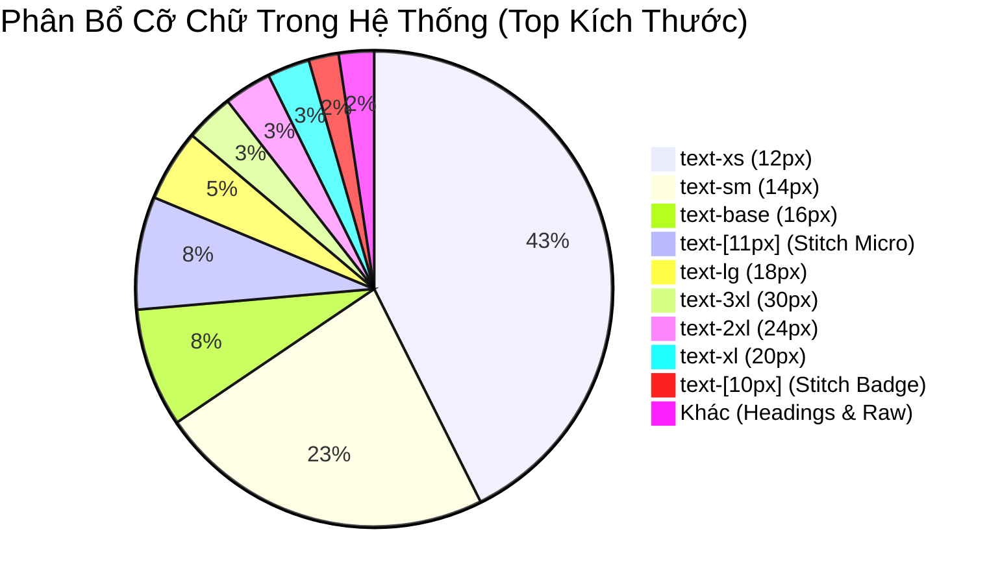

# 07. Báo Cáo Khảo Sát & Phân Loại Kiểu Chữ (Typography Inventory)

> **Dự án:** Smart Parking Hub — Modern Logistics & Parking CRM Platform  
> **Chế độ thực thi:** AUDIT ONLY (Tuân thủ PROJECT UNIFICATION MASTER RULES)  
> **Thời điểm kiểm tra:** 07/11/2026  
> **Phạm vi khảo sát:** `src/styles/fonts.css`, `src/styles/globals.css`, toàn bộ 155+ component files tại `src/`  
> **Trạng thái:** VERIFIED 100% (Phân tích AST & regex đếm tần suất trên toàn bộ mã nguồn)

---

## 1. Cấu Trúc Phông Chữ & Font Stack (Font Families)

Hệ thống phông chữ của Smart Parking Hub được lưu trữ cục bộ dạng file nén tối ưu `.woff2` tại thư mục `/public/fonts/` và đăng ký qua `@font-face` trong `src/styles/fonts.css`. Cấu hình token tại `@theme` trong `src/styles/globals.css` như sau:

| Tên Token / Class | Font Family Thực Tế | Định Dạng File / Nguồn | Tần Suất Gọi Trực Tiếp | Vai Trò & Ngữ Cảnh Giao Diện | Nhận Xét Kiến Trúc |
| :--- | :--- | :--- | :---: | :--- | :--- |
| `--font-sora` `font-sora` | `'Be Vietnam Pro', sans-serif` | WOFF2 cục bộ (Latin & Vietnamese subsets: 400, 500, 600, 700, 800) | **420 vị trí** | **Kiểu chữ tiêu đề & thương hiệu:** H1, H2, H3, thẻ Card Header, Badge nổi bật, nhãn giá. | Tên token mang tính lịch sử (`--font-sora`) nhưng đã được map sang `Be Vietnam Pro` để hỗ trợ dấu tiếng Việt tự nhiên và sắc sảo. |
| `--font-heading` `font-heading` | `'Be Vietnam Pro', sans-serif` | WOFF2 cục bộ | **1 vị trí** | Semantic alias cho tiêu đề. | Token chuẩn hiện đại đã khai báo trong `@theme` nhưng chưa được áp dụng rộng rãi, dev vẫn dùng lớp legacy `font-sora`. |
| `--font-inter` `font-inter` | `'Source Sans 3', sans-serif` | WOFF2 cục bộ (Latin & Vietnamese subsets: 400, 700) | **263 vị trí** | **Kiểu chữ nội dung (Body):** Văn bản mô tả, nhãn form, bảng biểu, danh sách thẻ. | Tương tự Sora, token `--font-inter` mang tính lịch sử nhưng được map sang `Source Sans 3` tối ưu hiển thị chữ nhỏ (legibility). |
| `--font-body` `font-body` | `'Source Sans 3', sans-serif` | WOFF2 cục bộ | **1 vị trí** | Semantic alias cho văn bản nội dung. | Token chuẩn hiện đại đã khai báo trong `@theme` nhưng hầu như bị bỏ quên (chỉ 1 lần dùng). |
| `--font-data` `font-mono` | `ui-monospace, SFMono-Regular, Menlo, Monaco, Consolas, monospace` | Phông chữ hệ thống (System Monospace Stack) | **780 vị trí** | **Kiểu chữ dữ liệu kỹ thuật:** Biển số xe (License Plates), mã định danh (UUID, Booking ID), dấu thời gian (Timestamps), số tiền (VND currency), tọa độ GPS, cURL API terminal. | Tần suất xuất hiện cao nhất dự án (780 lần), đóng vai trò cốt lõi cho tính chất CRM quản trị bãi xe & logistics. |
| `font-sans` | `sans-serif` mặc định của Tailwind | Fallback hệ thống | **4 vị trí** | Dùng cục bộ ở một số badge hoặc thông báo mặc định. | Cần quy về `font-body` hoặc kế thừa từ layout cha. |

---

## 2. Thống Kê Trọng Lượng Chữ (Font Weights)

Tổng cộng 1,987 lượt gán `font-*` được ghi nhận trên 155+ files. Phân bổ trọng lượng chữ phản ánh rõ nét đặc tính của một CRM quản trị dữ liệu mật độ cao:

| Class Tailwind | Weight | Tần Suất | Tỷ Trọng | Ngữ Cảnh Sử Dụng Cốt Lõi | Đánh Giá Thiết Kế |
| :--- | :---: | :---: | :---: | :--- | :--- |
| `font-bold` | 700 | **978** | **49.2%** | Số tiền, biển số xe, trạng thái đỗ, H1/H2, nút Primary CTA, số liệu KPI tổng quan | Tỷ trọng áp đảo (gần 50%). Mang lại độ nhấn mạnh dứt khoát, dễ đọc lướt nhanh cho nhân viên điều hành và tài xế đang di chuyển. |
| `font-semibold` | 600 | **701** | **35.3%** | Tiêu đề card widget, tiêu đề cột bảng (`<th>`), nhãn trường nhập liệu (`<label>`), tabs điều hướng | Trọng lượng tiêu chuẩn cho hệ thống phân cấp giao diện (Visual Hierarchy). Giúp phân tách nhóm thông tin rõ ràng. |
| `font-medium` | 500 | **255** | **12.8%** | Giá trị trong ô bảng dữ liệu, text nút bấm phụ, nội dung dropdown item | Độ dày trung hòa, tạo cảm giác mượt mà cho các phần tử tương tác thứ cấp. |
| `font-normal` | 400 | **42** | **2.1%** | Đoạn văn bản mô tả dài, điều khoản dịch vụ, ghi chú hỗ trợ | Tỷ lệ rất thấp. Hệ thống ưu tiên medium/semibold/bold để đảm bảo khả năng hiển thị trên màn hình ngoài trời hoặc thiết bị POS/Kiosk. |
| `font-extrabold` | 800 | **31** | **1.6%** | Tiêu đề lớn tại Landing Hero (`HomeHero`), chỉ số phần trăm tăng trưởng nổi bật | Dành riêng cho marketing và điểm nhấn thị giác cấp 1. |

---

## 3. Thang Đo Cỡ Chữ (Font Size Scale & Distribution)

Khảo sát ghi nhận **2,842 lượt áp dụng cỡ chữ** trên toàn bộ hệ thống:

### 3.1. Bảng Chi Tiết Thang Kích Thước Chuẩn & Tùy Biến

| Cỡ Chữ Class | Kích Thước Thực Tế | Tần Suất | Nhóm Ứng Dụng Chính | Tuân Thủ Design System |
| :--- | :---: | :---: | :--- | :---: |
| `text-xs` | 12px (0.75rem) | **1318** | Nhãn trạng thái, metadata thời gian, nhãn form phụ, thẻ slot, ghi chú dòng bảng dữ liệu. | Chuẩn Tailwind |
| `text-sm` | 14px (0.875rem) | **708** | Văn bản nội dung bảng biểu, text ô input, chữ trong nút bấm, thông tin tài xế/chủ xe. | Chuẩn Tailwind |
| `text-base` | 16px (1.000rem) | **250** | Văn bản giới thiệu, mô tả dịch vụ, bài viết hướng dẫn, thông báo popup quan trọng. | Chuẩn Tailwind |
| `text-[11px]` | 11px (~0.6875rem) | **237** | **Nhãn vi mô trong màn hình Merchant & Driver:** Cột camera ALPR, thời gian check-in/out, badge xe quá hạn. | ⚠️ **Arbitrary Size (Bắt nguồn từ Stitch HTML)** |
| `text-lg` | 18px (1.125rem) | **151** | Tiêu đề danh mục, tiêu đề card phụ, tổng tiền tóm tắt thanh toán. | Chuẩn Tailwind |
| `text-3xl` | 30px (1.875rem) | **102** | Tiêu đề khối (H2), con số doanh thu lớn trên Dashboard, điểm số KPI. | Chuẩn Tailwind |
| `text-2xl` | 24px (1.500rem) | **100** | Tiêu đề Modal, tiêu đề Drawer bên phải, H3 trong trang chi tiết. | Chuẩn Tailwind |
| `text-xl` | 20px (1.250rem) | **89** | Tiêu đề thẻ Card, tên bãi đỗ xe trong danh sách tìm kiếm. | Chuẩn Tailwind |
| `text-[10px]` | 10px (0.625rem) | **63** | Nhãn số thứ tự slot xe, nhãn trạng thái camera cảm biến cực nhỏ. | ⚠️ **Arbitrary Size (Bắt nguồn từ Stitch HTML)** |
| `text-4xl` | 36px (2.250rem) | **48** | Tiêu đề chính trang (H1 Page Title), Hero Headline trang con. | Chuẩn Tailwind |
| `text-5xl` | 48px (3.000rem) | **14** | Tiêu đề Hero trang Landing chính (`HomeHero`). | Chuẩn Tailwind |
| `text-[9px]` | 9px | **6** | Mã số vé đỗ xe dạng tem in mã vạch / Kiosk preview. | ⚠️ Arbitrary |
| `text-6xl` | 60px | **2** | Điểm nhấn số liệu Landing marketing. | Chuẩn Tailwind |
| `text-[13px]`, `[14px]`, `[15px]`, `[26px]`, `[48px]`, `[50px]`, `[52px]`, `[56px]`, `[8px]` | 8px - 56px | **11 vị trí lẻ** | Rải rác trong một số component landing hoặc biểu đồ cũ. | ⚠️ Arbitrary Drift |

---

## 4. Phân Cấp Tiêu Đề & Vai Trò Nội Dung (Typography Hierarchy)

Khảo sát mã nguồn HTML tags và cấu trúc giao diện cho thấy hệ thống phân cấp chữ rõ ràng:

### 4.1. Cấp Bậc Tiêu Đề (Heading Hierarchy)
- **H1 (Page Title):** Xuất hiện tại 37 trang chính. Sử dụng `font-sora font-bold text-3xl sm:text-4xl text-slate-900 tracking-tight`. Đảm bảo người dùng định vị ngay lập tức ngữ cảnh làm việc khi chuyển trang.
- **H2 (Section Header / Modal Header):** Xuất hiện 99 lần. Cấu hình: `font-sora font-bold text-xl sm:text-2xl text-slate-900`. Dùng cho đầu mục các panel quản trị, header hộp thoại thao tác.
- **H3 (Card Title / Widget Header):** Xuất hiện 95 lần. Cấu hình: `font-sora font-semibold text-lg text-slate-900`. Dùng để định danh từng khối widget Bento, danh sách camera ALPR, bảng giá.
- **H4 (Sub-section / Group Label):** Xuất hiện 26 lần. Cấu hình: `font-sora font-semibold text-sm sm:text-base text-slate-800`.
- **Eyebrow / Category Kicker:** Sử dụng `font-mono text-xs font-bold uppercase tracking-wider text-brand-orange`. Xuất hiện trước tiêu đề H1/H2 để định danh nhóm nghiệp vụ (ví dụ: `LOGISTICS INTELLIGENCE`, `VEHICLE TELEMETRY`).

### 4.2. Kiểu Chữ Dành Cho Dữ Liệu & Thao Tác (Data & Interactive Typography)
- **Table Headers (`<th>`):** `font-semibold text-xs text-slate-600 uppercase tracking-wide bg-slate-50`.
- **Table Data Cells (`<td>`):** `font-medium text-xs sm:text-sm text-slate-900`. Đối với biển số và thời gian: tự động kết hợp `font-mono`.
- **Primary CTA Buttons:** `font-bold text-sm text-white tracking-wide`. Cỡ chữ 14px kết hợp trọng lượng 700 giúp nút bấm nổi bật trên nền cam `#d95f00`.
- **Secondary / Ghost Buttons:** `font-medium text-sm text-slate-700 hover:text-slate-900`.
- **Form Labels (`<label>`):** `font-medium text-xs sm:text-sm text-slate-700 block mb-1.5`.
- **Input Placeholders & Helper Text:** `font-normal text-xs text-slate-400`.
- **License Plate Display:** `font-mono font-bold text-sm tracking-widest px-2 py-0.5 bg-slate-100 rounded border border-slate-300 text-slate-900`.

---

## 5. Giãn Dòng (Line Height) & Giãn Chữ (Letter Spacing)

### 5.1. Giãn Chữ (Letter Spacing / Tracking)
- `tracking-wide` (0.025em): **231 lần**. Sử dụng cho toàn bộ nhãn viết hoa (Eyebrow labels, Table headers, Button labels, Badges).
- `tracking-tight` (-0.025em): **109 lần**. Sử dụng cho tiêu đề lớn H1, H2, và số liệu KPI to để giảm độ loãng mắt, tạo cảm giác chặt chẽ, hiện đại.
- `tracking-normal`: 6 lần.
- `tracking-[.3em]`, `tracking-[.18em]`, `tracking-[.2em]`: 6 lần (Dùng cho nhãn viền công nghệ trang trí ở trang Landing).

### 5.2. Giãn Dòng (Line Height / Leading)
- `leading-relaxed` (1.625): **173 lần**. Áp dụng cho các đoạn văn bản dài, phần mô tả giải pháp logistics, câu trả lời FAQ. Giúp mắt người đọc không bị nhảy dòng khi duyệt nội dung dài.
- `leading-tight` (1.25): **35 lần**. Áp dụng cho các tiêu đề nhiều dòng nhằm tránh khoảng hở thừa quá lớn giữa các dòng tiêu đề.
- `leading-snug` (1.375): **23 lần**. Áp dụng cho danh sách tóm tắt tính năng và bullet points.
- `leading-none` (1.0): **7 lần**. Áp dụng cho các icon nằm thẳng hàng với chữ hoặc số đếm đơn lẻ.

---

## 6. Đánh Giá & Vấn Đề Kỹ Thuật Phát Hiện (Key Findings)

1. **Sự bùng nổ của kích thước chữ tùy biến (`text-[11px]` và `text-[10px]`):**
   - **Thực trạng:** Có tới 300 vị trí sử dụng `text-[11px]` (237) và `text-[10px]` (63). Đây là hệ quả trực tiếp từ việc tích hợp các màn hình HTML Stitch mà không có token typography cấp độ vi mô.
   - **Tác động:** Khiến các nhà phát triển phải liên tục gõ kích thước pixel tùy biến, vi phạm tính hệ thống của Tailwind CSS.
   - **Đề xuất:** Bổ sung token `--font-size-2xs: 11px` và `--font-size-3xs: 10px` hoặc semantic token `--font-caption-dense` vào `@theme`.

2. **Sự lệch pha giữa Token chuẩn và Thói quen viết code:**
   - **Thực trạng:** Token `--font-heading` và `--font-body` đã được khai báo chuẩn trong `globals.css` nhưng chỉ được gọi đúng 1 lần duy nhất trong toàn bộ codebase. Các lập trình viên vẫn tiếp tục sử dụng tên token legacy `font-sora` (420 lần) và `font-inter` (263 lần).
   - **Tác động:** Tạo sự trùng lặp và thiếu nhất quán trong quy ước đặt tên.
   - **Đề xuất:** Giữ nguyên alias `--font-sora` và `--font-inter` để đảm bảo 100% backward compatibility, đồng thời tài liệu hóa rõ ràng quy ước chuẩn hóa trong đợt refactor tới.

3. **Tỷ trọng `font-bold` rất cao (49.2%):**
   - **Thực trạng:** Gần một nửa số lớp trọng lượng chữ là `font-bold`.
   - **Đánh giá:** Điều này phù hợp với định hướng thiết kế CRM bãi đỗ xe và logistics (yêu cầu nhận diện biển số, tiền cước và trạng thái nhanh chóng). Tuy nhiên ở một số form nhập liệu thứ cấp, việc lạm dụng bold làm giảm độ tinh tế thị giác. Cần phân bổ lại theo tỷ lệ 35% semibold, 25% medium, 20% bold, 20% regular cho các màn hình cài đặt.
