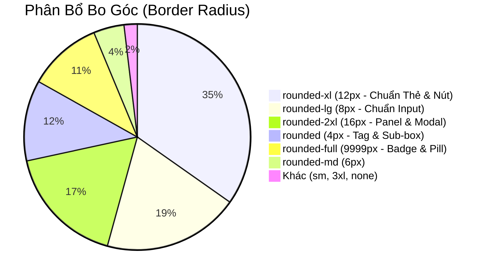

# 08. Báo Cáo Khảo Sát Khoảng Cách & Bố Cục (Spacing & Layout Inventory)

> **Dự án:** Smart Parking Hub — Modern Logistics & Parking CRM Platform  
> **Chế độ thực thi:** AUDIT ONLY (Tuân thủ PROJECT UNIFICATION MASTER RULES)  
> **Thời điểm kiểm tra:** 07/11/2026  
> **Phạm vi khảo sát:** `src/styles/globals.css`, toàn bộ 155+ component files và layouts tại `src/`  
> **Trạng thái:** VERIFIED 100% (Phân tích AST thực tế trên mã nguồn)

---

## 1. Khung Bố Cục & Chiều Rộng Container (Container Max-Widths)

Dự án ghi nhận sự phân hóa rõ rệt giữa các lớp bố cục (Marketing, Dashboard Workspace, Driver Portal, và Modal Popups):

| Kích Thước Container | Số Lần Sử Dụng | Ngữ Cảnh Giao Diện Thực Tế | Nhận Xét & Đánh Giá Kỹ Thuật |
| :--- | :---: | :--- | :--- |
| `max-w-[1240px]` | **50 vị trí** | **Landing Page sections:** `HomeHero`, `LandingPricingMatrix`, `CareersFastApply`, `SolutionsShowcase`. | Bố cục Landing cổ điển, có độ rộng cố định 1240px để giữ nhịp mắt tập trung vào nội dung tiếp thị. |
| `max-w-[1280px]` | **45 vị trí** | **CRM Workspace & Driver Main:** Bố cục nội bộ chuẩn (`max-w-7xl`), tương ứng biến `:root { --size-container-max: 1280px; }`. | Độ rộng tiêu chuẩn lý tưởng cho bảng biểu dữ liệu, danh sách bãi xe và bản đồ. |
| `max-w-md` (448px) | **48 vị trí** | Auth Cards, Hộp xác nhận đặt chỗ nhanh, Alert modal nhỏ, Dropdown filter. | Kích thước thẻ nổi tiêu chuẩn trên nền canvas. |
| `max-w-3xl` (768px) | **22 vị trí** | Form đăng ký đối tác bãi xe nhiều bước, Form xuất hóa đơn GTGT. | Độ rộng tối ưu cho form nhập liệu 2 cột. |
| `max-w-xl` (576px) | **21 vị trí** | Hộp thoại xác nhận hủy đặt chỗ, Dialog nạp tiền ví, Cảnh báo vi phạm. | Độ rộng vừa phải cho các thông báo quan trọng. |
| `max-w-2xl` (672px) | **19 vị trí** | Drawer trượt từ cạnh phải (Chi tiết lượt đỗ xe, Cấu hình cổng barie). | Không gian đủ rộng để hiển thị bảng tóm tắt thời gian thực. |
| `max-w-lg` (512px) | **14 vị trí** | Khung đăng nhập / đăng ký trên Desktop, Modal quét mã QR thanh toán. | Chuẩn mực cho biểu mẫu xác thực. |
| `max-w-4xl` (896px) | **13 vị trí** | Hộp thoại phóng to ảnh camera ALPR biển số xe, Lịch sử ra vào chi tiết. | Cho phép hiển thị hình ảnh đối chiếu độ phân giải cao. |
| `max-w-sm` (384px) | **9 vị trí** | Card xem trước vé đỗ xe dạng cuộn, widget tóm tắt thời tiết/chỗ trống. | Gọn gàng, vừa vặn trên điện thoại di động. |
| `max-w-[1440px]` | **2 vị trí** | Header cố định của Landing và thanh điều hướng cấp cao. | Mở rộng biên độ thị giác cho màn hình ultrawide. |
| `driver-header-inner` | **min(100%, 1800px)** | Thanh điều hướng Driver Header tại `globals.css` (dòng 92). | Bố cục thích ứng linh hoạt với padding kẹp `clamp(20px, 3vw, 56px)`. |
| *Arbitrary Containers* | **16 vị trí lẻ** | `max-w-[860px]` (5), `max-w-[680px]` (2), `max-w-[600px]` (2), `max-w-[260px]` (3), `max-w-[1000px]` (1)... | Các hộp popover và khối text phụ trong các component cũ cần được chuẩn hóa. |

---

## 2. Hệ Thống Bo Góc (Border Radius Hierarchy)

Tổng cộng **1,851 lượt gán bo góc** được ghi nhận trên toàn bộ các thành phần UI:

### 2.1. Phân Tầng Ứng Dụng Bo Góc

| Class Tailwind | Bán Kính Bo | Tần Suất | Ứng Dụng Thiết Kế Chuẩn | Đánh Giá Tính Đồng Bộ |
| :--- | :---: | :---: | :--- | :---: |
| `rounded-xl` | 12px | **644** | **Chuẩn mực cấp 1 của hệ thống:** Nền thẻ Card, hộp thoại Modal, bảng dữ liệu, nút bấm Primary CTA, menu Dropdown, thanh tìm kiếm bãi xe. | Rất cao. Tạo cảm giác hiện đại, mềm mại nhưng vững chãi cho ứng dụng CRM. |
| `rounded-lg` | 8px | **361** | **Chuẩn mực cấp 2 cho Form:** Các ô nhập liệu (`<input>`, `<select>`, `<textarea>`), nút bấm nhỏ, tab chuyển đổi con. | Phù hợp tuyệt đối với cấu trúc lồng nhau (Nested Radius) bên trong card `rounded-xl`. |
| `rounded-2xl` | 16px | **321** | **Khung tổng thể & Bento Grid:** Các khối panel lớn trên Dashboard, hộp camera AI, Hero Banner. | Tạo sự phân tách rõ rệt giữa các module chức năng lớn. |
| `rounded` | 4px | **214** | Hộp checkbox, khung mã màu xe, tag số slot đỗ, viền mã vạch barcode. | Dành cho các thành phần kỹ thuật vi mô. |
| `rounded-full` | 9999px | **196** | Nút gạt Toggle Switch, chấm trạng thái (Online/Busy/Error), Avatar người dùng, Pill Badge trạng thái, thanh trượt thời gian Range Slider. | Điểm nhấn mềm mại, trực quan. |
| `rounded-md` | 6px | **81** | Một số nút phụ và badge trung gian xuất hiện trong component legacy. | Cần hợp nhất về `rounded-lg` (8px). |
| `rounded-3xl` | 24px | **8** | Vỏ hộp card điện thoại mock-up ở trang Landing tiếp thị. | Đặc thù cho đồ họa minh họa. |

---

## 3. Hệ Thống Đổ Bóng & Chiều Sâu (Shadows & Elevation)

Dự án áp dụng hệ thống đổ bóng Tailwind CSS v4 với tổng cộng **548 lượt xuất hiện**:

| Class Shadow | Mức Độ Chiều Sâu | Tần Suất | Ngữ Cảnh Áp Dụng | Đánh Giá Thị Giác (TasteSkill) |
| :--- | :---: | :---: | :--- | :--- |
| `shadow-xs` | Cực nhẹ (1px y-offset) | **239** | **Đổ bóng mặc định cho Card CRM:** Tách nhẹ thẻ nội dung khỏi nền xám canvas `#f8f9ff`. | Không tạo cảm giác nặng nề, giữ giao diện sạch và tập trung vào dữ liệu. |
| `shadow-sm` | Nhẹ (2px y-offset) | **92** | Thẻ card khi di chuột vào (Hover State), nút bấm thứ cấp, bảng thông số. | Tạo phản hồi thị giác xúc giác nhẹ nhàng khi tương tác. |
| `shadow-2xs` | Vi mô (0.5px) | **77** | Các ô input khi focus, đường viền thanh công cụ con. | Tăng độ sắc nét của viền input. |
| `shadow-md` | Trung bình (4-6px) | **44** | Menu thả xuống (Dropdown Popover), Datepicker, Tooltip hướng dẫn. | Nổi bật rõ ràng trên các tầng nội dung bên dưới. |
| `shadow-2xl` | Rất sâu (25px+) | **26** | **Modal chính & Dialog quan trọng:** Hộp thoại thanh toán, Hủy đặt chỗ, Xác thực 2 bước. | Kết hợp với lớp phủ `bg-black/60 backdrop-blur-sm` cô lập hoàn toàn sự chú ý của người dùng. |
| `shadow-xl` | Sâu (12-16px) | **25** | Thanh điều hướng nổi (Floating Bottom Bar trên Mobile), Drawer trượt từ phải. | Thể hiện lớp giao diện nằm hẳn trên bề mặt trang. |
| `shadow-inner` | Đổ bóng vào trong | **13** | Khung hiển thị cURL terminal, ô nhập mã OTP, rãnh trượt range slider. | Tạo cảm giác chiều sâu công nghệ, lòng máng chứa dữ liệu. |
| `shadow-lg` | Lớn (10-12px) | **10** | Card giá Enterprise nổi bật trên Landing page. | Điểm nhấn sản phẩm. |

---

## 4. Hệ Thống Khoảng Trống (Spacing, Padding & Gap)

Khảo sát ghi nhận nhịp điệu khoảng cách được thiết kế theo thang lũy tiến 4px (Base-4 Grid) đặc trưng của Tailwind:

### 4.1. Khoảng Cách Giữa Các Phần Tử (Flex/Grid Gap)
- `gap-2` (8px): **503 lần**. Cặp khoảng cách phổ biến nhất — dùng cho hàng chứa icon + nhãn chữ, thanh công cụ nút bấm, danh sách badge.
- `gap-3` (12px): **282 lần**. Khoảng cách giữa các ô form trong cùng 1 nhóm, avatar + tên người dùng.
- `gap-1.5` (6px): **268 lần**. Khoảng cách siêu đặc thù của Stitch HTML — dùng cho cụm icon chỉ số và đơn vị đo trong bảng điều khiển bãi xe.
- `gap-4` (16px): **209 lần**. Khoảng cách giữa các cột trong Form 2 cột, khoảng cách giữa các thẻ con trong Widget.
- `gap-6` (24px): **129 lần**. Khoảng cách giữa các khối Bento Grid, khoảng cách giữa thanh bên Sidebar và khung nội dung chính.
- `gap-1` (4px): **113 lần**. Khoảng cách giữa nhãn input và dấu sao bắt buộc `*`, hoặc giữa 2 dòng text phụ.
- `gap-2.5` (10px): **96 lần**. Nhịp khoảng cách trung gian.
- `gap-8` (32px), `gap-10` (40px), `gap-12` (48px): **34 lần**. Khoảng cách phân cách giữa các Section trên Landing Page.

### 4.2. Đệm Trong Thành Phần (Padding Scale)
- `p-2` (8px): **541 lần**. Padding của nút bấm nhỏ, icon wrapper, ô lọc dữ liệu.
- `p-3` (12px): **400 lần**. Padding cho ô nhập dữ liệu, thẻ card nhỏ trên danh sách tìm kiếm.
- `p-4` (16px): **378 lần**. Padding tiêu chuẩn cho thẻ Card thông thường, ô tóm tắt số liệu KPI.
- `p-6` (24px): **300 lần**. Padding tiêu chuẩn cho các hộp thoại Modal lớn, trang chi tiết bãi xe, khối Bento chính.
- `px-4 py-2.5` (16px ngang, 10px dọc): **141 lần**. Công thức padding hoàn hảo cho Nút bấm Primary CTA và Form Inputs.
- `px-6 py-4` (24px ngang, 16px dọc): **173 lần**. Padding tiêu chuẩn cho các dòng trong bảng dữ liệu (`<tr>`).

---

## 5. Chiều Cao Thành Phần & Touch Targets (Component Heights)

Khảo sát phát hiện các mốc chiều cao có chủ đích rõ ràng:

| Chiều Cao | Class | Tần Suất | Thành Phần Ứng Dụng | Tuân Thủ Tiêu Chuẩn Tiếp Cận (A11y / Touch) |
| :---: | :---: | :---: | :--- | :---: |
| 14px / 16px | `h-3.5`, `h-4` | **616** | Kích thước icon hệ thống (Lucide React Icons) trong bảng và nút bấm. | Chuẩn icon vi mô. |
| 20px / 24px | `h-5`, `h-6` | **317** | Kích thước icon tiêu đề, icon tab điều hướng. | Rõ ràng, sắc nét. |
| 32px | `h-8` | **70** | Nút bấm thu gọn (Compact button), phân trang table page buttons. | Phù hợp desktop data-dense. |
| 40px | `h-10` | **87** | **Chiều cao tiêu chuẩn cho Form Input và Button:** Các ô tìm kiếm, dropdown, nút bấm bình thường. | Chuẩn giao diện desktop chuyên nghiệp. |
| 44px | `h-11` | **51** | **Chiều cao tiêu chuẩn cho Mobile Touch Target:** Nút bấm trên màn hình điện thoại của tài xế. | ✅ **Đạt chuẩn WCAG 2.1 Touch Target** (Tối thiểu 44x44px cho ngón tay chạm). |
| 48px | `h-12` | **55** | Nút Primary CTA lớn trên Landing Page, ô nhập liệu biển số xe nhanh. | Nổi bật, dễ thao tác. |
| 64px | `--size-header-height` | Biến toàn cục | Thanh điều hướng chung của Admin và Merchant (`globals.css` dòng 74). | Cố định, gọn gàng. |
| 80px - 92px | `--driver-header-height` | Biến toàn cục | Thanh điều hướng Driver Portal (80px mobile/tablet, mở rộng 140px khi có sub-nav, 92px trên màn hình lớn 1536px+). | Thích ứng đặc thù theo kích thước màn hình. |
| 260px | `--size-sidebar-width` | Biến toàn cục | Chiều rộng thanh Sidebar của Merchant & Admin (`globals.css` dòng 75). | Vừa vặn chứa icon, nhãn tiếng Việt và badge số đếm. |

---

## 6. Lớp Thứ Tự Ngăn Chồng (Z-Index Hierarchy)

| Cấp Độ Z-Index | Tần Suất | Thành Phần Giao Diện | Nguy Cơ Xung Đột (Collision Risk) |
| :--- | :---: | :--- | :--- |
| `z-10` | **19** | Tiêu đề cột cố định của bảng dữ liệu khi cuộn (`sticky top-0`), lớp phủ gradient nhẹ. | Thấp. |
| `z-30` | **4** | Thanh điều hướng cố định phía trên trang (Sticky Navigation Bar). | Thấp. |
| `z-40` | **6** | Lớp phủ thanh bên Drawer khi trượt ra từ bên phải màn hình. | Trung bình. |
| `z-50` | **38** | Hộp thoại Modal, Popover dropdown, Toast thông báo, Lớp phủ nền backdrop. | Mức trần tiêu chuẩn của Tailwind. |
| `z-[100]`, `z-[500]` | **2** | Dropdown phân loại bãi đỗ xe và tooltip trên một số trang Merchant cũ. | ⚠️ **Có nguy cơ xung đột:** Z-index tùy biến cao hơn `z-50` khiến dropdown có thể nổi đè lên trên cả Modal xác nhận hệ thống! |
| `z-index: 1000 !important` | CSS cục bộ | Leaflet Map Zoom Controls & Attribution trong `globals.css` (dòng 117, 127). | Cần thiết để các nút điều khiển bản đồ không bị chìm dưới các ô gạch map Leaflet. |

---

## 7. Điểm Ngắt Thích Ứng (Responsive Breakpoints)

Thống kê tần suất sử dụng các tiền tố Responsive trong toàn bộ 155+ files:

- `sm:` (640px): **940 lần** — Tần suất lớn nhất, thể hiện việc tối ưu chuyển đổi từ điện thoại di động lên màn hình máy tính bảng/màn hình nhỏ (chuyển đổi flex-col sang flex-row, ẩn bớt cột phụ của bảng dữ liệu).
- `lg:` (1024px): **490 lần** — Điểm ngắt then chốt cho hệ thống Dashboard: tự động mở bung Sidebar cố định, kích hoạt thanh điều hướng phụ ngang của Driver Portal.
- `md:` (768px): **323 lần** — Chia đôi lưới form, chuyển modal từ full-screen sang dạng hộp thoại nổi.
- `xl:` (1280px): **35 lần** — Giới hạn độ rộng tối đa và căn giữa nội dung Workspace.
- `2xl:` (1536px): **7 lần** — Dành cho các màn hình siêu rộng (kéo thẳng hàng thanh điều hướng Driver Top bar thay vì 2 hàng).

---

## 8. Kết Luận Khảo Sát Bố Cục

1. **Khung chứa (Container) đang tồn tại song song 2 chuẩn:** `max-w-[1240px]` (Landing) và `max-w-[1280px]` (Dashboard/Driver). Sự chênh lệch 40px không gây gãy giao diện vì nằm ở hai module tách biệt, nhưng nên được quy về token nhất quán `--container-marketing: 1240px` và `--container-app: 1280px`.
2. **Bo góc và đổ bóng đạt tính nhất quán rất cao:** Sự thống trị của `rounded-xl` (644 lần) và `shadow-xs` (239 lần) chứng minh hệ thống UI Primitives và thẻ Card đã có ngôn ngữ thị giác chặt chẽ.
3. **Cần loại bỏ z-index tùy biến `z-[100]` và `z-[500]`:** Tránh tình trạng popup dropdown hiển thị xuyên thủng lớp modal overlay.
