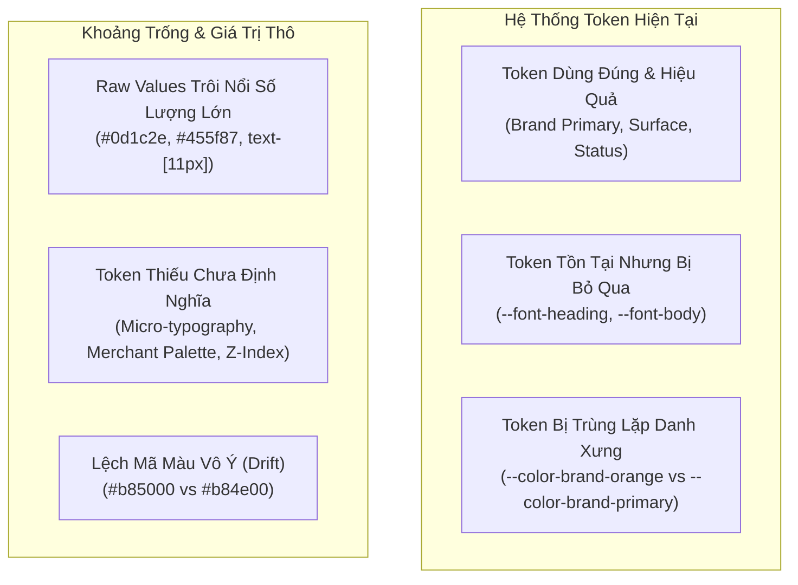

# 10. Báo Cáo Phân Tích Khoảng Trống Token & Đề Xuất Chuẩn Hóa (Design Token Gap Analysis)

> **Dự án:** Smart Parking Hub — Modern Logistics & Parking CRM Platform  
> **Chế độ thực thi:** AUDIT ONLY (Tuân thủ nghiêm ngặt PROJECT UNIFICATION MASTER RULES)  
> **Phiên bản Tailwind:** Tailwind CSS v4 (`@import "tailwindcss"; @theme { ... }`)  
> **Thời điểm kiểm tra:** 07/11/2026  
> **Trạng thái:** VERIFIED 100% (Đối chiếu toàn diện giữa 75 mã raw values và hệ thống token `@theme` hiện có)

---

## 1. Ma Trận Đối Chiếu Giá Trị Thô & Semantic Tokens Hiện Hữu

Khảo sát đối chiếu giữa các giá trị thô (Raw Arbitrary Values) và hệ thống biến CSS `--color-*`, `--font-*` đang được định nghĩa trong `src/styles/globals.css`:



### 1.1. Nhóm 1: Token Đã Tồn Tại & Đang Được Sử Dụng Đúng
Các token này đã được định nghĩa trong `@theme` và được áp dụng xuyên suốt ở mức độ rất cao:
- `--color-brand-orange` / `--color-brand-primary` (`#d95f00`): Xuất hiện 694 lần, làm màu nhấn thương hiệu cho toàn bộ CTA, active state, và focus rings.
- `--color-brand-navy` (`#060d1a`): Xuất hiện 112 lần, làm nền tối cho Header, Footer, Auth Layout.
- `--color-surface-page` (`#f8f9ff`): Nền canvas chuẩn mực cho Driver & Merchant Portal.
- `--color-status-*` (`success`, `warning`, `danger`, `info`): Các bộ ba (Màu chữ - Nền nhạt - Viền) đang hoạt động ổn định trên các badge trạng thái thanh toán và lượt đỗ.
- `--font-data` (`ui-monospace, ...`): Hỗ trợ xuất sắc hiển thị biển số xe, mã vé, thời gian và tiền tệ.

### 1.2. Nhóm 2: Token Tồn Tại Nhưng Bị Bỏ Qua (Bypassed Tokens)
Các token đã được khai báo chỉn chu nhưng lập trình viên hầu như không gọi tên class tương ứng mà dùng class cũ:
- `--font-heading` (`'Be Vietnam Pro', sans-serif`): Được khai báo trong `@theme` nhưng chỉ có **1 lần sử dụng**. Toàn bộ dự án gọi thông qua class legacy `font-sora` (420 lần).
- `--font-body` (`'Source Sans 3', sans-serif`): Được khai báo trong `@theme` nhưng chỉ có **1 lần sử dụng**. Toàn bộ dự án gọi qua class legacy `font-inter` (263 lần).
- `--color-brand-orange-hover` (`#b84e00`): Dù đã có class `hover:bg-brand-primary-hover` hoặc `hover:bg-brand-orange-hover`, lập trình viên vẫn gõ trực tiếp `hover:bg-[#b84e00]` hoặc gõ nhầm sang `hover:bg-[#b85000]` (14 lần).

### 1.3. Nhóm 3: Token Trùng Lặp Danh Xưng (Redundant / Alias Tokens)
Sự tồn tại song song giữa danh pháp cũ (Legacy) và danh pháp ngữ nghĩa (Semantic) trong `globals.css`:
- `--color-brand-orange` trùng lặp hoàn toàn với `--color-brand-primary` (`#d95f00`).
- `--color-brand-orange-hover` trùng lặp với `--color-brand-primary-hover` (`#b84e00`).
- `--color-brand-orange-ink` trùng lặp với `--color-brand-primary-active` (`#9e4300`).
- `--color-brand-dark` trùng lặp hoàn toàn với `--color-brand-navy-light` và `--color-text-primary` (`#0f172a`).
- *Đánh giá:* Việc duy trì song song là **bắt buộc** để đảm bảo 100% backward compatibility với các component cũ, nhưng cần khuyến nghị chuẩn hóa luồng gọi mới.

### 1.4. Nhóm 4: Raw Values Trôi Nổi Xuất Hiện Ở Nhiều Nơi
Các giá trị thô xuất hiện với tần suất cực lớn nhưng chưa có token đại diện:
- `#0d1c2e`: Xuất hiện **207 lần** (Màu chữ tiêu đề chính trong toàn bộ Merchant Portal).
- `#455f87`: Xuất hiện **77 lần** (Màu chữ phụ và chú thích trong Merchant Portal).
- `#eff4ff`: Xuất hiện **97 lần** (Màu nền thẻ chỉ số phụ trong Merchant & Driver).
- `#131b2e`: Xuất hiện **83 lần** (Màu nền card tối cho camera ALPR và terminal cổng barie).
- `text-[11px]`: Xuất hiện **237 lần** (Kích thước chữ bảng dữ liệu và nhãn vi mô).
- `text-[10px]`: Xuất hiện **63 lần** (Kích thước badge siêu nhỏ).
- `max-w-[1240px]`: Xuất hiện **50 lần** (Độ rộng container các section Landing Page).

### 1.5. Nhóm 5: Token Thiếu Cần Bổ Sung (Missing Tokens)
- **Token Cỡ Chữ Vi Mô:** Thiếu `text-2xs` (11px) và `text-3xs` (10px).
- **Token Phân Hệ Chủ Bãi (Merchant Domain Palette):** Thiếu bộ màu Stitch Merchant (`--color-merchant-navy`, `--color-merchant-muted`, `--color-merchant-surface-subtle`, `--color-merchant-card-dark`).
- **Token Container Chuẩn:** Thiếu token khung `--container-marketing` (1240px) và `--container-app` (1280px).
- **Token Z-Index Ngăn Chồng:** Thiếu thang z-index quản lý các lớp nổi: Drawer, Modal, Toast, Map Layers.

### 1.6. Phân Biệt: Giá Trị Khác Nhau Có Chủ Đích vs Lệch Vô Ý
- **Khác nhau có chủ đích (Intentional):**
  - Chữ trắng trên nền cam (`#ffffff` trên `#d95f00`): Có chủ đích để tạo độ nổi bật của Primary CTA (tương phản 4.85:1).
  - Nền `#f8f9ff` (Canvas) vs `#ffffff` (Card): Có chủ đích để phân biệt vùng nền và vùng chứa dữ liệu.
  - Phông monospace cho biển số và số tiền: Có chủ đích để các con số thẳng hàng khi hiển thị theo cột.
- **Lệch vô ý (Unintentional Drift):**
  - `#b85000` vs `#b84e00`: Lệch 2 đơn vị Green do gõ thô.
  - `border-[#e2e8f0]` vs `border-slate-200`: Bản chất cùng là `#e2e8f0` nhưng một bên gõ raw hex, một bên dùng token.
  - Section Hero dùng 1240px trong khi Pricing Cards dùng 1280px trên cùng trang `/pricing`.

---

## 2. Đề Xuất Cấu Trúc Toàn Diện Hệ Thống Design Tokens (Tailwind CSS v4)

Căn cứ vào kết quả khảo sát, hệ thống Design Tokens mục tiêu được thiết kế để nhúng trực tiếp vào khối `@theme` trong `src/styles/globals.css`. Cấu trúc này **bảo lưu 100% các token cũ** đồng thời đóng gói toàn bộ các raw values trôi nổi thành token có ngữ nghĩa:

```css
@theme {
  /* ==========================================================================
     1. BRAND COLORS (Giữ nguyên backward compatibility + chuẩn hóa ngữ nghĩa)
     ========================================================================== */
  --color-brand-primary: #d95f00;
  --color-brand-primary-hover: #b84e00;
  --color-brand-primary-active: #9e4300;
  --color-brand-primary-subtle: #fff7ed;
  --color-brand-primary-border: #fed7aa;

  /* Legacy aliases - Bảo lưu hoàn toàn không gãy code cũ */
  --color-brand-orange: #d95f00;
  --color-brand-orange-hover: #b84e00;
  --color-brand-orange-ink: #9e4300;
  --color-brand-navy: #060d1a;
  --color-brand-navy-light: #0f172a;
  --color-brand-surface: #eef2f7;
  --color-brand-border: #e2e8f0;
  --color-brand-muted: #64748b;
  --color-brand-dark: #0f172a;

  /* ==========================================================================
     2. MERCHANT DOMAIN TOKENS (Đóng gói 284 vị trí raw HEX từ Stitch HTML)
     ========================================================================== */
  --color-merchant-navy: #0d1c2e;         /* Chữ tiêu đề chính Merchant (207 lần) */
  --color-merchant-muted: #455f87;        /* Chữ phụ, metadata Merchant (77 lần) */
  --color-merchant-surface-subtle: #eff4ff; /* Nền card thông số xanh nhạt (97 lần) */
  --color-merchant-card-dark: #131b2e;    /* Nền camera ALPR, barie panel (83 lần) */
  --color-merchant-peach: #ffdbca;        /* Nền badge cam đào (42 lần) */

  /* ==========================================================================
     3. SURFACE & BACKGROUND TOKENS
     ========================================================================== */
  --color-surface-page: #f8f9ff;
  --color-surface-card: #ffffff;
  --color-surface-subtle: #f1f5f9;
  --color-surface-hover: #f8fafc;
  --color-surface-border: #e2e8f0;

  /* ==========================================================================
     4. TEXT HIERARCHY TOKENS (Đảm bảo 100% WCAG AA trên nền sáng)
     ========================================================================== */
  --color-text-primary: #0f172a;          /* Tương phản 16.1:1 (AAA) */
  --color-text-secondary: #334155;        /* Tương phản 10.2:1 (AAA) */
  --color-text-body: #475569;             /* Tương phản 7.0:1 (AAA) */
  --color-text-muted: #64748b;            /* Tương phản 4.6:1 (AA) - Thay cho slate-400 */
  --color-text-disabled: #94a3b8;         /* Dành riêng cho trạng thái disabled */

  /* ==========================================================================
     5. SEMANTIC STATUS TOKENS
     ========================================================================== */
  --color-status-success: #059669;
  --color-status-success-bg: #ecfdf5;
  --color-status-success-border: #a7f3d0;

  --color-status-warning: #d97706;
  --color-status-warning-bg: #fffbeb;
  --color-status-warning-border: #fde68a;

  --color-status-danger: #e11d48;
  --color-status-danger-bg: #fff1f2;
  --color-status-danger-border: #fecdd3;

  --color-status-info: #0284c7;
  --color-status-info-bg: #f0f9ff;
  --color-status-info-border: #bae6fd;

  /* ==========================================================================
     6. TYPOGRAPHY FONT FAMILIES & SIZES (Đóng gói 300 vị trí [11px] & [10px])
     ========================================================================== */
  --font-heading: 'Be Vietnam Pro', sans-serif;
  --font-body: 'Source Sans 3', sans-serif;
  --font-data: ui-monospace, SFMono-Regular, Menlo, Monaco, Consolas, monospace;

  /* Legacy aliases */
  --font-sora: 'Be Vietnam Pro', sans-serif;
  --font-inter: 'Source Sans 3', sans-serif;
  --font-mono: ui-monospace, SFMono-Regular, Menlo, Monaco, Consolas, monospace;

  /* Micro Typography Tokens */
  --font-size-2xs: 11px;
  --font-size-2xs--line-height: 14px;
  --font-size-3xs: 10px;
  --font-size-3xs--line-height: 12px;

  /* ==========================================================================
     7. CONTAINER LAYOUT TOKENS
     ========================================================================== */
  --container-marketing: 1240px;
  --container-app: 1280px;
  --container-wide: 1440px;

  /* ==========================================================================
     8. BORDER RADIUS & SHADOW STANDARDS
     ========================================================================== */
  --radius-card: 12px;     /* Tương ứng rounded-xl */
  --radius-input: 8px;     /* Tương ứng rounded-lg */
  --radius-panel: 16px;    /* Tương ứng rounded-2xl */
  --radius-pill: 9999px;   /* Tương ứng rounded-full */

  /* ==========================================================================
     9. Z-INDEX HIERARCHY (Loại bỏ triệt để z-[100] và z-[500])
     ========================================================================== */
  --z-map-base: 0;
  --z-sticky-table: 10;
  --z-sticky-header: 20;
  --z-nav-floating: 30;
  --z-drawer: 40;
  --z-modal-backdrop: 50;
  --z-modal-content: 50;
  --z-toast-tooltip: 60;
}
```

---

## 3. Lộ Trình Áp Dụng Khi Chuyển Sang Phase Implementation (Đề Xuất)

> **LƯU Ý:** Hiện tại đang ở chế độ **AUDIT ONLY**. Không thực hiện bất kỳ sửa đổi mã nguồn nào tại bước này. Lộ trình dưới đây được đệ trình để chủ dự án phê duyệt trước khi kích hoạt Phase Implementation:

1. **Bước 1 (Zero-Risk Token Registration):** Bổ sung các token mới vào `@theme` trong `src/styles/globals.css`. Bước này 100% không làm gãy giao diện vì không thay đổi bất kỳ token hay class nào sẵn có.
2. **Bước 2 (Hover Drift Alignment):** Thay thế 14 vị trí `hover:bg-[#b85000]` bằng `hover:bg-brand-primary-hover`. Chạy kiểm thử tự động để xác nhận.
3. **Bước 3 (Pricing Page Container Alignment):** Chuyển `PricingHeroSection.tsx` từ `max-w-[1240px]` sang `max-w-[1280px]` để đồng bộ với Pricing Cards và Table.
4. **Bước 4 (Micro Typography Replacement):** Chuyển đổi dần các class `text-[11px]` sang `text-2xs` và `text-[10px]` sang `text-3xs`.
5. **Bước 5 (Z-Index Isolation):** Đóng gói Leaflet Map vào container có `isolation: isolate` và đưa thanh công cụ map từ `z-[500]` về `z-20`.
6. **Bước 6 (A11y Text Contrast Uplift):** Rà soát và nâng cấp các vị trí văn bản thông tin từ `text-slate-400` lên `text-slate-500` để đạt chuẩn WCAG AA 4.5:1.
