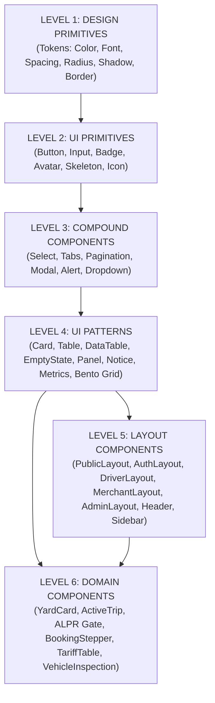

# 11. Danh Mục Thành Phần Toàn Hệ Thống (Component Registry)

> **Dự án:** Smart Parking Hub — Modern Logistics & Parking CRM Platform  
> **Chế độ thực thi:** DISCOVERY + AUDIT ONLY (Tuân thủ PROJECT UNIFICATION MASTER RULES — **Không sửa code**)  
> **Thời điểm khảo sát:** 07/11/2026  
> **Phạm vi khảo sát:** Toàn bộ 359 tệp `.tsx`, 351 thành phần xuất khẩu (exported components) tại `smart-parking-app-v2/src/`  
> **Trạng thái:** VERIFIED 100% (Phân tích AST thực tế và đối chiếu import graph)

---

## 1. Cấu Trúc Phân Tầng Hệ Thống (Component Hierarchy Overview)

Hệ thống giao diện Smart Parking Hub được phân rã thành **6 cấp độ thành phần (Component Levels)** từ hạ tầng thiết kế đến nghiệp vụ chuyên sâu:

### Tổng Quan Số Lượng Thành Phần Theo Từng Cấp:
* **LEVEL 1 — Design Primitives:** 75 mã HEX, 6 font weights, 15 container scales, 8 radius classes, 10 shadow levels trong `@theme`.
* **LEVEL 2 — UI Primitives:** 7 thành phần cơ sở (`Button`, `Input`, `Badge`, `Skeleton`, `ApiImage`, `control`, `button`).
* **LEVEL 3 — Compound Components:** 7 thành phần phức hợp (`Select`, `Tabs`, `Pagination`, `Modal`, `Alert`, `Tabs/TabList/TabTrigger`).
* **LEVEL 4 — UI Patterns:** 93 thành phần mẫu giao diện (`Card` family, `Table` family, `EmptyState`, `QueryState`, `Panel`, `Notice`, `Metrics`, `Field`, `Dialog`, `DataTable`, các khối Grid/Section/Banner).
* **LEVEL 5 — Layout Components:** 36 thành phần bố cục (`PublicLayout`, `AuthLayout`, `DriverLayout`, `MerchantLayout`, `AdminLayout`, `RootLayout`, các thanh Header, Sidebar, Footer, Workspace).
* **LEVEL 6 — Domain Components:** 158 thành phần đặc thù nghiệp vụ logistics và bãi xe (`YardCardItem`, `ActiveTripCard`, `OwnerLotLiveCard`, `TariffAuditTable`, `BookingBentoStepper`, `QrCheckoutModal`, `AlprGateControllerCard`, `ConfirmDecreaseModal`...).
* **Page Components:** 50 trang điều phối tương ứng 56 màn hình nghiệp vụ chính.

---

## 2. Bảng Đăng Ký Chi Tiết Thành Phần (Component Registry Table)

### 2.1. LEVEL 2 — UI PRIMITIVES (Thành Phần Giao Diện Cơ Sở)

| ID | Tên Component | File Nguồn | Vai Trò & Chức Năng | Số Lượt Import | Props Chính | Variants Hỗ Trợ | Visual & Interactive States | Dependencies | Đánh Giá Chất Lượng |
| :--- | :--- | :--- | :--- | :---: | :--- | :--- | :--- | :--- | :--- |
| **CMP-L2-01** | `Button` | `shared/components/Button.tsx` | Nút bấm thao tác chính, phụ, nguy hiểm | **5** | `variant`, `size`, `isLoading`, `leftIcon`, `rightIcon`, `disabled` | `primary`, `secondary`, `outline`, `ghost`, `danger` Size: `sm`, `md`, `lg` | `hover`, `active:scale-[0.99]`, `focus-visible:ring-2`, `disabled:opacity-50`, `loading:animate-spin` | `lucide-react`, `cn` | ✅ Rất tốt, chuẩn a11y. Nhưng tỷ lệ sử dụng rất thấp do bị viết inline. |
| **CMP-L2-02** | `Input` | `shared/components/Input.tsx` | Trường nhập liệu văn bản có nhãn và icon | **0** | `label`, `required`, `error`, `helperText`, `leftIcon`, `rightIcon`, `inputSize` | Size: `sm`, `md`, `lg` | `focus:border-brand-primary`, `error:border-rose-500`, `disabled:bg-slate-50` | `lucide-react`, `cn` | ⚠️ **Mồ côi (Orphaned):** 0 import. Các form hiện tại viết `<input>` thô hoặc dùng `Field`. |
| **CMP-L2-03** | `Badge` (Shared) | `shared/components/Badge.tsx` | Nhãn trạng thái hình con nhộng có chấm tròn | **8** | `variant`, `size`, `dot`, `children` | `default`, `primary`, `success`, `warning`, `danger`, `info`, `outline`, `orange` Size: `sm`, `md`, `lg` | `dot:animate-pulse` (khi active) | `cn` | ⚠️ **Xung đột tên:** Trùng tên với `Badge` trong `Workspace.tsx`. |
| **CMP-L2-04** | `Skeleton` | `shared/components/Skeleton.tsx` | Khung nạp chờ dữ liệu (Shimmer placeholder) | **2** | `className`, `variant`, `width`, `height` | `text`, `circular`, `rectangular`, `rounded` | `animate-pulse` | `cn` | Tốt nhưng nhiều trang tự viết `div bg-slate-200 animate-pulse`. |
| **CMP-L2-05** | `ApiImage` | `shared/components/ApiImage.tsx` | Tải ảnh từ API kèm fallback và loader | **1** | `src`, `alt`, `fallbackSrc`, `aspectRatio` | `cover`, `contain` | `loading:shimmer`, `error:fallback-icon` | `lucide-react`, `cn` | Hữu ích cho ảnh camera ALPR và ảnh bãi xe. |
| **CMP-L2-06** | `button` (Class) | `shared/components/Workspace.tsx` | Utility string cho nút bấm cam chuẩn Workspace | **8** | N/A (String class) | Nút cam bo tròn `rounded-xl shadow-xs` | `hover:bg-[#b84e00]`, `active:bg-[#9e4300]` | Không | Giải pháp tạm thời dạng string thay vì component chuẩn. |
| **CMP-L2-07** | `control` (Class) | `shared/components/Workspace.tsx` | Utility string cho ô input chuẩn Workspace | **7** | N/A (String class) | Input bo tròn `rounded-xl` viền `brand-border` | `focus:ring-2 focus:ring-[#d95f00]` | Không | Tương tự CMP-L2-06. |

---

### 2.2. LEVEL 3 — COMPOUND COMPONENTS (Thành Phần Phức Hợp)

| ID | Tên Component | File Nguồn | Vai Trò & Chức Năng | Số Lượt Import | Props Chính | Visual & Interactive States | Dependencies | Đánh Giá Chất Lượng |
| :--- | :--- | :--- | :--- | :---: | :--- | :--- | :--- | :--- |
| **CMP-L3-01** | `Select` | `shared/components/Select.tsx` | Dropdown chọn giá trị đơn kèm nhãn và icon | **3** | `options`, `label`, `error`, `placeholder`, `value`, `onChange` | `focus:ring-brand-primary`, `error:border-rose-500`, `disabled:opacity-50` | `lucide-react`, `cn` | Hoạt động tốt, bao bọc thẻ `<select>` chuẩn tiếp cận. |
| **CMP-L3-02** | `Modal` | `shared/components/Modal.tsx` | Hộp thoại thông báo / thao tác nổi toàn màn hình | **2** | `isOpen`, `onClose`, `title`, `description`, `size`, `children` | `backdrop-blur-sm`, `bg-black/60`, `animate-in fade-in zoom-in-95` | `lucide-react`, `cn` | Chuẩn nhưng bị cạnh tranh bởi `Dialog` trong `Workspace.tsx` và 25 bespoke modals. |
| **CMP-L3-03** | `Tabs` Family | `shared/components/Tabs.tsx` | Bộ chuyển đổi nội dung dạng tab (`Tabs`, `TabList`, `TabTrigger`, `TabContent`) | **0** | `defaultValue`, `value`, `onValueChange` | `data-[state=active]:bg-white shadow-xs`, `data-[state=inactive]:text-slate-500` | Radix-like primitive pattern | ⚠️ **Mồ côi (0 import):** Các trang tự viết `useState('tab')` và gán class thủ công. |
| **CMP-L3-04** | `Pagination` | `shared/components/Pagination.tsx` | Phân trang bảng dữ liệu số trang và nút tới/lui | **0** | `currentPage`, `totalPages`, `onPageChange`, `pageSize` | `hover:bg-slate-100`, `disabled:opacity-40` | `lucide-react`, `cn` | ⚠️ **Mồ côi (0 import):** Phân trang bị gộp vào trong `DataTable` hoặc tự render. |
| **CMP-L3-05** | `Alert` | `shared/components/Alert.tsx` | Hộp thông điệp ngữ cảnh (Success, Warning, Danger, Info) | **4** | `variant`, `title`, `children`, `onClose`, `icon` | `bg-emerald-50`, `bg-amber-50`, `bg-rose-50`, `bg-sky-50` | `lucide-react`, `cn` | Tốt, đồng bộ với bộ token ngữ nghĩa. |

---

### 2.3. LEVEL 4 — UI PATTERNS (Mẫu Giao Diện Tái Sử Dụng)

| ID | Tên Component | File Nguồn | Vai Trò & Chức Năng | Số Lượt Import | Props Chính | Visual & Responsive Behavior | Đánh Giá Tái Sử Dụng |
| :--- | :--- | :--- | :--- | :---: | :--- | :--- | :--- |
| **CMP-L4-01** | `Card` Family | `shared/components/Card.tsx` | Khung chứa thẻ nội dung (`Card`, `CardHeader`, `CardTitle`, `CardDescription`, `CardContent`, `CardFooter`) | **0** | `className`, `children` | `bg-white rounded-xl border border-slate-200 shadow-xs` | ⚠️ **Mồ côi:** 0 import. Các trang tự viết `
` hoặc dùng `Panel`. |
| **CMP-L4-02** | `Panel` | `shared/components/Workspace.tsx` | Khối khung nội dung chuẩn của CRM | **8** | `title`, `children`, `className` | `rounded-2xl border border-brand-border bg-white p-5 md:p-6` | Được sử dụng rộng rãi trong các trang Admin và CRM. |
| **CMP-L4-03** | `EmptyState` | `shared/components/EmptyState.tsx` | Màn hình thông báo rỗng kèm icon và nút CTA | **5** | `icon`, `title`, `description`, `actionLabel`, `onAction` | `flex flex-col items-center justify-center p-8 text-center` | Tốt nhưng bị phân mảnh bởi 6 EmptyState đặc thù ở các feature. |
| **CMP-L4-04** | `QueryState` | `shared/components/QueryState.tsx` | Điều phối tự động trạng thái Loading / Error / Empty / Success của React Query | **7** | `isLoading`, `isError`, `isEmpty`, `error`, `onRetry`, `children` | Tự động render `Skeleton`, `Alert`, hoặc `EmptyState` | Rất tốt, chuẩn hóa kiến trúc truy vấn dữ liệu. |
| **CMP-L4-05** | `Notice` | `shared/components/Workspace.tsx` | Thanh thông báo nhanh có icon `AlertCircle` | **17** | `children`, `error` | `border-brand-border bg-brand-surface` hoặc `border-red-200 bg-red-50` | Thành phần có số lượt tái sử dụng cao nhất hệ thống (17 files). |
| **CMP-L4-06** | `Metrics` | `shared/components/Workspace.tsx` | Lưới 4 ô thống kê chỉ số KPI tổng quan | **4** | `items: { label, value, note }[]` | `grid gap-4 sm:grid-cols-2 xl:grid-cols-4`, ô đầu tiên nền Navy | Tái sử dụng tốt tại Admin Dashboard, Transactions. |
| **CMP-L4-07** | `Field` | `shared/components/Workspace.tsx` | Bọc nhãn `<label>` và phần tử input con | **7** | `label`, `children` | `grid gap-2 text-sm font-medium` | Thay thế cho `Input` tại các form Admin. |
| **CMP-L4-08** | `Dialog` | `shared/components/Workspace.tsx` | Hộp thoại dùng thẻ HTML `<dialog>` gốc | **4** | `title`, `onClose`, `children` | `backdrop:bg-black/60`, gọi `showModal()` native | Tranh chấp kiến trúc với `Modal.tsx`. |
| **CMP-L4-09** | `DataTable` | `shared/components/Workspace.tsx` | Bảng dữ liệu tích hợp sẵn tìm kiếm, lọc, phân trang và xuất CSV | **5** | `data`, `columns`, `searchKey`, `filterKey`, `actions` | `overflow-x-auto rounded-xl border border-brand-border` | Component bảng dữ liệu mạnh mẽ nhất hiện tại. |
| **CMP-L4-10** | `Table` Family | `shared/components/Table.tsx` | Bộ khung bảng HTML ngữ nghĩa (`Table`, `TableHeader`, `TableBody`, `TableRow`, `TableCell`) | **0** | `className`, `children` | `table w-full caption-bottom text-sm` | ⚠️ **Mồ côi:** 0 import do bị thay thế bởi `DataTable` hoặc thẻ `<table>` thô. |

---

### 2.4. LEVEL 5 — LAYOUT COMPONENTS (Thành Phần Khung Bố Cục)

| ID | Tên Component | File Nguồn | Vai Trò & Chức Năng | Route Quản Lý | Cấu Trúc Khung |
| :--- | :--- | :--- | :--- | :--- | :--- |
| **CMP-L5-01** | `PublicLayout` / `LandingLayout` | `layouts/LandingLayout.tsx` | Bố cục trang công cộng tiếp thị | `/`, `/about`, `/pricing`, `/careers`, `/solutions/*` | `LandingNavbar` (sticky top-0) + `<Outlet />` + `LandingFooter` |
| **CMP-L5-02** | `AuthLayout` | `layouts/AuthLayout.tsx` | Bố cục trang xác thực đăng nhập, đăng ký | `/auth/*` | Split Screen: Banner tiếp thị bên trái + Card form căn giữa bên phải |
| **CMP-L5-03** | `DriverLayout` | `layouts/DriverLayout.tsx` | Bố cục cổng tài xế (Driver Portal) | `/driver/*`, `/search`, `/bookings/*` | Header 80-92px thích ứng + Tab bar di động + Khung `max-w-[1280px]` |
| **CMP-L5-04** | `MerchantLayout` | `layouts/MerchantLayout.tsx` | Bố cục cổng chủ bãi xe (Merchant Portal) | `/merchant/*` | Sidebar cố định 260px bên trái + Header 64px + Canvas `#f8f9ff` |
| **CMP-L5-05** | `AdminLayout` | `layouts/AdminLayout.tsx` | Bố cục cổng điều hành hệ thống (Admin Portal) | `/admin/*` | Sidebar tối cố định + Header điều hành + Canvas `#eef2f7` |
| **CMP-L5-06** | `Workspace` | `shared/components/Workspace.tsx` | Khung trang tiêu chuẩn chứa Header, Eyebrow, H1, Actions | Dùng trong 8 trang quản trị | Khung `max-w-[1440px] space-y-6 p-4 md:p-8` |

---

### 2.5. LEVEL 6 — DOMAIN COMPONENTS (Thành Phần Nghiệp Vụ Đặc Thù)

Dự án sở hữu **158 thành phần nghiệp vụ riêng biệt** được đóng gói theo từng domain logic. Dưới đây là các thành phần nghiệp vụ cốt lõi:

| ID | Tên Component | File Nguồn | Phân Hệ Nghiệp Vụ | Nghiệp Vụ Cốt Lõi Phụ Trách | API / DTO Phụ Thuộc |
| :--- | :--- | :--- | :--- | :--- | :--- |
| **CMP-L6-01** | `YardCardItem` | `features/parking-search/components/YardCardItem.tsx` | Tìm kiếm bãi xe | Hiển thị thẻ bãi đỗ xe: tên, khoảng cách, giá/giờ, số slot trống, tiện ích, nút đặt nhanh | `ParkingLotDto`, `GeoLocation` |
| **CMP-L6-02** | `ActiveTripCard` | `features/driver/components/ActiveTripCard.tsx` | Dashboard tài xế | Thẻ chuyến đi đang diễn ra: đếm thời gian đỗ thực tế, tính tiền cước tạm tính, nút mở mã QR xuất bãi | `BookingDto`, `VehicleDto` |
| **CMP-L6-03** | `BookingBentoStepper` | `features/bookings/components/BookingBentoStepper.tsx` | Lịch sử đặt chỗ | Quy trình 4 bước trạng thái vé: Chờ duyệt -> Đã xác nhận -> Đang đỗ -> Hoàn tất | `BookingStatusEnum` |
| **CMP-L6-04** | `TariffAuditTable` | `features/bookings/components/TariffAuditTable.tsx` | Bảng cước & Hóa đơn | Bảng phân rã chi tiết giá vé theo block giờ, phụ phí đêm, thuế VAT, tiền phạt quá giờ | `TariffCalculationDto` |
| **CMP-L6-05** | `QrCheckoutModal` | `features/driver/components/QrCheckoutModal.tsx` | Check-out bãi xe | Popup mã QR và barcode phục vụ quét nhanh tại camera ALPR cổng ra | `BookingCheckoutDto` |
| **CMP-L6-06** | `PayOsCheckoutModal` | `features/bookings/components/PayOsCheckoutModal.tsx` | Cổng thanh toán PayOS | Nhúng mã QR PayOS VietQR kèm đếm ngược 15 phút và webhook xác thực | `PaymentGatewayDto` |
| **CMP-L6-07** | `AlprGateControllerCard` | `features/merchant/dashboard/components/AlprGateControllerCard.tsx` | Quản trị cổng bãi | Bảng điều khiển camera nhận diện biển số, nút đóng/mở barie khẩn cấp | `AlprStreamDto`, `GateCommand` |
| **CMP-L6-08** | `ConfirmDecreaseModal` | `features/merchant/slots/components/ConfirmDecreaseModal.tsx` | Quản lý slot đỗ | Hộp thoại cảnh báo giảm số slot đỗ khi bãi đang có xe đỗ chiếm chỗ | `SlotInventoryDto` |
| **CMP-L6-09** | `OwnerLotLiveCard` | `entities/owner/components/OwnerLotLiveCard.tsx` | Đối tác chủ bãi | Thẻ thống kê thời gian thực công suất lấp đầy bãi xe (Occupancy Rate) | `LotLiveTelemetryDto` |
| **CMP-L6-10** | `ViewInspectionDossierModal` | `features/vehicles/components/ViewInspectionDossierModal.tsx` | Quản lý phương tiện | Xem hồ sơ đăng kiểm, thời hạn kiểm định và tải ảnh giấy tờ xe | `VehicleInspectionDto` |
