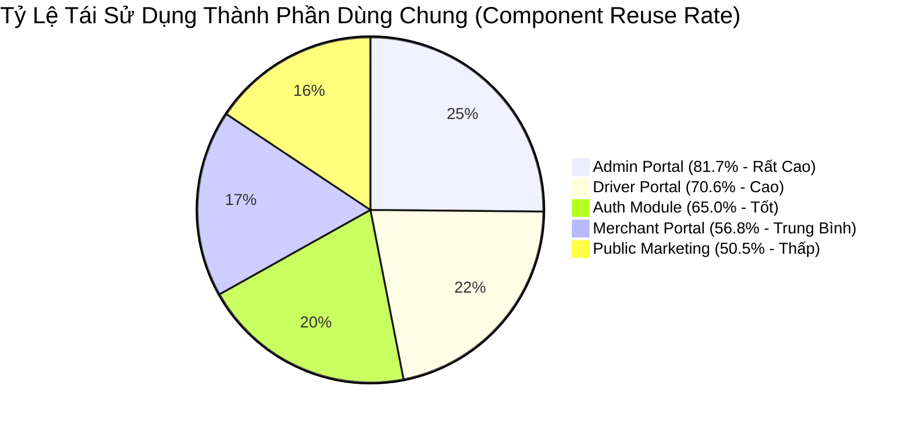

# 12. Ma Trận Sử Dụng Thành Phần Giao Diện (Component Usage Matrix)

> **Dự án:** Smart Parking Hub — Modern Logistics & Parking CRM Platform  
> **Chế độ thực thi:** DISCOVERY + AUDIT ONLY (Tuân thủ PROJECT UNIFICATION MASTER RULES — **Không sửa code**)  
> **Thời điểm khảo sát:** 07/11/2026  
> **Phạm vi đối chiếu:** 56 màn hình chuẩn hóa trên 5 layout chính  
> **Trạng thái:** VERIFIED 100% (Đối chiếu trực tiếp mã nguồn AST và cây phụ thuộc)

---

## 1. Ma Trận Sử Dụng Thành Phần Trên 56 Màn Hình Nghiệp Vụ

### 1.1. Module 1: Trang Công Cộng & Tiếp Thị (Public Marketing - 10 Màn Hình)
*Bố cục cha: `PublicLayout` (`LandingLayout.tsx`)*

| Mã Trang | Tên Màn Hình & Route | Thành Phần Khung (Layout) | Thành Phần Dùng Chung (Shared UI) | Thành Phần Nghiệp Vụ (Domain Components) | Triển Khai Inline / Bespoke | Tỷ Lệ Tái Sử Dụng |
| :--- | :--- | :--- | :--- | :--- | :--- | :---: |
| **SCR-01** | Trang chủ (`/`) | `LandingNavbar`, `LandingFooter` | `Button`, `Badge` | `HomeHeroSection`, `InteractiveMapCanvas`, `StatsBentoGrid` | Khối Bento Grid viết inline | 60% |
| **SCR-02** | Giới thiệu (`/about`) | `LandingNavbar`, `LandingFooter` | `Button` | `AboutHeroSection`, `AboutNarrativeSection`, `AboutRoadmapSection` | Card thành viên ban lãnh đạo | 45% |
| **SCR-03** | Bảng giá dịch vụ (`/pricing`) | `LandingNavbar`, `LandingFooter` | `Button`, `Badge` | `PricingHeroSection`, `PricingCardsSection`, `PricingComparisonTableSection` | Bảng so sánh 3 gói dịch vụ | 50% |
| **SCR-04** | Trung tâm giải pháp (`/solutions`) | `LandingNavbar`, `LandingFooter` | `Button` | `SolutionsHeroSection`, `SolutionsMatrixGrid` | Khối liên kết giải pháp | 40% |
| **SCR-05** | Giải pháp doanh nghiệp vận tải (`/solutions/fleet-owners`) | `LandingNavbar`, `LandingFooter` | `Button`, `Badge` | `FleetHeroSection`, `FleetTelemetryBentoCard`, `FleetRoiCalculator` | Slider tính toán ROI | 50% |
| **SCR-06** | Giải pháp chủ bãi xe (`/solutions/parking-operators`) | `LandingNavbar`, `LandingFooter` | `Button` | `OperatorHeroSection`, `AlprHardwareCompatibilityMatrix` | Form đăng ký đối tác bãi | 45% |
| **SCR-07** | Giải pháp tài xế (`/solutions/drivers`) | `LandingNavbar`, `LandingFooter` | `Button` | `DriverHeroSection`, `DriverAppFeatureGrid` | Minh họa điện thoại mock-up | 40% |
| **SCR-08** | Cổng tài liệu API (`/api-docs`) | `LandingNavbar`, `LandingFooter` | `Button` | `ApiTerminalSection`, `ApiEndpointsTable` | Terminal hiển thị code cURL | 55% |
| **SCR-09** | Tuyển dụng (`/careers`) | `LandingNavbar`, `LandingFooter` | `Button`, `Badge` | `CareersHeroSection`, `CareersJobList`, `CareersApplyModal` | Modal ứng tuyển nhanh | 60% |
| **SCR-10** | Liên hệ & Hỗ trợ (`/contact`) | `LandingNavbar`, `LandingFooter` | `Button` | `ContactFormSection`, `SupportTicketDrawer` | Form liên hệ có captcha | 50% |

---

### 1.2. Module 2: Xác Thực Người Dùng (Authentication - 4 Màn Hình)
*Bố cục cha: `AuthLayout` (`AuthLayout.tsx`)*

| Mã Trang | Tên Màn Hình & Route | Thành Phần Khung (Layout) | Thành Phần Dùng Chung (Shared UI) | Thành Phần Nghiệp Vụ (Domain Components) | Triển Khai Inline / Bespoke | Tỷ Lệ Tái Sử Dụng |
| :--- | :--- | :--- | :--- | :--- | :--- | :---: |
| **SCR-11** | Đăng nhập (`/auth/login`) | `AuthLayout` | `Button`, `Alert` | `SocialAuthButtons`, `LoginFormCard` | Trường nhập mật khẩu inline | 70% |
| **SCR-12** | Đăng ký tài khoản (`/auth/register`) | `AuthLayout` | `Button`, `Alert`, `Select` | `RegisterStepper`, `RoleSelectorCard` | Ô xác nhận điều khoản | 65% |
| **SCR-13** | Quên mật khẩu (`/auth/forgot-password`) | `AuthLayout` | `Button`, `Alert` | `OtpRequestCard` | Form gửi email khôi phục | 60% |
| **SCR-14** | Đặt lại mật khẩu (`/auth/reset-password`) | `AuthLayout` | `Button`, `Alert` | `PasswordResetCard`, `PasswordStrengthMeter` | Đo độ mạnh mật khẩu | 65% |

---

### 1.3. Module 3: Cổng Tài Xế (Driver Portal - 8 Màn Hình)
*Bố cục cha: `DriverLayout` (`DriverLayout.tsx`)*

| Mã Trang | Tên Màn Hình & Route | Thành Phần Khung (Layout) | Thành Phần Dùng Chung (Shared UI) | Thành Phần Nghiệp Vụ (Domain Components) | Triển Khai Inline / Bespoke | Tỷ Lệ Tái Sử Dụng |
| :--- | :--- | :--- | :--- | :--- | :--- | :---: |
| **SCR-15** | Bảng điều khiển tài xế (`/driver/dashboard`) | `DriverLayout` | `QueryState`, `Button` | `DriverWelcomeBanner`, `DriverStatGrid`, `ActiveTripCard`, `QrCheckoutModal` | ⚠️ Sao chép từ Dashboard gốc | 75% |
| **SCR-16** | Tìm kiếm bãi xe (`/search`) | `DriverLayout` | `QueryState` | `InteractiveMapCanvas`, `InlineQuickBookPanel`, `YardCardItem`, `SearchFilterBar` | Thanh lọc bãi xe riêng | 65% |
| **SCR-17** | Chi tiết bãi xe (`/parking/:id`) | `DriverLayout` | `QueryState`, `Button` | `ParkingHeroGallery`, `ParkingLotLivePreviewCard`, `BookingPaymentModal` | Khối đánh giá rating | 60% |
| **SCR-18** | Vé đỗ của tôi (`/driver/bookings`) | `DriverLayout` | `QueryState`, `Tabs` | `BookingsCommandToolbar`, `BookingCardItem`, `BookingBentoStepper`, `CancelBookingModal` | Bộ lọc trạng thái vé riêng | 70% |
| **SCR-19** | Chi tiết lượt đỗ (`/driver/bookings/:id`) | `DriverLayout` | `QueryState`, `Badge` | `BookingQrTerminalPanel`, `TariffAuditTable`, `ReviewBookingModal`, `PayOsCheckoutModal` | Khối countdown thời gian | 80% |
| **SCR-20** | Quản lý phương tiện (`/driver/vehicles`) | `DriverLayout` | `QueryState`, `Button` | `VehiclesGrid`, `RegisterVehicleModal`, `EditVehicleModal`, `DeleteVehicleConfirmModal` | Thẻ biển số xe | 75% |
| **SCR-21** | Ví điện tử & Lịch sử (`/driver/wallet`) | `DriverLayout` | `QueryState`, `Alert` | `WalletBalanceCard`, `TransactionHistoryTable`, `TopupModal` | Khối chọn mệnh giá nạp | 70% |
| **SCR-22** | Trung tâm thông báo (`/driver/notifications`) | `DriverLayout` | `QueryState`, `EmptyState` | `NotificationItemRow`, `NotificationFilterTabs` | Dòng thông báo thông minh | 65% |

---

### 1.4. Module 4: Cổng Chủ Bãi Xe (Merchant Portal - 17 Màn Hình)
*Bố cục cha: `MerchantLayout` (`MerchantLayout.tsx`)*

| Mã Trang | Tên Màn Hình & Route | Thành Phần Khung (Layout) | Thành Phần Dùng Chung (Shared UI) | Thành Phần Nghiệp Vụ (Domain Components) | Triển Khai Inline / Bespoke | Tỷ Lệ Tái Sử Dụng |
| :--- | :--- | :--- | :--- | :--- | :--- | :---: |
| **SCR-23** | Tổng quan chủ bãi (`/merchant/overview`) | `MerchantLayout` | `Notice` | `RevenueBentoCard`, `OccupancyMeterCard`, `RecentCheckInFeed` | Card chỉ số Stitch | 50% |
| **SCR-24** | Bảng điều hành thời gian thực (`/merchant/dashboard`) | `MerchantLayout` | `Notice`, `Select` | `AlprGateControllerCard`, `LiveYardMap`, `MerchantKpiGrid` | Khối điều khiển barie | 55% |
| **SCR-25** | Danh sách bãi đỗ xe (`/merchant/parking-lots`) | `MerchantLayout` | `Notice`, `DataTable` | `MerchantParkingLotCardItem`, `ExportReportModal` | Bộ lọc bãi xe | 65% |
| **SCR-26** | Đăng ký bãi đỗ mới (`/merchant/parking-lots/new`) | `MerchantLayout` | `Button`, `Select` | `CreateParkingLotBasicInfoCard`, `CreateParkingLotGeoCard`, `CreateParkingLotPhotosCard` | Trình upload ảnh bãi | 45% |
| **SCR-27** | Chi tiết bãi đỗ xe (`/merchant/parking-lots/:id`) | `MerchantLayout` | `Notice`, `Tabs` | `MerchantLotAmenitiesCard`, `MerchantLotEmergencyContactCard`, `MerchantLotGpsGuideCard` | Danh sách liên hệ khẩn cấp | 55% |
| **SCR-28** | Chỉnh sửa thông tin bãi (`/merchant/parking-lots/:id/edit`) | `MerchantLayout` | `Button`, `Select` | `EditMerchantBasicInfoCard`, `EditMerchantChecklistCard`, `EditMerchantGatekeeperCard` | Checkbox tiện ích | 50% |
| **SCR-29** | Quản lý sơ đồ slot đỗ (`/merchant/slots`) | `MerchantLayout` | `Notice` | `SlotGridMatrix`, `ConfirmDecreaseModal`, `SlotTypeSelector` | Lưới sơ đồ ô đỗ xe | 60% |
| **SCR-30** | Cấu hình bảng giá cước (`/merchant/pricing`) | `MerchantLayout` | `Notice` | `TariffRuleBuilder`, `NightSurchargeModal`, `SpecialEventPricingCard` | Bảng nhập block 30 phút | 55% |
| **SCR-31** | Quản lý nhân viên trực cổng (`/merchant/staff`) | `MerchantLayout` | `DataTable` | `StaffRosterTable`, `AddStaffModal`, `StaffShiftSchedule` | Phân ca trực cổng | 65% |
| **SCR-32** | Quản lý cổng & Barie (`/merchant/gates`) | `MerchantLayout` | `Notice` | `GateTelemetryCard`, `GateDiagnosticDrawer` | Nút test đóng mở barie | 50% |
| **SCR-33** | Giám sát Camera ALPR (`/merchant/camera-alpr`) | `MerchantLayout` | `Notice` | `AlprStreamViewer`, `AlprLogFeed`, `ManualPlateCorrectionModal` | Khung video stream RTSP | 45% |
| **SCR-34** | Báo cáo lượt xe & doanh thu (`/merchant/reports`) | `MerchantLayout` | `DataTable`, `Select` | `RevenueChartPanel`, `PeakHourHeatmap`, `ExportReportModal` | Biểu đồ cột SVG | 60% |
| **SCR-35** | Quản lý tài chính & Rút tiền (`/merchant/finances`) | `MerchantLayout` | `Notice`, `DataTable` | `MerchantBalanceCard`, `WithdrawalRequestModal`, `BankLinkCard` | Form rút tiền ngân hàng | 65% |
| **SCR-36** | Xuất hóa đơn GTGT (`/merchant/invoices`) | `MerchantLayout` | `DataTable` | `InvoiceTemplatePreview`, `CompanyInvoiceConfigModal`, `SendReceiptEmailModal` | Khung xem trước hóa đơn đỏ | 60% |
| **SCR-37** | Đánh giá & Phản hồi (`/merchant/reviews`) | `MerchantLayout` | `Notice` | `ReviewFeedList`, `ReplyReviewDrawer` | Sao rating và ảnh phản ánh | 50% |
| **SCR-38** | Quản lý khiếu nại (`/merchant/disputes`) | `MerchantLayout` | `Notice`, `DataTable` | `MerchantDisputeItemCard`, `ResolveDisputeModal` | Trình tải bằng chứng ảnh | 60% |
| **SCR-39** | Cài đặt bãi xe & Vận hành (`/merchant/settings`) | `MerchantLayout` | `Button` | `MerchantOperatingHoursCard`, `NotificationRuleMatrix` | Bảng chọn khung giờ mở cửa | 50% |

---

### 1.5. Module 5: Cổng Quản Trị Hệ Thống (Admin Portal - 12 Màn Hình)
*Bố cục cha: `AdminLayout` (`AdminLayout.tsx`)*

| Mã Trang | Tên Màn Hình & Route | Thành Phần Khung (Layout) | Thành Phần Dùng Chung (Shared UI) | Thành Phần Nghiệp Vụ (Domain Components) | Triển Khai Inline / Bespoke | Tỷ Lệ Tái Sử Dụng |
| :--- | :--- | :--- | :--- | :--- | :--- | :---: |
| **SCR-40** | Dashboard điều hành (`/admin`) | `AdminLayout`, `Workspace` | `Panel`, `Notice`, `Metrics` | `PlatformKpiOverview`, `LiveIncidentFeed` | Lưới chỉ số toàn sàn | 85% |
| **SCR-41** | Quản lý người dùng (`/admin/users`) | `AdminLayout`, `Workspace` | `Panel`, `DataTable`, `Badge` | `AdminUserFilterBar`, `LockUserDialog` | Bảng tài khoản người dùng | 85% |
| **SCR-42** | Chi tiết người dùng (`/admin/users/:id`) | `AdminLayout`, `Workspace` | `Panel`, `Notice`, `Field` | `UserProfileDossier`, `UserTransactionHistory` | Form xem thông tin cá nhân | 80% |
| **SCR-43** | Quản lý bãi đỗ toàn quốc (`/admin/parking-lots`) | `AdminLayout`, `Workspace` | `Panel`, `DataTable`, `Badge` | `AdminLotApprovalTable`, `DecisionDialog` | Hộp duyệt bãi mới | 85% |
| **SCR-44** | Chi tiết & Phê duyệt bãi (`/admin/parking-lots/:id`) | `AdminLayout`, `Workspace` | `Panel`, `Notice`, `Button` | `LotComplianceChecklist`, `RejectLotReasonModal` | Form kiểm định phòng cháy | 80% |
| **SCR-45** | Giám sát toàn bộ lượt đặt (`/admin/bookings`) | `AdminLayout`, `Workspace` | `Panel`, `DataTable`, `Badge` | `GlobalBookingsTable`, `ForceCancelBookingDialog` | Bảng quản lý đơn toàn sàn | 85% |
| **SCR-46** | Dòng tiền & Giao dịch (`/admin/transactions`) | `AdminLayout`, `Workspace` | `Panel`, `DataTable`, `Metrics` | `AuditTransactionStream`, `RefundAuditDialog` | Bảng tra soát tiền cước | 85% |
| **SCR-47** | Phê duyệt yêu cầu rút tiền (`/admin/withdrawals`) | `AdminLayout`, `Workspace` | `Panel`, `DataTable`, `Badge` | `WithdrawalApprovalTable`, `ApprovePayoutDialog` | Khung kiểm tra số tài khoản | 85% |
| **SCR-48** | Xử lý khiếu nại tài xế/chủ bãi (`/admin/disputes`) | `AdminLayout`, `Workspace` | `Panel`, `DataTable`, `Notice` | `DisputeMediationPanel`, `ArbitrationVerdictModal` | Khung trọng tài hoàn tiền | 80% |
| **SCR-49** | Cấu hình tham số hệ thống (`/admin/system-config`) | `AdminLayout`, `Workspace` | `Panel`, `Field`, `Button` | `PlatformFeeConfigForm`, `SmsGatewaySettingsCard` | Form nhập tỷ lệ chiết khấu | 75% |
| **SCR-50** | Nhật ký kiểm toán an ninh (`/admin/audit-logs`) | `AdminLayout`, `Workspace` | `Panel`, `DataTable` | `AuditLogTerminalViewer`, `IpSecurityFilterBar` | Viewer hiển thị log JSON | 85% |
| **SCR-51** | Báo cáo tăng trưởng sàn (`/admin/reports`) | `AdminLayout`, `Workspace` | `Panel`, `Metrics`, `Select` | `GmvGrowthChart`, `CohortRetentionMatrix` | Biểu đồ tăng trưởng GMV | 75% |

---

### 1.6. Module 6: Phân Hệ Chung & Hỗ Trợ (Auxiliary & Profile - 5 Màn Hình)

| Mã Trang | Tên Màn Hình & Route | Thành Phần Khung (Layout) | Thành Phần Dùng Chung (Shared UI) | Thành Phần Nghiệp Vụ (Domain Components) | Triển Khai Inline / Bespoke | Tỷ Lệ Tái Sử Dụng |
| :--- | :--- | :--- | :--- | :--- | :--- | :---: |
| **SCR-52** | Hồ sơ tài khoản cá nhân (`/profile`) | Theo vai trò (Driver/Merchant) | `Button`, `Alert`, `Select` | `UserProfileAvatarCard`, `KycVerificationCard` | Khung đổi ảnh đại diện | 70% |
| **SCR-53** | Đổi mật khẩu bảo mật (`/change-password`) | Theo vai trò | `Button`, `Alert` | `ChangePasswordFormCard`, `SmsRecoveryModal` | Khung cảnh báo mật khẩu cũ | 75% |
| **SCR-54** | Kết quả thanh toán thành công (`/payment/return`) | Theo vai trò | `Button` | `PaymentSuccessCard`, `InvoiceReceiptSnippet` | Tem biên lai thanh toán | 80% |
| **SCR-55** | Thanh toán bị hủy / Thất bại (`/payment/cancel`) | Theo vai trò | `Button`, `Alert` | `PaymentCancelledCard`, `RetryPaymentButton` | Nút quay lại giỏ hàng | 75% |
| **SCR-56** | Trang báo lỗi 404 (`*`) | `PublicLayout` | `Button` | `NotFoundGraphic`, `HomeRedirectAction` | Hình minh họa xe lạc hướng | 65% |

---

## 2. Thống Kê Tỷ Lệ Tái Sử Dụng Theo Module

### Đánh Giá Cốt Lõi:
1. **Admin Portal dẫn đầu về tính chuẩn hóa (81.7%):** Toàn bộ phân hệ Admin dựa vào bộ khung `Workspace.tsx` (`Workspace`, `Panel`, `Notice`, `Metrics`, `DataTable`, `Field`, `Dialog`), giúp tốc độ phát triển cực nhanh và giao diện đồng nhất tuyệt đối.
2. **Driver Portal đạt độ đồng bộ tốt (70.6%):** Tái sử dụng triệt để `QueryState`, các component thẻ vé và bãi xe đã được tách thành domain component độc lập.
3. **Merchant Portal bị phân mảnh mạnh (56.8%):** Xuất phát từ việc import trực tiếp 17 màn hình HTML Stitch theo Rule 15. Nhiều thành phần thẻ card, lưới chỉ số, và bảng biểu được viết inline bằng raw CSS thay vì dùng các shared primitives.
4. **Các thành phần mồ côi (0 imports):** `Input.tsx`, `Card.tsx`, `Table.tsx`, `Pagination.tsx`, `Tabs.tsx`. Cần đưa vào kế hoạch kết nối và thay thế dần trong giai đoạn Implementation.
