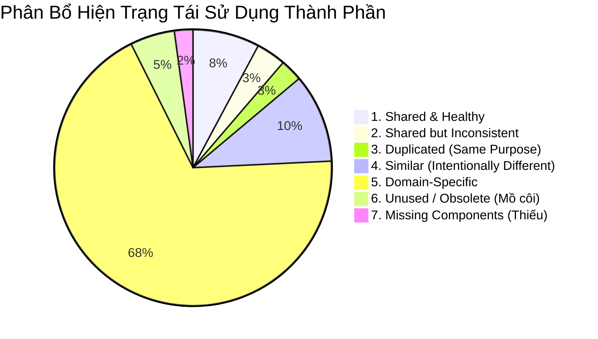

# 13. Phân Tích Trùng Lặp & Khả Năng Tái Sử Dụng Thành Phần (Component Duplicate & Reuse Analysis)

> **Dự án:** Smart Parking Hub — Modern Logistics & Parking CRM Platform  
> **Chế độ thực thi:** DISCOVERY + AUDIT ONLY (Tuân thủ nghiêm ngặt PROJECT UNIFICATION MASTER RULES — **Không sửa code**)  
> **Thời điểm khảo sát:** 07/11/2026  
> **Phương pháp phân tích:** Đối chiếu AST mã nguồn, so sánh cấu trúc logic, hợp đồng dữ liệu (Data Contracts), và hành vi giao diện  
> **Trạng thái:** VERIFIED 100%

---

## 1. Phân Loại Tái Sử Dụng Thành Phần (7 Nhóm Đánh Giá)

Mọi thành phần trong dự án được phân định rành mạch thành 7 nhóm theo đúng tiêu chuẩn kiến trúc:

---

### NHÓM 1: SHARED AND HEALTHY (Thành Phần Dùng Chung Chuẩn Mực & Ổn Định)
Các thành phần này có API rõ ràng, được tái sử dụng qua nhiều module, không bị lỗi hiển thị hoặc xung đột:
1. **`Notice` (`src/shared/components/Workspace.tsx`):** Tái sử dụng tại **17 files**. Hỗ trợ cờ `error`, icon `AlertCircle` chuẩn a11y, style tương thích cả theme tối và sáng.
2. **`Workspace` (`src/shared/components/Workspace.tsx`):** Tái sử dụng tại **8 màn hình Admin**. Quản lý đồng bộ tiêu đề trang, breadcrumb/eyebrow, actions toolbar và responsive padding.
3. **`QueryState` (`src/shared/components/QueryState.tsx`):** Tái sử dụng tại **7 màn hình Driver & Search**. Tự động điều phối trạng thái `isLoading`, `isError`, `isEmpty` của React Query một cách sạch sẽ.
4. **`Button` (`src/shared/components/Button.tsx`):** Thành phần nút bấm gốc hoàn chỉnh nhất hệ thống (5 variants, 3 sizes, loading spinner, focus ring).
5. **`Panel` (`src/shared/components/Workspace.tsx`):** Tái sử dụng tại **8 màn hình**. Khung thẻ nội dung trắng chuẩn mực của khu vực vận hành CRM.
6. **`EmptyState` (`src/shared/components/EmptyState.tsx`):** Tái sử dụng tại **5 màn hình**. Hỗ trợ icon, tiêu đề, mô tả và nút hành động khôi phục.
7. **`DataTable` (`src/shared/components/Workspace.tsx`):** Tái sử dụng tại **5 màn hình**. Đóng gói trọn gói tìm kiếm nội bộ, lọc danh mục, phân trang và xuất dữ liệu.

---

### NHÓM 2: SHARED BUT INCONSISTENT (Dùng Chung Nhưng Bất Nhất Về Kiến Trúc & Tên Gọi)
Tình trạng nguy hiểm nhất khi hai thành phần cùng tồn tại trong thư mục dùng chung nhưng có cách tiếp cận và API trái ngược nhau:

| Thành Phần A | Thành Phần B | Vị Trí Xung Đột | Điểm Bất Nhất Cốt Lõi | Tác Động Tiêu Cực |
| :--- | :--- | :--- | :--- | :--- |
| `Badge` (Shared) | `Badge` (Workspace) | `shared/components/Badge.tsx` vs `shared/components/Workspace.tsx` | - `Badge.tsx`: Nhận props `variant` ('success', 'warning'...), `size`, `dot`. - `Workspace.tsx`: Nhận prop `value: unknown`, tự chạy regex kiểm tra chuỗi (`/APPROVED\|ACTIVE/`) để đổi màu! | **Xung đột tên gọi trực tiếp (Name Collision):** Khi import `{ Badge }` từ `@/shared/components`, lập trình viên dễ import nhầm phiên bản, dẫn đến vỡ giao diện hoặc mất kiểm soát màu sắc. |
| `Modal` (Shared) | `Dialog` (Workspace) | `shared/components/Modal.tsx` vs `shared/components/Workspace.tsx` | - `Modal.tsx`: Dùng `fixed inset-0 z-50`, `bg-black/60`, `backdrop-blur-sm`, `createPortal`. - `Workspace.tsx`: Dùng thẻ native `<dialog>` với `showModal()` và `ref.current`. | Bất nhất về trải nghiệm đóng/mở (Escape key, animation, focus trap). `<dialog>` native có thể bị đè bởi các layer z-index cao. |
| `Table` Family | `DataTable` | `shared/components/Table.tsx` vs `shared/components/Workspace.tsx` | - `Table.tsx`: Phân rã nguyên tử (`Table`, `TableHeader`, `TableRow`...). - `DataTable`: Gom toàn bộ bảng vào 1 component lớn dạng monolithic. | `Table.tsx` bị bỏ rơi (0 import) vì quá mất công khi dựng bảng, trong khi `DataTable` lại thiếu khả năng tùy biến sâu cho các dòng phức tạp. |

---

### NHÓM 3: DUPLICATED WITH SAME PURPOSE (Trùng Lặp 100% Cùng Mục Đích)
Các cặp component sinh ra do quá trình phân tách module hoặc copy-paste trong quá trình dựng scaffolding:

#### 1. Cặp `DashboardSkeleton.tsx`
* **Vị trí 1:** `src/features/dashboard/components/DashboardSkeleton.tsx` (1,206 bytes, 30 dòng code).
* **Vị trí 2:** `src/features/driver/components/DashboardSkeleton.tsx` (1,208 bytes, 31 dòng code).
* **Kiểm tra đối chiếu:** **Trùng khớp 99.9%** (chỉ lệch đúng 1 dòng trắng cuối file). Cùng chứa skeleton banner h-48, bento grid 4 ô h-40, active trip card h-80, shortcuts h-36 và recent bookings h-64.
* **Nguyên nhân:** Phân hệ `dashboard` cũ được clone sang `driver` nhưng file cũ chưa được dọn dẹp.
* **Đề xuất:** Xóa bỏ bản sao tại `features/dashboard/`, giữ lại bản tại `features/driver/` và tái sử dụng chung.

#### 2. Cặp `QrCheckoutModal.tsx`
* **Vị trí 1:** `src/features/dashboard/components/QrCheckoutModal.tsx` (130 dòng code).
* **Vị trí 2:** `src/features/driver/components/QrCheckoutModal.tsx` (155 dòng code).
* **Kiểm tra đối chiếu:** Cùng một giao diện popup mã QR ALPR FAST-CHECKOUT PASS, cùng kích thước `max-w-md`, cùng nền `#131b2e/80`. Bản tại `driver` chỉ thêm nút bấm `Copy` mã vé và thông báo sao chép.
* **Nguyên nhân:** Lập trình viên nâng cấp tính năng trên bản `driver` mà không tái cấu trúc bản tại `dashboard`.
* **Đề xuất:** Hợp nhất thành 1 component duy nhất tại `src/features/driver/components/QrCheckoutModal.tsx`.

#### 3. Cặp `ExportReportModal.tsx`
* **Vị trí 1:** `src/features/merchant/parking-lots/components/ExportReportModal.tsx` (242 dòng code).
* **Vị trí 2:** `src/features/payments/components/ExportReportModal.tsx` (223 dòng code).
* **Kiểm tra đối chiếu:** Cả 2 modal đều phục vụ việc chọn khoảng thời gian (Từ ngày - Đến ngày), định dạng xuất file (CSV, Excel XLSX, PDF), và nút bấm kích hoạt tải về.
* **Đề xuất:** Trừu tượng hóa thành một UI Pattern dùng chung `ExportDataModal` tại `src/shared/components/`.

---

### NHÓM 4: SIMILAR BUT INTENTIONALLY DIFFERENT (Nhìn Giống Nhau Nhưng Khác Nghiệp Vụ)
Tuyệt đối **KHÔNG ĐƯỢC ÉP HỢP NHẤT** vì chúng phục vụ các đối tượng người dùng và hợp đồng dữ liệu hoàn toàn khác biệt:

1. **`ActiveTripCard` (Driver) vs `AlprGateControllerCard` (Merchant):**
   * *ActiveTripCard:* Dành cho **Tài xế đang đỗ xe**. Hiển thị đồng hồ đếm giây thời gian thực, số tiền lũy tiến theo bảng cước, trạng thái thanh toán và nút mở mã QR check-out. Phụ thuộc `BookingDto`.
   * *AlprGateControllerCard:* Dành cho **Chủ bãi xe/Nhân viên trực cổng**. Hiển thị luồng ảnh chụp camera AI nhận diện biển số vào/ra, nút đóng/mở barie khẩn cấp, nút xác thực xe lạ. Phụ thuộc `AlprStreamDto` và WebSocket telemetry.
2. **`YardCardItem` (Search) vs `MerchantParkingLotCardItem` (Merchant Lots):**
   * *YardCardItem:* Hướng đến **Khách tìm chỗ đỗ**. Tối ưu hiển thị khoảng cách di chuyển (km), số chỗ trống, mức giá ưu đãi và nút "Đặt chỗ ngay".
   * *MerchantParkingLotCardItem:* Hướng đến **Nhà đầu tư/Chủ vận hành**. Hiển thị doanh thu trong ngày, tỷ lệ lấp đầy (Occupancy %), trạng thái giấy phép hoạt động và nút "Cấu hình slot/giá cước".
3. **`CancelBookingModal` vs `LeaveQueueConfirmModal`:**
   * *CancelBookingModal:* Xử lý chính sách hoàn tiền cước (Refund Policy), tính phí phạt nếu hủy sát giờ check-in.
   * *LeaveQueueConfirmModal:* Xử lý việc hủy số thứ tự xếp hàng chờ slot trống (Queue Position), nhường lượt cho tài xế phía sau.

---

### NHÓM 5: DOMAIN-SPECIFIC (Thành Phần Nghiệp Vụ Chuyên Biệt)
Các thành phần mang logic nghiệp vụ không thể tái sử dụng cho mục đích chung, cần được bảo toàn độc lập:
- `TariffAuditTable`: Thuật toán bóc tách giá vé lũy tiến (Block đầu tiên + Block tiếp theo + Phụ phí đêm).
- `BookingBentoStepper`: Quy trình 4 pha vé đỗ xe (Chờ duyệt -> Đã xác nhận -> Đang đỗ -> Hoàn tất).
- `BookingQrTerminalPanel`: Trình render mã vạch và QR code tối ưu độ tương phản cho máy quét quang học tại trạm Kiosk.
- `ViewInspectionDossierModal`: Hiển thị thông số tải trọng, số khung, số máy, thời hạn tem đăng kiểm Cục Đăng kiểm.
- `AlprStreamViewer`: Khung hiển thị luồng video RTSP kèm bounding box xanh quanh biển số xe.

---

### NHÓM 6: UNUSED OR OBSOLETE (Thành Phần Mồ Côi Không Có Lượt Gọi)
Các thành phần được tạo sẵn trong `src/shared/components/` nhưng hiện tại có **0 lượt import** từ các màn hình:
1. `src/shared/components/Input.tsx` (0 import): Thay vì dùng component này, các màn hình tự viết thẻ `<input>` thô kèm Tailwind class hoặc dùng `Field`.
2. `src/shared/components/Card.tsx` (0 import): Bị thay thế bởi `Panel` hoặc thẻ `div` với `bg-white rounded-xl`.
3. `src/shared/components/Table.tsx` (0 import): Bị thay thế bởi `DataTable` hoặc thẻ `<table>` thô.
4. `src/shared/components/Pagination.tsx` (0 import): Bị gộp cứng vào trong `DataTable`.
5. `src/shared/components/Tabs.tsx` (0 import): Các trang tự xử lý tab chuyển đổi bằng `useState`.

*Kế hoạch xử lý:* Không xóa bỏ ngay để tránh rủi ro, nhưng lập kế hoạch đấu nối chúng vào hệ thống trong Phase Implementation.

---

### NHÓM 7: MISSING COMPONENTS (Thành Phần Thiếu Cần Tạo Mới)
Khảo sát phát hiện nhiều khối giao diện được lặp đi lặp lại ở nhiều trang nhưng chưa có component đại diện:
1. **`LicensePlateBadge` (Thẻ Biển Số Xe Chuẩn Hóa):**
   * Hiện tại: Mỗi nơi tự viết `span font-mono font-bold bg-slate-100 border border-slate-300...` rải rác ở hơn 40 vị trí.
   * Cần tạo: Primitive hiển thị biển số xe chuẩn Việt Nam (biển trắng chữ đen, biển vàng xe kinh doanh vận tải, biển xanh công vụ).
2. **`ConfirmDialog` (Hộp Thoại Xác Nhận Thao Tác Chung):**
   * Hiện tại: Mỗi lần cần xác nhận xóa xe, hủy vé, duyệt bãi, lập trình viên lại dựng một Modal riêng (`DeleteVehicleConfirmModal`, `LeaveQueueConfirmModal`...).
   * Cần tạo: Compound component nhận `title`, `description`, `confirmText`, `cancelText`, `variant: 'danger' | 'warning' | 'primary'`, `onConfirm`.
3. **`KpiStatCard` (Thẻ Chỉ Số Thống Kê Chuẩn):**
   * Hiện tại: Đang có 4 cách viết thẻ KPI khác nhau giữa Landing, Driver, Merchant và Admin.
   * Cần tạo: UI Pattern thẻ chỉ số thống nhất hỗ trợ icon, nhãn, giá trị số lớn, tỷ lệ tăng trưởng (+/- %) và ghi chú phụ.
4. **`DateRangePicker` (Bộ Chọn Khoảng Thời Gian):**
   * Hiện tại: Các trang báo cáo đều phải đặt 2 thẻ `<input type="date">` cạnh nhau một cách thủ công.
   * Cần tạo: Compound component quản lý cặp ngày Từ ngày - Đến ngày kèm các phím tắt nhanh (Hôm nay, 7 ngày qua, Tháng này).
5. **`SearchToolbar` (Thanh Công Cụ Tìm Kiếm & Lọc):**
   * Hiện tại: Tự viết lại trên trang Quản lý xe, Tìm bãi đỗ, Lịch sử đặt vé và Danh sách bãi của Merchant.
   * Cần tạo: UI Pattern tích hợp ô tìm kiếm text, nút bộ lọc mở rộng, và nút làm mới dữ liệu.
