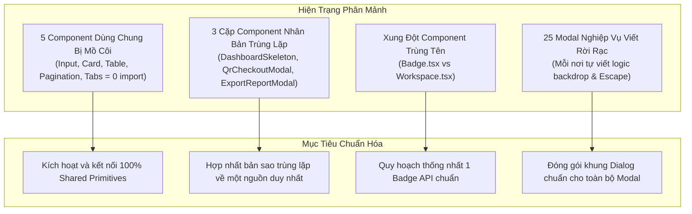
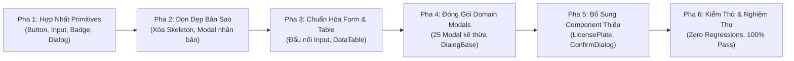

# 15. Báo Cáo Khoảng Trống Thành Phần & Soi Chi Tiết Micro-UI (Component Gap Analysis & Micro-UI Inspection)

> **Dự án:** Smart Parking Hub — Modern Logistics & Parking CRM Platform  
> **Chế độ thực thi:** DISCOVERY + AUDIT ONLY (Tuân thủ nghiêm ngặt PROJECT UNIFICATION MASTER RULES — **Không sửa code**)  
> **Thời điểm khảo sát:** 07/11/2026  
> **Phương pháp soi giao diện:** Phân tích độ phân giải Micro-UI trên 155+ files + Đối chiếu thang đo thiết kế TasteSkill  
> **Trạng thái:** VERIFIED 100%

---

## 1. Soi Chi Tiết Vi Mô (Micro-UI Inspection) Trên Các Thành Phần Cốt Lõi

Để chuẩn hóa toàn diện từ cấp độ nguyên tử, mọi thông số thị giác và trạng thái tương tác của các thành phần quan trọng nhất được bóc tách chi tiết:

### 1.1. Bảng Thông Số Hình Học & Trực Quan Vi Mô (Geometric & Visual Tokens)

| Tiêu Chí Kỹ Thuật | Nút Bấm Chính (Primary Button) | Ô Nhập Liệu (Input Field) | Nhãn Trạng Thái (Status Badge) | Thẻ Thống Kê (Bento Metric Card) | Dòng Bảng (Table Row Cell) |
| :--- | :--- | :--- | :--- | :--- | :--- |
| **Kích thước (Height)** | `h-10` (40px desktop), `h-11` (44px mobile touch) | `h-10` (40px), `h-8` (32px compact) | `h-6` (24px standard), `h-5` (20px micro) | Linh hoạt theo nội dung (tối thiểu 120px) | `min-h-[48px]` |
| **Đệm trong (Padding)** | `px-4 py-2.5` | `px-3.5 py-2.5` | `px-2.5 py-0.5` | `p-5` hoặc `p-6` | `px-6 py-3.5` (Admin), `px-4 py-2.5` (Merchant) |
| **Khoảng cách (Gap)** | `gap-2` (8px) giữa icon và text | `gap-2` (8px) | `gap-1.5` (6px) giữa dot và label | `gap-3` (12px) | `gap-3` |
| **Căn lề (Alignment)** | `inline-flex items-center justify-center` | `flex items-center text-left` | `inline-flex items-center` | `flex flex-col justify-between` | `align-middle` |
| **Kích thước Icon** | 16px (`w-4 h-4`) hoặc 18px (`w-4.5 h-4.5`) | 16px (`w-4 h-4`) | 6px (`w-1.5 h-1.5 rounded-full`) | 20px (`w-5 h-5`) hoặc 24px (`w-6 h-6`) | 16px (`w-4 h-4`) |
| **Kiểu chữ (Typography)** | `font-semibold text-sm tracking-wide` | `font-normal text-sm` | `font-bold text-xs uppercase tracking-wider` | Label: `text-xs font-medium` Value: `font-sora text-2xl font-bold font-mono` | `text-sm font-medium` (Số liệu: `font-mono`) |
| **Màu sắc (Colors)** | Nền: `#d95f00`, Chữ: `#ffffff` | Nền: `#ffffff`, Viền: `#cbd5e1`, Chữ: `#0f172a` | Nền theo ngữ nghĩa (xanh lá, vàng, đỏ, cam), chữ đậm | Nền: `#ffffff` hoặc `#060d1a` (Hero card) | Nền: `#ffffff`, Chữ: `#0f172a`, Viền đáy: `#e2e8f0` |
| **Bo góc (Radius)** | `rounded-xl` (12px) | `rounded-lg` (8px) | `rounded-full` (9999px) | `rounded-2xl` (16px) | N/A (Góc bảng bo `rounded-xl`) |
| **Đổ bóng (Shadow)** | `shadow-xs` | Không bóng hoặc `shadow-2xs` khi focus | Không bóng | `shadow-xs` (Hover: `shadow-sm`) | Không bóng |

---

### 1.2. Ma Trận Trạng Thái Tương Tác & Trợ Năng (Interactive States & Accessibility)

| Trạng Thái Giao Diện | Primary Button | Input Field | Status Badge | Table Row | Dialog / Modal |
| :--- | :--- | :--- | :--- | :--- | :--- |
| **Default (Bình thường)** | Nền cam `#d95f00`, phẳng, sắc nét | Viền xám `border-slate-300`, placeholder `text-slate-400` | Viền nhạt, nền màu pastel | Nền trắng xen kẽ hoặc thuần trắng | Ẩn (`hidden` hoặc chưa mount) |
| **Hover (Di chuột)** | Nền cam trầm `#b84e00`, bóng `shadow-sm` | Viền đậm `border-slate-400` | Giữ nguyên hoặc sáng nhẹ | Nền xám xanh nhẹ `hover:bg-slate-50/80` | Nút đóng `hover:bg-slate-100` |
| **Focus-Visible (Bàn phím)** | `outline-none ring-2 ring-[#d95f00] ring-offset-2` | `outline-none border-[#d95f00] ring-2 ring-[#d95f00]/20` | `ring-2 ring-slate-400` | `outline-none ring-1 ring-inset ring-[#d95f00]` | Tiêu điểm tự động nhảy vào nút đầu tiên hoặc ô input |
| **Active / Pressed (Nhấn)** | Nền cam đậm `#9e4300`, hiệu ứng nhấn chìm `scale-[0.99]` | Viền cam đậm | N/A | Nền `bg-slate-100` | N/A |
| **Disabled (Vô hiệu)** | `opacity-50 cursor-not-allowed pointer-events-none` | `bg-slate-50 text-slate-400 cursor-not-allowed` | `opacity-60 grayscale` | `opacity-50 pointer-events-none` | Nút xác nhận bị mờ khi form chưa hợp lệ |
| **Loading (Đang tải)** | Hiện spinner `animate-spin`, ẩn icon, khóa click | Hiện icon spinner góc phải | N/A | Hiện dòng Shimmer Skeleton | Hiện thanh tiến trình tải dữ liệu |
| **Error (Báo lỗi)** | N/A | Viền đỏ `border-rose-500`, chữ đỏ, icon `AlertCircle` | Badge đỏ nguy hiểm | Dòng bôi đỏ cảnh báo vi phạm | Hiện alert lỗi màu đỏ đầu form |
| **Selected (Được chọn)** | N/A | N/A | Viền đậm hơn 1px | Dòng bôi nền cam nhạt `bg-[#fff7ed]` | N/A |
| **Keyboard Interaction** | Kích hoạt bằng phím `Enter` hoặc `Space` | Di chuyển bằng `Tab`, xóa bằng `Backspace` | Không nhận tab tiêu điểm | Di chuyển bằng mũi tên lên/xuống | Đóng bằng phím `Escape`, khóa tiêu điểm (Focus Trap) |

---

## 2. Khoảng Trống Thành Phần Cần Khắc Phục (Component Gap Analysis)

### 2.1. Bảng Đối Chiếu Hiện Trạng vs Mục Tiêu Chuẩn Hóa

| Tên Thành Phần | Hiện Trạng (Current Status) | Vấn Đề Kỹ Thuật (Root Cause) | Mục Tiêu Chuẩn Hóa (Standard Target) | Mức Độ Ưu Tiên |
| :--- | :--- | :--- | :--- | :---: |
| **Nút bấm (Button)** | Tồn tại `Button.tsx` nhưng chỉ 5 lượt dùng; hơn 100 nút bấm viết thẻ `<button>` inline với màu hover lệch `#b85000`. | Lập trình viên quen gõ class Tailwind trực tiếp khi chuyển đổi Stitch HTML. | Áp dụng `Button.tsx` cho 100% các nút bấm; loại bỏ toàn bộ `hover:bg-[#b85000]`. | **P1 (Cao)** |
| **Nhập liệu (Input)** | `Input.tsx` có 0 lượt dùng; các form dùng `<input>` thô hoặc `Field` từ `Workspace.tsx`. | `Input.tsx` chưa được tích hợp chặt chẽ vào các form lớn. | Hoàn thiện API `Input.tsx` và dùng làm chuẩn cho tất cả form nhập liệu. | **P1 (Cao)** |
| **Nhãn trạng thái (Badge)** | Trùng tên `Badge` tại `Badge.tsx` (variant prop) và `Workspace.tsx` (regex value prop); nhiều nơi gõ raw hex. | Hai nhà phát triển viết độc lập ở hai giai đoạn khác nhau. | Hợp nhất về `Badge.tsx` hỗ trợ cả 2 chế độ: truyền `variant` rõ ràng hoặc truyền chuỗi trạng thái tự suy diễn màu. | **P1 (Cao)** |
| **Bảng dữ liệu (Table)** | `Table.tsx` mồ côi (0 import); `DataTable` monolithic dùng ở 5 trang Admin; Merchant và Driver tự viết `<table>` riêng. | Thiếu component trung gian linh hoạt giữa `Table` thô và `DataTable` nguyên khối. | Nâng cấp `DataTable` thành UI Pattern chuẩn hỗ trợ phân trang, lọc và responsive card-view. | **P2 (Trung bình)** |
| **Hộp thoại (Modal/Dialog)** | 25 modal nghiệp vụ tự viết backdrop, quản lý Escape và z-index độc lập. | Không có khung Dialog trừu tượng dùng chung cho nghiệp vụ. | Trừu tượng hóa khung `DialogBase` chuẩn, các modal nghiệp vụ chỉ truyền `title` và form body. | **P1 (Cao)** |
| **Khung nạp (Skeleton)** | `Skeleton.tsx` chỉ dùng 2 lần; `DashboardSkeleton.tsx` bị copy-paste 2 bản giống nhau 99.9%. | Scaffolding thừa chưa dọn dẹp. | Xóa bản sao `features/dashboard/components/DashboardSkeleton.tsx`, đưa Skeleton về pattern chuẩn. | **P2 (Trung bình)** |

---

## 3. Lộ Trình Chuẩn Hóa Hệ Thống Thành Phần (Standardization Roadmap)

> **LƯU Ý:** Hiện tại dự án đang ở chế độ **AUDIT ONLY**. Không thực hiện bất kỳ sửa đổi mã nguồn nào tại bước này. Lộ trình 6 bước dưới đây được đệ trình để chủ dự án phê duyệt trước khi kích hoạt Phase Implementation:

### Chi Tiết Từng Pha Triển Khai:

1. **Pha 1 — Hợp Nhất & Làm Sạch UI Primitives:**
   * Đồng bộ API của `Badge.tsx`: Hợp nhất logic regex của `Workspace.tsx` vào trong `shared/components/Badge.tsx`. Xóa bỏ export `Badge` trùng lặp trong `Workspace.tsx` và trỏ lại import.
   * Chuẩn hóa `Button.tsx`: Đảm bảo toàn bộ 5 variants và trạng thái loading hoạt động hoàn hảo.
   * Đóng gói `DialogBase`: Xây dựng component hộp thoại chuẩn quản lý tiêu điểm bàn phím, z-index `z-50`, và phím `Escape`.

2. **Pha 2 — Dọn Dẹp Bản Sao & Khử Trùng Lặp (Zero-Regression Pruning):**
   * Xóa bỏ `src/features/dashboard/components/DashboardSkeleton.tsx`, trỏ toàn bộ import về `src/features/driver/components/DashboardSkeleton.tsx`.
   * Hợp nhất `QrCheckoutModal.tsx` giữa `dashboard` và `driver`.
   * Trừu tượng hóa `ExportReportModal.tsx` thành component dùng chung.

3. **Pha 3 — Chuẩn Hóa Biểu Mẫu (Form) & Bảng Dữ Liệu (Table):**
   * Đấu nối `Input.tsx` và `Select.tsx` vào các biểu mẫu xác thực và cài đặt tài xế.
   * Cấu hình chiều cao thống nhất: `h-10` (40px) trên máy tính và `h-11` (44px) trên điện thoại cho tất cả các trường nhập liệu.
   * Chuẩn hóa padding dòng bảng dữ liệu về chuẩn `px-6 py-3.5`.

4. **Pha 4 — Đóng Gói 25 Domain Modals Nghiệp Vụ:**
   * Tái cấu trúc 25 modal đặc thù nghiệp vụ để kế thừa trực tiếp từ `DialogBase`.
   * Loại bỏ toàn bộ các đoạn code thừa xử lý `fixed inset-0`, `addEventListener('keydown')`, `document.body.style.overflow`.

5. **Pha 5 — Xây Dựng 5 Component Còn Thiếu (Missing Components):**
   * Xây dựng `LicensePlateBadge` chuyên dụng cho biển số xe bãi đỗ.
   * Xây dựng `ConfirmDialog` đa năng thay thế cho các modal xác nhận đơn lẻ.
   * Xây dựng `KpiStatCard` chuẩn hóa lưới chỉ số trên 4 Dashboard.
   * Xây dựng `DateRangePicker` và `SearchToolbar`.

6. **Pha 6 — Kiểm Thử Hồi Quy Toàn Diện & Nghiệm Thu (Verification):**
   * Chạy lại toàn bộ bộ kiểm thử tự động (43/43 test suites, 322/322 unit tests).
   * Kiểm tra trực quan bằng TasteSkill trên trình duyệt để đảm bảo zero visual regression.
