# 16. Danh Mục Thành Phần Tương Tác Toàn Hệ Thống (Interactive Element Registry)

> **Dự án:** Smart Parking Hub — Modern Logistics & Parking CRM Platform  
> **Chế độ thực thi:** AUDIT ONLY (Tuân thủ nghiêm ngặt PROJECT UNIFICATION MASTER RULES — **Không sửa code**)  
> **Thời điểm khảo sát:** 07/11/2026  
> **Tổng số thành phần tương tác ghi nhận:** **557 phần tử** (368 `<button>`, 189 `<Link>`/`<NavLink>`/`<a>`, 40 `<form>`)  
> **Trạng thái:** VERIFIED 100% (Phân tích AST thực tế và đối chiếu hành vi tương tác)

---

## 1. Tổng Quan Phân Bổ Thành Phần Tương Tác

```mermaid
pie title Phân Bổ Thành Phần Tương Tác Toàn Dự Án
    "Action Buttons (<button>)" : 368
    "SPA Navigation (<Link> / <NavLink>)" : 147
    "Anchor Links (<a>)" : 42
    "Clickable Table Rows & Panels" : 28
    "Data Forms (<form>)" : 40
```

---

## 2. Bảng Đăng Ký Thành Phần Tương Tác Đại Diện (Interactive Element Registry Table)

Dưới đây là bảng trích xuất chi tiết các thành phần tương tác đại diện trên 6 phân hệ, đối chiếu giữa hành vi hiện tại (Current Behavior) và hành vi kỳ vọng (Expected Behavior):

### 2.1. Phân Hệ 1: Tiếp Thị & Công Cộng (Public Marketing - SCR-01 đến SCR-10)

| ID | Page ID & Route | Component | Nhãn Phần Tử (Label) | Loại Phần Tử | Hành Vi Hiện Tại (Current Behavior) | Hành Vi Kỳ Vọng (Expected Behavior) | Đích Đến / Handler | API / State Phụ Thuộc | Phản Hồi Người Dùng (Feedback) | Trạng Thái Kiểm Tra |
| :--- | :--- | :--- | :--- | :--- | :--- | :--- | :--- | :--- | :--- | :---: |
| **INT-001** | SCR-01 (`/`) | `LandingNavbar.tsx` | "Đăng nhập" | `Link` | Chuyển trang SPA mượt mà sang form đăng nhập | Điều hướng đến `/auth/login` | `/auth/login` | Không | URL thay đổi, nạp trang tức thì | ✅ **PASS** |
| **INT-002** | SCR-01 (`/`) | `LandingNavbar.tsx` | "Liên hệ" | `a` | Nhảy đến neo `#lien-he` ở chân trang | Cuộn xuống footer trang chủ | `#lien-he` | `smooth-scroll` | Trang cuộn xuống | ✅ **PASS** |
| **INT-003** | SCR-01 (`/`) | `HomeHero.tsx` | "Tìm bãi đỗ ngay" | `Button` | Chuyển hướng sang giao diện tìm kiếm bãi xe | Điều hướng đến `/search` | `navigate('/search')` | Không | Chuyển sang bản đồ bãi xe | ✅ **PASS** |
| **INT-004** | SCR-01 (`/`) | `HomeTestimonials.tsx` | "Đánh giá trước đó" | `Button` | ⚠️ **Không phản ứng gì (Dead Button)** | Trượt carousel sang review khách hàng trước | `ArrowLeft` (Trống `onClick`) | Thiếu `state: currentIndex` | Không có phản hồi thị giác | ❌ **FAIL (Dead Button)** |
| **INT-005** | SCR-01 (`/`) | `HomeTestimonials.tsx` | "Đánh giá tiếp theo" | `Button` | ⚠️ **Không phản ứng gì (Dead Button)** | Trượt carousel sang review kế tiếp | `ArrowRight` (Trống `onClick`) | Thiếu `state: currentIndex` | Không có phản hồi thị giác | ❌ **FAIL (Dead Button)** |
| **INT-006** | SCR-02 (`/about`) | `LandingNavbar.tsx` | "Về chúng tôi" | `Link` | ⚠️ **Điều hướng vào URL lỗi `/company/about` (404)** | Giữ nguyên trang hoặc về `/about` | `/company/about` | Không | Bị chuyển sang trang lỗi 404 | ❌ **FAIL (Dead Link)** |
| **INT-007** | SCR-02 (`/about`) | `LandingNavbar.tsx` | "Liên hệ" | `Link` | ⚠️ **Điều hướng vào URL lỗi `/company/contact` (404)** | Điều hướng đến `/contact` | `/company/contact` | Không | Bị chuyển sang trang lỗi 404 | ❌ **FAIL (Dead Link)** |
| **INT-008** | SCR-03 (`/pricing`) | `PricingHeroSection.tsx` | "Thanh toán theo lượt" | `Button` | Cập nhật tab hiển thị giá vé ngắn hạn | Chuyển bảng giá sang đơn vị lượt đỗ | `onBillingTypeChange('turn')` | `state: billingType` | Nút active nền trắng, bóng nhẹ | ✅ **PASS** |
| **INT-009** | SCR-03 (`/pricing`) | `PricingCardsSection.tsx` | "Đăng ký gói Fleet" | `Button` | Mở hộp thoại tư vấn doanh nghiệp vận tải | Mở modal liên hệ Fleet | `onOpenLeadModal('FLEET')` | `state: leadModalOpen` | Popup mở ra kèm backdrop blur | ✅ **PASS** |
| **INT-010** | SCR-09 (`/careers`) | `CareersJobListSection.tsx` | "Ứng tuyển vị trí" | `Button` | Mở hộp thoại nộp hồ sơ ứng tuyển | Mở modal gửi CV và thông tin liên hệ | `onApply(job.title)` | `state: applyModalOpen` | Modal hiển thị form nộp hồ sơ | ✅ **PASS** |
| **INT-011** | SCR-01 (`/`) | `LandingFooter.tsx` | "Bản tin logistics" | `a` | ⚠️ **Gây tải lại toàn trang (Full Reload)** | Chuyển trang mượt mà không reload | `href="/insights"` | Không | Trình duyệt chớp trắng tải lại | ⚠️ **FAIL (SPA Violation)** |

---

### 2.2. Phân Hệ 2: Xác Thực Người Dùng (Authentication - SCR-11 đến SCR-14)

| ID | Page ID & Route | Component | Nhãn Phần Tử (Label) | Loại Phần Tử | Hành Vi Hiện Tại | Hành Vi Kỳ Vọng | Đích Đến / Handler | API / Mutation | Phản Hồi Người Dùng | Trạng Thái |
| :--- | :--- | :--- | :--- | :--- | :--- | :--- | :--- | :--- | :--- | :---: |
| **INT-012** | SCR-11 (`/auth/login`) | `LoginForm.tsx` | "Đăng nhập" | `Button` (submit) | Gửi form đăng nhập, kích hoạt mutation | Xác thực tài khoản và chuyển vào Portal | `form.handleSubmit(onSubmit)` | `POST /api/v1/auth/login` | Spinner xoay, nút mờ khi submit | ✅ **PASS** |
| **INT-013** | SCR-11 (`/auth/login`) | `LoginForm.tsx` | "Ẩn/hiện mật khẩu" | `Button` (icon) | Bật tắt hiển thị text/password | Đổi type của input mật khẩu | `setShowPassword(!showPassword)` | `state: showPassword` | Icon mắt gạch chéo thay đổi | ✅ **PASS** |
| **INT-014** | SCR-11 (`/auth/login`) | `LoginForm.tsx` | "Gửi mã OTP" | `Button` | Kích hoạt gửi OTP qua SMS | Gửi mã 6 chữ số và bắt đầu đếm ngược 60s | `otp.mutate()` | `POST /api/v1/auth/otp/send` | Bắt đầu countdown 60s, nút disable | ✅ **PASS** |
| **INT-015** | SCR-13 (`/auth/forgot-password`) | `SmsRecoveryModal.tsx` | "Gửi lại OTP" | `Button` | Gửi lại mã khi hết thời gian đếm ngược | Gửi lại OTP SMS mới | `resendOtp()` | `POST /api/v1/auth/forgot-password/otp` | Toast "Mã mới đã được gửi" | ✅ **PASS** |
| **INT-016** | SCR-14 (`/auth/reset-password`) | `PasswordResetCard.tsx` | "Xác nhận đổi mật khẩu" | `Button` (submit) | Gửi mật khẩu mới kèm OTP token | Cập nhật mật khẩu, đưa về trang Login | `onSubmit(data)` | `POST /api/v1/auth/reset-password` | Toast thành công và redirect | ✅ **PASS** |

---

### 2.3. Phân Hệ 3: Cổng Tài Xế (Driver Portal - SCR-15 đến SCR-22)

| ID | Page ID & Route | Component | Nhãn Phần Tử | Loại Phần Tử | Hành Vi Hiện Tại | Hành Vi Kỳ Vọng | Đích Đến / Handler | API / State | Phản Hồi | Trạng Thái |
| :--- | :--- | :--- | :--- | :--- | :--- | :--- | :--- | :--- | :--- | :---: |
| **INT-017** | SCR-15 (`/driver/dashboard`) | `DriverWelcomeBanner.tsx` | "Làm mới dữ liệu" | `Button` | Gọi lại API tải số liệu Dashboard | Làm mới các chỉ số lượt đỗ và xe | `void refetch()` | `GET /api/v1/driver/dashboard` | Icon xoay tròn `animate-spin` | ✅ **PASS** |
| **INT-018** | SCR-15 (`/driver/dashboard`) | `ActiveTripCard.tsx` | "Mã QR Check-out" | `Button` | Mở hộp thoại hiển thị mã QR xuất bãi | Mở modal quét camera ALPR | `setQrOpen(true)` | `state: qrOpen` | Modal QR nổi kèm barcode | ✅ **PASS** |
| **INT-019** | SCR-15 (`/driver/dashboard`) | `ActiveTripCard.tsx` | "Dẫn đường Google Maps" | `a` | Mở tab Google Maps dẫn đường | Mở chỉ đường GPS đến bãi xe | `href="https://google.com/maps/..."` | Tọa độ GPS bãi | Mở tab mới (`target="_blank"`) | ✅ **PASS** |
| **INT-020** | SCR-16 (`/search`) | `SmartLocationBar.tsx` | "Tìm địa điểm" | `Button` | ⚠️ **Thiếu type="submit" rõ ràng** | Kích hoạt tìm kiếm tọa độ địa điểm | Form submit event | `GET /api/v1/places/search` | Chữ đổi thành "Đang tìm…" | ⚠️ **PLACEHOLDER (Missing Type)** |
| **INT-021** | SCR-16 (`/search`) | `YardCardItem.tsx` | "Giữ chỗ nhanh" | `Button` | Mở panel đặt giữ chỗ 10 phút | Mở drawer đặt cọc nhanh | `onQuickBook(yard)` | `state: quickBookYard` | Panel trượt ra từ bên phải | ✅ **PASS** |
| **INT-022** | SCR-18 (`/driver/bookings`) | `BookingsCommandToolbar.tsx` | Tab "Chờ thanh toán" | `Button` | Lọc danh sách vé theo trạng thái | Chỉ hiện các vé PENDING_PAYMENT | `onTabChange('PENDING_PAYMENT')` | `state: activeTab` | Nút chuyển viền cam, nạp lại list | ✅ **PASS** |
| **INT-023** | SCR-18 (`/driver/bookings`) | `BookingCardItem.tsx` | "Hủy đặt vé" | `Button` | Mở hộp thoại xác nhận hủy đặt chỗ | Mở modal hủy vé kèm lý do | `onCancel(booking)` | `state: cancelTarget` | Modal xác nhận hủy hiển thị | ✅ **PASS** |
| **INT-024** | SCR-20 (`/driver/vehicles`) | `VehicleMasterTable.tsx` | "Xóa xe" | `Button` | Mở modal xác nhận xóa xe khỏi đội | Mở modal cảnh báo xóa vĩnh viễn | `onDelete(vehicle)` | `state: deleteVehicleTarget` | Hộp thoại cảnh báo màu đỏ | ✅ **PASS** |

---

### 2.4. Phân Hệ 4: Cổng Chủ Bãi Xe (Merchant Portal - SCR-23 đến SCR-39)

| ID | Page ID & Route | Component | Nhãn Phần Tử | Loại Phần Tử | Hành Vi Hiện Tại | Hành Vi Kỳ Vọng | Đích Đến / Handler | API / State | Phản Hồi | Trạng Thái |
| :--- | :--- | :--- | :--- | :--- | :--- | :--- | :--- | :--- | :--- | :---: |
| **INT-025** | SCR-24 (`/merchant/dashboard`) | `AlprGateControllerCard.tsx` | "Quét QR Cổng" | `Button` | Chuyển sang màn hình quét QR cổng vào | Điều hướng tới `/merchant/qr-scanner` | `navigate('/merchant/qr-scanner')` | Không | Mở trang Camera Scanner | ✅ **PASS** |
| **INT-026** | SCR-24 (`/merchant/dashboard`) | `RecentCheckinManifestTable.tsx` | "Dòng lượt xe" | `tr` (click) | ⚠️ **Clickable tr thiếu hỗ trợ phím Enter/Space** | Mở drawer thông tin chi tiết lượt xe | `onClick={() => onSelect(item)}` | `state: selectedItem` | Drawer mở ra từ phải | ⚠️ **FAIL (A11y Gap)** |
| **INT-027** | SCR-25 (`/merchant/parking-lots`) | `MerchantParkingLotsPage.tsx` | "Đăng ký bãi mới" | `Link` | Chuyển sang form tạo bãi xe mới | Điều hướng tới form tạo bãi | `/merchant/parking-lots/new` | Không | Trang Wizard 4 bước mở ra | ✅ **PASS** |
| **INT-028** | SCR-29 (`/merchant/slots`) | `MerchantSlotsHeader.tsx` | "Quét biển số" | `Button` | Chuyển tới camera ALPR | Điều hướng tới máy quét | `navigate('/merchant/qr-scanner')` | Không | Mở máy quét | ✅ **PASS** |
| **INT-029** | SCR-35 (`/merchant/finances`) | `FinancePages.tsx` | "Rút tiền về tài khoản" | `Button` | Mở modal tạo lệnh rút tiền | Kiểm tra số dư khả dụng và mở form rút | `setOpen(true)` | `state: withdrawOpen` | Modal nhập số tiền hiển thị | ✅ **PASS** |
| **INT-030** | SCR-36 (`/merchant/invoices`) | `ReceiptInspectorPanel.tsx` | "Tải hóa đơn PDF" | `Button` | Tải file hóa đơn điện tử VAT | Kích hoạt download file PDF | `onDownloadPdf(item)` | `GET /api/v1/invoices/:id/pdf` | Trình duyệt tải xuống file PDF | ✅ **PASS** |

---

### 2.5. Phân Hệ 5: Cổng Điều Hành Hệ Thống (Admin Portal - SCR-40 đến SCR-51)

| ID | Page ID & Route | Component | Nhãn Phần Tử | Loại Phần Tử | Hành Vi Hiện Tại | Hành Vi Kỳ Vọng | Đích Đến / Handler | API / State | Phản Hồi | Trạng Thái |
| :--- | :--- | :--- | :--- | :--- | :--- | :--- | :--- | :--- | :--- | :---: |
| **INT-031** | SCR-40 (`/admin`) | `AdminLayout.tsx` | "Logo / Trang chủ" | `Link` | Điều hướng về trang Dashboard Admin | Về `/admin` | `/admin` | Không | Chuyển về Dashboard | ✅ **PASS** |
| **INT-032** | SCR-41 (`/admin/users`) | `AdminUsersPage.tsx` | "Khóa tài khoản" | `Button` | Mở hộp thoại xác nhận khóa người dùng | Mở DecisionDialog kèm lý do | `setDecision({ ... })` | `state: decision` | Dialog xác nhận hiển thị | ✅ **PASS** |
| **INT-033** | SCR-43 (`/admin/parking-lots`) | `AdminParkingLotsPage.tsx` | "Phê duyệt bãi" | `Button` | Mở hộp thoại duyệt bãi xe mới | Kích hoạt API duyệt bãi đối tác | `setDecision({ ... })` | `POST /api/v1/admin/lots/:id/approve` | Dialog duyệt bãi hiển thị | ✅ **PASS** |
| **INT-034** | SCR-46 (`/admin/transactions`) | `AdminTransactionsPage.tsx` | "Hoàn tiền cước" | `Button` | Mở hộp thoại hoàn tiền giao dịch tranh chấp | Kích hoạt API hoàn tiền PayOS | `setDecision({ ... })` | `POST /api/v1/admin/refund` | Dialog hoàn tiền hiển thị | ✅ **PASS** |
| **INT-035** | SCR-50 (`/admin/audit-logs`) | `AdminAuditLogsPage.tsx` | "Xem chi tiết Log" | `Button` | Mở panel xem chuỗi JSON nhật ký | Hiển thị chi tiết payload request/response | `setSelected(log)` | `state: selected` | Modal JSON hiển thị | ✅ **PASS** |
