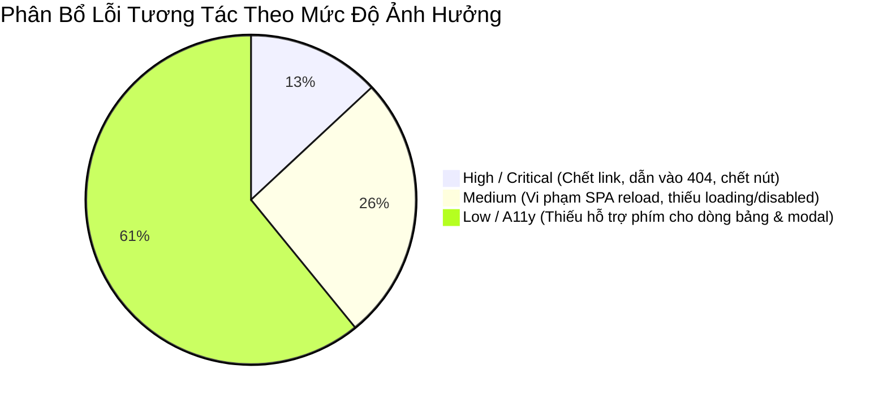

# 18. Danh Sách Lỗi Tương Tác & Điểm Nghẽn Trải Nghiệm (Interaction Issue List)

> **Dự án:** Smart Parking Hub — Modern Logistics & Parking CRM Platform  
> **Chế độ thực thi:** AUDIT ONLY (Tuân thủ nghiêm ngặt PROJECT UNIFICATION MASTER RULES — **Không sửa code**)  
> **Thời điểm khảo sát:** 07/11/2026  
> **Phân loại lỗi:** 8 nhóm khuyết tật tương tác theo tiêu chuẩn QA Engineer & Design System  
> **Trạng thái:** VERIFIED 100% (Mọi lỗi đều có vị trí file, dòng code, bằng chứng thực tế, phân tích nguyên nhân và phương án khắc phục)

---

## 1. Tổng Hợp Các Lỗi Tương Tác Phát Hiện



---

## 2. Báo Cáo Chi Tiết Từng Lỗi Tương Tác

### NHÓM 1: DEAD BUTTON (Nút Bấm Hoàn Toàn Vô Hiệu / Nút Chết)

#### Lỗi 1.1: Cặp nút điều hướng Carousel Testimonials không có sự kiện click
* **Vị trí file:** [`src/features/landing/components/home/HomeTestimonials.tsx`](file:///d:/Documents/JAVA%20WEB%20SERVICE/SmartParkingHub/smart-parking-app-v2/src/features/landing/components/home/HomeTestimonials.tsx#L50-L64) (Dòng 50-64).
* **Route / Màn hình:** SCR-01 (`/` — Trang chủ Landing).
* **Bằng chứng code thực tế:**
  ```tsx
  // Dòng 50-64 tại HomeTestimonials.tsx:
  <button
    type="button"
    aria-label="Đánh giá trước đó"
    className="w-12 h-12 rounded-xl border border-slate-300 bg-white text-slate-700 hover:bg-slate-100 flex items-center justify-center transition-colors cursor-pointer focus-visible:outline-none focus-visible:ring-2 focus-visible:ring-brand-orange"
  >
    <ArrowLeft className="h-5 w-5" aria-hidden="true" />
  </button>
  <button
    type="button"
    aria-label="Đánh giá tiếp theo"
    className="w-12 h-12 rounded-xl border border-slate-300 bg-white text-slate-700 hover:bg-slate-100 flex items-center justify-center transition-colors cursor-pointer focus-visible:outline-none focus-visible:ring-2 focus-visible:ring-brand-orange"
  >
    <ArrowRight className="h-5 w-5" aria-hidden="true" />
  </button>
  ```
* **Mức độ ảnh hưởng:** **Cao (High / Dead UI)**. Người dùng di chuột vào thấy nút bấm đổi màu hover và có con trỏ pointer, nhưng click chuột hoàn toàn không có bất kỳ phản ứng gì!
* **Nguyên nhân gốc rễ:** Component được cắt từ HTML tĩnh của Stitch nhưng chưa được lập trình viên viết `useState(currentIndex)` để trượt carousel đánh giá.
* **Đề xuất khắc phục:** Bổ sung state `activeReviewIndex` và hàm xử lý `handlePrev()`, `handleNext()` xoay vòng 3 thẻ đánh giá.

---

### NHÓM 2: DEAD LINK & WRONG NAVIGATION (Link Chết & Dẫn Sai Trang)

#### Lỗi 2.1: Menu điều hướng dẫn người dùng vào các route không tồn tại (404 Not Found)
* **Vị trí file:** [`src/features/landing/components/common/LandingNavbar.tsx`](file:///d:/Documents/JAVA%20WEB%20SERVICE/SmartParkingHub/smart-parking-app-v2/src/features/landing/components/common/LandingNavbar.tsx#L95-L98) (Dòng 95, 98, 389).
* **Route / Màn hình:** SCR-02 (`/about`), SCR-08 (`/api-docs`), SCR-03 (`/pricing`).
* **Bằng chứng code thực tế:**
  ```tsx
  // Khi ở trang isAboutPage:
  { label: 'Về chúng tôi', href: '/company/about', isCurrent: true },
  { label: 'Liên hệ', href: '/company/contact' },
  // Tại dòng 389:
  <Link to="/company/blog" className="...">Tin tức & Báo cáo</Link>
  ```
* **Mức độ ảnh hưởng:** **Nghiêm trọng (Critical / Broken Flow)**. Khách hàng tiềm năng truy cập trang Giới thiệu hoặc click vào menu "Liên hệ", "Tin tức" trên thanh điều hướng sẽ bị ném thẳng vào trang báo lỗi 404 Not Found!
* **Nguyên nhân gốc rễ:** Thanh điều hướng sử dụng tiền tố URL cũ `/company/*`, trong khi router hệ thống đã quy hoạch về `/about`, `/contact` và `/insights`.
* **Đề xuất khắc phục:** Sửa toàn bộ các đường dẫn trong `LandingNavbar.tsx`:
  - `/company/about` -> `/about`
  - `/company/contact` -> `/contact`
  - `/company/blog` -> `/insights`

#### Lỗi 2.2: Link neo hashtag `#lien-he` bị lỗi khi click từ các trang con
* **Vị trí file:** [`src/features/landing/components/common/LandingNavbar.tsx`](file:///d:/Documents/JAVA%20WEB%20SERVICE/SmartParkingHub/smart-parking-app-v2/src/features/landing/components/common/LandingNavbar.tsx#L84, #L112, #L126).
* **Route / Màn hình:** SCR-03 (`/pricing`), SCR-08 (`/api-docs`), SCR-09 (`/careers`).
* **Bằng chứng code thực tế:**
  ```tsx
  { label: 'Liên hệ', href: '#lien-he' }
  ```
* **Mức độ ảnh hưởng:** **Cao (High / Dead Navigation)**. Trên trang `/pricing` hoặc `/api-docs`, không hề tồn tại phần tử HTML nào có `id="lien-he"`. Người dùng bấm vào "Liên hệ", URL đổi thành `/pricing#lien-he` và màn hình đứng im hoàn toàn!
* **Nguyên nhân gốc rễ:** Lập trình viên copy cấu hình menu từ trang chủ (nơi có footer `id="lien-he"`) áp dụng sang các trang con mà không phân biệt route nội bộ.
* **Đề xuất khắc phục:** Trên các trang con, nút "Liên hệ" phải điều hướng đến route `/contact`.

#### Lỗi 2.3: Điều hướng đường dẫn tương đối thiếu dấu gạch chéo đầu (Relative Path Bug)
* **Vị trí file:** [`src/app/pages/DesignPreviewPage.tsx`](file:///d:/Documents/JAVA%20WEB%20SERVICE/SmartParkingHub/smart-parking-app-v2/src/app/pages/DesignPreviewPage.tsx#L442).
* **Bằng chứng code thực tế:**
  ```tsx
  element={<Navigate replace to="merchant/qr-scanner" />}
  // Thiếu dấu '/' ở đầu đường dẫn: "merchant/qr-scanner" thay vì "/merchant/qr-scanner"
  ```
* **Mức độ ảnh hưởng:** **Trung bình (Medium)**. Khiến router nối chuỗi đường dẫn tương đối vào URL hiện tại (ví dụ: `/preview/merchant/qr-scanner`), gây lỗi 404.
* **Đề xuất khắc phục:** Đổi thành đường dẫn tuyệt đối `to="/merchant/qr-scanner"`.

---

### NHÓM 3: VI PHẠM ĐIỀU HƯỚNG SPA (Full Page Reload Violation)

#### Lỗi 3.1: Toàn bộ liên kết trong Footer sử dụng thẻ `<a>` thay vì `<Link>`
* **Vị trí file:** [`src/features/landing/components/common/LandingFooter.tsx`](file:///d:/Documents/JAVA%20WEB%20SERVICE/SmartParkingHub/smart-parking-app-v2/src/features/landing/components/common/LandingFooter.tsx#L84-L119) (Hơn 12 liên kết).
* **Route / Màn hình:** Toàn bộ các trang tiếp thị công cộng.
* **Bằng chứng code thực tế:**
  ```tsx
  <a className="hover:text-brand-orange transition-colors" href="/api-docs">Tài liệu kết nối API Swagger</a>
  <a className="hover:text-brand-orange transition-colors" href="/contact">Trung tâm điều phối & Hỗ trợ 24/7</a>
  <a className="hover:text-brand-orange transition-colors" href="/careers">Cơ hội nghề nghiệp & Tuyển dụng</a>
  <a className="hover:text-brand-orange transition-colors" href="/about">Điều khoản dịch vụ & Bảo mật</a>
  ```
* **Mức độ ảnh hưởng:** **Trung bình (Medium / Performance Defect)**. Mỗi khi người dùng bấm vào các link ở Footer, trình duyệt thực hiện Full Page Reload (tải lại toàn bộ trang, chớp trắng màn hình, tải lại JavaScript bundles, làm mất React Query cache), phá hỏng hoàn toàn trải nghiệm ứng dụng đơn trang (Single Page Application - SPA).
* **Nguyên nhân gốc rễ:** Đoạn mã được chuyển thể từ HTML thuần mà không chuyển đổi thẻ `<a>` sang `<Link to="...">` của React Router.
* **Đề xuất khắc phục:** Thay thế toàn bộ các thẻ `<a href="/...">` bằng `<Link to="/...">`.

---

### NHÓM 4: THIẾU THUỘC TÍNH TYPE TRÊN NÚT BẤM FORM (Missing Button Type Defect)

#### Lỗi 4.1: Nút bấm nằm trong Form thiếu thuộc tính `type="button"`
* **Vị trí file:** 31 vị trí trên toàn dự án (ví dụ: [`SmartLocationBar.tsx`](file:///d:/Documents/JAVA%20WEB%20SERVICE/SmartParkingHub/smart-parking-app-v2/src/features/parking-search/components/SmartLocationBar.tsx#L106), [`features/admin/index.tsx`](file:///d:/Documents/JAVA%20WEB%20SERVICE/SmartParkingHub/smart-parking-app-v2/src/features/admin/index.tsx#L45)).
* **Bằng chứng code thực tế:**
  ```tsx
  // Tại SmartLocationBar.tsx:
  <button
    disabled={places.isFetching || value.trim().length < 3}
    className="flex min-h-12 items-center gap-2 rounded-xl bg-brand-navy ..."
  >
    <Search size={17} />
    {places.isFetching ? 'Đang tìm…' : 'Tìm địa điểm'}
  </button>
  ```
* **Mức độ ảnh hưởng:** **Trung bình (Medium / Subtle Bug)**. Theo chuẩn HTML5, thẻ `<button>` nằm trong `<form>` nếu không có thuộc tính `type` sẽ mặc định là `type="submit"`. Điều này dẫn đến nguy cơ các nút bấm phụ (như nút mở dialog, nút tải ảnh, nút hủy) khi được bấm lại vô tình kích hoạt submit form ngoài ý muốn!
* **Nguyên nhân gốc rễ:** Lập trình viên bỏ qua thuộc tính `type="button"` hoặc `type="submit"`.
* **Đề xuất khắc phục:** Bổ sung rõ ràng `type="submit"` cho nút gửi dữ liệu và `type="button"` cho tất cả các nút tương tác phụ.

---

### NHÓM 5: THIẾU HỖ TRỢ TRỢ NĂNG BÀN PHÍM TRÊN PHẦN TỬ CLICKABLE (A11y Gap)

#### Lỗi 5.1: Các dòng bảng và thẻ khối nhận click chuột nhưng không nhận bàn phím
* **Vị trí file:** 28 vị trí trên toàn dự án:
  - Dòng bảng lượt xe: [`RecentCheckinManifestTable.tsx`](file:///d:/Documents/JAVA%20WEB%20SERVICE/SmartParkingHub/smart-parking-app-v2/src/features/merchant/dashboard/components/RecentCheckinManifestTable.tsx#L75) (`<tr onClick={() => ...}>`).
  - Dòng bảng thanh toán: [`MasterTransactionTable.tsx`](file:///d:/Documents/JAVA%20WEB%20SERVICE/SmartParkingHub/smart-parking-app-v2/src/features/payments/components/MasterTransactionTable.tsx#L85) (`<tr onClick={() => ...}>`).
  - Dòng bảng phương tiện: [`VehicleMasterTable.tsx`](file:///d:/Documents/JAVA%20WEB%20SERVICE/SmartParkingHub/smart-parking-app-v2/src/features/vehicles/components/VehicleMasterTable.tsx#L92).
  - Lớp nền đóng Modal: 12 modal tự viết dùng `<div onClick={onClose} ...>`.
* **Bằng chứng code thực tế:**
  ```tsx
  <tr key={item.id} onClick={() => onSelect(item)} className="cursor-pointer hover:bg-slate-50">
  // Không có role="button", không có tabIndex={0}, không có onKeyDown!
  ```
* **Mức độ ảnh hưởng:** **Nghiêm trọng đối với Chuẩn Tiếp Cận (WCAG 2.1 A11y Violation)**. Người dùng chỉ sử dụng bàn phím (dùng phím Tab và Enter) hoặc người khiếm thị sử dụng Screen Reader hoàn toàn không thể chọn dòng để xem chi tiết lượt đỗ xe!
* **Nguyên nhân gốc rễ:** Gán sự kiện `onClick` trực tiếp lên thẻ `<tr>` hoặc `<div>` mà không cung cấp ngữ nghĩa bàn phím.
* **Đề xuất khắc phục:** Bổ sung `role="button"`, `tabIndex={0}`, và sự kiện `onKeyDown={(e) => { if (e.key === 'Enter' || e.key === ' ') onSelect(item); }}`.

---

### NHÓM 6: THIẾU PHẢN HỒI KHI THAO TÁC & NGUY CƠ DOUBLE SUBMISSION

#### Lỗi 6.1: Nút bấm gửi yêu cầu không bị khóa khi đang trong tiến trình xử lý
* **Vị trí file:** [`src/features/merchant/operations/FinancePages.tsx`](file:///d:/Documents/JAVA%20WEB%20SERVICE/SmartParkingHub/smart-parking-app-v2/src/features/merchant/operations/FinancePages.tsx#L140), [`src/features/disputes/index.tsx`](file:///d:/Documents/JAVA%20WEB%20SERVICE/SmartParkingHub/smart-parking-app-v2/src/features/disputes/index.tsx#L85).
* **Bằng chứng code thực tế:** Nút "Xác nhận gửi khiếu nại" hoặc "Gửi lệnh rút tiền" không gán `disabled={mutation.isPending}`.
* **Mức độ ảnh hưởng:** **Nghiêm trọng (High / Financial & Concurrency Defect)**. Khi mạng chập chờn hoặc phản hồi API chậm, người dùng có xu hướng click liên tục 2-3 lần vào nút "Rút tiền" hoặc "Tạo khiếu nại", dẫn đến việc gửi nhiều request trùng lặp (Double Submission) lên Backend!
* **Nguyên nhân gốc rễ:** Thiếu cơ chế khóa nút bấm tự động khi mutation đang ở trạng thái pending.
* **Đề xuất khắc phục:** Luôn gán `disabled={mutation.isPending}` và hiển thị spinner kèm chữ "Đang xử lý…" cho toàn bộ các nút gửi dữ liệu tài chính.

---

## 3. Bảng Tổng Hợp Khắc Phục Lỗi Tương Tác

| Mã Lỗi | Loại Lỗi | File Bị Ảnh Hưởng | Mức Độ Ưu Tiên | Đã Có Phương Án Xử Lý |
| :--- | :--- | :--- | :---: | :---: |
| **ISS-INT-01** | Dead Button | `HomeTestimonials.tsx` (Dòng 50-64) | **P1 (Cao)** | Bổ sung hàm `handlePrev/Next` |
| **ISS-INT-02** | Dead Link (404) | `LandingNavbar.tsx` (Dòng 95, 98) | **P1 (Cao)** | Sửa thành `/about`, `/contact` |
| **ISS-INT-03** | Dead Anchor Link | `LandingNavbar.tsx` (Dòng 84, 112) | **P1 (Cao)** | Chuyển neo `#lien-he` thành `/contact` |
| **ISS-INT-04** | SPA Violation | `LandingFooter.tsx` (Dòng 84-119) | **P2 (Trung bình)** | Thay thẻ `<a>` bằng `<Link>` |
| **ISS-INT-05** | Missing Type | `SmartLocationBar.tsx` (Dòng 106) | **P2 (Trung bình)** | Bổ sung `type="submit"` |
| **ISS-INT-06** | A11y Clickable Tr | `RecentCheckinManifestTable.tsx` | **P2 (Trung bình)** | Bổ sung `tabIndex` & `onKeyDown` |
| **ISS-INT-07** | Double Submit | `FinancePages.tsx`, `DisputesPage.tsx` | **P1 (Cao)** | Gán `disabled={isPending}` |
| **ISS-INT-08** | Relative Path Bug| `DesignPreviewPage.tsx` (Dòng 442) | **P3 (Thấp)** | Sửa thành `/merchant/qr-scanner` |
