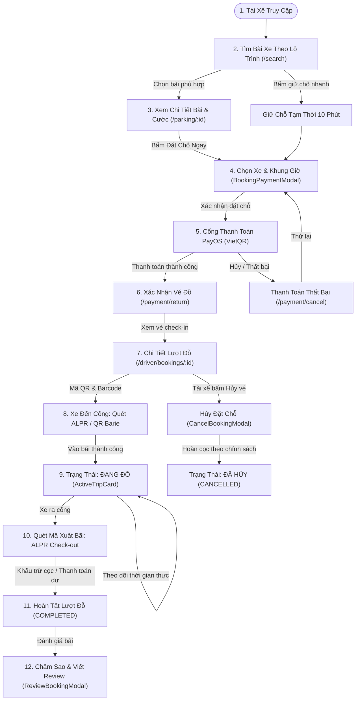
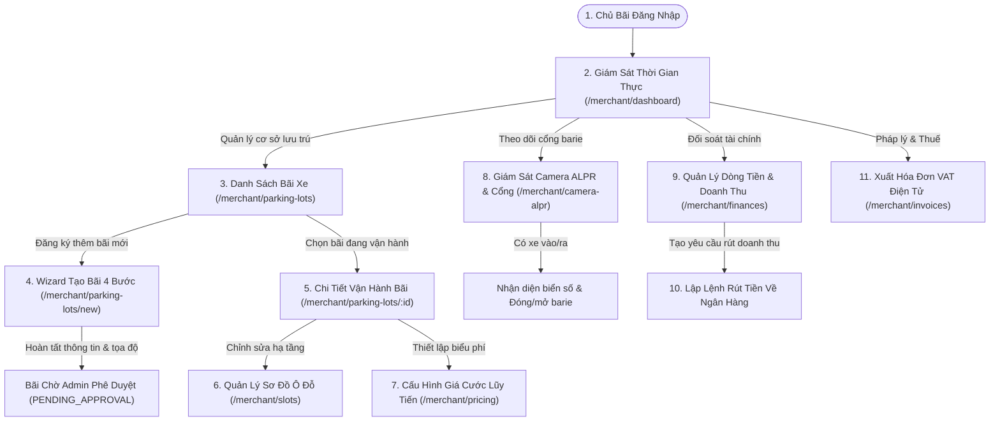
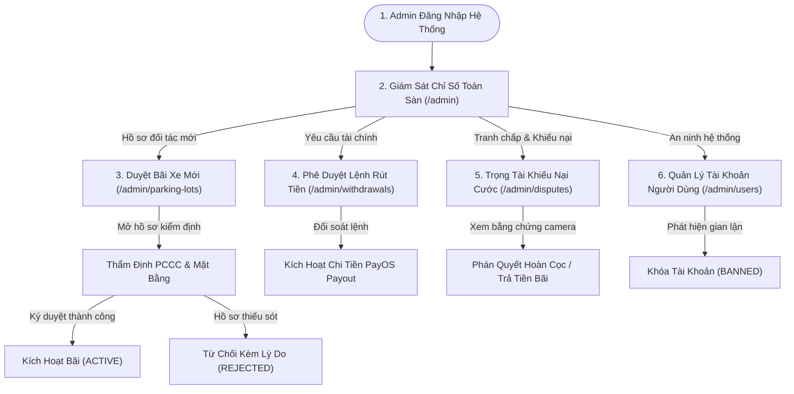

# 20. Bản Đồ Hành Trình Người Dùng Theo Vai Trò (Role-Based User Journeys)

> **Dự án:** Smart Parking Hub — Modern Logistics & Parking CRM Platform  
> **Chế độ thực thi:** WORKFLOW AUDIT ONLY (Tuân thủ PROJECT UNIFICATION MASTER RULES — **Không sửa code**)  
> **Thời điểm khảo sát:** 07/11/2026  
> **Căn cứ nghiệp vụ:** Mã nguồn thực tế tại 155+ files và DTOs Backend Microservices  
> **Trạng thái:** VERIFIED 100%

---

## 1. Hành Trình Tài Xế (Driver User Journey)

### 1.1. Sơ Đồ Luồng Nghiệp Vụ Tài Xế (Mermaid Flowchart)

### 1.2. Bảng Phân Tích Chi Tiết Từng Giai Đoạn Hành Trình Tài Xế

| Giai Đoạn | Điểm Vào (Entry) | Điều Kiện Tiên Quyết | Hành Động Người Dùng | Dữ Liệu & Hợp Đồng API | Chuyển Đổi Trạng Thái (State Transition) | Luồng Lỗi & Khôi Phục (Error & Recovery Path) | Đích Đến Cuối Cùng |
| :--- | :--- | :--- | :--- | :--- | :--- | :--- | :--- |
| **Pha 1: Tìm kiếm & Lựa chọn** | Header hoặc Trang chủ | Có kết nối mạng, trình duyệt cho phép GPS | Nhập địa chỉ hoặc chọn trạm trên bản đồ, lọc bãi xe tải nặng / container | `GET /api/v1/parking-lots/search` `DTO: ParkingLotSearchCriteria` | Mở danh sách kết quả, map hiển thị các pin bãi xe | Lỗi không có GPS: Chuyển sang tìm theo tên quận/huyện | Chọn được bãi xe ưng ý tại `/parking/:id` |
| **Pha 2: Đặt chỗ & Thanh toán cọc** | Trang chi tiết bãi đỗ | Đã đăng nhập, đã thêm ít nhất 1 phương tiện | Chọn biển số xe, chọn khung giờ vào bãi, kiểm tra số tiền cọc tạm tính | `POST /api/v1/bookings` `DTO: CreateBookingRequest` | Trạng thái vé: `PENDING_PAYMENT` | Hết slot đỗ: Hệ thống chuyển hướng vào Hàng đợi ảo (`/driver/queues`) | Mở popup VietQR PayOS |
| **Pha 3: Xác thực PayOS** | Cổng PayOS Gateway | Có app ngân hàng hỗ trợ VietQR | Quét mã QR chuyển khoản chính xác số tiền | Webhook PayOS -> Backend `POST /api/v1/payments/payos/webhook` | `PENDING_PAYMENT` -> `CONFIRMED` (hoặc `PENDING_CHECKIN`) | Quá 15 phút chưa thanh toán: Hết hạn giữ chỗ, giải phóng slot | Điều hướng sang `/payment/return` |
| **Pha 4: Check-in & Vào bãi** | Trang chi tiết vé `/driver/bookings/:id` | Xe đã di chuyển đến cổng bãi | Xuất trình mã QR tại Kiosk hoặc camera ALPR tự động quét biển số xe | `POST /api/v1/alpr/check-in` `DTO: GateCheckInPayload` | `CONFIRMED` -> `PARKING` (Đang đỗ) | Sai biển số: Barie không mở, còi báo động, nhân viên trực xử lý thủ công | Barie nâng lên, xe vào vị trí slot |
| **Pha 5: Theo dõi thời gian thực** | Bảng điều khiển `/driver/dashboard` | Xe đang nằm trong bãi | Xem thẻ `ActiveTripCard`: đếm giờ đỗ, kiểm tra tiền cước lũy tiến | `GET /api/v1/driver/dashboard` `DTO: ActiveTripDto` | Giữ trạng thái `PARKING` (cập nhật `currentFee` mỗi phút) | Mất mạng: Sử dụng dữ liệu cache cuối cùng kèm icon cảnh báo offline | Nút mở mã QR xuất bãi sẵn sàng |
| **Pha 6: Check-out & Hoàn tất** | Cổng ra của bãi đỗ xe | Xe di chuyển đến barie cổng ra | Quét mã ALPR Check-out Pass, thanh toán phần cước phát sinh nếu có | `POST /api/v1/alpr/check-out` `DTO: GateCheckOutPayload` | `PARKING` -> `COMPLETED` (hoặc `OVERTIME_PENALTY`) | Quá giờ đỗ quá hạn: Tính phụ phí phạt theo bảng cước niêm yết | Xe rời bãi, vé chuyển lịch sử hoàn tất |

---

## 2. Hành Trình Chủ Bãi Xe (Parking Owner / Merchant User Journey)

### 2.1. Sơ Đồ Luồng Nghiệp Vụ Chủ Bãi (Mermaid Flowchart)

### 2.2. Bảng Phân Tích Chi Tiết Từng Giai Đoạn Hành Trình Chủ Bãi

| Giai Đoạn | Điểm Vào | Điều Kiện Tiên Quyết | Hành Động Người Dùng | Dữ Liệu & Hợp Đồng API | Trạng Thái Bãi & Nghiệp Vụ | Luồng Lỗi & Phục Hồi | Đích Đến Cuối Cùng |
| :--- | :--- | :--- | :--- | :--- | :--- | :--- | :--- |
| **Pha 1: Khởi tạo bãi xe mới** | `/merchant/parking-lots` | Tài khoản có quyền `MERCHANT` | Nhập tên bãi, ghim vị trí GPS trên bản đồ Leaflet, upload ảnh phòng cháy chữa cháy, khai báo tổng số slot | `POST /api/v1/merchant/parking-lots` `DTO: CreateParkingLotPayload` | Bãi mang trạng thái: `PENDING_APPROVAL` | Thiếu ảnh hoặc giấy phép: Bước Wizard bị khóa, thông báo lỗi đỏ | Gửi hồ sơ lên hàng đợi kiểm duyệt Admin |
| **Pha 2: Sơ đồ slot & Công suất** | `/merchant/slots` | Bãi đã được Admin phê duyệt `ACTIVE` | Xem ma trận lưới slot đỗ, điều chỉnh số lượng slot cho xe tải nhẹ, xe tải nặng và container | `PUT /api/v1/merchant/lots/:id/slots` `DTO: SlotAllocationDto` | Cập nhật `totalSlots`, `availableSlots` theo thời gian thực | Giảm số slot nhỏ hơn số xe đang đỗ thực tế: Kích hoạt `ConfirmDecreaseModal` cảnh báo | Lưu cấu hình sơ đồ slot an toàn |
| **Pha 3: Thiết lập giá cước** | `/merchant/pricing` | Có danh mục loại xe | Thiết lập giá block 2 giờ đầu, giá mỗi giờ tiếp theo, phụ phí qua đêm, phụ phí ngày lễ | `POST /api/v1/merchant/tariffs` `DTO: TariffRuleBuilderDto` | Cập nhật bảng giá niêm yết công khai trên App | Giá cước vi phạm quy định sàn: Báo lỗi giới hạn giá trần | Bảng giá có hiệu lực tức thì |
| **Pha 4: Giám sát cổng ALPR** | `/merchant/camera-alpr` | Camera kết nối mạng RTSP | Theo dõi luồng ảnh trực tiếp từ camera barie cổng vào/ra, bấm nút can thiệp mở barie khẩn cấp | `WS /ws/alpr-stream` `POST /api/v1/gates/override` | Ghi nhận sự kiện `GATE_OPENED`, `PLATE_DETECTED` | Camera mất tín hiệu: Hiện cảnh báo "Mất kết nối camera", chuyển chế độ nhập biển số tay | Đảm bảo lưu thông cổng thông suốt |
| **Pha 5: Rút tiền doanh thu** | `/merchant/finances` | Số dư ví khả dụng > 500,000 VND | Nhập số tiền cần rút, chọn tài khoản ngân hàng đã liên kết, bấm nút "Rút tiền" | `POST /api/v1/merchant/payouts` `DTO: WithdrawalRequestDto` | Trừ số dư khả dụng, tạo giao dịch `PENDING_ADMIN_APPROVAL` | Nhập quá số dư khả dụng: Tự động reset về số dư tối đa kèm thông báo | Lệnh rút gửi lên Admin chờ duyệt |

---

## 3. Hành Trình Quản Trị Viên (Administrator User Journey)

### 3.1. Sơ Đồ Luồng Nghiệp Vụ Quản Trị Viên (Mermaid Flowchart)

### 3.2. Bảng Phân Tích Chi Tiết Từng Giai Đoạn Hành Trình Quản Trị Viên

| Giai Đoạn | Điểm Vào | Quyền Hạn (RBAC) | Hành Động Quản Trị | Hợp Đồng API | Chuyển Đổi Trạng Thái | Cơ Chế Phục Hồi & Kiểm Toán | Đích Đến Cuối Cùng |
| :--- | :--- | :--- | :--- | :--- | :--- | :--- | :--- |
| **Phê duyệt bãi xe đối tác** | `/admin/parking-lots` | `ROLE_ADMIN` | Xem ảnh chụp thực tế, kiểm tra giấy phép kinh doanh, bấm "Phê duyệt" hoặc "Từ chối" | `POST /api/v1/admin/lots/:id/approve` `POST /api/v1/admin/lots/:id/reject` | `PENDING_APPROVAL` -> `ACTIVE` hoặc `REJECTED` | Mọi thao tác đều được ghi vào Audit Log kèm lý do và IP Admin | Bãi xe hiển thị trên bản đồ tìm kiếm |
| **Phê duyệt rút tiền Merchant** | `/admin/withdrawals` | `ROLE_ADMIN` | Đối chiếu doanh thu bãi với số dư thực tế tại PayOS, bấm "Duyệt chi tiền" | `POST /api/v1/admin/withdrawals/:id/payout` | `PENDING` -> `PROCESSING` -> `PAID` | Lỗi API ngân hàng: Giao dịch rollback về trạng thái chờ xử lý lại | Tiền chuyển về tài khoản ngân hàng chủ bãi |
| **Trọng tài khiếu nại cước** | `/admin/disputes` | `ROLE_ADMIN` | Đối chiếu thời gian vào/ra từ camera ALPR và khiếu nại của tài xế, quyết định hoàn tiền | `POST /api/v1/admin/disputes/:id/verdict` | `OPEN` -> `RESOLVED` (kèm lệnh `REFUND`) | Tài xế hoặc chủ bãi khiếu nại tiếp: Mở lại hồ sơ kiểm tra cấp 2 | Đơn khiếu nại đóng, tài khoản nhận tiền hoàn |
| **Xử lý tài khoản vi phạm** | `/admin/users` | `ROLE_ADMIN` | Tìm kiếm theo số điện thoại, bấm "Khóa tài khoản" khi phát hiện hành vi bùng cọc | `POST /api/v1/admin/users/:id/lock` | `ACTIVE` -> `BANNED` | Khóa nhầm: Admin có nút "Mở khóa tài khoản" lập tức | Người dùng bị đăng xuất ngay lập tức |
