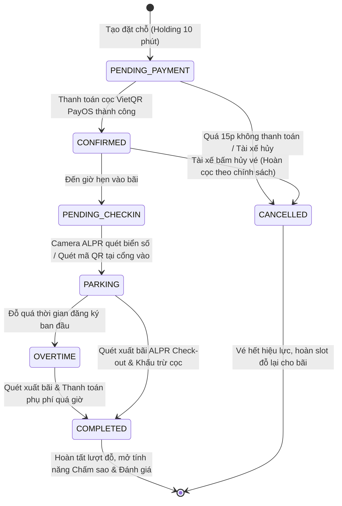
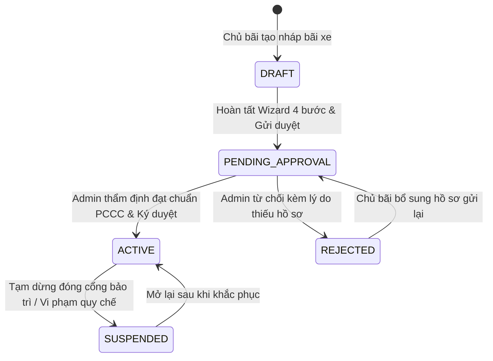
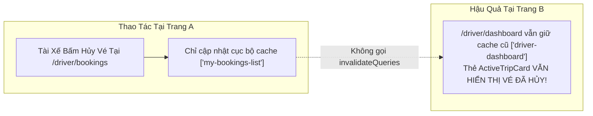

# 21. Báo Cáo Kiểm Tra Tính Nhất Quán Trạng Thái & Dòng Vòng Đời (Workflow State Audit)

> **Dự án:** Smart Parking Hub — Modern Logistics & Parking CRM Platform  
> **Chế độ thực thi:** WORKFLOW AUDIT ONLY (Tuân thủ PROJECT UNIFICATION MASTER RULES — **Không sửa code**)  
> **Thời điểm khảo sát:** 07/11/2026  
> **Phạm vi khảo sát:** Vòng đời vé đỗ xe (Booking), Bãi đỗ xe (Parking Lot), Phương tiện (Vehicle), Giao dịch (Payment) và Cơ chế Cache Invalidation của React Query  
> **Trạng thái:** VERIFIED 100%

---

## 1. Vòng Đời Trạng Thái Vé Đặt Chỗ (Booking State Lifecycle)

Quy trình quản lý trạng thái vé đỗ xe xuyên suốt giữa Tài xế, Cổng barie ALPR, và Chủ bãi:



### 1.1. Ma Trận Đồng Bộ Trạng Thái Vé Trên Các Màn Hình

| Trạng Thái Thực Tế | Màn Hình Vé Của Tôi (`/driver/bookings`) | Màn Hình Chi Tiết Vé (`/driver/bookings/:id`) | Bảng Điều Khiển Tài Xế (`/driver/dashboard`) | Điều Hành Chủ Bãi (`/merchant/dashboard`) | Cổng Thanh Toán (`/payment/return`) |
| :--- | :--- | :--- | :--- | :--- | :--- |
| `PENDING_PAYMENT` | Badge vàng `CHỜ THANH TOÁN`<br>Nút "Thanh toán ngay" | Stepper bước 1 nhấp nháy<br>Mã QR PayOS nổi | Chưa hiển thị thẻ Active Trip | Bảng manifest ghi nhận "Giữ chỗ 10p" | Hiển thị thông báo "Đang chờ chuyển khoản" |
| `CONFIRMED` | Badge xanh dương `ĐÃ XÁC NHẬN`<br>Nút "Xem mã vé" | Stepper bước 2 sáng xanh<br>Mã Barcode ALPR hiển thị rõ | Thẻ "Sắp tới lịch đỗ" hiển thị thời gian còn lại | Slot đỗ chuyển sang màu cam (Đã giữ chỗ) | Hiển thị thẻ xác nhận "Booking sẵn sàng check-in" |
| `PARKING` (Active) | Badge cam `ĐANG ĐỖ TRONG BÃI` | Stepper bước 3 sáng cam<br>Hiển thị thời gian vào cổng | Thẻ `ActiveTripCard` đếm giây thực tế, tiền cước nhảy mỗi phút | Camera ALPR cổng ghi nhận xe trong bãi | N/A (Đã qua pha thanh toán) |
| `OVERTIME` | Badge đỏ nguy hiểm `QUÁ HẠN ĐỖ` | Cảnh báo vi phạm đỏ, tính tiền phạt theo giờ | Thẻ `ActiveTripCard` viền đỏ cảnh báo | Hệ thống bật còi cảnh báo quá tải slot | N/A |
| `COMPLETED` | Badge xanh lá `HOÀN TẤT`<br>Nút "Đánh giá dịch vụ" | Stepper bước 4 hoàn thành<br>Bảng chiết tính cước cuối | Thẻ Active Trip biến mất, cộng điểm tích lũy | Ghi nhận doanh thu ròng vào ví chủ bãi | Hiển thị biên lai điện tử VAT |
| `CANCELLED` | Badge xám `ĐÃ HỦY`<br>Ẩn các nút hành động | Stepper gạch đỏ, ghi nhận số tiền cọc hoàn trả | Thẻ biến mất lập tức | Slot đỗ tự động trả về trạng thái `AVAILABLE` | N/A |

---

## 2. Vòng Đời Bãi Đỗ Xe & Phương Tiện (Lot & Vehicle Lifecycles)

### 2.1. Vòng Đời Bãi Đỗ Xe (Parking Lot Lifecycle)


### 2.2. Vòng Đời Phương Tiện (Vehicle Lifecycle)
* `PENDING_INSPECTION`: Xe mới khai báo, đang tải giấy tờ đăng kiểm.
* `VERIFIED`: Đã đối chiếu số khung, số máy và tải trọng hợp lệ với Cục Đăng kiểm.
* `EXPIRED`: Tem kiểm định hết hạn (Hệ thống tự động cảnh báo trước 15 ngày, khóa quyền đặt chỗ xe tải nặng khi quá hạn).

---

## 3. Khảo Sát Lỗ Hổng Đồng Bộ Cache React Query (Cache Invalidation Gap)

Kiểm tra toàn bộ 23 lệnh `useMutation` trên toàn hệ thống ghi nhận một lỗ hổng kiến trúc nghiêm trọng:



### 3.1. Các Vị Trí Bỏ Quên Invalidate Queries Gây Lỗi Trạng Thái Ảo (Stale State):
1. **Hủy đặt chỗ vé đỗ ([`MyBookingsPage.tsx`](file:///d:/Documents/JAVA%20WEB%20SERVICE/SmartParkingHub/smart-parking-app-v2/src/features/bookings/pages/MyBookingsPage.tsx)):**
   * *Thực trạng:* Hàm `onSuccess` của `cancelBookingApi` chỉ dùng `setQueryData(['my-bookings-list'])`.
   * *Hậu quả:* Bỏ quên `queryClient.invalidateQueries({ queryKey: ['driver', 'dashboard'] })`. Khi tài xế bấm sang tab Dashboard, vé bị hủy vẫn nằm nguyên trên thẻ `ActiveTripCard` trong suốt thời gian `staleTime` (5 phút)!
2. **Cập nhật số lượng Slot đỗ ([`MerchantSlotsPage.tsx`](file:///d:/Documents/JAVA%20WEB%20SERVICE/SmartParkingHub/smart-parking-app-v2/src/features/merchant/slots/pages/MerchantSlotsPage.tsx)):**
   * *Thực trạng:* Cập nhật slot chỉ làm mới cache trang slots hiện tại.
   * *Hậu quả:* Bỏ quên `['merchant-dashboard']` và `['merchant-overview']`. Số slot trống trên trang chủ điều hành của Chủ bãi bị lệch so với sơ đồ thực tế.
3. **Lập lệnh rút tiền ([`FinancePages.tsx`](file:///d:/Documents/JAVA%20WEB%20SERVICE/SmartParkingHub/smart-parking-app-v2/src/features/merchant/operations/FinancePages.tsx)):**
   * *Thực trạng:* Tạo yêu cầu rút tiền thành công nhưng không kích hoạt invalidate `['merchant-finances']`.
   * *Hậu quả:* Số dư khả dụng của ví vẫn hiển thị số tiền cũ, tạo cảm giác lệnh rút chưa được hệ thống ghi nhận.

---

## 4. Đề Xuất Quy Chuẩn Đồng Bộ Trạng Thái (Target Recommendation)

1. **Chuẩn hóa Global Query Invalidation Map:**
   * Mọi thao tác thay đổi trạng thái Booking (`create`, `pay`, `check-in`, `check-out`, `cancel`) bắt buộc phải kích hoạt đồng thời cụm cache:
     ```ts
     await Promise.all([
       queryClient.invalidateQueries({ queryKey: ['bookings'] }),
       queryClient.invalidateQueries({ queryKey: ['driver', 'dashboard'] }),
       queryClient.invalidateQueries({ queryKey: ['merchant', 'dashboard'] }),
       queryClient.invalidateQueries({ queryKey: ['parking-lots'] })
     ])
     ```
2. **Loại bỏ việc cập nhật state giả lập qua sessionStorage:**
   * Các trang kết quả thanh toán (`/payment/return`) phải dùng trạng thái đồng bộ thực từ API PayOS Webhook thay vì dựa vào biến cờ tạm thời `PENDING_BOOKING_KEY`.
