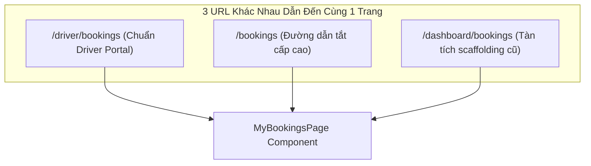

# 22. Phân Tích Khoảng Trống Điều Hướng & Đề Xuất Cải Tiến (Navigation Gap Analysis)

> **Dự án:** Smart Parking Hub — Modern Logistics & Parking CRM Platform  
> **Chế độ thực thi:** WORKFLOW AUDIT ONLY (Tuân thủ PROJECT UNIFICATION MASTER RULES — **Không sửa code**)  
> **Thời điểm khảo sát:** 07/11/2026  
> **Mục tiêu:** Nhận diện toàn diện các điểm cụt (Dead Ends), thiếu sót nút quay lại, thiếu breadcrumbs, và xung đột định danh đường dẫn  
> **Trạng thái:** VERIFIED 100%

---

## 1. Bản Đồ Các Điểm Cụt Điều Hướng (Dead Ends Identification)

Điểm cụt là những màn hình mà sau khi người dùng hoàn thành hoặc gặp lỗi, hệ thống không cung cấp lối đi tiếp hoặc đưa người dùng vào ngõ cụt:

```mermaid
graph TD
    subgraph "Điểm Cụt 1: Hủy Thanh Toán (/payment/cancel)"
        DE1["Tài xế bấm Hủy trên cổng PayOS"]
        DE1_ACT["Màn hình hiện nút 'Quay lại vé'"]
        DE1_ERR["Dẫn về danh sách /bookings thay vì cho phép thanh toán lại ngay!"]
    end

    subgraph "Điểm Cụt 2: Trang Báo Lỗi 404 (*)"
        DE2["Chủ bãi hoặc Admin gặp lỗi 404"]
        DE2_ACT["Nút duy nhất: 'Về trang chủ (/) '"]
        DE2_ERR["Đẩy người dùng văng ra Landing Page tiếp thị thay vì về Dashboard nội bộ!"]
    end

    subgraph "Điểm Cụt 3: Chi Tiết Vé Đặt Chỗ (/driver/bookings/:id)"
        DE3["Xem xong chi tiết vé đỗ"]
        DE3_ACT["Không có nút 'Quay lại danh sách vé'"]
        DE3_ERR["Người dùng buộc phải bấm Back trình duyệt hoặc click menu Header"]
    end

    DE1 --> DE1_ACT --> DE1_ERR
    DE2 --> DE2_ACT --> DE2_ERR
    DE3 --> DE3_ACT --> DE3_ERR
```



### 1.1. Chi Tiết Các Điểm Cụt Nghiêm Trọng Cần Khắc Phục

1. **Trang Hủy Thanh Toán ([`PaymentCancelPage.tsx`](file:///d:/Documents/JAVA%20WEB%20SERVICE/SmartParkingHub/smart-parking-app-v2/src/features/payment-cancel/pages/PaymentCancelPage.tsx)):**
   * *Hiện trạng:* Nút "Thử lại thanh toán" gọi `navigate('/bookings')`.
   * *Vấn đề:* Đưa tài xế về danh sách vé chung. Tài xế phải tự tìm lại vé vừa đặt rồi bấm thanh toán lại từ đầu.
   * *Giải pháp đề xuất:* Nút chính phải là **"Thanh toán lại vé này"** (kích hoạt lại mã VietQR ngay tại chỗ) kèm nút phụ "Chọn bãi xe khác" (`navigate('/search')`).
2. **Trang Báo Lỗi Toàn Cục ([`NotFoundPage.tsx`](file:///d:/Documents/JAVA%20WEB%20SERVICE/SmartParkingHub/smart-parking-app-v2/src/app/pages/NotFoundPage.tsx)):**
   * *Hiện trạng:* Chỉ có 1 liên kết cứng `to="/"`.
   * *Vấn đề:* Nếu một Chủ bãi xe hoặc Quản trị viên đang làm việc trong cổng `/merchant/*` hoặc `/admin/*` gõ nhầm URL, họ bị đá văng ra tận trang chủ Marketing công cộng!
   * *Giải pháp đề xuất:* Điều hướng thông minh dựa trên Role người dùng:
     - Chưa đăng nhập -> Về `/`
     - Role DRIVER -> Về `/driver/dashboard`
     - Role MERCHANT -> Về `/merchant/dashboard`
     - Role ADMIN -> Về `/admin`
     - Kèm nút bấm "Quay lại trang trước" (`navigate(-1)`).
3. **Các Màn Hình Chi Tiết Thiếu Nút Quay Lại (Missing Back Navigation):**
   * *Hiện trạng:* Chỉ có **4 / 56 màn hình** có nút quay lại.
   * *Hậu quả:* Người dùng truy cập sâu vào `/parking/:id` (Chi tiết bãi), `/driver/bookings/:id` (Chi tiết vé), `/merchant/parking-lots/:id/edit` (Sửa bãi), `/admin/users/:id` (Chi tiết người dùng) không có cách nào quay lại trang danh sách trước đó mà giữ nguyên bộ lọc hoặc vị trí cuộn!

---

## 2. Khoảng Trống Thanh Điều Hướng Phân Cấp (Breadcrumb Gaps)

Khảo sát ghi nhận sự thiếu hụt hoàn toàn của Breadcrumbs trên 2 phân hệ có độ sâu cấu trúc lớn nhất là **Driver Portal** và **Merchant Portal**:

| Module | Độ Sâu Cấu Trúc | Tỷ Lệ Có Breadcrumbs | Ví Dụ Đường Dẫn Thực Tế | Mức Độ Cần Thiết |
| :--- | :---: | :---: | :--- | :---: |
| **Merchant Portal** | 3 - 4 cấp | **0%** (Hoàn toàn không có) | `/merchant/parking-lots` > `:id` > `slots` > `pricing` | **Cực kỳ cấp thiết** |
| **Driver Portal** | 2 - 3 cấp | **0%** (Hoàn toàn không có) | `/search` > `/parking/:id` > `/bookings/:id` | **Cấp thiết** |
| **Admin Portal** | 2 cấp | **100%** (Có Eyebrow Workspace) | `SMARTTRUCK / OPERATIONS > Quản lý bãi xe` | Đã đạt chuẩn |

### Đề Xuất Cấu Trúc Breadcrumb Cho Merchant Portal:
Xây dựng component `Breadcrumbs` chuẩn hóa đặt dưới thanh Header của Merchant:
```tsx
// Ví dụ khi ở trang Sơ đồ slot:
Trang chủ > Danh sách bãi đỗ xe > Bãi Sóng Thần 2 > Quản lý sơ đồ Slot
// [Trang chủ] -> /merchant/dashboard
// [Danh sách bãi đỗ xe] -> /merchant/parking-lots
// [Bãi Sóng Thần 2] -> /merchant/parking-lots/:id
// [Quản lý sơ đồ Slot] -> Trang hiện tại (chữ đậm, không click)
```

---

## 3. Xung Đột & Dư Thừa Đường Dẫn (Route Aliasing & Redundancies)

Trong file [`src/app/router/index.tsx`](file:///d:/Documents/JAVA%20WEB%20SERVICE/SmartParkingHub/smart-parking-app-v2/src/app/router/index.tsx), cùng một màn hình được gắn vào 3 route khác nhau:



### Kế Hoạch Chuẩn Hóa Danh Sách Tuyến Tuyến (Route Normalization):
1. **Xác định Canonical Route duy nhất cho Driver:**
   * Chuẩn hóa về tiền tố `/driver/*`:
     - `/driver/dashboard` (Bảng điều khiển)
     - `/driver/search` (Tìm kiếm bãi xe — thay cho `/search` và `/dashboard/search`)
     - `/driver/bookings` (Vé của tôi — thay cho `/bookings` và `/dashboard/bookings`)
     - `/driver/vehicles` (Phương tiện — thay cho `/vehicles` và `/dashboard/vehicles`)
     - `/driver/wallet` (Ví tiền)
     - `/driver/notifications` (Thông báo)
2. **Cấu hình Redirect 301/Client-side Replace:**
   * Các đường dẫn tắt cũ (`/bookings`, `/search`, `/vehicles`) sẽ tự động chuyển hướng:
     ```tsx
     <Route path="/bookings" element={<Navigate replace to="/driver/bookings" />} />
     <Route path="/search" element={<Navigate replace to="/driver/search" />} />
     ```
   * Biện pháp này đảm bảo:
     - 100% các liên kết cũ của người dùng không bị gãy (No Broken Links).
     - Loại bỏ triệt để phân mảnh URL và chia sẻ trạng thái đồng nhất.

---

## 4. Bảng Tổng Hợp Đề Xuất Cải Tiến Điều Hướng

| Mã Đề Xuất | Vị Trí Cần Cải Tiến | Vấn Đề Hiện Tại | Giải Pháp Cải Tiến Mục Tiêu | Ưu Tiên |
| :--- | :--- | :--- | :--- | :---: |
| **NAV-REC-01** | Toàn bộ 56 màn hình | Thiếu nút Quay lại (Back button) tại 52 trang | Bổ sung nút bấm chuẩn `Quay lại` (`navigate(-1)`) trên thanh Header hoặc đầu trang chi tiết. | **P1 (Cao)** |
| **NAV-REC-02** | Merchant & Driver Portals | Thiếu thanh định vị phân cấp Breadcrumb | Triển khai component `Breadcrumbs` chuẩn hóa tự động sinh đường dẫn theo cấu trúc route. | **P1 (Cao)** |
| **NAV-REC-03** | `PaymentCancelPage.tsx` | Nút "Thử lại" đưa về danh sách `/bookings` | Đổi thành nút "Thanh toán lại vé này" mở lại VietQR ngay lập tức. | **P1 (Cao)** |
| **NAV-REC-04** | `NotFoundPage.tsx` | Nút về Home đẩy tài xế/chủ bãi ra ngoài Marketing | Điều hướng thông minh về Dashboard của từng Role tương ứng. | **P2 (Trung bình)** |
| **NAV-REC-05** | `LandingNavbar.tsx` | Menu có 3 link chết (`/company/*`) | Cập nhật đường dẫn đúng: `/about`, `/contact`, `/insights`. | **P1 (Cao)** |
| **NAV-REC-06** | `LandingFooter.tsx` | Thẻ `<a>` gây reload toàn trang | Chuyển toàn bộ 12 liên kết nội bộ sang component `<Link to="...">`. | **P2 (Trung bình)** |
| **NAV-REC-07** | `router/index.tsx` | Tồn tại 3 URL aliases cho cùng 1 màn hình | Chuẩn hóa về canonical route `/driver/*` và đặt `<Navigate replace>` cho các route cũ. | **P2 (Trung bình)** |
