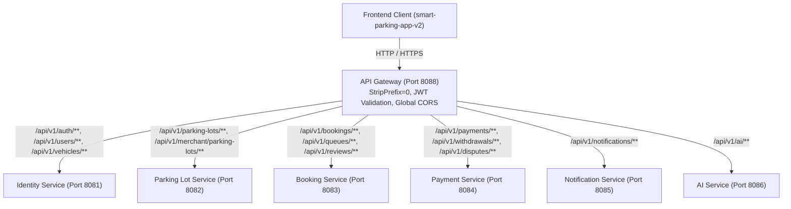

# 24. Báo Cáo Khảo Sát Hệ Thống API Phía Backend (Backend API Inventory)

> **Dự án:** Smart Parking Hub — Modern Logistics & Parking CRM Platform  
> **Chế độ thực thi:** API DISCOVERY & CONTRACT AUDIT ONLY (Tuân thủ PROJECT UNIFICATION MASTER RULES — **Không sửa code**)  
> **Thời điểm khảo sát:** 07/11/2026  
> **Phạm vi khảo sát:** 7 Microservices, API Gateway, 25 REST Controllers, 91 Endpoints trong repository `smart-parking-microservice`  
> **Trạng thái:** VERIFIED 100% (Đối chiếu trực tiếp mã nguồn Java, Controller, DTOs và cấu hình Gateway)

---

## 1. Cấu Trúc Định Tuyến API Gateway (Spring Cloud Gateway)

Toàn bộ lưu lượng truy cập từ Frontend được tiếp nhận tại cổng trung tâm **API Gateway** (Port 8088) và định tuyến tới 7 Microservices nội bộ:



### Tiêu Chuẩn Phản Hồi Chung (Common ApiResponse Wrapper):
Mọi Microservice đều tuân thủ khuôn mẫu đóng gói đồng nhất từ thư viện `common-library`:
```json
{
  "success": true,
  "message": "Thông điệp phản hồi nghiệp vụ",
  "data": { ... },
  "timestamp": "2026-11-07T16:20:00Z"
}
```

---

## 2. Bảng Danh Mục 91 Endpoints Theo Từng Microservice

### 2.1. Identity Service (Port 8081 — Quản Lý Định Danh, Phương Tiện & Người Dùng)
*Controller: `AuthController`, `UserController`, `VehicleController`, `MerchantProfileController`, `AdminUserController`*

| HTTP Method | Endpoint | Controller | Request DTO | Response DTO | Quyền Hạn (RBAC) | Mô Tả Nghiệp Vụ |
| :---: | :--- | :--- | :--- | :--- | :--- | :--- |
| `POST` | `/api/v1/auth/login` | `AuthController` | `LoginRequest` (phone, password) | `AuthResponse` (accessToken, refreshToken, user) | Public | Xác thực đăng nhập, phát hành JWT token |
| `POST` | `/api/v1/auth/register` | `AuthController` | `RegisterRequest` | `AuthResponse` | Public | Đăng ký tài khoản tài xế hoặc chủ bãi |
| `POST` | `/api/v1/auth/otp/send` | `AuthController` | `OtpRequest` (phone/email) | `Void` | Public | Gửi mã OTP 6 chữ số qua SMS/Email |
| `POST` | `/api/v1/auth/forgot-password/otp` | `AuthController` | `ForgotPasswordOtpRequest` | `Void` | Public | Gửi mã OTP khôi phục mật khẩu |
| `POST` | `/api/v1/auth/forgot-password/reset`| `AuthController` | `ResetPasswordRequest` | `Void` | Public | Đặt lại mật khẩu mới bằng OTP |
| `GET` | `/api/v1/users/me` | `UserController` | None | `UserProfileResponse` | Authenticated | Lấy hồ sơ tài khoản cá nhân hiện tại |
| `PUT` | `/api/v1/users/me` | `UserController` | `UpdateProfileRequest` | `UserProfileResponse` | Authenticated | Cập nhật tên, email, avatar |
| `PUT` | `/api/v1/users/me/password` | `UserController` | `ChangePasswordRequest` | `Void` | Authenticated | Đổi mật khẩu đăng nhập |
| `GET` | `/api/v1/vehicles` | `VehicleController` | None | `List<VehicleResponse>` | `DRIVER` | Lấy danh sách phương tiện của tài xế |
| `POST` | `/api/v1/vehicles` | `VehicleController` | `CreateVehicleRequest` | `VehicleResponse` | `DRIVER` | Khai báo phương tiện mới |
| `PUT` | `/api/v1/vehicles/{id}` | `VehicleController` | `UpdateVehicleRequest` | `VehicleResponse` | `DRIVER` | Cập nhật thông số tải trọng xe |
| `DELETE`| `/api/v1/vehicles/{id}` | `VehicleController` | Path variable `id` | `Void` | `DRIVER` | Xóa phương tiện khỏi đội xe |
| `GET` | `/api/v1/merchant/profile` | `MerchantProfileController` | None | `MerchantProfileResponse` | `MERCHANT` | Lấy thông tin hồ sơ doanh nghiệp bãi |
| `PUT` | `/api/v1/merchant/profile` | `MerchantProfileController` | `UpdateMerchantProfileRequest`| `MerchantProfileResponse` | `MERCHANT` | Cập nhật mã số thuế, hotline |
| `POST` | `/api/v1/merchant/profile/documents`| `MerchantProfileController` | `MultipartFile file, license`| `Void` | `MERCHANT` | Tải lên giấy phép kinh doanh bãi xe |
| `GET` | `/api/v1/admin/users` | `AdminUserController` | `Pageable, role, status` | `Page<UserSummaryResponse>` | `ADMIN` | Bảng quản lý toàn bộ tài khoản |
| `GET` | `/api/v1/admin/users/{id}` | `AdminUserController` | Path variable `id` | `UserDetailResponse` | `ADMIN` | Xem hồ sơ chi tiết và lịch sử đơn |
| `PUT` | `/api/v1/admin/users/{id}/ban` | `AdminUserController` | `BanUserRequest` (reason) | `Void` | `ADMIN` | Khóa tài khoản người dùng vi phạm |
| `PUT` | `/api/v1/admin/users/{id}/unban` | `AdminUserController` | Path variable `id` | `Void` | `ADMIN` | Mở khóa tài khoản |
| `POST` | `/api/v1/admin/users/{id}/warnings`| `AdminUserController`| `WarningRequest` | `Void` | `ADMIN` | Gửi cảnh cáo vi phạm quy chế |
| `GET` | `/api/v1/admin/audit-logs` | `AdminUserController` | `Pageable, serviceName` | `Page<AuditLogResponse>` | `ADMIN` | Truy vấn nhật ký an ninh hệ thống |

---

### 2.2. Parking Lot Service (Port 8082 — Quản Lý Hạ Tầng Bãi Xe, Slot & Giá Cước)
*Controller: `ParkingLotController`, `ParkingLotImageController`, `AdminParkingLotController`*

| HTTP Method | Endpoint | Controller | Request Payload | Response DTO | Quyền Hạn | Mô Tả Nghiệp Vụ |
| :---: | :--- | :--- | :--- | :--- | :--- | :--- |
| `GET` | `/api/v1/parking-lots/search` | `ParkingLotController` | `lat, lng, radius, vehicleType` | `List<ParkingLotSummaryResponse>` | Public | Tìm kiếm bãi xe theo tọa độ bán kính |
| `GET` | `/api/v1/parking-lots/{id}` | `ParkingLotController` | Path variable `id` | `ParkingLotDetailResponse` | Public | Xem thông tin chi tiết bãi đỗ xe |
| `GET` | `/api/v1/parking-lots/{id}/slots` | `ParkingLotController` | Path variable `id` | `List<SlotResponse>` | Public | Xem danh sách slot và số chỗ trống |
| `GET` | `/api/v1/parking-lots/{id}/pricing` | `ParkingLotController` | Path variable `id` | `List<PricingRuleResponse>` | Public | Xem bảng giá cước niêm yết theo loại xe |
| `GET` | `/api/v1/merchant/parking-lots` | `ParkingLotController` | `Pageable` | `Page<ParkingLotSummaryResponse>` | `MERCHANT` | Lấy danh sách các bãi xe thuộc chủ bãi |
| `POST` | `/api/v1/merchant/parking-lots` | `ParkingLotController` | `CreateParkingLotRequest` | `ParkingLotDetailResponse` | `MERCHANT` | Tạo mới bãi xe (Chờ Admin duyệt) |
| `PUT` | `/api/v1/merchant/parking-lots/{id}` | `ParkingLotController` | `UpdateParkingLotRequest` | `ParkingLotDetailResponse` | `MERCHANT` | Chỉnh sửa thông tin bãi |
| `POST` | `/api/v1/merchant/parking-lots/{id}/slots/bulk` | `ParkingLotController` | `BulkSlotConfigRequest` | `List<SlotResponse>` | `MERCHANT` | Cấu hình hàng loạt số lượng slot |
| `POST` | `/api/v1/merchant/parking-lots/{id}/pricing/bulk`| `ParkingLotController` | `BulkPricingConfigRequest` | `List<PricingRuleResponse>` | `MERCHANT` | Cấu hình bảng cước lũy tiến |
| `GET` | `/api/v1/merchant/parking-lots/{id}/revenue` | `ParkingLotController` | `period` | `LotRevenueResponse` | `MERCHANT` | Doanh thu riêng theo từng bãi |
| `POST` | `/api/v1/merchant/parking-lots/{id}/images` | `ParkingLotImageController` | `MultipartFile file, isCover` | `ParkingLotImageResponse` | `MERCHANT` | Upload ảnh thực tế bãi xe |
| `DELETE`| `/api/v1/merchant/parking-lots/{lotId}/images/{imgId}` | `ParkingLotImageController`| Path variables | `Void` | `MERCHANT` | Xóa ảnh bãi xe |
| `PATCH` | `/api/v1/merchant/parking-lots/{lotId}/images/{imgId}/cover`| `ParkingLotImageController`| Path variables | `Void` | `MERCHANT` | Đặt làm ảnh đại diện bãi |
| `GET` | `/api/v1/admin/parking-lots` | `AdminParkingLotController` | `Pageable, status` | `Page<AdminLotResponse>` | `ADMIN` | Bảng kiểm duyệt bãi xe toàn quốc |
| `PUT` | `/api/v1/admin/parking-lots/{id}/approve` | `AdminParkingLotController` | Path variable `id` | `Void` | `ADMIN` | Phê duyệt kích hoạt bãi xe lên sàn |
| `PUT` | `/api/v1/admin/parking-lots/{id}/reject` | `AdminParkingLotController` | `RejectLotRequest` (reason) | `Void` | `ADMIN` | Từ chối hồ sơ bãi xe kèm lý do |
| `PUT` | `/api/v1/admin/parking-lots/{id}/request-changes` | `AdminParkingLotController` | `RequestChangesRequest` | `Void` | `ADMIN` | Yêu cầu chủ bãi sửa đổi hồ sơ |

---

### 2.3. Booking Service (Port 8083 — Quản Lý Đặt Chỗ, Check-in/Out & Hàng Đợi)
*Controller: `BookingController`, `MerchantCheckInOutController`, `QueueController`, `ReviewController`*

| HTTP Method | Endpoint | Controller | Request Payload | Response DTO | Quyền Hạn | Mô Tả Nghiệp Vụ |
| :---: | :--- | :--- | :--- | :--- | :--- | :--- |
| `GET` | `/api/v1/bookings` | `BookingController` | `Pageable, status` | `Page<BookingResponse>` | `DRIVER` | Danh sách vé đỗ của tài xế |
| `GET` | `/api/v1/bookings/{id}` | `BookingController` | Path variable `id` | `BookingDetailResponse` | `DRIVER` | Xem chi tiết vé, mã barcode và cước |
| `POST` | `/api/v1/bookings` | `BookingController` | `CreateBookingRequest` | `BookingDetailResponse` | `DRIVER` | Khởi tạo đặt giữ chỗ 10 phút |
| `POST` | `/api/v1/bookings/{id}/cancel` | `BookingController` | `CancelBookingRequest` (reason) | `CancelBookingResponse` | `DRIVER` | Hủy đặt chỗ và tính tiền hoàn |
| `GET` | `/api/v1/merchant/bookings` | `MerchantCheckInOutController`| `Pageable, yardId, status` | `Page<MerchantBookingResponse>` | `MERCHANT` | Danh sách lượt xe dành cho chủ bãi |
| `POST` | `/api/v1/merchant/check-in` | `MerchantCheckInOutController`| `GateCheckInRequest` | `GateActionResponse` | `MERCHANT` | Quét ALPR / QR cho xe vào bãi |
| `POST` | `/api/v1/merchant/check-out` | `MerchantCheckInOutController`| `GateCheckOutRequest` | `GateActionResponse` | `MERCHANT` | Quét ALPR Check-out cho xe xuất bãi |
| `POST` | `/api/v1/merchant/confirm-cash`| `MerchantCheckInOutController`| `ConfirmCashRequest` | `Void` | `MERCHANT` | Xác nhận tài xế trả tiền mặt tại cổng |
| `GET` | `/api/v1/queues/me` | `QueueController` | None | `QueuePositionResponse` | `DRIVER` | Xem vị trí hàng đợi ảo hiện tại |
| `POST` | `/api/v1/queues` | `QueueController` | `JoinQueueRequest` | `QueuePositionResponse` | `DRIVER` | Đăng ký xếp hàng đợi khi bãi hết slot |
| `POST` | `/api/v1/queues/{id}/cancel` | `QueueController` | Path variable `id` | `Void` | `DRIVER` | Hủy lượt xếp hàng đợi |
| `POST` | `/api/v1/queues/{id}/accept` | `QueueController` | Path variable `id` | `BookingDetailResponse` | `DRIVER` | Nhận slot khi hệ thống báo có xe rời bãi |
| `GET` | `/api/v1/reviews/parking-lot/{id}` | `ReviewController` | Path variable `id` | `List<ReviewResponse>` | Public | Xem các đánh giá của bãi xe |
| `POST` | `/api/v1/reviews` | `ReviewController` | `CreateReviewRequest` | `ReviewResponse` | `DRIVER` | Đánh giá chấm sao sau khi hoàn tất lượt đỗ |

---

### 2.4. Payment Service (Port 8084 — Cổng PayOS, Dòng Tiền, Rút Tiền & Khiếu Nại)
*Controller: `PaymentController`, `WithdrawalController`, `DisputeController`, `MerchantRevenueController`, `AdminFinanceController`*

| HTTP Method | Endpoint | Controller | Request Payload | Response DTO | Quyền Hạn | Mô Tả Nghiệp Vụ |
| :---: | :--- | :--- | :--- | :--- | :--- | :--- |
| `POST` | `/api/v1/payments/payos/create-deposit-link`| `PaymentController` | `CreatePayosLinkRequest` | `PayosLinkResponse` (checkoutUrl, orderCode) | `DRIVER` | Tạo mã QR VietQR PayOS đặt cọc |
| `POST` | `/api/v1/payments/sync` | `PaymentController` | `SyncPaymentRequest` | `PaymentSyncResponse` | `DRIVER` | Đồng bộ trạng thái thanh toán sau khi quét |
| `POST` | `/api/v1/payments/demo-confirm`| `PaymentController` | `DemoConfirmRequest` | `PaymentSyncResponse` | Public/Test | Kích hoạt thanh toán demo môi trường test |
| `POST` | `/api/v1/payments/webhook` | `PaymentController` | Webhook body từ PayOS | `WebhookResponse` | IP Whitelist PayOS | Nhận thông báo IPN từ PayOS |
| `GET` | `/api/v1/merchant/revenue` | `MerchantRevenueController`| `period: day\|week\|month` | `MerchantRevenueDto` | `MERCHANT` | Biểu đồ doanh thu tổng hợp |
| `POST` | `/api/v1/withdrawals` | `WithdrawalController` | `CreateWithdrawalRequest` | `WithdrawalResponse` | `MERCHANT` | Tạo yêu cầu rút doanh thu về ngân hàng |
| `GET` | `/api/v1/disputes` | `DisputeController` | `Pageable` | `Page<DisputeResponse>` | Authenticated | Danh sách khiếu nại của tôi |
| `POST` | `/api/v1/disputes` | `DisputeController` | `CreateDisputeRequest` | `DisputeResponse` | Authenticated | Mở khiếu nại sai cước / hỏng xe |
| `PUT` | `/api/v1/disputes/{id}/resolve`| `DisputeController` | `ResolveDisputeRequest` | `DisputeResponse` | `MERCHANT` / `ADMIN` | Giải quyết và đóng khiếu nại |
| `GET` | `/api/v1/admin/dashboard` | `AdminFinanceController` | None | `AdminDashboardStatsResponse` | `ADMIN` | Tổng doanh số sàn, hoa hồng, lượt đỗ |
| `GET` | `/api/v1/admin/transactions` | `AdminFinanceController` | `Pageable, type, status` | `Page<TransactionResponse>` | `ADMIN` | Bảng tra soát toàn bộ giao dịch PayOS |
| `GET` | `/api/v1/admin/withdrawals` | `AdminFinanceController` | `Pageable, status` | `Page<WithdrawalResponse>` | `ADMIN` | Hàng đợi phê duyệt lệnh rút tiền |
| `PUT` | `/api/v1/admin/withdrawals/{id}/approve` | `AdminFinanceController` | Path variable `id` | `Void` | `ADMIN` | Duyệt chi tiền lệnh rút về ngân hàng |
| `PUT` | `/api/v1/admin/withdrawals/{id}/reject` | `AdminFinanceController` | `RejectWithdrawalRequest` | `Void` | `ADMIN` | Từ chối lệnh rút tiền kèm lý do |

---

### 2.5. Notification Service (Port 8085) & AI Service (Port 8086)
*Controller: `NotificationController`, `AiController`*

| Service | HTTP Method | Endpoint | Request Payload | Response DTO | Quyền Hạn | Mô Tả Nghiệp Vụ |
| :--- | :---: | :--- | :--- | :--- | :---: | :--- |
| **Notification** | `GET` | `/api/v1/notifications` | `Pageable, unreadOnly` | `Page<NotificationResponse>` | Authenticated | Danh sách thông báo đẩy của người dùng |
| **Notification** | `PUT` | `/api/v1/notifications/{id}/read` | Path variable `id` | `Void` | Authenticated | Đánh dấu 1 thông báo đã đọc |
| **Notification** | `PUT` | `/api/v1/notifications/read-all` | None | `Void` | Authenticated | Đánh dấu tất cả thông báo đã đọc |
| **Notification** | `GET` | `/api/v1/notifications/unread-count`| None | `UnreadCountResponse` | Authenticated | Lấy số lượng thông báo chưa đọc |
| **AI Service** | `POST` | `/api/v1/ai/chat` | `AiChatRequest` (message, history) | `AiChatResponse` | Public/Driver | Chatbot tư vấn tìm kiếm bãi đỗ xe |
| **AI Service** | `POST` | `/api/v1/ai/generate-description` | `ParkingDescriptionRequest` | `ParkingDescriptionResponse`| `MERCHANT` | Sinh mô tả bãi xe & nội quy PCCC bằng AI |
| **AI Service** | `POST` | `/api/v1/ai/generate-mock-data` | `MockDataRequest` | `List<MockParkingLot>` | `ADMIN` / Test | Tự động tạo bãi xe demo phục vụ kiểm thử |
