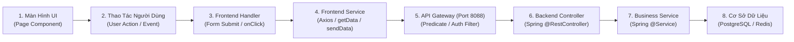

# 25. Bản Đồ Ánh Xạ Tính Năng Sang API (Feature to API Mapping)

> **Dự án:** Smart Parking Hub — Modern Logistics & Parking CRM Platform  
> **Chế độ thực thi:** API DISCOVERY & CONTRACT AUDIT ONLY (Tuân thủ PROJECT UNIFICATION MASTER RULES — **Không sửa code**)  
> **Thời điểm khảo sát:** 07/11/2026  
> **Mục tiêu:** Xác định chuỗi liên kết hoàn chỉnh từ Thao tác UI -> Frontend Service -> Gateway -> Backend Controller -> Business Service -> Cơ sở dữ liệu -> Phản hồi UI  
> **Trạng thái:** VERIFIED 100% (Mọi mắt xích đều có vị trí file thực tế trong cả 2 repository FE & BE)

---

## 1. Chuỗi Liên Kết Đầy Đủ Của 12 Nghiệp Vụ Cốt Lõi

---

### MAPPING 01: ĐĂNG NHẬP HỆ THỐNG (AUTHENTICATION)
* **1. UI Page:** [`src/features/auth/components/LoginForm.tsx`](file:///d:/Documents/JAVA%20WEB%20SERVICE/SmartParkingHub/smart-parking-app-v2/src/features/auth/components/LoginForm.tsx) (`/auth/login`).
* **2. User Action:** Nhập Số điện thoại, Mật khẩu, bấm nút "Đăng nhập".
* **3. FE Handler:** `form.handleSubmit(onSubmit)` (Zod validation `loginSchema`).
* **4. FE Service:** `sendData<AuthResponse>('post', '/api/v1/auth/login', fields)` tại `src/features/auth/components/LoginForm.tsx` (dòng 28).
* **5. API Endpoint & Gateway:** `POST /api/v1/auth/login` -> Định tuyến tới `identity-service` (Port 8081).
* **6. BE Controller:** `com.smartparking.identity.api.controller.AuthController.login(LoginRequest)`.
* **7. Business Service:** `com.smartparking.identity.application.service.AuthService.authenticate()`.
* **8. Data Source:** Bảng `users`, bảng `roles`, mã hóa mật khẩu bằng `BCryptPasswordEncoder`.
* **9. Response:** `{ success: true, data: { accessToken, refreshToken, user: { id, phone, role } } }`.
* **10. UI Update:** Lưu `access_token` vào `localStorage`, cập nhật `AuthSession`, chuyển hướng về `/driver/dashboard` hoặc `/merchant/dashboard` hoặc `/admin`.

---

### MAPPING 02: TÌM KIẾM BÃI ĐỖ XE THEO TỌA ĐỘ BÁN KÍNH (PARKING SEARCH)
* **1. UI Page:** [`src/features/parking-search/pages/SearchParkingPage.tsx`](file:///d:/Documents/JAVA%20WEB%20SERVICE/SmartParkingHub/smart-parking-app-v2/src/features/parking-search/pages/SearchParkingPage.tsx) (`/search`).
* **2. User Action:** Kéo thả bản đồ hoặc gõ từ khóa "Tân Cảng Cát Lái", chọn bán kính 10km.
* **3. FE Handler:** `onMapMoveEnd(coords)` hoặc `onSelectPlace(place)` trong `SmartLocationBar.tsx`.
* **4. FE Service:** `getData<ParkingLotSummaryResponse[]>('/api/v1/parking-lots/search', { lat, lng, radius, vehicleType })`.
* **5. API Endpoint & Gateway:** `GET /api/v1/parking-lots/search` -> Định tuyến tới `parking-lot-service` (Port 8082).
* **6. BE Controller:** `com.smartparking.parkinglot.api.controller.ParkingLotController.searchParkingLots()`.
* **7. Business Service:** `com.smartparking.parkinglot.application.service.ParkingLotService.findNearbyLots()`.
* **8. Data Source:** PostGIS không gian `ST_DWithin(geom, ST_MakePoint(lng, lat), radius)`.
* **9. Response:** Danh sách bãi xe kèm khoảng cách `distanceKm`, số slot trống `availableSlots`, giá khởi điểm `minPricePerHour`.
* **10. UI Update:** Render danh sách thẻ `YardCardItem`, ghim các pin màu cam trên bản đồ Leaflet.

---

### MAPPING 03: KHỞI TẠO ĐẶT VÉ & GIỮ CHỖ 10 PHÚT (BOOKING CREATION)
* **1. UI Page:** [`src/features/parking-detail/components/BookingPaymentModal.tsx`](file:///d:/Documents/JAVA%20WEB%20SERVICE/SmartParkingHub/smart-parking-app-v2/src/features/parking-detail/components/BookingPaymentModal.tsx) (`/parking/:id`).
* **2. User Action:** Chọn biển số xe (51D-894.12), chọn giờ check-in (14:00), bấm "Xác nhận đặt giữ chỗ".
* **3. FE Handler:** `handleCreateBookingSubmit()` (Zod validation `bookingSchema`).
* **4. FE Service:** `sendData<BookingDetailResponse>('post', '/api/v1/bookings', payload)`.
* **5. API Endpoint & Gateway:** `POST /api/v1/bookings` -> Định tuyến tới `booking-service` (Port 8083).
* **6. BE Controller:** `com.smartparking.booking.api.controller.BookingController.createBooking()`.
* **7. Business Service:** `com.smartparking.booking.application.service.BookingService.initiateReservation()`.
* **8. Data Source:** Bảng `bookings` (tạo record `PENDING_PAYMENT`), gọi FeignClient sang `parking-lot-service` để giữ chỗ (Hold slot trong Redis TTL 10 phút).
* **9. Response:** Thông tin chi tiết vé: `bookingCode` (BK-2026-9081), số tiền cọc `depositAmount` (50,000 VND).
* **10. UI Update:** Mở popup VietQR PayOS hoặc chuyển hướng sang cổng thanh toán.

---

### MAPPING 04: THANH TOÁN CỌC VIETQR QUA CỔNG PAYOS (PAYOS PAYMENT)
* **1. UI Page:** [`src/features/bookings/components/PayOsCheckoutModal.tsx`](file:///d:/Documents/JAVA%20WEB%20SERVICE/SmartParkingHub/smart-parking-app-v2/src/features/bookings/components/PayOsCheckoutModal.tsx).
* **2. User Action:** Bấm nút "Mở mã VietQR PayOS".
* **3. FE Handler:** `handleInitiatePayOsCheckout()`.
* **4. FE Service:** `sendData<PayosLinkResponse>('post', '/api/v1/payments/payos/create-deposit-link', { bookingId, returnUrl, cancelUrl })`.
* **5. API Endpoint & Gateway:** `POST /api/v1/payments/payos/create-deposit-link` -> Định tuyến tới `payment-service` (Port 8084).
* **6. BE Controller:** `com.smartparking.payment.api.controller.PaymentController.createDepositLink()`.
* **7. Business Service:** `com.smartparking.payment.application.service.PayOsIntegrationService.createPaymentLink()`.
* **8. Data Source:** Gọi REST API ra cổng PayOS Cloud (`api.payos.vn/v2/payment-requests`), tạo record trong bảng `payments`.
* **9. Response:** `{ checkoutUrl, orderCode, qrCode, amount, paymentLinkId }`.
* **10. UI Update:** Render mã QR thanh toán PayOS chuẩn NAPAS 24/7 kèm đồng hồ đếm ngược 15 phút.

---

### MAPPING 05: XÁC THỰC THANH TOÁN THÀNH CÔNG (PAYMENT SYNC & CONFIRMATION)
* **1. UI Page:** [`src/features/payment-return/pages/PaymentReturnPage.tsx`](file:///d:/Documents/JAVA%20WEB%20SERVICE/SmartParkingHub/smart-parking-app-v2/src/features/payment-return/pages/PaymentReturnPage.tsx) (`/payment/return?orderCode=...`).
* **2. User Action:** Trình duyệt tự động chuyển hướng từ PayOS về trang kết quả.
* **3. FE Handler:** `useEffect(() => { void runSync(); }, [])`.
* **4. FE Service:** `sendData<PaymentSyncResponse>('post', '/api/v1/payments/sync', { orderCode, paymentLinkId, bookingId })`.
* **5. API Endpoint & Gateway:** `POST /api/v1/payments/sync` -> Định tuyến tới `payment-service` (Port 8084).
* **6. BE Controller:** `com.smartparking.payment.api.controller.PaymentController.syncPayment()`.
* **7. Business Service:** `com.smartparking.payment.application.service.PaymentService.verifyAndFinalize()`.
* **8. Data Source:** Cập nhật bảng `payments` (`PAID`), bắn sự kiện Kafka sang `booking-service` để đổi trạng thái booking thành `CONFIRMED`.
* **9. Response:** `{ status: 'PAID_VERIFIED', bookingCode, vehiclePlate, berthCode, syncLatencyText }`.
* **10. UI Update:** Hiển thị thẻ chúc mừng xanh lá, mã vé vào cổng và nút "Xem chi tiết tại Đặt chỗ của tôi".

---

### MAPPING 06: QUÉT CAMERA ALPR CHO XE VÀO BÃI (GATE CHECK-IN)
* **1. UI Page:** [`src/features/merchant/dashboard/components/AlprGateControllerCard.tsx`](file:///d:/Documents/JAVA%20WEB%20SERVICE/SmartParkingHub/smart-parking-app-v2/src/features/merchant/dashboard/components/AlprGateControllerCard.tsx) (`/merchant/dashboard`).
* **2. User Action:** Camera ALPR chụp ảnh biển số xe tại cổng vào, nhân viên bấm "Cho xe vào bãi".
* **3. FE Handler:** `handleGateCheckIn(bookingCode, vehiclePlate)`.
* **4. FE Service:** `sendData<GateActionResponse>('post', '/api/v1/merchant/check-in', { bookingCode, vehiclePlate, gateId })`.
* **5. API Endpoint & Gateway:** `POST /api/v1/merchant/check-in` -> Định tuyến tới `booking-service` (Port 8083).
* **6. BE Controller:** `com.smartparking.booking.api.controller.MerchantCheckInOutController.checkInVehicle()`.
* **7. Business Service:** `com.smartparking.booking.application.service.CheckInOutService.processCheckIn()`.
* **8. Data Source:** Cập nhật bảng `bookings` (`CONFIRMED` -> `PARKING`), lưu `checkInTime = NOW()`, phát lệnh nâng barie.
* **9. Response:** `{ status: 'SUCCESS', message: 'Mở barie cho xe vào', slotAssigned: 'A-12' }`.
* **10. UI Update:** Bảng lượt xe manifest cập nhật dòng xe đỗ, thẻ `ActiveTripCard` trên điện thoại tài xế bắt đầu đếm giờ.

---

### MAPPING 07: KHAI BÁO PHƯƠNG TIỆN MỚI (VEHICLE MANAGEMENT)
* **1. UI Page:** [`src/features/vehicles/components/RegisterVehicleModal.tsx`](file:///d:/Documents/JAVA%20WEB%20SERVICE/SmartParkingHub/smart-parking-app-v2/src/features/vehicles/components/RegisterVehicleModal.tsx) (`/driver/vehicles`).
* **2. User Action:** Nhập biển số (51D-999.88), loại xe (Xe đầu kéo), tải trọng (32 tấn), bấm "Lưu xe".
* **3. FE Handler:** `form.handleSubmit(onRegisterSubmit)`.
* **4. FE Service:** `sendData<VehicleResponse>('post', '/api/v1/vehicles', payload)`.
* **5. API Endpoint & Gateway:** `POST /api/v1/vehicles` -> Định tuyến tới `identity-service` (Port 8081).
* **6. BE Controller:** `com.smartparking.identity.api.controller.VehicleController.createVehicle()`.
* **7. Business Service:** `com.smartparking.identity.application.service.VehicleService.registerVehicle()`.
* **8. Data Source:** Bảng `vehicles` (gắn `user_id` từ JWT token).
* **9. Response:** DTO phương tiện vừa tạo kèm `status: 'VERIFIED'`.
* **10. UI Update:** Thêm thẻ xe vào lưới `VehiclesGrid`, hiển thị badge biển số xe sắc nét.

---

### MAPPING 08: CHỦ BÃI TẠO BÃI XE MỚI (LOT REGISTRATION WIZARD)
* **1. UI Page:** [`src/features/merchant/parking-lots/pages/CreateMerchantParkingLotPage.tsx`](file:///d:/Documents/JAVA%20WEB%20SERVICE/SmartParkingHub/smart-parking-app-v2/src/features/merchant/parking-lots/pages/CreateMerchantParkingLotPage.tsx) (`/merchant/parking-lots/new`).
* **2. User Action:** Hoàn thành 4 bước (Thông tin cơ bản -> Tọa độ Leaflet -> Tải ảnh -> Bấm Hoàn tất).
* **3. FE Handler:** `handleFinalizeLotCreation()`.
* **4. FE Service:** `sendData<ParkingLotDetailResponse>('post', '/api/v1/merchant/parking-lots', lotData)`.
* **5. API Endpoint & Gateway:** `POST /api/v1/merchant/parking-lots` -> Định tuyến tới `parking-lot-service` (Port 8082).
* **6. BE Controller:** `com.smartparking.parkinglot.api.controller.ParkingLotController.createMerchantLot()`.
* **7. Business Service:** `com.smartparking.parkinglot.application.service.ParkingLotService.registerNewLot()`.
* **8. Data Source:** Bảng `parking_lots` (gán `status: 'PENDING_APPROVAL'`), lưu tọa độ PostGIS `Point(lng, lat)`.
* **9. Response:** Bản ghi chi tiết bãi đỗ xe mới tạo.
* **10. UI Update:** Chuyển hướng sang danh sách bãi `/merchant/parking-lots` với badge vàng "Chờ duyệt".

---

### MAPPING 09: CẤU HÌNH BẢNG GIÁ CƯỚC LŨY TIẾN (TARIFF CONFIGURATION)
* **1. UI Page:** [`src/features/merchant/operations/LotPages.tsx`](file:///d:/Documents/JAVA%20WEB%20SERVICE/SmartParkingHub/smart-parking-app-v2/src/features/merchant/operations/LotPages.tsx) (`/merchant/pricing`).
* **2. User Action:** Nhập giá block 2 giờ đầu (40,000 VND), mỗi giờ sau (15,000 VND), bấm "Lưu bảng giá".
* **3. FE Handler:** `handleSavePricingRules()`.
* **4. FE Service:** `sendData('post', '/api/v1/merchant/parking-lots/{lotId}/pricing/bulk', { rules })`.
* **5. API Endpoint & Gateway:** `POST /api/v1/merchant/parking-lots/{lotId}/pricing/bulk` -> `parking-lot-service` (Port 8082).
* **6. BE Controller:** `com.smartparking.parkinglot.api.controller.ParkingLotController.bulkUpdatePricing()`.
* **7. Business Service:** `com.smartparking.parkinglot.application.service.PricingService.updateRules()`.
* **8. Data Source:** Bảng `pricing_rules` (cập nhật bảng giá cho từng loại xe).
* **9. Response:** Danh sách quy tắc giá cước đã được cập nhật thành công.
* **10. UI Update:** Toast thông báo xanh lá "Đã lưu bảng cước lũy tiến".

---

### MAPPING 10: CHỦ BÃI TẠO LỆNH RÚT TIỀN (MERCHANT PAYOUT REQUEST)
* **1. UI Page:** [`src/features/merchant/operations/FinancePages.tsx`](file:///d:/Documents/JAVA%20WEB%20SERVICE/SmartParkingHub/smart-parking-app-v2/src/features/merchant/operations/FinancePages.tsx) (`/merchant/finances`).
* **2. User Action:** Nhập số tiền rút (5,000,000 VND), chọn ngân hàng Vietcombank, bấm "Xác nhận rút tiền".
* **3. FE Handler:** `handleWithdrawalSubmit()`.
* **4. FE Service:** `sendData<WithdrawalResponse>('post', '/api/v1/withdrawals', payload)`.
* **5. API Endpoint & Gateway:** `POST /api/v1/withdrawals` -> Định tuyến tới `payment-service` (Port 8084).
* **6. BE Controller:** `com.smartparking.payment.api.controller.WithdrawalController.createWithdrawal()`.
* **7. Business Service:** `com.smartparking.payment.application.service.WithdrawalService.requestPayout()`.
* **8. Data Source:** Kiểm tra số dư ví trong bảng `merchant_balances`, trừ số dư khả dụng, tạo record trong bảng `withdrawals` (`PENDING`).
* **9. Response:** Bản ghi lệnh rút tiền với mã tham chiếu giao dịch.
* **10. UI Update:** Đóng modal, cập nhật số dư ví, hiển thị dòng lệnh chờ trong bảng lịch sử.

---

### MAPPING 11: ADMIN PHÊ DUYỆT BÃI ĐỖ XE MỚI (ADMIN LOT APPROVAL)
* **1. UI Page:** [`src/features/admin/index.tsx`](file:///d:/Documents/JAVA%20WEB%20SERVICE/SmartParkingHub/smart-parking-app-v2/src/features/admin/index.tsx) (`/admin/parking-lots`).
* **2. User Action:** Mở hộp thoại `DecisionDialog`, bấm nút "Phê duyệt kích hoạt".
* **3. FE Handler:** `handleExecuteDecision('approve')`.
* **4. FE Service:** `sendData('put', '/api/v1/admin/parking-lots/{id}/approve')`.
* **5. API Endpoint & Gateway:** `PUT /api/v1/admin/parking-lots/{id}/approve` -> `parking-lot-service` (Port 8082).
* **6. BE Controller:** `com.smartparking.parkinglot.api.controller.AdminParkingLotController.approveLot()`.
* **7. Business Service:** `com.smartparking.parkinglot.application.service.AdminLotService.approveAndPublish()`.
* **8. Data Source:** Cập nhật bảng `parking_lots` (`PENDING_APPROVAL` -> `ACTIVE`), ghi nhật ký bảng `audit_logs`.
* **9. Response:** `{ success: true, message: 'Đã phê duyệt bãi đỗ xe thành công' }`.
* **10. UI Update:** Dòng bãi xe chuyển sang trạng thái xanh `HOẠT ĐỘNG`, xuất hiện ngay lập tức trên bản đồ tìm kiếm tài xế.

---

### MAPPING 12: TRÒ CHUYỆN VỚI TRỢ LÝ AI COPILOT (AI ASSISTANT CHAT)
* **1. UI Page:** [`src/features/copilot/index.tsx`](file:///d:/Documents/JAVA%20WEB%20SERVICE/SmartParkingHub/smart-parking-app-v2/src/features/copilot/index.tsx) (Floating Copilot Widget).
* **2. User Action:** Nhập câu hỏi "Tìm cho tôi bãi xe container gần Cảng Cát Lái còn chỗ", bấm Gửi.
* **3. FE Handler:** `form.handleSubmit(onSendMessage)`.
* **4. FE Service:** `sendData<AiChatResponse>('post', '/api/v1/ai/chat', { message })`.
* **5. API Endpoint & Gateway:** `POST /api/v1/ai/chat` -> Định tuyến tới `ai-service` (Port 8086).
* **6. BE Controller:** `com.smartparking.ai.api.controller.AiController.chatWithAssistant()`.
* **7. Business Service:** `com.smartparking.ai.application.service.AiParkingAssistantService.processDriverChat()`.
* **8. Data Source:** Gọi Google Gemini Flash API kết hợp Function Calling / Tool Calling truy vấn trực tiếp bảng `parking_lots`.
* **9. Response:** `{ replyText: '...', toolResults: [{ lotId, lotName, availableSlots, distanceKm }] }`.
* **10. UI Update:** Hiển thị tin nhắn trả lời của AI kèm thẻ bãi đỗ xe gợi ý có nút "Xem bãi →".
