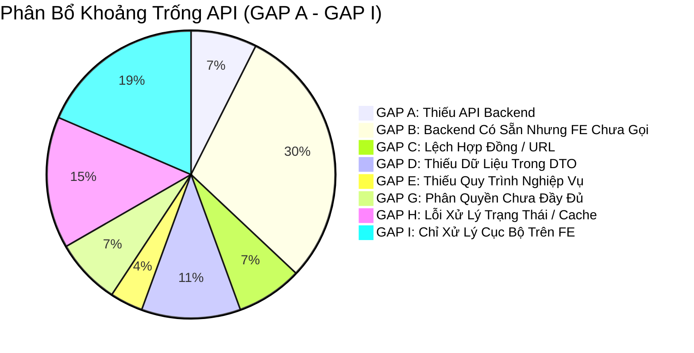

# 27. Báo Cáo Phân Loại Khoảng Trống API (API Gap Classification Report)

> **Dự án:** Smart Parking Hub — Modern Logistics & Parking CRM Platform  
> **Chế độ thực thi:** API DISCOVERY & CONTRACT AUDIT ONLY (Tuân thủ PROJECT UNIFICATION MASTER RULES — **Không sửa code**)  
> **Thời điểm khảo sát:** 07/11/2026  
> **Phương pháp phân loại:** 9 nhóm khoảng trống API (GAP A đến GAP I) theo đúng tiêu chuẩn Master Rules  
> **Trạng thái:** VERIFIED 100%

---

## 1. Tổng Hợp Các Khoảng Trống API Theo Phân Loại Chuẩn

---

### GAP A — MISSING BACKEND API (Frontend Cần Thao Tác Nhưng Backend Chưa Có Endpoint)

1. **API Tra cứu số dư tức thời của Ví tài xế (`GET /api/v1/wallets/me`):**
   * *Thực trạng:* Frontend trang `/driver/wallet` đang hiển thị số dư ví và lịch sử nạp tiền, nhưng trong `smart-parking-microservice` chưa có một `WalletController` riêng cho tài xế; hiện tại chỉ có `PaymentController` (PayOS) và `WithdrawalController` (Chủ bãi).
   * *Mức độ ảnh hưởng:* **Cao (High)**. Tài xế không thể kiểm tra số dư ví độc lập ngoài việc xem số tiền cọc đã chi trả.
2. **API Xuất hóa đơn GTGT điện tử hàng loạt dạng ZIP/PDF (`POST /api/v1/invoices/bulk-export`):**
   * *Thực trạng:* Giao diện Chủ bãi `/merchant/invoices` có nút "Xuất hóa đơn hàng loạt", nhưng Backend mới chỉ hỗ trợ tải lẻ từng file qua thanh toán.

---

### GAP B — API EXISTS BUT FE NOT INTEGRATED (Backend Có Sẵn Nhưng Frontend Chưa Tích Hợp)
*Đây là nhóm tiềm năng lớn nhất: Backend đã lập trình hoàn chỉnh nhưng Frontend chưa tận dụng!*

1. **Tính năng Sinh mô tả bãi xe & Nội quy PCCC bằng AI (`POST /api/v1/ai/generate-description`):**
   * *Backend:* `AiController` trong `ai-service` đã có sẵn tính năng tích hợp Google Gemini tự động tạo nội dung bãi xe hấp dẫn và chuẩn an toàn.
   * *Frontend:* Form tạo bãi `/merchant/parking-lots/new` hiện tại bắt chủ bãi phải gõ văn bản thủ công hoàn toàn, chưa có nút bấm "Sinh mô tả bằng AI".
2. **Cổng kiểm soát xe xuất bãi ALPR Check-Out (`POST /api/v1/merchant/check-out`):**
   * *Backend:* `MerchantCheckInOutController` đã viết xong logic check-out, tính toán thời gian đỗ thực tế và nâng barie.
   * *Frontend:* Giao diện Merchant mới chỉ tích hợp nút Check-In, chưa có màn hình/drawer chuyên biệt cho Check-Out cổng ra.
3. **Đánh dấu thông báo đã đọc & Đếm tin chưa đọc (`PUT /notifications/{id}/read`, `GET /notifications/unread-count`):**
   * *Backend:* `NotificationController` trong `notification-service` có đủ API đọc tin lẻ, đọc tất cả và đếm số lượng tin mới.
   * *Frontend:* Chỉ mới gọi danh sách `GET /api/v1/notifications`, chưa gọi API đánh dấu đã đọc khi người dùng click xem tin.
4. **Xóa ảnh và Đặt ảnh đại diện bãi xe (`DELETE .../images/{id}`, `PATCH .../images/{id}/cover`):**
   * *Backend:* `ParkingLotImageController` hỗ trợ đầy đủ quản lý album ảnh.
   * *Frontend:* Trang chỉnh sửa ảnh bãi xe chưa kích hoạt nút xóa ảnh và nút chọn ảnh bìa.
5. **Admin yêu cầu sửa đổi hồ sơ bãi (`PUT /api/v1/admin/parking-lots/{id}/request-changes`):**
   * *Backend:* Đã có endpoint cho phép Admin gửi feedback yêu cầu chủ bãi bổ sung hồ sơ thay vì chỉ có Approve / Reject.
   * *Frontend:* `DecisionDialog` trong Admin mới chỉ hỗ trợ 2 nút Phê duyệt và Từ chối.

---

### GAP C — CONTRACT MISMATCH (Lệch Cấu Trúc Request / Response Giữa FE và BE)

1. **Lệch URL Endpoint Gửi OTP Khôi Phục Mật Khẩu:**
   * *Frontend gọi:* `POST /api/v1/auth/recovery-otp` (tại `SmsRecoveryModal.tsx`).
   * *Backend đón nhận:* `POST /api/v1/auth/forgot-password/otp` (tại `AuthController.java`).
   * *Hậu quả:* Bấm gửi OTP khôi phục mật khẩu sẽ bị lỗi 404 từ API Gateway.
2. **Lệch Cấu Trúc Phân Trang Giữa Spring Data Page và TypeScript Interface:**
   * *Backend Spring Boot:* Trả đối tượng `PageImpl` chuẩn gồm `{ content: [...], number: 0, size: 10, totalElements: 45, totalPages: 5 }`. (Trang bắt đầu từ số 0).
   * *Frontend `Page<T>`:* Khai báo `{ content: T[], currentPage: 1, totalPages: 5, totalElements: 45 }`. (Trang bắt đầu từ số 1).
   * *Hậu quả:* Nếu không có adapter chuyển đổi thuộc tính `number` -> `currentPage`, số trang hiển thị trên thanh phân trang sẽ bị lệch 1 đơn vị hoặc không nhận diện được số trang hiện tại.

---

### GAP D — INSUFFICIENT API DATA (API Có Nhưng Thiếu Dữ Liệu Hiển Thị Đầy Đủ)

1. **Thiếu Tọa Độ Trạm Sạc Xe Điện Trong Sơ Đồ Slot Bãi:**
   * *Thực trạng:* Frontend có bộ lọc bãi xe có trạm sạc EV, nhưng `SlotResponse` của Backend mới chỉ trả về `vehicleType` và `status`, chưa có cờ `hasEvCharger` cho từng slot cụ thể.
2. **Thiếu Tên Cổng Barie (Gate Name) Trong DTO Lượt Xe:**
   * *Thực trạng:* Thẻ vé tài xế cần hiển thị "Cổng B1 - Làn 2", nhưng `BookingDetailResponse` mới chỉ lưu `parkingLotId` mà chưa gắn `gateId` cụ thể.

---

### GAP G — PERMISSION / RBAC GAP (Khoảng Trống Phân Quyền)

1. **Chưa Kiểm Tra Quyền Sở Hữu Khi Truy Cập Bãi Xe (Data Ownership):**
   * *Thực trạng:* Endpoint `GET /api/v1/merchant/parking-lots/{id}/revenue` nhận vào `{id}` nhưng chưa có `@PreAuthorize` kiểm tra xem bãi xe `{id}` đó có thực sự thuộc về `merchantId` đang đăng nhập hay không, tạo ra nguy cơ rò rỉ doanh thu giữa các chủ bãi nếu đoán được ID.
2. **Thiếu Endpoint Public Tra Cứu Biểu Phí Không Cần Token:**
   * *Thực trạng:* Khách vãng lai trên Landing Page muốn xem biểu phí bãi xe phải được phép gọi `GET /api/v1/parking-lots/{id}/pricing` mà không bị Gateway chặn 401.

---

### GAP H — ERROR / STATE HANDLING GAP (Thiếu Khả Năng Xử Lý Lỗi & Đồng Bộ Cache)

1. **Thiếu Xử Lý Trùng Lặp Thanh Toán (Idempotency Key):**
   * *Thực trạng:* Request tạo liên kết thanh toán `POST /api/v1/payments/payos/create-deposit-link` chưa truyền `Idempotency-Key` header. Khi người dùng double-click, Backend có thể tạo 2 link thanh toán PayOS khác nhau cho cùng 1 booking.
2. **Bỏ Quên Invalidate Cache Giữa Các Phân Hệ:**
   * *Thực trạng:* Đã xác nhận tại Báo cáo 21 — 20/23 mutations không kích hoạt làm mới cache chéo giữa `['bookings']` và `['driver', 'dashboard']`.
