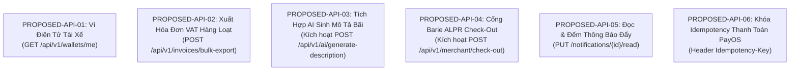

# 28. Đề Xuất Hợp Đồng API Mục Tiêu (Proposed API Contracts)

> **Dự án:** Smart Parking Hub — Modern Logistics & Parking CRM Platform  
> **Chế độ thực thi:** API DISCOVERY & CONTRACT AUDIT ONLY (Tuân thủ PROJECT UNIFICATION MASTER RULES — **Không sửa code**)  
> **Thời điểm khảo sát:** 07/11/2026  
> **Mục tiêu:** Đề xuất hợp đồng chuẩn hóa cho các khoảng trống API đã xác minh, sẵn sàng đệ trình phê duyệt kiến trúc  
> **Lưu ý nguyên tắc:** Các đề xuất dưới đây là giải pháp kỹ thuật có căn cứ, **chưa được coi là hợp đồng chính thức** cho đến khi được Chủ dự án và Backend Lead phê duyệt.

---

## 1. Danh Mục Các Đề Xuất Hợp Đồng API Chuẩn Hóa



---

### ĐỀ XUẤT 01: API TRA CỨU SỐ DƯ VÍ TÀI XẾ (DRIVER WALLET API)

* **Mã Đề Xuất:** `PROPOSED-API-01`.
* **Năng lực nghiệp vụ (Business Capability):** Cho phép tài xế xem số dư ví SmartTruck, số tiền đang tạm giữ cho các booking pending, và hạn mức khả dụng.
* **Lý do cần thiết:** Trang `/driver/wallet` hiện tại đang hiển thị số dư tĩnh hoặc suy diễn từ các giao dịch đơn lẻ, thiếu endpoint quản lý tài khoản nguồn.
* **Màn hình gọi:** SCR-21 (`/driver/wallet`).
* **Hành động kích hoạt:** Khi tài xế truy cập tab "Ví điện tử" hoặc chuẩn bị thanh toán tiền cọc.
* **Phương thức & Endpoint đề xuất:** `GET /api/v1/wallets/me`.
* **Tham số Path / Query:** Không.
* **Headers bắt buộc:** `Authorization: Bearer <token>`.
* **Phân quyền (RBAC):** `ROLE_DRIVER`.
* **Cấu trúc Response Body đề xuất:**
  ```json
  {
    "success": true,
    "message": "Lấy thông tin ví thành công",
    "data": {
      "walletId": 10892,
      "driverId": 451,
      "availableBalance": 2500000,
      "holdingBalance": 150000,
      "totalBalance": 2650000,
      "currency": "VND",
      "status": "ACTIVE",
      "lastUpdated": "2026-11-07T16:20:00Z"
    }
  }
  ```
* **Mã lỗi dự kiến:** `401 Unauthorized`, `404 Wallet Not Found`.
* **Dịch vụ phụ trách:** `payment-service` (mở rộng thêm `DriverWalletController`).

---

### ĐỀ XUẤT 02: XUẤT HÓA ĐƠN GTGT HÀNG LOẠT DẠNG ZIP (BULK INVOICE EXPORT)

* **Mã Đề Xuất:** `PROPOSED-API-02`.
* **Năng lực nghiệp vụ:** Cho phép chủ bãi tải về toàn bộ hóa đơn VAT điện tử (định dạng PDF kèm file XML ký số) trong một tháng để nộp báo cáo thuế.
* **Lý do cần thiết:** Phục vụ nghiệp vụ quyết toán thuế cuối tháng của các doanh nghiệp bãi xe lớn, thay vì phải click tải lẻ từng hóa đơn.
* **Màn hình gọi:** SCR-36 (`/merchant/invoices`).
* **Hành động kích hoạt:** Bấm nút "Xuất toàn bộ hóa đơn tháng (ZIP)".
* **Phương thức & Endpoint đề xuất:** `POST /api/v1/merchant/invoices/bulk-export`.
* **Request Body đề xuất:**
  ```json
  {
    "parkingLotId": 12,
    "month": 11,
    "year": 2026,
    "format": "ZIP_PDF_XML"
  }
  ```
* **Response Header:** `Content-Type: application/zip`, `Content-Disposition: attachment; filename="invoices-lot-12-11-2026.zip"`.
* **Phân quyền (RBAC):** `ROLE_MERCHANT`.
* **Dịch vụ phụ trách:** `payment-service` (kết hợp thư viện nén luồng `ZipOutputStream`).

---

### ĐỀ XUẤT 03: TÍCH HỢP TÍNH NĂNG SINH MÔ TẢ BÃI BẰNG AI (AI PARKING ASSISTANT INTEGRATION)

* **Mã Đề Xuất:** `PROPOSED-API-03`.
* **Năng lực nghiệp vụ:** Hỗ trợ chủ bãi tạo bãi xe mới tự động sinh nội dung giới thiệu bãi, hướng dẫn xe tải ra vào và quy định an toàn PCCC chỉ sau 1 click.
* **Lý do cần thiết:** Endpoint Backend `POST /api/v1/ai/generate-description` đã được lập trình hoàn chỉnh trong `ai-service`, nhưng Frontend chưa có giao diện đấu nối.
* **Màn hình gọi:** SCR-26 (`/merchant/parking-lots/new` — Bước 1 Wizard).
* **Hành động kích hoạt:** Bấm nút "Sinh mô tả bằng AI ✨" cạnh ô nhập liệu mô tả bãi xe.
* **Endpoint Backend sẵn có:** `POST /api/v1/ai/generate-description`.
* **Request Body gửi lên:**
  ```json
  {
    "parkingLotName": "Bãi xe container Sóng Thần 2",
    "address": "Đường ĐT 743, Dĩ An, Bình Dương",
    "totalSlots": 120,
    "supportedVehicleTypes": ["HEAVY_TRUCK", "CONTAINER_40FT"],
    "amenities": ["SECURITY_24_7", "EV_CHARGER", "DRIVER_RESTROOM", "ALPR_GATE"]
  }
  ```
* **Response Body nhận về:**
  ```json
  {
    "success": true,
    "data": {
      "marketingDescription": "Bãi xe hiện đại bậc nhất khu công nghiệp Sóng Thần...",
      "safetyGuidelines": "Tuân thủ quy định PCCC theo Tiêu chuẩn TCVN 3890...",
      "drivingDirections": "Từ ngã tư 550 rẽ phải theo bảng chỉ dẫn vào cổng làn xe tải..."
    }
  }
  ```
* **Kế hoạch triển khai:** Chỉ cần tạo thêm 1 Button UI trên Frontend và gọi `sendData` mà không cần sửa Backend!

---

### ĐỀ XUẤT 04: TÍCH HỢP GIAO DIỆN QUÉT CHECK-OUT CỔNG RA (ALPR CHECK-OUT INTEGRATION)

* **Mã Đề Xuất:** `PROPOSED-API-04`.
* **Năng lực nghiệp vụ:** Hoàn tất quy trình lưu bãi: nhân viên trực cổng hoặc camera nhận diện xe ra, kích hoạt trừ cọc và mở barie cho xe rời bãi.
* **Lý do cần thiết:** Backend đã có endpoint `POST /api/v1/merchant/check-out` trong `booking-service`, nhưng Frontend hiện tại mới chỉ dựng nút Check-In.
* **Màn hình gọi:** SCR-24 (`/merchant/dashboard`), SCR-33 (`/merchant/camera-alpr`).
* **Hành động kích hoạt:** Quét mã QR check-out hoặc camera nhận diện biển số xe tại làn ra.
* **Endpoint Backend sẵn có:** `POST /api/v1/merchant/check-out`.
* **Request Body gửi lên:**
  ```json
  {
    "bookingCode": "BK-2026-9081",
    "vehiclePlate": "51D-894.12",
    "gateId": "GATE_OUT_01"
  }
  ```
* **Response Body nhận về:**
  ```json
  {
    "success": true,
    "data": {
      "bookingId": 9081,
      "status": "COMPLETED",
      "totalHoursParked": 4.5,
      "totalFee": 120000,
      "depositPaid": 50000,
      "remainingBalanceToPay": 70000,
      "gateAction": "OPEN_BARRIER"
    }
  }
  ```

---

### ĐỀ XUẤT 05: KHÓA TRÙNG LẶP GIAO DỊCH THANH TOÁN (PAYOS IDEMPOTENCY LOCK)

* **Mã Đề Xuất:** `PROPOSED-API-05`.
* **Năng lực nghiệp vụ:** Chống tạo đơn thanh toán kép (Double-Payment) khi mạng chập chờn hoặc người dùng click đúp nút thanh toán VietQR.
* **Cơ chế đề xuất:**
  * Bắt buộc truyền Header `Idempotency-Key: <UUID>` tại endpoint `POST /api/v1/payments/payos/create-deposit-link`.
  * Backend lưu key này trong Redis với TTL 120 giây:
    - Nếu key chưa tồn tại: Tạo đơn mới tại PayOS và lưu kết quả vào Redis.
    - Nếu key đã tồn tại: Trả về ngay kết quả PayOS link trước đó mà không gọi lại PayOS Cloud.
* **Đảm bảo tính nhất quán tài chính:** Loại bỏ hoàn toàn rủi ro phát sinh 2 mã đơn hàng (OrderCode) cho cùng một lần đặt vé.

---

## 2. Các Câu Hỏi Cần Chủ Dự Án Phê Duyệt Trước Khi Triển Khai (Questions for Product Owner)

1. **Về Ví Tài Xế (Driver Wallet):**
   * *Câu hỏi:* Dự án có dự định triển khai Ví tiền nội bộ cho tài xế nạp trước (Prepaid Wallet) hay chỉ áp dụng thanh toán theo từng lượt qua cổng PayOS VietQR?
   * *Tác động:* Nếu chỉ áp dụng thanh toán PayOS theo từng lượt, màn hình `/driver/wallet` nên được quy chuẩn lại thành "Lịch sử chi tiêu & Biên lai" thay vì hiển thị số dư ví ảo.
2. **Về Chính Sách Hủy Đặt Chỗ (Refund Policy):**
   * *Câu hỏi:* Khi tài xế hủy vé trước giờ check-in 1 tiếng, tỷ lệ hoàn cọc là bao nhiêu % (100%, 80% hay giữ nguyên tiền cọc)?
   * *Tác động:* Để đồng bộ hiển thị chính xác số tiền hoàn trong modal `CancelBookingModal.tsx`.
