# 29. Đặc Tả Hệ Thống Thiết Kế Thống Nhất (Unified Design System Specification)

> **Dự án:** Smart Parking Hub — Modern Logistics & Parking CRM Platform  
> **Chế độ thực thi:** SPECIFICATION ONLY (Tuân thủ nghiêm ngặt PROJECT UNIFICATION MASTER RULES — **Không sửa code**)  
> **Thời điểm xác lập:** 07/11/2026  
> **Căn cứ thiết kế:** Tổng hợp dữ liệu kiểm toán từ Docs 00 đến 28 (155+ components, 75 mã màu HEX, 2.842 lượt cỡ chữ, 1.851 bo góc)  
> **Nền tảng công nghệ tương thích:** React 19, TypeScript, Vite, Tailwind CSS v4 (`@theme`), Radix UI / Headless primitives  
> **Trạng thái:** DRAFT FOR ARCHITECTURAL APPROVAL (Chờ phê duyệt từ Chủ dự án)

---

## 1. Tuyên Ngôn Triết Lý & Nguyên Tắc Thiết Kế Cốt Lõi (Core Design Principles)

Smart Parking Hub là một nền tảng vận hành logistics và quản lý bãi đỗ xe thông minh phục vụ đồng thời ba nhóm người dùng: **Tài xế xe tải/container (Driver)** đang di chuyển trên đường cần thao tác nhanh; **Chủ bãi & Nhân viên điều hành (Merchant)** làm việc liên tục nhiều giờ trước màn hình giám sát barie/ALPR; và **Ban quản trị hệ thống (Admin)** đối soát số liệu quy mô lớn. 

Hệ thống thiết kế phải đáp ứng nghiêm ngặt 10 nguyên tắc sau:

```mermaid
graph TD
    A["SMART PARKING HUB DESIGN SYSTEM"]
    A --> P1["1. Nhận Diện Thương Hiệu Sắc Nét<br>(Brand Identity)"]
    A --> P2["2. Phân Cấp Thị Giác Rõ Ràng<br>(Visual Hierarchy)"]
    A --> P3["3. Sử Dụng Màu Sắc Có Kiểm Soát<br>(Controlled Color Usage)"]
    A --> P4["4. Kiểu Chữ Dễ Đọc Mọi Hoàn Cảnh<br>(High-Legibility Typography)"]
    A --> P5["5. Không Gian Thoáng & Có Nhịp Điệu<br>(Base-4 Spacing Rhythm)"]
    A --> P6["6. Mật Độ Bố Cục Theo Ngữ Cảnh<br>(Adaptive Layout Density)"]
    A --> P7["7. Nhất Quán Nguyên Tử & Mảnh Ghép<br>(Component Consistency)"]
    A --> P8["8. Thích Ứng Thiết Bị Thực Tế<br>(Responsive Principles)"]
    A --> P9["9. Tương Tác Phản Hồi Xúc Giác<br>(Tactile Interaction Patterns)"]
    A --> P10["10. Trợ Năng Mặc Định Không Thỏa Hiệp<br>(Accessibility by Default)"]
```



### 1.1. Nhận Diện Thương Hiệu Sắc Nét (Brand Identity)
* **Tông màu chủ đạo:** Hệ thống giữ vững sắc cam nhận diện thương hiệu công nghiệp logistics `#d95f00` (được bảo toàn từ kiểm toán Doc 06), kết hợp cùng sắc xanh Navy chiều sâu `#060d1a` và `#0d1c2e`.
* **Cảm xúc mang lại:** Đáng tin cậy, an toàn, công nghiệp hiện đại, chính xác như một hệ thống quản lý cảng biển/logistics tiêu chuẩn quốc tế. Không sử dụng phong cách đồ họa hoạt hình (cartoonish) hay phong cách landing page Web3 viển vông.
* **Bảo tồn tài sản:** Giữ nguyên các logo, nhãn dán, biểu tượng đã được định hình tại các màn hình đã vận hành tốt.

### 1.2. Phân Cấp Thị Giác Rõ Ràng (Visual Hierarchy)
* Trên bất kỳ màn hình nào, người dùng phải xác định được **hành động chính duy nhất (Primary CTA)** trong vòng **1 giây**.
* Phân cấp 4 tầng mắt nhìn:
  1. *Tầng 1 (Primary Focus):* Tiêu đề trang, nút Primary Action (Cam `#d95f00`), cảnh báo sự cố khẩn cấp (Đỏ `#e11d48`).
  2. *Tầng 2 (Key Data):* Thẻ chỉ số tổng quan (Metric KPI Bento), số tiền lớn, biển số xe (Monospace font).
  3. *Tầng 3 (Data Body):* Danh sách dòng bảng, trường nhập liệu form, danh sách xe.
  4. *Tầng 4 (Metadata & Auxiliary):* Chú thích thời gian, nhãn vi mô (11px/10px), icon trang trí.

### 1.3. Sử Dụng Màu Sắc Có Kiểm Soát (Controlled Color Usage)
* **Định hướng Light Theme ưu tiên:** Nền trắng thuần khiết (`#ffffff`) và xám canvas xanh nhẹ (`#f8f9ff`). Tuyệt đối tránh lạm dụng chế độ Dark Mode giả cầy trên các màn hình CRM nhập liệu phức tạp.
* **Quy tắc 60 - 30 - 10 trong phối màu:**
  * **60% Nền & Bề mặt:** Nền xám nhạt (`#f8f9ff`), thẻ trắng (`#ffffff`), viền tinh tế (`#e2e8f0`).
  * **30% Cấu trúc & Chữ:** Xanh đen Slate (`#0f172a`), xám đậm (`#334155`), nền Navy (`#060d1a` cho header/auth).
  * **10% Màu nhấn (Accent):** Cam thương hiệu (`#d95f00`) cho hành động tương tác và chỉ thị trạng thái.
* **Không lạm dụng Gradient:** Cấm dùng gradient sặc sỡ trên các nút bấm thao tác hoặc thẻ card thông thường. Gradient chỉ được dùng rất hạn chế tại Hero Section của Marketing Page.

### 1.4. Kiểu Chữ Dễ Đọc Mọi Hoàn Cảnh (High-Legibility Typography)
* **Bộ ba phông chữ chiến lược:**
  * Tiêu đề & Nhận diện: **Be Vietnam Pro** (`--font-heading`). Dấu tiếng Việt tròn trịa, hiện đại, uy lực.
  * Thân bài & Nhập liệu: **Source Sans 3** (`--font-body`). Dễ đọc ở kích thước nhỏ, tỷ lệ chiều cao x-height lớn, không mỏi mắt.
  * Dữ liệu & Kỹ thuật: **System Monospace** (`--font-data`). Cố định bề ngang ký tự cho biển số xe, số tiền VNĐ, mã UUID, tọa độ GPS.
* **Ưu tiên độ đậm dễ nhận biết:** Do môi trường bãi xe ngoài trời và ánh sáng mạnh trên cabin xe tải, độ đậm ưu tiên là `font-bold` (700) và `font-semibold` (600) cho các số liệu quan trọng.

### 1.5. Không Gian Thoáng & Có Nhịp Điệu (Base-4 Spacing Rhythm)
* Toàn bộ hệ thống khoảng cách (margin, padding, gap) tuân thủ nghiêm ngặt **hệ lưới cơ sở 4px (Base-4 scale)**: 4, 8, 12, 16, 20, 24, 32, 40, 48, 64px.
* Tuyệt đối cấm các giá trị đệm tùy tiện (như `padding: 13px`, `margin-top: 27px`).
* Card nội dung có padding chuẩn `p-5` hoặc `p-6` (20px - 24px), tạo cảm giác thoáng đãng, không ngột ngạt.

### 1.6. Mật Độ Bố Cục Thích Ứng Theo Ngữ Cảnh (Adaptive Layout Density)
Không áp đặt một mật độ hiển thị duy nhất cho tất cả các trang:
* **Mật độ Thư thái (Comfortable Density):** Áp dụng cho Marketing Page, Auth Page, và Driver Booking Wizard. Khoảng cách rộng, nút bấm to (44px), khoảng cách dòng thoáng.
* **Mật độ Chặt chẽ (Compact / High Density):** Áp dụng cho Merchant Gate Monitor (cổng ALPR), Admin DataTable và Dashboard Logs. Dòng bảng thấp hơn (`min-h-[44px]`), font chữ 12px/13px, cho phép nhìn được tối đa dữ liệu trên 1 màn hình máy tính mà không cần cuộn trang nhiều.

### 1.7. Nhất Quán Nguyên Tử & Mảnh Ghép (Component Consistency)
* Một nút Primary trên trang Landing phải có cùng logic hình học, độ bo tròn, màu hover và focus ring giống hệt như một nút Primary trong Modal nạp ví hay duyệt bãi xe.
* Tất cả các trường nhập liệu phải có cùng chiều cao mặc định (`h-10` - 40px) và bo góc (`rounded-lg` - 8px).

### 1.8. Thích Ứng Thiết Bị Thực Tế (Responsive Principles)
* **Mobile-First cho Tài xế:** Luồng tìm kiếm bãi đỗ, đặt chỗ, giữ chỗ, và mở mã QR check-in phải hoàn hảo trên màn hình điện thoại từ 360px trở lên. Vùng chạm (Tap Target) tối thiểu 44x44px.
* **Desktop-First cho Quản Trị & Vận Hành:** Màn hình giám sát bãi xe Merchant và đối soát Admin được tối ưu cho độ phân giải Full HD (1920x1080) và HD (1366x768), hỗ trợ chế độ xem đa cột, chia màn hình và bảng mở rộng.

### 1.9. Tương Tác Phản Hồi Xúc Giác (Tactile Interaction Patterns)
* Mọi hành động click chuột hoặc chạm ngón tay đều phải có phản hồi tức thì:
  * Trạng thái Hover: Đổi sắc độ màu rõ rệt (`hover:bg-[#b84e00]`), bóng nổi nhẹ (`shadow-sm`).
  * Trạng thái Active: Nhấn lún nhẹ thị giác (`active:scale-[0.99]` hoặc `active:bg-[#9e4300]`).
  * Trạng thái Loading: Khóa click, hiện spinner, không làm giật kích thước của nút bấm.

### 1.10. Trợ Năng Mặc Định Không Thỏa Hiệp (Accessibility by Default)
* Tuân thủ chuẩn **WCAG 2.1 AA**:
  * Tương phản văn bản thông thường tối thiểu **4.5:1**.
  * Tương phản văn bản lớn (trên 18px hoặc 14px bold) tối thiểu **3.0:1**.
  * Nút bấm thương hiệu `#d95f00` trên nền trắng đạt **4.85:1** (Đạt chuẩn).
* Khả năng điều hướng 100% bằng bàn phím (Keyboard Accessible) với viền **Focus-Visible Ring** màu cam sắc nét trên mọi thẻ input, nút bấm, và checkbox.

---

## 2. Đặc Tả Chuyển Động & Hiệu Ứng (Motion Specification)

Chuyển động trong Smart Parking Hub chỉ được sử dụng cho mục đích **chỉ dẫn nhận thức (Cognitive Guidance)** và **phản hồi chức năng (Functional Feedback)**, tuyệt đối không dùng chuyển động chỉ để trang trí rườm rà làm chậm thao tác nghiệp vụ.

### 2.1. Thang Thời Gian Chuyển Động (Duration Scale)

| Token Tên | Thời Gian (ms) | Mục Đích Sử Dụng | Ví Dụ Ứng Dụng |
| :--- | :---: | :--- | :--- |
| `--duration-instant` | `100ms` | Phản hồi siêu nhanh của vi mô | Trạng thái Active khi click nút chuột, toggle checkbox |
| `--duration-fast` | `150ms` | Phản hồi hover của nút bấm, dropdown | `hover:bg-*`, màu viền input khi focus, màu tab |
| `--duration-normal` | `200ms` | Chuyển đổi trạng thái giao diện trung bình | Mở đóng Accordion, ẩn hiện thông báo Toast, chuyển Tab |
| `--duration-slow` | `300ms` | Chuyển cảnh layout lớn | Trượt Drawer từ cạnh phải, mở hộp thoại Modal, bung Sidebar |
| `--duration-deliberate`| `500ms` | Chuyển cảnh toàn trang hoặc skeleton | Loading Shimmer effect, hiệu ứng đếm số KPI |

### 2.2. Đường Cong Tốc Độ (Easing Curves)

```css
@theme {
  --ease-standard: cubic-bezier(0.2, 0, 0, 1);       /* Chuyển động tự nhiên cho UI */
  --ease-emphasized-in: cubic-bezier(0.05, 0.7, 0.1, 1); /* Xuất hiện vào màn hình */
  --ease-emphasized-out: cubic-bezier(0.3, 0, 0.8, 0.15); /* Rời khỏi màn hình */
}
```

### 2.3. Quy Định Chuyển Động Cho Các Thành Phần Cốt Lõi

1. **Nút Bấm & Liên Kết (Button & Links):**
   * Hiệu ứng hover: `transition-colors duration-150 ease-standard`.
   * Hiệu ứng nhấn (Active): `active:scale-[0.99] transition-transform duration-100`.
2. **Ô Nhập Liệu (Input Focus):**
   * Hiệu ứng viền và vòng sáng: `transition-[border-color,box-shadow] duration-150 ease-standard`.
3. **Hộp Thoại Modal (Dialog/Modal Popups):**
   * Lớp phủ (Backdrop): Mờ dần vào trong `fade-in duration-200 ease-out`.
   * Nội dung Modal: Phóng to nhẹ từ trung tâm: Từ `scale-95 opacity-0` lên `scale-100 opacity-100` trong `200ms`. Khi đóng: Thu nhỏ và mờ đi trong `150ms`.
4. **Ngăn Kéo Trượt (Slide-over Drawer):**
   * Trượt từ mép phải màn hình: `translate-x-full` sang `translate-x-0` trong `300ms ease-emphasized-in`.
5. **Khung Nạp Dữ Liệu (Skeleton Shimmer):**
   * Dải sáng quét ngang liên tục với chu kỳ `1.5s ease-in-out infinite`.
6. **Hỗ Trợ Giảm Thiểu Chuyển Động (Reduced Motion Support):**
   * Bắt buộc có media query `@media (prefers-reduced-motion: reduce)`. Khi kích hoạt:
   * Toàn bộ transition chuyển về `duration: 0.01ms`, vô hiệu hóa scale và trượt ngang, thay thế bằng hiệu ứng hiển thị tĩnh (instant appear).

---

## 3. Khả Năng Tương Thích Kiến Trúc Hiện Hữu (Implementation Compatibility)

Bản đặc tả thiết kế này được xây dựng trên nền tảng kiến trúc hiện có của `smart-parking-app-v2`, đảm bảo việc áp dụng có thể diễn ra từng bước mà không gây vỡ giao diện (Zero-breaking change):

1. **Tương thích Tailwind CSS v4:**
   * Sử dụng cấu trúc `@theme` native của Tailwind v4, không sinh thêm file `tailwind.config.js` đã bị loại bỏ.
   * Tất cả token được định nghĩa dưới dạng CSS Variables tiêu chuẩn tại `:root`.
2. **Bảo tồn Backward Compatibility:**
   * Giữ nguyên các alias cũ (`--color-brand-orange` song song với `--color-brand-primary`) để các component chưa kịp refactor vẫn hiển thị chính xác 100%.
3. **Tuân thủ Kiến trúc 4 tầng (4-Layer Frontend Architecture):**
   * Tầng 1 (Design Tokens): Đăng ký tại `globals.css`.
   * Tầng 2 (UI Primitives): Bộ component nguyên tử tại `src/shared/components/` (`Button`, `Input`, `Badge`, `DialogBase`).
   * Tầng 3 (UI Patterns & Widgets): Các khối phức hợp tại `src/shared/patterns/` (`DataTable`, `FilterBar`, `BentoGrid`).
   * Tầng 4 (Feature & Domain): Các màn hình nghiệp vụ tại `src/features/*`.

---

## 4. Mục Lục Bộ Đặc Tả Chi Tiết Kèm Theo

Hệ thống đặc tả hoàn chỉnh bao gồm 6 tài liệu liên kết chặt chẽ:

* **[Tài liệu 29: Tổng Quan Hệ Thống Thiết Kế Thống Nhất (Tài liệu này)](file:///d:/Documents/JAVA%20WEB%20SERVICE/SmartParkingHub/docs/project-unification/29-unified-design-system.md)**
* **[Tài liệu 30: Đặc Tả Bảng Màu Ngữ Nghĩa (Semantic Color Spec)](file:///d:/Documents/JAVA%20WEB%20SERVICE/SmartParkingHub/docs/project-unification/30-semantic-color-spec.md)**
* **[Tài liệu 31: Đặc Tả Kiểu Chữ & Phân Cấp Văn Bản (Typography Spec)](file:///d:/Documents/JAVA%20WEB%20SERVICE/SmartParkingHub/docs/project-unification/31-typography-spec.md)**
* **[Tài liệu 32: Đặc Tả Khoảng Cách, Bo Góc & Bố Cục (Spacing & Layout Spec)](file:///d:/Documents/JAVA%20WEB%20SERVICE/SmartParkingHub/docs/project-unification/32-spacing-layout-spec.md)**
* **[Tài liệu 33: Hợp Đồng Thiết Kế 21 Thành Phần Giao Diện (Component Design Contracts)](file:///d:/Documents/JAVA%20WEB%20SERVICE/SmartParkingHub/docs/project-unification/33-component-design-contracts.md)**
* **[Tài liệu 34: Quy Chuẩn Bố Cục 8 Dạng Trang Nghiệp Vụ (Page Type Guidelines)](file:///d:/Documents/JAVA%20WEB%20SERVICE/SmartParkingHub/docs/project-unification/34-page-type-guidelines.md)**

---
*Tài liệu đã được xác lập và sẵn sàng đệ trình kiểm duyệt kiến trúc.*
