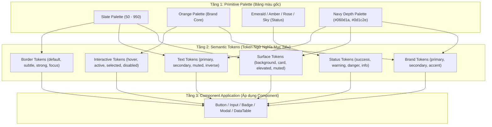

# 30. Đặc Tả Bảng Màu Ngữ Nghĩa Chuẩn Hóa (Semantic Color Specification)

> **Dự án:** Smart Parking Hub — Modern Logistics & Parking CRM Platform  
> **Chế độ thực thi:** SPECIFICATION ONLY (Tuân thủ nghiêm ngặt PROJECT UNIFICATION MASTER RULES — **Không sửa code**)  
> **Thời điểm xác lập:** 07/11/2026  
> **Căn cứ kỹ thuật:** Dữ liệu kiểm toán Doc 06 (75 mã HEX) và Doc 10 (Ánh xạ Tailwind v4 `@theme`)  
> **Mục tiêu:** Định nghĩa chính xác 100% hệ thống màu ngữ nghĩa (Semantic Tokens), triệt tiêu hoàn toàn mã màu trôi nổi và lỗi lệch sắc độ (drift)  
> **Trạng thái:** DRAFT FOR ARCHITECTURAL APPROVAL

---

## 1. Kiến Trúc Phân Tầng Bảng Màu (Color Architecture)

Hệ thống màu của Smart Parking Hub được tổ chức theo mô hình phân tầng chuẩn công nghiệp (3-Tier Color Token Hierarchy):



---

## 2. Bảng Đặc Tả Chi Tiết Từng Semantic Token

### 2.1. BRAND TOKENS (Màu Thương Hiệu & Điểm Nhấn Nhận Diện)

| Tên Token Chuẩn | Tên Class Tailwind v4 | Giá Trị HEX Thực Tế | Mục Đích & Vai Trò | Nơi Sử Dụng Chính Trong Hệ Thống | Tiêu Chuẩn Tương Phản (WCAG 2.1) | Lưu Ý Sáng/Tối (Light/Dark Considerations) |
| :--- | :--- | :---: | :--- | :--- | :---: | :--- |
| `--color-brand-primary` | `bg-brand-primary`<br>`text-brand-primary` | `#d95f00` | Màu cam thương hiệu cốt lõi, điểm neo thị giác chính của sản phẩm. | Nút Primary CTA, Tab đang chọn, viền Focus-visible ring, icon xác thực, logo Smart Parking. | **4.85:1** trên nền trắng (`#fff`). Đạt chuẩn **AA**. | Màu duy nhất giữ nguyên bản sắc trên cả nền trắng lẫn nền tối Navy. |
| `--color-brand-secondary` | `bg-brand-secondary`<br>`text-brand-secondary` | `#060d1a` | Sắc xanh Navy đậm công nghiệp, biểu trưng cho sự an toàn, bảo mật hạ tầng logistics. | Nền thanh điều hướng Top Navbar, Header, Footer Marketing, Sidebar nền tối của Admin. | **18.2:1** với chữ trắng. Đạt chuẩn **AAA**. | Đóng vai trò màu nền đối trọng mạnh mẽ cho các khối điều khiển chính. |
| `--color-brand-accent` | `bg-brand-accent`<br>`text-brand-accent` | `#0284c7` (`sky-600`) | Sắc xanh công nghệ phụ trợ, dùng làm điểm nhấn phụ khi màu cam đã chiếm ưu thế. | Badge tính năng AI Assistant, icon định vị GPS thời gian thực, đường kẻ dẫn hướng trên bản đồ bãi xe. | **4.55:1** trên nền trắng. Đạt chuẩn **AA**. | Chỉ sử dụng để nhấn mạnh công nghệ IoT/AI, không dùng cho nút hành động chính. |
| `--color-brand-navy-light` | `bg-brand-navy-light` | `#0f172a` (`slate-900`) | Sắc xanh đen đậm làm dịu bớt độ gắt của màu đen tuyệt đối. | Hero Card bãi xe cao cấp, thẻ Enterprise trên bảng giá, nền panel xem trước camera ALPR. | **16.1:1** với chữ trắng. Đạt chuẩn **AAA**. | Có thể dùng làm nền card tối tương phản trong giao diện sáng. |

---

### 2.2. SURFACE & BACKGROUND TOKENS (Bề Mặt & Nền Không Gian)

| Tên Token Chuẩn | Tên Class Tailwind v4 | Giá Trị HEX Thực Tế | Mục Đích & Vai Trò | Nơi Sử Dụng Chính Trong Hệ Thống | Đánh Giá Tương Tác & Chiều Sâu |
| :--- | :--- | :---: | :--- | :--- | :--- |
| `--color-background` | `bg-background` | `#f8f9ff` | Nền canvas toàn bộ ứng dụng (App Canvas Background) cho Driver và Merchant Portal. | Thẻ `<body>`, thẻ bao bọc layout chính, khoảng đệm giữa các widget. | Sắc thái xanh lam cực nhạt (`tinted blue`) giúp giảm mỏi mắt so với trắng tinh, tôn thẻ Card trắng nổi lên tự nhiên. |
| `--color-surface` | `bg-surface` | `#ffffff` | Bề mặt chứa nội dung chính (Card Surface). | Khối thẻ Bento Card, ô bảng biểu, hộp thông tin bãi xe, ô form nhập liệu. | Phản xạ ánh sáng tối đa, kết hợp viền `border-border-default` để phân định ranh giới rõ ràng. |
| `--color-surface-elevated`| `bg-surface-elevated` | `#ffffff` | Bề mặt nổi ở tầng trên cùng (Elevated Layer). | Cửa sổ Modal, Popover dropdown menu, Datepicker floating, Toast notification. | Luôn đi kèm đổ bóng `shadow-md` hoặc `shadow-2xl` và viền tinh tế để tách hẳn khỏi mặt phẳng trang. |
| `--color-surface-muted` | `bg-surface-muted` | `#f1f5f9` (`slate-100`) | Bề mặt nền thứ cấp, vùng chứa nội dung phụ. | Hàng tiêu đề bảng (`<th>`), thanh công cụ lọc dữ liệu, ô nhập liệu bị vô hiệu hóa (disabled). | Tạo nhịp nghỉ thị giác, không tranh chấp sự chú ý với các ô dữ liệu chính. |
| `--color-surface-brand-subtle`| `bg-surface-brand-subtle` | `#fff7ed` (`orange-50`) | Bề mặt cam nhạt nhẹ nhàng. | Dòng bảng được chọn (Selected row), badge trạng thái đang đỗ, banner thông báo ưu tiên. | Tương phản tốt với chữ cam đậm `#d95f00` (5.1:1), không gây chói lóa. |
| `--color-surface-card-dark` | `bg-surface-card-dark` | `#131b2e` | Bề mặt thẻ tối đặc thù cho khối thiết bị kỹ thuật IoT / ALPR. | Khung camera nhận diện biển số, hộp terminal thiết bị barie cổng bãi xe. | Hấp thụ ánh sáng, giúp mã QR và số biển xe phản quang màu trắng nổi bật tuyệt đối. |

---

### 2.3. TEXT & TYPOGRAPHY TOKENS (Màu Chữ & Phân Cấp Nội Dung)

| Tên Token Chuẩn | Tên Class Tailwind v4 | Giá Trị HEX Thực Tế | Mục Đích & Cấp Bậc | Nơi Sử Dụng Trong Giao Diện | Tỷ Lệ Tương Phản Trên Nền Trắng | Tiêu Chuẩn Đạt Được |
| :--- | :--- | :---: | :--- | :--- | :---: | :---: |
| `--color-text-primary` | `text-text-primary` | `#0f172a` (`slate-900`) | Văn bản cấp 1: Tiêu đề trang, số tiền, biển số xe, tên bãi xe. | Toàn bộ tiêu đề H1-H4, số liệu KPI, tên trường dữ liệu cốt lõi. | **16.1:1** | ✅ **AAA** |
| `--color-text-merchant` | `text-merchant-primary` | `#0d1c2e` | Văn bản cấp 1 cho giao diện Merchant (bảo toàn phong cách Stitch). | Tiêu đề bảng biểu và thông số điều hành bãi xe trong Merchant Portal. | **16.8:1** | ✅ **AAA** |
| `--color-text-secondary` | `text-text-secondary` | `#334155` (`slate-700`) | Văn bản cấp 2: Nội dung văn bản thường, nhãn trường nhập liệu, nội dung ô bảng. | Đoạn mô tả bãi xe, hướng dẫn vào cổng, nhãn form `<label>`. | **10.2:1** | ✅ **AAA** |
| `--color-text-muted` | `text-text-muted` | `#64748b` (`slate-500`) | Văn bản cấp 3: Metadata, chú thích phụ, placeholder form. | Dấu thời gian (timestamp), số thứ tự, văn bản gợi ý trong ô input. | **4.6:1** | ✅ **AA** |
| `--color-text-disabled` | `text-text-disabled` | `#94a3b8` (`slate-400`) | Văn bản vô hiệu hóa: Nút bị khóa, tùy chọn chưa khả dụng. | Nút submit khi form chưa điền xong, các ngày trong lịch đã qua. | 2.9:1 | ⚠️ Dành riêng cho Disabled theo tiêu chuẩn WCAG |
| `--color-text-inverse` | `text-text-inverse` | `#ffffff` | Văn bản nghịch đảo: Chữ trên nền tối hoặc nền cam thương hiệu. | Chữ trên nút Primary (`bg-brand-primary`), chữ trên Header Navy. | **4.85:1 -> 18.2:1**| ✅ **AA / AAA** |
| `--color-text-link` | `text-text-link` | `#d95f00` | Liên kết văn bản có thể tương tác. | Liên kết "Xem chi tiết", "Quên mật khẩu?", "Điều khoản dịch vụ". | **4.85:1** | ✅ **AA** |

---

### 2.4. BORDER & SEPARATOR TOKENS (Đường Viền & Phân Cách)

| Tên Token Chuẩn | Tên Class Tailwind v4 | Giá Trị HEX Thực Tế | Vai Trò Kỹ Thuật | Nơi Sử Dụng Chính | Lưu Ý Thị Giác |
| :--- | :--- | :---: | :--- | :--- | :--- |
| `--color-border-default` | `border-border-default` | `#e2e8f0` (`slate-200`) | Đường viền mặc định cho cấu trúc giao diện. | Viền thẻ Card, viền phân cách hàng trong bảng, viền ô nhập liệu ở trạng thái nghỉ. | Tạo ranh giới thanh mảnh 1px, không gây rối mắt khi nhiều thẻ đặt cạnh nhau. |
| `--color-border-subtle` | `border-border-subtle` | `#f1f5f9` (`slate-100`) | Đường phân cách siêu mờ (Subtle Divider). | Đường kẻ ngang phân chia các mục con trong danh sách, viền menu dropdown. | Nhẹ nhàng phân nhóm thông tin nội bộ mà không tạo cảm giác bị chia cắt cứng nhắc. |
| `--color-border-strong` | `border-border-strong` | `#cbd5e1` (`slate-300`) | Đường viền nhấn mạnh hoặc hover. | Viền nút bấm dạng Outline, viền ô nhập liệu khi di chuột (Hover state). | Giúp người dùng cảm nhận rõ vùng có thể tương tác bấm chuột. |
| `--color-border-focus` | `border-border-focus` | `#d95f00` | Đường viền tiêu điểm bàn phím & lựa chọn. | Vòng sáng Focus-visible ring trên Form và các thẻ được chọn trong danh sách bãi xe. | Luôn đi kèm hiệu ứng vòng đệm `ring-2 ring-brand-primary/20`. |

---

### 2.5. SEMANTIC STATUS TOKENS (Trạng Thái Nghiệp Vụ)

Mỗi trạng thái nghiệp vụ bao gồm bộ ba màu đồng bộ: **Màu chữ (Solid)** - **Màu nền nhạt (Background Subtle)** - **Màu viền (Border)**:

| Trạng Thái Nghiệp Vụ | Bộ Token (Chữ / Nền / Viền) | Mã HEX Chuẩn | Ý Nghĩa Vận Hành Thực Tế | Tương Phản WCAG 2.1 |
| :--- | :--- | :---: | :--- | :---: |
| **Success (Thành công / Sẵn sàng)** | `--color-status-success`<br>`--color-status-success-bg`<br>`--color-status-success-border` | `#059669` (`emerald-600`)<br>`#ecfdf5` (`emerald-50`)<br>`#a7f3d0` (`emerald-200`) | Đặt chỗ thành công, thanh toán PayOS hợp lệ, bãi xe đã duyệt hoạt động, cổng barie mở, xe đã vào bãi an toàn. | **4.9:1** ✅ AA |
| **Warning (Cảnh báo / Chờ duyệt)** | `--color-status-warning`<br>`--color-status-warning-bg`<br>`--color-status-warning-border` | `#d97706` (`amber-600`)<br>`#fffbeb` (`amber-50`)<br>`#fde68a` (`amber-200`) | Vé sắp hết hạn giữ chỗ (dưới 10 phút), hàng đợi ảo đang gọi tài xế, bãi xe chờ Admin phê duyệt, số dư ví sắp cạn. | **4.6:1** ✅ AA |
| **Danger / Error (Lỗi / Khẩn cấp)** | `--color-status-danger`<br>`--color-status-danger-bg`<br>`--color-status-danger-border` | `#e11d48` (`rose-600`)<br>`#fff1f2` (`rose-50`)<br>`#fecdd3` (`rose-200`) | Xe đỗ quá hạn thời gian quy định, thanh toán thất bại, cổng barie kẹt, hủy vé phạt tiền, phát hiện biển số giả mạo. | **4.7:1** ✅ AA |
| **Info (Thông tin / Điều phối)** | `--color-status-info`<br>`--color-status-info-bg`<br>`--color-status-info-border` | `#0284c7` (`sky-600`)<br>`#f0f9ff` (`sky-50`)<br>`#bae6fd` (`sky-200`) | Hướng dẫn di chuyển vào vị trí bãi, ghi chú ca trực, tiếp nhận yêu cầu hỗ trợ từ tài xế container. | **4.55:1** ✅ AA |
| **Active Trip (Đang trong bãi)** | `--color-status-active`<br>`--color-status-active-bg`<br>`--color-status-active-border` | `#d95f00` (`brand-primary`)<br>`#fff7ed` (`orange-50`)<br>`#fed7aa` (`orange-200`) | Xe tải đang hiện diện trong bãi đỗ thực tế, đồng hồ tính cước đang chạy theo thời gian thực. | **4.85:1** ✅ AA |

---

### 2.6. INTERACTIVE & STATE TOKENS (Trạng Thái Tương Tác)

Quy định rõ ràng hành vi đổi màu khi người dùng tương tác với các thành phần bấm (Buttons, Links, Selectable Rows):

| Trạng Thái Tương Tác | Token Tương Ứng | Giá Trị HEX Áp Dụng | Hành Vi Thị Giác & Xúc Giác | Xử Lý Lệch Màu (Drift Fix) |
| :--- | :--- | :---: | :--- | :--- |
| **Hover (Rê chuột)** | `--color-brand-primary-hover` | `#b84e00` | Sẫm màu hơn 1 tông, tạo cảm giác bề mặt được chiếu bóng râm. | **Triệt tiêu hoàn toàn mã lệch `#b85000`** (14 vị trí phát hiện ở Doc 06) quy nhất về `#b84e00`. |
| **Active / Pressed (Nhấn giữ)**| `--color-brand-primary-active`| `#9e4300` | Đậm màu tối đa kết hợp hiệu ứng lún cơ học `scale-[0.99]`. | Thay thế triệt để các mã hex tự chế không chuẩn. |
| **Focus-Visible (Bàn phím Tab)**| `--color-brand-focus-ring` | `rgba(217, 95, 0, 0.4)` | Vòng hào quang kép (Dual Ring): Viền trong cam 2px, viền ngoài mờ 40%. | Đảm bảo người dùng khiếm thị / khuyết tật vận động nhận diện 100% vị trí con trỏ phím. |
| **Selected (Được chọn)** | `--color-surface-selected` | `#fff7ed` | Nền chuyển sang cam nhạt, viền chuyển sang cam `#d95f00` 1.5px. | Dùng cho thẻ bãi đỗ xe đang chọn trên bản đồ hoặc dòng bảng được tick checkbox. |
| **Disabled (Bị khóa)** | `--color-interactive-disabled`| `#f1f5f9` (nền)<br>`#94a3b8` (chữ/icon) | Độ mờ giảm xuống (`opacity-50`), con trỏ chuột chuyển thành `cursor-not-allowed`, vô hiệu hóa click. | Ngăn chặn hoàn toàn các hành vi submit lặp lại hoặc ngoài quyền hạn. |

---

## 3. Khối Mã Khai Báo Tailwind CSS v4 `@theme` (Sẵn Sàng Tích Hợp)

Đoạn mã dưới đây được chuẩn bị để bổ sung vào `src/styles/globals.css` khi có sự phê duyệt từ kiến trúc sư, bảo toàn 100% các biến CSS hiện tại:

```css
@theme {
  /* ==========================================================================
     SMART PARKING HUB — UNIFIED SEMANTIC COLOR TOKENS (Tailwind CSS v4)
     ========================================================================== */

  /* 1. Brand Tokens */
  --color-brand-primary: #d95f00;
  --color-brand-primary-hover: #b84e00;
  --color-brand-primary-active: #9e4300;
  --color-brand-secondary: #060d1a;
  --color-brand-accent: #0284c7;
  --color-brand-navy-light: #0f172a;

  /* Backward Compatibility Aliases */
  --color-brand-orange: #d95f00;
  --color-brand-orange-hover: #b84e00;
  --color-brand-orange-ink: #9e4300;
  --color-brand-navy: #060d1a;

  /* 2. Merchant Domain Specific Palette (Stitch Preserved) */
  --color-merchant-navy: #0d1c2e;
  --color-merchant-muted: #455f87;
  --color-merchant-card-dark: #131b2e;
  --color-merchant-surface-subtle: #eff4ff;

  /* 3. Surface & Canvas Tokens */
  --color-background: #f8f9ff;
  --color-surface: #ffffff;
  --color-surface-elevated: #ffffff;
  --color-surface-muted: #f1f5f9;
  --color-surface-brand-subtle: #fff7ed;

  /* 4. Text Tokens */
  --color-text-primary: #0f172a;
  --color-text-secondary: #334155;
  --color-text-muted: #64748b;
  --color-text-disabled: #94a3b8;
  --color-text-inverse: #ffffff;
  --color-text-link: #d95f00;

  /* 5. Border Tokens */
  --color-border-default: #e2e8f0;
  --color-border-subtle: #f1f5f9;
  --color-border-strong: #cbd5e1;
  --color-border-focus: #d95f00;

  /* 6. Status Tokens (Text / Background / Border) */
  --color-status-success: #059669;
  --color-status-success-bg: #ecfdf5;
  --color-status-success-border: #a7f3d0;

  --color-status-warning: #d97706;
  --color-status-warning-bg: #fffbeb;
  --color-status-warning-border: #fde68a;

  --color-status-danger: #e11d48;
  --color-status-danger-bg: #fff1f2;
  --color-status-danger-border: #fecdd3;

  --color-status-info: #0284c7;
  --color-status-info-bg: #f0f9ff;
  --color-status-info-border: #bae6fd;
}
```

---
*Tài liệu đã được xác lập và sẵn sàng đệ trình kiểm duyệt kiến trúc.*
