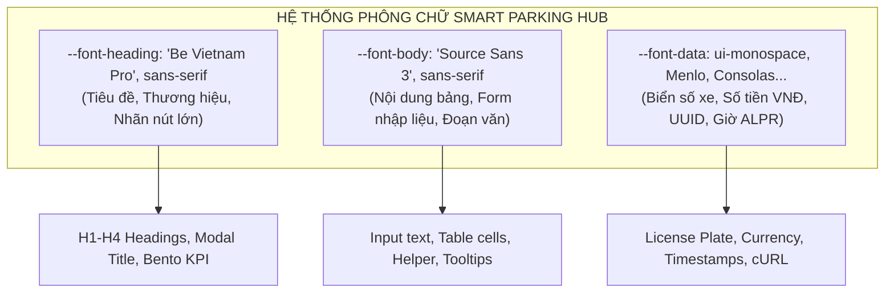
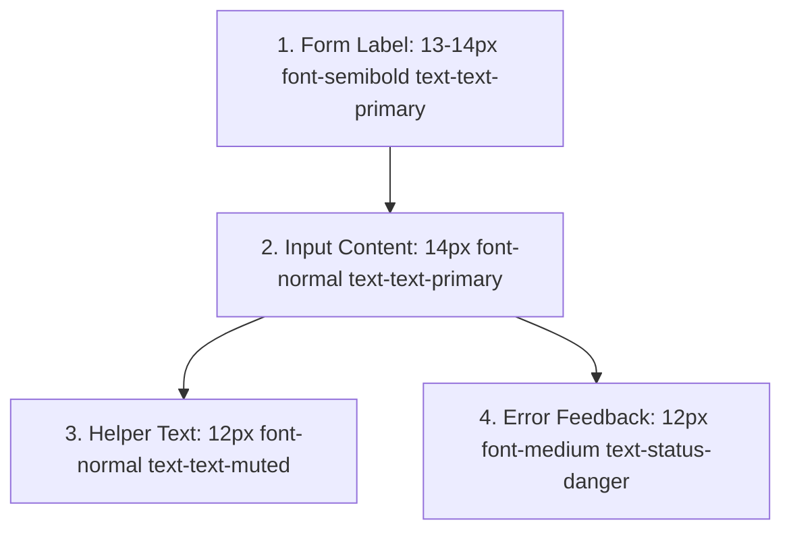

# 31. Đặc Tả Hệ Thống Kiểu Chữ Chuẩn Hóa (Typography Specification)

> **Dự án:** Smart Parking Hub — Modern Logistics & Parking CRM Platform  
> **Chế độ thực thi:** SPECIFICATION ONLY (Tuân thủ nghiêm ngặt PROJECT UNIFICATION MASTER RULES — **Không sửa code**)  
> **Thời điểm xác lập:** 07/11/2026  
> **Căn cứ kỹ thuật:** Dữ liệu kiểm toán Doc 07 (2.842 lượt cỡ chữ, 1.987 lượt gán weight, 780 vị trí monospace)  
> **Bộ phông lưu trữ:** File WOFF2 cục bộ (Zero external CDN dependency) tại `/public/fonts/`  
> **Trạng thái:** DRAFT FOR ARCHITECTURAL APPROVAL

---

## 1. Cấu Trúc Bộ Phông Chữ Chiến Lược (Font Family Hierarchy)

Hệ thống kiểu chữ của Smart Parking Hub được thiết kế dựa trên sự phân tách chuyên môn hóa cao giữa 3 họ phông chữ (Typography Triad):



### 1.1. Chi Tiết Từng Họ Phông Chữ

| Tên Token Chuẩn | Tên Class CSS | Tên Phông & Stack Dự Phòng | Trọng Lượng Đã Nhúng (Weights) | Lý Do Lựa Chọn & Vai Trò Nghiệp Vụ |
| :--- | :--- | :--- | :---: | :--- |
| `--font-heading` | `font-heading`<br>*(Alias: `font-sora`)* | `'Be Vietnam Pro', -apple-system, BlinkMacSystemFont, 'Segoe UI', Roboto, sans-serif` | 500, 600, 700, 800 | Phông chữ thiết kế riêng cho ngôn ngữ tiếng Việt; các nét dấu (huyền, sắc, hỏi, ngã, nặng, mũ) không bị đè chữ hay lệch dòng khi hiển thị hoa (`uppercase`) trên các tiêu đề quản trị. |
| `--font-body` | `font-body`<br>*(Alias: `font-inter`)* | `'Source Sans 3', -apple-system, BlinkMacSystemFont, 'Segoe UI', Roboto, sans-serif` | 400, 500, 600, 700 | Tỷ lệ x-height vượt trội, độ mở ký tự thoáng đãng giúp nhân viên bãi xe và tài xế đọc lướt cực nhanh ngay cả trên màn hình thiết bị cầm tay ngoài trời nắng. |
| `--font-data` | `font-mono`<br>`font-data` | `ui-monospace, SFMono-Regular, Menlo, Monaco, Consolas, 'Liberation Mono', monospace` | 500, 600, 700 | Hệ thống phông đơn cách (Monospace) giữ cố định độ rộng mọi ký tự (từ số `1` đến số `8` hay chữ cái `W`). Tránh tình trạng nhảy giật vị trí khi hiển thị bảng tính tiền theo giây và đối soát biển số xe tải. |

---

## 2. Thang Đo Cỡ Chữ Chuẩn Hóa Toàn Hệ Thống (Standard Type Scale)

Bảng phân tầng kích cỡ chữ được xây dựng dựa trên tỷ lệ chuẩn Modular Scale kết hợp chuẩn hóa các kích thước vi mô bắt nguồn từ Stitch HTML:

| Cấp Bậc (Scale Token) | Class Tailwind v4 | Cỡ Chữ (Font Size) | Chiều Cao Dòng (Line Height) | Khoảng Cách Chữ (Letter Spacing) | Trọng Lượng Mặc Định (Default Weight) | Ngữ Cảnh Sử Dụng Cốt Lõi |
| :--- | :--- | :---: | :---: | :---: | :---: | :--- |
| **Display / Hero** | `text-5xl` | `48px` (3.00rem) | `56px` (1.16) | `-0.025em` | `font-bold` (700) / `font-extrabold` (800) | Hero Headline Marketing Landing Page (`HomeHero`). |
| **Heading 1 (Page Title)**| `text-3xl` | `30px` (1.875rem) | `38px` (1.26) | `-0.02em` | `font-bold` (700) | Tiêu đề chính của màn hình Dashboard, trang Quản lý bãi xe, Đặt chỗ. |
| **Heading 2 (Section Title)**| `text-2xl` | `24px` (1.50rem) | `32px` (1.33) | `-0.015em` | `font-bold` (700) / `font-semibold` (600) | Tiêu đề nhóm nội dung lớn, tiêu đề cửa sổ Modal, Drawer bên phải. |
| **Heading 3 (Card Title)** | `text-xl` | `20px` (1.25rem) | `28px` (1.40) | `-0.01em` | `font-semibold` (600) | Tiêu đề các khối widget Bento, tên bãi xe trong danh sách tìm kiếm. |
| **Heading 4 (Sub-heading)** | `text-lg` | `18px` (1.125rem) | `26px` (1.44) | `0` | `font-semibold` (600) | Tiêu đề phân nhóm nhỏ trong form, tổng tiền hóa đơn thanh toán. |
| **Body Large** | `text-base` | `16px` (1.00rem) | `24px` (1.50) | `0` | `font-normal` (400) / `font-medium` (500) | Đoạn mô tả dịch vụ, bài viết hướng dẫn, nội dung alert thông báo quan trọng. |
| **Body Default / UI** | `text-sm` | `14px` (0.875rem) | `20px` (1.42) | `0` | `font-normal` (400) / `font-medium` (500) | **Tiêu chuẩn cho 70% văn bản CRM:** Ô nhập liệu form, nội dung ô bảng dữ liệu, chữ trong nút bấm. |
| **Caption / Metadata** | `text-xs` | `12px` (0.75rem) | `16px` (1.33) | `0.01em` | `font-medium` (500) / `font-bold` (700) | Nhãn cột tiêu đề bảng (`<th>`), badge trạng thái, mốc thời gian (timestamp). |
| **Micro UI 1 (Stitch Table)**| `text-2xs` *(Mới)* | `11px` (0.6875rem) | `15px` (1.36) | `0.02em` | `font-semibold` (600) | **Chuẩn hóa 237 vị trí `text-[11px]`:** Nhãn camera ALPR, ghi chú vi mô dưới ô đỗ xe. |
| **Micro UI 2 (Stitch Badge)**| `text-3xs` *(Mới)* | `10px` (0.625rem) | `13px` (1.30) | `0.03em` | `font-bold` (700) | **Chuẩn hóa 63 vị trí `text-[10px]`:** Mã phân làn xe siêu nhỏ, badge trạng thái cảm biến IoT. |

---

## 3. Đặc Tả Kiểu Chữ Theo Từng Thành Phần Nghiệp Vụ Cụ Thể

### 3.1. Nhãn Form (Form Labels), Helper Text & Thông Báo Lỗi (Error Text)



1. **Nhãn trường nhập liệu (Form Label):**
   * Class: `font-body text-sm font-semibold text-text-primary mb-1.5 inline-flex items-center gap-1`.
   * Trường bắt buộc: Dấu sao đỏ `*` mang class `text-status-danger font-bold`.
2. **Văn bản nhập liệu & Placeholder (Input Text & Placeholder):**
   * Nội dung gõ: `font-body text-sm font-normal text-text-primary`.
   * Gợi ý (Placeholder): `font-body text-sm font-normal text-text-muted italic` (hoặc non-italic).
3. **Văn bản trợ giúp (Helper Text):**
   * Class: `font-body text-xs font-normal text-text-muted mt-1.5 leading-relaxed`.
   * Mục đích: Hướng dẫn định dạng (ví dụ: *"Nhập biển số liền nhau, ví dụ: 51C12345"*).
4. **Thông báo lỗi xác thực (Error Text):**
   * Class: `font-body text-xs font-medium text-status-danger mt-1.5 flex items-center gap-1.5`.
   * Đi kèm icon tam giác cảnh báo hoặc vòng tròn lỗi kích thước 14px (`w-3.5 h-3.5`).

---

### 3.2. Nút Bấm Thao Tác (Buttons) & Thẻ Điều Hướng (Tabs)

* **Button Size LG (44px touch-target):** `font-body text-base font-semibold tracking-wide`. Dành cho Mobile Action Bar và trang thanh toán PayOS.
* **Button Size MD (40px desktop default):** `font-body text-sm font-semibold tracking-wide`. Chuẩn mực cho 90% nút bấm hệ thống.
* **Button Size SM (32px compact):** `font-body text-xs font-semibold tracking-wide`. Dùng cho nút thao tác trong từng dòng bảng hoặc bộ lọc phụ.
* **Tabs Navigation:**
  * Tab bình thường: `font-body text-sm font-medium text-text-muted`.
  * Tab được chọn: `font-body text-sm font-bold text-brand-primary`.

---

### 3.3. Bảng Dữ Liệu Quản Trị (Data Table Typography)

* **Tiêu đề cột (`<th>` Header):**
  * Class: `font-body text-xs font-semibold uppercase tracking-wider text-text-secondary`.
  * Giúp phân biệt rạch ròi giữa dòng tiêu đề và hàng chục dòng dữ liệu bên dưới.
* **Ô dữ liệu thông thường (`<td>` Regular Cell):**
  * Class: `font-body text-sm font-normal text-text-primary`.
* **Ô dữ liệu định danh & Kỹ thuật (`<td>` Technical/Code Cell):**
  * Class: `font-mono text-xs font-semibold text-text-primary tracking-wide`.
  * Áp dụng cho: Biển số xe, mã đặt chỗ (`BK-2026-991`), mã hóa đơn VAT.
* **Ô số tiền thanh toán (`<td>` Currency Cell):**
  * Class: `font-mono text-sm font-bold text-text-primary text-right`.
  * Canh lề phải để người xem dễ so sánh độ lớn giữa các con số theo cột dọc.

---

### 3.4. Dữ Liệu Kỹ Thuật Chuyên Biệt (Monospace Technical Data)

Smart Parking Hub chuẩn hóa hiển thị dữ liệu kỹ thuật theo các quy tắc khắt khe:

1. **Biển Số Xe (License Plates):**
   * Cấu hình: `font-mono text-xs md:text-sm font-bold tracking-widest uppercase bg-slate-100 text-slate-900 px-2 py-0.5 rounded border border-slate-300`.
   * Ví dụ: `51D-882.14`, `29C-409.11`.
2. **Số Tiền Việt Nam Đồng (VND Currency):**
   * Cấu hình: `font-mono font-bold text-text-primary`.
   * Tiêu chuẩn hiển thị: Luôn có dấu phân cách hàng nghìn bằng dấu chấm (`.`) và hậu tố đơn vị tiền tệ rõ ràng (`đ` hoặc `VND`). Ví dụ: `150.000 đ`, `2.450.000 VND`.
3. **Mốc Thời Gian Check-In / Check-Out:**
   * Cấu hình: `font-mono text-xs font-medium text-text-secondary`.
   * Tiêu chuẩn: `HH:mm:ss DD/MM/YYYY`. Ví dụ: `14:20:05 07/11/2026`.

---

## 4. Khối Mã Khai Báo Typography Trong `@theme` (Tailwind CSS v4)

```css
@theme {
  /* ==========================================================================
     SMART PARKING HUB — UNIFIED TYPOGRAPHY TOKENS (Tailwind CSS v4)
     ========================================================================== */

  /* 1. Font Family Stacks */
  --font-heading: 'Be Vietnam Pro', -apple-system, BlinkMacSystemFont, sans-serif;
  --font-body: 'Source Sans 3', -apple-system, BlinkMacSystemFont, sans-serif;
  --font-data: ui-monospace, SFMono-Regular, Menlo, Monaco, Consolas, monospace;

  /* Backward Compatibility Aliases */
  --font-sora: 'Be Vietnam Pro', sans-serif;
  --font-inter: 'Source Sans 3', sans-serif;
  --font-mono: ui-monospace, SFMono-Regular, Menlo, Monaco, Consolas, monospace;

  /* 2. Micro-Typography Font Sizes (Triệt tiêu Raw Arbitrary Values) */
  --text-2xs: 0.6875rem; /* 11px */
  --text-2xs--line-height: 0.9375rem; /* 15px */

  --text-3xs: 0.625rem; /* 10px */
  --text-3xs--line-height: 0.8125rem; /* 13px */
}
```

---
*Tài liệu đã được xác lập và sẵn sàng đệ trình kiểm duyệt kiến trúc.*
