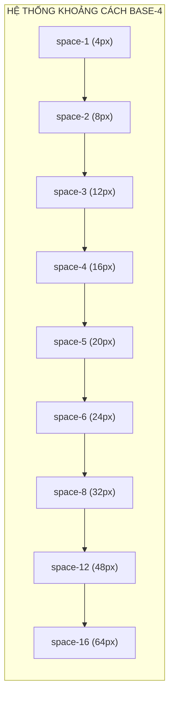
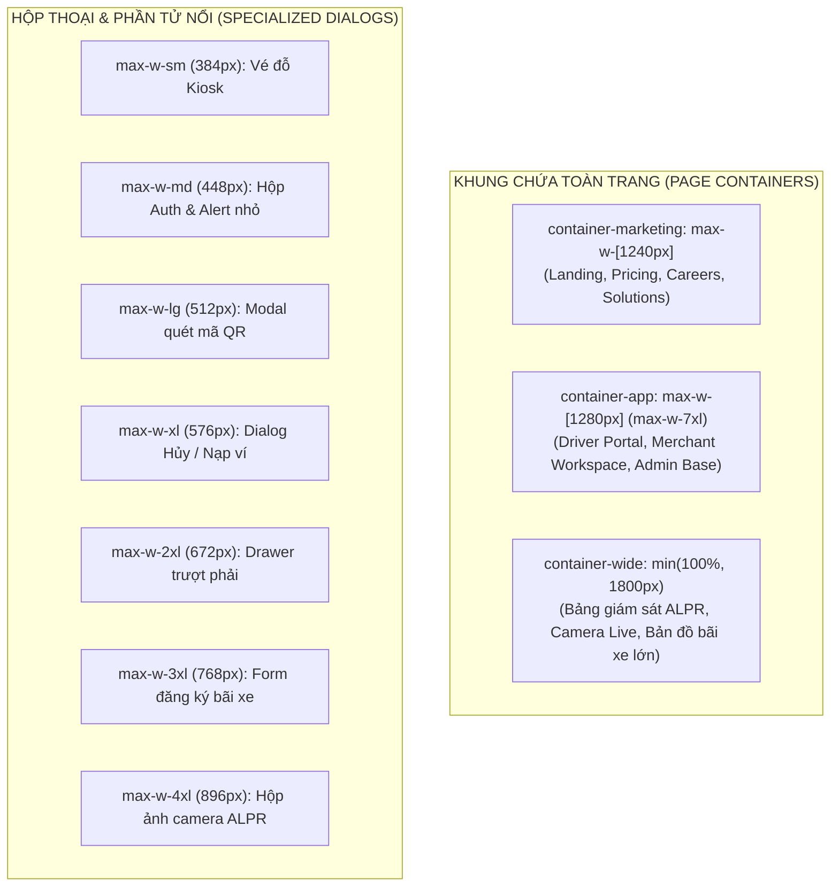
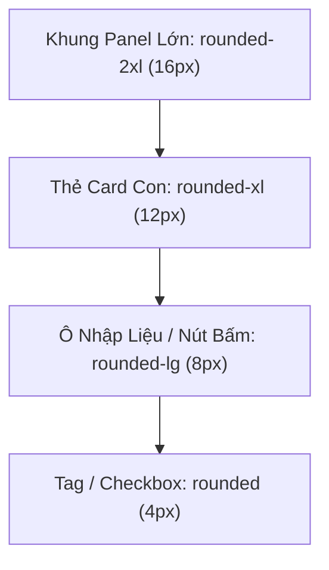
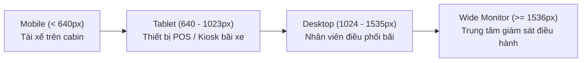

# 32. Đặc Tả Khoảng Cách, Bo Góc & Bố Cục (Spacing & Layout Specification)

> **Dự án:** Smart Parking Hub — Modern Logistics & Parking CRM Platform  
> **Chế độ thực thi:** SPECIFICATION ONLY (Tuân thủ nghiêm ngặt PROJECT UNIFICATION MASTER RULES — **Không sửa code**)  
> **Thời điểm xác lập:** 07/11/2026  
> **Căn cứ kỹ thuật:** Dữ liệu kiểm toán Doc 08 (1.851 lượt gán bo góc, 548 lượt đổ bóng, ma trận container)  
> **Hệ thống phân tầng:** Base-4 Spacing Scale, 8 cấp độ Bo góc, 8 tầng Z-index có kiểm soát  
> **Trạng thái:** DRAFT FOR ARCHITECTURAL APPROVAL

---

## 1. Hệ Lưới Khoảng Cách Cơ Sở (Base-4 Spacing Scale)

Toàn bộ khoảng cách đệm (Padding), lề ngoài (Margin) và khe hở phân tách (Gap) của Smart Parking Hub được quy chuẩn hóa nghiêm ngặt trên **hệ lưới cơ sở 4px (Base-4 Grid)**:

| Token Tên | Kích Thước (px / rem) | Class Tailwind v4 | Ngữ Cảnh Ứng Dụng Chuẩn Mực Trong Hệ Thống |
| :--- | :---: | :--- | :--- |
| `--space-0-5` | `2px` (0.125rem) | `p-0.5`, `gap-0.5` | Khoảng cách siêu nhỏ: Chấm trạng thái với viền ngoài, đường chỉ dẫn bản đồ. |
| `--space-1` | `4px` (0.250rem) | `p-1`, `gap-1` | Đệm bên trong Badge siêu nhỏ, khoảng cách giữa icon mũi tên và nhãn số trang. |
| `--space-1-5`| `6px` (0.375rem) | `p-1.5`, `gap-1.5` | **Stitch HTML Metric Spacing:** Khoảng cách giữa icon và chỉ số đo lường trong bảng bãi xe. |
| `--space-2` | `8px` (0.500rem) | `p-2`, `gap-2` | **Khoảng cách tiêu chuẩn cho UI Primitives:** Giữa Icon và Text trong Button, nhãn và ô input. |
| `--space-3` | `12px` (0.750rem) | `p-3`, `gap-3` | Đệm thẻ nhỏ, khoảng cách giữa Avatar và tên người dùng, khoảng cách giữa các nút trong toolbar. |
| `--space-4` | `16px` (1.000rem) | `p-4`, `gap-4` | Đệm trang trên Mobile (`px-4 py-4`), khoảng cách giữa các trường trong form nhập liệu. |
| `--space-5` | `20px` (1.250rem) | `p-5`, `gap-5` | **Đệm chuẩn cho Thẻ Card CRM:** Giúp nội dung thẻ thoáng đãng mà không tốn diện tích cuộn. |
| `--space-6` | `24px` (1.500rem) | `p-6`, `gap-6` | Đệm Panel lớn, khoảng cách giữa các khối Bento Grid trên Dashboard. |
| `--space-8` | `32px` (2.000rem) | `p-8`, `gap-8` | Đệm trang trên Desktop (`px-8 py-8`), khoảng cách giữa thanh Header và nội dung chính. |
| `--space-12`| `48px` (3.000rem) | `py-12`, `gap-12` | Khoảng cách phân đoạn trên các trang Marketing và giới thiệu đối tác. |
| `--space-16`| `64px` (4.000rem) | `py-16`, `gap-16` | Khoảng cách giữa các Section lớn trên Landing Page (`HomeHero`, `Pricing`). |

---

## 2. Hệ Thống Khung Bố Cục & Chiều Rộng Container (Container Widths)

Smart Parking Hub phân định rạch ròi giữa 2 loại không gian hiển thị (Marketing vs CRM Workspace) và 7 kích thước hộp chuyên dụng:

### 2.1. Bảng Tiêu Chuẩn Container & Quy Định Đệm Trang

| Tên Khung Container | Chiều Rộng Tối Đa | Đệm Trang Theo Thiết Bị (Page Padding) | Áp Dụng Cho Màn Hình |
| :--- | :---: | :--- | :--- |
| **Marketing Container** | `1240px` (`max-w-[1240px]`) | Mobile: `px-4 py-8` Tablet: `px-6 py-12` Desktop: `px-8 py-16` | Trang chủ (`/`), Bảng giá (`/pricing`), Tuyển dụng (`/careers`), Giải pháp (`/solutions`). |
| **Workspace CRM Container**| `1280px` (`max-w-7xl`) | Mobile: `px-4 py-4` Tablet: `px-6 py-6` Desktop: `px-8 py-6` | Trang chủ tài xế (`/driver/dashboard`), Lịch sử đặt chỗ, Quản lý xe, Quản trị bãi xe. |
| **Wide Monitoring Canvas** | `min(100%, 1800px)` | Mọi thiết bị: `px-4 py-4 md:px-6` | Màn hình giám sát trực tiếp cổng bãi xe ALPR, Trung tâm điều hành nhiều bãi. |
| **Auth Floating Box** | `448px` (`max-w-md`) | Trung tâm màn hình: `p-6 md:p-8` | Đăng nhập (`/auth/login`), Đăng ký (`/auth/register`), Quên mật khẩu. |

---

## 3. Hệ Thống Bo Góc Hình Học (Border Radius Scale)

Tuân thủ nguyên tắc **Bo góc lồng nhau (Nested Radius Consistency)**: Bán kính phần tử con bên trong luôn nhỏ hơn hoặc bằng bán kính khung bao ngoài:

| Class Bo Góc | Bán Kính Bo | Mục Đích Thiết Kế | Nơi Sử Dụng Bắt Buộc Trong Hệ Thống |
| :--- | :---: | :--- | :--- |
| `rounded-none` | `0px` | Cắt phẳng tuyệt đối | Đường phân cách, đáy thanh điều hướng cố định sát mép màn hình. |
| `rounded-sm` | `4px` | Bo góc kỹ thuật vi mô | Hộp checkbox, tag phân làn xe tải, ô hiển thị mã màu xe. |
| `rounded-lg` | `8px` | **Chuẩn mực cấp 1 cho Form:** | Ô nhập liệu (`<input>`, `<select>`, `<textarea>`), nút bấm nhỏ (SM), tab con. |
| `rounded-xl` | `12px` | **Chuẩn mực cốt lõi cho Thẻ:** | Thẻ Card nội dung, Nút bấm chính (MD/LG), cửa sổ Modal, Menu Dropdown, Bảng dữ liệu. |
| `rounded-2xl` | `16px` | Khung Bento & Module lớn | Các khối KPI trên Dashboard, hộp camera AI, Hero Banner chào mừng. |
| `rounded-full` | `9999px` | Hình trụ tròn hoặc viên thuốc (Pill) | Nút gạt Switch, Avatar người dùng, chấm trạng thái (Status Dot), Badge trạng thái pill. |

---

## 4. Hệ Thống Đổ Bóng & Độ Cao Thị Giác (Shadows & Elevation)

Smart Parking Hub áp dụng phong cách thiết kế phẳng hiện đại (Modern Flat & Soft Elevation). Đổ bóng chỉ nhằm mục đích phân tách các lớp không gian:

| Tầng Độ Cao (Elevation Layer) | Class Đổ Bóng | Thông Số Kỹ Thuật (y-offset, blur, color) | Mục Đích Sử Dụng |
| :--- | :--- | :--- | :--- |
| **Level 0 (Phẳng)** | `shadow-none` | Không có bóng | Bảng biểu nằm phẳng trên nền, các ô input ở trạng thái nghỉ. |
| **Level 1 (Vi mô)** | `shadow-2xs` | `0 0.5px 1px rgba(0,0,0,0.05)` | Tăng độ sắc nét cho viền input khi người dùng click vào ô (Focus). |
| **Level 2 (Mặc định CRM)** | `shadow-xs` | `0 1px 2px rgba(0,0,0,0.05)` | **Chuẩn cho thẻ Card CRM:** Tách nhẹ thẻ trắng khỏi nền xám canvas `#f8f9ff`. |
| **Level 3 (Xúc giác Hover)** | `shadow-sm` | `0 1px 3px rgba(0,0,0,0.1), 0 1px 2px rgba(0,0,0,0.06)` | Hiệu ứng nổi nhẹ khi di chuột qua Thẻ bãi xe, Nút bấm Primary. |
| **Level 4 (Menu Nổi)** | `shadow-md` | `0 4px 6px -1px rgba(0,0,0,0.1), 0 2px 4px -2px rgba(0,0,0,0.1)` | Menu thả xuống (Dropdown Popover), Lịch chọn ngày (Datepicker), Tooltip. |
| **Level 5 (Tầng Nổi Lớn)** | `shadow-xl` | `0 20px 25px -5px rgba(0,0,0,0.1), 0 8px 10px -6px rgba(0,0,0,0.1)` | Ngăn kéo trượt (Drawer từ phải), Thanh điều hướng nổi dưới đáy Mobile. |
| **Level 6 (Tối Thượng)** | `shadow-2xl` | `0 25px 50px -12px rgba(0,0,0,0.25)` | **Hộp thoại Modal chính:** Kết hợp backdrop mờ làm nổi bật tiêu điểm thanh toán. |
| **Level Inner (Lòng Máng)** | `shadow-inner` | `inset 0 2px 4px 0 rgba(0,0,0,0.06)` | Khung Terminal cURL, ô nhập mã OTP 6 số, rãnh trượt Range Slider. |

---

## 5. Điểm Ngắt Thích Ứng Thiết Bị (Responsive Breakpoints)

Dự án tuân thủ thang điểm ngắt mặc định của Tailwind CSS v4, tối ưu hóa theo 3 hành vi thiết bị đặc thù:

* **Mobile (`< 640px`):** Giao diện 1 cột, toàn bộ bảng chuyển sang dạng Danh sách thẻ (Card View), thanh công cụ chuyển xuống đáy màn hình (Sticky Bottom Action Bar).
* **Tablet (`sm` 640px & `md` 768px):** Giao diện 2 cột, bảng dữ liệu rút gọn ẩn các cột phụ (ẩn mã định danh UUID, chỉ giữ biển số và giờ ra vào).
* **Desktop (`lg` 1024px & `xl` 1280px):** Giao diện 3-4 cột Bento Grid, bảng dữ liệu hiển thị đầy đủ, thanh bên Sidebar mở rộng cố định.
* **Wide Monitor (`2xl` 1536px+):** Cho phép màn hình chia đôi (Split-screen: Nửa trái xem camera ALPR, nửa phải hiển thị danh sách duyệt xe).

---

## 6. Phân Tầng Z-Index Tuyệt Đối (Z-Index Hierarchy Matrix)

Nhằm chấm dứt tình trạng các thành phần nổi đè lên nhau tùy tiện, toàn bộ hệ thống Z-Index được ấn định vào 10 tầng chuẩn:

| Tên Token / Class | Giá Trị Z-Index | Thành Phần Giao Diện Được Phép Sử Dụng | Nguyên Tắc Kiểm Soát |
| :--- | :---: | :--- | :--- |
| `z-negative` | `-1` | Các hình khối nền, lưới chấm họa tiết SVG trang trí phía sau. | Tuyệt đối không chứa phần tử có thể click. |
| `z-base` | `0` | Nội dung trang, thẻ Card, bảng biểu trên mặt phẳng canvas. | Môi trường làm việc bình thường. |
| `z-raised` | `10` | Tiêu đề cột bảng khi cuộn (`sticky top-0 <th>`), huy hiệu đè góc thẻ ảnh. | Không che khuất thanh công cụ chính. |
| `z-sticky` | `20` | Thanh điều hướng phụ của trang con, thanh tác vụ dính dưới đáy Mobile. | Giữ cố định khi người dùng cuộn nội dung dài. |
| `z-dropdown` | `30` | Danh sách gợi ý tìm kiếm bãi xe, Menu Dropdown chọn tác vụ hàng. | Đè lên các dòng bảng bên dưới. |
| `z-fixed-header` | `40` | Thanh Header chính của ứng dụng (`TopNavbar`). | Luôn nằm trên nội dung cuộn của trang. |
| `z-drawer` | `50` | Ngăn kéo trượt chi tiết lượt đỗ xe từ cạnh phải màn hình. | Nằm trên Header và nội dung. |
| `z-modal-backdrop` | `60` | Màn đen mờ che toàn bộ màn hình (`bg-black/60 backdrop-blur-sm`). | Khóa toàn bộ tương tác của các tầng bên dưới. |
| `z-modal` | `70` | Cửa sổ Hộp thoại chính (Dialog Window). | Tâm điểm duy nhất nhận tương tác bàn phím. |
| `z-popover` | `80` | Lịch chọn ngày nổi (Floating Datepicker), Tooltip có chứa nút bấm. | Hiển thị được ngay cả khi mở bên trong Modal. |
| `z-toast` | `90` | Thông báo đẩy hệ thống (Toast Alerts góc trên cùng bên phải). | Luôn nhìn thấy được trong mọi tình huống. |
| `z-tooltip` | `100` | Chú thích nhanh khi rê chuột qua icon (Pure Hover Tooltip). | Tầng thị giác tối cao, tự biến mất khi rời chuột. |

---
*Tài liệu đã được xác lập và sẵn sàng đệ trình kiểm duyệt kiến trúc.*
