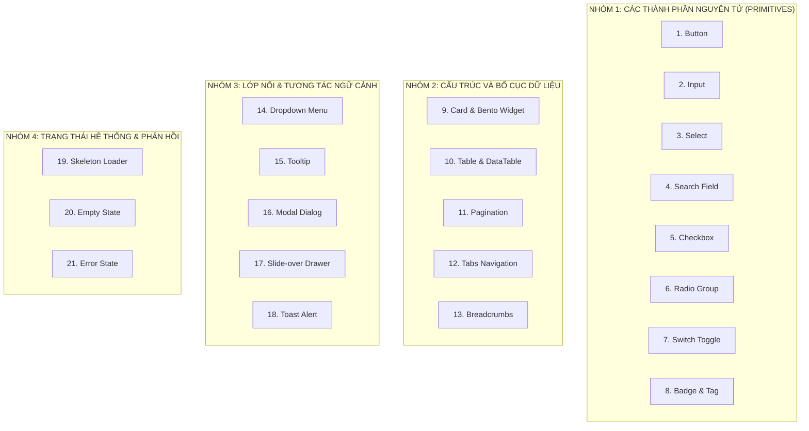

# 33. Hợp Đồng Thiết Kế 21 Thành Phần Giao Diện (Component Design Contracts)

> **Dự án:** Smart Parking Hub — Modern Logistics & Parking CRM Platform  
> **Chế độ thực thi:** SPECIFICATION ONLY (Tuân thủ nghiêm ngặt PROJECT UNIFICATION MASTER RULES — **Không sửa code**)  
> **Thời điểm xác lập:** 07/11/2026  
> **Căn cứ kỹ thuật:** Dữ liệu kiểm toán Doc 11 đến 15 (351 components, 6 tầng phân loại, 557 phần tử tương tác)  
> **Quy chuẩn lập trình:** React 19, TypeScript Strict, Tailwind CSS v4 Semantic Tokens, WAI-ARIA 1.2  
> **Trạng thái:** DRAFT FOR ARCHITECTURAL APPROVAL

---

## Danh Mục 21 Hợp Đồng Thành Phần Chuẩn Hóa



---

### HỢP ĐỒNG 01: BUTTON (Nút Bấm Thao Tác)
* **Purpose:** Kích hoạt hành động nghiệp vụ tức thời (submit form, xác nhận đặt chỗ, mở modal, thanh toán PayOS).
* **Variants:**
  * `primary`: Cam thương hiệu `#d95f00` (`bg-brand-primary text-white hover:bg-brand-primary-hover active:bg-brand-primary-active`).
  * `secondary`: Xám trung tính (`bg-slate-100 text-slate-800 border border-slate-200 hover:bg-slate-200`).
  * `outline`: Viền xám trong suốt (`bg-transparent text-slate-800 border border-slate-300 hover:bg-slate-50`).
  * `ghost`: Tối giản không viền (`bg-transparent text-slate-700 hover:bg-slate-100`).
  * `danger`: Đỏ cảnh báo nguy hiểm (`bg-rose-600 text-white hover:bg-rose-700`).
* **Props Interface:**
  ```typescript
  interface ButtonProps extends React.ButtonHTMLAttributes<HTMLButtonElement> {
    variant?: 'primary' | 'secondary' | 'outline' | 'ghost' | 'danger';
    size?: 'sm' | 'md' | 'lg';
    isLoading?: boolean;
    leftIcon?: React.ReactNode;
    rightIcon?: React.ReactNode;
    isFullWidth?: boolean;
  }
  ```
* **States:** Default, Hover, Active (`scale-[0.99]`), Focus-Visible (`ring-2 ring-brand-primary/40`), Disabled (`opacity-50 cursor-not-allowed pointer-events-none`), Loading (hiện Spinner SVG, giữ nguyên kích thước nút).
* **Accessibility:** Luôn có `type="button"` mặc định nếu không phải submit. Icon-only button bắt buộc phải có `aria-label`. Khi loading gán `aria-busy="true"`.
* **Responsive Behavior:** Trên Mobile, các nút Primary CTA trong Action Bar tự động giãn rộng 100% (`w-full`) và có chiều cao chạm tối thiểu 44px (`h-11`).
* **When to use:** Cho mọi hành động thay đổi dữ liệu hoặc kích hoạt giao diện.
* **When NOT to use:** Để điều hướng sang trang khác (phải dùng thẻ `Link` hoặc `NavLink` của React Router).

---

### HỢP ĐỒNG 02: INPUT (Ô Nhập Liệu Văn Bản)
* **Purpose:** Cho phép người dùng nhập dữ liệu văn bản, số, mật khẩu hoặc ngày tháng vào form.
* **Variants:** `text`, `password`, `number`, `email`, `tel`, `date`.
* **Props Interface:**
  ```typescript
  interface InputProps extends React.InputHTMLAttributes<HTMLInputElement> {
    label?: string;
    helperText?: string;
    error?: string;
    leftIcon?: React.ReactNode;
    rightIcon?: React.ReactNode;
    isRequired?: boolean;
  }
  ```
* **States:** Default (`border-slate-300`), Hover (`border-slate-400`), Focus (`border-brand-primary ring-2 ring-brand-primary/20`), Error (`border-rose-500 ring-rose-500/20`), Disabled (`bg-slate-50 text-slate-400 cursor-not-allowed`).
* **Accessibility:** Gắn kết `id` của input với thẻ `<label htmlFor={id}>`. Khi có lỗi gán `aria-invalid="true"` và liên kết thông báo lỗi qua `aria-describedby={errorId}`.
* **Responsive Behavior:** Chiều cao cố định `h-10` (40px) trên Desktop, chữ 14px để ngăn chặn trình duyệt Safari trên iOS tự động zoom màn hình (iOS auto-zoom kích hoạt khi font < 16px, nên trên mobile dùng `text-base sm:text-sm`).
* **When to use:** Thu thập dữ liệu ngắn 1 dòng.
* **When NOT to use:** Thu thập đoạn văn bản dài (dùng Textarea) hoặc lựa chọn trong danh sách cố định (dùng Select).

---

### HỢP ĐỒNG 03: SELECT (Hộp Lựa Chọn Thả Xuống)
* **Purpose:** Cho phép người dùng chọn 1 giá trị từ danh sách tùy chọn được định nghĩa sẵn (chọn loại xe, chọn phương thức thanh toán, chọn tỉnh/thành).
* **Variants:** `native` (thẻ select chuẩn trình duyệt trên mobile), `custom` (dựa trên Radix UI Popover hỗ trợ tìm kiếm và icon).
* **Props Interface:**
  ```typescript
  interface SelectOption { label: string; value: string | number; icon?: React.ReactNode; disabled?: boolean; }
  interface SelectProps {
    options: SelectOption[];
    value?: string | number;
    onChange: (val: string | number) => void;
    placeholder?: string;
    label?: string;
    error?: string;
    disabled?: boolean;
  }
  ```
* **States:** Closed, Open, Hover option, Selected option (`bg-orange-50 text-brand-primary font-bold`), Disabled.
* **Accessibility:** Hỗ trợ phím mũi tên `Up/Down` để duyệt danh sách, `Enter` để chọn, `Escape` để đóng. Gán `role="combobox"`, `aria-expanded`, `aria-activedescendant`.
* **Responsive Behavior:** Trên Mobile, khuyến khích kích hoạt Native Picker của hệ điều hành hoặc mở Bottom Sheet để ngón tay dễ chạm.
* **When to use:** Khi số lượng tùy chọn từ 4 đến 15 mục.
* **When NOT to use:** Khi chỉ có 2-3 tùy chọn (dùng Radio Group hoặc Segmented Tabs).

---

### HỢP ĐỒNG 04: SEARCH FIELD (Thanh Tìm Kiếm Dữ Liệu)
* **Purpose:** Tìm kiếm thời gian thực danh sách bãi xe, biển số xe, mã vé đặt chỗ hoặc lịch sử hóa đơn.
* **Variants:** `header-search` (nằm trên navbar), `table-search` (nằm trên thanh công cụ bảng), `hero-search` (khối tìm kiếm lớn ở trang chủ).
* **Props Interface:**
  ```typescript
  interface SearchFieldProps {
    value: string;
    onChange: (val: string) => void;
    onClear?: () => void;
    placeholder?: string;
    isSearching?: boolean;
    debounceMs?: number;
  }
  ```
* **States:** Resting, Focused, Searching (hiện spinner nhỏ bên phải thay cho icon tìm kiếm), Has-value (hiện nút `X` để xóa nhanh từ khóa).
* **Accessibility:** Cung cấp `aria-label="Tìm kiếm bãi đỗ xe hoặc biển số"`, gán `type="search"`.
* **Responsive Behavior:** Trên Desktop co giãn linh hoạt trong khoảng 280px - 400px. Trên Mobile hiển thị icon kính lúp, khi click sẽ mở rộng toàn chiều rộng header.
* **When to use:** Lọc nhanh dữ liệu danh sách dài hơn 10 phần tử.
* **When NOT to use:** Tìm kiếm toàn văn phức tạp có nhiều bộ lọc điều kiện (kết hợp Filter Panel).

---

### HỢP ĐỒNG 05: CHECKBOX (Hộp Đánh Dấu Chọn)
* **Purpose:** Cho phép chọn một hoặc nhiều tùy chọn độc lập (chọn tiện ích bãi xe: trạm sạc điện, camera 24/7, phòng nghỉ tài xế; hoặc chọn nhiều dòng trong bảng để xóa hàng loạt).
* **Variants:** `standard` (chỉ có nhãn), `card-checkbox` (bao bọc cả thẻ tiện ích có icon).
* **Props Interface:**
  ```typescript
  interface CheckboxProps {
    checked: boolean | 'indeterminate';
    onChange: (checked: boolean) => void;
    label?: React.ReactNode;
    description?: string;
    disabled?: boolean;
  }
  ```
* **States:** Unchecked, Checked (nền cam `#d95f00` + dấu tick trắng SVG), Indeterminate (nền cam + vạch ngang trắng), Hover, Disabled.
* **Accessibility:** `role="checkbox"`, `aria-checked="true|false|mixed"`, kích hoạt bằng phím `Space`.
* **Responsive Behavior:** Vùng chạm (Click Target Area) bao gồm cả nhãn chữ, kích thước tối thiểu 36x36px.
* **When to use:** Lựa chọn đa mục không phụ thuộc lẫn nhau.
* **When NOT to use:** Bật/tắt tính năng hệ thống có hiệu lực tức thì (dùng Switch).

---

### HỢP ĐỒNG 06: RADIO GROUP (Nhóm Nút Chọn Duy Nhất)
* **Purpose:** Cho phép người dùng chọn chính xác 1 giá trị duy nhất trong một tập hợp loại trừ lẫn nhau (chọn phương thức thanh toán: PayOS, Ví SmartTruck, Tiền mặt).
* **Variants:** `standard-list` (danh sách dọc truyền thống), `selectable-card` (thẻ nổi có viền cam khi được chọn).
* **Props Interface:**
  ```typescript
  interface RadioOption { label: string; value: string; description?: string; badge?: string; }
  interface RadioGroupProps {
    name: string;
    options: RadioOption[];
    selectedValue: string;
    onChange: (val: string) => void;
    orientation?: 'horizontal' | 'vertical';
  }
  ```
* **States:** Unselected, Selected (vòng tròn cam có tâm đặc), Focus-visible, Disabled.
* **Accessibility:** `role="radiogroup"`, mỗi nút mang `role="radio"`, điều hướng bằng phím mũi tên `Left/Right/Up/Down`.
* **When to use:** Khi các tùy chọn cần được phơi bày trực quan cùng lúc để so sánh.
* **When NOT to use:** Danh sách dài hơn 5 mục (dùng Select).

---

### HỢP ĐỒNG 07: SWITCH (Nút Gạt Bật/Tắt Trạng Thái)
* **Purpose:** Bật hoặc tắt tức thời một trạng thái hoặc cấu hình hệ thống (Bật thông báo SMS, Kích hoạt camera ALPR, Tự động duyệt xe).
* **Variants:** `sm` (36x20px), `md` (44x24px).
* **Props Interface:**
  ```typescript
  interface SwitchProps {
    checked: boolean;
    onChange: (checked: boolean) => void;
    label?: string;
    disabled?: boolean;
    isLoading?: boolean;
  }
  ```
* **States:** Off (`bg-slate-200`), On (`bg-brand-primary`), Disabled, Loading.
* **Accessibility:** `role="switch"`, `aria-checked="true|false"`. Kích hoạt bằng phím `Space` hoặc `Enter`.
* **Responsive Behavior:** Giữ nguyên tỉ lệ hình học, không bị biến dạng khi co màn hình.
* **When to use:** Hành động bật/tắt có hiệu lực ngay lập tức mà không cần bấm nút "Lưu".
* **When NOT to use:** Trong các form khảo sát cần bấm nút "Submit" mới lưu dữ liệu (dùng Checkbox).

---

### HỢP ĐỒNG 08: BADGE & TAG (Nhãn Trạng Thái & Thẻ Phân Loại)
* **Purpose:** Hiển thị trực quan trạng thái lượt đỗ xe, phân loại xe, số đếm thông báo hoặc định danh biển số xe.
* **Variants:**
  * `status`: Có chấm tròn nhấp nháy (`success`, `warning`, `danger`, `info`, `active`).
  * `neutral`: Xám tro (`bg-slate-100 text-slate-700`).
  * `brand`: Nền cam nhạt (`bg-orange-50 text-brand-primary border-orange-200`).
  * `plate`: Biển số xe chuyên dụng (`font-mono tracking-widest bg-slate-100 text-slate-900 border-slate-300`).
* **Props Interface:**
  ```typescript
  interface BadgeProps {
    variant?: 'success' | 'warning' | 'danger' | 'info' | 'brand' | 'neutral' | 'plate';
    size?: 'sm' | 'md';
    hasDot?: boolean;
    children: React.ReactNode;
  }
  ```
* **Accessibility:** Văn bản nhãn phải rõ ràng, không chỉ dựa vào màu sắc đơn thuần để truyền tải ý nghĩa (luôn có chữ đi kèm).
* **Responsive Behavior:** Không tự ngắt dòng (`whitespace-nowrap`).
* **When to use:** Hiển thị trạng thái ngắn gọn 1-2 từ.
* **When NOT to use:** Để kích hoạt hành động bấm (dùng Button).

---

### HỢP ĐỒNG 09: CARD & BENTO WIDGET (Thẻ Chứa Nội Dung & Chỉ Số)
* **Purpose:** Đóng gói thông tin độc lập về một bãi xe, một lượt đặt chỗ, hoặc một chỉ số thống kê KPI.
* **Variants:**
  * `default`: Nền trắng, viền `border-slate-200`, đổ bóng `shadow-xs`.
  * `metric-bento`: Thẻ KPI với số liệu lớn, icon tròn và nhãn phần trăm tăng trưởng.
  * `interactive`: Thẻ có thể click chọn (`hover:border-slate-400 hover:shadow-sm cursor-pointer`).
  * `dark-iot`: Thẻ nền đen `#131b2e` chuyên dụng cho khung camera ALPR.
* **Props Interface:**
  ```typescript
  interface CardProps {
    children: React.ReactNode;
    title?: string;
    subtitle?: string;
    headerAction?: React.ReactNode;
    footer?: React.ReactNode;
    className?: string;
    isHoverable?: boolean;
  }
  ```
* **Accessibility:** Nếu card có thể click toàn bộ, sử dụng kỹ thuật `<a className="after:absolute after:inset-0">` để bàn phím tab nhận đúng một liên kết ngữ nghĩa duy nhất.
* **Responsive Behavior:** Bo góc `rounded-xl` (12px), đệm trong `p-5` (Desktop) và `p-4` (Mobile).

---

### HỢP ĐỒNG 10: DATA TABLE (Bảng Dữ Liệu Quản Trị Chuyên Sâu)
* **Purpose:** Hiển thị danh sách có cấu trúc lớn (quản lý lượt đỗ, biểu phí tariff, lịch sử xe ra vào bãi, người dùng).
* **Variants:** `standard` (bảng cuộn ngang thông thường), `compact` (mật độ cao cho cổng barie ALPR).
* **Props Interface:**
  ```typescript
  interface ColumnDef<T> {
    id: string;
    header: string | React.ReactNode;
    cell: (item: T) => React.ReactNode;
    sortable?: boolean;
    align?: 'left' | 'center' | 'right';
    width?: string;
  }
  interface DataTableProps<T> {
    data: T[];
    columns: ColumnDef<T>[];
    isLoading?: boolean;
    emptyText?: string;
    onRowClick?: (item: T) => void;
  }
  ```
* **States:** Loading (render 5 dòng Shimmer Skeleton), Empty (hiện Empty State Panel), Sorting (icon mũi tên đổi chiều), Hover dòng (`hover:bg-slate-50/80`).
* **Accessibility:** Sử dụng đầy đủ `<caption>`, `<thead>`, `<tbody>`, `<th> scope="col"`. Hỗ trợ phím mũi tên duyệt hàng.
* **Responsive Behavior:** Trên Mobile tự động kích hoạt chế độ xem thẻ (`Card View`) hoặc cuộn ngang mượt mà có chỉ thị bóng đổ hai bên mép (`scroll-shadow`).

---

### HỢP ĐỒNG 11: PAGINATION (Thanh Phân Trang Dữ Liệu)
* **Purpose:** Chia nhỏ danh sách dữ liệu hàng trăm dòng thành các trang kích thước cố định (10, 20, 50 dòng/trang).
* **Props Interface:**
  ```typescript
  interface PaginationProps {
    currentPage: number;
    totalPages: number;
    onPageChange: (page: number) => void;
    totalItems?: number;
    pageSize?: number;
    onPageSizeChange?: (size: number) => void;
  }
  ```
* **Accessibility:** Thẻ `<nav aria-label="Phân trang dữ liệu">`, nút trang hiện tại mang `aria-current="page"`, nút lùi/tiến có `aria-label="Trang trước"`, `"Trang sau"`.
* **Responsive Behavior:** Trên Mobile ẩn bớt các nút số ở giữa, chỉ giữ lại cụm `"Trang 2 / 15"` cùng nút Trước / Sau.

---

### HỢP ĐỒNG 12: TABS NAVIGATION (Thanh Tab Điều Hướng Nội Bộ)
* **Purpose:** Chuyển đổi qua lại giữa các góc nhìn khác nhau trên cùng một trang (Tab "Tổng quan" / "Vị trí bãi" / "Biểu phí" / "Lịch sử").
* **Variants:** `underline` (đường kẻ cam dưới chân tab), `pill` (khối bo tròn có nền sáng).
* **Props Interface:**
  ```typescript
  interface TabItem { id: string; label: string; count?: number; icon?: React.ReactNode; }
  interface TabsProps {
    tabs: TabItem[];
    activeTab: string;
    onChange: (tabId: string) => void;
  }
  ```
* **Accessibility:** Tuân thủ chuẩn WAI-ARIA Tabs Design Pattern: `role="tablist"`, `role="tab"`, `aria-selected="true|false"`, di chuyển tab bằng phím mũi tên `Left/Right`.

---

### HỢP ĐỒNG 13: BREADCRUMBS (Đường Dẫn Phân Cấp Trang)
* **Purpose:** Giúp người dùng biết vị trí hiện tại trong cây thư mục ứng dụng và lùi lại các cấp cha dễ dàng.
* **Props Interface:**
  ```typescript
  interface BreadcrumbItem { label: string; href?: string; isCurrent?: boolean; }
  interface BreadcrumbsProps { items: BreadcrumbItem[]; separator?: React.ReactNode; }
  ```
* **Accessibility:** Thẻ `<nav aria-label="Breadcrumb">`, danh sách `<ol>`, mục cuối cùng mang `aria-current="page"`.
* **When to use:** Trên tất cả các trang con sâu từ cấp 2 trở lên (`/merchant/parking-lots/{id}/edit`).
* **When NOT to use:** Trang chủ Dashboard cấp 1.

---

### HỢP ĐỒNG 14: DROPDOWN MENU (Menu Thả Xuống Ngữ Cảnh)
* **Purpose:** Chứa danh sách các hành động thứ cấp gắn với một nút hoặc một dòng bảng (Nút 3 chấm: "Sửa", "Đổi mật khẩu", "Xuất PDF", "Xóa").
* **States:** Closed, Opening, Open, Focus Item, Disabled Item.
* **Accessibility:** `role="menu"`, mỗi mục mang `role="menuitem"`, đóng ngay khi bấm `Escape` hoặc click ra ngoài (Click Outside).
* **When to use:** Tiết kiệm diện tích màn hình khi một đối tượng có trên 3 hành động thao tác.

---

### HỢP ĐỒNG 15: TOOLTIP (Hộp Chú Thích Rê Chuột)
* **Purpose:** Giải thích ý nghĩa ngắn gọn của một icon hoặc từ viết tắt chuyên môn (ví dụ: *"ALPR: Nhận diện biển số xe tự động qua camera AI"*).
* **Accessibility:** `role="tooltip"`, kích hoạt khi Hover hoặc Bàn phím Focus, biến mất ngay khi bấm phím `Escape`.
* **When to use:** Chỉ cho văn bản chú thích ngắn dưới 15 từ.
* **When NOT to use:** Chứa văn bản dài hoặc chứa các nút bấm có thể click (khi đó phải dùng Popover).

---

### HỢP ĐỒNG 16: MODAL (Cửa Sổ Hộp Thoại Chặn Tương Tác)
* **Purpose:** Thu hút 100% sự chú ý của người dùng vào một tác vụ quan trọng (Xác nhận hủy đặt chỗ, Quét QR thanh toán PayOS, Thêm xe tải mới).
* **Props Interface:**
  ```typescript
  interface ModalProps {
    isOpen: boolean;
    onClose: () => void;
    title: string;
    description?: string;
    children: React.ReactNode;
    footer?: React.ReactNode;
    size?: 'sm' | 'md' | 'lg' | 'xl';
  }
  ```
* **Accessibility:** Khóa cuộn trang `overflow: hidden`, bẫy tiêu điểm (Focus Trap: phím Tab chỉ chạy vòng quanh trong Modal), đóng khi nhấn `Escape`, gán `role="dialog"` và `aria-modal="true"`.

---

### HỢP ĐỒNG 17: DRAWER (Ngăn Kéo Trượt Từ Cạnh Phải)
* **Purpose:** Hiển thị chi tiết sâu hoặc form chỉnh sửa nhanh mà không làm mất ngữ cảnh của bảng dữ liệu bên dưới (Xem chi tiết lượt xe ra vào, lịch sử sự kiện camera).
* **Responsive Behavior:** Chiều rộng chuẩn 480px - 640px trên Desktop. Trên Mobile tự động mở rộng 100% chiều ngang màn hình.

---

### HỢP ĐỒNG 18: TOAST (Thông Báo Nổi Đẩy Toàn Cục)
* **Purpose:** Thông báo kết quả hành động vừa thực hiện thành công hoặc thất bại (ví dụ: *"Đã sao chép mã đặt chỗ vào bộ nhớ tạm"*, *"Lưu thông tin bãi xe thành công"*).
* **Variants:** `success`, `error`, `warning`, `info`.
* **Accessibility:** Vùng chứa mang `role="status"` hoặc `role="alert"`, tự động biến mất sau 4 giây nhưng dừng đếm ngược khi người dùng rê chuột lên.

---

### HỢP ĐỒNG 19: SKELETON (Khung Nạp Dữ Liệu Tải Trang)
* **Purpose:** Giảm cảm giác chờ đợi và ngăn chặn hiện tượng nhảy layout (Layout Shift - CLS) khi dữ liệu API đang được tải về từ Backend.
* **Variants:** `text`, `circular` (cho Avatar), `rectangular` (cho Card, Ảnh camera, Bảng biểu).
* **Visual:** Khối màu xám nhạt `bg-slate-200` kèm hiệu ứng quét sáng `animate-pulse` chu kỳ 1.5s.

---

### HỢP ĐỒNG 20: EMPTY STATE (Trạng Thái Dữ Liệu Trống)
* **Purpose:** Hướng dẫn người dùng hành động tiếp theo khi chưa có dữ liệu (ví dụ: *"Bạn chưa có xe nào trong đội xe. Thêm xe đầu tiên ngay"*).
* **Cấu trúc bắt buộc:** 1 Icon minh họa tối giản + 1 Tiêu đề rõ ràng + 1 Đoạn mô tả lý do + 1 Nút bấm hành động Primary (Call To Action).

---

### HỢP ĐỒNG 21: ERROR STATE (Trạng Thái Sự Cố Kết Nối & Lỗi Mạng)
* **Purpose:** Thông báo thân thiện khi API gặp sự cố (mất mạng, lỗi 500, lỗi xác thực phiên) kèm giải pháp khắc phục.
* **Cấu trúc bắt buộc:** Icon cảnh báo màu đỏ/cam + Thông báo giải thích nguyên nhân bằng ngôn ngữ người dùng hiểu (không in raw JSON stacktrace) + Nút "Thử lại ngay" (Retry Button).

---
*Tài liệu đã được xác lập và sẵn sàng đệ trình kiểm duyệt kiến trúc.*
