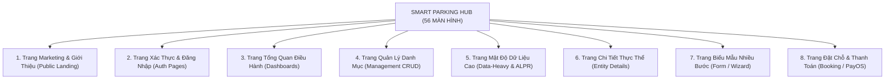

# 34. Quy Chuẩn Bố Cục 8 Dạng Trang Nghiệp Vụ (Page Type Guidelines)

> **Dự án:** Smart Parking Hub — Modern Logistics & Parking CRM Platform  
> **Chế độ thực thi:** SPECIFICATION ONLY (Tuân thủ nghiêm ngặt PROJECT UNIFICATION MASTER RULES — **Không sửa code**)  
> **Thời điểm xác lập:** 07/11/2026  
> **Căn cứ kỹ thuật:** Dữ liệu kiểm toán Doc 02 (56 màn hình canonical), Doc 03 (5 Role Layouts), Doc 19-22 (Workflow Graph & Navigation Gaps)  
> **Nguyên tắc bất biến:** Không áp dụng cùng một bố cục chung chung cho mọi màn hình. Mỗi dạng trang có một bản thiết kế công năng riêng biệt  
> **Trạng thái:** DRAFT FOR ARCHITECTURAL APPROVAL

---

## 1. Ma Trận Phân Loại 8 Dạng Màn Hình Nghiệp Vụ



---

## 2. Tiêu Chuẩn Bố Cục Chi Tiết Cho Từng Dạng Trang

### 2.1. DẠNG 1: TRANG MARKETING & TIẾP THỊ (MARKETING PAGES)
* **Các màn hình đại diện:** Trang chủ (`/`), Giải pháp (`/solutions`), Bảng giá (`/pricing`), Tuyển dụng (`/careers`), Giới thiệu (`/about`), Liên hệ (`/contact`).
* **Độ rộng Container:** Cố định `max-w-[1240px]` căn giữa màn hình (`mx-auto`).
* **Mật độ thị giác (Density):** Thư thái (Comfortable), đệm cách khoảng rộng giữa các khối: `py-16 md:py-24`.
* **Tiêu chuẩn Header & Footer:**
  * Header cố định trong suốt hoặc nền trắng kính mờ (`bg-white/90 backdrop-blur-md border-b border-slate-200`).
  * Footer nền xanh Navy đậm `#060d1a` với các liên kết nội bộ điều hướng bằng thẻ `<Link>` của React Router (nghiêm cấm thẻ `<a>` gây reload toàn trang theo Doc 18).
* **Typography:** Tiêu đề H1/H2 dùng phông `Be Vietnam Pro` (`font-heading`), cỡ chữ lớn `text-4xl md:text-5xl` với trọng lượng `font-bold` hoặc `font-extrabold`.
* **Quy chuẩn Action Button:** Nút bấm kích thước lớn (LG - 44px), màu cam thương hiệu `#d95f00`, có hiệu ứng hover sẫm màu rõ rệt (`#b84e00`).

---

### 2.2. DẠNG 2: TRANG XÁC THỰC & ĐĂNG NHẬP (AUTHENTICATION PAGES)
* **Các màn hình đại diện:** Đăng nhập (`/auth/login`), Đăng ký tài khoản (`/auth/register`), Quên mật khẩu (`/auth/forgot-password`), Đặt lại mật khẩu (`/auth/reset-password`).
* **Khung chứa (Container):** Hộp thẻ nổi độc lập `max-w-md` (448px) đặt tại trung tâm màn hình, bao quanh bởi nền xanh Navy đậm (`#060d1a`) hoặc canvas xám sáng.
* **Mật độ thị giác:** Tập trung cao độ (High Focus), loại bỏ hoàn toàn các thanh điều hướng phức tạp để người dùng không bị phân tâm.
* **Quy chuẩn Form:**
  * Khoảng cách giữa các ô input: `gap-4` (16px).
  * Nút mắt bật/tắt hiển thị mật khẩu (`Eye`/`EyeOff`) cố định bên phải ô password.
  * Thông báo lỗi xác thực dạng Alert viền đỏ đặt ngay phía trên nút Đăng nhập.
  * Phím `Enter` trong bất kỳ ô input nào cũng kích hoạt submit form.

---

### 2.3. DẠNG 3: TRANG TỔNG QUAN ĐIỀU HÀNH (DASHBOARDS)
* **Các màn hình đại diện:** Tổng quan tài xế (`/driver/dashboard`), Trung tâm chủ bãi (`/merchant/dashboard`), Điều hành hệ thống (`/admin/dashboard`).
* **Khung chứa (Container):** `max-w-7xl` (`1280px`), padding `px-4 py-6 md:px-8`.
* **Cấu trúc Bố cục Bento Grid:**
  1. *Hàng 1 (Header Banner):* Lời chào cá nhân hóa + Nút hành động nhanh chính (Ví dụ: "Tìm bãi đỗ xe ngay", "Tạo bãi đỗ mới").
  2. *Hàng 2 (Metric Cards):* Lưới 4 cột (Desktop) -> 2 cột (Tablet) -> 1 cột (Mobile) hiển thị các chỉ số KPI then chốt (Doanh thu hôm nay, Số lượt đỗ, Vị trí trống, Tỷ lệ lấp đầy).
  3. *Hàng 3 (Dual Panels):* Chia tỉ lệ 60/40 hoặc 65/35 (Nửa trái: Bảng lượt đỗ xe gần nhất; Nửa phải: Biểu đồ doanh thu hoặc camera ALPR trực tiếp).
* **Trạng thái nạp trang:** Hiển thị Shimmer Bento Skeleton đồng nhất trong quá trình tải API.

---

### 2.4. DẠNG 4: TRANG QUẢN LÝ DANH MỤC (MANAGEMENT CRUD PAGES)
* **Các màn hình đại diện:** Danh sách bãi đỗ (`/merchant/parking-lots`), Quản lý đội xe (`/driver/vehicles`), Lịch sử hóa đơn (`/merchant/invoices`), Danh sách tài khoản (`/admin/users`).
* **Cấu trúc 4 tầng chuẩn mực:**
  ```mermaid
  graph TD
      T1["Tầng 1: Page Header (Tiêu đề + Huy hiệu đếm số + Nút 'Thêm mới')"]
      T2["Tầng 2: Filter Toolbar (Ô tìm kiếm thời gian thực + Dropdown lọc trạng thái)"]
      T3["Tầng 3: Data Table (Bảng dữ liệu phân trang, hỗ trợ sắp xếp cột)"]
      T4["Tầng 4: Table Footer (Thông tin số dòng + Bộ điều khiển chuyển trang)"]
      T1 --> T2 --> T3 --> T4
  ```
* **Quy chuẩn tương tác bảng:**
  * Di chuột qua hàng: Nền sáng nhẹ `hover:bg-slate-50/80`.
  * Click vào hàng: Điều hướng sang trang chi tiết thực thể.
  * Nút tác vụ hàng (Action Column): Đặt ở cột ngoài cùng bên phải, sử dụng menu Dropdown 3 chấm để tránh làm rối mắt.

---

### 2.5. DẠNG 5: TRANG MẬT ĐỘ DỮ LIỆU CAO (DATA-HEAVY & ALPR MONITORING)
* **Các màn hình đại diện:** Giám sát trực tiếp cổng bãi xe ALPR (`/merchant/monitoring`), Nhật ký giao dịch hệ thống (`/admin/audit`), Kiểm soát biểu phí lũy tiến (`/merchant/tariffs`).
* **Khung chứa (Container):** Trải rộng tối đa `min(100%, 1800px)` với padding hẹp `p-4 md:p-6`.
* **Mật độ thị giác:** Chặt chẽ (Compact Density). Dòng bảng thấp hơn (`min-h-[44px]`), cỡ chữ 11px - 13px (`text-2xs` / `text-xs`).
* **Khung thiết bị IoT (Camera / Barie):**
  * Nền thẻ màu đen chuyên dụng `#131b2e` chống lóa mắt.
  * Cung cấp nút chuyển đổi chế độ xem: Chế độ Lưới (Grid View) hoặc Chế độ Danh sách (List View).
  * Biển số xe hiển thị phông `font-mono text-sm font-bold tracking-widest` trên nền xám tương phản cao.

---

### 2.6. DẠNG 6: TRANG CHI TIẾT THỰC THỂ (ENTITY DETAIL PAGES)
* **Các màn hình đại diện:** Chi tiết bãi xe (`/driver/parking-lots/:id`), Chi tiết lượt đặt chỗ (`/driver/bookings/:id`), Hồ sơ chủ bãi (`/merchant/profile`).
* **Quy chuẩn điều hướng bắt buộc (Khắc phục triệt để Gap Doc 22):**
  * **Nút Quay lại (Back Navigation):** Luôn xuất hiện ở góc trên bên trái tiêu đề trang (`<- Quay lại danh sách bãi xe`), sử dụng `useNavigate()` an toàn có fallback về danh mục cha.
  * **Đường dẫn Breadcrumbs:** Nằm ngay trên tiêu đề trang, thể hiện rõ phân cấp (`Trang chủ > Quản lý bãi xe > Bãi xe Sóng Thần 2`).
* **Bố cục 2 cột bất đối xứng (Desktop):**
  * Cột chính (65%): Thông tin chi tiết, hình ảnh thực tế bãi xe, bản đồ vệ tinh, danh sách các vị trí đỗ.
  * Cột tóm tắt cố định (35% Sticky Sidebar): Thẻ tóm tắt biểu phí, nút Primary Action ("Đặt chỗ ngay" hoặc "Xuất hóa đơn").

---

### 2.7. DẠNG 7: TRANG BIỂU MẪU NHIỀU BƯỚC (FORM / WIZARD PAGES)
* **Các màn hình đại diện:** Tạo mới bãi đỗ xe đối tác (`/merchant/parking-lots/new`), Quy trình đăng kiểm xe tải, Đăng ký xác minh doanh nghiệp KYC.
* **Độ rộng Container:** Thu gọn `max-w-3xl` (768px) để đường đọc mắt không bị phân tán.
* **Thanh tiến trình (Step Progress Indicator):**
  * Nằm ở đầu trang: Hiển thị rõ số bước (Ví dụ: `Bước 1: Thông tin cơ bản -> Bước 2: Vị trí & Bản đồ -> Bước 3: Biểu phí & Tiện ích -> Bước 4: Kiểm duyệt`).
  * Các bước đã hoàn thành có dấu tick xanh `CheckCircle`, bước đang làm sáng cam `#d95f00`, bước chưa làm màu xám.
* **Tích hợp Trợ lý AI (Căn cứ Doc 28):** Cung cấp nút bấm *"Sinh mô tả bằng AI ✨"* ngay cạnh trường mô tả bãi xe để kích hoạt API Gemini Backend.
* **Chân trang điều hướng Form:** Nút "Quay lại" (Secondary) bên trái và nút "Tiếp tục / Hoàn tất" (Primary) bên phải.

---

### 2.8. DẠNG 8: TRANG ĐẶT CHỖ & THANH TOÁN (BOOKING & PAYMENT PAGES)
* **Các màn hình đại diện:** Chọn vị trí và xác nhận đặt chỗ (`/booking/:lotId`), Cổng thanh toán PayOS (`/payment/checkout`), Kết quả giao dịch (`/payment/success`, `/payment/cancel`).
* **Mật độ thị giác:** Tối giản & An toàn tuyệt đối (Zero Distraction). Loại bỏ hoàn toàn thanh Sidebar để người dùng tập trung hoàn thành giao dịch.
* **Đồng hồ đếm ngược giữ chỗ (Slot Holding Timer):**
  * Hiển thị cố định dạng Banner cảnh báo vàng: *"Vị trí đỗ của bạn được giữ tạm thời trong: 09:45"*.
  * Sử dụng phông `font-mono text-base font-bold text-amber-700`.
* **Cửa sổ mã QR thanh toán PayOS:**
  * Mã QR kích thước tối thiểu 200x200px đặt chính giữa.
  * Cung cấp nút "Sao chép số tài khoản" và "Sao chép số tiền" có phản hồi Toast *"Đã chép"*.
  * Hỗ trợ nút thoát an toàn ("Hủy giao dịch & Quay lại bãi xe") tránh bẫy người dùng tại ngõ cụt theo Doc 22.

---
*Tài liệu đã được xác lập và sẵn sàng đệ trình kiểm duyệt kiến trúc.*
