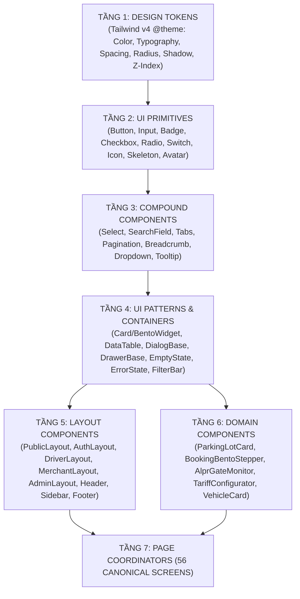

# 35. Kiến Trúc Thành Phần Mục Tiêu & Ma Trận Tái Sử Dụng (Target Component Architecture & Reuse Matrix)

> **Dự án:** Smart Parking Hub — Modern Logistics & Parking CRM Platform  
> **Chế độ thực thi:** ARCHITECTURE PLANNING ONLY (Tuân thủ PROJECT UNIFICATION MASTER RULES — **Không sửa code**)  
> **Thời điểm xác lập:** 07/11/2026  
> **Căn cứ kỹ thuật:** Dữ liệu kiểm toán Doc 11 đến 15 (351 components, 6 tầng phân cấp) và Doc 33 (21 Hợp đồng thành phần thiết kế)  
> **Trạng thái:** DRAFT FOR ARCHITECTURAL APPROVAL

---

## PHẦN 1: CÂY KIẾN TRÚC THÀNH PHẦN MỤC TIÊU (TARGET COMPONENT TREE)

Kiến trúc thành phần mục tiêu của Smart Parking Hub được tái cấu trúc thành **6 tầng phân cấp nghiêm ngặt (Strict 6-Tier Architecture)** tuân thủ nguyên tắc một chiều (Single Directional Dependency: Tầng cao hơn phụ thuộc vào tầng thấp hơn, không có phụ thuộc ngược hay phụ thuộc vòng):

---

### PHÂN TÍCH QUYẾT ĐỊNH THEO TỪNG TẦNG (COMPONENT RETENTION & TRANSFORMATION)

#### 1. Tầng 1: Design Tokens
* **Giữ lại:** Toàn bộ token thương hiệu đang vận hành tốt (`--color-brand-primary: #d95f00`, `--color-brand-navy: #060d1a`, `--color-background: #f8f9ff`, `--font-heading`, `--font-body`, `--font-data`).
* **Chuẩn hóa:** Khắc phục triệt để lỗi lệch sắc độ hover `#b85000` quy nhất về `#b84e00`. Khai báo chuẩn hóa cỡ chữ vi mô `--text-2xs: 11px` và `--text-3xs: 10px`.
* **Tạo mới:** Token phân hệ chủ bãi Merchant (`--color-merchant-navy: #0d1c2e`, `--color-merchant-muted: #455f87`, `--color-merchant-card-dark: #131b2e`), thang Z-Index chuẩn 10 cấp.

#### 2. Tầng 2: UI Primitives (Thành phần giao diện cơ sở)
* **Giữ lại:** `src/shared/components/Button.tsx` (kiến trúc variant rất tốt).
* **Chuẩn hóa:** 
  * `Button.tsx`: Bổ sung size `lg` chuẩn 44px touch target cho Mobile; chuẩn hóa hành vi focus-visible ring cam.
  * `Skeleton.tsx`: Chuẩn hóa 3 variants (`text`, `circular`, `rectangular`) để thay thế toàn bộ các thẻ div xám viết tay.
* **Gộp (Merge):**
  * Gộp `Badge.tsx` (variant prop) và `Badge` trong `Workspace.tsx` (regex value prop) thành **một component `Badge` duy nhất** hỗ trợ cả 2 chế độ: truyền variant rõ ràng hoặc tự suy diễn màu theo chuỗi trạng thái (`DRAFT`, `CONFIRMED`, `PAID`, `CANCELLED`).
  * Loại bỏ các chuỗi class tiện ích `button` và `control` trong `Workspace.tsx` thay thế bằng `Button` và `Input` nguyên tử.
* **Tạo mới:** `Checkbox.tsx`, `RadioGroup.tsx`, `Switch.tsx` (được tách từ các input inline hiện hữu).
* **Kích hoạt component mồ côi:** Đấu nối `Input.tsx` (trước đây có 0 import) vào toàn bộ các form nhập liệu, bổ sung biến thể Search, Number, Date.

#### 3. Tầng 3: Compound Components (Thành phần phức hợp)
* **Giữ lại:** `Tabs.tsx`, `Pagination.tsx`.
* **Chuẩn hóa:** Nâng cấp `Pagination.tsx` đồng bộ với định dạng 0-indexed của Spring Data Page từ Backend, khắc phục độ vênh giao tiếp API (Doc 27).
* **Tách (Split):** Tách `Dropdown` và `Select` ra khỏi component monolithic `Workspace.tsx` thành các atomic compound component độc lập (`src/shared/components/Select.tsx`, `src/shared/components/Dropdown.tsx`).
* **Tạo mới:** `Breadcrumb.tsx` (để giải quyết triệt để 52/56 màn hình thiếu đường dẫn phân cấp theo Doc 22).

#### 4. Tầng 4: UI Patterns & Containers (Mẫu giao diện)
* **Chuẩn hóa:** 
  * `DataTable.tsx`: Tái cấu trúc từ `Workspace.tsx`, hỗ trợ generic type `<T>`, tích hợp tự động phân trang, trạng thái sắp xếp và mobile card view.
  * `EmptyState.tsx` & `ErrorState.tsx`: Thống nhất cấu trúc (Icon + Title + Description + Action CTA) cho toàn bộ hệ thống.
* **Tạo mới:** 
  * `DialogBase.tsx`: Khung Dialog chuẩn tích hợp Focus Trap, backdrop mờ `bg-black/60` và phím Escape.
  * `DrawerBase.tsx`: Khung ngăn kéo trượt chuẩn từ cạnh phải (chiều rộng 480px - 640px) thay thế các popup tự chế.
* **Không nên tái sử dụng (Non-reusable Patterns):** Bảng biểu đặc thù có logic audit phức tạp như `TariffAuditTable.tsx` (chỉ dùng nội bộ cho Merchant Tariffs).

#### 5. Tầng 5: Layout Components (Khung bố cục)
* **Giữ lại:** 5 Layout chính (`PublicLayout`, `AuthLayout`, `DriverLayout`, `MerchantLayout`, `AdminLayout`).
* **Chuẩn hóa:**
  * Thêm nút **Back Navigation** cố định tại Header của `DriverLayout` và `MerchantLayout` cho các trang con cấp 2 trở lên.
  * Chuẩn hóa `LandingFooter.tsx`: Chuyển 100% thẻ `<a>` thành `<Link>` của React Router để triệt tiêu tải lại toàn trang.
  * Đồng bộ `LandingNavbar.tsx`: Loại bỏ các liên kết 404 (`/company/*`), trỏ về đúng các anchor hoặc route thực.

#### 6. Tầng 6: Domain Components (Thành phần đặc thù nghiệp vụ)
* **Gộp (Merge) triệt để các bản sao trùng lặp:**
  * Xóa bản sao `features/dashboard/components/DashboardSkeleton.tsx`, giữ lại và chuẩn hóa `features/driver/components/DashboardSkeleton.tsx` (trùng lặp 99.9% theo Doc 13).
  * Gộp `QrCheckoutModal.tsx` và `ExportReportModal.tsx` trùng lặp giữa các thư mục feature.
* **Tách (Split):** Tách các màn hình quá lớn (God components) như `MerchantParkingLotsPage.tsx` và `BookingBentoStepper.tsx` thành các sub-components độc lập: `LotHeaderBar`, `LotFilterSection`, `LotGridCard`, `LotActionMenu`.

---

## PHẦN 2: MA TRẬN TÁI SỬ DỤNG THÀNH PHẦN (COMPONENT REUSE MATRIX)

Dưới đây là ma trận ánh xạ toàn diện từ hiện trạng các file code sang cấu trúc component mục tiêu:

| Component Mục Tiêu | Phân Loại (Type) | File Hiện Tại (Current Source) | Trạng Thái Chuyển Đổi (Target Action) | Danh Sách Màn Hình Sử Dụng (Used By Pages) |
| :--- | :--- | :--- | :--- | :--- |
| **`Button`** | Shared Generic (L2) | `shared/components/Button.tsx` `Workspace.tsx (button)` | Chuẩn hóa toàn diện, thay thế toàn bộ button viết inline | Dùng trên **56/56 màn hình** toàn hệ thống |
| **`Input`** | Shared Generic (L2) | `shared/components/Input.tsx` `Workspace.tsx (control)` | Kích hoạt và dùng làm chuẩn cho tất cả ô nhập văn bản | 32 màn hình form (Auth, CRUD, Profile, Settings) |
| **`Badge`** | Shared Generic (L2) | `shared/components/Badge.tsx` `Workspace.tsx (Badge)` | Hợp nhất 2 file thành 1 API chuẩn duy nhất | 48 màn hình (Danh sách bãi, Lượt đỗ, Trạng thái vé) |
| **`Checkbox`** | Shared Generic (L2) | Viết inline tại các form | Trích xuất thành shared component độc lập | Form lọc bãi xe, Đăng ký tiện ích bãi, Bảng chọn dòng |
| **`RadioGroup`** | Shared Generic (L2) | Viết inline tại trang checkout | Trích xuất thành shared component độc lập | SCR-22 (`/booking/:lotId`), SCR-24 (Phương thức thanh toán) |
| **`Switch`** | Shared Generic (L2) | Viết inline tại Merchant Settings | Trích xuất thành shared component độc lập | SCR-35 (Cấu hình tự động duyệt), SCR-41 (Bật/tắt camera) |
| **`Skeleton`** | Shared Generic (L2) | `shared/components/Skeleton.tsx` | Nâng cấp variants: text, circle, rect, bento-card | 56/56 màn hình trong quá trình tải API React Query |
| **`Select`** | Shared Generic (L3) | `Workspace.tsx (Select)` | Tách thành component độc lập dựa trên Radix UI | SCR-20 (Bộ lọc tìm kiếm), SCR-26 (Chọn loại xe bãi đỗ) |
| **`SearchField`** | Shared Generic (L3) | Viết inline tại TopNavbar | Chuẩn hóa thành shared component có debounce | SCR-01 (Landing Hero), SCR-20 (Driver Search), SCR-25 |
| **`Pagination`** | Shared Generic (L3) | `shared/components/Pagination.tsx` | Chuẩn hóa hỗ trợ 0-indexed Backend Page | 18 màn hình danh sách phân trang (Merchant, Admin) |
| **`Breadcrumb`** | Shared Generic (L3) | Chưa có (Missing) | **Tạo mới hoàn toàn** | 38 màn hình con cấp 2 và cấp 3 toàn hệ thống |
| **`Tabs`** | Shared Generic (L3) | `shared/components/Tabs.tsx` | Giữ lại và mở rộng variant `pill` và `underline` | SCR-18 (Driver Bookings), SCR-28 (Lot Detail Tabs) |
| **`Dropdown`** | Shared Generic (L3) | `Workspace.tsx (Dropdown)` | Tách thành shared component menu ngữ cảnh | Cột Action trong tất cả các bảng dữ liệu quản trị |
| **`Tooltip`** | Shared Generic (L3) | Dùng title thô của HTML | Chuẩn hóa popup tooltip nổi trợ năng | Icon trạng thái camera ALPR, ghi chú phụ trên bảng |
| **`DialogBase`** | Shared Generic (L4) | 25 modal tự viết riêng lẻ | Trừu tượng hóa khung Modal chuẩn cho hệ thống | Toàn bộ 25 modal nghiệp vụ kế thừa khung này |
| **`DrawerBase`** | Shared Generic (L4) | Viết riêng tại Merchant | Trừu tượng hóa khung Drawer trượt từ cạnh phải | SCR-30 (Xem chi tiết lượt đỗ xe), Cấu hình cổng |
| **`DataTable`** | Shared Generic (L4) | `Workspace.tsx (DataTable)` | Nâng cấp hỗ trợ generic `<T>` và Mobile Card View | SCR-19 (Lịch sử đỗ), SCR-36 (Hóa đơn), SCR-48 (Admin) |
| **`EmptyState`** | Shared Generic (L4) | `shared/components/EmptyState.tsx` | Chuẩn hóa: Icon + Title + Description + CTA | Toàn bộ các bảng và danh sách khi rỗng (0 bản ghi) |
| **`ErrorState`** | Shared Generic (L4) | `shared/components/QueryState.tsx` | Chuẩn hóa thông báo lỗi thân thiện + nút Retry | Toàn bộ màn hình khi API trả về mã lỗi 4xx/5xx |
| **`BentoMetricCard`**| Shared Generic (L4)| Viết riêng tại 3 dashboard | Trích xuất thành widget chuẩn cho Dashboard | SCR-17 (Driver), SCR-25 (Merchant), SCR-45 (Admin) |
| **`ParkingLotCard`** | Domain-Specific (L6)| `features/driver/components/*` | Chuẩn hóa thẻ hiển thị bãi đỗ xe cho tài xế | SCR-01 (Landing), SCR-20 (Tìm bãi đỗ), SCR-21 |
| **`AlprGateCard`** | Domain-Specific (L6)| `features/merchant/components/*` | Thẻ camera ALPR nền tối `#131b2e` nhận diện xe | SCR-25 (Merchant Dashboard), SCR-41 (Giám sát cổng) |
| **`BookingStepper`** | Domain-Specific (L6)| `features/driver/components/*` | Tiến trình đặt chỗ 3 bước (Vị trí -> Xe -> Cọc) | SCR-22 (`/booking/:lotId`) |
| **`TariffAuditTable`**| Page-Only (L6) | `features/merchant/tariffs/*` | Giữ nguyên (không tái sử dụng cho trang khác) | SCR-31 (`/merchant/tariffs`) |
| **`HomeHeroSection`**| Page-Only (L6) | `features/marketing/home/*` | Giữ nguyên (chỉ phục vụ trang chủ tiếp thị) | SCR-01 (`/`) |

---
*Tài liệu đã được xác lập và sẵn sàng đệ trình kiểm duyệt kiến trúc.*
