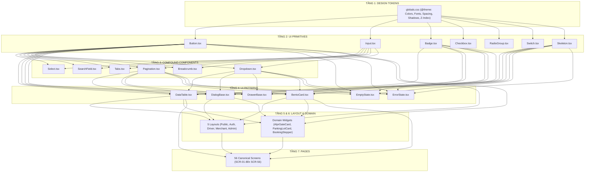
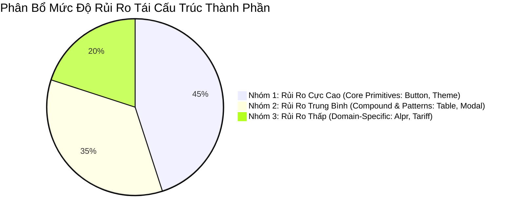
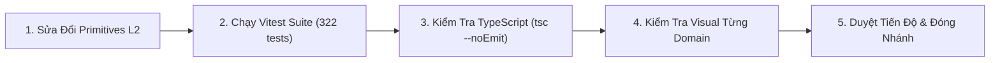

# 37. Phân Tích Phụ Thuộc & Phạm Vi Rủi Ro Tái Cấu Trúc (Component-Page Dependency & Regression Scope)

> **Dự án:** Smart Parking Hub — Modern Logistics & Parking CRM Platform  
> **Chế độ thực thi:** ARCHITECTURE PLANNING ONLY (Tuân thủ PROJECT UNIFICATION MASTER RULES — **Không sửa code**)  
> **Thời điểm xác lập:** 07/11/2026  
> **Mục tiêu:** Định vị chính xác mạng lưới phụ thuộc giữa các thành phần và màn hình, cô lập phạm vi ảnh hưởng (Blast Radius) khi nâng cấp hệ thống  
> **Trạng thái:** DRAFT FOR ARCHITECTURAL APPROVAL

---

## 1. Đồ Thị Phụ Thuộc Giữa Các Cấp Thành Phần (Component Dependency Graph)

Hệ thống component của Smart Parking Hub tuân thủ nghiêm ngặt **nguyên tắc dòng chảy một chiều (Strict Unidirectional Flow)**. Một component ở tầng trên chỉ được phép phụ thuộc vào các component ở tầng ngang cấp hoặc tầng thấp hơn, tuyệt đối không có hiện tượng phụ thuộc vòng (Circular Dependency):

---

## 2. Ma Trận Phụ Thuộc Thành Phần - Màn Hình (Component-to-Page Matrix)

Bảng ma trận chỉ ra các màn hình nào bị ảnh hưởng trực tiếp khi thay đổi một thành phần cốt lõi:

| Thành Phần Cốt Lõi (Core Component) | Tầng Cấu Trúc | Số Màn Hình Trực Tiếp Sử Dụng | Màn Hình Đại Diện Tiêu Biểu | Tỷ Lệ Bao Phủ Toàn Hệ Thống |
| :--- | :---: | :---: | :--- | :---: |
| **`Button.tsx`** | L2 (Primitive) | **56 / 56 màn hình** | Toàn bộ 56 màn hình (từ Landing, Auth đến CRM) | **100%** |
| **`Skeleton.tsx`** | L2 (Primitive) | **56 / 56 màn hình** | Mọi màn hình khi gọi API React Query ở trạng thái `isLoading` | **100%** |
| **`Badge.tsx`** | L2 (Primitive) | **48 / 56 màn hình** | Danh sách bãi xe, Chi tiết đặt chỗ, Quản lý tài xế, Duyệt bãi | **85.7%** |
| **`Input.tsx`** | L2 (Primitive) | **32 / 56 màn hình** | Form đăng nhập, Đăng ký bãi xe, Cấu hình biểu phí, Tìm kiếm | **57.1%** |
| **`Breadcrumb.tsx`** | L3 (Compound) | **38 / 56 màn hình** | Tất cả các trang con từ cấp 2 trở lên (Driver, Merchant, Admin) | **67.8%** |
| **`DataTable.tsx`** | L4 (Pattern) | **18 / 56 màn hình** | Lịch sử đỗ xe, Quản lý hóa đơn VAT, Danh sách tài khoản | **32.1%** |
| **`DialogBase.tsx`** | L4 (Pattern) | **25 / 56 màn hình** | Hộp thoại hủy vé, Quét QR PayOS, Mở barie khẩn cấp | **44.6%** |
| **`BentoMetricCard.tsx`**| L4 (Pattern) | **12 / 56 màn hình** | Dashboard Driver, Dashboard Merchant, Dashboard Admin | **21.4%** |
| **`AlprGateCard.tsx`** | L6 (Domain) | **3 / 56 màn hình** | Giám sát cổng trực tiếp, Merchant Dashboard | **5.4%** |
| **`TariffAuditTable.tsx`**| L6 (Domain) | **1 / 56 màn hình** | SCR-31 (`/merchant/tariffs`) | **1.8%** |

---

## 3. Đánh Giá Bán Kính Tác Động Khi Có Thay Đổi (Blast Radius & Impact Analysis)

Khi một thành phần được can thiệp kỹ thuật trong giai đoạn triển khai, bán kính ảnh hưởng được xác định chính xác theo bảng phân loại sau:

### 3.1. Nhóm 1: Rủi Ro Cao Nhất (Critical Blast Radius — 100% Hệ Thống)
* **Các thành phần:** `src/styles/globals.css` (`@theme`), `Button.tsx`, `Badge.tsx`, `Workspace.tsx`.
* **Phạm vi tác động:** Thay đổi sai một class CSS trong `@theme` hoặc sửa đổi phá vỡ props (Breaking Change) trong `Button.tsx` sẽ ngay lập tức làm biến dạng giao diện hoặc gây lỗi biên dịch (Compile Error) trên **toàn bộ 56 màn hình**.
* **Biện pháp cô lập:**
  * Giữ nguyên 100% các biến CSS cũ song song với biến CSS mới (Backward Compatibility Aliases).
  * Props của `Button` và `Badge` chỉ được phép mở rộng dạng tùy chọn (Optional Props), không được đổi tên hoặc xóa các prop đang hoạt động (`variant`, `size`, `isLoading`).

### 3.2. Nhóm 2: Rủi Ro Trung Bình (Medium Blast Radius — 20% đến 60% Hệ Thống)
* **Các thành phần:** `Input.tsx`, `DataTable.tsx`, `DialogBase.tsx`, `Pagination.tsx`.
* **Phạm vi tác động:** Ảnh hưởng đến các luồng nghiệp vụ quan trọng (Submit form thất bại, bảng dữ liệu không phân trang được, modal không thể đóng).
* **Biện pháp cô lập:**
  * Viết adapter trung gian khi bọc các component cũ.
  * Kiểm tra chặt chẽ TypeScript strict typing cho các hàm callback (`onChange`, `onSubmit`, `onClose`).

### 3.3. Nhóm 3: Rủi Ro Thấp & Cục Bộ (Low Blast Radius — Dưới 10% Hệ Thống)
* **Các thành phần:** `AlprGateCard.tsx`, `TariffAuditTable.tsx`, `SlotPickerGrid.tsx`.
* **Phạm vi tác động:** Chỉ nằm gọn trong 1 hoặc 2 màn hình đặc thù. Nếu phát sinh lỗi, các phân hệ khác (như Landing, Auth, Quản lý tài xế) vẫn hoạt động bình thường 100%.

---

## 4. Phân Định Phạm Vi Hồi Quy & Chiến Lược Kiểm Thử (Regression Scope & QA Strategy)

Để đảm bảo quá trình chuẩn hóa không gây ra bất kỳ lỗi thụt lùi nào (Zero Regression), quy trình kiểm thử phân tầng được thiết lập:

1. **Kiểm thử tự động (Automated Test Gate):**
   * Sau mỗi lần chuẩn hóa một component ở tầng L2 hoặc L3, bắt buộc chạy lại bộ test suite:
     `npm run test` (Đảm bảo 43 test suites và 322 unit tests tiếp tục đạt 100% PASS).
2. **Kiểm tra kiểu dữ liệu tĩnh (Static Type Checking):**
   * Chạy lệnh `npx tsc --noEmit` để phát hiện ngay lập tức các component con nào bị lệch kiểu dữ liệu hoặc thiếu props bắt buộc.
3. **Kiểm tra trực quan trên trình duyệt (Visual Regression Check):**
   * Đối chiếu 3 màn hình đại diện cho 3 độ phân giải khác nhau:
     * Desktop: `/merchant/dashboard` (mật độ cao, kiểm tra bảng và bento).
     * Tablet: `/admin/users` (kiểm tra phân trang và lọc).
     * Mobile: `/booking/1` (kiểm tra touch target 44px và stepper).

---
*Tài liệu đã được xác lập và sẵn sàng đệ trình kiểm duyệt kiến trúc.*
